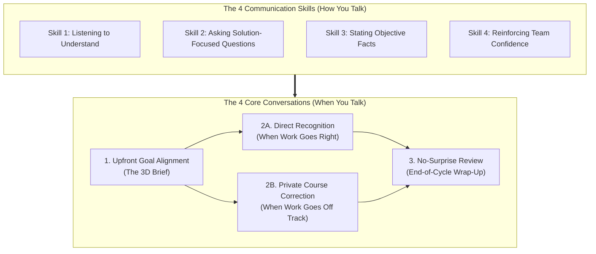
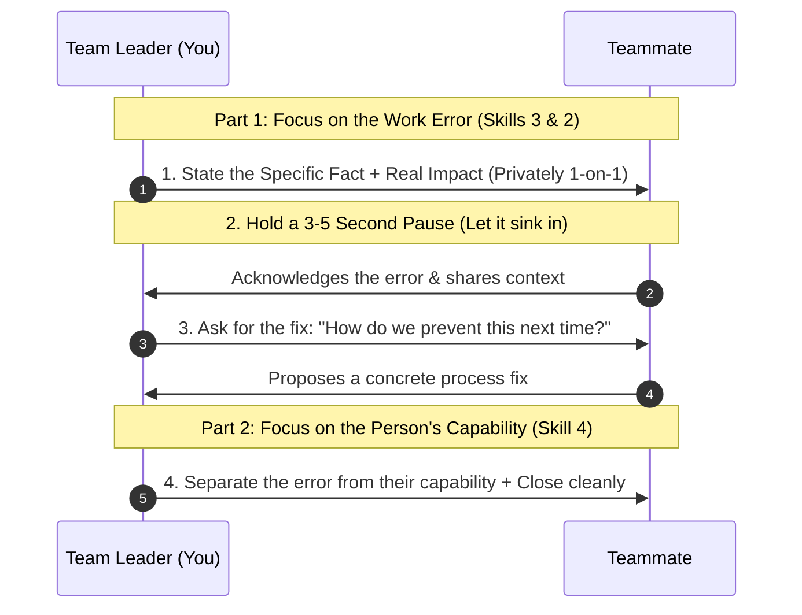
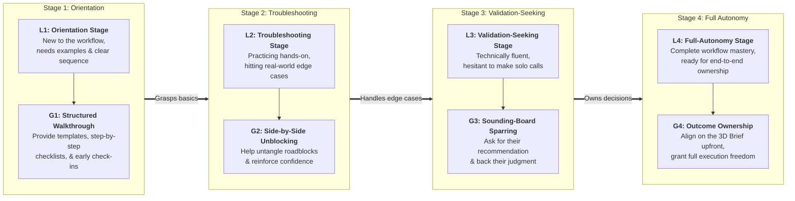

# Practical Team Leadership: Developing Autonomous Teams

**Written by:** `aiossan`</br>
**Tone & Register:** Conversational-Professional Global English</br>
**Format:** GitHub Flavored Markdown (GFM)

> [!NOTE] How to Use This Playbook
> This guide is built for working managers, team leads, and project coordinators across remote, hybrid, and in-office teams. Read it straight through from the Introduction to Chapter 13, expand the collapsible blocks (`<details>`) to copy ready-to-use conversation scripts and test yourself on the 4-week simulation, or jump straight to the **Appendix** when you need a quick desk reference before a 1-on-1.

## Table of Contents

1. [Introduction: The First-Time Leader Reality Check](#introduction-the-first-time-leader-reality-check)
2. [Chapter 1: Shifting from Individual Contributor to Team Multiplier](#chapter-1-shifting-from-individual-contributor-to-team-multiplier)
3. [Chapter 2: The 4x4 Leadership Framework (4 Core Conversations + 4 Communication Skills)](#chapter-2-the-4x4-leadership-framework-4-core-conversations--4-communication-skills)
4. [Chapter 3: Skill 1: Listening to Understand](#chapter-3-skill-1-listening-to-understand)
5. [Chapter 4: Skill 2: Asking Solution-Focused Questions](#chapter-4-skill-2-asking-solution-focused-questions)
6. [Chapter 5: Skill 3: Stating Objective Facts Without Personal Attacks](#chapter-5-skill-3-stating-objective-facts-without-personal-attacks)
7. [Chapter 6: Skill 4: Reinforcing Team Confidence](#chapter-6-skill-4-reinforcing-team-confidence)
8. [Chapter 7: Conversation 1: Upfront Goal Alignment (The 3D Brief)](#chapter-7-conversation-1-upfront-goal-alignment-the-3d-brief)
9. [Chapter 8: Conversation 2A: Direct Recognition When Work Goes Right](#chapter-8-conversation-2a-direct-recognition-when-work-goes-right)
10. [Chapter 9: Conversation 2B: Private Course Correction When Work Goes Off Track](#chapter-9-conversation-2b-private-course-correction-when-work-goes-off-track)
11. [Chapter 10: Conversation 3: The No-Surprise Review (The 30/70 Wrap-Up)](#chapter-10-conversation-3-the-no-surprise-review-the-3070-wrap-up)
12. [Chapter 11: 4-Week Case Study & Interactive Simulation (Maya and Alex)](#chapter-11-4-week-case-study--interactive-simulation-maya-and-alex)
13. [Chapter 12: Calibrating Your Guidance (Matching Task Levels L1 to L4 with Guidance Modes G1 to G4)](#chapter-12-calibrating-your-guidance-matching-task-levels-l1-to-l4-with-guidance-modes-g1-to-g4)
14. [Chapter 13: Your 30-Day Workplace Action Plan](#chapter-13-your-30-day-workplace-action-plan)
15. [Appendix: Quick Desk Reference & Primary Research Citations](#appendix-quick-desk-reference--primary-research-citations)

## Introduction: The First-Time Leader Reality Check

Did you recently get promoted to team lead, supervisor, or manager? Or maybe you were just handed a cross-functional project with three or four people reporting to you for the first time?

Take a quick look at these scenarios and see which ones hit close to home:

- You feel awkward and hesitant when you need to correct a teammate who missed the mark on a deliverable.
- You struggle to hand off assignments clearly without fielding five follow-up messages asking what you actually meant.
- You worry about coming across as bossy or controlling, especially when you are managing people who used to be your peers.
- You end up logging back in at 10:00 PM to quietly rewrite a report, fix a pull request, or rebuild a client deck yourself because the draft your teammate submitted was not ready to ship.

If any of those sound familiar, take a breath. <mark>Nearly every new leader goes through this exact phase.</mark>

Leading a team is a practical craft, just like writing clean code, managing a paid media budget, designing an interface, or closing a B2B sale. Because it is a skill set rather than a personality trait, you can learn it, practice it, and get measurably better at it week by week.

The trouble is that companies rarely teach these mechanics before handing you the title. Research from the *Center for Creative Leadership* (<abbr title="Center for Creative Leadership">CCL</abbr>) shows that most first-line managers are promoted because they excelled at technical execution as individual contributors, and are then expected to lead people without structured training in management communication[^1].

This book is a field manual you can put to work tomorrow morning. We skip abstract academic jargon and focus on the three things you actually deal with every week:

1. **4 Core Conversations:** The four moments when you need to talk 1-on-1 with a teammate, from setting expectations on Monday morning to running a monthly or quarterly review.
2. **4 Communication Skills:** How to listen without jumping in too early, ask questions that build ownership, point out mistakes objectively, and keep your team's confidence intact.
3. **Calibrating Your Guidance (L1 to L4):** How to read a teammate's workflow mastery and decision autonomy on a specific task so you know when to give step-by-step guidance and when to get out of their way.

> [!IMPORTANT] Evidence-Based Foundations
> Every practice in this guide is grounded in decades of organizational behavior research: leadership transition studies from the *Center for Creative Leadership* (CCL)[^1], Edwin Locke and Gary Latham's *Goal-Setting Theory*[^2], Harvard professor Amy Edmondson's field studies on *Psychological Safety*[^3], and Gallup's global workplace recognition analytics[^4]. All of it has been distilled into plain, direct language for modern workplaces.

Let's start with the role shift you are navigating right now in **Chapter 1**.

## Chapter 1: Shifting from Individual Contributor to Team Multiplier

When you step into a role as a manager, project lead, supervisor, or senior mentor, the way your company measures your value changes overnight.

Research from the *Center for Creative Leadership* (<abbr title="Center for Creative Leadership">CCL</abbr>) notes that moving from peer to manager is one of the toughest transitions in any professional career[^1].

As an individual contributor (IC), your reputation was built on what you produced with your own hands. You were the person who shipped reliable code, built sharp campaign assets, reconciled complex spreadsheets, or hit quota every quarter. As long as your own queue was clear, you had a great day.

Once you lead a team, the scoreboard changes. Your primary job is <ins>creating the clarity and conditions that allow your teammates to do great work together</ins>.

### Solo Execution vs. Leading a Team

Stepping into leadership requires shifting how you operate across three dimensions:

| Work Dimension              | As an Individual Contributor (IC)                           | As a Team Leader                                                                |
| :-------------------------- | :---------------------------------------------------------- | :------------------------------------------------------------------------------ |
| **How Success Is Measured** | Judged by the tasks and deliverables you complete yourself. | Judged by the combined output and reliability of your entire team.              |
| **When Problems Come Up**   | You jump in and fix the technical issue directly.           | You guide your teammates so they learn how to solve the issue themselves.       |
| **Primary Skill Focus**     | Technical craft (*hard skills* specific to your function).  | Communication, scoping, delegation, and expectation management (*soft skills*). |

When new leaders are not given a clear framework for running day-to-day conversations, most swing toward one of two counterproductive habits:

#### 1. The Hovering Micromanager (Dictating Every Step)

Because you are afraid a deadline will slip or quality will drop, you hover over every task. You check Slack statuses constantly, dictate how every email or ticket should be written, and only speak up when something goes wrong.

- **The real cost:** Your team gets anxious, stops taking initiative, and waits for your permission on tiny decisions. Meanwhile, you become the bottleneck for the entire group.

#### 2. The Silent Fixer (Avoiding Conflict and Doing It Yourself)

Because you want to stay liked and avoid awkward tension with former peers, you hold back when work misses the mark. You give vague instructions, accept half-finished drafts with a polite smile, and then stay up late fixing the work yourself in secret.

- **The real cost:** Your teammates never learn where the bar actually sits, team standards stall, and you burn out from carrying two jobs at once.

### The Healthy Middle Ground: Clear Standards, Open Support

You do not have to choose between being a rigid taskmaster and a burnt-out people-pleaser. Effective team leadership rests on one practical principle:

> **Act as a clear partner to your team: be explicit about what good work looks like upfront, and stay approachable when people hit roadblocks along the way.**

Leadership is something you practice **with** your team rather than something you do **to** them. When your teammates have clear targets, honest feedback, and room to grow, their output rises and your credibility as a leader grows right alongside them.

To make this concrete in your weekly workflow, this playbook organizes daily management into the **4x4 Leadership Framework**:

1. **4 Core Conversations (When to Talk):** The four recurring touchpoints in your performance cycle, from initial goal alignment to end-of-cycle reviews.
2. **4 Communication Skills (How to Talk):** The four habits that make those conversations work: listening to understand, asking solution-focused questions, stating objective facts, and reinforcing confidence.

Let's look at how the whole system fits together in **Chapter 2**.

## Chapter 2: The 4x4 Leadership Framework (4 Core Conversations + 4 Communication Skills)

You do not need to memorize a shelf full of management textbooks to lead well. Everything in this guide comes down to **eight repeatable habits**, split into two groups:

1. **4 Core Conversations** (your performance management cycle)
2. **4 Communication Skills** (how you handle the dialogue inside each conversation)

Here is how the two groups connect:



The logic is straightforward: **you use the 4 Communication Skills to run the 4 Core Conversations throughout every project or quarter.**

### The Four Core Conversations

- **1. Upfront Goal Alignment (The 3D Brief)**
  A short conversation at the start of a project, sprint, or quarter to agree on the **Deliverable**, the **Definition of Done**, and the **Deadline**. This makes expectations unmistakable from day one.
- **2A. Direct Recognition (Timely Praise)**
  Brief, specific recognition delivered on the same day you notice a teammate doing strong work or taking smart initiative.
- **2B. Private Course Correction (1-on-1 Reset)**
  A prompt, private 1-on-1 conversation when a deliverable or behavior drifts off track, designed to fix the work quickly without crushing the person's morale.
- **3. The No-Surprise Review (The 30/70 Wrap-Up)**
  A monthly, quarterly, or post-project review that summarizes patterns you have already discussed, extracts lessons learned, and sets the next cycle's targets.

> [!TIP] Why Reviews Stop Feeling Stressful
> When you consistently run Conversation 1 (*Goal Alignment*), 2A (*Direct Recognition*), and 2B (*Private Course Correction*) week after week, Conversation 3 (*The No-Surprise Review*) becomes calm and predictable. Nobody walks into a review blindsided by complaints you secretly saved up for three months.

### The Four Communication Skills

To run those four conversations well, you rely on four core habits:

1. **Listening to Understand:** Giving your undivided attention without multitasking on Slack or email so you catch the real blocker behind a teammate's words.
2. **Asking Solution-Focused Questions:** Using open *"What"* and *"How"* questions that prompt teammates to think critically and propose their own fixes instead of waiting to be spoon-fed.
3. **Stating Objective Facts:** Pointing out specific errors and their operational impact calmly and directly, without attacking anyone's character.
4. **Reinforcing Team Confidence:** Naming specific strengths when praising good work, and reaffirming your trust in a teammate's capability right after correcting a mistake.

In **Part 2 (Chapters 3 through 6)**, we will break down each of the **4 Communication Skills** with side-by-side scripts and exercises. Then, in **Part 3 (Chapters 7 through 10)**, we will put them to work inside the **4 Core Conversations**.

## Chapter 3: Skill 1: Listening to Understand

On the surface, listening sounds like the most basic thing in the world. You might think, *"I have been listening to people my whole life. What is there to learn?"*

There is a big gap between hearing noise and **listening to understand**. Active listening means giving the person across from you your full attention, without glancing at Slack notifications on your second monitor or rehearsing your counterargument while they are still mid-sentence.

Why does this skill come first? Because **you cannot help a teammate solve the right problem if you misdiagnose what is actually blocking them.** Harvard professor Amy Edmondson's research on work teams shows that a leader's willingness to listen openly without immediate judgment is the foundation of **psychological safety**[^3]. When teams lack psychological safety, people hide mistakes and delays until they snowball into major outages or missed launches.

### Three Bad Listening Habits in the Workplace

Pay attention the next time a teammate pings you or walks up to your desk with a problem. Do you catch yourself falling into any of these three habits?

- **The Premature Fixer:** Your teammate gets two sentences into an issue and you cut them off: *"Oh, that's easy. Just run script A, update table B, and ping the client."* Meanwhile, they had not even reached the real constraint yet.
- **The Defensive Debater:** A teammate mentions that a sprint deadline feels unrealistic, and your brain immediately starts building a legal defense for leadership's timeline instead of hearing where the workload bottleneck actually sits.
- **The Split-Screen Listener:** A teammate is talking through a serious blocker during a video call or by your desk, but your eyes stay glued to your inbox, your fingers keep hitting <kbd>Ctrl</kbd> + <kbd>C</kbd> and <kbd>Ctrl</kbd> + <kbd>V</kbd>, or you are scrolling through your phone.

All three habits send the same message: you are listening only to reply, not to understand.

### Three Practical Steps to Listen to Understand

Practice these three simple moves whenever a teammate brings you a real issue:

#### 1. Give Undivided Attention (Close the Laptop)

When a teammate asks for a serious conversation or joins a 1-on-1, show them they have the floor:

- If you are in person, lower your laptop screen halfway (or press <kbd>Win</kbd> + <kbd>L</kbd> / <kbd>Cmd</kbd> + <kbd>Ctrl</kbd> + <kbd>Q</kbd> to lock your screen), turn your chair toward them, and place your phone face down on the desk.
- If you are on Zoom, Google Meet, or Teams, close your extra browser tabs, mute Slack notifications, and look at the camera rather than reading email on a second screen.

That small physical shift tells your teammate that their issue matters and has your full focus.

#### 2. Paraphrase the Core Point in Your Own Words

Once your teammate finishes speaking, summarize what you heard before offering any opinion:

- *"So if I'm hearing you right, the main blocker right now is..., is that accurate?"*
- *"Let me make sure I've got this straight: the part of this launch that worries you most is..., right?"*
- *"Okay, so step X is stalled because we're still waiting on the API schema from the platform team, correct?"*

Paraphrasing pays off in two ways:

- **For your teammate:** They feel heard and respected because they can tell you actually processed what they said.
- **For you:** You verify that you are solving the right problem before you give advice.

#### 3. Dig One Layer Deeper Before Offering Solutions

The first complaint someone voices is often just a surface symptom. Before you hand out instructions, ask one or two follow-up questions to uncover the root cause:

- *"Can you walk me through that part in a bit more detail?"*
- *"How did the sequence of events unfold from the beginning?"*
- *"Which part of that handoff is slowing your work down the most right now?"*

### Workplace Script Comparison (Skill 1)

| Avoid This Response                                                     | Use This Response Instead                                                                     |
| :---------------------------------------------------------------------- | :-------------------------------------------------------------------------------------------- |
| *"Oh, that's easy, just..."* (Cutting them off before they finish)      | *"Got it. Walk me through the full situation first."*                                         |
| Saying *"Uh-huh, go on"* while typing an email on your second monitor.  | *"Give me five seconds to close my tabs so I can focus. Okay, what happened?"*                |
| *"Well, upper management set that deadline, so..."* (Getting defensive) | *"So if I'm following you, the QA step is where things are piling up, right?"* (Paraphrasing) |
| *"You're overthinking this."* (Dismissing their concern)                | *"What part of today's client call is weighing on you the most?"* (Digging deeper)            |

### Field Practice for Chapter 3

In your next 1-on-1 or troubleshooting call this week, test these three habits:

- [ ] **Hold your advice for the first 5 minutes:** Decide before the call starts that your only job in the opening five minutes is mapping the problem.
- [ ] **Paraphrase at least once:** Use *"So what I'm hearing is..."* and get a nod or *"Yes"* before you share your own take.
- [ ] **Use the 3-second pause:** When your teammate stops talking, count silently from one to three before jumping in. Often, the most honest detail comes out right after that brief silence.

## Chapter 4: Skill 2: Asking Solution-Focused Questions

Once you have listened and mapped the problem (Chapter 3), your next move is guiding your teammate to think through a solution.

Word choice matters more than most new managers realize. Think about how often you have heard managers fire off questions like these when something goes sideways:

- *"Why isn't this report finished yet?"*
- *"Why did you push that config change without testing it?"*
- *"Why didn't you just use the existing template from last month?"*

When someone is put on the spot with the word **"Why"** during a problem, the human brain reads it as an accusation. People immediately shift into self-defense: they make excuses, blame another department, or shut down completely so they do not say the wrong thing.

> [!WARNING] The Problem with "Why" Questions Under Pressure
> When something has gone wrong at work, starting a question with *"Why"* almost always sounds like an interrogation. It drags the conversation backward into blame instead of moving it forward toward a fix.

### Swap "Why" for "What" and "How"

Shifting your phrasing from *"Why"* to *"What"* and *"How"* changes the tone of a troubleshooting conversation immediately:

- **"What":** Directs attention to **current facts, data, and specific bottlenecks**.
- **"How":** Directs attention to **process, options, and next steps**.

Compare the difference in tone and focus across these everyday examples:

| Accusatory "Why" Questions                    | Solution-Focused "What & How" Questions                                                        |
| :-------------------------------------------- | :--------------------------------------------------------------------------------------------- |
| *"Why did you miss the standup?"*             | *"What held you up this morning, and how can we make sure we're synced before 9:30 tomorrow?"* |
| *"Why is this forecast wrong?"*               | *"What part of pulling the numbers for this forecast was the trickiest or most ambiguous?"*    |
| *"Why didn't you flag this delay yesterday?"* | *"What made you hesitate to ping me as soon as the staging build failed?"*                     |
| *"Why did you build the workflow this way?"*  | *"Walk me through how you weighed the options when you chose this approach."*                  |

### Pass the Ball Back to Build an Independent Team

Why does this questioning habit matter so much for your own sanity as a manager?

If you play the role of the instant answer machine every time a problem pops up, you train your team to become dependent on you. They will ping you for every minor edge case, wait for your sign-off on routine tasks, and hesitate to act on their own.

Your company pays your teammates to think and solve problems alongside you, not just to type out whatever you dictate.

The next time a teammate brings you a problem, resist the reflex to hand them the answer right away. Ask for their assessment first:

> **Teammate:** *"Hey, the enterprise client just sent an angry email about the two-day delay on their onboarding dashboard."*
> **Old Habit (Spoon-Feeding the Answer):** *"Ugh, okay. Reply to them right now and tell them A, B, and C..."*
> **New Habit (Coaching with Questions):** *"Thanks for flagging it right away. What is their biggest concern in that email? Based on what you've seen, what caused the hold-up, and what are the two best options we can offer them today?"*

Asking questions like that builds your teammates' analytical judgment and gives them real ownership over the solution they help create.

### Workplace Script Comparison (Skill 2)

| Avoid This Question                                      | Use This Question Instead                                                                 |
| :------------------------------------------------------- | :---------------------------------------------------------------------------------------- |
| *"Why is this ticket still sitting in progress?"*        | *"What do you still need so we can get this ticket across the finish line today?"*        |
| *"Did you try method X yet?"* (Closed, leading question) | *"What options have you already considered or tested so far?"*                            |
| *"These numbers are off, aren't they?"* (Cornering them) | *"How confident do you feel about the conversion numbers on slide 4?"*                    |
| *"What is taking so long?!"* (Impatient and vague)       | *"Help me see the full picture: what is the biggest obstacle slowing down this release?"* |

### Field Practice for Chapter 4

Over the next week, practice these three habits with your team:

- [ ] **Catch and replace "Why":** Whenever you are about to ask *"Why"* during a project hiccup, rephrase the sentence to start with *"What"* or *"How"*.
- [ ] **Ask for their recommendation first:** When a teammate asks, *"How do you want me to handle this?"*, reply with: *"If it were entirely your call, what approach makes the most sense to you?"*
- [ ] **Pair with Skill 1:** After asking a solution-focused question, stay quiet and listen to their full answer without interrupting.

## Chapter 5: Skill 3: Stating Objective Facts Without Personal Attacks

Giving corrective feedback is the moment that makes most new team leaders sweat.

Because nobody enjoys awkward confrontation, many managers avoid the conversation altogether. They stay silent, drop passive-aggressive hints in a group Slack channel, or vent to another manager behind closed doors. Yet letting performance issues slide always carries three steep costs:

- Small errors left unaddressed compound into missed quarterly targets or broken client trust.
- Your teammate assumes their work is fine because nobody told them otherwise, which robs them of the chance to improve.
- Your own frustration builds up until you eventually snap over a minor issue at the worst possible moment.

To deliver clear, honest corrections without demeaning anyone, anchor yourself to one core rule:

> [!IMPORTANT] The Golden Rule of Objective Feedback
> Separate **the work issue** (the specific action, data error, or missed behavior) from **the person** (their character, intelligence, or worth). You are correcting a flawed output, not putting a human being on trial.

Look at the difference between attacking a person and pointing to verifiable facts:

- **Attacking the person (Wrong):** *"Your reports are always so sloppy."* (Vague, subjective, and insulting).
- **Stating the fact (Right):** *"The table on page 5 of this report still uses last month's cohort numbers, so it isn't ready for the 10:00 AM executive sync."* (Specific, verifiable, and focused on the work).
- **Attacking character (Wrong):** *"You're just not disciplined with your time."* (Judges personal traits).
- **Stating the fact (Right):** *"This week, three of your deliverables came in past the 3:00 PM handoff time we agreed on."* (Points to observable, measurable behavior).

### Three Steps to Objective Feedback: Fact, Impact, and Pause

Skip the old-school "feedback sandwich" (wrapping a criticism between two forced compliments). In real workplaces, the sandwich method feels insincere, buries the main point, and leaves teammates waiting for the "but" every time you praise them.

When something goes off track, talk to your teammate **privately (1-on-1)** and walk through these three steps in order:

#### 1. State the Specific Fact Calmly

Describe what you observed as plainly as a security camera recording, free of loaded adjectives:

> *"Alex, during this morning's client walkthrough, the revenue chart on slide 4 showed Q2 figures instead of the updated Q3 numbers."*
> *(Instead of: "Alex, your presentation this morning was a mess!")*

#### 2. Explain the Real-World Impact

Teammates often overlook small errors because they do not see how those errors ripple across the rest of the team or client relationship. Spell out the consequence clearly:

> *"Because those numbers didn't match the client's live dashboard, they questioned our data accuracy and paused sign-off on next month's budget."*
> *(Instead of: "You made me look terrible in front of the client!")*

#### 3. Hold a 3-to-5-Second Silence

Once you state the Fact and the Impact, **stop talking and count to four in your head.**

Resist the urge to soften the awkwardness by immediately tacking on, *"But hey, it's no big deal, don't worry about it!"* If it were truly no big deal, you would not be having a private 1-on-1 about it.

That brief pause gives your teammate room to absorb the fact, see the impact, and respond like an adult. Once they acknowledge the issue, transition straight into **Skill 2 (Asking Solution-Focused Questions)**: *"What steps should we put in place right now so we catch this before the next client deck goes out?"*

### Workplace Script Comparison (Skill 3)

| Avoid This Phrasing                                                                         | Use This Phrasing Instead                                                                                           |
| :------------------------------------------------------------------------------------------ | :------------------------------------------------------------------------------------------------------------------ |
| *"Your work has been kind of slipping lately."* (Vague and speculative)                     | *"The last two deliverables on Project X came in two days past our agreed handoff date."* (Specific fact)           |
| Calling someone out in a public channel: *"Nice of you to finally join us this morning..."* | Speaking privately 1-on-1: *"Our daily standup starts at 9:00 AM, and today you joined at 9:20 AM. What happened?"* |
| *"You're careless with details!"* (Personal attack)                                         | *"There are three misspelled client titles in the proposal draft you sent over."* (Focused on the document)         |
| *"It's totally fine, don't sweat it..."* (While secretly annoyed)                           | *"When the copy arrives late, the design team loses a full day of production time."* (Honest about impact)          |

### Field Practice for Chapter 5

This week, practice objective feedback on one real issue:

- [ ] **Pick 1 small deviation you would normally ignore:** Choose a missed deadline, formatting error, or incomplete handoff from this week.
- [ ] **Write down the Fact and Impact first:** Before pinging your teammate, jot down two bullet points: the verifiable **fact** (with zero judgmental adjectives) and the concrete **impact** on the team or project.
- [ ] **Deliver it privately and hold the pause:** Have a calm 1-on-1 call or desk chat, state both points, and wait 3 to 5 seconds for their response.

## Chapter 6: Skill 4: Reinforcing Team Confidence

The first three skills help you understand the real problem (Chapter 3), prompt critical thinking (Chapter 4), and address mistakes objectively (Chapter 5). Skill 4 is the glue that holds morale together: **reinforcing your team's confidence.**

Why does confidence matter so much in day-to-day execution? Because teammates who know you believe in their capability take ownership, flag risks early, and bounce back quickly when a project gets tough.

There are **two key moments** when you need to use this skill:

1. **When recognizing good work:** So your praise is specific enough that teammates know exactly which habits to repeat.
2. **Immediately after correcting a mistake:** So a teammate leaves a tough feedback conversation with their head up, focused on fixing the work rather than doubting their place on the team.

### 1. Make Praise Specific, Not Just a Passing "Good Job!"

Dropping a quick *"Nice work!"*, *"Awesome!"*, or a thumbs-up emoji in Slack is polite, but it fades in five seconds because it never tells the person what they actually did well.

Turn generic praise into specific recognition by naming **the exact action** and **its positive impact**:

| Generic, Forgettable Praise              | Specific, Confidence-Building Recognition                                                                                                                                         |
| :--------------------------------------- | :-------------------------------------------------------------------------------------------------------------------------------------------------------------------------------- |
| *"Good job on the client call earlier!"* | *"You handled that client call really well. When their VP asked that surprise question about security compliance, you stayed calm and walked through our documentation clearly."* |
| *"Thanks for sending the report."*       | *"Thanks for the report. Adding that cohort comparison chart on slide 3 made it much easier for the leadership team to spot the retention trend."*                                |
| *"Great quarter, everyone!"*             | *"We beat our quarterly target by 12%. I really appreciate how persistently you followed up on stalled enterprise trials over the last two weeks."*                               |

### 2. Reaffirm Your Trust Right After a Correction

No matter how calm and objective you are in Chapter 5, getting corrected on a mistake stings. Any conscientious teammate will feel a dip in confidence when a flaw in their work is pointed out.

Once your teammate acknowledges the error and agrees on how to fix it, close the conversation by making one thing unmistakable: **making a mistake on a task does not change your respect for them or your confidence in their ability.**

Look at how these closing scripts separate the temporary mistake from the person's core capability:

- **Example 1 (After correcting a data accuracy error):**
  *"I'm being direct with you about this because I know this isn't your usual standard. You're normally one of the most thorough people on this team, and I have full confidence you can tighten this up."*
- **Example 2 (After addressing a missed deadline):**
  *"I know this sprint has been heavy, and I still trust your ability to deliver. Remember the Q1 migration project? That timeline was even tighter, and you organized the rollout cleanly. Let's get back to that rhythm."*
- **Example 3 (After addressing a cross-team communication issue):**
  *"I'm sharing this openly because you're a key part of this team. I value the work you do here, and I know you can smooth out how we coordinate with the design group going forward."*

When you close a correction this way, your teammate walks away motivated to prove you right instead of feeling defeated.

### Workplace Script Comparison (Skill 4)

| Avoid This Closing                                                                      | Use This Closing Instead                                                                                   |
| :-------------------------------------------------------------------------------------- | :--------------------------------------------------------------------------------------------------------- |
| *"Don't let this happen again!"* (Closing with a threat)                                | *"I know you've got a handle on what went wrong here and will nail the revision."*                         |
| *"Good job!"* (Too vague to teach anything)                                             | *"Great work on [Specific Action]; it helped the team by [Concrete Positive Impact]."*                     |
| Walking away coldly or acting distant for the rest of the day after correcting someone. | Closing cleanly: *"Alright, we have a plan. I appreciate how quickly you jumped on this."*                 |
| *"How could you miss something so basic?"* (Demeaning their ability)                    | *"I know your skills are much stronger than what showed up in this first draft. Let's get it cleaned up."* |

### Field Practice for Chapter 6

This week, practice these two confidence-building habits:

- [ ] **Deliver 1 specific piece of recognition:** Catch one teammate doing thorough work this week and send them a note using the formula **Specific Action + Positive Impact + Reinforcing Close**.
- [ ] **Remind a teammate of a past win:** Think of one person on your team who is currently tackling a tough assignment or feeling stretched thin, and remind them of a past project they handled well.

## Chapter 7: Conversation 1: Upfront Goal Alignment (The 3D Brief)

Now that we have covered the four communication skills in Part 2, let's put them into practice across the **4 Core Conversations** of your management cycle, starting at the very beginning: **Conversation 1: Upfront Goal Alignment.**

Why does goal alignment have to come first? Because logically, **you have no business praising or correcting a teammate's performance if you never made it clear what "success" and "off track" look like in the first place.**

A 35-year meta-analysis by Edwin A. Locke and Gary P. Latham across more than 400 empirical studies proved that **specific, clear goals** are one of the strongest drivers of task performance, far outperforming vague encouragement like *"just do your best"*[^2]. Most execution failures at work happen because the handoff was blurry on day one.

### The Classic Handoff Problem: "Just Handle It"

Many managers think they have delegated clearly when all they actually handed over was a wish. Look at how ambiguous these common instructions are:

- *"Can you take ownership of Project X this month?"* (How much decision-making authority do they have? What does a finished result look like? When is it due?)
- *"We need to improve paid acquisition this quarter!"* (Improve conversion rate or lower CPA? By what percentage? Across which channels?)
- *"You're in charge of the weekly ops report."* (Which metrics belong in it? Who reads it? How many pages should it be?)

When your initial brief is fuzzy, your teammates are forced to play a guessing game. When their guess does not match the picture in your head, everyone wastes days redoing the work.

### How to Run a Upfront Goal Alignment (The 3D Brief)

Every major responsibility or project handoff should be agreed upon and written down concisely in a single shared note (3 to 5 core bullet points, making it easy for you and your teammate to scan during a Monday check-in).

Follow these three steps whenever you kick off a new assignment:

#### 1. Make It a Two-Way Discussion (Use Skills 1 & 2)

Instead of reading off a checklist like a dictator, involve your teammate in shaping the target so they own the outcome:

- **Use Skill 2 (Asking Solution-Focused Questions):** *"This onboarding redesign is a big priority for us this month. From your perspective, what would a successful result look like by the end of the sprint?"*
- **Use Skill 1 (Listening to Understand):** Hear their ideas, paraphrase the key points, and layer in any constraints or metrics leadership requires.

#### 2. Lock In the 3D Brief (Deliverable, Definition of Done, Deadline)

Summarize your agreement in writing using the **3D Brief**:

1. **Deliverable (*What*):** What specific output, document, feature, or campaign is being produced?
2. **Definition of Done (*Quality Bar*):** What measurable criteria prove the work is complete and up to standard? (Metrics, page length, accuracy checks, or format).
3. **Deadline (*When*):** What is the exact date, time, and time zone for delivery or check-in?

> [!IMPORTANT] Cap Active Priorities at 3 to 5 Goals per Cycle
> Never load a teammate with 15 "top priorities" at once. When everything is urgent, nothing gets done well. Keep each person focused on 3 to 5 clear goals per cycle.

#### 3. Store It in a Shared Workspace

Do not let your 3D Brief get buried in a Slack thread. Pin it in Notion, Jira, Asana, Linear, or a shared Google Doc. Take a brief moment every Monday morning to scan it together and confirm that the week's tasks line up with the target.

<details>
<summary><strong>Copy-Paste Script Template: Conversation 1 (The 3D Brief)</strong></summary>

```text
"Hey [Name], before we kick off [Project/Task Name], let's lock in our 3D Brief so we're on the exact same page from day one:
1. Deliverable: [Name the concrete output].
2. Definition of Done: [List the exact metrics, format, or quality standards].
3. Deadline: [State the day, time, and time zone for the draft or final handoff].
Looking at this scope, is there anything we should adjust upfront, or anything you need from me to clear the way?"
```
</details>

### Workplace Script Comparison (Conversation 1)

| Blurry, Multi-Interpretation Handoff                                              | Clear Upfront Goal Alignment (3D Brief)                                                                                                                                                         |
| :-------------------------------------------------------------------------------- | :------------------------------------------------------------------------------------------------------------------------------------------------------------------------------------------------ |
| *"Please boost our social engagement this quarter."*                              | *"Our Q3 goal is raising average LinkedIn engagement rate from 1.8% to 3.2% by September 30 by publishing 3 case-study carousels per week."*                                                      |
| *"I need that client proposal ASAP!"* ("ASAP" means different things to everyone) | *"Please send the first draft of the Acme Corp proposal to my inbox by Thursday at 3:00 PM EST."*                                                                                                 |
| *"Make sure the weekly performance deck is clean and thorough."*                  | *"Our agreed standard for the weekly deck: 1) Max 3 slides, 2) Includes Spend, CAC, and ROAS, 3) Formulas double-checked against raw data, 4) Posted in #growth-weekly every Friday by 4:00 PM."* |

### Field Practice for Chapter 7

- [ ] **Pick 1 assignment this week:** Choose one project or recurring task you are delegating to a teammate.
- [ ] **Draft the 3D Brief:** Write out **(1) the Deliverable, (2) the Definition of Done, and (3) the Deadline.**
- [ ] **Have your teammate recap the agreement:** At the end of your handoff chat, ask them to summarize the plan in their own words so you know nothing was lost in translation.

## Chapter 8: Conversation 2A: Direct Recognition When Work Goes Right

Once your teammate has a clear 3D Brief (Chapter 7), execution begins. This is where many well-meaning managers make a quiet mistake: they go silent whenever work is going smoothly and only show up when something breaks.

Flip that habit around: **keep your eyes open for teammates doing things right, and recognize them on the spot.**

Research from **Gallup Workplace** in the United States reveals that **only 1 in 3 workers (roughly 33%)** strongly agree that they received recognition or praise for doing good work in the past seven days[^4]. Yet Gallup's global meta-analysis of **3.3 million employees across more than 100,000 teams** shows that teams scoring in the top quartile for recognition and engagement experience **21% to 51% lower employee turnover**, **14% to 18% higher productivity**, and **23% higher profitability** than bottom-quartile teams[^4].

### Why Drive-By Praise Falls Flat

When a teammate puts real thought into a deliverable and you reply with a one-word *"Awesome!"*, *"Thanks!"*, or a quick emoji reaction, the praise fails to land for three reasons:

1. **It lacks specificity:** Your teammate has no idea which part of their work stood out or what standard they should repeat next time.
2. **It feels automatic:** It reads like a canned reflex you paste to everyone rather than genuine attention to their craft.
3. **It misses the learning loop:** Specific, immediate recognition reinforces effective workplace habits so people keep doing them.

### Five Steps to Effective Direct Recognition

Use this five-step structure to make your recognition specific, memorable, and motivating:

1. **Be Immediate:** As soon as you notice a teammate taking smart initiative or hitting a milestone cleanly, recognize them that same day. Do not save it for a performance review three months later.
2. **Be Specific:** Point to the exact action, decision, or detail they executed well. Example: *"Alex, in this morning's sprint review..."*
3. **Name the Positive Impact:** Connect their action to how it helped the team, the client, or the project timeline. Example: *"...the backup latency benchmarks you prepared answered the engineering director's question on the spot and saved us a follow-up meeting."*
4. **Pause for 2 to 3 Seconds:** Let the compliment sit for a moment so they can actually take it in. Do not ruin the moment by immediately piling on a new chore in the same breath (*"Great job on this, now can you also take over..."*).
5. **Close with Encouragement:** Wrap up warmly: *"Keep bringing that level of preparation to our reviews. I really appreciate the initiative."*

> [!TIP] Praise Progress Early, Not Just the Final Launch
> If you wait until a six-month initiative is 100% finished before saying a word of praise, your team will run out of steam halfway through. Especially when someone is learning a new responsibility (L1 or L2), recognize them whenever they get the early building blocks right.

<details>
<summary><strong>Copy-Paste Script Template: Conversation 2A (Direct Recognition)</strong></summary>

```text
"Hey [Name], I just reviewed your work on [Name the Specific Action/Deliverable]. You executed that really cleanly. Because you [Specific Detail], it helped the team by [State the Concrete Positive Impact]. (Pause 2-3 seconds). Keep that habit up. I really appreciate the ownership you brought to this."
```
</details>

### Workplace Script Comparison (Conversation 2A)

| Vague or Ruined Praise                                                                                  | Specific Direct Recognition                                                                                                                                 |
| :------------------------------------------------------------------------------------------------------ | :----------------------------------------------------------------------------------------------------------------------------------------------------- |
| At the end of a group call: *"Alright team, good job everybody!"*                                       | Sending a direct message right after the call: *"Alex, the way you walked the client through the migration timeline kept everyone calm and on track."* |
| *"Thanks for the doc, looks good!"*                                                                     | *"Thanks for the doc. Adding the competitor pricing table on page 4 made our positioning argument much sharper."*                                      |
| *"Your deck yesterday was great, but today's spreadsheet is a mess..."* (Mixing praise with a scolding) | Separate praise from correction. When praising, keep the focus 100% on what went right without adding a *"but"*.                                       |

### Field Practice for Chapter 8

- [ ] **Spot 1 win every day this week:** Look for at least one specific action a teammate takes that aligns with your team's 3D Briefs.
- [ ] **Deliver it using the 5 steps:** Share your recognition in person or via a direct message using **Immediate + Specific Fact + Positive Impact + Pause + Reinforcing Close**.

## Chapter 9: Conversation 2B: Private Course Correction When Work Goes Off Track

Let's be candid: addressing mistakes is the conversation most team leaders dread and procrastinate on the longest.

In the **4x4 Leadership Framework**, we call this **Private Course Correction**, not scolding. The goal of this conversation is **getting your teammate's work back on track toward the agreed 3D Brief as quickly as possible, without bruising their dignity or motivation.**

Think about how GPS navigation works on your phone. When you miss a highway exit, the app does not yell at you, *"What is wrong with you?! I told you to turn left!"* Instead, it calmly flags the wrong turn and recalculates the route forward.

Private Course Correction works the exact same way. It combines **Skill 3 (Stating Objective Facts)**, **Skill 2 (Asking Solution-Focused Questions)**, and **Skill 4 (Reinforcing Confidence)** into a clean two-part conversation.



### Two Prerequisites Before Running a Private Course Correction

1. **The expectation was clearly set beforehand:** Make sure the error actually violates a standard you agreed on in a 3D Brief. If you never defined the standard upfront, own your part of the miscommunication and go back to Chapter 7.
2. **Hold the conversation promptly and privately (1-on-1):** Never correct an individual's mistake in a public Slack channel or in front of the rest of the team.

> [!CAUTION] Strict Privacy Rule: Praise in Public, Correct in Private
> Calling out an individual's mistake in a group channel or open meeting triggers public embarrassment. Research shows that public shaming destroys psychological safety[^3] and makes the entire team defensive and secretive. Always move corrective conversations to a private 1-on-1.

### The Two-Part Structure of Private Course Correction

#### Part 1: Focus on the Error (Use Skills 3 & 2)

1. **State the verifiable fact calmly:**
   *"Alex, do you have three minutes for a quick call? I just checked the paid search report you sent over this morning. On slide 3, the cost-per-click column is still pulling last month's numbers instead of this week's live data."*
2. **Explain the concrete impact:**
   *"Because those figures don't match the client's live dashboard, they messaged me asking if our tracking is broken. We'll need to reissue the deck before we can get approval on next week's ad spend."*
3. **Hold a 3-to-5-second pause, then ask for the fix:**
   Stop talking and let Alex respond first. Once they acknowledge the slip-up, follow up with **Skill 2**: *"What caused that column to pull the old range, and how can we lock the template so it doesn't happen on next Friday's run?"*

#### Part 2: Focus on the Person (Use Skill 4)

As soon as your teammate owns the mistake and outlines a fix, shift gears and reinforce your confidence in them:

1. **Separate the mistake from their overall capability:**
   *"Locking the cell reference in the master template is a smart fix. Alex, I'm bringing this up directly because I respect your work. I know a formula slip like that isn't your normal standard. Your last two reports were spot-on, and I trust you to get this revision sorted out."*
2. **Close cleanly (when it's over, it's over):**
   *"Send me the updated PDF by 2:00 PM today, and we're good to go."*
   Once the revision is done, drop the issue completely. Do not make passive-aggressive jokes about it later in the week.

<details>
<summary><strong>Copy-Paste Script Template: Conversation 2B (Two-Part Private Course Correction)</strong></summary>

```text
[Part 1: Address the Work Issue]
"Hey [Name], I just looked over [Deliverable/Task] and noticed that [State Specific Fact] didn't match our initial 3D Brief. The impact is that [Explain Concrete Impact on Team/Client/Timeline]. (Pause 3-5 seconds and listen). From your perspective, what caused that gap, and what step can we put in place so it doesn't trip us up next time?"

[Part 2: Reinforce Confidence]
"That sounds like a solid fix. I'm being direct with you about this because I value your role on this team. I know this slip isn't your usual standard of work, and I have full confidence in your ability to get this back on track."
```
</details>

### Workplace Script Comparison (Conversation 2B)

| Demoralizing Criticism                                                           | Effective Two-Part Private Course Correction                                                                          |
| :------------------------------------------------------------------------------- | :---------------------------------------------------------------------------------------------------------- |
| *"Why are you always so careless with formulas?!"* (Personal attack using "Why") | (Privately 1-on-1): *"The table on slide 2 has a 15% variance compared to the raw export."* (Specific fact) |
| *"Because of you, the whole team looks incompetent!"* (Emotional blame)          | *"Because of that mismatch, finance delayed our budget sign-off by one day."* (Objective impact)            |
| Posting the complaint in a public Slack channel so everyone sees it.             | Sending a direct message asking for a quick 3-minute huddle or private call.                                |
| Acting cold and distant for the rest of the week after pointing out an error.    | Closing warmly: *"I know this isn't your usual standard. I trust you to get the revision squared away."*    |

### Field Practice for Chapter 9

- [ ] **Address 1 off-track deliverable this week:** When a piece of work misses your agreed 3D Brief, resist the urge to fix it yourself in silence.
- [ ] **Jot down your 2-part notes:** Write two quick lines before the call: **Part 1 (Fact + Impact + Pause)** and **Part 2 (Confidence reinforcement)**.
- [ ] **Run a 3-minute private chat:** Hold the conversation 1-on-1, agree on the fix, and close on a supportive note.

## Chapter 10: Conversation 3: The No-Surprise Review (The 30/70 Wrap-Up)

The fourth conversation in your management cycle is the **No-Surprise Review**, whether it takes place at the end of a month, a quarter, a project, or an annual performance cycle.

In many companies, performance reviews feel like a courtroom trial. Why? Because for the preceding three or six months, the manager skipped Conversation 1 (*Goal Alignment*), Conversation 2A (*Direct Recognition*), and Conversation 2B (*Private Course Correction*):

- Goals at the start of the quarter were vague or outdated within two weeks.
- When the teammate did strong work, the manager said nothing because *"that's what we pay them for."*
- When the teammate made mistakes, the manager stayed quiet to avoid awkwardness, **while secretly keeping a private list of grievances.**

Then review day arrives, and the manager dumps four months of saved-up complaints onto the table at once. The teammate feels ambushed, gets defensive, and walks out demoralized because they were never given a fair chance to course-correct in real time.

### The Golden Rule of Reviews: Zero New Surprises

When you practice *Goal Alignment* (Chapter 7), *Direct Recognition* (Chapter 8), and *Private Course Correction* (Chapter 9) throughout the month, your formal review becomes a calm, reflective wrap-up of conversations you and your teammate have already had.

> [!IMPORTANT] Never Hoard Corrections for Review Day
> Never ambush a teammate in a monthly or quarterly review with an old mistake you failed to bring up when it happened. A review is a summary of established patterns and a launchpad for the next cycle's goals.

### Four Steps to Running a No-Surprise Review (The 30/70 Rule)

1. **Ask Your Teammate to Share Their Self-Reflection First (Use Skill 2):**
   Never open a review by reading a monologue off your screen. Hand the microphone to your teammate first with open questions:
   - *"Alex, today we're looking back at our Q3 work together. From your seat, how do you feel about your performance and progress over the last three months?"*
   - *"Which deliverable or win are you proudest of from this cycle, and where do you feel your skills grew the most?"*
   - *"On the flip side, what was the toughest roadblock you ran into, and what did you take away from it?"*
2. **Listen Fully Without Interrupting (Use Skill 1):**
   Take notes and paraphrase their main points. When teammates trust that you are fair, they are often remarkably honest about both their wins and their stumbles.
3. **Share Your Pattern Summary (30% of the Meeting Time):**
   Add your perspective by referencing the *Direct Recognition* and *Private Course Corrections* you already discussed during the cycle:
   - **On strengths:** *"I completely agree with what you highlighted. Looking at my notes from the month, your cohort analysis in Week 2 gave us the exact data we needed to reallocate our Q3 ad spend..."*
   - **On growth areas:** *"Regarding the spreadsheet formula issue in Week 3 that you mentioned, I really appreciated how quickly you locked the master template after our chat so Week 4's report ran cleanly."*
4. **Spend 70% of the Time Looking Forward (Back to the 3D Brief):**
   Looking backward should take no more than 30% of your meeting. Spend the remaining 70% discussing career growth and locking in the **3D Briefs** for the upcoming month or quarter (which loops your cycle right back to **Chapter 7**).

### Workplace Script Comparison (Conversation 3)

| Courtroom-Style Ambush Review                                                                      | Collaborative No-Surprise Review                                                                                                 |
| :------------------------------------------------------------------------------------------------- | :------------------------------------------------------------------------------------------------------------------------------- |
| Opening with a monologue: *"Here is my evaluation and a list of issues from the last 3 months..."* | Opening with a question: *"Looking back at the last 3 months, how do you feel about what you accomplished?"*                     |
| Bringing up a 2-month-old mistake for the very first time.                                         | Referencing ongoing coaching chats: *"As we talked about during our check-in three weeks ago..."*                                |
| Spending 90% of the hour rehashing past mistakes.                                                  | Splitting the agenda **30% on past patterns** and **70% on next cycle's goals and growth**.                                      |
| Ending the meeting in tense silence with no clear next steps.                                      | Closing with confidence (Skill 4): *"You've built real momentum this quarter, and I'm excited to expand your scope next month."* |

### Field Practice for Chapter 10

- [ ] **Run a mini monthly review:** Do not wait for HR's annual review cycle. Use your last 1-on-1 of this month to practice a 30-minute wrap-up.
- [ ] **Send 3 reflection prompts 24 hours ahead:** Message your teammate the day before: *"In tomorrow's 1-on-1, let's look at the big picture. Come ready to share: (1) A win you're proud of from this month, (2) A challenge you learned from, and (3) What you want to focus on next month."*
- [ ] **Keep the 30/70 time split:** Let them speak first, spend 10 minutes summarizing the past month, and spend 20 minutes aligning on next month's priorities.

## Chapter 11: 4-Week Case Study & Interactive Simulation (Maya and Alex)

To see how all eight habits fit together across a real month of work, let's follow two people on a distributed product marketing team:

- **Maya:** A newly promoted Team Lead managing a hybrid marketing analytics group. She is putting the **4x4 Leadership Framework** into practice.
- **Alex:** A junior marketing analyst on Maya's team. Sharp and creative with campaign ideas, though occasionally hasty when checking spreadsheet formulas.

### Week 1: Upfront Goal Alignment (The 3D Brief)

**Context:** Maya wants to hand off ownership of the weekly paid acquisition performance deck to Alex for the first time.

- **Old Habit (Vague Handoff):**
  *"Hey Alex, starting next week you're taking over the weekly acquisition report. Make sure it's thorough and get it to me every Friday."*
- **Maya's Approach (Using the 4x4 Framework):**
  **Maya:** *"Alex, starting this month we're tightening up how we review campaign performance. You've got a good eye for creative trends, so I'd like you to take ownership of our weekly acquisition report. How does that sound?"*
  **Alex:** *"Sounds great, Maya! I'd love to own that. What exact format are you looking for?"*
  **Maya (Skill 2 - Asking):** *"Before I share my list, if we want to know within five minutes whether our campaigns are working each week, which metrics do you think are essential to track?"*
  **Alex:** *"I'd say total spend, cost per acquisition (CPA), and trial-to-paid conversion rate."*
  **Maya (Skill 1 - Listening & Paraphrasing):** *"Spot on. Those three metrics are non-negotiable. To make the deck even more useful for leadership, let's add one short paragraph explaining why our top ad creative won and why the bottom one lagged. Does that make sense?"*
  **Alex:** *"Definitely. That way it's insights, not just raw numbers."*
  **Maya:** *"Exactly. Let's lock in our 3D Brief in our shared Notion doc:"*
  - **Deliverable:** Weekly Paid Acquisition Performance Deck (Meta & Google Ads).
  - **Definition of Done:** Max 2 slides covering 3 core metrics (Spend, CPA, Trial-to-Paid CVR) plus 1 paragraph analyzing the best and worst performing creatives, with all formulas verified against the raw CSV export.
  - **Deadline:** Posted in `#growth-leadership` every Friday by 3:00 PM UTC.

### Week 2: Direct Recognition When Work Goes Right

**Context:** On Friday of Week 2, Alex posts the first report at 2:00 PM UTC (an hour ahead of the deadline). Every criterion is met, and the creative analysis uncovers a clear pattern on short-form video hooks.

- **Old Habit (Drive-By Reply):**
  Replying in thread: *"Noted, thanks Alex."*
- **Maya's Approach (5-Step Direct Recognition):**
  **Maya:** *"Alex, I just finished reading your Week 2 acquisition deck. Your breakdown of why the 30-second product walkthrough video beat our static banners by 40% was sharp, the data was clean, and you got it in an hour ahead of deadline. That insight gives me the exact evidence I need to pitch a bigger video budget to the VP on Monday."*
  *(Maya pauses for 3 seconds on their afternoon huddle).*
  **Alex:** *"Awesome, glad that helped! I almost left that creative breakdown out because I wasn't sure if it was too detailed."*
  **Maya (Skill 4 - Reinforcing):** *"That paragraph was the best part of the report. Keep bringing that analytical eye every Friday."*

### Week 3: Private Course Correction When Work Goes Off Track

**Context:** On Friday of Week 3, Alex submits the report on time. When Maya reviews it, the Google Ads conversion rate is listed as **8.5%**, an unusually high jump. Checking the source sheet, Maya sees that Alex copied a formula without locking the denominator cell (the true number is **1.8%**).

- **The Silent Fixer Habit:** Fixing the spreadsheet formula herself at 9:00 PM on Friday without telling Alex.
- **The Hovering Micromanager Habit:** Posting in the public `#growth-team` channel: *"@Alex check your math before posting! How does 1.8% turn into 8.5%?! Don't post unverified numbers!"*
- **Maya's Approach (Two-Part Private Private Course Correction):**
  *(Maya sends Alex a direct message asking for a quick 3-minute huddle).*
  **Part 1 (Focus on the Error - Skills 3 & 2):**
  **Maya:** *"Alex, thanks for getting the report in at 2:00 PM today. When I cross-checked the numbers just now, I found a formula error on slide 2. The Google Ads conversion rate is listed at 8.5%, whereas the raw export shows 1.8% because the denominator cell shifted when the row was copied. That's a risky gap for us, because the VP uses this slide to allocate next week's ad spend. If we act on an inflated 8.5% figure, we'll misallocate thousands of dollars in budget."*
  *(Maya pauses for 4 seconds and waits).*
  **Alex:** *"Oh no, you're right, Maya. I'm really sorry. When I duplicated last week's tab, I forgot to lock the denominator row."*
  **Maya (Skill 2):** *"Got it. What step can we put in place so that cell reference doesn't shift in future weeks?"*
  **Alex:** *"I'll lock the master template formulas with `$` signs right now, and I'll do a manual calculator sanity-check on the top-line percentages before exporting to PDF. I'll have the corrected deck up in 20 minutes."*
  **Part 2 (Focus on the Person - Skill 4):**
  **Maya:** *"Locking the master tab and running a quick manual spot-check will solve it. Alex, I'm being direct with you about this because I value your work on this team. I know a math slip like that isn't your normal standard. Your first two reports were super clean, and I have full confidence in you handling this."*

### Week 4: The No-Surprise Review

**Context:** At the end of the month, Maya and Alex hold their monthly 1-on-1 review.

- **Maya:** *"Alex, you've owned the weekly acquisition report for a full month now. Before I share my notes, how do you feel about how the first month went?"*
- **Alex:** *"I really enjoy owning it. Digging into why certain ad creatives convert has taught me a lot, and it feels great seeing my insights used in Monday planning. My biggest lesson was definitely Week 3 when my unlocked formula inflated the conversion rate. Locking the master template fixed that, so Week 4 went smoothly."*
- **Maya:** *"My notes match yours word for word. Your creative analysis since Week 2 has sharpened our whole team's testing roadmap, and I respected how quickly you owned and systematized the template fix in Week 3 so Week 4 was 100% accurate. Since you've got the report creation dialed in, let's expand your scope next month: instead of me presenting your findings, I'd like you to take 5 minutes in Monday's department meeting to walk the team through your top creative insight yourself. Ready for that?"*
- **Alex:** *"Definitely, I'd love to!"*

<details>
<summary><strong>Interactive Self-Test: Score Your Leadership Decisions as Maya (Click to Expand)</strong></summary>

Test your instincts on each week's scenario, then check the score and outcome below:

1. **Week 1 (Initial Handoff):**
   - **Option A:** *"Just put together a thorough acquisition report every Friday."* -> **+20 Points** (Alex guesses the format and misses key metrics).
   - **Option B:** Two-way discussion + written 3D Brief (Deliverable, Definition of Done, Deadline). -> **+100 Points** (Crystal-clear alignment from day one).
   - **Option C:** *"Help me pull a few numbers if you have time, and I'll finish the slides."* -> **+40 Points** (You stay the bottleneck).
2. **Week 2 (Alex Submits Sharp Creative Analysis an Hour Early):**
   - **Option A:** Reply *"Thx"* in Slack and assign two more tasks. -> **+30 Points** (Alex's extra effort goes unnoticed).
   - **Option B:** 5-step Direct Recognition naming the exact video insight and its impact on Monday's VP pitch. -> **+100 Points** (Locks in high-initiative behavior).
   - **Option C:** Say nothing because accurate reporting is part of the job description. -> **+10 Points** (Alex stops writing deeper insights).
3. **Week 3 (Spreadsheet Formula Error: 8.5% vs. 1.8%):**
   - **Option A:** Call Alex out in the public team channel. -> **+10 Points** (Destroys psychological safety).
   - **Option B:** Quietly fix the spreadsheet yourself on Friday night. -> **+30 Points** (Alex never learns the formula is broken and repeats the error next month).
   - **Option C:** Private 2-part Private Course Correction (Fact + Impact + Pause + Confidence Reinforcement). -> **+100 Points** (Error fixed in 3 minutes; master template permanently upgraded).
4. **Week 4 (Monthly Review):**
   - **Option A:** Ask for Alex's self-review first + summarize patterns with zero new surprises (30%) + expand scope to presenting live next month (70%). -> **+100 Points** (High trust and career growth).
   - **Option B:** Spend 30 minutes lecturing Alex again about the Week 3 formula mistake. -> **+20 Points** (Kills morale after the issue was already solved).

</details>

## Chapter 12: Calibrating Your Guidance (Matching Task Levels L1 to L4 with Guidance Modes G1 to G4)

Once you have mastered the 4 Communication Skills and the 4 Core Conversations, one practical question remains:

> **"Should I use the exact same management style and level of oversight with every person on my team?"**

Picture two different teammates reporting to you:

- **Liam:** A recent university graduate who joined the company three days ago. He is eager to contribute, but he has never used your deployment pipeline or CRM before.
- **Priya:** A senior specialist who has been in the role for four years, knows the technical edge cases inside out, and consistently delivers ahead of schedule.

If you manage Liam the way you manage Priya (handing him a high-level goal and disappearing for two weeks), Liam will stall out in confusion. Conversely, if you manage Priya the way you manage Liam (checking her work every two hours and dictating every step), Priya will feel micromanaged and start looking for another job.

This is where **Task Autonomy Calibration** comes in. Think of your technical involvement like instructional scaffolding: you put strong structure in place when someone is brand-new to a workflow, and you gradually remove that scaffolding as their mastery grows. The core rule is simple:

> **Calibrate your level of technical scaffolding and decision-making space to your teammate's Task Level (L1 to L4) on the specific assignment in front of them.**

### 1. Diagnosing Task Autonomy: Levels L1 to L4

Whenever you hand off a specific assignment, evaluate where your teammate stands across two practical dimensions:

1. **Workflow Mastery (Technical Grip):** How familiar and experienced they are with the tools, steps, and quality standards of this exact type of task.
2. **Decision Autonomy (Execution Independence):** How ready they are to troubleshoot edge cases and make sound operational calls without waiting for your constant sign-off.

Combining these two dimensions maps out a four-stage autonomy progression (L1 to L4), which pairs directly with four guidance modes (G1 to G4):



Here is how to spot each task level in day-to-day work:

- **L1: Orientation Stage (New to the Workflow, Needs Concrete Examples)**
  Ready and motivated to jump into the assignment (*"I'm on it!"*), but lacks hands-on experience with this specific workflow and does not yet know what pitfalls to watch out for. Example: a new hire in week one, or a veteran teammate tackling a brand-new tool or process for the first time.
- **L2: Troubleshooting Stage (Practicing Hands-On, Hitting Real-World Edge Cases)**
  Once they dive into execution, they encounter real-world complexities that were not obvious at kickoff. They hit technical snags and need a partner to help untangle bottlenecks (*"I've been working through this integration, and I'm stuck on how the API handles failed retries"*).
- **L3: Validation-Seeking Stage (Technically Fluent, Hesitant to Make Solo Calls)**
  They already have the technical skill to execute the task cleanly, but they still look for your confirmation before making key decisions on their own (*"I've drafted the client response-can you double-check it before I hit send just to be safe?"*).
- **L4: Full-Autonomy Stage (Complete Workflow Mastery, Ready for End-to-End Ownership)**
  Both technically fluent and decisive on this task. They anticipate edge cases, resolve roadblocks independently, and can mentor others on the workflow.

> [!WARNING] Diagnose Per Task, Never Label the Person Permanently
> Task levels L1 through L4 are **task-specific**, not permanent personality labels. A senior designer might operate at **L4 (Full-Autonomy Stage)** when leading a product UI sprint, and simultaneously sit at **L1 (Orientation Stage)** the first time you ask them to negotiate an annual software vendor contract.

### 2. Matching Your Guidance Mode: G1 to G4

#### G1: Structured Walkthrough (For L1: Orientation Stage)

- **Guidance mix:** **High** technical structure, **Gradual** independent scope.
- **How to execute:** When a teammate is at L1 on a task, do not make them guess what good looks like. Provide a detailed **3D Brief**, a step-by-step checklist, an example of a finished deliverable, and short early check-ins.
- **Core tools:** Use **Conversation 1 (Upfront Goal Alignment)** in granular detail, and use **Conversation 2A (Direct Recognition)** whenever they complete an early building block cleanly. Avoid asking *"How do you think we should do this?"* when someone has zero prior context on the workflow.

#### G2: Side-by-Side Unblocking (For L2: Troubleshooting Stage)

- **Guidance mix:** **Active** problem-solving guidance, **High** encouragement.
- **How to execute:** At L2, your teammate is running into real-world friction while practicing the workflow. Step in to **help break down technical bottlenecks** while **listening to their challenges and keeping their confidence steady**.
- **Core tools:** Combine **Skill 1 (Listening)** and **Skill 2 (Asking Questions)** to pinpoint where they are stuck, use **Conversation 2B (Private Course Correction)** if a step went off track, and lean on **Skill 4 (Reinforcing Confidence)**.

#### G3: Sounding-Board Sparring (For L3: Validation-Seeking Stage)

- **Guidance mix:** **Low** technical instruction, **High** decision validation.
- **How to execute:** An L3 teammate already knows how to execute the work; they just need to build trust in their own judgment. Stop handing out technical instructions. Instead, act as a sounding board: ask for their recommendation and validate their reasoning so they gain the confidence to make the call solo.
- **Core tools:** Rely on **Skill 2 (Passing the ball back)**: *"Walk me through the options-which one do you recommend?"*, followed by **Skill 4 (Reinforcing Confidence)** to back their decision.

#### G4: Outcome Ownership (For L4: Full-Autonomy Stage)

- **Guidance mix:** **Minimal** day-to-day oversight, **Full** execution ownership anchored by clear outcomes.
- **How to execute:** Agree on the final outcome, resource boundaries, and deadline upfront, then **step back and let them own the method and workflow**.
- **Core tools:** Run a high-level **Conversation 1 (Upfront Goal Alignment)** at kickoff, deliver meaningful **Conversation 2A (Direct Recognition)** when milestones land, and review impact in **Conversation 3 (No-Surprise Review)**.

<details>
<summary><strong>Copy-Paste Scripts for Guidance Modes G1 to G4 (Click to Expand)</strong></summary>

- **G1 Script (For L1 - Orientation Stage):**
  *"Hey [Name], for [Task Name], I've put together a step-by-step checklist and a sample from last quarter so you have a clear reference. Let's lock in our 3D Brief: (1) The deliverable is a first draft using this template, (2) Definition of Done is having sections 1 through 3 populated, and (3) Let's do a 10-minute check-in tomorrow at 2:00 PM so I can answer any questions early."*
- **G2 Script (For L2 - Troubleshooting Stage):**
  *"Hey [Name], I know [Task Name] has a steep learning curve once you get into the edge cases. Walk me through which part is giving you the biggest headache right now. (Listen & Paraphrase). Got it. That step trips everyone up at first. Let's break that piece into two smaller steps together. You've picked up the first half of this workflow quickly, and I know we can get this part unstuck too."*
- **G3 Script (For L3 - Validation-Seeking Stage):**
  *"Hey [Name], you already have a strong handle on the technical side of [Task Name]. Before I weigh in, based on your analysis, which approach do you think gives us the cleanest result? (Listen). Your reasoning there is solid. Go ahead and run with that plan. I'm backing your call."*
- **G4 Script (For L4 - Full-Autonomy Stage):**
  *"Hey [Name], for [Task Name], I'd like you to take full ownership of the execution. Let's align on the final outcome and the Friday 3:00 PM deadline, and the how is entirely up to you. Ping me if you run into any cross-department roadblocks where you need me to clear the path."*

</details>

### Quick-Match Reference Table: L1 to L4 and G1 to G4

| Task Level | Workflow Mastery & Autonomy Profile                 | Matching Guidance Mode            | Primary Conversations & Skills                                                             |
| :--------: | :-------------------------------------------------- | :-------------------------------- | :----------------------------------------------------------------------------------------- |
|   **L1**   | New to the workflow, needs concrete examples        | **G1: Structured Walkthrough**    | Granular **3D Brief** + frequent **Direct Recognition** on early steps.                    |
|   **L2**   | Practicing hands-on, hitting technical roadblocks   | **G2: Side-by-Side Unblocking**   | **Private Course Correction** + **Skill 2 (Questions)** + **Skill 4 (Confidence)**.        |
|   **L3**   | Technically fluent, hesitant to decide solo         | **G3: Sounding-Board Sparring**   | **Skill 1 (Listening)** + **Skill 2 (Pass the ball back)** + **Skill 4**.                  |
|   **L4**   | Complete mastery, high autonomy & ownership         | **G4: Outcome Ownership**         | Outcome-level **3D Brief** + **No-Surprise Review**.                                       |

## Chapter 13: Your 30-Day Workplace Action Plan

Reading a leadership playbook is easy; changing your default reflexes when Slack is pinging and deadlines are tight is where the real work happens.

If you try to overhaul every habit at once tomorrow morning, you will feel overwhelmed by Wednesday. Instead, build these habits progressively, one focused layer per week over the next 30 days:

### Week 1: Pause and Listen First

**Week 1 Focus:** Practicing **Skill 1 (Listening to Understand)** and **Skill 2 (Asking Solution-Focused Questions)**.

- [ ] **Mission 1 (Give undivided attention at least 3 times):** When a teammate asks to talk through an issue this week, stop typing, close or look away from your laptop, mute notifications, and focus 100% on them.
- [ ] **Mission 2 (Paraphrase at least 3 times):** In meetings or 1-on-1s, summarize their point before sharing your view: *"So if I'm hearing you right, the core issue is..., right?"*
- [ ] **Mission 3 (Replace "Why" and pass the ball back):** When a teammate brings you a problem, hold back your instant solution. Ask at least one question starting with **"What"** or **"How"** (*"What do you see as the main bottleneck, and how would you recommend we tackle it?"*).

### Week 2: Sharpen Your Handoffs and Catch People Doing Things Right

**Week 2 Focus:** Practicing **Conversation 1 (Upfront Goal Alignment)**, **Conversation 2A (Direct Recognition)**, and **Task Autonomy Calibration (L1 to L4)**.

- [ ] **Mission 1 (Write 1 clear 3D Brief):** Pick one task or project you are handing off this week. Discuss it two-way and write down the **Deliverable, Definition of Done, and Deadline**.
- [ ] **Mission 2 (Map L1 to L4 across your team):** List each teammate along with their main deliverable this week. Diagnose whether they sit at **L1, L2, L3, or L4** on that specific task, and match your guidance mode (**G1 to G4**).
- [ ] **Mission 3 (Deliver 3 specific Direct Recognitions):** Catch at least three moments where a teammate executes well this week, and recognize them that same day (**Specific Fact + Positive Impact + Pause + Reinforcing Close**).

### Week 3: Tackle Corrective Feedback Privately and Objectively

**Week 3 Focus:** Practicing **Skill 3 (Stating Objective Facts)**, **Skill 4 (Reinforcing Confidence)**, and **Conversation 2B (Private Course Correction)**.

- [ ] **Mission 1 (Spot 1 small deviation you would normally let slide):** Pick a missed deadline, incomplete ticket, or data error from this week rather than fixing it yourself in secret.
- [ ] **Mission 2 (Write your 2-part notes first):** Before calling your teammate, jot down *Part 1* (Objective Fact + Concrete Impact) and *Part 2* (Reaffirming your confidence in their capability).
- [ ] **Mission 3 (Run the private Private Course Correction):** Hold a calm 1-on-1 chat, state Part 1, **hold a 3-to-5-second pause**, agree on the solution, and close warmly with Part 2.

### Week 4: Close the Loop with a No-Surprise Review

**Week 4 Focus:** Practicing **Conversation 3 (The No-Surprise Review)** using the 30/70 time split.

- [ ] **Mission 1 (Send 3 reflection prompts ahead of a 1-on-1):** Ask a teammate to come to their end-of-month 1-on-1 ready to share their biggest win, toughest challenge, and proposed focus for next month.
- [ ] **Mission 2 (Let your teammate speak first):** Open the review with Skill 2 and listen all the way through with Skill 1 before sharing your summary.
- [ ] **Mission 3 (Apply the 30/70 split):** Spend 30% of the meeting summarizing past patterns with zero new surprises, and spend 70% locking in next month's **3D Briefs**.

### Closing Note: Be Transparent with Your Team

When you start changing how you lead, your first few attempts at holding a 4-second pause or asking solution-focused questions might feel slightly unfamiliar. And on a hectic afternoon, you might still catch yourself jumping in with a quick fix. That is completely normal; just notice it and reset in your next conversation.

In fact, one of the most effective moves you can make tomorrow morning is telling your team openly what you are working on:

> *"Hey everyone, I'm actively working on being a better team lead for all of you. Going forward, you'll notice me asking for your input more often, writing clearer 3D briefs when we kick off work, and giving more direct, timely feedback. If I ever slip back into being vague or jumping in too fast, please call me on it."*

Transparency like that never weakens your authority. Instead, it builds immediate trust because your team can see you care enough to grow right alongside them.

## Appendix: Quick Desk Reference & Primary Research Citations

Keep these three summary tables handy as a quick refresher before stepping into a 1-on-1 or project kickoff.

### 1. The 4 Core Communication Skills

|   #   | Communication Skill                   | Core Objective                                                           | Field Mechanics & Key Phrasing                                                                                                                                                                                                                                               |
| :---: | :------------------------------------ | :----------------------------------------------------------------------- | :--------------------------------------------------------------------------------------------------------------------------------------------------------------------------------------------------------------------------------------------------------------------------- |
| **1** | **Listening to Understand**           | Uncover the real root blocker before jumping in with advice.             | • **Undivided focus:** Close laptop tabs, silence phone, look at the speaker.<br/>• **Paraphrase:** *"So if I'm hearing you right, the main issue is..."*<br/>• **Dig deeper & pause 3s:** *"Walk me through that part in more detail."*                                     |
| **2** | **Asking Solution-Focused Questions** | Build critical thinking and solution ownership across the team.          | • **Retire accusatory "Why" questions** when troubleshooting.<br/>• **Use "What" & "How":**<br/>  *"What is the main blocker?"* / *"How would you recommend we solve this?"*                                                                                                 |
| **3** | **Stating Objective Facts**           | Deliver clear corrections without attacking personal character.          | • **Separate the work error from the person's worth.**<br/>• **Sequence:** State **Specific Fact** + Explain **Concrete Impact** + **Hold a 3-5s Pause**.<br/>• *"Slide 3 uses last month's cohort data (Fact), which caused the client to pause budget sign-off (Impact)."* |
| **4** | **Reinforcing Team Confidence**       | Protect morale and confidence during praise and right after corrections. | • **When praising:** Name the specific action + its positive impact.<br/>• **After correcting:** *"I'm sharing this directly because I respect your work. I know this slip isn't your usual standard, and I trust you to get it sorted out."*                                |

### 2. The 4 Core Conversations (Performance Cycle)

| Core Conversation                          | When to Run It                                             | Primary Goal                                                        | Step-by-Step Structure                                                                                                                                                                                                                                                      |
| :----------------------------------------- | :--------------------------------------------------------- | :------------------------------------------------------------------ | :-------------------------------------------------------------------------------------------------------------------------------------------------------------------------------------------------------------------------------------------------------------------------- |
| **1. Upfront Goal Alignment (3D Brief)** | Start of a project, sprint, month, or quarter.             | Align expectations so "done" is crystal clear on day one.           | 1. Two-way scoping discussion (Skills 1 & 2).<br/>2. Lock in 3 to 5 priorities using the **3D Brief**: **Deliverable**, **Definition of Done**, **Deadline**.<br/>3. Pin in a shared doc & review every Monday.                                                             |
| **2A. Direct Recognition**                      | Daily, **immediately** when work goes right.               | Reinforce effective habits and initiative so they get repeated.     | 1. Deliver on the same day.<br/>2. Name the specific action done well.<br/>3. Explain the positive impact on the team/client.<br/>4. Pause 2 to 3 seconds.<br/>5. Close with confidence reinforcement.                                                                      |
| **2B. Private Course Correction**                 | Daily, **promptly & privately (1-on-1)** when work drifts. | Get work back on track quickly without damaging morale.             | **Part 1 (Work Error - Skills 3 & 2):**<br/>1. State the verifiable fact.<br/>2. Explain the real impact.<br/>3. Pause 3-5 seconds & ask for their fix.<br/>**Part 2 (The Person - Skill 4):**<br/>4. Reaffirm trust in their capability.<br/>5. Close cleanly and move on. |
| **3. No-Surprise Review**                  | Monthly, quarterly, or end of project.                     | Summarize performance patterns with **zero ambushes** & plan ahead. | 1. Ask for teammate's self-reflection first (Skill 2).<br/>2. Listen fully without interrupting (Skill 1).<br/>3. Share pattern summary (30% of time).<br/>4. Set next cycle's 3D Briefs (70% of time).                                                                     |

### 3. Task Autonomy Calibration Matrix (L1 to L4 -> G1 to G4)

| Level  | Task Autonomy Profile                                                    | Matching Guidance Mode            |           Guidance & Autonomy Mix           | Primary Action Plan                                                                                                                                                |
| :----: | :----------------------------------------------------------------------- | :-------------------------------- | :-----------------------------------------: | :----------------------------------------------------------------------------------------------------------------------------------------------------------------- |
| **L1** | **Orientation Stage** (New to workflow, needs clear examples)            | **G1: Structured Walkthrough**    | **High** Structure<br/>**Initial** Autonomy | • Provide a granular **3D Brief**, templates, and step-by-step checklists.<br/>• Use **Direct Recognition** as they master early building blocks.                  |
| **L2** | **Troubleshooting Stage** (Practicing hands-on, hitting edge cases)      | **G2: Side-by-Side Unblocking**   | **Active** Unblocking<br/>**High** Support  | • Unblock technical steps & use **Private Course Correction** when needed.<br/>• Use **Skills 1, 2, and 4** to keep confidence steady through roadblocks.          |
| **L3** | **Validation-Seeking Stage** (Technically fluent, hesitant on solo call) | **G3: Sounding-Board Sparring**   | **Low** Instruction<br/>**High** Validation | • Resist giving technical instructions.<br/>• Use **Skill 2 (Pass the ball back)**: *"Which option do you recommend?"*<br/>• Back their decision with **Skill 4**. |
| **L4** | **Full-Autonomy Stage** (Complete workflow mastery & ownership)          | **G4: Outcome Ownership**         |  **Outcome** Focus<br/>**Full** Autonomy    | • Align on outcome and deadline via a high-level **3D Brief**, then grant full autonomy.<br/>• Recognize wins & review in the **No-Surprise Review**.              |

### 10-Second Pre-Conversation Checklist

1. **Close your laptop tabs and silence your phone.** *(Give 100% presence)*
2. **Check task level:** *"On this specific task, are they at L1, L2, L3, or L4? Which guidance mode (G1, G2, G3, or G4) do they need from me right now?"*
3. **If correcting an error:** *"State the Fact + Impact privately, pause 3 to 5 seconds, ask for the fix, and close by reaffirming my confidence in them."*
4. **If asked for a quick answer:** *"Ask first: 'If it were your call, what approach makes the most sense to you?'"*

## Primary Research Citations

[^1]: **Center for Creative Leadership (CCL).** *12 Common Challenges of New Managers & Understanding the Leadership Challenges of First-Time Managers*. Documents the structural transition challenges from Individual Contributor to first-line leader. Available at: https://www.ccl.org/articles/leading-effectively-articles/first-time-managers-must-conquer-these-challenges/
[^2]: **Locke, E. A., & Latham, G. P. (2002).** *Building a practically useful theory of goal setting and task motivation: A 35-year odyssey*. American Psychologist, 57(9), 705-717. Meta-analysis of 400+ studies demonstrating that specific, clear goals produce significantly higher performance than vague instructions. Available at: https://pubmed.ncbi.nlm.nih.gov/12237980/
[^3]: **Edmondson, A. C. (1999).** *Psychological Safety and Learning Behavior in Work Teams*. Administrative Science Quarterly, 44(2), 350-383. Empirical field research establishing that psychological safety enables candid error reporting and team learning. Available at: https://web.mit.edu/curhan/www/docs/Articles/15341_Readings/Group_Performance/Edmondson%20Psychological%20safety.pdf
[^4]: **Gallup Workplace Analytics.** *The Importance of Employee Recognition: Low Cost, High Impact* & *Gallup Global Workplace Engagement Meta-Analysis* (study covering 3.3 million employees across 100,000+ teams). Available at: https://www.gallup.com/workplace/236441/employee-recognition-low-cost-high-impact.aspx

> [!NOTE] Copyright & Trademark Notice
> All leadership frameworks, conversation scripts, and case simulations in this playbook are original educational material created for practical workplace application. References to third-party software products or platforms (such as Slack, Zoom, Google Meet, Microsoft Teams, Notion, Jira, Asana, Linear, Google Docs, Microsoft Excel, LinkedIn, Meta, and Google Ads) appear solely as illustrative examples of modern workplace workflows and do not imply affiliation, sponsorship, or endorsement by their respective trademark owners.
