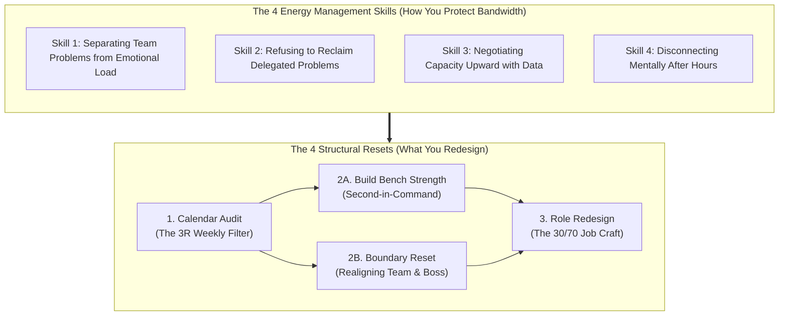
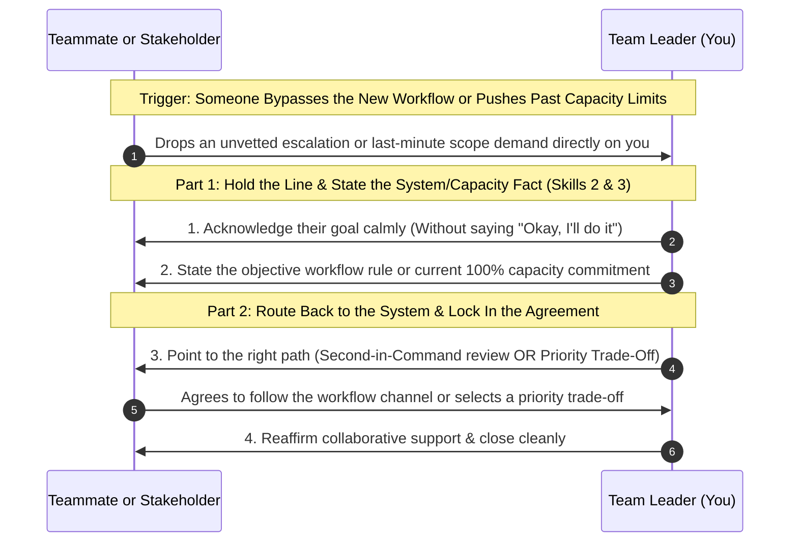
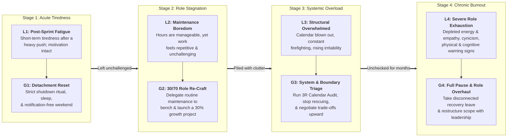

# Sustaining Your Leadership: Practical Strategies to Beat Burnout and Build Self-Running Teams

**Written by:** `aiossan`</br>
**Tone & Register:** Conversational-Professional Global English</br>
**Format:** GitHub Flavored Markdown (GFM)

> [!NOTE] How to Use This Playbook
> This second book is built for working managers, team leads, and supervisors who have already mastered the basics of managing a team, yet now find themselves running on fumes, bored by repetitive operational cycles, or trapped playing daily firefighter. Read it straight through from the Introduction to Chapter 13, expand the collapsible blocks (`<details>`) to copy ready-to-use workload negotiation scripts and test yourself on the 4-week simulation, or jump straight to the **Appendix** when you need a quick desk reference to reset your boundaries this week.

## Table of Contents

1. [Introduction: When You Have the Title, Yet Your Tank Is Running Empty](#introduction-when-you-have-the-title-yet-your-tank-is-running-empty)
2. [Chapter 1: Shifting from Daily Firefighter to Workflow Architect](#chapter-1-shifting-from-daily-firefighter-to-workflow-architect)
3. [Chapter 2: The 4x4 Resilience Framework (4 Structural Resets + 4 Energy Management Skills)](#chapter-2-the-4x4-resilience-framework-4-structural-resets--4-energy-management-skills)
4. [Chapter 3: Skill 1: Separating Team Problems from Personal Emotional Load](#chapter-3-skill-1-separating-team-problems-from-personal-emotional-load)
5. [Chapter 4: Skill 2: Refusing to Reclaim Delegated Problems (The Anti-Rescue Habit)](#chapter-4-skill-2-refusing-to-reclaim-delegated-problems-the-anti-rescue-habit)
6. [Chapter 5: Skill 3: Negotiating Capacity Upward with Trade-Off Data, Not Complaints](#chapter-5-skill-3-negotiating-capacity-upward-with-trade-off-data-not-complaints)
7. [Chapter 6: Skill 4: Disconnecting Mentally After Hours (Psychological Detachment)](#chapter-6-skill-4-disconnecting-mentally-after-hours-psychological-detachment)
8. [Chapter 7: Reset 1: Auditing Your Calendar & Cutting Low-Value Routines (The 3R Filter)](#chapter-7-reset-1-auditing-your-calendar--cutting-low-value-routines-the-3r-filter)
9. [Chapter 8: Reset 2A: Building Your Second-in-Command & Team Bench Strength](#chapter-8-reset-2a-building-your-second-in-command--team-bench-strength)
10. [Chapter 9: Reset 2B: Resetting Boundaries When Teammates or Stakeholders Overstep](#chapter-9-reset-2b-resetting-boundaries-when-teammates-or-stakeholders-overstep)
11. [Chapter 10: Reset 3: Redesigning Your Role to Reignite Meaning (The 30/70 Job Craft)](#chapter-10-reset-3-redesigning-your-role-to-reignite-meaning-the-3070-job-craft)
12. [Chapter 11: 4-Week Case Study & Interactive Simulation (Maya, Alex, and Priya)](#chapter-11-4-week-case-study--interactive-simulation-maya-alex-and-priya)
13. [Chapter 12: Diagnosing Leadership Fatigue (Matching Fatigue Levels L1 to L4 with Recovery Modes G1 to G4)](#chapter-12-diagnosing-leadership-fatigue-matching-fatigue-levels-l1-to-l4-with-recovery-modes-g1-to-g4)
14. [Chapter 13: Your 30-Day Leadership Renewal Action Plan](#chapter-13-your-30-day-leadership-renewal-action-plan)
15. [Appendix: Quick Desk Reference & Primary Research Citations](#appendix-quick-desk-reference--primary-research-citations)

## Introduction: When You Have the Title, Yet Your Tank Is Running Empty

Have you been leading a team as a manager, supervisor, or project lead for one, two, or three years now?

When you first stepped into leadership, your biggest headaches were figuring out how to delegate clearly and overcoming the awkwardness of correcting former peers. Today, the friction you feel looks very different. See how many of these scenarios hit close to home right now:

- You wake up on Monday mornings feeling flat and heavy, wondering, *"What operational fire am I going to get dragged into fixing today?"*
- Your calendar is packed wall-to-wall with status meetings from 9:00 AM to 5:00 PM, forcing you to do your own strategic thinking after dinner.
- You feel like a human shock absorber: squeezed from above by rising executive targets and pulled from below by your teammates' daily blockers, revisions, and frustrations.
- Your team is running reasonably well, yet you feel professionally stagnant-repeating the exact same monthly cycles without learning anything new or feeling the spark you used to have.
- Even when you close your laptop for the weekend or sit down for dinner with family, half your brain is still rehearsing Slack replies, worrying about Q4 deliverables, or mentally triaging Monday's queue.

If any of those ring true, take a breath. <mark>You are not broken, and you have not turned into a bad leader.</mark>

What you are experiencing is **leadership role exhaustion and mid-tenure plateau**. In Book 1, we focused on building the core communication habits that get a team performing. In this second book, we tackle the next challenge in a leader's career: **how to protect your cognitive energy, redesign your team's operating system, and sustain your leadership without burning out.**

Research from the *Center for Creative Leadership* (<abbr title="Center for Creative Leadership">CCL</abbr>) shows that frontline and mid-level managers face the highest burnout risk in modern organizations due to structural *sandwich pressure*-translating executive demands from above while absorbing day-to-day operational friction from below[^4].

Here is the good news: workplace resilience is not about gritting your teeth and enduring endless overload. Decades of organizational psychology research prove that sustainable leadership comes down to **how you structure your role boundaries, build second-line bench strength, and recover your mental energy every single day**.

This playbook gives you a concrete system you can put to work immediately. We focus on three practical pillars:

1. **4 Structural Resets:** Four deliberate moves to overhaul how your week runs-auditing your calendar with the **3R Filter**, building a **Second-in-Command** (*bench strength*), resetting **Boundaries** when people overstep, and **Job Crafting** your role using the 30/70 rule.
2. **4 Energy Management Skills:** Four daily habits that protect your bandwidth-separating team problems from personal emotional load, refusing to reclaim delegated tasks, negotiating capacity upward with trade-off data, and practicing psychological detachment after hours.
3. **Fatigue Calibration (Levels L1 to L4 -> Recovery Modes G1 to G4):** How to diagnose your own (or a senior teammate's) fatigue level early so you know when a quiet weekend is enough and when a structural workload reset is required.

> [!IMPORTANT] Evidence-Based Foundations
> Every strategy in this guide is anchored in peer-reviewed organizational behavior and occupational health research: Professor Christina Maslach's pioneering research on *Burnout and the Six Areas of Worklife*[^1], Amy Wrzesniewski and Jane Dutton's *Job Crafting Theory*[^2], Professor Sabine Sonnentag's empirical studies on *Psychological Detachment and Recovery from Work Stress*[^3], and research on middle-manager sustainability and succession bench strength from the *Center for Creative Leadership* (CCL)[^4]. All of it has been translated into plain, actionable workplace mechanics.

Let's start by looking at why the most conscientious leaders are often the ones who burn out fastest in **Chapter 1**.

## Chapter 1: Shifting from Daily Firefighter to Workflow Architect

Does your typical workday feel less like leading a team and more like playing whack-a-mole with urgent problems?

At 9:15 AM, a production bug or client escalation lands in your inbox. At 10:30 AM, two teammates hit a stalemate over scope. Right after lunch, your director pings you asking for a slide deck for tomorrow's leadership sync. By 4:30 PM, you are still reviewing routine deliverables that should have been ready hours ago. When you finally glance at the clock, it is 6:15 PM-and you have not touched a single item on your own priority list.

During your first few months as a team lead, jumping into the trenches to untangle daily knots is natural because you are learning the ropes and earning trust. However, if you are still operating as the chief problem-solver two years into the role, your nervous system will eventually send you the bill.

UC Berkeley professor Christina Maslach's research demonstrates that workplace burnout is not simply physical tiredness from working hard; it is a response to a **chronic mismatch between job demands and the control you exercise over your work**[^1]. Maslach identifies three progressive warning signs when a leader's system is running dry:

1. **Chronic Exhaustion:** Deep cognitive and physical fatigue that does not go away even after a full weekend of sleep.
2. **Cynicism and Detachment:** You start feeling irritable toward teammates' questions, skeptical of company initiatives, and tempted to coast on autopilot just to survive the week.
3. **Sense of Inefficacy:** Despite working long hours and attending dozens of meetings, you feel like you are spinning your wheels without accomplishing anything meaningful for your own growth.

### Daily Firefighter vs. Workflow Architect

To break out of that cycle, you have to make the second major mindset shift of your management career. In Book 1, you shifted from *solo contributor* to *team leader*. Now, you must shift from **Daily Firefighter** to **Workflow Architect**:

| Work Dimension | The Daily Firefighter (Drains Energy Fast) | The Workflow Architect (Sustains Long-Term Pace) |
| :--- | :--- | :--- |
| **Source of Self-Worth** | Feeling valuable because the team constantly needs you to rescue them. | Feeling proud because the team solves problems smoothly even when you are offline. |
| **Daily Calendar Shape** | Packed with ad-hoc huddles, micro-approvals, and constant interruptions. | Protected by focus blocks, streamlined async updates, and clear decision rules. |
| **Role Inside the Team** | The central bottleneck: every minor edge case waits for your personal sign-off. | The builder of a second tier (*bench strength*) who can lead daily execution. |
| **Response to New Demands** | Automatically saying *"Sure, we'll squeeze it in"* even when the team is at 120% capacity. | Negotiating scope and timeline trade-offs upward using objective capacity data. |

Why do smart, capable team leaders get stuck in Firefighter mode for years? Most fall into one of two psychological traps:

#### 1. The Hero Leader Trap (*"Everything Falls Apart Without Me"*)

Secretly, it feels good to be the hero who swoops in at 4:45 PM to save a broken deliverable. You take pride in knowing every detail, answering every question in thirty seconds, and holding tight to every key decision.

- **The hidden cost:** While being indispensable strokes your ego in the short term, it locks you inside an operational cage. Upper management cannot promote you if nobody can run the team in your absence, and you eventually grow resentful of the very dependency you created.

#### 2. The Human Sponge Trap (*Absorbing Pressure from Both Directions*)

Because you want to be a supportive boss to your team and a reliable lieutenant to your director, you absorb every complaint from below while swallowing every last-minute demand from above. You shield your team so much that they never stretch, and you never push back on stakeholders.

- **The hidden cost:** You get crushed in the middle. Your teammates stay comfortable in low gear, your boss keeps piling on urgent requests because you never flag capacity limits, and your own health and evenings pay the price.

### The Sustainable Standard: Building a Team That Runs Without Constant Rescue

The true test of an experienced team leader is not how frantic your Slack activity looks on a Tuesday afternoon; it is <ins>how smoothly your team hits its targets and handles unexpected roadblocks when you take a full week off without checking your phone</ins>.

Anchor yourself to this operating principle:

> **Stop measuring your value by how many fires you put out today; measure it by how fire-resistant you have made your team's systems and people.**

To turn that principle into weekly practice, this guide organizes leadership sustainability into the **4x4 Resilience Framework**:

1. **4 Structural Resets (What You Redesign):** Four concrete changes to your calendar, team bench, boundary agreements, and role design.
2. **4 Energy Management Skills (How You Protect Bandwidth):** Four daily habits for filtering emotional noise, keeping delegated problems with their owners, negotiating capacity with data, and detaching after work.

Let's map out the complete system in **Chapter 2**.

## Chapter 2: The 4x4 Resilience Framework (4 Structural Resets + 4 Energy Management Skills)

Just as you used a clear system to master core management conversations in Book 1, beating burnout and stagnation comes down to **eight repeatable habits**, divided into two groups:

1. **4 Structural Resets** (how you redesign your schedule, team structure, boundaries, and growth scope)
2. **4 Energy Management Skills** (how you protect your mental and emotional bandwidth day to day)

Here is how the two groups reinforce each other:



The system locks together naturally: **you practice the 4 Energy Management Skills every day so the 4 Structural Resets you put in place hold firm when workplace pressure spikes.**

> [!NOTE]
> We will break down the exact mechanics of the `3R Filter` (*Remove, Reassign, Retain*) in Chapter 7.

### The Four Structural Resets

- **1. Auditing Your Calendar & Cutting Low-Value Routines (The 3R Filter)**
  A practical audit to reclaim 4 to 6 hours of your workweek by filtering recurring meetings, legacy reports, and approval bottlenecks through three buckets: **Remove**, **Reassign**, and **Retain**.
- **2A. Building Your Second-in-Command & Team Bench Strength**
  Deliberately elevating 1 or 2 senior teammates (at Task Levels L3 or L4) to own system-level responsibilities-such as first-pass quality reviews, leading team rituals, or representing the group in cross-functional syncs.
- **2B. Resetting Boundaries When Teammates or Stakeholders Overstep**
  A calm, two-part reset conversation for moments when teammates slip back into upward dependency or when stakeholders bypass your team's workflow with last-minute demands.
- **3. Redesigning Your Role to Reignite Meaning (The 30/70 Job Craft)**
  A quarterly role reset that caps routine maintenance at 70% of your bandwidth and carves out 30% for high-leverage strategic initiatives, process innovation, and personal skill growth.

> [!TIP] Follow the Sequence in Order
> When leaders feel bored or stagnant, they often try to jump straight to Reset 3 (*taking on an exciting new project*) while their calendar is still 110% full and they have zero backup on the team. That only accelerates burnout. Clear your calendar first (Reset 1), build your bench and boundaries (Resets 2A & 2B), and then invest your reclaimed hours into meaningful growth (Reset 3).

### The Four Energy Management Skills

To execute those four structural resets without guilt or friction, you rely on four daily habits:

1. **Separating Team Problems from Personal Emotional Load:** Helping teammates untangle operational roadblocks with grounded empathy, without absorbing their panic, frustration, or anxiety into your own nervous system.
2. **Refusing to Reclaim Delegated Problems (The Anti-Rescue Habit):** Breaking the reflex to say *"Send it to me, I'll fix it"* whenever a teammate hits a snag, keeping ownership of the next action squarely in their hands.
3. **Negotiating Capacity Upward with Trade-Off Data, Not Complaints:** Responding to new executive requests by presenting objective workload visibility and clear priority trade-offs rather than emotional pushback.
4. **Disconnecting Mentally After Hours (Psychological Detachment):** Using a 10-minute end-of-day shutdown ritual and clear communication norms so your brain actually powers down and recovers overnight.

In **Part 2 (Chapters 3 through 6)**, we will train each of the **4 Energy Management Skills** with side-by-side scripts. Then, in **Part 3 (Chapters 7 through 10)**, we will walk step by step through the **4 Structural Resets**.

## Chapter 3: Skill 1: Separating Team Problems from Personal Emotional Load

Have you ever wrapped up a 1-on-1 with a stressed-out teammate where they walked out of the room looking relieved and lighter, while you sat at your desk for the next hour with a tension headache and a knot in your stomach?

Psychologists call this **emotional contagion**. When you care about your people, it is natural to tune in when they are struggling. However, if you do not have a mental filter separating **the operational problem** from **the emotional weather**, you quickly become the emotional sponge for the entire department.

Professor Christina Maslach's research highlights emotional exhaustion as the core driver of management burnout[^1]. The leaders who last longest in high-pressure organizations are not cold or uncaring; they practice **cognitive empathy (understanding a teammate's obstacle and helping them find a path forward)** rather than **emotional absorption (taking on the teammate's panic, anger, or helplessness as their own)**.

### Three Habits That Drain Your Emotional Battery by Noon

Watch how you react the next time a teammate pings you in a panic or vents during a check-in. Do you recognize any of these three patterns?

- **Matching Their Panic Frequency:** A teammate messages you, *"Disaster! The client hated the layout and the launch is tomorrow!"* Instantly, your heart rate spikes, your typing gets frantic, and you broadcast that urgency across the entire team channel.
- **Taking Personal Responsibility for Everyone's Mood:** If one person on your team seems quiet or grumpy during Tuesday standup, you spend the rest of the afternoon replaying your recent conversations, wondering if they are upset with you, and feeling like a failure until they smile again.
- **Hosting Endless Venting Loops:** You let a 15-minute blocker check-in turn into a 45-minute venting session where a teammate complains in circles about another department without agreeing on a single concrete action step.

Those three habits burn through your mental glucose before lunch, even when the underlying technical issue is completely solvable.

### Three Practical Steps to Filter Facts from Emotional Noise

To stay warm and supportive without absorbing everyone else's stress, practice these three moves:

#### 1. Put Up the "Glass Shield" (*Observe, Don't Absorb*)

When a teammate comes to you heated, anxious, or overwhelmed, picture a pane of clear tempered glass between the two of you. You can see them clearly and hear their words, but the smoke of their panic stays on their side of the glass.

- Remind yourself silently: *"They are panicking because they feel stuck. My job is to stay grounded so at least one of us has a clear head."*
- Deliberately slow your speaking pace and lower your vocal volume by 20%. Calmness is just as contagious in a room as anxiety.

#### 2. Validate the Feeling in One Sentence, Then Pivot to Controllable Facts

You do not need to dismiss their frustration (*"Relax, it's not a big deal"*), nor should you throw fuel on the fire (*"Yeah, that client is impossible!"*). Acknowledge the emotion in **one clean sentence**, then immediately steer the conversation toward verifiable facts and controllable next steps:

- *"I can see why that feedback is frustrating after how hard you worked on the prototype. Let's look at the specifics: out of the five changes they requested, which two are essential for tomorrow's release?"*
- *"It makes sense that you're annoyed by the late data handoff from the finance group. So we don't lose the whole afternoon waiting, which sections of the forecast can we lock in right now using the numbers we already have?"*

#### 3. Cap Venting Sessions with the "5-Minute Steam Valve" Rule

When a teammate genuinely needs to blow off steam after a rough call, give them permission to vent-with a clear time boundary:

- *"Take five minutes and give me the unfiltered version of what happened on that call. I'm listening. Once the five minutes are up, we'll shift gears 100% into figuring out our next move."*

Once five minutes pass, pivot firmly to problem-solving. Your teammate feels heard, and your own head stays clear of circular negativity.

### Workplace Script Comparison (Skill 1)

| Avoid This Response (Drains Your Battery) | Use This Response Instead (Grounded Empathy) |
| :--- | :--- |
| *"Oh no, how did this happen?! What are we going to do?!"* (Catching their panic) | *"Okay, take a breath. Walk me through the exact facts of what broke so we can map out our options."* |
| Spending 30 minutes co-complaining with your team about another department. | *"I know their delay squeezes our timeline. Given where things stand right now, what is within our team's control today?"* |
| Worrying all afternoon because a teammate looked quiet on Zoom. | Checking in briefly 1-on-1: *"You seemed a bit quiet in standup earlier-is there a project blocker I should know about?"* If they say they are fine, take them at their word and move on. |
| Letting a 1-on-1 end after 40 minutes of venting with zero resolution. | *"I appreciate you sharing that openly. To make sure next week feels lighter, what is the single most helpful change we can agree on right now?"* |

### Field Practice for Chapter 3

This week, protect your emotional bandwidth with these three exercises:

- [ ] **Practice the "Glass Shield" once:** The next time someone brings you an urgent issue or frustrated rant, intentionally take one slow breath and drop your speaking speed by 20% before replying.
- [ ] **Use the "1-Sentence Validation + Pivot to Fact" formula:** Acknowledge a teammate's frustration in a single sentence, then immediately ask a question about what is controllable today.
- [ ] **Run an end-of-day emotional audit:** Before closing your laptop, ask yourself: *"Which worries in my head right now are actually my job to solve, and which ones are someone else's emotional weather that I accidentally picked up?"*

## Chapter 4: Skill 2: Refusing to Reclaim Delegated Problems (The Anti-Rescue Habit)

Picture this classic scene in a Slack thread or by your desk:

One of your teammates, Jordan, messages you: *"Hey, I ran into a snag with the analytics vendor. They said the custom export format we requested isn't supported on our current tier, and I'm not sure how we should pull the Q3 numbers."*

Because you have three minutes before your next meeting, you reply: *"Ugh, okay. Forward me their email thread and the schema doc. I'll message our account rep after lunch and figure out a workaround, then let you know."*

Look closely at what just happened in those thirty seconds:

1. Before the message, ownership of that problem sat on Jordan's shoulders.
2. After your reply, ownership of the problem jumped onto your shoulders.
3. Jordan is now relaxed, waiting to follow up with *you* tomorrow morning: *"Hey Boss, did you hear back from the vendor yet?"*

If you manage six people and allow each of them to hand two problems back to you every day like that, by Friday afternoon you are drowning in 60 reclaimed tasks while your team logs off right at 5:00 PM.

> [!WARNING] The Hidden Cost of the "Quick Rescue"
> Every time you take back a delegated task because *"it's faster if I just fix it myself,"* you train your team in two destructive habits: (1) whenever a task gets tricky, bringing it to the manager makes the work disappear, and (2) your own strategic time is always up for grabs.

### Three Phrases That Quietly Turn You into the Team's Assistant

Catch yourself whenever you are tempted to utter any of these three sentences:

- *"Just send me the file-I'll clean up the slides myself tonight."* (Because you feel too tired to explain what needs fixing).
- *"Let me ping the engineering lead for you and see what they say."* (Even though your teammate is the project owner and can message them directly).
- *"Leave it with me for now; I'll think through how we should handle it and get back to you."* (Turning your own to-do list into a parking lot for everyone else's unfinished puzzles).

### Three Practical Steps to Keep Problems with Their Owners

Refusing to reclaim a problem does not mean abandoning your team. You still coach and unblock them, **while making sure ownership of the next action never leaves their hands**. Follow these three rules:

#### 1. Never End a Check-In Holding the "Next Action" Ball

Make this an ironclad personal rule: **at the end of any troubleshooting chat, the person who walks away holding the immediate next step must be your teammate, not you.**

When Jordan brings up the analytics vendor snag, keep your hands off the email thread. Help Jordan think through the move in three minutes, then let Jordan execute it:

- *"Got it, Jordan. Looking at the export options available on our current tier, which two raw tables come closest to what we need? Message the account rep this afternoon to confirm if we can join those two tables, and bring me the two options at 3:00 PM."*

#### 2. Enforce the "Bring 2 Options Before Escalating" Rule

To stop teammates from dropping raw, unexamined problems onto your desk, establish a team-wide norm: whenever someone escalates a blocker, they must come prepared with **at least one or two proposed solutions**:

- *"I'm happy to help you make the call on this. Before I weigh in, walk me through the two options you've already considered and which one you're leaning toward."*

If a teammate brings you a problem without having spent ten minutes thinking through options first, ask them to take fifteen minutes to draft two possible approaches and ping you back.

#### 3. Step In Directly Only When Your Formal Authority Is Required

When should a team leader personally take over an action item? Only when the obstacle strictly requires **positional authority that a teammate does not have** (such as approving incremental budget, signing a legal contract, or resolving a political deadlock with a peer VP). If the action can be performed by the project owner-calling a vendor, revising a deck, or coordinating with a peer in another group-coach them from the sideline and let them run the play.

### Workplace Script Comparison (Skill 2)

| Avoid This Rescuing Habit | Use This Ownership-Building Habit Instead |
| :--- | :--- |
| *"Send me the spreadsheet, I'll fix the broken macros so we don't miss the deadline."* | *"The macro on tab 3 is pulling the wrong column range. Update that reference to column F and send me the refreshed total by 2:00 PM."* |
| *"Let me sleep on this problem tonight and tell you what to do tomorrow."* | *"Let's spend 5 minutes on it right now. What do you see as the most practical first step you can test before the end of the day?"* |
| Taking over cross-team coordination: *"I'll message the product manager for you."* | *"Since you own this launch, message the PM directly with our timeline options, and loop me in only if you hit a priority conflict."* |
| Doing the work for a teammate who says, *"I've never done this before."* | *"Share your screen with me for 10 minutes. You drive the keyboard while I talk you through the first one, so you've got it down for next week."* |

### Field Practice for Chapter 4

Over the next five workdays, keep delegated problems off your own plate with these three practices:

- [ ] **Audit your current to-do list for "adopted" tasks:** Scan your task list today. Highlight any item that actually belongs to a teammate's scope, and hand ownership of the next step back to them before 5:00 PM.
- [ ] **Ban the phrase *"Just send it to me"* for one full week:** Catch yourself every time you are tempted to rewrite or fix a teammate's draft yourself.
- [ ] **Confirm the owner of the next step out loud:** Close every troubleshooting huddle with: *"Alright, so your next step this afternoon is X, and you'll ping me at Y time with the update."*

## Chapter 5: Skill 3: Negotiating Capacity Upward with Trade-Off Data, Not Complaints

One of the fastest ways a team leader burns out is feeling powerless to say "no" when upper management or cross-functional stakeholders pile on new work.

Picture this scenario: your team is already running at 100% capacity to deliver three major quarterly commitments due on Friday. On Wednesday afternoon, your director messages you: *"Hey, we need your team to spin up a custom competitive analysis deck for the board meeting next Tuesday. This is high visibility."*

Faced with that request, most managers fall into one of two losing responses:

1. **The Silent Yes-Person (Swallowing the Overload):** You reply, *"Sure thing, we'll make it happen!"* Then you either force your team to work over the weekend or stay up until 1:00 AM building the deck yourself.
2. **The Emotional Complainer (Sounding Defensive):** You push back with vague frustration: *"There's no way we can do that! My team is already totally slammed and exhausted this week!"* To senior executives, emotional pushback without data often sounds like poor attitude or lack of agility.

Christina Maslach's research on the *Six Areas of Worklife* proves that exercising **control over workload** is essential for preventing burnout[^1]. The secret to maintaining workload control with senior leaders is never saying a flat *"No"* or complaining about how tired you are-it is saying **"Yes, and here is the trade-off"** backed by objective capacity data.

### The Core Truth: Your Boss Rarely Sees Your Team's Full Queue

Keep one reality in mind: when your director or VP drops an urgent request on your desk, 90% of the time they are not trying to ruin your week. **They simply do not have your team's hour-by-hour task allocation memorized in their head.** They see a new business problem, they trust your competence, and they hand it to you.

Your job as a leader is to act as the air-traffic controller who makes your team's runway visible-and invites your boss to choose which plane lands first.

### Three Steps to Negotiating Capacity with Trade-Off Data

Use this three-step structure whenever a new request collides with a full sprint:

#### 1. Validate the Strategic Priority First

Never open with *"We can't"* or *"We're too busy."* Start by acknowledging the business value of the request so your manager knows you are on the same side:

- *"Got it-I can see why having sharp competitive data for Tuesday's board meeting is a big priority. Let's look at the cleanest way to fit this into our queue."*

#### 2. Show Objective Capacity Data (Never Use the Word "Busy")

Retire vague words like *"busy,"* *"slammed,"* or *"swamped."* Instead, show a 30-second snapshot of **active deliverables, assigned owners, and committed deadlines**:

- *"Right now, 100% of our four analysts' hours this week are locked into the three deliverables we aligned on Monday: (1) The Q3 Pricing Migration due Friday (Priya & Alex), (2) The Enterprise Retention Audit due Monday at noon (Liam), and (3) The automated billing QA."*

#### 3. Present 3 Clear Trade-Off Options and Let Your Boss Choose

Because there are only a fixed number of engineering or analyst hours in a week, adding a new priority mathematically requires shifting an existing deadline, reducing scope, or adding resources. Lay out the menu clearly and ask your manager to make the executive call:

- *"To make sure this board deck is accurate without breaking our Friday launch, we have three options:*
  - ***Option A (Swap Deadlines):*** *We pull Alex onto the board deck today and move the Enterprise Retention Audit deadline back four days to next Friday.*
  - ***Option B (Scope Down to a Minimum Viable Version):*** *We keep all current deadlines intact, and for Tuesday's board meeting we deliver a 2-slide executive summary using our existing Q2 dataset, then follow up with the deep-dive next month.*
  - ***Option C (Pull Cross-Team Support):*** *We borrow an analyst from the ops group to pull the raw competitor pricing tables.*
  *Looking at the big picture for the department, which trade-off makes the most sense to you?"*

Look at what that script accomplishes: you never complained, you never refused to help, and you placed the priority trade-off decision right back where it belongs-on the executive's desk.

### Workplace Script Comparison (Skill 3)

| Avoid This Response to Upper Management | Use This Data-Backed Trade-Off Script Instead |
| :--- | :--- |
| *"Sure, we'll figure out a way to get it done!"* (While silently burning out) | *"Happy to support this priority. Let's look at our active queue so we can decide what shifts to make room for it."* |
| *"My team is totally burned out, we can't take on another thing right now."* (Emotional complaint) | *"Our team's 160 hours this week are 100% allocated to Launch A and Audit B. If Project C needs to happen this week, should we push Audit B to next Wednesday?"* |
| *"That timeline is impossible-it takes at least two weeks!"* (Flat refusal) | *"With a 3-day turnaround, we can reliably deliver Phases 1 and 2 with full QA. Phase 3 would need to follow in next week's sprint."* |
| Venting to your teammates about how upper management has no clue how hard you work. | Maintaining a live, single-page capacity tracker that you screen-share in 10 seconds whenever new requests come in. |

### Field Practice for Chapter 5

This week, build your upward negotiation muscle with these three steps:

- [ ] **Build a 1-Page Active Capacity Snapshot:** Keep a clean, up-to-date list of your team's current top projects, owners, and deadlines ready to screen-share at any moment.
- [ ] **Eliminate the word "Busy" when talking upward:** Replace subjective words (*"swamped," "overwhelmed"*) with concrete resource facts (*"All 40 of Alex's hours this week are committed to the Q3 migration"*).
- [ ] **Use the 3-Option Trade-Off Menu once this week:** The next time an unscheduled request lands on your desk, respond by offering a choice between **shifting an existing deadline**, **delivering a lean v1 scope**, or **adding cross-team bandwidth**.

## Chapter 6: Skill 4: Disconnecting Mentally After Hours (Psychological Detachment)

Have you ever sat at the dinner table with your family or met friends on a Saturday afternoon where your body was in the chair, yet your thumb kept refreshing Slack under the table and your mind was still drafting Monday morning's escalation email?

In an era of smartphones and hybrid work, the biggest threat to a leader's longevity is rarely the eight hours spent working during the day-it is **the inability to unplug your mind from work during the sixteen hours you are supposed to be off duty**.

A landmark review by organizational psychologists Professor Sabine Sonnentag and Charlotte Fritz (2015) synthesizing decades of stress-recovery research established a vital truth: **physical rest alone does not prevent burnout unless it is paired with psychological detachment**[^3]. Psychological detachment means mentally switching off work-related thoughts, problem-solving, and ruminations outside of work hours.

Sonnentag's research shows that when you continue thinking about workplace problems at 9:30 PM-even if you are lying on the couch-your sympathetic nervous system and stress hormones remain activated as if you were still sitting in a tense office meeting[^3]. As a result, you wake up the next morning with a depleted cognitive battery.

### Three Habits That Keep Your Brain "On the Clock" 24/7

Why do so many leaders struggle to shut off their mental work tabs at night? Usually because of three everyday habits:

- **Stopping Work Mid-Sentence Without a Closure Ritual:** You slam your laptop shut at 6:15 PM in the middle of a messy problem without writing down where you left off or what your plan is for tomorrow. Because the human brain hates open loops (known in psychology as the *Zeigarnik Effect*), your subconscious keeps spinning on those unfinished tasks all evening so you do not forget them.
- **Checking Work Channels at Night to Soothe Anxiety:** You tap open Slack or email at 9:00 PM "just to check that nothing blew up." Ironically, seeing a non-urgent message from an executive at 9:05 PM triggers a fresh wave of mental rehearsal that ruins the rest of your night.
- **Sending Late-Night Pings That Trigger Team-Wide Ping-Pong:** Because an idea crosses your mind at 10:00 PM, you drop it into the team channel immediately. Your conscientious teammates see the notification, feel pressured to reply right away, and suddenly the whole team is working at 10:30 PM.

### Three Practical Steps to Power Down Your Work Brain (*The Shutdown Ritual*)

To give your brain true recovery every evening, install these three habits:

#### 1. Run a 10-Minute "End-of-Day Shutdown Ritual"

Never end your workday by abruptly closing your laptop in a rush. Dedicate the final 10 minutes of your workday to a structured closure routine:

1. Scan tomorrow's calendar so no early-morning meeting catches you off guard.
2. Write down your **Top 3 Priorities for Tomorrow** on a notepad or task app, including the exact first step you will take at 9:00 AM.
3. Close every work browser tab, lock your screen (<kbd>Win</kbd> + <kbd>L</kbd> or <kbd>Cmd</kbd> + <kbd>Ctrl</kbd> + <kbd>Q</kbd>), and tell yourself explicitly: *"Today's work is complete. Tomorrow's plan is locked in on paper."*

Once your brain sees that tomorrow's priorities are safely captured externally, it stops rehearsing them in the background while you sleep.

#### 2. Default to *Scheduled Send* & Separate Routine Channels from True Emergencies

Many managers leave Slack and email notifications on all night because they worry, *"What if there's a real emergency?"*

The fix is simple: **separate asynchronous work channels (Slack/Teams/Email) from your true emergency channel (a direct phone call).** Set a clear operating agreement with your team:

- *"Team, after 6:30 PM and on weekends, I mute Slack and email notifications so we can all recharge properly. If you think of something after hours, please use Scheduled Send so it delivers at 8:30 AM the next workday. If we ever have a true production emergency that cannot wait until morning, call my cell phone directly."*

With that agreement in place, you can mute work apps every evening with zero guilt-knowing that if your phone is not ringing, there is no fire.

#### 3. Build a 15-Minute "Transition Buffer" Between Work and Personal Life

Your brain needs a sensory cue to shift out of "Manager Mode" and back into "Human Mode"-especially if you work remotely and commute ten feet from your desk to your kitchen.

Create a 15-to-20-minute physical buffer right after your Shutdown Ritual:

- Take a brisk walk outside without your work phone, do a short workout or stretch, shower and change out of your work clothes, or listen to music or a non-business podcast before engaging with evening life.

### Workplace Habit Comparison (Skill 4)

| Avoid This Habit (Drives Chronic Exhaustion) | Use This Habit Instead (Restores Cognitive Energy) |
| :--- | :--- |
| Slamming your laptop shut mid-problem and carrying mental clutter to dinner. | Taking 10 minutes before logging off to write down your **Top 3 Priorities for Tomorrow**. |
| Pinging teammates at 10:00 PM just to get a thought out of your head. | Writing the message now and using **Scheduled Send** for 8:30 AM tomorrow morning. |
| Leaving Slack, Teams, and work email banners active on your phone lock screen all night. | Muting work notifications after 6:30 PM and establishing a "True Emergencies = Phone Call" rule. |
| Scrolling through project docs in bed right before going to sleep. | Using a 15-minute physical transition buffer (walk, workout, or music) to mark the end of the workday. |

### Field Practice for Chapter 6

This week, test these three recovery habits:

- [ ] **Run the 10-Minute Shutdown Ritual for 3 consecutive days:** Write down tomorrow's top 3 priorities before closing your laptop, and notice how much easier it is to stop thinking about work at night.
- [ ] **Use *Scheduled Send* for 100% of after-hours messages:** Do not send a single live Slack or email message to your team after 6:30 PM this week; schedule every one of them for the next morning.
- [ ] **Announce the "Emergency = Phone Call" norm to your team:** Let your teammates know that you mute chat notifications at night to protect everyone's rest, and clarify what qualifies for a direct phone call.

## Chapter 7: Reset 1: Auditing Your Calendar & Cutting Low-Value Routines (The 3R Filter)

Now that you have the four daily Energy Management Skills in place from Part 2, we move into **Part 3: The 4 Structural Resets** to overhaul how your workweek actually operates.

We start with the most visible energy drain in any manager's life: **your calendar and recurring operational routines.**

Why do team leaders feel more time-starved in year two or three than they did in month one? Because organizations suffer from **process accretion**: new meetings, reports, and approval steps get added every quarter, while old meetings and reports from last year are almost never officially retired.

Before long, you are attending weekly syncs where your presence adds zero value, compiling spreadsheet trackers nobody reads, and personally rubber-stamping routine items your team mastered months ago.

### The Classic Trap: The Packed Yet Unproductive Calendar

Look at your calendar from the past two weeks. Chances are, a huge chunk of your bandwidth is being eaten up by three low-leverage activities:

- **"Meeting Tourism":** Sitting in 60-minute meetings where you neither make decisions nor contribute critical context-or attending a 45-minute call just to give a 3-minute status update that could have been a 3-bullet message.
- **Zombie Reports:** Weekly decks or manual data pulls created for a problem that existed nine months ago, which no longer drive any real decisions today.
- **Rubber-Stamp Approval Bottlenecks:** Unwritten rules requiring every routine client email, minor copy tweak, or standard ticket to wait for your personal "LGTM" before moving forward.

### How to Run a Calendar & Routine Audit (The 3R Filter)

To reclaim **4 to 6 hours of focused breathing room every week**, review every recurring meeting, report, and approval step on your plate using the **3R Filter: Remove, Reassign, and Retain**.

#### 1. Remove (*Eliminate or Shrink by 50%*): Cut What No Longer Drives Impact

Ask one honest question about every recurring meeting and report: *"If we stopped doing this next week-or cut its length in half-would our team's output or quality suffer?"*

- **Cut default meeting lengths by 50%:** Change 60-minute recurring meetings to 25 or 30 minutes, and 30-minute check-ins to 15 minutes.
- **Convert "status-reading" meetings into async written updates:** Never use live meeting time to have six people read their to-do lists out loud. Have everyone post a 3-bullet update (1. Done, 2. In Progress, 3. Blocked) in your team channel by 9:15 AM, and use live meeting time exclusively to solve the blockers.
- **Sunset zombie reports:** Ask the stakeholders receiving a legacy report: *"We're streamlining our reporting workflow this month. Which specific metrics in Report X do you still use for weekly decisions, and which sections can we retire?"*

#### 2. Reassign (*Delegate or Automate*): Hand Off Routine Ownership

For recurring workflows that still matter but no longer require your personal manager-level judgment, shift ownership:

- **Rotate or delegate meeting facilitation:** Let your L3 and L4 teammates take turns running the weekly team sync or representing your group in cross-departmental project meetings while sending you a 3-bullet recap afterward.
- **Set pre-approved decision guardrails:** Replace manual sign-offs with clear thresholds. For example: *"For standard campaign copy and design revisions that follow our brand checklist and stay under $1,500, you are pre-approved to ship without waiting for my sign-off."*

#### 3. Retain & Protect: Lock In Weekly Focus Blocks on Your Calendar

Once you clear 4 to 6 hours of low-value clutter through Removing and Reassigning, **do not leave those newly freed hours sitting empty on your calendar-or other people's ad-hoc meetings will swallow them within 48 hours.**

- Immediately block out two or three 90-minute **Focus Blocks** on your calendar every week (for example, Tuesday and Thursday mornings from 9:00 AM to 10:30 AM).
- Treat these blocks like immovable client appointments dedicated to strategic planning, system improvements, and your own deep work.

<details>
<summary><strong>Copy-Paste Script Template: Reset 1 (Proposing a 3R Calendar Reset)</strong></summary>

```text
"Hey [Team / Stakeholder Name], this month we're tightening up our operating rhythm so the team has more uninterrupted execution time for [Core Q3 Goal]. Starting next week, I'd like to test a 3R adjustment on [Name of Recurring Meeting / Report]:
1. Remove status reading: We'll post our routine 3-bullet progress updates asynchronously in #[channel] by 9:15 AM, and shorten our live call from 60 minutes to 25 minutes focused purely on unblocking stuck items.
2. Reassign representation: For Wednesday's cross-team technical sync, [Senior Teammate Name] will represent our group and share a quick decision recap afterward.
3. Retain deep-work focus: This gives everyone back 3+ hours a week of heads-down maker time.
Let's run this format for the next two weeks and see how much smoother our sprint execution feels."
```
</details>

### Workplace Time Management Comparison (Reset 1)

| Old Calendar-Draining Habit | New 3R Workflow Architect Habit |
| :--- | :--- |
| Accepting every calendar invite automatically without checking your role. | Asking before accepting: *"What specific decision needs my input on this call? If it's informational, can [Teammate] represent us or can I read the notes async?"* |
| Running a 60-minute weekly team call where everyone reads their status updates out loud. | Collecting written updates 1 hour before the call and running a crisp 25-minute huddle focused only on roadblocks. |
| Requiring every routine deliverable to pass through your personal inbox for approval. | Creating a 5-point quality checklist; if a deliverable meets all 5 criteria, teammates ship it directly without waiting on you. |
| Leaving your calendar wide open all week, resulting in fragmented 15-minute scraps of time. | Locking in three 90-minute **Focus Blocks** every week for strategic thinking and system building. |

### Field Practice for Chapter 7

- [ ] **Audit your last 2 weeks of calendar events:** Color-code every recurring meeting and routine task: Red to **Remove/Shrink**, Yellow to **Reassign** to a senior teammate, and Green to **Retain**.
- [ ] **Convert 1 meeting to async or cut its duration in half:** Put the change into effect starting Monday and measure how many team hours you save.
- [ ] **Block two 90-minute Focus Blocks on next week's calendar:** Label them clearly (e.g., *"Q3 Strategy & Deep Work - Do Not Book"*) and protect them.

## Chapter 8: Reset 2A: Building Your Second-in-Command & Team Bench Strength

Once you free up your calendar using the 3R Filter in Chapter 7, the natural question is: **who on your team is ready to take ownership of those reassigned meetings, quality reviews, and operational decisions?**

Many tired managers sigh and say, *"I can't step back or take a real vacation because nobody on my team is ready to cover for me."* Here is the candid truth: if you have led a team for over a year and still have zero backup, it usually means you have been so busy **using your team to hit short-term deadlines** that you forgot to **build your second-line bench strength**.

Research from the *Center for Creative Leadership* (<abbr title="Center for Creative Leadership">CCL</abbr>) and Gallup shows that cultivating a Second-in-Command (or splitting second-line leadership across two senior teammates) creates a powerful win-win[^4]:

1. **For you as the leader:** Your daily operational load drops dramatically, you gain a trusted sounding board inside the team, and you become promotable because upper management can see a clear succession bench behind you.
2. **For your senior teammates:** High-performing teammates (at Task Levels L3 and L4) are the most likely to get bored and leave if they are kept doing the exact same execution tasks forever. Giving them system-level leadership scope is the single best way to retain and grow top talent.

### Why Efforts to Build a Second-in-Command Often Backfire

Avoid these three mistakes when elevating a senior teammate:

1. **Dumping Chores Without Granting Authority or Visibility:** You ask a senior specialist to review junior teammates' work, but you never announce their role to the group and give them zero decision-making power. To your senior teammate, that feels like unpaid extra labor rather than career growth.
2. **Expecting Instant Perfection on Day One:** The first time your second-in-command leads a team meeting and misses a detail, you jump in, take over the screen-share, and undermine their authority in front of everyone.
3. **Giving In to Status Insecurity:** Some managers quietly worry that if a senior teammate shines too brightly in front of executives, the manager will look replaceable. In reality, executives promote the leaders who build strong successors-and trap the leaders who hoard all the credit.

### Five Practical Steps to Build Your Bench Strength

Use this five-step sequence to elevate 1 or 2 capable teammates into true operational partners:

1. **Select Teammates Operating at L3 or L4 on Core Execution:** Look for people who consistently deliver clean work, communicate constructively, and already earn natural respect from their peers.
2. **Frame the Role as Career Acceleration (Not Chore Offloading):** Meet 1-on-1 and explicitly connect this new scope to their career path toward Senior, Lead, or Manager-starting with specific recognition of their track record.
3. **Delegate "System Ownership," Not Just Piecemeal Tasks:** Hand over a cohesive, visible domain rather than random errands. Great examples include: (a) Serving as First-Pass Quality Lead for junior deliverables, (b) Facilitating the weekly sprint review or cross-team sync, or (c) Owning the onboarding and mentoring system for new hires.
4. **Announce Their Mandate Publicly to the Team:** Make their authority unmistakable so peers do not bypass them. Announce in your team meeting that for Domain X, this person now holds first-line decision authority on your behalf.
5. **Back Them with a Weekly 15-Minute Leadership Coaching Sync:** Do not drop them in the deep end alone. Hold a focused 15-minute check-in each week to talk through how they are handling peer dynamics, coach them through tricky calls, and publicly credit their leadership in front of your own boss.

> [!TIP] Split the Bench Across Two People If Needed
> You do not have to crown a single heir apparent for everything. For instance, Priya can own **Technical Quality & Architecture Reviews**, while Alex owns **Cross-Functional Campaign Coordination**. You spread the load evenly and give two people meaningful growth paths at once.

<details>
<summary><strong>Copy-Paste Script Template: Reset 2A (Inviting a Senior Teammate to Step Up)</strong></summary>

```text
"Hey [Name], I'd love to talk about the next stage of your growth on our team. Over the past two quarters, your execution and judgment on [Specific Area] have been rock-solid.
To help you build the track record you'll need for a [Senior / Lead / Manager] role, I'd like to expand your scope from owning individual deliverables to owning a piece of our team's operating system. Specifically, I'd like you to step up as our [Role Name, e.g., First-Pass Quality Lead / Cross-Functional Sync Lead].
That means teammates will bring their drafts to you for initial sign-off before anything escalates to me, and you'll have real decision-making authority over [Specific Scope]. I'll announce this officially in Monday's team sync so everyone is aligned, and we'll use 15 minutes of our weekly 1-on-1 to coach through any challenges that come up. How does that opportunity sound to you?"
```
</details>

### Workplace Delegation Comparison (Reset 2A)

| Avoid This Offloading Approach | Use This Bench-Building Approach Instead |
| :--- | :--- |
| *"Priya, I'm swamped this week-can you check the junior analysts' spreadsheets for me?"* | *"Priya, because your data standards are the sharpest on the team, I'd like you to take on the role of First-Pass Quality Lead this quarter as part of your path toward Senior Lead."* |
| Asking a senior teammate to guide peers without telling the rest of the team. | Announcing clearly in the team meeting: *"Starting Monday, Priya owns first-pass sign-off on all client decks. Her green light represents mine."* |
| Taking solo credit in executive meetings for projects your second-in-command coordinated. | Highlighting their leadership upward: *"We hit our Q3 launch date cleanly thanks to Priya leading the daily QA triage across the team."* |
| Interrupting and taking over when your second-in-command stumbles slightly while leading a call. | Letting them finish facilitating the call, then sharing constructive coaching notes privately 1-on-1 afterward. |

### Field Practice for Chapter 8

- [ ] **Identify 1 or 2 bench candidates on your team:** Write down the names of teammates currently operating at L3 or L4 on their core tasks.
- [ ] **Choose 1 system-level responsibility to hand off this month:** Pick a cohesive domain such as leading a recurring sync, owning first-pass quality reviews, or running new-hire onboarding.
- [ ] **Hold the career-growth conversation & announce the mandate:** Use the script above in your next 1-on-1, agree on decision guardrails, and introduce their new role clearly to the whole team.

## Chapter 9: Reset 2B: Resetting Boundaries When Teammates or Stakeholders Overstep

Once you streamline your calendar (Chapter 7) and empower your second-in-command (Chapter 8), you will hit a predictable real-world test: **other people's old habits will try to pull you right back into the old pattern.**

- A teammate who spent the last year pinging you for every minor question will try to bypass your newly appointed Quality Lead and drop a raw draft straight into your DMs.
- A peer manager or executive who is used to treating your team like a 24/7 express lane will message you at 4:45 PM on Friday asking for an "urgent favor" that skips your sprint queue.

If you cave in at those moments and say, *"Okay, just this once I'll handle it,"* your new operating system will collapse within a week. This is where you need **Reset 2B: Resetting Boundaries**.

Just like *Private Course Correction* in Book 1, resetting a boundary is never about snapping at people or acting territorial. Its purpose is **calmly re-educating teammates and stakeholders to use the healthier, faster system you have built.**

This conversation combines **Skill 2 (The Anti-Rescue Habit)** and **Skill 3 (Negotiating with Trade-Off Data)** into a clean **Two-Part Boundary Reset**.



### Two Core Boundary Reset Scenarios at Work

Here is how to run the Two-Part Boundary Reset across the two most common boundary leaks:

#### Scenario 1: When a Teammate Bypasses Your Second-in-Command or Escalates Without Options

Suppose you appointed Priya as First-Pass Quality Lead (or established the "Bring 2 Options" norm), yet Liam messages you directly asking you to review his raw draft.

- **Part 1 (Acknowledge & Name the System Impact):**
  *"Liam, I know you want to get this client deck moving quickly. However, if I jump in and review your first draft directly, it bypasses the quality review workflow we set up with Priya and slows down the rest of today's queue."*
- **Part 2 (Route Back to the System & Reinforce Trust):**
  *"To keep our workflow clean, take this draft to Priya's 2:00 PM review slot along with the two headline options you're weighing. I trust her call on this completely. If the two of you hit a budget question that needs my sign-off, bring that specific piece to me afterward."*

#### Scenario 2: When a Boss or Peer Stakeholder Bypasses Your Sprint Queue

Suppose a peer department head or director keeps dropping unscheduled requests directly onto your engineers or analysts mid-sprint.

- **Part 1 (Validate the Goal & Show the Systemic Cost):**
  *"Sarah, I know getting the custom landing page live is important for your regional campaign. I want to share what's happening on our end: over the past two weeks, four unscheduled requests came in mid-sprint via direct message, which pushed our core checkout release back by three days."*
- **Part 2 (Direct to the Intake Channel & Offer a Trade-Off):**
  *"So we can protect our committed launch dates while still supporting your team, we're routing all mid-sprint requests through our Monday priority queue. For this landing page, would you like us to slot it into next Monday's sprint kickoff, or should we get together with the VP to swap it with the promo banner we're building for your team right now?"*

> [!CAUTION] Protect Your Second-in-Command's Authority
> The fastest way to destroy your newly built bench strength is letting teammates play "Mom and Dad" by coming to you whenever they want to skip your Second-in-Command's review. Unless it is an ethical or HR issue, always route operational escalations back through the system you established.

<details>
<summary><strong>Copy-Paste Script Templates: Reset 2B (Two-Part Boundary Resets)</strong></summary>

```text
[Script A: Routing a Teammate Back to the Agreed System]
"Hey [Name], thanks for flagging [Task/Issue]. So we keep our workflow running smoothly and don't bottleneck everything at my desk, I'm not stepping in on first-pass reviews directly. Please jot down the 2 options you recommend (or run this through [Second-in-Command Name] during today's review window), and let me know what decision you land on. I trust you to drive this step."

[Script B: Resetting Mid-Sprint Interruptions from Stakeholders]
"Hey [Stakeholder Name], I understand why [Request] is important for your timeline. Because mid-week side requests have started delaying our committed quarterly launches, we're keeping all active hours locked on our agreed sprint board. To get this done for you, we can either (1) slot it at the top of next Monday's sprint, or (2) swap it with [Existing Task for That Stakeholder] currently in progress. Which option works best for your team?"
```
</details>

### Workplace Boundary Comparison (Reset 2B)

| Boundary-Breaking Habit | Calm, Professional Boundary Reset |
| :--- | :--- |
| *"Technically Priya is supposed to review this, but fine, send it here and I'll look at it."* (Undermines your own system) | *"Priya owns first-pass sign-off on all campaign decks now. Run it by her at 2:00 PM-her approval counts as mine."* |
| Replying to non-urgent stakeholder emails at 10:30 PM while resenting them. | Waiting until 8:30 AM the next morning to reply calmly and concisely, training stakeholders on your working hours through consistent behavior. |
| Snapping at teammates who ask basic questions: *"Why don't you ever read the playbook?!"* | Asking calmly: *"Before I answer, check section 2 of our team playbook doc-what does it recommend for this case?"* |
| Letting other teams DM your specialists directly with "quick favors." | Instructing your team: *"Whenever another group DMs you a side request, reply warmly: 'Happy to help! Please drop this in our #team-intake channel so Maya can slot it into our sprint queue.'"* |

### Field Practice for Chapter 9

- [ ] **Spot your #1 boundary leak this week:** Identify whether your biggest leak is teammates bypassing your new workflow, stakeholders dropping side-requests mid-sprint, or your own habit of answering messages late at night.
- [ ] **Draft your 2-part reset script in advance:** Write out **Part 1 (Objective Fact & Systemic Impact)** and **Part 2 (The Approved Path / Trade-Off)** so you are ready before the moment happens.
- [ ] **Hold the boundary 3 times in a row without "just this once" exceptions:** Consistency over three consecutive interactions is what rewires workplace norms.

## Chapter 10: Reset 3: Redesigning Your Role to Reignite Meaning (The 30/70 Job Craft)

Imagine you have put Reset 1 into practice (freeing up 5 hours a week with the 3R Filter) and executed Resets 2A and 2B (your second-in-command is handling daily reviews and your boundaries are holding firm).

Your workload is finally sustainable. Yet here is a surprising truth many mid-tenure leaders discover: **removing exhaustion does not automatically cure boredom.**

Even when you are no longer working late nights, you can still feel flat and uninspired if 100% of your week is spent repeating maintenance routines you mastered two years ago. When every month is just an endless loop of sprint planning, routine check-ins, and monthly reporting, your brain starves for novelty and growth.

This is where **Reset 3: The 30/70 Job Craft** comes in.

Pioneering research by professors Amy Wrzesniewski (Yale University) and Jane E. Dutton (University of Michigan) introduced the concept of **Job Crafting**: the proactive process of reshaping the task boundaries, relational network, and cognitive meaning of your current role so that your work stays energizing and aligned with your strengths[^2]. You do not have to quit your job or wait two years for a reorganization to make your current role exciting again.

### Three Levers of Job Crafting for Team Leaders

Drawing on Wrzesniewski and Dutton's research[^2], you can refresh your leadership role across three dimensions:

1. **Task Crafting (Shifting Your Work Mix):** Delegating repetitive maintenance tasks to your rising L3/L4 bench (Reset 2A) and replacing those hours with 1 high-leverage strategic project that stretches your skills-such as building a cross-team automation workflow, piloting a new product initiative, or overhauling how your department measures ROI.
2. **Relational Crafting (Expanding Your Circle):** Changing who you talk to every week. When leaders get stuck solely inside their own direct reports' bubble, their perspective shrinks. Intentionally schedule time with peer leaders in other functions, shadow customer calls, or mentor a high-potential specialist in another department.
3. **Cognitive Crafting (Reframing Your Role's Purpose):** Upgrading how you define your job. Instead of seeing yourself as *"the person who checks five analysts' spreadsheets every Friday,"* reframe your mission as *"the architect building a self-running analytics engine and developing the company's next two team leads."*

### The 70/30 Bandwidth Split for Sustainable Leadership

To keep your role both operationally reliable and intellectually energizing, aim for a **70/30 bandwidth allocation**:

- **70% Core Operations & Team Coaching:**
  Seventy percent of your week goes toward ensuring your team hits its core deliverables through the 4 Core Conversations and coaching your second-line bench. Because you trimmed calendar bloat (Reset 1) and built bench strength (Reset 2A), the operational work that used to consume 120% of your week now fits comfortably inside this 70% container.
- **30% Strategic Growth & Renewal (*Your Crafted Scope*):**
  The remaining 30% (roughly 6 to 10 hours a week, anchored by your 90-minute Focus Blocks from Chapter 7) is deliberately invested in work that recharges your curiosity and advances your career:
  - Driving **1 high-impact strategic improvement** per quarter (building systems rather than patching symptoms).
  - Developing the next-level skills required for your future role (such as cross-functional resource allocation, executive business cases, or AI workflow automation).
  - Building strategic relationships across the broader organization.

> [!IMPORTANT] Nature Abhors an Empty Calendar
> If you free up 6 hours a week through calendar audits and delegation, but fail to intentionally claim that 30% bandwidth for a meaningful strategic initiative, Parkinson's Law guarantees that trivial operational noise will expand to fill those 6 hours again within two weeks.

### Four Steps to Running a Quarterly 30/70 Job Craft

1. **Run an Energy Drain vs. Energy Gain Audit:**
   Draw two columns on a sheet of paper:
   - *Energy Drains:* Which recurring tasks over the past month left you feeling bored, drained, or stagnant?
   - *Energy Gains:* Which moments over the past quarter put you in a state of flow where time flew by (e.g., designing a new system architecture, coaching a senior teammate through a breakthrough, or pitching a strategic roadmap)?
2. **Offload 2 Energy Drains via the 3R Filter & Bench Building (Chapters 7 & 8):**
   Remember that a routine task that bores you (because you have done it 200 times) is often an exciting growth stretch for an L3 teammate on your bench.
3. **Pick 1 "Keystone Growth Project" for the Quarter:**
   Choose one initiative from your *Energy Gains* column that solves a real strategic problem for your department while stretching your own capabilities.
4. **Align on Your 30% Project with Your Manager:**
   Pitch it proactively in your monthly 1-on-1 with your boss: *"Now that Priya and Alex are handling our day-to-day QA and cross-team syncs smoothly, our daily operations are running at high reliability. This quarter, I'm dedicating 25–30% of my focus blocks to building [Strategic Initiative Name], which will cut our department's onboarding time by 40%. Here's the one-page brief."* Senior executives love when managers bring proactive system solutions like this.

### Workplace Role Design Comparison (Reset 3)

| Stagnant Maintenance Mode (100% Routine) | Energized 70/30 Job Crafting Mode |
| :--- | :--- |
| Spending 100% of your year repeating the exact same supervision loop you ran last year. | Running core operations in 70% of your week with your bench, and investing 30% in 1 high-impact strategic project per quarter. |
| Talking only to your immediate direct reports week after week. | Scheduling biweekly coffee chats or strategy syncs with peer leaders, product partners, or key customers. |
| Waiting passively for upper management to hand you a promotion or new challenge. | Proactively designing and pitching the high-leverage initiatives that prove you are ready for the next level. |
| Treating boredom as a sign that you need to quit your career. | Treating boredom as a signal that it is time to hand off routine execution to your bench and expand your strategic scope. |

### Field Practice for Chapter 10

- [ ] **Complete your Energy Drain vs. Energy Gain Audit:** List the 3 tasks that drained you most this month and the 3 activities that gave you the strongest sense of flow and accomplishment.
- [ ] **Define 1 Keystone 30% Project for the next 30 days:** Pick one strategic improvement or system build you have been putting off for months because you were too busy firefighting.
- [ ] **Schedule 1 cross-functional peer chat this month:** Reach out to a respected manager in another department for a 20-minute exchange on how they structure their team's operating rhythm.

## Chapter 11: 4-Week Case Study & Interactive Simulation (Maya, Alex, and Priya)

Remember **Maya** and **Alex** from Book 1?

Two years have passed since Maya was first promoted to Team Lead of Marketing Analytics. Thanks to the **4x4 Leadership Framework** from Book 1, her team's output is strong. Alex-who once struggled with unlocked spreadsheet formulas-has grown into a sharp mid-level analyst, working alongside **Priya** (a meticulous senior specialist) and two newer hires, including **Liam**.

Yet as she enters her third year in the role, Maya hits a wall: **she is exhausted, overbooked, and quietly burning out.**

Because her team is reliable, the VP of Marketing constantly routes last-minute executive requests to Maya's desk. Meanwhile, because Maya is approachable and helpful, her teammates still ping her all day for minor sign-offs. She sits in 20 hours of meetings a week, answers Slack messages at 10:30 PM, and catches herself browsing job boards on Sunday nights because every week feels like an endless treadmill.

Let's watch how Maya turns her workweek around across four weeks using the **4x4 Resilience Framework**.

### Week 1: The 3R Calendar Audit (Reset 1) & The Shutdown Ritual (Skill 4)

**Context:** On Monday morning of Week 1, Maya looks at a calendar packed with 20 hours of recurring meetings and realizes she checked Slack 14 times over the weekend.

- **Old Habit (The Overwhelmed Firefighter):**
  Dialing into every call while multitasking on slides, then logging back in from 8:30 PM to 10:30 PM every night to catch up.
- **Maya's New Approach (Reset 1 + Skill 4):**
  Maya spends 30 minutes auditing her calendar with the **3R Filter**:
  1. **Remove:** She converts the team's 60-minute Monday and Thursday status calls into a 3-bullet async Slack update due at 9:15 AM, followed by a 20-minute live standup strictly for blockers. (Saves 80 minutes/week).
  2. **Reassign:** She sets a pre-approved guardrail: routine campaign performance reports that pass the team's 5-point formula checklist no longer require Maya's personal sign-off before publishing.
  3. **Retain & Shutdown Ritual (Skill 4):** Maya blocks Tuesday and Thursday mornings from 9:00 AM to 10:30 AM as immovable **Focus Blocks**. At 5:50 PM every evening, she writes down her Top 3 Priorities for tomorrow, closes her laptop, and posts a clear norm to her team:
     *"Team, starting this week I'm muting Slack and email notifications after 6:30 PM and on weekends so we can all get real rest. If you're working late or in another time zone, please use Scheduled Send for 8:30 AM. If a live tracking pipeline ever goes down completely, call my cell phone directly."*

### Week 2: Building Bench Strength (Reset 2A) & The Anti-Rescue Habit (Skill 2)

**Context:** Maya realizes she is still the single point of failure for quality checks and cross-team meetings. That same Tuesday, her junior hire Liam pings her asking for help with a broken SQL query.

- **Building Her Second-Line Bench (Reset 2A with Priya and Alex):**
  Maya holds dedicated career-growth 1-on-1s with Priya and Alex:
  **Maya to Priya:** *"Priya, your data architecture and QA standards have been at L4 for over a year. To help build your case for Principal/Lead Analyst, I'd like you to step up as our team's First-Pass Quality Lead starting this week. All custom client models will go through your 2:00 PM review slot before shipping. I'll announce this in Monday standup and coach you through it in our Friday 1-on-1s."*
  **Maya to Alex:** *"Alex, you've mastered our paid acquisition reporting over the past two years. Starting this month, I'd like you to represent our analytics group and co-lead the Wednesday growth sync with the creative team on my behalf."*
  Both Priya and Alex are energized by the trust and visibility!
- **Refusing to Reclaim a Delegated Problem (Skill 2 with Liam):**
  On Wednesday afternoon, Liam messages Maya: *"Hey Maya, the attribution join on this enterprise table keeps throwing duplicate rows. Can I send you the query so you can fix the join logic for me?"*
  **Old Habit:** *"Sure, paste the SQL here, I'll fix it in 10 minutes."*
  **Maya's New Approach (Skill 2 + Reset 2B):** *"Liam, I know duplicate joins are tricky at first. To help you build muscle on this-and keep our workflow moving-I won't rewrite the query for you. Take 15 minutes to test two ways of deduplicating the user IDs, then bring those two options to Priya's 2:00 PM QA office hours today. Ping me at 3:00 PM to let me know which fix worked."*

### Week 3: Negotiating Capacity Upward with Trade-Off Data (Skill 3 & Reset 2B)

**Context:** On Wednesday afternoon of Week 3, Marcus (the VP of Marketing and Maya's boss) messages Maya asking her team to build a custom multi-touch attribution deep-dive by Monday morning for an executive offsite.

- **Old Habit (Swallowing Overload or Complaining):**
  Saying *"Sure thing, Marcus!"* and ruining the team's weekend, or complaining, *"Marcus, we're way too swamped this week!"*
- **Maya's New Approach (Skill 3 - Data-Backed Trade-Off Negotiation):**
  **Maya:** *"Marcus, I can see how valuable that multi-touch breakdown will be for Monday's executive offsite. Let's look at our active capacity board for a quick moment so we can pick the cleanest way to deliver it."*
  *(Maya shares her 1-page capacity snapshot on screen).*
  **Maya:** *"Right now, 100% of our team's hours through Friday are locked into the two Q3 priorities you approved last week: (1) The Pricing Experiment Readout due Friday at 4:00 PM, and (2) The Board Retention Cohort Deck due Monday at 9:00 AM. To fit the new offsite deep-dive in by Monday without risking data errors, we have three trade-off options:*
  - *Option 1 (Swap Deadlines): We put Alex and Priya on the offsite deep-dive today, and move the Pricing Experiment Readout to next Thursday.*
  - *Option 2 (Lean v1 Scope): We keep both existing deadlines intact, and for Monday's offsite we provide a 1-slide summary using our existing channel-level attribution model, then build the custom multi-touch model next sprint.*
  - *Option 3 (Cross-Team Bandwidth): We pull a data engineer from the central BI team to run the raw SQL extraction for us tomorrow.*
  *Which option lines up best with your priorities for Monday?"*
  **Marcus:** *(Looking at the capacity snapshot)* *"Good catch-definitely don't delay the Pricing Experiment Readout. Let's go with Option 2: give me the 1-slide summary from our existing model for Monday, and we'll schedule the custom build next month."*

In four minutes flat, Maya protected her team's weekend and reinforced her reputation as a calm, strategic leader.

### Week 4: The 30/70 Job Craft (Reset 3)

**Context:** By Week 4, Maya has reclaimed nearly 7 hours a week: status meetings are async, Priya is running daily QA reviews, and Alex is leading the Wednesday creative sync. Maya uses her Tuesday/Thursday Focus Blocks to execute **Reset 3 (The 30/70 Job Craft)**.

- Reviewing her Energy Audit, Maya realizes that what excites her most is **designing automated self-serve dashboards and predictive churn models**-not manually checking weekly slide decks.
- In her monthly 1-on-1 with Marcus, Maya shares her structural reset and pitches her 30% Keystone Project:
  **Maya:** *"Marcus, over the past month I've restructured our team's workflow: Priya is now serving as First-Pass Quality Lead and Alex is leading our weekly creative syncs, which has cut my routine review load by 35% while growing their leadership skills. With that bandwidth freed up, I'm dedicating 30% of my weekly focus time this quarter to building an automated self-serve pipeline for regional sales managers-which will eliminate roughly 15 hours a month of ad-hoc data tickets across our department. Here's the one-page roadmap."*
  **Marcus:** *"Maya, this is exactly the kind of systems thinking we need at the Director level. Run with it-and let's talk next quarter about expanding your scope."*

That Friday, Maya runs her 10-minute Shutdown Ritual at 5:45 PM and walks out for the weekend feeling genuinely energized about her work for the first time in over a year.

<details>
<summary><strong>Interactive Self-Test: Score Your Resilience Decisions as Maya (Click to Expand)</strong></summary>

Test your instincts on each week's scenario, then check the score and outcome below:

1. **Week 1 (20 Hours of Meetings & Late-Night Slack Habits):**
   - **Option A:** Keep attending every meeting while multitasking, and answer Slack at 10:30 PM every night. -> **+10 Points** (Chronic cognitive fatigue and fragmented focus).
   - **Option B:** Apply the 3R Filter (convert status calls to async + set pre-approved guardrails + lock in Focus Blocks) and install the 5:50 PM Shutdown Ritual. -> **+100 Points** (Reclaims 6+ hours a week and restores overnight mental recovery).
   - **Option C:** Decline all meetings without explanation and go dark on Slack. -> **+20 Points** (Creates alignment chaos and erodes trust).
2. **Week 2 (Junior Analyst Asks You to Fix Broken SQL & Senior Analysts Need Growth):**
   - **Option A:** Rewrite the junior analyst's SQL query yourself in 10 minutes, and keep doing all QA reviews solo. -> **+20 Points** (You stay the bottleneck and senior talent stagnates).
   - **Option B:** Elevate Priya to First-Pass Quality Lead and Alex to Sync Lead, and have the junior analyst draft 2 fix options before visiting Priya's QA office hours. -> **+100 Points** (Builds second-line bench strength and keeps problem ownership with the team).
   - **Option C:** Scold the junior analyst in the public channel for asking a basic question. -> **+10 Points** (Damages psychological safety).
3. **Week 3 (VP Requests an Unscheduled Deep-Dive for Monday Morning):**
   - **Option A:** Say *"No problem!"* and force the team to work Saturday and Sunday. -> **+20 Points** (Burns out the team and breeds resentment).
   - **Option B:** Complain emotionally that the team is too exhausted to help. -> **+30 Points** (Sounds defensive and unhelpful to senior leadership).
   - **Option C:** Screen-share your 1-page capacity snapshot and offer 3 concrete trade-offs (swap deadlines, ship a lean 1-slide v1, or add BI bandwidth). -> **+100 Points** (VP chooses the lean v1; weekend stays protected).
4. **Week 4 (7 Hours a Week of Reclaimed Bandwidth):**
   - **Option A:** Leave the reclaimed hours unscheduled until random admin tasks fill them back up. -> **+30 Points** (Slips right back into maintenance boredom).
   - **Option B:** Apply the 30/70 Job Craft: run core operations in 70% of your week alongside your bench, and dedicate 30% to a Keystone Growth Project that automates department bottlenecks. -> **+100 Points** (Reignites intrinsic motivation and positions you for promotion).

</details>

## Chapter 12: Diagnosing Leadership Fatigue (Matching Fatigue Levels L1 to L4 with Recovery Modes G1 to G4)

Just as teammates sit at different Task Autonomy Levels (L1 to L4) in Book 1, **leadership fatigue and role exhaustion-whether in yourself or in your senior teammates-also show up across four distinct stages.**

Here is the critical question every leader must ask:

> **"Can every type of workplace tiredness or frustration be fixed the same way-say, by taking a long weekend off?"**

The answer is **no**.

If you are simply tired after a heavy product launch week, a quiet weekend with full psychological detachment will recharge your battery completely. However, if you are suffering from six months of role boredom or structural calendar overload, taking Friday off is like putting a bandage on a leaky pipe-by 10:00 AM on Monday morning, your frustration is right back at 100%.

This is where **Fatigue Calibration** comes in. Grounded in Professor Sabine Sonnentag's stress-recovery research[^3] and Professor Christina Maslach's workload-control framework[^1], the core principle is straightforward:

> **Diagnose where your fatigue (or a teammate's fatigue) sits from Level L1 to L4, and match it with the specific Recovery & Redesign Mode (G1 to G4) that addresses its root cause.**

### 1. The Four Levels of Leadership Fatigue (L1 to L4)

You can diagnose workplace fatigue across two observable dimensions:

1. **Daily Energy Reserve (Cognitive & Physical Stamina):** How rested, focused, and emotionally steady you feel during the workday.
2. **Role Engagement (Meaning & Sense of Control):** How connected, challenged, and in control you feel regarding your scope and trajectory.

Mapping these two indicators reveals four progressive fatigue levels (L1 to L4), paired with four targeted recovery modes (G1 to G4):



Here is how to recognize each level in yourself or your team:

- **L1: Post-Sprint Fatigue (Short-Term Energy Dip, High Engagement)**
  Normal, healthy tiredness right after shipping a major release, closing quarter-end, or wrapping up an intense travel week. Your body feels tired and your brain wants a break, yet you still care about your team and feel proud of what you shipped.
- **L2: Maintenance Boredom / Role Stagnation (Adequate Energy, Dropping Engagement)**
  You are not necessarily working 60 hours a week, yet you feel flat and uninspired every morning. You can do your routine management tasks in your sleep. You feel like you have stopped learning, your curiosity has faded, and you are coasting on autopilot.
- **L3: Structural Overload (Depleting Energy, High Friction & Irritability)**
  Your calendar is broken. You are juggling overlapping deadlines, sitting in back-to-back calls all day, and acting as the escalation bottleneck for everyone. Tell-tale signs: you snap at minor annoyances, struggle to fall asleep because your brain is racing through tomorrow's to-do list, and feel perpetually behind.
- **L4: Severe Role Exhaustion (Depleted Energy, Cynicism & Physical Strain)**
  This is the red-alert zone. When L3 overload goes unaddressed for months, your system hits chronic burnout. You feel numb, cynical, and detached from both your teammates and the company; your concentration fractures; physical symptoms appear (tension headaches, insomnia, stomach issues); and even small tasks feel insurmountable.

> [!WARNING] Never Treat an L3 or L4 Structural Problem with an L1 Rest Cure Alone
> The most common mistake managers make is trying to cure **L3 (Structural Overload)** solely by taking a Friday off (an L1 tool) without changing their calendar, delegation bench, or stakeholder boundaries. When you return on Monday to 300 unread messages and the exact same broken calendar, the relief vanishes in thirty minutes.

### 2. Matching Your Recovery & Redesign Mode: G1 to G4

#### G1: Detachment Reset (For L1: Post-Sprint Fatigue)

- **Primary focus:** Biological recovery and clean psychological detachment.
- **How to execute:** Because L1 is simply acute tiredness after a heavy sprint, the prescription is **high-quality rest with zero work bleed**.
- **Core tools:** Enforce **Skill 4 (The 10-Minute Shutdown Ritual & Psychological Detachment)** strictly for several days, log off on time, mute all work apps over the weekend, and publicly recognize the team so everyone can exhale together.

#### G2: 30/70 Role Re-Craft (For L2: Maintenance Boredom)

- **Primary focus:** Handing off routine maintenance and injecting fresh intellectual challenge.
- **How to execute:** Someone at L2 does not need more sleep; they need **a compelling new puzzle to solve**. The cure for L2 stagnation is elevating your senior teammates to own the routines you have outgrown, freeing you to tackle a high-leverage strategic project.
- **Core tools:** Execute **Reset 2A (Build Your Second-in-Command)** to hand off routine reviews, then apply **Reset 3 (The 30/70 Job Craft)** to launch one Keystone Growth Project that excites you.

#### G3: System & Boundary Triage (For L3: Structural Overload)

- **Primary focus:** Cutting calendar bloat, stopping upward task leaks, and negotiating priority trade-offs.
- **How to execute:** At L3, your operating system is leaking from both ends. You must perform immediate surgical triage on your schedule and boundary norms.
- **Core tools:** Run **Reset 1 (The 3R Calendar Audit)** this week, enforce **Skill 2 (The Anti-Rescue Habit)** so teammates keep their own action items, and schedule a 15-minute alignment call with your manager using **Skill 3 (Trade-Off Data Negotiation)** and **Reset 2B (Boundary Reset)**.

#### G4: Full Pause & Role Overhaul (For L4: Severe Role Exhaustion)

- **Primary focus:** Immediate energy circuit-breaker, extended disconnected recovery, and formal scope restructuring.
- **How to execute:** If you (or a teammate) have reached L4, do not try to "power through" another quarter. L4 requires a true circuit-breaker: taking consecutive days or weeks of fully disconnected recovery leave (handing interim daily operations to your **Second-in-Command**), followed by **a candid, data-backed restructuring conversation with your manager or HR to permanently resize the role's portfolio or headcount**.
- **Core tools:** Combine **Skill 1 (Emotional Separation)** and **Skill 3 (Capacity Data)** to have an honest, closed-door structural reset with upper leadership, backed by **Reset 2A (Bench Handoff)**.

<details>
<summary><strong>Copy-Paste Scripts for Recovery Modes G1 to G4 (Click to Expand)</strong></summary>

- **G1 Script (For L1 - Post-Sprint Recovery Norm with Your Team):**
  *"Team, thank you for the huge push to get the Q3 release across the finish line this week. Because everyone sprinted hard over the last five days, let's make sure we all do a full disconnect this weekend. Please mute Slack through Monday morning and get some real rest-we've earned it."*
- **G2 Script (For L2 - Pitching a 30/70 Role Re-Craft to Your Boss):**
  *"Hey [Boss Name], our team's day-to-day execution is running smoothly right now, and [Second-in-Command Name] has stepped up to handle our routine QA and weekly syncs cleanly. To keep stretching my impact for the department, I'd like to dedicate 25–30% of my focus blocks this quarter to leading [New Strategic Initiative], which will help us solve [Key Department Goal]. How does that align with your priorities?"*
- **G3 Script (For L3 - Running a Structural Workload Triage with Your Boss):**
  *"Hey [Boss Name], I'd like to take 10 minutes today to review our team's active project load. Right now we have six parallel workstreams running at once, which has pushed our meeting and review overhead past 120% capacity and risks introducing quality slips. I've mapped out a 3R triage proposal: keeping Projects A and B as our locked top priorities this month, delegating Project C's daily coordination to [Second-in-Command], and moving Project D to next month's queue. Does that priority order work from your seat?"*
- **G4 Script (For L4 - Initiating a Formal Scope Overhaul & Recovery Pause):**
  *"Hey [Boss Name], I want to share an honest operational assessment with you. Over the past three months, carrying both [Scope X] and [Scope Y] simultaneously has pushed past a sustainable pace and is starting to impact my health and sharpness. I've briefed [Second-in-Command Name] to cover our daily team operations while I take [X days] of disconnected recovery leave next week. When I return, I'd like us to formally restructure how [Scope X and Y] are divided so we can keep the department performing sustainably for the long haul."*

</details>

### Quick-Match Reference Table: L1 to L4 and G1 to G4

| Fatigue Level | Energy & Engagement Signals | Matching Recovery Mode | Primary Resets & Skills |
| :---: | :--- | :--- | :--- |
| **L1** | Physically tired after a heavy push; morale still strong | **G1: Detachment Reset** | **Skill 4 (Psychological Detachment)** + 10-Minute Shutdown Ritual. |
| **L2** | Manageable hours, yet bored, repetitive, & stagnant | **G2: 30/70 Role Re-Craft** | **Reset 2A (Build Bench Strength)** + **Reset 3 (30/70 Job Craft)**. |
| **L3** | Calendar blown out, constant firefighting, irritable | **G3: System & Boundary Triage** | **Reset 1 (3R Audit)** + **Skill 2 (Anti-Rescue)** + **Skill 3 (Trade-Off Data)**. |
| **L4** | Exhausted, cynical, numb, physical/cognitive strain | **G4: Full Pause & Role Overhaul** | Disconnected recovery leave + **Bench Handoff** + formal scope restructuring with boss. |

## Chapter 13: Your 30-Day Leadership Renewal Action Plan

When you are already feeling stretched thin or uninspired, the last thing you need is a complicated 50-step transformation project.

That is why this **30-Day Renewal Plan** is designed to **subtract low-value clutter first**, giving you back time and mental margin week by week:

### Week 1: Stop the Daily Energy Leaks

**Week 1 Focus:** Practicing **Skill 1 (Emotional Separation)**, **Skill 4 (Psychological Detachment)**, and **Reset 1 (The 3R Calendar Audit)**. Your goal in Week 1 is creating immediate breathing room in your schedule and evenings.

- [ ] **Mission 1 (Install the 10-Minute Shutdown Ritual):** Ten minutes before logging off each day, write down your **Top 3 Priorities for Tomorrow**, close all work tabs, and mute Slack/email notifications after 6:30 PM (using *Scheduled Send* for any late thoughts).
- [ ] **Mission 2 (Cut 2+ hours of low-value meetings with the 3R Filter):** Convert at least one recurring status meeting into a 3-bullet async update or cut its duration by 50%.
- [ ] **Mission 3 (Lock in two 90-minute Focus Blocks):** Put two protected 90-minute blocks on next week's calendar for uninterrupted thinking and system work.

### Week 2: Retire the "Rescuer" Reflex & Elevate Your Bench

**Week 2 Focus:** Practicing **Skill 2 (The Anti-Rescue Habit)** and **Reset 2A (Building Your Second-in-Command)**. Your goal in Week 2 is getting out of the bottleneck seat.

- [ ] **Mission 1 (Enforce the "Bring 2 Options" norm):** Whenever a teammate brings you a blocker this week, resist taking the task back. Ask for their top two proposed solutions first and ensure they walk away holding the next action step.
- [ ] **Mission 2 (Appoint and announce 1 Second-in-Command role):** Hold a career-growth 1-on-1 with an L3/L4 teammate, hand off one cohesive system responsibility (such as First-Pass Quality Lead or Weekly Sync Lead), and announce their mandate to the team.
- [ ] **Mission 3 (Diagnose L1–L4 fatigue across yourself and your senior bench):** Check where you and your key teammates sit on the **L1 to L4 Fatigue Matrix** and apply the matching **G1 to G4 Recovery Mode**.

### Week 3: Reset Boundaries Upward, Sideways, and Downward

**Week 3 Focus:** Practicing **Skill 3 (Negotiating Capacity with Trade-Off Data)** and **Reset 2B (Boundary Reset)**. Your goal in Week 3 is protecting your newly cleaned-up workflow from getting overrun again.

- [ ] **Mission 1 (Create your 1-Page Active Capacity Snapshot):** List your team's committed projects, owners, and deadlines on a single clean page ready to screen-share.
- [ ] **Mission 2 (Negotiate 1 unscheduled request using the 3-Option Trade-Off Menu):** When a new request comes in from upper management or another team this week, show your capacity snapshot and ask them to choose between shifting an existing deadline, shipping a lean v1 scope, or adding resources.
- [ ] **Mission 3 (Back your Second-in-Command 100%):** If a teammate tries to bypass your newly appointed Second-in-Command, use the Two-Part Boundary Reset to route them calmly back through the agreed workflow.

### Week 4: Reignite Your Spark with the 30/70 Job Craft

**Week 4 Focus:** Practicing **Reset 3 (The 30/70 Job Craft)**. Your goal in Week 4 is investing your reclaimed hours into high-leverage work that makes you excited to lead again.

- [ ] **Mission 1 (Run your Energy Drain vs. Energy Gain Audit):** Identify two remaining routine drains to delegate to your bench next month, and highlight the strategic activities that give you the strongest sense of flow.
- [ ] **Mission 2 (Launch 1 Keystone 30% Growth Project):** Dedicate your weekly 90-minute Focus Blocks to one high-impact system improvement, automation initiative, or strategic capability build.
- [ ] **Mission 3 (Pitch your 70/30 roadmap in your monthly 1-on-1 with your boss):** Show your manager how your team's daily operations are now running smoothly with your bench, and align on your 30% strategic project for the upcoming quarter.

### Closing Note: Leadership Is a Marathon, Not a 100-Meter Sprint

Many new managers start their leadership careers running at a 100-meter sprint pace-attending every meeting, replying to every message within thirty seconds at 10:00 PM, and personally rescuing every shaky deliverable. While that sprint mentality might survive a single tough month, nobody can sprint for three years straight without collapsing.

Maturing as a leader means intentionally shifting your stride to a marathon pace. You build a second-line bench to share the baton, you negotiate realistic capacity with data, you power down your mind at night, and you carve out space for the strategic work that keeps your curiosity alive.

In fact, one of the healthiest moves you can make tomorrow morning is sharing this shift openly with your team:

> *"Hey everyone, to make sure our team can keep doing great work sustainably over the long haul-and to give everyone room to grow-we're upgrading how we operate this month. We're cutting down on status-reading meetings, giving our senior teammates real ownership over quality reviews and cross-team syncs, and protecting quiet evening hours so everyone can recharge properly. Let's build a workflow that lets us hit big goals without burning ourselves out."*

When you lead with clear systems and healthy boundaries, you do far more than save yourself from burnout-you model for your entire team what a resilient, sustainable, and high-impact leader actually looks like.

## Appendix: Quick Desk Reference & Primary Research Citations

Keep these three summary tables handy as a quick refresher whenever your calendar starts feeling crowded or your energy begins to dip.

### 1. The 4 Daily Energy Management Skills

| # | Energy Management Skill | Core Objective | Field Mechanics & Key Phrasing |
| :---: | :--- | :--- | :--- |
| **1** | **Separating Team Problems from Emotional Load** | Help teammates solve blockers without absorbing their panic or frustration. | • **Put up the Glass Shield:** Slow your speaking pace by 20% when someone is panicked.<br/>• **1-sentence validation + pivot to fact:** *"I can see why that's frustrating. Looking at the facts, which 2 pieces are within our control today?"*<br/>• **5-minute cap:** Allow 5 minutes to vent, then pivot to action. |
| **2** | **Refusing to Reclaim Delegated Problems** | Keep ownership of delegated tasks from jumping back onto your desk (*Anti-Rescue*). | • **Ensure the teammate walks away holding the next action.**<br/>• **The 2-Option Rule:** *"Before I weigh in, what are the 2 options you've considered and which do you recommend?"*<br/>• Step in directly only when your formal authority is required. |
| **3** | **Negotiating Capacity Upward with Data** | Protect team workload rationally with executives without sounding defensive. | • **Replace "busy/swamped" with a 1-page capacity snapshot.**<br/>• **Offer a 3-Option Trade-Off Menu:**<br/>  *"Our hours this week are 100% locked on Projects A & B. To add Project C now, should we (1) move B's deadline, (2) ship a lean 2-slide v1 of C, or (3) slot C into next Monday's sprint?"* |
| **4** | **Disconnecting Mentally After Hours** | Fully restore cognitive energy and nervous-system recovery overnight. | • **10-Minute Shutdown Ritual:** Write down tomorrow's Top 3 Priorities before closing your laptop.<br/>• **Default to *Scheduled Send*** for after-hours messages.<br/>• **Separate emergency channels:** Mute chat apps after 6:30 PM; true emergencies require a direct phone call. |

### 2. The 4 Structural Resets (Operating System Overhaul)

| Structural Reset | When to Run It | Primary Goal | Step-by-Step Structure |
| :--- | :--- | :--- | :--- |
| **1. Calendar Audit (The 3R Filter)** | Start of the month or whenever meetings crowd out deep work. | Reclaim 4 to 6 hours a week of focused strategic bandwidth. | 1. **Remove:** Cut default meeting lengths by 50% & convert status calls to 3-bullet async updates.<br/>2. **Reassign:** Set pre-approved decision guardrails & rotate meeting representation.<br/>3. **Retain:** Lock in two or three 90-minute **Focus Blocks** every week. |
| **2A. Build Bench Strength (Second-in-Command)** | Ongoing with L3 and L4 teammates. | Eliminate single-point bottlenecks and create career growth paths. | 1. Select 1–2 capable L3/L4 teammates.<br/>2. Frame as career acceleration.<br/>3. Delegate cohesive system ownership (e.g., Quality Lead or Sync Lead).<br/>4. Announce mandate publicly to the team.<br/>5. Coach in a 15-minute weekly check-in. |
| **2B. Boundary Reset (Two-Part Reset)** | Immediately when teammates bypass the system or stakeholders overstep. | Re-educate people calmly to respect your team's workflow and capacity limits. | **Part 1 (Objective Fact & Impact):**<br/>1. Acknowledge their goal calmly.<br/>2. State the workflow rule or current 100% capacity commitment.<br/>**Part 2 (System Path):**<br/>3. Route back to your Second-in-Command or offer a priority trade-off.<br/>4. Close with collaborative support. |
| **3. The 30/70 Job Craft (Role Redesign)** | Monthly or quarterly self-review. | Reignite intrinsic motivation and build strategic promotion readiness. | 1. Audit Energy Drains vs. Energy Gains.<br/>2. Run core operations in **70%** of your week alongside your bench.<br/>3. Invest **30%** (via Focus Blocks) in 1 Keystone Growth Project.<br/>4. Align on your 30% roadmap with your manager. |

### 3. Leadership Fatigue Calibration Matrix (L1 to L4 -> G1 to G4)

| Level | Fatigue & Engagement Profile | Matching Recovery Mode | Intervention Focus | Primary Action Plan |
| :---: | :--- | :--- | :---: | :--- |
| **L1** | **Post-Sprint Fatigue** (Short-term physical tiredness after a push; morale intact) | **G1: Detachment Reset** | **Biological** Rest<br/>**Mental** Unplugging | • Enforce the **10-Minute Shutdown Ritual** & log off on time.<br/>• Mute work notifications all weekend (**Skill 4**). |
| **L2** | **Maintenance Boredom** (Manageable hours, yet work feels repetitive & stagnant) | **G2: 30/70 Role Re-Craft** | **Delegate** Routine<br/>**Inject** Challenge | • Hand off routine reviews to your **Second-in-Command (Reset 2A)**.<br/>• Launch 1 strategic Keystone Project via **30/70 Job Crafting (Reset 3)**. |
| **L3** | **Structural Overload** (Calendar blown out, constant firefighting, rising irritability) | **G3: System & Boundary Triage** | **Cut** Clutter<br/>**Enforce** Trade-Offs | • Execute the **3R Calendar Audit (Reset 1)** immediately.<br/>• Stop rescuing (**Skill 2**) & negotiate priorities upward with data (**Skill 3**). |
| **L4** | **Severe Role Exhaustion** (Chronic exhaustion, cynicism, physical/cognitive strain) | **G4: Full Pause & Role Overhaul** | **Full** Disconnect<br/>**Scope** Restructuring | • Take fully disconnected recovery leave.<br/>• Hand interim ops to your bench & formally restructure role scope with upper leadership. |

### 10-Second Pre-Action Checklist When You Feel Overwhelmed

1. **Take one slow breath and bite your tongue before saying, *"Just send it to me, I'll do it."***
2. **Diagnose your fatigue level:** *"Am I at L1 (need a quiet weekend), L2 (need a fresh 30% challenge), L3 (need a 3R calendar cut & trade-off chat), or L4 (need recovery leave & scope restructuring)?"*
3. **When a teammate brings a raw problem:** *"Keep the Glass Shield up, listen to the facts, and ask: 'What are the two options you recommend?'"*
4. **When a boss drops an urgent mid-sprint request:** *"Screen-share the 1-page capacity snapshot and offer the 3-option Trade-Off Menu."*

## Primary Research Citations

[^1]: **Maslach, C., & Leiter, M. P. (2016).** *Understanding the burnout experience: recent research and its implications for psychiatry*. World Psychiatry, 15(2), 103-111 (including the *Six Areas of Worklife* model: workload, control, reward, community, fairness, and values). Available at: https://pubmed.ncbi.nlm.nih.gov/27265691/
[^2]: **Wrzesniewski, A., & Dutton, J. E. (2001).** *Crafting a job: Revisioning employees as active crafters of their work*. Academy of Management Review, 26(2), 179-201. Foundational research establishing how employees and leaders proactively reshape task, relational, and cognitive boundaries (*Job Crafting*) to renew meaning and engagement. Available at: https://journals.aom.org/doi/10.5465/amr.2001.4378011
[^3]: **Sonnentag, S., & Fritz, C. (2015).** *Recovery from job stress: The stressor-detachment model as an integrative framework*. Journal of Organizational Behavior, 36, 72-103. Comprehensive empirical review demonstrating that psychological detachment from work during off-job time is essential for physiological and cognitive recovery. Available at: https://onlinelibrary.wiley.com/doi/10.1002/job.1924
[^4]: **Center for Creative Leadership (CCL).** *Beat Burnout: 5 Ways to Sustain Your Energy & Build Bench Strength in Middle Management*. Documents the structural sandwich pressure on frontline and mid-level leaders and how succession bench-building prevents role exhaustion. Available at: https://www.ccl.org/articles/leading-effectively-articles/burnout-in-leadership/

> [!NOTE] Copyright & Trademark Notice
> All leadership frameworks, conversation scripts, and case simulations in this playbook are original educational material created for practical workplace application. References to third-party software products or platforms (such as Slack, Zoom, Google Meet, Microsoft Teams, Notion, Jira, Asana, Linear, Google Docs, and Microsoft Excel) appear solely as illustrative examples of modern workplace workflows and do not imply affiliation, sponsorship, or endorsement by their respective trademark owners.
