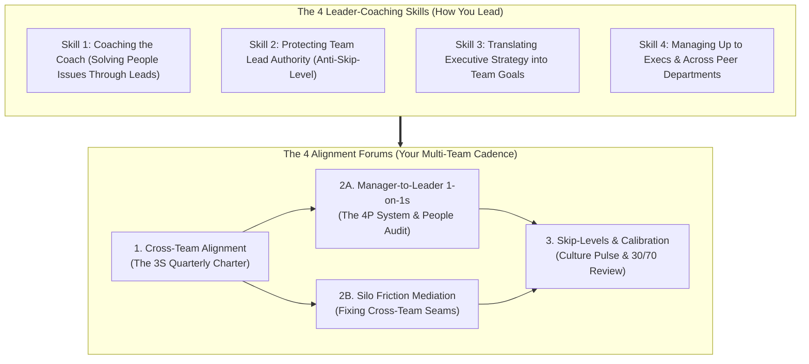
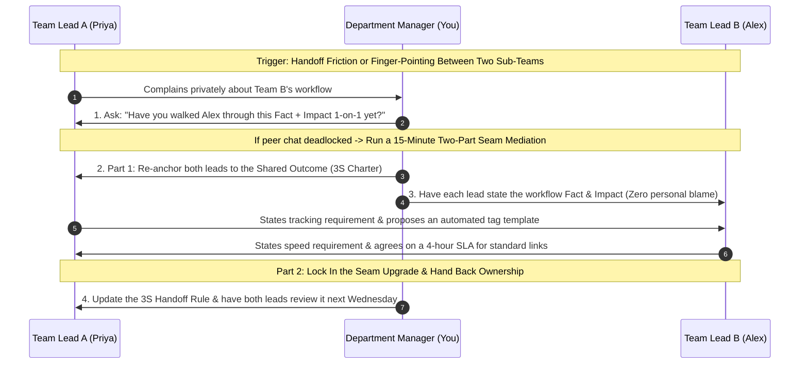
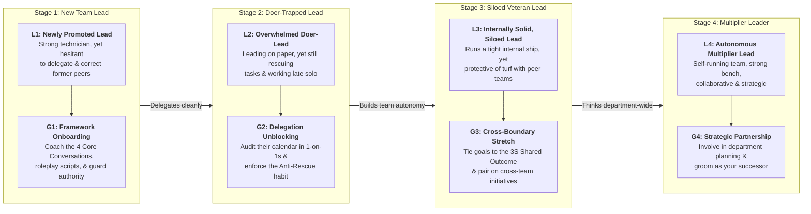

# Leading Other Leaders: Practical Strategies for Moving from Team Lead to Manager of Managers

**Written by:** `aiossan`</br>
**Tone & Register:** Conversational-Professional Global English</br>
**Format:** GitHub Flavored Markdown (GFM)

> [!NOTE] How to Use This Playbook
> This third book in our practical leadership series is built for leaders who have just been promoted above the frontline team-lead level-whether your new title is Department Manager, Head of Function, Group Lead, or Director managing multiple team leads (*Manager of Managers*). Read it straight through from the Introduction to Chapter 13, expand the collapsible blocks (`<details>`) to copy ready-to-use coaching scripts and test yourself on the 4-week simulation, or jump straight to the **Appendix** when you need a quick desk reference before running a cross-team alignment session.

## Table of Contents

1. [Introduction: When Your Direct Reports Are Now Team Leaders Themselves](#introduction-when-your-direct-reports-are-now-team-leaders-themselves)
2. [Chapter 1: Shifting from Managing Doers to Leading Leaders](#chapter-1-shifting-from-managing-doers-to-leading-leaders)
3. [Chapter 2: The 4x4 Multi-Team Framework (4 Alignment Forums + 4 Leader-Coaching Skills)](#chapter-2-the-4x4-multi-team-framework-4-alignment-forums--4-leader-coaching-skills)
4. [Chapter 3: Skill 1: Coaching Leaders to Solve Their Own Team's Problems (Coaching the Coach)](#chapter-3-skill-1-coaching-leaders-to-solve-their-own-teams-problems-coaching-the-coach)
5. [Chapter 4: Skill 2: Protecting Your Team Leads' Authority (Breaking the Skip-Level Habit)](#chapter-4-skill-2-protecting-your-team-leads-authority-breaking-the-skip-level-habit)
6. [Chapter 5: Skill 3: Translating Executive Strategy into Team-Level Operational Goals](#chapter-5-skill-3-translating-executive-strategy-into-team-level-operational-goals)
7. [Chapter 6: Skill 4: Collaborating Across Silos & Managing Up to Senior Executives](#chapter-6-skill-4-collaborating-across-silos--managing-up-to-senior-executives)
8. [Chapter 7: Forum 1: Cross-Team Quarterly Alignment (The 3S Charter)](#chapter-7-forum-1-cross-team-quarterly-alignment-the-3s-charter)
9. [Chapter 8: Forum 2A: Manager-to-Leader 1-on-1s: Inspecting Team Health & Systems, Not Micro-Tasks](#chapter-8-forum-2a-manager-to-leader-1-on-1s-inspecting-team-health--systems-not-micro-tasks)
10. [Chapter 9: Forum 2B: Resolving Turf Wars & Friction Between Team Leaders](#chapter-9-forum-2b-resolving-turf-wars--friction-between-team-leaders)
11. [Chapter 10: Forum 3: Ethical Skip-Level Check-Ins & Departmental Calibration (The 30/70 Review)](#chapter-10-forum-3-ethical-skip-level-check-ins--departmental-calibration-the-3070-review)
12. [Chapter 11: 4-Week Case Study & Interactive Simulation (Maya Leading Priya, Alex, and Ryan)](#chapter-11-4-week-case-study--interactive-simulation-maya-leading-priya-alex-and-ryan)
13. [Chapter 12: Calibrating How You Coach Team Leaders (Matching Leader Maturity L1 to L4 with Modes G1 to G4)](#chapter-12-calibrating-how-you-coach-team-leaders-matching-leader-maturity-l1-to-l4-with-modes-g1-to-g4)
14. [Chapter 13: Your First 30-Day Transition Plan as a Manager of Managers](#chapter-13-your-first-30-day-transition-plan-as-a-manager-of-managers)
15. [Appendix: Quick Desk Reference & Primary Research Citations](#appendix-quick-desk-reference--primary-research-citations)

## Introduction: When Your Direct Reports Are Now Team Leaders Themselves

Congratulations! Your hard work building an autonomous team and designing sustainable workflows has paid off. Senior leadership noticed your impact, and you have just been promoted to the next rung of the ladder: **you now oversee multiple teams, and the people reporting directly to you are team leads or frontline managers themselves.**

On the surface, this promotion looks like a straightforward extension of your old job. You might think, *"Last year I managed five specialists; now I manage three team leads who each manage five specialists. I just do the same thing at a slightly bigger scale, right?"*

Not quite. Within your first few weeks in the seat, you discover that leading leaders is a fundamentally different sport. See how many of these moments already feel familiar:

- You watch a newly promoted team lead stumble through a clumsy project handoff, and your fingers itch to jump directly into their team's Slack channel and take over the keyboard yourself.
- Specialists from your old team-now reporting to the successor you promoted-still DM you directly to ask for approvals or complain quietly about how their new team lead runs things.
- Two team leads reporting to you start pointing fingers at each other when a cross-team release slips (*"That's not our bug-their group handed us broken specs!"*).
- Your VP or C-suite hands you a high-level business mandate (*"Cut customer onboarding cost by 15% this quarter while improving enterprise retention"*), and you have to figure out how to translate that into concrete targets across three distinct sub-teams.
- You feel strangely disconnected from tangible daily output because you are no longer reviewing individual tickets; your days are spent on cross-departmental politics, resource trade-offs, and coaching other managers.

If any of those hit close to home, take heart. <mark>You are navigating one of the most consequential transitions in organizational leadership.</mark>

In their landmark study *The Leadership Pipeline*, Ram Charan, Stephen Drotter, and James Noel point out that moving from **Managing Others** to **Managing Managers** is where many talented leaders derail-because they keep acting like hands-on frontline supervisors instead of multi-team architects[^1].

In Book 1, we covered the mechanics of leading individual contributors. In Book 2, we built the systems and boundaries that prevent manager burnout. In **Book 3**, we master the third stage of the trilogy: **how to lead through other leaders, align multiple sub-teams around shared outcomes, and operate as a strategic bridge between senior executives and the front line.**

We focus on three practical pillars you will use every week in this role:

1. **4 Alignment Forums:** The four recurring touchpoints that keep a multi-team department moving in lockstep-from locking in a quarterly **3S Charter** across team leads, to running manager-level 1-on-1s, mediating inter-team turf friction, and conducting ethical **Skip-Level Check-Ins**.
2. **4 Leader-Coaching Skills:** The four communication habits required at the mid-management level-coaching team leads to solve their own people issues (*Coaching the Coach*), protecting your team leads' authority (*Anti-Skip-Level*), translating executive strategy into team goals, and managing up and across departments.
3. **Leader Maturity Calibration (Levels L1 to L4 -> Modes G1 to G4):** How to diagnose the maturity of each team lead reporting to you-from a nervous first-time lead to a seasoned veteran older than you-so you give each one the exact right mix of coaching and autonomy.

> [!IMPORTANT] Evidence-Based Foundations
> Every practice in this guide draws on established research in organizational design and multi-team leadership: Ram Charan, Stephen Drotter, and James Noel's *Leadership Pipeline* framework[^1], mid-level leadership research from the *Center for Creative Leadership* (CCL)[^2], Harvard Business School professors John Gabarro and John Kotter's classic work on *Managing Your Boss and Horizontal Relations*[^3], and Harvard professor Amy Edmondson and Jean-François Harvey's field research on *Cross-Boundary Teaming*[^4]. Everything is distilled into plain, copy-ready workplace language.

Let's start with the core identity shift required when you step into this role in **Chapter 1**.

## Chapter 1: Shifting from Managing Doers to Leading Leaders

When you first became a frontline team lead, your hardest adjustment was keeping your hands off the technical keyboard so your specialists could learn to execute.

Now, as a **Manager of Managers**, the discipline moves up one full layer: **you must keep your hands off your team leads' steering wheels so they can learn to lead.**

Research from the *Center for Creative Leadership* (<abbr title="Center for Creative Leadership">CCL</abbr>) shows that the single most common failure mode of newly promoted mid-level managers is acting as a "Super-Supervisor"-bypassing their frontline managers to direct individual contributors directly whenever pressure rises[^2].

As a frontline team lead, your primary output was **the work your team shipped**. As a manager of managers, your primary output is **the quality of decisions your team leads make and the seamless collaboration between their teams**.

### Managing Doers vs. Leading Leaders

Stepping into multi-team leadership requires shifting how you operate across four dimensions:

| Work Dimension | As a Frontline Team Lead (Managing Doers) | As a Manager of Managers (Leading Leaders) |
| :--- | :--- | :--- |
| **Primary Coaching Focus** | Coaching specialists on how to execute technical deliverables cleanly and on time. | Coaching team leads on how to set goals, give feedback, and develop their people. |
| **Time Horizon** | Focused on this week's sprint and this month's team deliverables. | Focused on cross-team systems and translating 3-to-12-month business strategy. |
| **When an Execution Issue Pops Up** | You troubleshoot the technical blocker directly with the specialist. | You ask the team lead: *"How are you planning to coach your specialist through this blocker?"* |
| **Directional Bandwidth** | 80% downward (to your team), 20% upward and sideways. | 40% downward (to team leads), 30% sideways (peer department heads), 30% upward (VPs/execs). |

When newly promoted mid-level managers fail to make this shift, they almost always fall into one of two destructive traps:

#### 1. The Shadow Boss Trap (*The Skip-Level Micromanager*)

Because you used to lead one of the sub-teams yourself-and you still have close relationships with the specialists on that team-you keep jumping straight into their daily tickets, answering their questions in DMs, and overriding decisions their new team lead just made.

- **The organizational cost:** You publicly hollow out your team lead's authority. Specialists quickly learn, *"Why listen to my team lead when the Department Head is going to change it anyway?"* Your team lead becomes a passive messenger, and you end up bottlenecking twenty people instead of five.

#### 2. The Tribal Silo Boss Trap (*Playing Favorites & Fighting Neighboring Teams*)

Because you were promoted out of one specific sub-function (for instance, you came up through Content Marketing and now oversee Content, Paid Acquisition, and Brand Design), you unconsciously favor your old group and treat peer departments (like Sales or Product) as adversaries.

- **The organizational cost:** Your other sub-teams feel like second-class citizens, and your team leads copy your territorial behavior-hoarding resources and blaming neighboring teams whenever a shared metric misses the mark.

### The Healthy Standard: Coaching the Coaches & Connecting the Seams

Your value as a Manager of Managers is never proved by showing everyone you are still the smartest technician in the room; it is proved by <ins>how capably your team leads run their groups and solve cross-team problems together without needing you to referee every call</ins>.

Anchor yourself to this core rule:

> **Never cripple a leader reporting to you by grabbing the wheel of their team; stand behind them to sharpen their leadership judgment, and stand in front of them to clear cross-departmental roadblocks.**

To make this concrete in your weekly calendar, this playbook organizes multi-team leadership into the **4x4 Multi-Team Framework**:

1. **4 Alignment Forums (Where You Drive Alignment):** The four recurring forums for uniting sub-teams around shared outcomes, running manager-level 1-on-1s, resolving inter-team friction, and auditing frontline culture.
2. **4 Leader-Coaching Skills (How You Coach & Influence):** The four core habits for coaching leaders through people problems, protecting the chain of authority, translating executive strategy, and managing up and across.

Let's look at how all eight pieces connect in **Chapter 2**.

## Chapter 2: The 4x4 Multi-Team Framework (4 Alignment Forums + 4 Leader-Coaching Skills)

When you oversee multiple teams, hallway chats and ad-hoc DMs are no longer enough to keep fifteen or thirty people moving in the same direction. You need a clean operating cadence that translates executive strategy downward and resolves cross-team friction horizontally.

Everything in this third playbook comes down to **eight repeatable habits**, split into two groups:

1. **4 Alignment Forums** (your multi-team management cadence)
2. **4 Leader-Coaching Skills** (how you coach, translate, and negotiate inside each forum)

Here is how the two groups fit together:



The logic is simple: **you use the 4 Leader-Coaching Skills every day to run the 4 Alignment Forums across each quarter.**

> [!NOTE]
> We will cover the exact structure of the `3S Charter` (*Shared Outcome, Scope Boundary, Sync Cadence*) in Chapter 7.

### The Four Alignment Forums

- **1. Cross-Team Quarterly Alignment (The 3S Charter)**
  A 45-to-60-minute kickoff forum with all of your team leads together at the start of a quarter or major initiative to lock in the **Shared Outcome**, **Scope Boundaries & Handoff Rules**, and **Sync Cadence**.
- **2A. Manager-to-Leader 1-on-1s (The 4P Audit)**
  Your weekly or biweekly 1-on-1 with each individual team lead-focused not on micro-checking individual tickets, but on auditing **Performance Systems**, **People Coaching**, **Path-Clearing**, and **Personal Leader Growth**.
- **2B. Resolving Turf Wars & Friction Between Team Leaders**
  A prompt, 15-minute mediation forum when two team leads hit a stalemate over handoff quality, shared resources, or scope boundaries-refusing triangulation and fixing the process seam.
- **3. Ethical Skip-Level Check-Ins & Departmental Calibration (The 30/70 Review)**
  Transparent quarterly pulse chats with frontline specialists (conducted with your team leads' full buy-in) paired with an end-of-cycle calibration meeting with your team leads to align standards and plan the next cycle.

> [!TIP] How Your 1-on-1 Questions Must Upgrade
> When you led individual contributors, you asked: *"Where does Deliverable X stand?"* When you lead a team lead, upgrade your question to: *"How is your team's delivery rhythm holding up this month, which specialist on your team needs coaching right now, and how are you planning to approach that conversation?"*

### The Four Leader-Coaching Skills

To run those four forums effectively, you rely on four core habits:

1. **Coaching Leaders to Solve Their Own Team's Problems (*Coaching the Coach*):** Guiding a team lead who complains about an underperforming specialist to diagnose and run their own feedback conversation-rather than stepping in to scold the specialist yourself.
2. **Protecting Your Team Leads' Authority (*Breaking the Skip-Level Habit*):** Refusing to let former direct reports bypass their new team lead for backdoor approvals, and never overruling a team lead publicly in front of their group.
3. **Translating Executive Strategy into Team-Level Operational Goals:** Acting as a prism that turns high-level C-suite objectives into concrete, function-specific sub-team priorities while filtering out upper-management noise.
4. **Collaborating Across Silos & Managing Up to Senior Executives:** Proactively managing your VP's expectations with zero surprises and building horizontal alliances with peer department heads to unblock your teams.

In **Part 2 (Chapters 3 through 6)**, we will practice each of the **4 Leader-Coaching Skills** with side-by-side scripts. Then, in **Part 3 (Chapters 7 through 10)**, we will put them to work inside the **4 Alignment Forums**.

## Chapter 3: Skill 1: Coaching Leaders to Solve Their Own Team's Problems (Coaching the Coach)

Expect this scene to happen within your first month of managing team leads:

One of your newly promoted team leads, Alex, steps into your office looking frustrated: *"Hey, I'm really struggling with Jordan on my team. I've explained our client reporting format twice now, and Jordan still submitted the deck with broken tables yesterday. What should I do? Or honestly, could you just hop on a quick call with Jordan so they take it seriously?"*

Pause right here. This is your defining test as a Manager of Managers.

If you take the bait and say, *"Ugh, send Jordan to my office-I'll straighten this out,"* or if you dictate a script word-for-word without making Alex think, you rob Alex of the chance to grow into a real leader.

As Ram Charan's *Leadership Pipeline* research emphasizes, once you manage managers, your job is **coaching your direct reports on how to lead their people, not doing their people-management for them**[^1]. If you step in as the enforcer whenever a specialist slips up, the specialist learns that Alex has no real authority, and Alex never builds the muscle to hold tough 1-on-1s independently.

### Three Traps When a Team Lead Complains About a Specialist

Watch out for these three counterproductive reactions when a team lead brings you a people problem:

- **Playing the Heavy Enforcer:** Stepping in to reprimand a frontline specialist yourself because you think your team lead is "too soft."
- **Co-Venting About the Specialist:** Joining your team lead in complaining about the specialist (*"Yeah, Jordan has always been a bit slow on the uptake"*) without turning the conversation into a concrete coaching plan.
- **Fixing the Deliverable While Ignoring the Leadership Gap:** Telling your team lead how to fix the broken client deck, while failing to ask how the team lead set expectations with the specialist in the first place.

### Three Practical Steps to "Coach the Coach"

Whenever a team lead brings you a performance or behavioral issue regarding one of their team members, walk through these three steps:

#### 1. Audit the Team Lead's Setup Before Blaming the Specialist

Remember the core lesson from Book 1: most execution failures start with a blurry handoff. Before assuming the specialist is at fault, ask your team lead to reflect on how they set the task up:

- *"Alex, before we look at Jordan's mistake, walk me through how you kicked this task off: when you handed this report to Jordan on Monday, what did your written 3D Brief (Deliverable, Definition of Done, Deadline) look like?"*
- *"On this specific type of client deck, what Task Level (L1, L2, L3, or L4) is Jordan currently at? And which guidance mode (G1 to G4) have you been using with them this week?"*

Half the time, that question alone triggers a lightbulb moment: *"Actually... I just slacked Jordan a one-line message and assumed they knew the format."*

#### 2. Prompt Your Team Lead to Design Their Own Course-Correction Plan

If the initial 3D Brief was crystal clear and the specialist still missed the mark, resist telling your team lead what to say. Ask them to construct their own two-part *Private Course Correction*:

- *"Since the 3D Brief was clear and this is the second time the tables came in incomplete, it's time for a Private Course Correction. If you run that 1-on-1 with Jordan this afternoon, what is the specific verifiable Fact and the concrete Impact you're going to state in Part 1?"*

#### 3. Run a 2-Minute Dry Run (*Roleplay*) & Back Their Authority

When a first-time team lead feels nervous about correcting a former peer, offer a quick, low-stakes rehearsal right there in your 1-on-1:

- *"Pretend I'm Jordan for two minutes. Try delivering your opening Fact and Impact lines to me right now so we can hear how it sounds."*
- Once they practice it and get the tone calm and objective, reinforce their confidence: *"That phrasing is clear, calm, and fair. Have that exact chat with Jordan at 2:00 PM today, and let me know tomorrow morning how it went. You've got this."*

### Workplace Script Comparison (Skill 1)

| Avoid This Response to Your Team Lead | Use This "Coach the Coach" Response Instead |
| :--- | :--- |
| *"Tell Jordan to get on a call with me at 3:00 PM-I'll handle it."* (Strips your team lead of authority) | *"This is a great coaching rep for you as Jordan's lead. How are you planning to structure your 1-on-1 reset with Jordan today?"* |
| *"Why can't you get your team to follow basic instructions?!"* (Blaming without coaching) | *"When you delegated that task on Monday, which part of the Definition of Done do you think might have been open to interpretation?"* |
| *"Just put Jordan on a formal warning if it happens again."* (Jumping to threats instead of coaching mechanics) | *"Let's map out the specific Fact and Impact together, and do a quick 2-minute dry run before you meet with Jordan."* |
| Reassigning the struggling specialist to another group at the first sign of trouble. | *"For the next two weeks, shift your guidance mode with Jordan back to G1 (Structured Walkthrough) with a mid-sprint check-in, and let's review their progress next Tuesday."* |

### Field Practice for Chapter 3

This week, build your *Coaching the Coach* habit with these three actions:

- [ ] **Refuse to reprimand a second-level specialist directly:** If a specialist under one of your team leads misses a standard this week, coach their team lead to deliver the private course correction themselves.
- [ ] **Ask the "Handoff Audit" question:** The next time a team lead complains about a teammate's output, ask how they structured the initial 3D Brief and which task level (L1–L4) the specialist sits at.
- [ ] **Run one 2-minute roleplay in a 1-on-1:** Help a team lead practice the opening two sentences of a tough feedback conversation before they deliver it live.

## Chapter 4: Skill 2: Protecting Your Team Leads' Authority (Breaking the Skip-Level Habit)

The second major test of a new Manager of Managers rarely looks like a crisis-it usually shows up as a friendly message from a former direct report.

Picture this scenario: for two years, you led the Content Analytics team. You worked closely with Liam every day. Last month, you were promoted to Department Head, and you promoted Priya to take over as Team Lead of Content Analytics.

On Tuesday afternoon, Liam walks up to your desk (or sends you a direct message): *"Hey Maya, got a second? I wanted to get your take on the Q4 attribution model. Priya told me to use a 7-day lookback window, but I remember you always preferred a 14-day window. Should I just stick with the 14-day one?"*

Or picture yourself in a department-wide review: a specialist on Alex's team is presenting a slide deck, you spot a formatting choice you dislike, and you blurt out in front of fifteen people: *"Hey, change slide 5 to a bar chart before sending that to the client-don't use the line graph Alex approved."*

> [!WARNING] The Destructive Cost of the "Backdoor Override"
> Every time you allow a specialist to go around their team lead to get a different answer from you-or every time you publicly overrule a team lead in front of their direct reports-you cut the legs out from under the very leader you appointed. Within weeks, specialists will bypass your team lead on everything, and your calendar will be flooded with frontline decisions again.

### Three Habits That Quietly Undermine Your Team Leads

Check your own behavior over the past two weeks for these three subtle traps:

- **Keeping an "Open Backdoor" for Former Direct Reports:** Because you enjoy feeling helpful and close to the troops, you answer technical questions and approve drafts directly when specialists ping you, leaving their actual team lead out of the loop.
- **Correcting Second-Level Specialists in Public Channels:** Tagging a specialist directly in a group channel to critique their deliverable, acting as if their team lead does not exist.
- **Overriding Safe Method Choices out of Personal Preference:** Overruling a workflow decision your team lead made with their team simply because it is not the exact way *you* used to do it.

### Three Practical Steps to Protect the Chain of Authority

To build strong, respected team leads beneath you, enforce these three habits:

#### 1. Install the "What Did Your Team Lead Say?" Gate

Whenever a frontline specialist comes directly to you for a project decision, approval, or technical ruling, stay warm and approachable-**while firmly refusing to make the call around their team lead**:

- *"Hey Liam, great to see you! Before I weigh in on the lookback window, have you talked through your rationale with Priya yet? What did she say?"*
- If they say *no*: *"Priya is leading the analytics roadmap for your group now, and I trust her call completely. Take your comparison data to her first."*
- If they say *yes, but I disagree with her call*: *"Got it. If you think there's a technical risk we missed, let's hop into a quick 10-minute huddle with Priya together this afternoon so we're all looking at the same numbers."* (Never reverse a team lead's decision behind their back!).

#### 2. Route Operational Corrections Through the Team Lead

Unless there is an immediate safety or production-outage emergency, channel deliverable feedback through the responsible team lead rather than jumping over their head:

- Instead of tagging the specialist in a public thread, message the team lead privately: *"Hey Alex, I noticed slide 5 in the client deck uses Q2 cohort numbers instead of Q3. Can you review that with Jordan today and guide them on updating it before the 4:00 PM send?"*

When feedback flows through Alex, Jordan sees Alex as the true standard-bearer for the team.

#### 3. Separate "Non-Negotiable Outcomes" from "Personal Style Preferences"

One of the hardest lessons for a promoted manager is realizing that **there is more than one right way to run a team.**

Your team lead might run standups slightly differently than you did, or organize their project board in a different layout. Hold yourself to this filter: **if your team lead's approach is ethical, safe, and delivers the agreed-upon quality and timeline, back their decision 100%-even if it is not how you would have done it.** Save interventions strictly for moments when outcomes, timelines, or team health are genuinely at risk.

### Workplace Script Comparison (Skill 2)

| Avoid This Authority-Eroding Habit | Use This Authority-Building Habit Instead |
| :--- | :--- |
| Answering a backdoor DM: *"Yeah, use the 14-day window Liam-just tell Priya I said it was fine."* | *"Priya owns the methodology calls for your team now, and her sign-off represents mine. Walk her through your data at your afternoon sync."* |
| Calling out a specialist in a large meeting: *"Sam, why is your module still behind schedule?!"* | Addressing the team lead in the review: *"Alex, on the module Sam is working on, what is the main bottleneck and how is your team adjusting the plan?"* |
| Publicly reversing a team lead's decision in Slack: *"Actually team, ignore the schedule Priya posted-use mine instead."* | Messaging Priya privately 1-on-1 to discuss a needed timeline shift, then letting Priya post the updated schedule to her team herself. |
| Listening to a specialist complain about their team lead and promising to "keep it between us." | *"Thanks for sharing that. To actually solve this fairly, which part of this feedback have you shared with your team lead directly, or would you like me to facilitate a 3-way chat?"* |

### Field Practice for Chapter 4

This week, reinforce your team leads' authority with these three moves:

- [ ] **Use the "Have you talked to your Team Lead?" gate 100% of the time:** Whenever a second-level specialist pings you for a project decision this week, route them warmly back to their team lead.
- [ ] **Credit a Team Lead publicly in front of their team:** In your next department meeting or group message, explicitly highlight a win that came from a team lead's coordination and leadership.
- [ ] **Bite your tongue on 1 style preference:** Notice one moment this week where a team lead does something differently than your personal habit (while still hitting the goal), and intentionally let their approach stand.

## Chapter 5: Skill 3: Translating Executive Strategy into Team-Level Operational Goals

When you step into mid-level management, you live at the intersection of two completely different languages:

1. **The Executive Language (C-Suite / VPs):** Senior executives speak in terms of annual revenue, EBITDA margins, market share, unit economics, and strategic pillars. Their directives often arrive as broad headlines: *"In Q4, our company mandate is reducing customer churn by 15% while keeping operating expenses flat."*
2. **The Frontline Language (Team Leads & Specialists):** Frontline teams live in sprint tickets, UI wireframes, ad creatives, support queues, and Friday shipping deadlines.

Research from the *Center for Creative Leadership* (<abbr title="Center for Creative Leadership">CCL</abbr>) identifies a common trap among ineffective mid-level managers: acting as a passive **"Mail Carrier" (*Message Forwarder*)**[^2]. They walk out of the VP's strategy meeting, forward the executive slide deck straight to their team leads, and say: *"Here's the Q4 deck from the VP-we need to cut churn by 15%. Make sure your teams do their part!"*

What happens next? Your team leads stare at the deck in confusion. The Design Lead wonders how font choices reduce churn by 15%, the Ads Lead keeps running the exact same campaigns as last quarter, and nothing changes on the ground.

### Your Core Value as a Manager of Managers: Acting as the "Strategic Prism"

Just as a glass prism takes a single beam of white light and splits it into distinct, visible colors, your job as a department leader is taking a single macro business goal from above and refracting it into **concrete, function-specific operational targets for each sub-team below you**.

### Three Practical Steps to Translate Executive Strategy Downward

Run this three-step translation process whenever new strategic priorities come down from senior leadership:

#### 1. Explain "The Strategic Why" in Plain Human Language

Before handing out numbers or projects, translate the business reality behind the executive decision so your team leads understand the *why* without corporate jargon:

- **Avoid saying:** *"Corporate cut our Q4 vendor budget by 20%, so we just have to deal with it."* (Breeds cynicism and helplessness).
- **Translate the context:** *"Team, across our industry, new-customer acquisition costs rose 30% this year. To keep the company profitable and protect everyone's roles without layoffs, we are shifting 20% of our focus from cold acquisition to helping existing enterprise customers expand their usage."*

When your team leads grasp the business logic, they can champion the direction confidently with their own specialists.

#### 2. Break 1 Macro Mandate into Distinct "Sub-Team Contribution Pillars"

Never leave a macro company metric floating in the air. Sit down with your team leads and translate the department goal into specific levers each sub-team actually controls.

Look at how one executive mandate (*"Reduce Enterprise Churn by 15% in Q4"*) translates into clear operational targets across three different team leads:

- **For the Onboarding & Support Team Lead:** *"Your team's lever is cutting time-to-first-value for new enterprise accounts from 14 days down to 5 days."*
- **For the Content & Enablement Team Lead:** *"Your team's lever is shipping 4 interactive playbook templates for the features most correlated with annual renewal."*
- **For the Data & Analytics Team Lead:** *"Your team's lever is building an early-warning health score that flags accounts with dropping usage 60 days before their renewal date."*

Suddenly, every team lead knows the exact scoreboard their group owns!

#### 3. Absorb Upper-Management Noise, Pass Down Only Clear Signals

At the executive level, brainstorms, hypothetical pivots, and half-baked ideas fly around every week.

A hallmark of a mature Manager of Managers is acting as a **noise filter**: do not broadcast every unconfirmed executive rumor or passing anxiety down to your team leads. Hold preliminary ideas in your own notebook until a real decision is made, and pass down calm, actionable signals so your teams can execute without constant whiplash.

### Workplace Script Comparison (Skill 3)

| Avoid This "Mail Carrier" Habit | Use This "Strategic Prism" Habit Instead |
| :--- | :--- |
| Forwarding an executive email to your channel with: *"FYI team, see below from the VP."* | Distilling the signal: *"Out of today's executive town hall, here are the 2 specific shifts that matter for our department this month: (1)... and (2)... We'll map out sub-team scopes on Thursday."* |
| Blaming "upper management" to look relatable: *"I don't know why the execs want this either, but we have to do it."* | Explaining the business driver maturely: *"The goal behind this compliance update is unlocking enterprise healthcare deals in Q4. Let's design the cleanest way to build it into our workflow."* |
| Handing the exact same generic KPI to three completely different functional teams. | Translating the department KPI into the specific operational input metric each sub-team directly controls. |
| Passing every half-baked executive brainstorm down to the team as an urgent priority pivot. | Filtering out unconfirmed executive noise and shielding your teams' sprint focus until scope is officially locked. |

### Field Practice for Chapter 5

This week, sharpen your strategic translation muscle with these three steps:

- [ ] **Run the "Line-of-Sight" test on 1 company goal:** Ask each of your team leads to explain in one sentence how their team's current sprint priorities directly move the needle on your department's #1 quarterly metric.
- [ ] **Use the "Business Context + Sub-Team Lever" formula:** The next time you cascade a directive from above, explain the commercial *Why* in plain English first, then define each sub-team's specific lever.
- [ ] **Filter out 1 piece of executive noise:** Catch yourself before passing along a speculative rumor or unconfirmed priority shift from above; wait until you have verified the concrete impact with your boss.

## Chapter 6: Skill 4: Collaborating Across Silos & Managing Up to Senior Executives

When you were a frontline team lead, 80% of your effectiveness came from managing downward. Once you become a Manager of Managers, the center of gravity shifts: **your sub-teams cannot succeed if you fail to manage upward (with your VP/C-suite) and sideways (with peer department heads).**

Harvard Business School professors John Gabarro and John Kotter's classic research on *Managing Your Boss* and horizontal leadership proved that high-performing mid-level managers do not wait passively for instructions-they **proactively manage executive expectations upward and build cross-departmental alliances sideways before bottlenecks stall their teams**[^3].

Think about the biggest headaches slowing down your team leads right now: delayed specs from Product, slow legal reviews, rigid data access from IT, or misaligned promos with Sales. Frontline team leads rarely have the political clout to fix cross-departmental bottlenecks on their own-**clearing those horizontal paths is uniquely your job as the department leader.**

### Three Mistakes Mid-Level Managers Make Upward and Sideways

- **Going Radio Silent Until Your Boss Chases You:** Because you are busy running your department, you only update your VP when something goes wrong or when they ping you. That silence makes executives anxious, triggering top-down micromanagement.
- **Only Talking to Peer Department Heads When You Want to Complain:** You ignore your peer managers in Engineering, Sales, or Finance for months, and only message them to say, *"Your team dropped the ball again!"* Naturally, they get defensive and dig into their silos.
- **Sending Junior Team Leads into Outgunned Political Battles:** Expecting a newly promoted L1 team lead to negotiate a major priority conflict with a seasoned Director in another department without your air cover.

### Three Practical Steps to Master Managing Up & Across

#### 1. Manage Up with the "Proactive 5-Bullet Executive Pulse" (*Zero Surprises*)

What does a busy VP or C-level executive want most from the department heads reporting to them? **Predictability, concise visibility, and early warning on risks accompanied by solutions.**

Install these three upward habits:

- **Adapt to your boss's communication style:** As Gabarro and Kotter note, some executives are *readers* (who want a crisp written brief every Friday afternoon) while others are *listeners* (who prefer a 10-minute verbal walk-through on Monday morning)[^3]. Match their natural cadence.
- **Send a "5-Bullet Executive Pulse" before they have to ask:** Every Friday, send a concise update covering: (1) Top department wins against quarterly goals, (2) Key metric trajectory, (3) Risks spotted early + mitigation in progress, (4) Next week's focus, and (5) Specific executive decisions or air cover needed from them.
- **Never bring a raw problem upward without a recommended decision:** When escalating a strategic roadblock to your VP, use the formula: *"We hit Constraint X. We evaluated three paths and recommend Option A because it protects our launch date at zero extra cost. Unless you see a broader conflict, we'll proceed with Option A on Tuesday."*

#### 2. Build "Trust Equity" with Peer Department Heads Before You Need a Favor (*Managing Across*)

Harvard professor Amy Edmondson's research on *Cross-Boundary Teaming* shows that horizontal collaboration breaks down when department heads only interact during heated escalations[^4].

- Schedule a recurring 20-minute monthly coffee or virtual check-in with the 2 or 3 peer department heads whose workflows touch yours most often.
- Ask one disarming question: *"Looking at how our two departments interact, what is one thing my teams do that makes life easier for your people, and what is one handoff friction we could clean up together this quarter?"*
- Investing twenty minutes a month in goodwill makes peer leaders ten times more responsive when your team needs fast cross-functional support during a crunch.

#### 3. Frame Cross-Departmental Negotiations Around "Shared Company Wins"

When friction erupts between your department and another function (e.g., Marketing vs. Sales, or Product vs. Engineering), never walk into the room arguing about *"what my team needs."*

Anchor the conversation to the **Shared Customer or Company Goal** that both of your bosses care about:

- *"Hey David, both of our VPs are measuring us on the same Q4 enterprise launch target. Right now, the manual data handoff between our teams is costing both of our groups six hours a week in rework. Let's spend 15 minutes standardizing the intake template so your reps get faster leads and my analysts stop chasing missing fields."*

### Workplace Script Comparison (Skill 4)

| Avoid This Siloed / Reactive Phrasing | Use This "Managing Up & Across" Phrasing Instead |
| :--- | :--- |
| Waiting until your VP asks: *"Oh yeah, that launch actually slipped by a week..."* | Flagging early with a plan: *"Heads-up: Vendor X delayed API delivery by 3 days. We shifted QA resources to parallel-path testing so our Friday launch date remains intact."* |
| Attacking a peer department head: *"Your sales reps never fill out the CRM fields properly, and it's ruining our attribution!"* | Proposing a mutual system win: *"To save your reps time and give our team clean attribution data, what if we cut the required CRM form down to just 4 dropdown fields?"* |
| Telling your junior team lead: *"Go convince the Finance Director to change their policy."* | Providing executive air cover: *"I'll align with the Finance Director today to agree on the budget guardrail. Once we lock the principle, you and their lead can finalize the weekly workflow."* |
| Dumping a messy dilemma in your boss's lap: *"What do you want us to do about this?"* | Bringing a clear recommendation: *"Given the trade-offs, I recommend Path B. Do you support us locking that in?"* |

### Field Practice for Chapter 6

This week, strengthen your upward and horizontal influence with these three actions:

- [ ] **Send 1 proactive "5-Bullet Executive Pulse" to your boss this Friday:** Beat them to the punch with a crisp summary of wins, metrics, mitigated risks, next week's focus, and any needed decisions.
- [ ] **Hold a 15-minute goodwill sync with 1 peer department head:** Ask what single handoff between your two departments could be made smoother this quarter.
- [ ] **Provide air cover on 1 cross-departmental roadblock for your team leads:** Ask your team leads which external bottleneck is slowing them down most this week, and step in peer-to-peer with the neighboring department head to clear it.

## Chapter 7: Forum 1: Cross-Team Quarterly Alignment (The 3S Charter)

With the four Leader-Coaching Skills in place from Part 2, we now step into **Part 3: The 4 Alignment Forums** that structure your multi-team management cycle. We begin at the start of the quarter or major cross-team initiative with **Forum 1: Cross-Team Quarterly Alignment (The 3S Charter).**

When you led a single team of specialists in Book 1, setting goals meant holding 1-on-1 conversations using the *3D Brief* (Deliverable, Definition of Done, Deadline).

When you oversee **multiple teams**, however, setting quarterly goals with each team lead separately behind closed doors is a recipe for organizational dysfunction.

Here is why: when you align with Team Lead A, Team Lead B, and Team Lead C in isolation:

- Team Lead A assumes end-to-end integration testing belongs to Team Lead B.
- Team Lead B assumes it belongs to Team Lead A.
- Team A's delivery date is scheduled three days *after* Team C needs the assets to launch.
- Six weeks later, when the project drops into the gap between teams, your team leads sit in a room blaming each other while you play referee.

As Amy Edmondson and Jean-François Harvey demonstrate in *Cross-Boundary Teaming*, multi-team failures rarely happen inside the core of a single team-they happen **at the seams where work passes from one team to the next**[^4].

### How to Run a Cross-Team Alignment Forum (The 3S Charter)

At the start of every quarter (or major multi-team launch), bring all of your team leads together for a 45-to-60-minute alignment forum. Before anyone leaves the room, lock in a written one-page **3S Charter**:

#### 1. Shared Outcome (*The Unified Department Scoreboard*)

Before discussing sub-team metrics, establish **1 to 3 Shared Department Outcomes** that every team lead in the room is jointly accountable for achieving.

The rule is unmistakable: **no single sub-team can claim victory at the end of the quarter if the department's Shared Outcome fails.**

- *Siloed Approach (Wrong):* The Content Team is measured purely on volume of articles published, while the Paid Growth Team is measured purely on cost-per-acquisition. Content ships high-volume fluff that converts poorly, Paid Growth blames Content, and both argue over their separate scorecards.
- *The 3S Approach (Right):* *"Our #1 Shared Outcome across all three teams this quarter is generating 2,000 sales-qualified enterprise pipeline opportunities at a blended CPA under $120. Every sub-team's success starts with hitting this shared scoreboard together."*

#### 2. Scope Boundaries & Handoff Rules (*Seam Definitions*)

With all team leads looking at the same page, map out the exact boundary lines between teams and establish **explicit Handoff Rules (*Definition of Ready*)**:

- **Who is the single accountable owner** for each stage of the workflow?
- **What is the objective checklist for a valid handoff between Team A and Team B?** For example: *"The Brand Event Team hands webinar lead data to the Content & Nurture Team within 24 hours of each event. A handoff is only complete when (1) CSV fields are cleaned and deduplicated, (2) attendance tags are verified, and (3) the recording link is live."*

When both team leads co-design the handoff checklist upfront, mid-quarter finger-pointing disappears.

#### 3. Sync Cadence (*Peer-to-Peer Leader Touchpoints*)

Never make yourself the central switchboard for routine communication between your team leads! If Priya has to tell you something so you can tell Alex, you have turned yourself into a human router.

Lock in a direct **Peer Sync Cadence** between your team leads:

- *"For this launch, Priya, Alex, and Ryan will run a direct 15-minute peer sync every Wednesday at 10:00 AM to check handoff timing and unblock cross-team dependencies-without waiting for me. Just drop a 3-bullet summary in our `#leads-sync` channel afterward."*

<details>
<summary><strong>Copy-Paste Script Template: Forum 1 (Cross-Team 3S Charter Kickoff)</strong></summary>

```text
"Team Leads, today we're locking in our 1-page 3S Charter for [Quarter / Initiative Name] so all of our groups operate as one connected system:
1. Shared Outcome: Our unified department scoreboard this cycle is [State 1-3 Shared Department Metrics & Deadline]. We win or lose on this number together.
2. Scope Boundaries & Handoff Rules:
   - [Team A, led by Lead A] owns [Scope A] and hands off to [Team B] every [Day/Time] meeting three criteria: [Criteria 1, 2, 3].
   - [Team B, led by Lead B] owns [Scope B] and feeds performance data back to [Team A] every [Day/Time].
3. Sync Cadence: The three of you will hold a direct 15-minute peer sync every [Day/Time] to clear cross-team handoff snags directly, and post a 3-bullet recap in our leads channel.
Looking at the seams between our teams, where do you see any gray areas we should tighten up right now?"
```
</details>

### Multi-Team Goal Setting Comparison (Forum 1)

| Siloed Goal Setting (Breeds Turf Wars) | 3S Charter Alignment (Builds One Unified Department) |
| :--- | :--- |
| Setting quarterly goals with each team lead in isolated 1-on-1 meetings. | Aligning all team leads together in one room around a shared 1-page **3S Charter**. |
| Giving sub-teams conflicting local KPIs (e.g., speed vs. stability) with no shared scoreboard. | Anchoring every team lead to 1–3 **Shared Department Outcomes** alongside their functional metrics. |
| Leaving inter-team handoff standards unwritten until deliverables break in transit. | Co-writing explicit **Handoff Checklists (*Definition of Ready*)** between sending and receiving team leads. |
| Routing all cross-team coordination through the Department Head's desk. | Establishing a recurring 15-minute peer-to-peer **Sync Cadence** directly between team leads. |

### Field Practice for Chapter 7

- [ ] **Audit the "gray seams" between your sub-teams:** Ask your team leads this week: *"Where do handoffs between our groups most frequently stall or cause rework?"*
- [ ] **Draft a 1-Page 3S Charter for your current cycle:** Document the **Shared Outcome**, **Scope Boundaries & Handoff Rules**, and **Peer Sync Cadence** in a shared doc.
- [ ] **Have sending and receiving Team Leads co-sign their handoff checklist:** Let your team leads agree directly on the 3–4 criteria that define a "ready-to-use" handoff between their groups.

## Chapter 8: Forum 2A: Manager-to-Leader 1-on-1s: Inspecting Team Health & Systems, Not Micro-Tasks

In Books 1 and 2, you mastered the frontline 1-on-1. When you become a Manager of Managers, however, **the agenda of your 1-on-1s with your team leads must undergo a complete upgrade.**

Imagine sitting down for your weekly 30-minute 1-on-1 with Alex (who now leads a five-person team) and spending the entire half hour asking: *"Did you change the headline on landing page B? Did you check row 14 of the spreadsheet? Did you email the vendor?"*

When you run a frontline task-check 1-on-1 with a team lead, you cause two serious problems:

1. You demote your team lead back into an individual contributor and train them to stop thinking like a manager.
2. You completely miss the blind spots that can sink a sub-team: **broken team morale, a struggling specialist who isn't getting coached, or a team lead who is secretly burning out from doing their team's work at midnight!**

Drawing on *The Leadership Pipeline*[^1] and CCL's mid-level management research[^2], your 1-on-1 with a team lead should shift from inspecting individual tasks to **auditing team systems, people leadership, and cross-functional roadblocks**.

### The 4P Agenda for Manager-to-Leader 1-on-1s

To make your 30-minute weekly or biweekly 1-on-1s with each team lead high-leverage, structure the conversation around the **4P Agenda**:

#### 1. Performance Systems & Patterns (25% of Time - Trends, Not Tickets)

Instead of checking individual tickets (which live on the project board), ask about delivery patterns and system reliability:

- *"Looking at your team's scoreboard this month, which workstreams are pacing cleanly, and where are you seeing recurring bottlenecks in the workflow?"*
- *"What process tweak did you and your team put in place this week so last sprint's delay doesn't repeat?"*

#### 2. People Leadership & Team Health (35% of Time - The Heart of Coaching the Coach)

This is the signature block of a Manager-of-Managers 1-on-1. Inspect how your team lead is developing and managing their people:

- *"Across your five teammates, who delivered standout work this week, and how did you recognize them?"*
- *"Who on your team is currently struggling, stuck at L2, or drifting off track? Walk me through how you're coaching them and what your next 1-on-1 with them looks like."*
- *"Did all of your weekly 1-on-1s with your team happen on schedule this past week, and what themes are you hearing from them?"* (This holds your team leads accountable for actually leading their people!).

#### 3. Path-Clearing & Cross-Team Seams (20% of Time - Your Air Cover)

Ask where your positional authority is needed to unblock their group externally:

- *"How are handoffs working with the other team leads under our 3S Charter, and what external roadblock with another department needs my air cover this week?"*

#### 4. Personal Leader Growth & Bandwidth (20% of Time)

Coach the leader sitting across from you on their own craft and sustainability:

- *"Where is your own energy and calendar sitting on the L1–L4 fatigue scale this week? Which leadership skill-delegation, tough feedback, or strategic planning-do you want us to focus on sharpening this month?"*

<details>
<summary><strong>Copy-Paste Agenda Template: Forum 2A (Manager-to-Leader 4P 1-on-1)</strong></summary>

```text
"Hey [Team Lead Name], for our 30-minute 1-on-1 today, let's walk through our 4P check-in on your team:
1. Performance Systems (5-7 mins): Looking at your team's quarterly scoreboard, which metrics are on track and what workflow bottleneck are you tuning this week?
2. People & Team Coaching (10 mins): Who on your team earned Direct Recognition this week, and who needs a Private Course Correction or extra scaffolding? How are you approaching that chat?
3. Path-Clearing (5 mins): How are cross-team handoffs flowing, and is there any cross-departmental roadblock where you need me to step in with a peer manager?
4. Personal Leader Growth (5 mins): How is your own workload balance holding up, and which leadership muscle do you want coaching on right now?"
```
</details>

### Manager 1-on-1 Question Comparison (Forum 2A)

| Frontline Task Questions (Wrong for a Team Lead 1-on-1) | Manager-of-Managers System Questions (Builds Strong Leaders) |
| :--- | :--- |
| *"Did you finish formatting slide 6 of the client deck?"* | *"Is your team's peer-review checklist catching formatting issues before decks reach your desk?"* |
| *"Why is Jordan still making mistakes? I'll talk to Jordan myself."* | *"What is your diagnosis of Jordan's task level on that workflow, and what did the two of you agree on in your last Course Correction?"* |
| Spending 30 minutes reviewing technical details while never asking about the people on the team. | Dedicating 35% of every 1-on-1 to auditing how the team lead is praising, correcting, and developing each member of their group. |
| Assuming your team leads are running great 1-on-1s without ever checking. | Asking regularly: *"How are your 1-on-1s with your team going, and who on your bench are you grooming as your Second-in-Command?"* |

### Field Practice for Chapter 8

- [ ] **Upgrade your 1-on-1 doc with every Team Lead to the 4P Agenda:** Share the 4P structure (**Performance Systems, People Coaching, Path-Clearing, Personal Growth**) in your shared 1-on-1 notes 24 hours before your next sync.
- [ ] **Audit people-coaching in every 1-on-1 this week:** Ask each team lead to walk you through one specific recognition and one specific coaching conversation they held with their direct reports this week.
- [ ] **Verify your Team Leads' management cadence:** Confirm that every team lead reporting to you is holding consistent 1-on-1s and maintaining clear 3D Briefs with their specialists.

## Chapter 9: Forum 2B: Resolving Turf Wars & Friction Between Team Leaders

Whenever you manage multiple ambitious team leads operating under tight deadlines, friction at the seams is inevitable.

Here is how it usually shows up:

- **Priya (Content & Analytics Lead)** messages you privately on Tuesday: *"Maya, Alex's paid media team keeps changing campaign tags without telling us, and it's breaking our attribution scripts every week!"*
- On Wednesday morning, **Alex (Paid Acquisition Lead)** complains to you in his 1-on-1: *"Maya, Priya's team takes four days to approve simple tracking links, so my team is missing our launch windows!"*

When inexperienced department heads run into this situation, they almost always fall into the **"Triangle Drama" Trap (*Triangulation*)**:

They listen sympathetically to Priya and say, *"I'll talk to Alex about that,"* and then listen to Alex and say, *"I'll tell Priya to speed up."* Look at the damage that causes:

1. Priya and Alex never learn to resolve peer-level operational friction directly with each other.
2. You trap yourself as the permanent middleman carrying complaints back and forth between grown adults.
3. Both team leads become more territorial because complaining to the boss in private gets rewarded.

As Amy Edmondson's cross-boundary research shows, inter-team conflict is almost always **a flawed process seam disguised as a personality clash**[^4].

### The Iron Rule: Refuse Triangulation & Mediate the Process Seam Together

Unless a complaint involves an HR, safety, or ethical violation, follow this three-step protocol whenever Team Lead A complains to you about Team Lead B:

1. **Listen to the core fact for 2 minutes without taking sides.**
2. **Ask the directness gate: *"Have you shared this specific Fact and Impact directly with Alex in your Wednesday peer sync yet?"***
3. **If they already tried and hit a deadlock, bring both team leads together for a 15-Minute Two-Part Seam Mediation focused 100% on upgrading the handoff system.**



### The Two-Part Structure of Cross-Team Seam Mediation

#### Part 1: Anchor to the Shared Outcome & Strip Blame from the Process Fact

1. **Re-anchor both team leads to their Shared Outcome (from the 3S Charter):**
   *"Priya, Alex, thanks for jumping on for 15 minutes. Both of you care deeply about hitting our Q4 target of 2,000 enterprise opportunities. Right now, the handoff seam between tracking setup and campaign launch is creating friction for both of your teams."*
2. **Set the "System Fact Only" ground rule:**
   *"We're not here to debate whose team works harder; we're here to fix the handoff pipe so both teams win. Priya, take two minutes to state the specific technical gap happening with campaign tags, and then Alex, share the timeline constraint on your side."*

#### Part 2: Co-Design the Handoff Upgrade & Return the Wheel

Once both constraints are on the table (e.g., manual tag creation takes too long, so the ad team skips it when rushing), prompt your team leads to engineer the system fix together:

1. **Prompt a joint workflow solution:**
   *"Okay, the bottleneck is clear: manual tag creation takes 48 hours, while ad launches need same-day turnaround. How can the two of you redesign this handoff so Alex's team gets same-day links and Priya's team gets 100% clean schema?"*
2. **Update the 3S Charter & reinforce peer ownership:**
   *"Building a self-serve tag generator sheet with locked dropdowns solves both sides. Let's add that rule to our 3S Charter right now. I'll let the two of you check in on how it's running during next Wednesday's peer sync. Appreciate how constructively you both solved this."*

<details>
<summary><strong>Copy-Paste Script Templates: Forum 2B (Stopping Triangulation & Mediating Seams)</strong></summary>

```text
[When Team Lead A Complains Privately About Team Lead B]
"Thanks for flagging that context, [Lead A]. To keep trust high across our leadership bench, I don't carry messages back and forth between leads behind closed doors. Have you shared that specific Fact and Impact directly with [Lead B] yet? Take 10 minutes today to walk [Lead B] through it 1-on-1. If the two of you still hit a trade-off deadlock on scope or timing, let me know and the three of us will hop on a 15-minute call tomorrow morning to upgrade our 3S handoff rule."

[Opening a 15-Minute Three-Way Seam Mediation]
"Hey [Lead A] and [Lead B], we're getting together for 15 minutes because our teams share the same Q4 scoreboard on [Shared Outcome], and right now the handoff seam around [Specific Process] is slowing both groups down. Let's focus 100% on the workflow mechanics: let's hear the concrete constraint from each side in two minutes, and then agree on one change to our 3S Handoff Checklist so neither team gets bottlenecked next week."
```
</details>

### Inter-Team Conflict Resolution Comparison (Forum 2B)

| Dysfunctional Handling (Deepens Silos) | Effective Multi-Team Leadership (Strengthens Seams) |
| :--- | :--- |
| Listening to Lead A complain about Lead B in private and promising, *"I'll go reprimand Lead B for you."* | Stopping triangulation immediately: coaching Lead A to talk with Lead B directly first, or bringing both into a transparent 15-minute seam mediation. |
| Letting department meetings degenerate into finger-pointing over who caused a delay. | Reframing every cross-team hiccup as a gap in the **3S Handoff Checklist** that the leads must co-engineer. |
| Taking over cross-team coordination yourself because your leads cannot agree. | Facilitating a 15-minute agreement on the new handoff rule and holding both leads accountable for monitoring it in their weekly peer sync. |
| Pitting sub-teams against each other: *"Why can't your team be as organized as Priya's team?!"* | Respecting each sub-team's distinct technical reality while holding all leads accountable to the **Shared Department Outcome**. |

### Field Practice for Chapter 9

- [ ] **Refuse 1 triangulation attempt this week:** When a team lead or specialist complains to you about a peer, coach them to have a direct *Fact + Impact* conversation with that peer first.
- [ ] **Upgrade 1 friction-heavy handoff seam:** Bring two team leads together for 15 minutes to tighten the checklist or SLA on their most frequent point of friction.
- [ ] **Publicly praise peer-to-peer problem solving:** The next time two team leads resolve a cross-team snag on their own without escalating to you, recognize their collaboration in your department sync.

## Chapter 10: Forum 3: Ethical Skip-Level Check-Ins & Departmental Calibration (The 30/70 Review)

Every thoughtful Manager of Managers eventually wrestles with this question:

> **"If I step out of day-to-day technical execution and refuse to micromanage my team leads, how do I make sure I'm not flying blind if a team lead is quietly mismanaging their people?"**

That concern is 100% valid. If your only source of information about a sub-team is what its team lead tells you in 1-on-1s, you can miss early warning signs of a toxic or overwhelmed sub-team-until three top specialists suddenly hand in their resignation letters on the same Friday.

The way you stay connected to frontline reality without undermining your team leads' authority is **Forum 3: Ethical Skip-Level Check-Ins & The 30/70 Departmental Calibration**.

### 1. How to Run Ethical Skip-Level Check-Ins (Without Undermining Your Team Leads)

A **Skip-Level Check-In** is a structured, 20-minute conversation held once a quarter between you (the Department Head) and frontline specialists (your team leads' direct reports).

To make sure skip-levels build trust rather than paranoia or backdoor politics, follow these **3 Ethical Skip-Level Guardrails**:

1. **Brief Your Team Leads Openly Upfront (Zero Secrecy):**
   Never schedule skip-level chats behind a team lead's back. Frame them transparently in your leads meeting: *"Team, once a quarter I hold a 20-minute skip-level chat with each specialist across our department. The purpose is never to audit behind your back or make technical project calls-it's to hear their long-term career goals, spot department-level tool or process bottlenecks, and gather themes that help me support you as their leader."*
2. **Ask System, Culture, and Career Questions (Never Audit Daily Tickets):**
   Use a consistent set of four open questions that focus on the environment rather than daily task supervision:
   - *"What part of your work over the past quarter has been most energizing or rewarding?"*
   - *"Which department-level tools, cross-team processes, or approval steps slow your work down the most?"*
   - *"What is one thing [Their Team Lead's Name] is doing that helps you do your best work?"*
   - *"If there were one piece of extra clarity or support from the department or from [Team Lead's Name] that would make your team even stronger next quarter, what would it be?"*
3. **Protect Anonymity on Themes & Route Operational Requests Back to the Team Lead:**
   If a specialist tries to use a skip-level chat to get you to approve a project spec or overrule their team lead, apply **Skill 2** on the spot and route the decision back to their team lead. And if you hear a recurring coaching theme across multiple specialists on the same team (for example, three people mention that sprint priorities keep changing mid-week), **never name-drop individual specialists to the team lead**; instead, coach the team lead on sprint stability during your next 4P 1-on-1!

### 2. Running the End-of-Cycle Departmental Calibration (The 30/70 Split)

At the end of each month or quarter, bring all of your team leads together for a 60-minute **Departmental Calibration & Strategy Review** using the **30/70 Rule**:

- **First 30% of the Meeting (Scoreboard Review & Talent Calibration):**
  - Review progress against the department's **Shared Outcomes (3S Charter)** with zero new surprises.
  - Run **Cross-Team Talent Calibration**: have your team leads review performance standards across all sub-teams together. This prevents "grading inflation" (where one lenient team lead rates everyone a 10/10 while a strict team lead rates everyone a 6/10) and identifies high-potential L3/L4 specialists across the department who are ready for cross-team stretch assignments.
- **Remaining 70% of the Meeting (Next-Cycle Strategy & Resource Allocation):**
  - Translate upcoming executive priorities (**Skill 3**).
  - Reallocate budget, tooling, or temporary cross-team bandwidth toward the highest-leverage bottlenecks.
  - Lock in the updated **3S Charter** for the upcoming cycle.

<details>
<summary><strong>Copy-Paste Script Templates: Forum 3 (Transparent Skip-Level Invitations)</strong></summary>

```text
[Note to Your Team Leads Before Scheduling Skip-Levels]
"Hey Team Leads, next week I'm kicking off our routine quarterly 20-minute skip-level chats with the specialists across our groups. As always, my goal is listening for department-level tool/process roadblocks, hearing their long-term career aspirations, and learning what's working well on the ground. All project and operational decisions remain 100% with you. Once I finish the round, I'll share high-level themes with each of you in our 1-on-1s."

[Calendar Invite Note to a Frontline Specialist]
"Hey [Specialist Name], looking forward to our 20-minute quarterly skip-level chat next week! No need to prepare any slides or status reports. I'd simply love to hear your perspective on: (1) What's going well and energizing you in your role lately, (2) Any department-level tool or cross-team workflow friction I can help clear from my seat, and (3) Your long-term career growth goals here. Talk to you on [Day] at [Time]!"
```
</details>

### Departmental Review Comparison (Forum 3)

| Dysfunctional Practice (Blind or Politicized) | Healthy Multi-Team Practice (Transparent & Calibrated) |
| :--- | :--- |
| Never speaking to frontline specialists all year because *"that's my team leads' job."* | Holding transparent, structured 20-minute quarterly **Skip-Level Check-Ins** with your team leads' full awareness. |
| Secretly interrogating specialists to dig up dirt on their team lead. | Asking first what their team lead is doing well, and focusing on department-level process blockers and career growth. |
| Telling a team lead: *"Liam told me yesterday that you're disorganized!"* (Destroys psychological safety) | Protecting individual confidentiality and coaching the team lead on aggregate workflow patterns during your 4P 1-on-1. |
| Allowing each sub-team to grade performance and hoard talent in isolation. | Running a **30/70 Calibration Review** where team leads align evaluation standards (30%) and co-plan next quarter's 3S Charter (70%). |

### Field Practice for Chapter 10

- [ ] **Brief your Team Leads on your Skip-Level cadence:** Explain the 3 ethical guardrails upfront so your team leads see skip-levels as support rather than surveillance.
- [ ] **Run 2 ethical Skip-Level Check-Ins (20 minutes each) this month:** Use the four open questions above and keep your hands off tactical project approvals.
- [ ] **Host a 30/70 Calibration & Planning Session with your Team Leads:** Spend 30% calibrating cross-team performance and bench talent, and 70% locking in next month's shared priorities.

## Chapter 11: 4-Week Case Study & Interactive Simulation (Maya Leading Priya, Alex, and Ryan)

Let's follow **Maya** into the third chapter of her leadership journey!

After Maya redesigned her team's workflows and built strong bench strength in Book 2, Marcus (her VP) was promoted to Chief Marketing Officer (CMO), and **Maya was promoted to Director of Growth & Brand Marketing-stepping up as a Manager of Managers!**

Maya no longer manages individual analysts directly. Instead, she leads **three Team Leads**, who collectively manage 16 specialists across the department:

1. **Priya (*Team Lead, Marketing Analytics*):** Maya's former Second-in-Command, promoted three weeks ago to take over Maya's old team. Brilliant technically, but still hesitant when correcting former peers like **Liam**.
2. **Alex (*Team Lead, Paid Acquisition*):** Has led the 5-person paid media team for six months. Fast, ambitious, and numbers-driven, though quick to blame other sub-teams when campaigns get delayed.
3. **Ryan (*Team Lead, Brand & Events*):** A 39-year-old veteran manager (six years older than Maya) who has led the Brand & Events group for four years. Respected by his team, but protective of his turf and used to operating in a silo.

Let's watch how Maya navigates her first month as a Director using the **4x4 Multi-Team Framework**.

### Week 1: Translating Executive Strategy (Skill 3) & Locking In the 3S Charter (Forum 1)

**Context:** On Monday morning of Week 1, Marcus (now CMO) hands Maya her Q4 mandate: *"Maya, the board wants us to expand into the mid-market enterprise segment this quarter. Your department needs to deliver 2,000 qualified mid-market pipeline opportunities in Q4 with zero increase in total marketing budget."*

- **The "Mail Carrier" Mistake:**
  Forwarding the CMO's email to Priya, Alex, and Ryan with: *"Team, we need 2,000 mid-market leads this quarter on a flat budget. Send me your plans by Friday."*
- **Maya's Approach (Skill 3 + Forum 1 - The 3S Charter):**
  Maya brings Priya, Alex, and Ryan together for a 45-minute kickoff.
  **Maya (Skill 3 - Translating the Why):** *"Team, our company's self-serve SMB growth is maturing, so moving upmarket into mid-market accounts is how we hit our annual revenue target without raising ad spend. None of our three teams can hit 2,000 mid-market opportunities alone-but if Ryan's executive roundtables feed Alex's retargeting engine, backed by Priya's lead-scoring model, we can hit this cleanly."*
  Together, they co-write their Q4 **3S Charter**:
  - **Shared Outcome:** 2,000 qualified mid-market pipeline opportunities by December 31 (shared scoreboard across all three leads).
  - **Scope Boundaries & Handoff Rules:**
    1. **Ryan's Team (Brand & Events)** hosts 2 industry webinars a month and hands cleaned registrant datasets + video recordings to Alex's team within 24 hours of each event.
    2. **Priya's Team (Analytics)** delivers an automated mid-market lead-scoring model by Friday of Week 2 and maintains a 4-hour SLA on campaign tracking links.
    3. **Alex's Team (Paid Acquisition)** launches retargeting sequences within 48 hours of receiving event assets and shares conversion data back to Ryan and Priya every Tuesday.
  - **Sync Cadence:** Priya, Alex, and Ryan lock in a direct 15-minute peer sync every Wednesday at 10:00 AM without waiting on Maya.

### Week 2: Protecting Authority (Skill 2) & Coaching the Coach (Skill 1 & Forum 2A)

**Context:** In Week 2, Maya faces two classic tests with her old team:

1. **Tuesday afternoon:** **Liam** (a specialist on Priya's analytics team who used to report directly to Maya) DMs Maya: *"Hey Maya, can you approve my SQL attribution model for the enterprise campaign? Priya asked me to rewrite the cohort logic, but the way I wrote it is how you and I always did it last year."*
   - **Maya's Response (Skill 2 - Protecting Priya's Authority):**
     *"Hey Liam! Glad to see you diving into the enterprise model. Remember, Priya leads Marketing Analytics now, and her technical standards represent my sign-off 100%. If she asked for a cohort adjustment for the mid-market segment, she has a solid reason. Walk through your questions with her at your afternoon check-in-I back her call completely."*
2. **Thursday morning (Forum 2A - 4P 1-on-1 with Priya):**
   During their weekly 1-on-1, Priya admits to Maya: *"Maya, I'm frustrated with Liam. He still pushes back when I review his models, and yesterday he delivered the tracking links three hours past our agreed SLA. Could you mention something to him so he listens?"*
   - **Maya's Response (Skill 1 - Coaching the Coach):**
     *"Priya, it's totally normal for former peers to test boundaries in your first month as lead. If I step in and scold Liam, though, it tells him I'm still his real boss. Let's prep you to run a clean Private Course Correction with him today. What is the specific Fact and the concrete Impact on Alex's launch timeline that you want to state in Part 1?"*
     Priya maps out the two points, and they run a 2-minute roleplay right on the call. That afternoon, Priya holds a calm, direct 1-on-1 with Liam-and Liam's respect for Priya's leadership clicks into place.

### Week 3: Mediating Cross-Team Friction (Forum 2B) & Clearing External Roadblocks (Skill 4)

**Context:** On Wednesday of Week 3, Alex messages Maya angrily: *"Maya, Ryan's event team delivered Tuesday's webinar registrant list 36 hours late, and half the company-size fields were blank! My team can't hit our Q4 CPA target if Ryan's group keeps handing us messy data!"*

- **Maya's Approach (Forum 2B - Refusing Triangulation & Fixing the Seam):**
  After confirming Alex already raised it briefly with Ryan without resolution, Maya brings Ryan, Alex, and Priya together for a 15-minute seam mediation.
  **Maya (Part 1 - Shared Outcome & System Facts):** *"Ryan, Alex, Priya-we all own the same 2,000-opportunity scoreboard this quarter. Let's look at the mechanics of Tuesday's webinar handoff with zero finger-pointing. Ryan, walk us through what caused the 36-hour delay and missing company-size fields on the export."*
  **Ryan:** *"Honestly, my team was stuck waiting on the Sales Ops department. The webinar registration tool is locked by Sales Ops, and their admin took a day and a half to run the manual CRM enrichment script."*
  **Alex:** *(Immediately softening)* *"Oh-I had no idea Sales Ops controlled that export. I thought your team just forgot to pull it."*
  **Maya (Part 2 & Skill 4 - Horizontal Path-Clearing):** *"Glad we looked at the pipe together! Clearing a cross-departmental bottleneck with the Director of Sales Ops is my job. I'll meet with the Sales Ops Director this afternoon to automate that webhook so enriched lists drop into a shared folder within 2 hours of every event. In the meantime, Ryan and Alex, can your two specialists co-verify the registration form fields 48 hours before next week's webinar?"*
  **Ryan & Alex:** *"Done-that solves it completely."*

That afternoon, Maya meets peer-to-peer with the Director of Sales Ops (**Skill 4 - Managing Across**), framing the webhook automation around helping the sales floor receive hot webinar leads a full day faster. The Sales Ops Director greenlights the automation on the spot.

### Week 4: Ethical Skip-Levels & The 30/70 Departmental Calibration (Forum 3)

**Context:** In Week 4, Maya closes out her first monthly cycle:

1. **Ethical Skip-Level Check-Ins (20 Minutes Each):** With Priya, Alex, and Ryan briefed ahead of time, Maya holds 20-minute skip-level chats with three specialists across the sub-teams. She learns that morale on Ryan's team is high, and spots a simple tooling fix (consolidating two duplicate design-review licences) that saves the department four hours a week.
2. **The 30/70 Calibration Review & Executive Pulse (Forum 3 + Skill 4):**
   On Friday morning, Maya leads her monthly calibration with Priya, Alex, and Ryan: they review Q4 pacing (720 qualified opportunities generated in Month 1-ahead of target!), calibrate specialist performance standards fairly across all three groups, and lock in Month 2 priorities.
   At 3:00 PM on Friday, Maya sends her proactive **5-Bullet Executive Pulse** to Marcus (CMO). Marcus replies in five minutes: *"Maya, the cross-team alignment across Brand, Paid, and Analytics is night and day compared to last quarter. Keep driving this."*

<details>
<summary><strong>Interactive Self-Test: Score Your Multi-Team Leadership Decisions as Maya (Click to Expand)</strong></summary>

Test your instincts on each week's scenario, then check the score and outcome below:

1. **Week 1 (CMO Sets a Macro Goal of 2,000 Mid-Market Opportunities on a Flat Budget):**
   - **Option A:** Forward the CMO's email to your three team leads and tell each one to come up with their own plan. -> **+20 Points** (Sub-teams work in silos and pull in conflicting directions).
   - **Option B:** Translate the commercial *Why* (Skill 3) and bring all three leads together to co-write a 1-page 3S Charter (Shared Outcome, Scope & Handoff Rules, Peer Sync Cadence). -> **+100 Points** (All three sub-teams operate as one unified funnel).
   - **Option C:** Write out the detailed daily task list for all 16 specialists yourself. -> **+30 Points** (You bottleneck the department and disempower your team leads).
2. **Week 2 (Former Direct Report DMs You to Bypass Their New Team Lead):**
   - **Option A:** Review and approve Liam's SQL model yourself since you know the code well. -> **+10 Points** (Publicly undercuts Priya's authority in her first month).
   - **Option B:** Route Liam warmly back to Priya (Skill 2), then coach Priya in your 4P 1-on-1 using a 2-minute roleplay (Skill 1) so she delivers a calm Course Correction to Liam herself. -> **+100 Points** (Cements Priya's authority and builds her leadership confidence).
   - **Option C:** Call Liam into your office and scold him for messaging you. -> **+30 Points** (Makes Priya look like she needs you to fight her battles).
3. **Week 3 (Alex Complains Privately About Late Data from Ryan's Team):**
   - **Option A:** Reprimand Ryan in DM based on Alex's one-sided complaint. -> **+10 Points** (Breeds resentment and misses the real systemic blocker).
   - **Option B:** Run a 15-minute Two-Part Seam Mediation (Forum 2B), uncover the external Sales Ops bottleneck, and use Skill 4 (*Managing Across*) with the Sales Ops Director to automate the data handoff. -> **+100 Points** (Fixes the root system flaw and strengthens peer trust between Alex and Ryan).
   - **Option C:** Tell Alex and Ryan to go argue with the Director of Sales Ops themselves. -> **+30 Points** (Stalls out due to mismatched organizational levels).
4. **Week 4 (Staying Connected to Frontline Culture Across 16 Specialists):**
   - **Option A:** Hold secret backchannel chats with specialists to ask what their team leads are doing wrong. -> **+10 Points** (Destroys trust and creates toxic politics).
   - **Option B:** Run transparent quarterly Skip-Level Check-Ins with your team leads' full buy-in, followed by a 30/70 Calibration Review and a proactive 5-Bullet Executive Pulse to the CMO. -> **+100 Points** (High visibility, clean alignment, and strong executive trust).

</details>

## Chapter 12: Calibrating How You Coach Team Leaders (Matching Leader Maturity L1 to L4 with Modes G1 to G4)

In Book 1, we calibrated our guidance to a specialist's task mastery. In Book 2, we calibrated recovery modes to leadership fatigue. Now, in Book 3, every Manager of Managers faces a pivotal question:

> **"Should I manage a brand-new team lead who was promoted three weeks ago (like Priya) the exact same way I manage a seasoned four-year team lead (like Ryan)?"**

Of course not.

If you give a brand-new L1 team lead zero management scaffolding, they will either freeze when a teammate underperforms or revert to doing all the technical work themselves. Conversely, if you lecture a seasoned L3/L4 team lead on how to run a basic 1-on-1, they will feel micromanaged and disengaged.

Grounded in *The Leadership Pipeline*[^1] and CCL's research on developing frontline managers[^2], the core rule is clear:

> **Calibrate your management coaching and strategic delegation to each direct report's Leader Maturity Level (L1 to L4) in their role as a people leader.**

### 1. Diagnosing Leader Maturity: Levels L1 to L4

When evaluating a team lead reporting to you, stop grading them on their individual technical speed-grade them across **two leadership dimensions**:

1. **Team Management Grip (Internal Leadership Mechanics):** How consistently they run the 4 Core Conversations (clear 3D Briefs, Direct Recognition, Private Course Corrections, and No-Surprise Reviews) and delegate without rescuing.
2. **Cross-Team & Strategic Lens (Organizational Perspective):** How well they collaborate across team seams, think beyond their local silo, and translate department strategy.

Combining these two dimensions maps out four stages of **Leader Maturity (L1 to L4)**, paired with four **Manager-of-Managers Coaching Modes (G1 to G4)**:



Here is how to spot each leader maturity level across your direct reports:

- **L1: Newly Promoted Lead (*Strong Technician, Novice People Manager*)**
  Promoted recently because they were a star individual contributor (like Priya in Month 1). They know the technical craft inside out, but feel awkward holding former peers accountable, struggle to let go of hands-on work, and need structured training on the mechanics of management.
- **L2: Overwhelmed Doer-Lead (*Caught in the Rescuer Trap*)**
  Has held the team lead title for several months, yet still operates as the team's chief firefighter. Whenever a specialist's draft is weak, the L2 lead rewrites it themselves at 9:00 PM instead of coaching the specialist. Their team stays dependent, and the lead is heading toward burnout.
- **L3: Internally Solid, Externally Siloed Lead (*Strong Local Boss, Narrow Lens*)**
  Runs their own sub-team effectively (like Ryan or Alex early on): their specialists know what to do and local targets get met. However, the L3 lead optimizes purely for their own sub-team's comfort-getting territorial during cross-team handoffs and resisting department-wide changes.
- **L4: Autonomous Multiplier Lead (*Self-Running Team & Department Mindset*)**
  A complete leader. Their sub-team hits high standards autonomously, they have already trained a Second-in-Command inside their group, they proactively help peer team leads solve cross-team seams, and they think like a Department Head.

> [!WARNING] Never Confuse High Sub-Team Output with L4 Leader Maturity
> A sub-team can hit its short-term numbers because the team lead is working 70 hours a week doing the work themselves (L2) or bullying their specialists and hoarding resources from peer teams (L3). Always evaluate *how* a team lead achieves results and *how* they develop their people.

### 2. Matching Your Coaching Mode: G1 to G4

#### G1: Framework Onboarding (For L1: Newly Promoted Lead)

- **Coaching mix:** **High** management-framework scaffolding, **Strict** authority protection.
- **How to execute:** Hand your L1 team lead the **Book 1 Playbook** (the 4 Core Conversations and 4 Communication Skills). In your weekly 4P 1-on-1s (**Forum 2A**), use **Skill 1 (*Coaching the Coach*)** to review their 3D Briefs and run 2-minute roleplays before they deliver tough feedback. In public, enforce **Skill 2 (*Anti-Skip-Level*)** rigorously so their former peers respect their new seat.

#### G2: Delegation Unblocking (For L2: Overwhelmed Doer-Lead)

- **Coaching mix:** **Active** calendar and delegation triage, **High** accountability on letting go.
- **How to execute:** Your L2 team lead is drowning because they keep reclaiming their specialists' tasks. Walk them through the **Book 2 Playbook** (the 3R Calendar Audit and the Anti-Rescue Habit). In every 1-on-1, inspect their task list and ask: *"Which two technical tasks on your plate this week belong in your specialists' hands, and who on your team are you elevating as your Second-in-Command?"*

#### G3: Cross-Boundary Stretch (For L3: Internally Solid, Siloed Lead)

- **Coaching mix:** **Low** interference in internal team routines, **High** alignment on cross-team outcomes.
- **How to execute:** With an L3 lead (especially a seasoned veteran), respect their internal management competence-do not nitpick how they run their standups. Instead, stretch their horizon outward using **Forum 1 (The 3S Charter)**: tie their performance evaluation directly to **Shared Department Outcomes**, pair them with a peer team lead to co-own a cross-team workflow, and invite them to mentor an L1 team lead on internal team mechanics.

#### G4: Strategic Partnership (For L4: Autonomous Multiplier Lead)

- **Coaching mix:** **Full** operational autonomy, **High** involvement in department-level strategy and executive exposure.
- **How to execute:** Step out of their day-to-day operations completely. Use your 1-on-1s to co-design next quarter's department strategy (**Skill 3**), bring them into cross-departmental negotiations with peer Directors and VPs (**Skill 4**), and designate them as Acting Department Head when you take disconnected time off.

<details>
<summary><strong>Copy-Paste Scripts for Coaching Team Leads from G1 to G4 (Click to Expand)</strong></summary>

- **G1 Script (For an L1 Newly Promoted Team Lead):**
  *"Hey [Lead Name], stepping into leadership over former peers is always the toughest transition. In our 1-on-1s this quarter, we're going to focus on your management mechanics-reviewing the 3D Briefs you set with your team and doing quick 2-minute dry runs before you hold course-correction chats. Out on the floor, I have your back 100% and will route anyone who comes to me straight back to you."*
- **G2 Script (For an L2 Doer-Trapped Team Lead):**
  *"Hey [Lead Name], I appreciate how deeply you care about your team's output, and I noticed you were online at 10:00 PM twice this week fixing your specialists' deliverables yourself. If you keep rescuing them, you'll burn out and they won't grow. Let's pick two recurring workflows right now that you're going to hand back to your team this week using the 'Bring 2 Options' rule."*
- **G3 Script (For an L3 Internally Solid Yet Siloed Team Lead):**
  *"Hey [Lead Name], the internal rhythm and quality standards you've built inside your team are top-notch. To prepare you for broader leadership scope, the next muscle to build is cross-team systems thinking. This quarter, I want you and [Peer Lead Name] to co-own the handoff seam on [Shared Initiative], and a major part of our Q4 review will look at how smoothly our sub-teams hit our Shared Outcome together."*
- **G4 Script (For an L4 Autonomous Multiplier Team Lead):**
  *"Hey [Lead Name], because you've built a strong Second-in-Command and a self-running team, I don't need to inspect your daily operations. This quarter, I'd like to bring you into our Q4 department budget planning and have you represent our entire function at Thursday's cross-departmental product council."*

</details>

### Quick-Match Reference Table: L1 to L4 and G1 to G4 (Coaching Team Leads)

| Leader Maturity Level | Management & Collaboration Profile | Matching Coaching Mode | Primary Forums & Skills |
| :---: | :--- | :--- | :--- |
| **L1** | Strong technician, newly promoted, hesitant to correct peers | **G1: Framework Onboarding** | **Skill 1 (Coach the Coach + Roleplay)** + **Skill 2 (Protect Authority)**. |
| **L2** | Reclaims specialists' tasks, working late as chief firefighter | **G2: Delegation Unblocking** | **Forum 2A (4P Delegation Audit)** + **Book 2 Anti-Rescue & 3R Habits**. |
| **L3** | Strong internal sub-team, yet territorial/siloed at the seams | **G3: Cross-Boundary Stretch** | **Forum 1 (3S Shared Outcome)** + **Forum 2B (Seam Mediation)**. |
| **L4** | Self-running team, strong bench, collaborative & strategic | **G4: Strategic Partnership** | Co-lead **Skills 3 & 4 (Strategy & Cross-Dept)** + groom as successor. |

## Chapter 13: Your First 30-Day Transition Plan as a Manager of Managers

Stepping up to lead other leaders is a major career inflection point. Without a deliberate transition plan during your first 30 days, gravity will pull you back into the comfort zone of frontline technical supervision-leaving a vacuum at the strategic level of your department.

Follow this progressive **30-Day Transition Plan** to install the **4x4 Multi-Team Framework** week by week:

### Week 1: Let Go of the Frontline Wheel & Diagnose Your Bench of Leaders

**Week 1 Focus:** Enforcing **Skill 2 (Breaking the Skip-Level Habit)** and diagnosing **Leader Maturity Levels L1 to L4 (Chapter 12)**.

- [ ] **Mission 1 (Announce clear chain-of-authority norms):** Communicate clearly to your entire department (especially your former sub-team) that your team leads own 100% of daily project sign-offs and tactical decisions.
- [ ] **Mission 2 (Run initial 4P 1-on-1s with each Team Lead):** Meet 1-on-1 with each team lead using the **4P Agenda (Forum 2A)**, and assess whether they currently operate at **L1, L2, L3, or L4** in their leadership maturity.
- [ ] **Mission 3 (Align upward with your VP/Executive boss):** Clarify the top 3 department-level outcomes your boss expects this quarter, and agree on the cadence for your **Proactive 5-Bullet Executive Pulse (Skill 4)**.

### Week 2: Translate Strategy & Lock In Your Department's 3S Charter

**Week 2 Focus:** Practicing **Skill 3 (Strategic Translation)** and **Forum 1 (Cross-Team 3S Alignment)**.

- [ ] **Mission 1 (Write your 1-Page Strategic Translation Brief):** Convert upper management's macro goals into a plain-English *Strategic Why* and define the specific operational levers for each sub-team.
- [ ] **Mission 2 (Run a 60-minute Cross-Team 3S Alignment Forum):** Bring all of your team leads together to co-sign your quarterly **3S Charter** (**Shared Outcome**, **Scope Boundaries & Handoff Rules**, and **Peer Sync Cadence**).
- [ ] **Mission 3 (Practice *Coaching the Coach* at least twice):** When team leads bring you specialist performance issues this week, use **Skill 1** (auditing their 3D Brief and running a 2-minute roleplay) so they lead the conversation themselves.

### Week 3: Clear Cross-Departmental Seams & Stop Triangulation

**Week 3 Focus:** Practicing **Skill 4 (Managing Up & Across)** and **Forum 2B (Cross-Team Seam Mediation)**.

- [ ] **Mission 1 (Hold 15-minute goodwill syncs with 2 peer Department Heads):** Meet horizontally with two peer leaders in neighboring departments to identify one cross-functional handoff you can streamline together.
- [ ] **Mission 2 (Unblock 1 external bottleneck for your Team Leads):** Take ownership of one cross-departmental bureaucracy or resource snag that requires your Director/Department-Head authority to resolve.
- [ ] **Mission 3 (Enforce zero triangulation between Team Leads):** If one team lead complains about another sub-team this week, route them to their weekly peer sync or facilitate a 15-minute **Two-Part Seam Mediation** anchored to your 3S Charter.

### Week 4: Run Ethical Skip-Levels & Host Your 30/70 Calibration Review

**Week 4 Focus:** Practicing **Forum 3 (Ethical Skip-Level Check-Ins & The 30/70 Departmental Calibration)**.

- [ ] **Mission 1 (Conduct 2 to 3 transparent Skip-Level Check-Ins):** After briefing your team leads upfront, hold 20-minute pulse chats with frontline specialists to hear career goals and spot department-level tool or process friction.
- [ ] **Mission 2 (Feed aggregate themes back into your 4P coaching):** Share anonymized, system-level insights from your skip-level chats with your team leads during your 1-on-1s to help them strengthen their teams.
- [ ] **Mission 3 (Run your monthly 30/70 Calibration & send your Executive Pulse):** Spend 30% of your leads meeting calibrating metrics and rising talent across sub-teams, 70% locking in next month's priorities, and send your Friday 5-Bullet Pulse upward.

### Closing Note: Your Lasting Legacy Is the Leaders You Build

At the start of this trilogy in Book 1, your challenge was stepping out of solo execution to guide a single team with clarity. In Book 2, your challenge was redesigning your workflow and boundaries so you could lead for the long haul without burning out.

Now, at the summit of this third book, your scoreboard as a leader reaches its highest form: **your success is measured by the strength, confidence, and humanity of the leaders who grow under your wing.**

One of the most powerful ways to set that tone tomorrow morning is sharing this partnership commitment directly with your team leads:

> *"Team, in my role leading this department, my success is 100% tied to your success as leaders. I will never undercut your authority in front of your teams or jump over your heads to micromanage your specialists. My job is to be your coaching partner behind the scenes, keep our teams aligned around shared goals, and clear cross-departmental roadblocks above us. If you ever catch me slipping back into frontline habits, call me on it right away. Let's build a great department together."*

Welcome to the next level of leadership. When you build leaders who can build leaders of their own, your impact multiplies far beyond anything a single pair of hands could ever achieve.

## Appendix: Quick Desk Reference & Primary Research Citations

Keep these three summary tables handy as a quick refresher before stepping into a cross-team kickoff, a manager-level 1-on-1, or an executive review.

### 1. The 4 Leader-Coaching Skills (How You Lead Other Leaders)

| # | Leader-Coaching Skill | Core Objective | Field Mechanics & Key Phrasing |
| :---: | :--- | :--- | :--- |
| **1** | **Coaching the Coach** | Train team leads to solve their own people problems without taking over as the enforcer. | • **Audit their initial setup:** *"Walk me through the written 3D Brief you set with them on Monday."*<br/>• **Prompt their reset plan:** *"What specific Fact and Impact will you state in Part 1 of your Course Correction?"*<br/>• **Run a 2-minute dry run:** Rehearse the opening lines together, then let them run the 1-on-1 solo. |
| **2** | **Protecting Team Lead Authority (*Anti-Skip-Level*)** | Prevent backdoor overrides and keep the chain of leadership intact. | • **Install the gate question:** *"Have you discussed your rationale with your Team Lead yet? What did they say?"*<br/>• **Channel feedback through the lead:** Never publicly overrule a team lead or reprimand second-level specialists in group channels. |
| **3** | **Translating Executive Strategy** | Turn abstract C-suite goals into concrete, function-specific sub-team targets. | • **Explain the *Strategic Why* in plain English.**<br/>• **Refract into sub-team levers:** Define the specific input metric each sub-team controls.<br/>• **Filter executive noise:** Absorb unconfirmed rumors; cascade only locked decisions. |
| **4** | **Managing Up & Collaborating Across** | Maintain executive trust upward and clear cross-departmental bottlenecks sideways. | • **Managing Up:** Send a proactive Friday *5-Bullet Executive Pulse*; flag risks early paired with a recommended option.<br/>• **Managing Across:** Hold monthly goodwill syncs with peer department heads & frame negotiations around *Shared Company Wins*. |

### 2. The 4 Multi-Team Alignment Forums (Departmental Cadence)

| Alignment Forum | When to Run It | Primary Goal | Step-by-Step Structure |
| :--- | :--- | :--- | :--- |
| **1. Cross-Team Alignment (The 3S Charter)** | Start of every quarter or major multi-team launch (45–60 mins with all Team Leads). | Eliminate gray seams and conflicting KPIs between sub-teams. | 1. Lock in 1–3 **Shared Department Outcomes**.<br/>2. Define **Scope Boundaries & Handoff Checklists (*Definition of Ready*)**.<br/>3. Establish a direct weekly **Peer Sync Cadence** between team leads. |
| **2A. Manager-to-Leader 1-on-1s (The 4P Agenda)** | Weekly or biweekly with each Team Lead (30 mins). | Audit sub-team systems and coach the team lead's management craft. | Follow the **4P Agenda**:<br/>1. **Performance Systems (25%):** Delivery trends & workflow fixes.<br/>2. **People Coaching (35%):** Who is being praised & who is being coached.<br/>3. **Path-Clearing (20%):** Cross-departmental blockers.<br/>4. **Personal Growth (20%):** Lead's energy & skill focus. |
| **2B. Cross-Team Seam Mediation** | Promptly when two Team Leads hit a handoff stalemate (15 mins). | Upgrade broken process seams while refusing triangulation. | **Part 1 (Shared Outcome & System Fact):**<br/>1. Refuse private backchannel complaints.<br/>2. Re-anchor to the 3S Shared Outcome & state technical constraints with zero blame.<br/>**Part 2 (Seam Upgrade):**<br/>3. Co-design an updated handoff rule/SLA.<br/>4. Hand monitoring back to their weekly peer sync. |
| **3. Ethical Skip-Levels & 30/70 Calibration** | Monthly / Quarterly (with Team Leads' full upfront awareness). | Keep a pulse on frontline culture & calibrate standards across groups. | • **Skip-Levels (20 mins):** Brief leads upfront; ask about career goals & tool/process blockers; never override tactical calls.<br/>• **30/70 Calibration:** Spend 30% calibrating metrics & talent standards; 70% planning next cycle's 3S Charter & resource allocation. |

### 3. Leader Maturity Calibration Matrix (L1 to L4 -> G1 to G4)

| Level | Team Lead Maturity Profile | Matching Coaching Mode | Coaching Focus | Primary Action Plan |
| :---: | :--- | :--- | :---: | :--- |
| **L1** | **Newly Promoted Lead** (Strong technician, hesitant to delegate & correct former peers) | **G1: Framework Onboarding** | Core **Management Mechanics**<br/>Strict **Authority Guarding** | • Train on the **Book 1 Playbook** & run 2-minute roleplays in 1-on-1s (**Skill 1**).<br/>• Enforce **Anti-Skip-Level (Skill 2)** strictly with their team. |
| **L2** | **Overwhelmed Doer-Lead** (Reclaiming tasks from specialists & working late solo) | **G2: Delegation Unblocking** | Breaking the **Rescuer Reflex**<br/>Calendar **Triage** | • Audit reclaimed tasks in **Forum 2A (4P 1-on-1s)**.<br/>• Train on the **Book 2 Playbook** (*3R Audit, Bring 2 Options, Second-in-Command*). |
| **L3** | **Internally Solid, Siloed Lead** (Tight local team, yet protective of turf at the seams) | **G3: Cross-Boundary Stretch** | Expanding to **Department Lens**<br/>Fixing **Cross-Team Seams** | • Respect internal autonomy; tie evaluations to **3S Shared Outcomes**.<br/>• Pair with peer leads to co-own cross-team workflows. |
| **L4** | **Autonomous Multiplier Lead** (Self-running team, strong bench, collaborative & strategic) | **G4: Strategic Partnership** | Full **Operational Autonomy**<br/>Executive **Exposure** | • Step out of daily ops; involve in department strategy & cross-dept councils (**Skills 3 & 4**).<br/>• Groom as your successor. |

### 10-Second Pre-Action Checklist for Managers of Managers

1. **When a former direct report pings you for a backdoor approval:** *"Pause, smile, and ask: 'Have you talked this through with your Team Lead yet?'"*
2. **When a Team Lead complains about a struggling specialist:** *"Don't offer to play the enforcer! Ask: 'What did your initial 3D Brief look like, and how are you planning to run your Course Correction today?'"*
3. **When two Team Leads point fingers over a delayed handoff:** *"Refuse triangulation. Bring both together for 15 minutes to upgrade the Handoff Checklist in your 3S Charter."*
4. **When cascading a new executive mandate:** *"Filter out the noise, translate the commercial Why, and map out each sub-team's specific lever."*

## Primary Research Citations

[^1]: **Charan, R., Drotter, S., & Noel, J. (2011).** *The Leadership Pipeline: How to Build the Leadership Powered Company* (2nd ed.). Jossey-Bass / Wiley. Defines the six career leadership passages, specifically detailing the shift in work values, time application, and coaching skills required when moving from *Managing Others* to *Managing Managers*. Available at: https://daniels.du.edu/assets/Leadership-Pipeline.pdf
[^2]: **Center for Creative Leadership (CCL).** *Leading Middle Managers: Navigating the Challenges of Managing Other Leaders*. Documents the structural traps of skip-level micromanagement, strategic translation across organizational layers, and coaching frontline leaders. Available at: https://www.ccl.org/articles/leading-effectively-articles/leading-middle-managers/
[^3]: **Gabarro, J. J., & Kotter, J. P. (2005).** *Managing Your Boss*. Harvard Business Review, 83(1), 92-99 (alongside the *HBR Guide to Managing Up and Across*). Classic empirical research demonstrating how effective mid-level leaders proactively manage executive expectations and build horizontal cross-departmental alliances. Available at: https://hbr.org/2005/01/managing-your-boss
[^4]: **Edmondson, A. C., & Harvey, J. F. (2018).** *Cross-Boundary Teaming: Leading Collaboration Across Silos*. Harvard Business Publishing / Administrative Science. Establishes how shared outcomes and explicit handoff interfaces enable multi-team collaboration across functional boundaries. Available at: https://www.hbs.edu/faculty/Pages/item.aspx?num=52473

> [!NOTE] Copyright & Trademark Notice
> All leadership frameworks, conversation scripts, and case simulations in this playbook are original educational material created for practical organizational and mid-level management application. References to third-party software products or platforms (such as Slack, Zoom, Google Meet, Microsoft Teams, Notion, Jira, Asana, Linear, Google Docs, and Microsoft Excel) appear solely as illustrative examples of modern workplace workflows and do not imply affiliation, sponsorship, or endorsement by their respective trademark owners.
