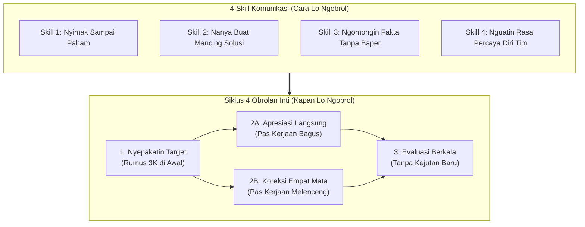
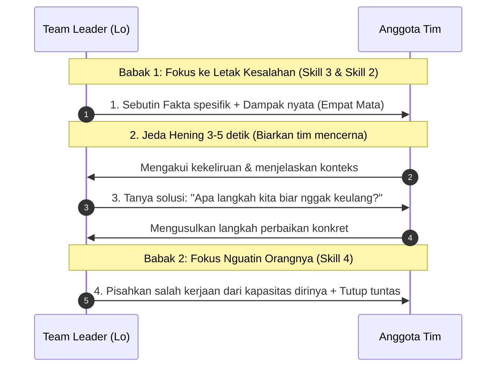
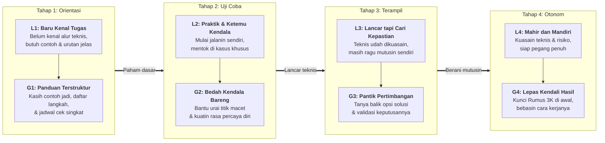

# Mahir Memimpin Tim: Strategi Bikin Tim Jadi Mandiri

**Ditulis oleh:** `aiossan`</br>
**Ragam Bahasa:** Kasual / Akrab (`Gue/Lo`)</br>
**Format:** GitHub Flavored Markdown (GFM)

> [!NOTE] Cara Pakai Panduan Ini
> Seluruh bab di dokumen ini ditulis dengan gaya ngobrol santai sehari-hari di kantor. Lo bisa langsung baca berurutan dari Pendahuluan sampai Bab 13, buka bagian lipat (*collapsible sections*) buat lihat contoh skrip dan simulasi kasus, atau langsung lompat ke **Lampiran** kalau butuh contekan cepat sebelum masuk ruang rapat.

## Daftar Isi

1. [Pendahuluan: Rasanya Baru Diangkat Jadi *Team Leader*](#pendahuluan-rasanya-baru-diangkat-jadi-team-leader)
2. [Bab 1: Peralihan dari Kerja Sendiri ke Ngurusin Tim](#bab-1-peralihan-dari-kerja-sendiri-ke-ngurusin-tim)
3. [Bab 2: Kerangka Kerja 4x4 (4 Obrolan Inti + 4 *Skill* Komunikasi)](#bab-2-kerangka-kerja-4x4-4-obrolan-inti--4-skill-komunikasi)
4. [Bab 3: *Skill* 1: Nyimak Sampai Paham](#bab-3-skill-1-nyimak-sampai-paham)
5. [Bab 4: *Skill* 2: Nanya Buat Mancing Solusi](#bab-4-skill-2-nanya-buat-mancing-solusi)
6. [Bab 5: *Skill* 3: Ngomongin Fakta Tanpa Nyerang Pribadi](#bab-5-skill-3-ngomongin-fakta-tanpa-nyerang-pribadi)
7. [Bab 6: *Skill* 4: Nguatin Rasa Percaya Diri Tim](#bab-6-skill-4-nguatin-rasa-percaya-diri-tim)
8. [Bab 7: Obrolan 1: Menyepakati Target di Awal (Rumus 3K)](#bab-7-obrolan-1-menyepakati-target-di-awal-rumus-3k)
9. [Bab 8: Obrolan 2A: Apresiasi Langsung Pas Tim Kerja Bagus](#bab-8-obrolan-2a-apresiasi-langsung-pas-tim-kerja-bagus)
10. [Bab 9: Obrolan 2B: Koreksi Empat Mata Pas Kerjaan Melenceng](#bab-9-obrolan-2b-koreksi-empat-mata-pas-kerjaan-melenceng)
11. [Bab 10: Obrolan 3: Evaluasi Berkala Tanpa Kejutan (*No-Surprise Review*)](#bab-10-obrolan-3-evaluasi-berkala-tanpa-kejutan-no-surprise-review)
12. [Bab 11: Studi Kasus & Simulasi 4 Minggu (Rina dan Budi)](#bab-11-studi-kasus--simulasi-4-minggu-rina-dan-budi)
13. [Bab 12: Menyesuaikan Gaya Pendampingan (Level L1 sampai L4 ke Gaya G1 sampai G4)](#bab-12-menyesuaikan-gaya-pendampingan-level-l1-sampai-l4-ke-gaya-g1-sampai-g4)
14. [Bab 13: Rencana Praktik 30 Hari di Kantor](#bab-13-rencana-praktik-30-hari-di-kantor)
15. [Lampiran: Contekan Meja Kerja & Rujukan Riset](#lampiran-contekan-meja-kerja--rujukan-riset)

## Pendahuluan: Rasanya Baru Diangkat Jadi *Team Leader*

Baru diangkat jadi *team leader*, supervisor, atau manajer? Atau baru diserahin tanggung jawab pegang proyek bareng beberapa orang?

Jujur aja, mana situasi yang paling sering lo rasain belakangan ini:

- Canggung dan serba salah waktu mau negur anggota tim yang kerjaannya keliru.
- Bingung gimana cara ngasih arahan yang jelas biar nggak bolak-balik ditanyain hal yang sama.
- Sungkan dan takut dicap "bos galak" atau "tukang ngatur", apalagi kalau yang lo pimpin dulunya teman selevel (*peer*).
- Sering lembur sendirian gara-gara terpaksa beresin ulang kerjaan tim yang hasilnya belum sesuai harapan.

Kalau lo ngerasain salah satunya, tenang aja. <mark>Hampir semua *leader* baru pernah ngelewatin fase ini.</mark>

Memimpin tim itu adalah sebuah keterampilan kerja (*skill*), persis kayak nulis kode program, nyusun laporan keuangan, bikin desain, atau jualan ke klien. Artinya, cara mimpin orang itu bisa dipelajarin, dilatih, dan dibiasain lewat praktik sehari-hari.

Masalahnya cuma satu: jarang ada kantor atau kampus yang ngajarin kita cara praktis mimpin orang sebelum jabatan itu dikasih ke kita. Riset dari *Center for Creative Leadership* (<abbr title="Center for Creative Leadership">CCL</abbr>) nunjukin kalau mayoritas manajer lini pertama diangkat karena hasil kerja teknis mereka bagus waktu masih jadi kontributor individu (*individual contributor*), terus langsung dituntut ngarahin orang lain tanpa bekal komunikasi yang cukup[^1].

Panduan ini gue tulis buat jadi pegangan praktis yang bisa langsung lo pakai besok pagi di kantor. Kita langsung fokus ke tiga hal yang paling sering lo hadapin tiap minggu bareng tim:

1. **4 Obrolan Inti:** Empat momen penting kapan lo perlu ngobrol empat mata sama anggota tim, mulai dari nyepakatin target di awal sampai evaluasi bulanan.
2. **4 *Skill* Komunikasi:** Cara nyimak sampai paham, nanya buat mancing solusi, negur pakai fakta tanpa bikin baper, dan nguatin rasa percaya diri tim.
3. **Nyesuaiin Gaya Pendampingan (L1 sampai L4):** Cara baca tingkat penguasaan dan kemandirian tiap anggota tim di satu tugas spesifik, biar lo tahu kapan harus ngebimbing detail dan kapan harus ngasih otonomi penuh.

> [!IMPORTANT] Dasar Riset Panduan Ini
> Semua langkah praktis di buku ini dirangkum dari riset perilaku organisasi puluhan tahun: studi peralihan peran manajer baru dari *Center for Creative Leadership* (CCL)[^1], teori penetapan tujuan (*Goal-Setting Theory*) Edwin Locke dan Gary Latham[^2], riset rasa aman psikologis (*Psychological Safety*) Amy Edmondson di Harvard[^3], serta studi global *Gallup Workplace* tentang apresiasi kerja[^4]. Semuanya dikemas ulang pakai bahasa obrolan kantor sehari-hari.

Yuk, kita mulai dari perubahan peran yang lagi lo jalanin di **Bab 1**.

## Bab 1: Peralihan dari Kerja Sendiri ke Ngurusin Tim

Waktu lo baru dapet promosi jadi manajer, koordinator proyek, supervisor, atau *senior* yang harus ngebimbing anak baru, ukuran kerjaan lo di kantor ikut berubah.

Studi dari *Center for Creative Leadership* (<abbr title="Center for Creative Leadership">CCL</abbr>) nyatet kalau peralihan dari teman selevel (*peer*) jadi atasan adalah salah satu fase paling berat dalam karier seseorang[^1].

Dulu, waktu masih jadi eksekutor teknis (*individual contributor*), lo dinilai murni dari hasil kerja tangan lo sendiri. Lo diandelin karena jago bikin kode, tajam bikin desain, rapi ngitung laporan keuangan, atau kencang nutup target penjualan. Pokoknya asal kerjaan lo sendiri beres, tugas lo kelar.

Begitu lo jadi *team leader*, cara mainnya ganti. Tugas utama lo sekarang adalah <ins>nyiapin kondisi kerja yang jelas biar anggota tim lo bisa kerja bagus dan nyapai target bareng-bareng</ins>.

### Bedanya Kerja Sendiri vs Ngarahin Tim

Perubahan posisi ini nuntut pergeseran cara pikir (*mindset*) di tiga urusan:

| Urusan Kerja            | Dulu (Waktu Kerja Sendiri)                               | Sekarang (Jadi *Team Leader*)                                            |
| :---------------------- | :------------------------------------------------------- | :----------------------------------------------------------------------- |
| **Ukuran Keberhasilan** | Dinilai dari kerjaan yang lo beresin sendiri.            | Dinilai dari hasil kerja gabungan seluruh anggota tim lo.                |
| **Pas Ada Masalah**     | Langsung turun tangan benerin masalah teknisnya sendiri. | Ngebimbing anggota tim biar mereka bisa nyelesaiin masalah itu.          |
| **Fokus Keterampilan**  | Fokus di *hard skill* (keahlian teknis sesuai bidang).   | Fokus di *soft skill* (komunikasi, bagi kerjaan, dan ngatur ekspektasi). |

Karena belum kebiasa sama peran baru ini, banyak *leader* baru gampang kejeblos ke salah satu dari dua kebiasaan keliru di bawah ini:

#### 1. Gaya "Mandor" (Semua Diatur Sampai Detail Kecil)

Karena takut target meleset, lo jadi tukang perintah. Lo ngelakuin *micromanaging*, ngecek kerjaan anak tim tiap lima menit, ngedikte setiap langkah kecil, dan baru buka suara pas nyari kesalahan.

- **Akibatnya di tim:** Anak tim jadi tertekan, takut ambil inisiatif, pasif nunggu disuruh, dan lo sendiri kecapekan karena harus ngawasin semuanya sendirian.

#### 2. Gaya "Nggak Enakan" (Beresin Kerjaan Tim Diam-diam)

Karena takut dicap "bos galak" atau dijauhin teman kantor, lo milih mendem semuanya. Lo nggak berani negur pas kerjaan anggota tim melenceng, ngasih instruksi yang ngambang, terus ujung-ujungnya lembur tengah malam buat benerin kerjaan mereka diam-diam.

- **Akibatnya di tim:** Anggota tim nggak pernah tahu letak salahnya di mana, kualitas kerjaan tim jalan di tempat, dan beban kerja lo numpuk dua kali lipat.

### Posisi yang Sehat: Jadi Rekan Diskusi yang Ngarahin

Lo nggak perlu milih antara jadi mandor yang galak atau atasan yang makan hati sendirian. Pegangan dasarnya simpel:

> **Jadilah pengarah sekaligus rekan diskusi buat tim lo: jelas waktu nentuin standar di awal, tapi tetap terbuka ngebantu pas mereka mentok di jalan.**

Kepemimpinan itu proses yang lo jalanin **bareng** tim lo, bukan sesuatu yang lo paksain ke mereka. Kalau kerjaan anggota tim lo lancar, performanya naik, dan target tercapai, kinerja lo sebagai *team leader* otomatis ikut keangkat.

Biar gampang dipraktikin tiap hari di kantor, panduan ini ngerangkum pola kerja *team leader* ke dalam **Kerangka Kerja 4x4** _(baca: 4 eks 4)_:

1. **4 Obrolan Inti (Kapan Lo Harus Ngobrol?):** Empat waktu penting buat ngomongin kerjaan bareng anggota tim, dari nyepakatin target di awal sampai evaluasi akhir periode.
2. **4 *Skill* Komunikasi (Gimana Cara Ngomongnya?):** Empat kebiasaan dasar waktu ngobrol, yaitu nyimak sampai paham, nanya buat mancing solusi, ngomongin fakta tanpa nyerang pribadi, dan nguatin rasa percaya diri tim.

Yuk kita lihat gambaran utuhnya di **Bab 2**.

## Bab 2: Kerangka Kerja 4x4 (4 Obrolan Inti + 4 *Skill* Komunikasi)

Biar lo nggak pusing harus mulai dari mana, seluruh isi buku ini diringkas jadi **8 kebiasaan praktis** yang dibagi ke dua kelompok:

1. **4 Obrolan Inti** (siklus obrolan kerja dari awal sampai akhir periode)
2. **4 *Skill* Komunikasi** (cara ngobrol yang lo pakai di tiap sesi)

Lihat hubungan keduanya di diagram berikut:



Cara kerjanya simpel: **lo pakai 4 *Skill* Komunikasi sebagai dasar buat ngejalanin 4 Obrolan Inti dari awal sampai akhir bulan.**

> [!NOTE] Note
> Penjelasan `Rumus 3K` ada di bagian Bab 7

### Empat Obrolan Inti dalam Siklus Kerja

- **1. Menyepakati Target di Awal (Rumus 3K)**</br>
  Obrolan di awal proyek, awal minggu, atau awal kuartal buat nyepakatin hasil akhir, ukuran beresnya, dan *deadline*-nya. Tujuannya biar target kerja jernih sejak hari pertama.
- **2A. Apresiasi Langsung (*Direct Recognition*)**</br>
  Apresiasi singkat sehari-hari yang langsung lo sampaikan pas ngelihat anggota tim kerja rapi atau ambil inisiatif yang pas.
- **2B. Koreksi Empat Mata (*Private Course Correction*)**</br>
  Obrolan pribadi pas lo lihat ada hasil kerjaan atau sikap yang keluar jalur, biar cepat balik ke kesepakatan awal tanpa bikin mental anak tim jatuh.
- **3. Evaluasi Berkala Tanpa Kejutan (*No-Surprise Review*)**</br>
  Obrolan penutup periode (bulanan atau kuartalan) buat ngecek pola keberhasilan, ngambil pelajaran, dan nyusun target periode berikutnya.

> [!TIP] Kunci Biar Evaluasi Nggak Penuh Drama
> Kalau lo rutin ngejalanin Obrolan 1 (*Nyepakatin Target*), 2A (*Apresiasi Langsung*), dan 2B (*Koreksi Empat Mata*) sepanjang bulan, maka Obrolan 3 (*Evaluasi Berkala*) bakal jalan santai dan terukur. Nggak bakal ada cerita anak tim kaget karena baru ditegur pas akhir kuartal.

### Empat *Skill* Komunikasi Dasar

Buat ngejalanin empat obrolan di atas, ada empat kebiasaan komunikasi yang perlu lo latih:

1. **Nyimak Sampai Paham:** Dengerin penuh tanpa teralihkan layar laptop atau HP biar lo nangkep fakta dan kendala aslinya.
2. **Nanya Buat Mancing Solusi:** Nanya pakai kata *"Apa"* dan *"Bagaimana"* biar anggota tim terbiasa mikir dan ngajuin jalan keluar, nggak melulu nunggu disuapin jawaban.
3. **Ngomongin Fakta Tanpa Nyerang Pribadi:** Nunjukin letak kesalahan kerja dan dampaknya secara spesifik dan tenang, tanpa nyerang sifat personal.
4. **Nguatin Rasa Percaya Diri Tim:** Ngasih pengakuan yang jelas waktu muji, sekaligus negesin lagi kepercayaan lo ke kemampuan anggota tim sesaat habis lo koreksi kerjaannya.

Di **Bagian 2 (Bab 3 sampai Bab 6)**, kita bahas empat *skill* komunikasi ini satu-satu lengkap sama contoh kalimatnya. Habis itu, di **Bagian 3 (Bab 7 sampai Bab 10)** kita langsung pakai buat ngejalanin keempat obrolan inti.

## Bab 3: *Skill* 1: Nyimak Sampai Paham

Sekilas, urusan dengerin orang ngomong kelihatannya sepele banget. Dalam hati mungkin lo mikir, *"Kalau cuma dengerin mah dari kecil gue juga udah bisa."*

Tunggu dulu. Sekadar denger suara orang (*hearing*) sama nyimak aktif (*active listening*) itu beda jauh. Nyimak aktif artinya lo naruh perhatian penuh ke orang yang lagi ngomong di depan lo, tanpa sambil ngelirik notifikasi WhatsApp atau sibuk nyiapin kalimat bantahan di kepala.

Kenapa *skill* ini ditaruh paling pertama? Karena **lo nggak bakal bisa bantu tim nyelesaiin masalah yang sebenarnya kalau lo sendiri salah nangkep akar kendala mereka.** Riset Profesor Amy Edmondson di Harvard University nunjukin kalau kesediaan *leader* buat dengerin laporan masalah secara terbuka tanpa buru-buru nyalahin adalah syarat utama tumbuhnya rasa aman psikologis (*psychological safety*)[^3]. Tanpa rasa aman itu, anak tim bakal milih nyembunyiin masalah sampai akhirnya meledak jadi krisis gede.

### Tiga Kebiasaan Keliru Waktu Dengerin Tim

Coba cek diri lo sendiri waktu ada anggota tim datang ngajak ngobrol. Apakah lo masih sering nggak sadar ngelakuin salah satu dari tiga kebiasaan ini?

- **Langsung motong pakai solusi instan:** Anak tim baru ngomong dua kalimat, lo langsung nyela, *"Oh, itu mah gampang! Lo tinggal lakuin A, B, terus C aja."* Padahal dia belum selesai ngejelasin letak macet utamanya di mana.
- **Buru-buru bela diri:** Anak tim lagi ngeluh soal *deadline* yang mepet, tapi kepala lo langsung sibuk nyiapin argumen buat ngebela jadwal manajemen, bukannya nyimak dulu rincian beban kerjanya.
- **Dengerin sambil natap layar:** Anak tim lagi ngomong serius di sebelah meja lo, tapi mata lo tetap nempel ke monitor, jari masih ngetik <kbd>Ctrl</kbd> + <kbd>C</kbd> dan <kbd>Ctrl</kbd> + <kbd>V</kbd>, atau tangan masih asyik *scrolling* HP.

Tiga kebiasaan di atas bikin anggota tim ngerasa cuma didengerin buat dijawab, bukan buat dipahami.

### Tiga Langkah Praktis Nyimak Sampai Paham

Biasain tiga langkah simpel ini tiap kali ada anggota tim ngajak ngobrol serius:

#### 1. Kasih Perhatian Penuh (Tutup Dulu Laptopnya)

Pas rekan tim ngajak diskusi penting, apalagi di sesi *one-on-one*, tunjukin kalau lo hadir 100% buat mereka:

- Tutup layar laptop lo setengah (atau pencet <kbd>Win</kbd> + <kbd>L</kbd> / <kbd>Cmd</kbd> + <kbd>Ctrl</kbd> + <kbd>Q</kbd> buat ngunci layar), terus putar kursi lo ngadep langsung ke dia.
- Balikkin layar HP lo ngadep meja dan nyalain mode senyap.
- Kalau rapatnya daring lewat Zoom atau Google Meet, tutup *tab* kerjaan lain dan tatap kamera.

Sikap sesimpel ini langsung ngasih tahu lawan bicara lo kalau masalah yang dia bawa itu penting dan lo beneran dengerin.

#### 2. Ulangi Inti Pesannya Pakai Bahasa Lo (*Parafrase*)

Begitu anggota tim selesai ngomong, rangkum dulu intinya buat mastiin nggak ada salah tangkap:

- *"Jadi kalau gue tangkap, kendala utamanya ada di..., bener gitu?"*
- *"Kalau gue rangkum, hal yang paling bikin lo khawatir di proyek ini tuh..., bener nggak?"*
- *"Oke, berarti proses X ketahan gara-gara masih nunggu data dari tim Y, gitu ya?"*

Manfaat cara ini langsung kerasa di dua sisi:

- **Buat anggota tim:** Mereka ngerasa lega dan dihargai karena tahu *leader*-nya beneran nyimak.
- **Buat lo:** Lo mastiin duduk perkaranya udah akurat sebelum ngambil keputusan.

#### 3. Gali Lebih Dalam Sebelum Ngasih Saran

Jangan buru-buru ngedikte perintah. Sering kali, keluhan pertama yang keluar baru gejala di permukaan. Gali dulu lebih lengkap pakai pertanyaan singkat:

- *"Boleh ceritain lebih detail soal bagian itu?"*
- *"Terus, gimana urutan kejadiannya dari awal?"*
- *"Bagian mana yang paling ngehambat kerjaan lo dari kejadian tadi?"*

### Perbandingan Kalimat di Kantor (*Skill* 1)

| Hindari Respons Ini                                               | Gunakan Respons Ini                                                                    |
| :---------------------------------------------------------------- | :------------------------------------------------------------------------------------- |
| *"Ah, itu gampang, tinggal..."* (Motong omongan sebelum tuntas)   | *"Oke, coba ceritain lebih lengkap situasinya..."*                                     |
| Jawab *"Hmm, iya terus?"* sambil mata tetap natap layar laptop.   | *"Bentar ya, gue tutup laptop dulu biar fokus. Gimana tadi?"*                          |
| *"Iya, tapi kan aturan kantor emang gitu..."* (Langsung nyanggah) | *"Jadi kalau gue tangkap, lo kewalahan di bagian..., bener gitu?"* (Mastiin pemahaman) |
| *"Lo terlalu baper aja kali."* (Ngeremehin keluhan)               | *"Apa hal yang paling bikin lo kepikiran dari kejadian tadi?"* (Ngegali konteks)       |

### Latihan Praktik Bab 3

Di sesi obrolan atau *one-on-one* lo berikutnya, coba jalanin tiga latihan ini:

- [ ] **Tahan solusi di 5 menit pertama:** Niatin sejak awal obrolan buat dengerin dan metain duduk perkara dulu sebelum ngasih saran.
- [ ] **Ulangi inti cerita minimal 1 kali:** Pakai kalimat *"Jadi maksud lo adalah..."* sebelum lo nanggapin.
- [ ] **Kasih jeda 3 detik habis mereka selesai ngomong:** Jangan langsung nyamber omongan. Hitung 1 sampai 3 di dalam hati; sering kali kalimat paling jujur justru keluar habis jeda hening itu.

## Bab 4: *Skill* 2: Nanya Buat Mancing Solusi

Di Bab 3, lo udah belajar cara nyimak duduk perkara dengan bener. Langkah berikutnya adalah ngebantu anggota tim mikirin jalan keluarnya lewat pertanyaan yang pas.

Tapi hati-hati: salah milih kata tanya bisa langsung bikin mental anak tim ciut. Coba ingat-ingat, seberapa sering kalimat kayak gini keluar pas lagi ada masalah di kantor:

- *"Kenapa laporannya sampai sekarang belum beres?"*
- *"Kenapa lo bisa salah masukin data kayak gini?"*
- *"Kenapa lo nggak kepikiran pakai cara A dari kemarin?"*

Pas seseorang ditembak pakai kata **"Kenapa"** waktu lagi ada masalah, reaksi alaminya adalah bela diri, nyari alasan (*ngeles*), nyalahin keadaan, atau malah diem seribu bahasa karena takut salah ngomong lagi.

> [!WARNING] Efek Kata "Kenapa" Pas Lagi Ada Masalah
> Dalam situasi kerja yang lagi bermasalah, pertanyaan *"Kenapa"* hampir selalu kedengeran kayak interogasi dan tuduhan. Kata *"Kenapa"* nyeret obrolan ke masa lalu yang udah nggak bisa diubah dan memicu orang saling lempar salah.

### Ganti "Kenapa" Pakai "Apa" dan "Bagaimana"

Menggeser kata tanya dari *"Kenapa"* ke *"Apa"* dan *"Bagaimana"* langsung ngubah suasana diskusi:

- **"Apa":** Ngarahin fokus obrolan ke **fakta, data, dan letak kendala saat ini**.
- **"Bagaimana / Gimana":** Ngarahin fokus obrolan ke **langkah perbaikan dan opsi solusi ke depan**.

Coba bandingin beda rasa dan arah mikir dari kalimat-kalimat ini:

| Pertanyaan yang Nyudutin                | Pertanyaan yang Mancing Solusi                                                                   |
| :-------------------------------------- | :----------------------------------------------------------------------------------------------- |
| *"Kenapa lo telat?"*                    | *"Tadi ketahan macet di titik mana? Gimana caranya biar besok bisa kita antisipasi lebih awal?"* |
| *"Kenapa laporannya salah?"*            | *"Bagian mana dari ngolah laporan ini yang menurut lo paling rumit atau bikin bingung?"*         |
| *"Kenapa lo nggak lapor dari kemarin?"* | *"Apa yang bikin lo ragu ngabarin kendala ini lebih awal ke gue?"*                               |
| *"Kenapa lo malah pakai cara ini?"*     | *"Boleh ceritain gimana pertimbangan lo waktu milih cara ini?"*                                  |

### Biasain Tanya Balik Biar Tim Tumbuh Mandiri

Kenapa kebiasaan nanya ini penting banget buat ketenangan kerja lo sebagai *leader*?

Kalau tiap kali ada masalah lo langsung nyuapin jawabannya, lama-lama anggota tim lo jadi ketergantungan. Dikit-dikit nanya ke lo, dikit-dikit nunggu lampu hijau dari lo, dan nggak berani gerak kalau belum disuruh.

Ingat: kantor ngegaji anggota tim lo buat ikut mikir dan mecahin masalah bareng, bukan cuma nunggu dikte perintah dari lo.

Mulai sekarang, pas ada anggota tim datang bawa masalah, tahan refleks buat langsung ngasih jawaban. Tanya dulu pandangan mereka:

> **Anggota Tim:** *"Kak, klien X barusan komplain keras soal keterlambatan rilis fitur baru kita."*</br>
> **Cara Lama (Langsung Nyuapin Solusi):** *"Duh, ya udah, lo balas emailnya sekarang, bilang ke mereka A, B, dan C ya..."*</br>
> **Cara Baru (Mancing Analisis Tim):** *"Oke, makasih infonya. Apa poin utama yang paling mereka khawatirin dari keterlambatan ini? Menurut analisis lo, apa penyebab utamanya dan dua langkah apa yang paling masuk akal kita tawarin ke mereka sekarang?"*

Lewat pertanyaan kayak gitu, lo ngelatih cara analisis mereka sekaligus numbuin rasa tanggung jawab (*ownership*) atas solusi yang mereka usulin sendiri.

### Perbandingan Kalimat di Kantor (*Skill* 2)

| Hindari Pertanyaan Ini                                   | Gunakan Pertanyaan Ini                                                   |
| :------------------------------------------------------- | :----------------------------------------------------------------------- |
| *"Kenapa tugas ini belum selesai juga?"*                 | *"Apa yang masih lo butuhin biar tugas ini bisa tuntas sore ini?"*       |
| *"Lo udah coba cara X belum?"* (Pertanyaan tertutup)     | *"Opsi solusi apa aja yang sejauh ini udah kepikiran sama lo?"*          |
| *"Ini datanya salah, kan?"* (Nyudutin)                   | *"Gimana hasil pengecekan lo soal akurasi angka di bagian ini?"*         |
| *"Sebenarnya masalah lo apa sih?!"* (Nada nggak sabaran) | *"Bantu gue paham, apa kendala terbesar yang lo hadapin di proyek ini?"* |

### Latihan Praktik Bab 4

Selama seminggu ke depan, coba latih tiga kebiasaan ini:

- [ ] **Rem kata "Kenapa":** Tiap kali kata *"Kenapa"* mau keluar dari mulut lo pas bahas kendala kerja, ganti kalimatnya pakai awalan *"Apa"* atau *"Bagaimana"*.
- [ ] **Tanya balik sebelum jawab:** Pas anggota tim nanya, *"Kak, ini enaknya gimana ya?"*, tanya balik dulu: *"Kalau menurut pertimbangan lo sendiri, opsi mana yang paling masuk akal buat kita ambil?"*
- [ ] **Gabungin sama *Skill* 1:** Habis ngelontarin pertanyaan pemantik, diem dan simak jawaban mereka sampai kelar tanpa motong.

## Bab 5: *Skill* 3: Ngomongin Fakta Tanpa Nyerang Pribadi

Negur anggota tim yang kerjaannya keliru sering jadi urusan yang paling bikin *team leader* baru keringat dingin.

Karena ngerasa "nggak enakan" atau takut ngerusak suasana kantor, banyak *leader* milih mendem sendiri, nyindir halus di grup WhatsApp, atau ngeluh di belakang ke teman selevel. Padahal, kalau kesalahan kerja terus didiemin, ada tiga buntut masalah yang pasti kejadian:

- Masalah kecil yang dibiarin bakal membesar jadi kegagalan proyek.
- Anggota tim ngira kerjaan mereka udah bener karena nggak pernah dikoreksi, jadi mereka nggak pernah berkembang.
- Lo sendiri numpuk rasa gondok di dada sampai suatu hari "meledak" di waktu dan cara yang salah.

Supaya lo bisa negur dengan lugas tanpa nyakitin harga diri orang lain, pegang satu prinsip dasar ini:

> [!IMPORTANT] Prinsip Dasar Koreksi Objektif
> Pisahin **letak kesalahan kerjanya** (perilaku atau hasil kerja) dari **orangnya** (karakter atau harga diri). Yang lagi lo lurusin itu tindakan atau datanya yang keliru, bukan ngehakimin sifat pribadi manusianya.

Perhatiin bedanya kalimat yang nyerang pribadi sama kalimat yang nunjuk fakta kerjaan:

- **Nyerang pribadi (Keliru):** *"Laporan lo berantakan banget sih."* (Kalimat kabur yang ngerendahin orangnya).
- **Ngomongin fakta (Tepat):** *"Data di halaman 5 laporan ini masih pakai angka bulan lalu, jadi belum akurat buat rapat pagi ini."* (Langsung nunjuk letak kekeliruan secara spesifik).
- **Nyerang karakter (Keliru):** *"Lo tuh emang orangnya males dan nggak disiplin."* (Ngehakimin sifat personal).
- **Ngomongin fakta (Tepat):** *"Minggu ini lo udah tiga kali ngumpulin laporan lewat dari jam *deadline* 15.00 yang kita sepakatin."* (Fokus ke kejadian yang terukur).

### Tiga Langkah Negur Objektif: Fakta, Dampak, dan Jeda Hening

Lupain gaya lama *sandwich feedback* (muji basa-basi di awal, nyelipin teguran di tengah, terus nutup pakai pujian basa-basi lagi) karena sering bikin pesan koreksi utamanya malah kabur.

Pas ada kerjaan yang melenceng, panggil anggota tim ngobrol **empat mata (privat)** dan sampaikan tiga langkah ini berurutan:

#### 1. Sebutin Faktanya Secara Spesifik Tanpa Emosi

Sampaikan apa yang lo lihat atau temuin apa adanya, tanpa tambahan kata sifat yang ngehakimin:

> *"Budi, waktu presentasi ke klien tadi pagi, grafik penjualan di slide ke-4 masih pakai angka kuartal lalu, belum diperbarui ke data kuartal ini."*
> *(Bukan: "Budi, presentasi lo tadi pagi kacau banget!")*

#### 2. Jelasin Dampaknya Buat Tim atau Kerjaan

Sering kali anak tim ngeremehin kesalahan detail karena mereka nggak ngelihat buntut masalahnya ke proses kerja lain. Tunjukin dampak nyatanya:

> *"Dampaknya, klien tadi bingung waktu nyocokin angka, dan mereka jadi ragu sama ketelitian olahan data tim kita."*
> *(Bukan: "Gara-gara lo, muka gue mau ditaruh di mana coba?!")*

#### 3. Kasih Jeda Hening 3 sampai 5 Detik

Habis lo nyebutin fakta dan dampaknya, **berhenti ngomong sejenak selama 3 sampai 5 detik.**

Jangan gatal buat langsung cairin suasana pakai kalimat kayak, *"Tapi ya udahlah nggak apa-apa kok, santai aja..."* Kalau emang nggak apa-apa, ngapain lo panggil ngobrol empat mata, kan?

Jeda hening ini ngasih ruang buat anggota tim lo nyerna fakta tadi, nyadarin dampaknya, dan nanggapin lebih dulu. Habis dia ngerespons (biasanya ngakuin salah atau minta maaf), baru lo sambung pakai **Skill 2 (Nanya Buat Mancing Solusi)**: *"Menurut lo, langkah apa yang perlu kita lakuin sekarang biar di presentasi berikutnya hal ini nggak kelewat lagi?"*

### Perbandingan Kalimat di Kantor (*Skill* 3)

| Hindari Kalimat Ini                                                                       | Gunakan Kalimat Ini                                                                                                 |
| :---------------------------------------------------------------------------------------- | :------------------------------------------------------------------------------------------------------------------ |
| *"Kerjaan lo akhir-akhir ini kayaknya lagi kendor ya."* (Ngambang, pakai kata "kayaknya") | *"Dua deadline terakhir di proyek X mundur dua hari dari jadwal yang kita sepakatin."* (Fakta spesifik)             |
| Nyindir di grup chat: *"Wah, pagi ini ada yang hobi datang siang lagi nih..."*            | Ngobrol empat mata: *"Jadwal rapat harian kita jam 09.00, dan pagi ini lo baru gabung jam 09.20. Ada kendala apa?"* |
| *"Lo tuh emang orangnya ceroboh dan nggak teliti!"* (Nyerang sifat pribadi)               | *"Ada tiga salah ketik di nama jabatan klien pada draf surat yang lo kirim tadi."* (Fokus ke hasil kerja)           |
| *"Nggak apa-apa kok, santai aja..."* (Padahal di dalam hati gondok)                       | *"Keterlambatan draf ini bikin waktu pengerjaan tim desain kepotong satu hari."* (Jujur nyampein dampak)            |

### Latihan Praktik Bab 5

Minggu ini, coba latih langkah koreksi objektif ini di satu kasus nyata:

- [ ] **Pilih 1 kekeliruan kerja yang nyata:** Ambil satu kesalahan data atau keterlambatan minggu ini yang tadinya mau lo diemin aja.
- [ ] **Tulis draf Fakta & Dampaknya dulu:** Sebelum manggil orangnya, catat singkat apa fakta kejadiannya dan apa dampak nyatanya buat kerjaan.
- [ ] **Sampaikan empat mata + kasih jeda:** Ajak dia ngobrol berdua dengan nada tenang, sampaikan dua poin tadi, terus diem 3 sampai 5 detik buat dengerin responsnya.

## Bab 6: *Skill* 4: Nguatin Rasa Percaya Diri Tim

Tiga *skill* pertama yang udah kita bahas ngebantu lo nangkep masalah (Bab 3), mancing cara mikir tim (Bab 4), dan nyampein koreksi secara objektif (Bab 5). Nah, *skill* keempat ini adalah pengikatnya: **nguatin rasa percaya diri anggota tim.**

Kenapa rasa percaya diri tim itu penting? Karena anggota tim yang percaya diri bakal berani ambil inisiatif, berani tanggung jawab, dan nggak takut lapor lebih awal pas nemu kendala di jalan.

Ada **dua situasi utama** kapan lo perlu ngeluarin *skill* ini:

1. **Pas lo ngapresiasi kerjaan yang bagus:** Biar pujian lo spesifik dan anak tim tahu standar kerja mana yang harus dipertahanin.
2. **Sesaat habis lo negur kesalahan:** Biar mental anak tim nggak jatuh dan mereka tetap semangat benerin kerjaannya.

### 1. Ngapresiasi Secara Spesifik, Jangan Cuma Bilang "Good Job!"

Ucapan singkat kayak *"Bagus!"*, *"Mantap!"*, *"Good job!"*, atau sekadar ngirim jempol di grup chat emang sopan, tapi cepet nguap karena nggak ngasih tahu bagian mana yang udah bener.

Ubah pujian basa-basi jadi pengakuan yang nyebutin **fakta kerjaannya** dan **dampak positifnya**:

| Pujian yang Terlalu Umum               | Apresiasi yang Spesifik dan Nguatin                                                                                                  |
| :------------------------------------- | :----------------------------------------------------------------------------------------------------------------------------------- |
| *"Good job ya presentasinya tadi!"*    | *"Presentasi lo tadi rapi banget. Gue senang lihat cara lo jawab pertanyaan dadakan dari Klien X dengan tenang dan datanya akurat."* |
| *"Oke, makasih laporannya."*           | *"Makasih laporannya ya. Tambahan grafik perbandingan di halaman 3 yang lo bikin ngebantu manajemen baca datanya jauh lebih cepat."* |
| *"Mantap, target kuartal ini tembus!"* | *"Target kuartal ini berhasil kita lewatin. Gue hargain banget ketekunan kalian nge-follow up klien selama dua minggu terakhir."*    |

### 2. Negesin Kepercayaan Habis Negur Kesalahan

Seobjektif apa pun cara lo negur di Bab 5, ditegur soal kesalahan kerja pasti bikin orang ngerasa nggak enak, malu, atau agak *down*.

Begitu mereka udah ngakuin salahnya dan nyepakatin cara benerinnya, tutup obrolan dengan negesin kalau **kesalahan di satu tugas ini nggak ngubah kepercayaan lo sama kemampuan mereka secara utuh.**

Lihat contoh kalimat penutup habis koreksi di bawah ini:

- **Contoh 1 (Habis negur ketelitian data):**
  *"Gue ngomong jujur soal ini karena gue tahu hasil tadi di luar standar kerja lo biasanya. Biasanya lo teliti dan bisa diandelin. Gue yakin lo bisa langsung beresin bagian ini."*
- **Contoh 2 (Habis negur keterlambatan *deadline*):**
  *"Gue tahu beban proyek ini lumayan padat, tapi gue percaya penuh sama kapasitas lo. Ingat proyek Y bulan lalu? Waktu itu situasinya juga rumit dan lo berhasil nyelesaiin dengan rapi. Yuk kita balikin lagi ritme kerja itu."*
- **Contoh 3 (Habis negur sikap atau cara komunikasi):**
  *"Gue sampaikan ini secara terbuka karena peran lo penting di tim ini. Gue respek sama kontribusi lo selama ini, dan gue percaya lo bisa benerin cara koordinasi ini ke depannya."*

Penutup kayak gini bikin anggota tim keluar dari ruang obrolan tanpa rasa minder dan langsung fokus ngeberesin revisinya.

### Perbandingan Kalimat di Kantor (*Skill* 4)

| Hindari Penutup Ini                                                       | Gunakan Penutup Ini                                                                                                 |
| :------------------------------------------------------------------------ | :------------------------------------------------------------------------------------------------------------------ |
| *"Awas ya, lain kali jangan sampai kejadian lagi!"* (Nutup pakai ancaman) | *"Gue percaya lo udah nangkep letak salahnya dan bisa nanganin ini jauh lebih rapi ke depannya."*                   |
| *"Kerja bagus!"* (Terlalu singkat dan nggak jelas bagian mananya)         | *"Kerjaan lo di bagian [Fakta Spesifik] rapi banget, dampaknya [Dampak Positif buat Tim/Proyek]."*                  |
| Habis negur kesalahan, langsung pergi atau pasang muka dingin seharian.   | Habis negur kesalahan, tutup dengan jelas: *"Oke, urusan ini beres ya. Gue tetap percaya sama kemampuan kerja lo."* |
| *"Masa ngurus hal sepele gini aja salah sih?"* (Ngerendahin kapasitas)    | *"Gue tahu kemampuan lo jauh lebih bagus daripada draf awal ini. Yuk, kita rapikan."*                               |

### Latihan Praktik Bab 6

Minggu ini, coba jalanin dua latihan berikut:

- [ ] **Kasih 1 apresiasi spesifik:** Cari satu anggota tim yang ngerjain tugasnya dengan rapi minggu ini, terus apresiasi pakai rumus **Fakta Spesifik + Dampak Positif + Kalimat Penguat**.
- [ ] **Ingatin 1 keberhasilan lama:** Pilih satu anggota tim yang belakangan kelihatan kurang pede atau lagi megang tugas berat, terus ingatin dia sama satu proyek sulit yang pernah berhasil dia beresin sebelumnya.

## Bab 7: Obrolan 1: Menyepakati Target di Awal (Rumus 3K)

Setelah ngebahas empat *skill* komunikasi di Bagian 2, sekarang kita masuk ke **4 Obrolan Inti** dalam siklus kerja sehari-hari. Kita mulai dari titik paling awal: **Obrolan 1: Nyepakatin Target di Awal.**

Kenapa obrolan ini wajib di urutan pertama? Karena secara logika, **lo nggak bisa muji ataupun negur anggota tim kalau sejak hari pertama mereka nggak dikasih tahu ukuran kerjaan yang dianggap "beres" dan "melenceng".**

Riset meta-analisis selama 35 tahun oleh Edwin A. Locke dan Gary P. Latham terhadap lebih dari 400 studi ngebuktiin kalau **target yang spesifik dan jelas (*specific, clear goals*)** adalah penentu utama tingginya motivasi dan kinerja tim, jauh lebih ampuh dibanding instruksi ngambang kayak *"lakuin aja yang terbaik"*[^2]. Mayoritas kegagalan eksekusi di kantor berakar dari arahan awal yang masih kabur waktu tugas pertama kali dikasih.

### Masalah Klasik: Instruksi "Pokoknya Beres"

Banyak *team leader* ngerasa udah ngasih arahan, padahal yang diomongin baru sebatas harapan yang multitafsir. Contohnya:

- *"Tolong nanti lo pegang proyek X ya."* (Sejauh mana wewenangnya? Apa ukuran beresnya? Kapan *deadline*-nya?)
- *"Pokoknya kuartal ini penjualan kita harus naik!"* (Naik berapa persen? 2% atau 30%? Segmen mana yang dikejar?)
- *"Tugas lo nyusun laporan bulanan divisi."* (Data apa aja yang wajib masuk? Siapa yang baca? Formatnya gimana?)

Kalau instruksi di awal ngambang, anak tim terpaksa nebak-nebak sendiri isi kepala lo. Pas hasil tebakan mereka beda sama bayangan lo, lo jadi kesel sendiri dan kerjaan harus diulang dari nol.

### Cara Nyusun Kesepakatan Target yang Ringkas (Rumus 3K)

Setiap tanggung jawab utama yang lo serahin ke tim sebaiknya disepakatin dan ditulis ringkas dalam satu blok catatan (cukup 3 sampai 5 poin inti, jadi gampang dipindai ulang tiap awal minggu).

Berikut 3 langkah praktis ngejalanin obrolan *Nyepakatin Target*:

#### 1. Diskusiin Dua Arah (Pakai *Skill* 1 & *Skill* 2)

Jangan cuma ngedikte daftar tugas sepihak. Ajak anggota tim ikut mikir biar mereka ngerasa punya tanggung jawab atas target itu:

- **Pakai *Skill* 2 (Nanya Buat Mancing Solusi):** *"Proyek X ini penting buat divisi kita bulan ini. Menurut pandangan lo, gambaran hasil akhir kayak gimana yang bisa kita sebut sukses buat proyek ini?"*
- **Pakai *Skill* 1 (Nyimak Sampai Paham):** Dengerin usulan mereka, ulangi poin utamanya, terus tambahin standar yang dibutuhin manajemen.

#### 2. Kunci dan Tulis Pakai Rumus 3K (Keluaran, Kriteria Sukses, Kalender)

Habis diskusi, tulis kesepakatannya secara singkat yang ngejawab tiga komponen **3K**:

1. **Keluaran (*Output*):** Apa bentuk tugas atau hasil akhir spesifik yang harus diserahkan?
2. **Kriteria Sukses:** Kayak gimana wujud nyata kerjaan yang dianggap tuntas dengan baik? (Angka, metrik, atau standar kualitas).
3. **Kalender (*Deadline*):** Kapan batas waktu pengumpulannya (hari dan jam)?

> [!IMPORTANT] Batasi 3 sampai 5 Target Utama per Periode
> Jangan numpuk 15 target sekaligus ke satu orang. Kalau seseorang punya 15 prioritas utama sekaligus, artinya dia nggak punya prioritas sama sekali.

#### 3. Taruh di Dokumen Bersama Biar Gampang Dicek

Jangan biarin catatan target tadi tenggelam di tumpukan *chat*. Taruh di tempat yang gampang dibuka bareng (kayak Trello, Notion, Google Docs, atau pesan yang di-*pin*). Ajak tim luangin waktu sebentar tiap Senin pagi buat baca ulang target ini biar kerjaan mingguan tetap satu jalur.

<details>
<summary><strong>Templat Skrip Obrolan 1 (Nyepakatin Target Rumus 3K) Siap Salin</strong></summary>

```text
"Halo [Nama], buat tugas [Nama Tugas/Proyek] ini, yuk kita sepakatin dulu Rumus 3K-nya biar satu frekuensi sejak awal:
1. Keluaran utamanya: [Sebutkan bentuk hasil akhir].
2. Kriteria suksesnya: [Sebutkan metrik, jumlah halaman, atau standar kualitas].
3. Kalender tenggatnya: [Sebutkan hari dan jam pengumpulan].
Menurut pandangan lo, ada bagian yang perlu kita sesuaikan dulu atau ada dukungan yang lo butuhin dari gue?"
```
</details>

### Perbandingan Kalimat di Kantor (Obrolan 1)

| Arahan yang Masih Ngambang                                                          | Kesepakatan Target Pakai Rumus 3K                                                                                                                                             |
| :---------------------------------------------------------------------------------- | :---------------------------------------------------------------------------------------------------------------------------------------------------------------------------- |
| *"Tolong naikin engagement media sosial kita ya."*                                  | *"Target kuartal ini naikin rata-rata engagement rate Instagram dari 1,5% jadi 3% di akhir Juni lewat 3 konten Reels edukatif per minggu."*                                   |
| *"Proposal proyek ini harus kelar secepatnya!"* (Kata "secepatnya" tiap orang beda) | *"Draf pertama proposal klien A udah harus masuk ke email gue paling lambat Kamis jam 15.00 WIB."*                                                                            |
| *"Kerjain laporannya yang rapi dan bener ya."*                                      | *"Standar laporan yang kita sepakatin: 1) Maksimal 3 halaman PDF, 2) Muat angka Reach, Leads, dan Konversi, 3) Tanpa salah rumus/typo, 4) Dikirim tiap Jumat jam 16.00 WIB."* |

### Latihan Praktik Bab 7

- [ ] **Pilih 1 tugas minggu ini:** Ambil satu kerjaan atau proyek yang mau lo serahin ke anggota tim.
- [ ] **Tulis Rumus 3K:** Catat dulu **(1) Keluaran hasil akhirnya, (2) Kriteria suksesnya, dan (3) Kalender *deadline*-nya.**
- [ ] **Minta anak tim ngerangkum ulang:** Di akhir obrolan, minta anggota tim nyebutin ulang kesepakatan tadi pakai bahasanya sendiri buat mastiin nggak ada salah tangkap.

## Bab 8: Obrolan 2A: Apresiasi Langsung Pas Tim Kerja Bagus

Habis target disepakatin di awal (Bab 7), anggota tim mulai kerja. Di tahap ini, kesalahan banyak atasan adalah cuma buka suara pas ada yang salah, tapi diem aja pas kerjaan beres dan rapi.

Biasain sebaliknya: **peka ngelihat anggota tim yang lagi kerja bener, terus langsung kasih apresiasi.**

Riset **Gallup Workplace** di Amerika Serikat nunjukin kalau **cuma 1 dari 3 pekerja (sekitar 33%)** yang ngerasa dapet pengakuan atau apresiasi atas kerjaan bagus dalam tujuh hari terakhir[^4]. Padahal, meta-analisis global Gallup terhadap **3,3 juta pekerja di lebih dari 100.000 tim** ngebuktiin kalau tim yang skor apresiasi dan *engagement*-nya masuk kuartil atas punya **angka keluar-masuk karyawan (*turnover*) 21% sampai 51% lebih rendah**, **produktivitas 14% sampai 18% lebih tinggi**, dan **profitabilitas 23% lebih tinggi** dibanding tim di kuartil bawah[^4].

### Kenapa Pujian Sambil Lalu Nggak Mempan?

Pas anggota tim lo udah kerja keras beresin sesuatu, terus lo cuma balas sambil lalu pakai kata *"Good job!"*, *"Mantap!"*, atau sekadar lempar stiker jempol di grup chat, pujian itu kurang nempel karena tiga alasan:

1. **Nggak spesifik:** Anak tim nggak tahu bagian mana dari usahanya yang lo anggap bagus dan harus dipertahanin.
2. **Kedengeran formalitas:** Kerasa kayak balasan otomatis (*auto-reply*) yang diucapin ke semua orang tanpa perhatian nyata.
3. **Nggak ngebentuk kebiasaan:** Kebiasaan kerja yang bagus baru bakal diulangin terus kalau orangnya tahu persis kenapa cara kerjanya diapresiasi.

### Lima Langkah Apresiasi Langsung (*Direct Recognition*)

Gunakan 5 langkah simpel ini biar apresiasi lo beneran ngena dan jelas:

1. **Segera (Jangan ditunda):** Begitu lo lihat anggota tim ngambil inisiatif bagus atau nyelesaiin tahapan kerja dengan rapi, sampaikan apresiasi hari itu juga. Jangan disimpen buat rapat evaluasi tiga bulan lagi.
2. **Spesifik (Sebutin fakta kerjanya):** Tunjuk persis tindakan atau bagian kerjaan mana yang mereka garap dengan baik. Contoh: *"Budi, waktu rapat sama klien tadi pagi..."*
3. **Jelasin dampak positifnya:** Hubungin tindakan spesifik tadi sama manfaatnya buat tim, klien, atau target proyek. Contoh: *"...cara lo nyiapin data cadangan pas klien nanya proyeksi biaya tadi sigap banget. Klien jadi langsung yakin dan rapat kita kelar lebih cepat."*
4. **Kasih jeda singkat (2 sampai 3 detik):** Berhenti ngomong sebentar biar mereka ngerasain apresiasi itu dengan utuh. Jangan langsung disambung sama kerjaan baru di kalimat yang sama (*"Bagus ya, nah sekarang tolong kerjain yang ini..."* karena itu langsung ngerusak momen apresiasinya).
5. **Tutup pakai kalimat penguat:** Akhiri obrolan singkat itu dengan dorongan semangat: *"Pertahanin cara kerja rapi kayak gini ya. Makasih banyak inisiatifnya."*

> [!TIP] Apresiasi Progresnya, Jangan Tunggu Sempurna 100%
> Kalau lo nunggu proyek raksasa beres 100% baru ngasih apresiasi, tim lo keburu kehabisan tenaga di tengah jalan. Apalagi buat anak tim yang baru belajar tugas baru, apresiasi setiap kali mereka nunjukin progres awal yang bener.

<details>
<summary><strong>Templat Skrip Obrolan 2A (Apresiasi Langsung) Siap Salin</strong></summary>

```text
"Halo [Nama], gue barusan ngecek hasil kerja lo di bagian [Sebutkan Fakta Spesifik]. Itu digarap dengan rapi dan tepat sasaran. Dampaknya buat tim kita, [Sebutkan Dampak Positifnya]. (Jeda 3 detik). Pertahanin inisiatif kayak gini ya, makasih banyak atas kerja keras lo."
```
</details>

### Perbandingan Kalimat di Kantor (Obrolan 2A)

| Pujian Sambil Lalu                                                                                   | Apresiasi Langsung yang Spesifik                                                                                                                             |
| :--------------------------------------------------------------------------------------------------- | :----------------------------------------------------------------------------------------------------------------------------------------------------------- |
| Di akhir rapat umum: *"Oke guys, good job buat semuanya ya!"*                                        | Nyamperin atau DM langsung habis rapat: *"Bud, cara lo jawab pertanyaan kritis dari Pak Anton tadi tenang dan datanya jelas banget. Rapat jadi terkendali."* |
| *"Makasih ya laporannya, mantap!"*                                                                   | *"Makasih laporannya ya. Tabel perbandingan kompetitor yang lo tambahin di halaman 4 bikin analisis kita jauh lebih kuat."*                                  |
| *"Kerjaan lo kemarin bagus banget, tapi sayang hari ini kok malah..."* (Nyampur pujian sama teguran) | Pisahin waktu muji dan negur. Pas lagi ngapresiasi, fokus 100% ke hal yang bagus tanpa embel-embel kata *"tapi"*.                                            |

### Latihan Praktik Bab 8

- [ ] **Perhatiin hasil kerja yang rapi tiap hari:** Niatin buat nemuin minimal satu hal bener yang dikerjain anggota tim lo sesuai kesepakatan target.
- [ ] **Sampaikan pakai 5 langkah di atas:** Sampaikan langsung secara tatap muka atau lewat pesan pribadi (**Segera + Fakta Spesifik + Dampak Positif + Jeda + Penguatan**).

## Bab 9: Obrolan 2B: Koreksi Empat Mata Pas Kerjaan Melenceng

Mari kita jujur: negur hasil kerja yang melenceng adalah bagian dari tugas *team leader* yang paling sering bikin kepikiran dan paling sering ditunda-tunda.

Padahal, tujuan utama **Koreksi Empat Mata (*Private Course Correction*)** adalah **ngebalikin kerjaan anggota tim ke jalur target yang udah disepakatin secepat mungkin, tanpa ngerusak semangat dan harga diri mereka.**

Bayangin cara kerja aplikasi peta digital (GPS) di HP lo. Pas lo salah belok di jalan raya, aplikasi peta itu langsung ngasih tahu secara objektif kalau jalur lo keliru terus nunjukin rute putar baliknya, tanpa maki-maki pengendaranya.

Di obrolan inilah lo ngegabungin **Skill 3 (Ngomongin Fakta Tanpa Nyerang Pribadi)**, **Skill 2 (Nanya Buat Mancing Solusi)**, dan **Skill 4 (Nguatin Rasa Percaya Diri Tim)** dalam alur dua babak.



### Dua Syarat Mutlak Sebelum Koreksi Empat Mata

1. **Target dan standarnya emang udah disepakatin sebelumnya:** Pastiin kekeliruan itu emang melenceng dari standar yang udah pernah disepakatin di awal (kalau lo belum pernah ngejelasin standarnya, berarti instruksi awal lo yang perlu dibenerin dulu di Bab 7).
2. **Lakuin segera dan empat mata (privat):** Jangan pernah negur anggota tim di grup publik atau di depan teman kerja lainnya.

> [!CAUTION] Aturan Privasi Mutlak: Jangan Negur di Depan Umum
> Negur kesalahan individu di grup WhatsApp kantor atau di depan anggota tim lain bikin orang ngerasa dipermaluin di depan umum (*public shaming*). Riset nunjukin hal ini langsung ngerusak rasa aman psikologis[^3] dan bikin tim berbalik pasang badan ngelawan lo. Selalu panggil bicara empat mata.

### Alur 2 Babak Koreksi Empat Mata

#### Babak 1: Fokus ke Letak Kesalahannya (Pakai *Skill* 3 & *Skill* 2)

1. **Sebutin fakta kekeliruannya secara spesifik dan tenang:**
   *"Budi, bisa ngobrol sebentar? Gue barusan ngecek laporan kampanye iklan yang lo kirim pagi ini. Di halaman 3, angka biaya per klik yang tertulis masih pakai data bulan lalu, belum data minggu ini."*
2. **Jelasin dampak nyatanya:**
   *"Dampaknya, klien tadi langsung ngirim pesan ke gue karena angkanya nggak cocok sama dashboard mereka. Kita jadi harus kerja dua kali buat revisi dan kepercayaan klien ke akurasi data kita bisa turun."*
3. **Kasih jeda hening 3 sampai 5 detik, terus tanya solusinya:**
   Habis nyebutin fakta dan dampak, **diem sejenak.** Biarin Budi ngerasain bobot kekeliruannya dan nanggapin duluan. Habis itu, sambung pakai **Skill 2**: *"Apa yang bikin bagian itu kelewat tadi, dan gimana langkah kita biar minggu depan nggak keulang?"*

#### Babak 2: Fokus Nguatin Orangnya (Pakai *Skill* 4)

Begitu anggota tim lo udah nyadarin salahnya dan nyepakatin langkah perbaikan, geser obrolan buat nguatin kembali rasa percaya dirinya:

1. **Tegesin lagi kepercayaan lo ke kemampuannya:**
   *"Oke, makasih udah langsung sigap mau benerin, Bud. Gue ngomong terbuka soal ini karena gue respek sama kerjaan lo. Gue tahu kekeliruan tadi di luar standar kerja lo biasanya. Biasanya lo teliti dan rapi. Gue percaya penuh lo bisa beresin revisi ini dengan tuntas."*
2. **Tutup dengan bersih (selesai berarti selesai):**
   *"Sip, gue tunggu hasil perbaikannya jam 14.00 siang ini ya."*
   Begitu obrolan kelar, urusan selesai. Jangan nyindir lagi sore harinya dan jangan diungkit-ungkit lagi minggu depan.

<details>
<summary><strong>Templat Skrip Obrolan 2B (Koreksi Empat Mata 2 Babak) Siap Salin</strong></summary>

```text
[Babak 1: Fokus Masalah]
"Halo [Nama], gue perhatiin di bagian [Sebutkan Fakta Spesifik] masih belum sesuai sama kesepakatan awal kita. Dampaknya, [Sebutkan Dampak Nyata bagi Tim/Klien]. (Jeda 3-5 detik, simak tanggapannya). Menurut lo, langkah apa yang perlu kita ambil sekarang biar hal ini nggak keulang?"

[Babak 2: Fokus Nguatin Orangnya]
"Oke, makasih udah langsung sigap merespons. Gue ngomong terbuka soal ini karena gue menghargai kerjaan lo. Gue tahu ini di luar standar ketelitian lo biasanya, dan gue percaya penuh lo bisa beresin bagian ini dengan rapi."
```
</details>

### Perbandingan Kalimat di Kantor (Obrolan 2B)

| Teguran yang Bikin Mental Jatuh                                               | Koreksi Empat Mata yang Terarah                                                                              |
| :---------------------------------------------------------------------------- | :----------------------------------------------------------------------------------------------------------- |
| *"Kenapa lo bisa teledor banget sih?!"* (Nyerang pribadi pakai kata "Kenapa") | (Empat mata): *"Di tabel halaman 2 ini ada selisih angka 15% dari data sumbernya."* (Fakta spesifik)         |
| *"Gara-gara lo, satu tim ikut kena getahnya!"* (Nyalahin pakai emosi)         | *"Dampaknya, persetujuan anggaran dari tim keuangan jadi mundur satu hari."* (Dampak objektif)               |
| Negur di grup WhatsApp/Slack kantor biar dilihat semua orang.                 | Minta waktu 3 menit lewat pesan pribadi atau panggil ke ruang rapat kecil.                                   |
| Habis negur, pasang muka dingin dan ngediemin anak tim seharian.              | Nutup dengan jelas: *"Gue tahu ini di luar standar kerja lo biasanya. Gue tetap percaya sama kemampuan lo."* |

### Latihan Praktik Bab 9

- [ ] **Pilih 1 momen koreksi minggu ini:** Pas ada hasil kerja anggota tim yang melenceng dari kesepakatan, jangan didiemin dan jangan lo kerjain ulang sendiri.
- [ ] **Siapin catatan 2 babak:** Tulis singkat poin **Babak 1 (Fakta + Dampak + Jeda)** dan **Babak 2 (Penguatan kepercayaan diri)**.
- [ ] **Jalanin empat mata:** Obrolin berdua selama 3 sampai 5 menit sampai langkah perbaikannya disepakatin.

## Bab 10: Obrolan 3: Evaluasi Berkala Tanpa Kejutan (*No-Surprise Review*)

Obrolan keempat dalam siklus kerja adalah **Evaluasi Berkala**, baik evaluasi bulanan, kuartalan, maupun akhir proyek (*performance review*).

Buat banyak pekerja, undangan evaluasi kinerja dari atasan sering bikin deg-degan karena suasananya mirip sidang pengadilan. Penyebabnya simpel: sepanjang bulan atau kuartal, sang *leader* nggak pernah ngejalanin Obrolan 1 (*Nyepakatin Target*), Obrolan 2A (*Apresiasi Langsung*), dan Obrolan 2B (*Koreksi Empat Mata*):

- Di awal periode, targetnya ngambang.
- Pas anak tim kerja bagus, *leader*-nya diem aja karena nganggap *"itu emang udah kewajiban gajinya"*.
- Pas anak tim bikin salah, *leader*-nya juga diem aja karena "nggak enakan", tapi nyimpen daftar kesalahan itu buat ditumpahin sekaligus pas rapat evaluasi akhir.

Akibatnya, anggota tim kaget luar biasa karena baru dikasih tahu salahnya setelah berbulan-bulan lewat, waktu semuanya udah terlambat buat dibenerin.

### Pegangan Utama Evaluasi Akhir: Jangan Ada Kejutan Baru (*No Surprises*)

Kalau lo udah rutin nyepakatin target (Bab 7), ngasih apresiasi langsung (Bab 8), dan ngelakuin koreksi empat mata (Bab 9) dari minggu ke minggu, maka sesi evaluasi akhir tinggal ngerangkum obrolan-obrolan yang emang udah pernah kalian bahas sebelumnya.

> [!IMPORTANT] Jangan Nabung Teguran Buat Evaluasi Akhir
> Jangan pernah ngeluarin teguran atas kesalahan lama yang belum pernah lo bahas di sesi *Koreksi Empat Mata* harian. Evaluasi akhir adalah tempat ngelihat pola perkembangan kerja dan nyusun target periode berikutnya.

### Empat Langkah Ngejalanin Evaluasi Berkala

1. **Minta anggota tim ngevaluasi dirinya sendiri duluan (Pakai *Skill* 2):**
   Jangan buka rapat dengan langsung ngebacain daftar nilai dari lo. Biarin anggota tim ngomong duluan lewat pertanyaan reflektif:
   - *"Bud, hari ini kita mau ninjau kerjaan kita selama kuartal ini. Kalau dari kacamata lo sendiri, gimana penilaian lo atas performa lo sejauh ini?"*
   - *"Capaian apa yang paling bikin lo puas di periode ini, dan di bagian mana lo ngerasa paling berkembang?"*
   - *"Sebaliknya, kendala apa yang paling kerasa berat, dan pelajaran apa yang lo dapet dari situ?"*
2. **Simak penuh tanpa nyela (Pakai *Skill* 1):**
   Dengerin dan catat poin-poinnya. Anggota tim yang biasa diajak diskusi terbuka umumnya bisa nilai kelebihan dan kekurangannya sendiri secara jujur.
3. **Sampaikan rangkuman catatan lo (Porsi 30% waktu rapat):**
   Tambahin pandangan lo dengan ngerujuk ke apresiasi dan koreksi yang udah pernah dibahas sepanjang bulan:
   - **Ngerujuk ke apresiasi:** *"Gue sepakat sama poin yang lo sampaikan tadi. Di catatan gue juga kelihatan analisis data lo bulan lalu ngebantu banget buat nentuin prioritas konten tim..."*
   - **Ngerujuk ke perbaikan:** *"Soal tantangan ketelitian rumus di minggu ketiga yang lo sebut tadi, gue senang lo langsung ngunci rumus template-nya waktu kita bahas kemarin, jadi laporan minggu keempat udah akurat."*
4. **Fokusin 70% sisa waktu buat rencana ke depan (Balik ke Rumus 3K):**
   Masa lalu cukup dibahas 30% buat diambil pelajarannya. Pakai 70% sisa waktu rapat buat nyusun target periode berikutnya (langsung nyambung lagi ke **Bab 7**).

### Perbandingan Kalimat di Kantor (Obrolan 3)

| Evaluasi Model Sidang Pengadilan                                                                    | Evaluasi Dua Arah Tanpa Kejutan                                                                                       |
| :-------------------------------------------------------------------------------------------------- | :-------------------------------------------------------------------------------------------------------------------- |
| Buka rapat pakai monolog: *"Oke, ini daftar penilaian dan kesalahan lo selama 3 bulan terakhir..."* | Buka rapat pakai pertanyaan: *"Menurut pandangan lo sendiri, gimana perjalanan kerja lo selama 3 bulan ini?"*         |
| Ngeluarin daftar kesalahan lama yang belum pernah ditegur sebelumnya.                               | Ngerujuk ke obrolan mingguan yang udah pernah dibahas bareng.                                                         |
| Ngehabisin 90% waktu rapat buat ngulitin masa lalu.                                                 | Bagi porsi **30% evaluasi periode lalu** dan **70% nyusun target periode depan**.                                     |
| Nutup rapat dengan suasana tegang tanpa kejelasan langkah lanjutan.                                 | Nutup pakai kalimat penguat: *"Lo berkembang pesat di periode ini, dan kuartal depan kita naikin tanggung jawabnya."* |

### Latihan Praktik Bab 10

- [ ] **Jadwalin evaluasi bulanan singkat:** Pakai sesi *one-on-one* akhir bulan ini buat latihan meninjau kerjaan sebulan terakhir.
- [ ] **Kirim 3 pertanyaan sehari sebelum rapat:** Chat anggota tim lo: *"Besok di sesi 1-on-1 kita, tolong siapin 3 hal ya: (1) Hal yang paling berhasil bulan ini, (2) Kendala utama yang lo hadapin, dan (3) Usulan prioritas buat bulan depan."*
- [ ] **Jaga porsi waktu 30/70:** Dengerin mereka duluan, bahas kilas balik maksimal 30% durasi rapat, dan pakai 70% sisanya buat nyepakatin target bulan depan.

## Bab 11: Studi Kasus & Simulasi 4 Minggu (Rina dan Budi)

Biar kebayang gimana wujud praktiknya dari minggu ke minggu di kantor, kita ikutin perjalanan sebulan penuh antara dua tokoh ini:

- **Rina:** *Team leader* baru di divisi *Digital Marketing* yang baru mulai nerapin **Kerangka Kerja 4x4**.
- **Budi:** Anggota tim Rina. Kreatif dan cepat belajar, tapi kadang konsistensi dan ketelitian angkanya masih naik-turun.

### Minggu 1: Nyepakatin Target di Awal (Rumus 3K)

**Situasi:** Rina mau nyerahin tugas baru ke Budi, yaitu nyusun dan nganalisis laporan mingguan performa media sosial kantor.

- **Cara Lama (Ngambang):**
  *"Bud, mulai minggu depan laporan media sosial lo yang pegang ya. Pokoknya bikin yang lengkap dan kirim ke gue tiap Jumat."*
- **Cara Rina (Pakai Kerangka Kerja 4x4):**
  **Rina:** *"Bud, mulai bulan ini kita mau ngerapiin evaluasi konten. Gue lihat lo cukup tajam baca tren konten, jadi gue mau nyerahin tanggung jawab laporan mingguan media sosial ke lo. Gimana menurut lo?"*
  **Budi:** *"Siap, Kak Rina! Menarik tuh. Tapi detail laporan yang Kakak harapin kayak gimana ya?"*
  **Rina (*Skill* 2 - Nanya):** *"Sebelum gue kasih masukan, kalau menurut pandangan lo sendiri, angka apa aja yang paling penting kita pantau tiap minggu biar kita tahu konten kita berhasil atau nggak?"*
  **Budi:** *"Hmm, menurut gue sih jangkauan (*reach*), interaksi (*likes/komen*), sama pertambahan pengikut baru, Kak."*
  **Rina (*Skill* 1 - Nyimak & Parafrase):** *"Setuju, tiga metrik utama itu wajib ada. Biar makin tajam, gue usul kita tambahin satu poin lagi: kesimpulan singkat kenapa satu konten bisa ramai dan kenapa ada konten yang sepi. Masuk akal nggak buat lo?"*
  **Budi:** *"Masuk akal banget, Kak. Jadi nggak cuma deretan angka doang ya."*
  **Rina:** *"Sip! Kita tulis kesepakatan Rumus 3K-nya di dokumen bersama kita ya:"*
  - **Keluaran:** Laporan Mingguan Performa Instagram & TikTok.
  - **Kriteria Sukses:** Maksimal 2 halaman *slide*, berisi 3 metrik utama (*Reach*, *Engagement Rate*, Pengikut Baru) + 1 paragraf *insight* konten terbaik & terendah, tanpa salah rumus.
  - **Kalender (*Deadline*):** Dikirim ke email gue tiap Jumat paling lambat jam 15.00 WIB.

### Minggu 2: Apresiasi Langsung Pas Kerja Bagus

**Situasi:** Jumat minggu kedua, Budi ngirim laporan pertamanya jam 14.00 WIB (sejam sebelum *deadline*). Semua kriteria terpenuhi dan analisisnya tajam.

- **Cara Lama (Basa-basi):**
  Balas email singkat: *"Noted. Thanks, Bud."*
- **Cara Rina (Apresiasi Langsung):**
  **Rina:** *"Bud, laporan mingguan pertama lo barusan selesai gue baca. Gue suka bagian analisis yang lo tulis soal kenapa video tutorial 30 detik kemarin punya interaksi paling tinggi. Poinnya tajam, datanya rapi, plus lo kirim sejam sebelum deadline. Insight lo ini ngebantu banget buat bahan presentasi gue ke Manajer Divisi minggu depan."*
  *(Rina berhenti ngomong 3 detik sambil senyum).*
  **Budi:** *"Syukurlah kalau ngebantu, Kak. Tadi gue sempat ragu mau nulis analisis itu atau nggak."*
  **Rina (*Skill* 4 - Penguatan):** *"Justru itu bagian paling bagusnya. Pertahanin cara analisis kayak gini ya, Bud."*

### Minggu 3: Koreksi Empat Mata Pas Ada Kesalahan

**Situasi:** Jumat minggu ketiga, Budi ngirim laporan tepat waktu. Tapi pas Rina ngecek, angka *Engagement Rate* TikTok tertulis **8,5%**. Setelah dicek ke tabel mentahnya, ternyata Budi salah narik sel pembagi di Excel (harusnya **1,8%**).

- **Gaya "Nggak Enakan":** Benerin sendiri rumus Excel Budi malam-malam tanpa ngasih tahu Budi.
- **Gaya "Mandor":** Nulis di grup WhatsApp tim: *"@Budi kalau bikin laporan dicek dulu rumusnya! Masa angka 1,8% bisa jadi 8,5%?! Jangan asal kirim dong!"*
- **Cara Rina (Koreksi Empat Mata 2 Babak):**
  *(Rina ngajak Budi ngobrol berdua 3 menit di ruang rapat kecil).*
  **Babak 1 (Fokus Masalah - *Skill* 3 & 2):**
  **Rina:** *"Bud, makasih laporan minggu ini udah masuk tepat waktu jam 14.00 tadi. Waktu gue cek rinciannya barusan, ada kesalahan rumus di bagian Engagement Rate TikTok. Di slide tertulis 8,5%, padahal di tabel mentahnya 1,8% karena sel pembaginya geser. Ini cukup berisiko buat kita, Bud, soalnya laporan ini jadi dasar nentuin anggaran iklan minggu depan. Kalau angkanya meleset, alokasi anggaran kita bisa salah sasaran."*
  *(Rina diem 4 detik ngasih ruang Budi nyerna dan nanggapin).*
  **Budi:** *"Astaga... iya Kak, maaf banget! Tadi waktu nyalin tabel dari minggu lalu, gue lupa ngunci sel pembaginya."*
  **Rina (*Skill* 2):** *"Oke. Menurut lo, langkah apa yang bisa lo lakuin biar minggu depan rumus ini nggak geser lagi pas disalin?"*
  **Budi:** *"Gue kunci rumus sel pembaginya pakai tanda `$` di template Excel-nya, Kak, terus gue cek ulang pakai kalkulator buat angka utamanya sebelum diekspor ke PDF. Gue revisi sekarang ya, Kak."*
  **Babak 2 (Fokus Nguatin Orangnya - *Skill* 4):**
  **Rina:** *"Ide bagus tuh soal ngunci rumus template. Bud, gue ngomong lugas soal ini ke lo karena gue menghargai kerjaan lo. Gue tahu kekeliruan tadi di luar standar ketelitian lo biasanya; dua minggu pertama kemarin kerjaan lo rapi banget. Gue percaya penuh lo bisa beresin revisi ini."*

### Minggu 4: Evaluasi Berkala Tanpa Kejutan

**Situasi:** Akhir bulan tiba, Rina ngadain sesi *one-on-one* evaluasi bulanan bareng Budi.

- **Rina:** *"Halo Bud, udah sebulan penuh lo pegang laporan media sosial kita. Sebelum gue kasih catatan dari sisi gue, gimana penilaian lo sendiri atas hasil kerja lo sebulan ini?"*
- **Budi:** *"Gue senang dikasih kepercayaan ini, Kak. Gue jadi belajar banyak soal baca data konten dan senang karena insight mingguan gue kepakai buat strategi tim. Catatan terbesar gue ada di minggu ketiga kemarin waktu salah rumus Excel, tapi sekarang template-nya udah gue kunci jadi di minggu keempat kemarin udah aman."*
- **Rina:** *"Catatan gue persis sama kayak yang baru lo sampaikan. Gue hargain banget kecepatan belajar lo dan tajamnya analisis konten yang lo tulis sejak minggu kedua. Soal rumus di minggu ketiga, gue salut karena lo langsung benerin sistem template-nya sampai minggu keempat kemarin akurasinya 100% tepat. Nah, karena bagian ini udah lo kuasain, bulan depan kita naikin targetnya ya: selain nyusun laporan, gue mau kasih lo kesempatan presentasiin langsung insight itu selama 5 menit di rapat mingguan divisi. Gue yakin lo siap!"*

<details>
<summary><strong>Simulasi Interaktif Mandiri: Uji Keputusan Lo Sebagai Rina (Klik untuk Buka)</strong></summary>

Pilih satu opsi di tiap minggu di dalam kepala lo, lalu cocokkan dengan skor dan dampaknya di bawah ini:

1. **Minggu 1 (Delegasi Awal):**
   - **Opsi A:** *"Pokoknya bikin laporan lengkap tiap Jumat."* -> **+20 Poin** (Budi bingung menebak format laporan).
   - **Opsi B:** Diskusi dua arah + sepakati Rumus 3K tertulis. -> **+100 Poin** (Ekspektasi jernih sejak hari pertama).
   - **Opsi C:** *"Bantu rekap dikit ya kalau nggak sibuk, sisanya biar gue."* -> **+40 Poin** (Beban analisis balik ke pundak lo).
2. **Minggu 2 (Budi Kirim Analisis Tajam Sejam Sebelum *Deadline*):**
   - **Opsi A:** Balas singkat *"Noted, thanks"* lalu kasih tugas baru. -> **+30 Poin** (Inisiatif Budi lewat begitu saja).
   - **Opsi B:** Apresiasi langsung sebut fakta + dampak + jeda 3 detik. -> **+100 Poin** (Kebiasaan bagus Budi terus dipertahankan).
   - **Opsi C:** Diam saja karena menganggap itu kewajiban gaji. -> **+10 Poin** (Minggu depan Budi berhenti menulis analisis).
3. **Minggu 3 (Salah Rumus Excel 8,5% vs 1,8%):**
   - **Opsi A:** Tegur keras di grup WhatsApp tim. -> **+10 Poin** (Merusak *psychological safety* tim).
   - **Opsi B:** Benerin sendiri diam-diam malam hari. -> **+30 Poin** (Budi nggak sadar salah, bulan depan terulang lagi).
   - **Opsi C:** Koreksi empat mata 2 babak (Fakta + Dampak + Jeda + Penguatan). -> **+100 Poin** (Masalah beres dalam 3 menit tanpa merusak mental).
4. **Minggu 4 (Evaluasi Bulanan):**
   - **Opsi A:** Tanya evaluasi diri Budi dulu + rangkum tanpa kejutan (30%) + naikkan target bulan depan (70%). -> **+100 Poin** (Budi siap naik kelas).
   - **Opsi B:** Bacakan daftar kesalahan selama 30 menit. -> **+20 Poin** (Semangat Budi langsung turun).

</details>

## Bab 12: Menyesuaikan Gaya Pendampingan (Level L1 sampai L4 ke Gaya G1 sampai G4)

Setelah megang 4 *Skill* Komunikasi dan 4 Obrolan Inti, muncul satu pertanyaan penting waktu lo harus mimpin anggota tim yang penguasaan kerjanya beda-beda:

> **"Apakah gue harus pakai gaya ngobrol dan tingkat pengawasan yang sama persis ke setiap orang di tim?"**

Coba bayangin dua orang berbeda di tim lo:

- **Andi:** Karyawan *fresh graduate* yang baru masuk tiga hari lalu. Semangat belajarnya tinggi, tapi belum pernah pakai sistem kerja kantor.
- **Siska:** Staf senior yang udah kerja empat tahun, hafal seluk-beluk teknis di bidangnya, dan selalu beresin tugas dengan teliti.

Kalau lo ngelepas Andi kerja sendiri tanpa petunjuk detail (kayak cara lo memperlakukan Siska), Andi bakal tenggelam karena bingung harus mulai dari mana. Sebaliknya, kalau lo ngedikte Siska langkah demi langkah tiap jam (kayak cara lo ngebimbing Andi), Siska bakal ngerasa nggak dipercaya dan gerah.

Di sinilah lo perlu nerapin **Kalibrasi Pendampingan Kerja**. Porsi panduan teknis dari seorang *leader* itu fungsinya mirip penyangga belajar (*scaffolding*): dipasang rapat waktu anggota tim baru kenal tugasnya, terus dikurangin bertahap seiring naiknya kemandirian mereka. Pegangan utamanya jelas:

> **Sesuaikan porsi panduan teknis dan ruang diskusi lo dengan level kemandirian anggota tim (L1 sampai L4) pada tugas spesifik yang lagi mereka kerjain.**

### 1. Empat Level Kemandirian Anggota Tim pada Suatu Tugas (L1 sampai L4)

Tiap kali lo nyerahin satu tugas spesifik, amati posisi kemandirian anggota tim lo dari dua ukuran praktis:

1. **Penguasaan Alur Kerja (*Technical Grip*):** Seberapa kenal dan terbiasa dia sama urutan teknis, alat kerja, dan standar kualitas tugas spesifik itu.
2. **Kemandirian Keputusan (*Decision Autonomy*):** Seberapa siap dia ngurai kendala di lapangan dan ngambil keputusan teknis sendiri tanpa harus nunggu validasi lo terus-menerus.

Gabungan dua ukuran ini ngebentuk 4 tahapan kemandirian tugas (L1 sampai L4) yang dipasangin langsung sama 4 gaya pendampingan (G1 sampai G4):



Berikut ciri-ciri tiap level kemandirian tugas di lapangan:

- **L1: Baru Kenal Tugas (Penguasaan Teknis Awal, Butuh Contoh Konkret)**
  Siap dan antusias nerima tugas baru (*"Siap, Kak!"*), tapi belum punya pengalaman praktis di alur tugas itu dan belum tahu standar detail cara ngerjainnya. Contoh: anak baru di minggu pertama, atau staf lama yang baru pertama kali megang jenis kerjaan baru.
- **L2: Praktik & Ketemu Kendala (Mulai Jalanin Sendiri, Mentok di Kasus Khusus)**
  Habis mulai nyoba ngerjain sendiri, dia ketemu kerumitan nyata di lapangan yang belum ada di bayangan awal. Dia mulai nemu hambatan teknis dan butuh teman diskusi buat ngurai titik macetnya (*"Duh, bagian ini ternyata rumit ya, gue nyangkut di tahap kedua nih"*).
- **L3: Lancar tapi Cari Kepastian (Penguasaan Teknis Tinggi, Masih Nunggu Validasi)**
  Secara teknis dia sebenernya udah nguasain alur kerjaan itu dan jarang salah. Cuma, dia masih sering minta konfirmasi lo sebelum berani ngambil keputusan penting sendiri (*"Kak, drafnya udah beres, tapi boleh cek dulu nggak sebelum gue kirim ke klien?"*).
- **L4: Mahir dan Mandiri (Penguasaan Teknis Tinggi, Otonomi Penuh)**
  Udah ahli secara teknis sekaligus matang ngambil keputusan. Dia proaktif ngantisipasi risiko, bisa mecahin masalah sendiri dari hulu ke hilir, bahkan udah bisa ikut ngebimbing rekan kerja lainnya.

> [!WARNING] Ukur per Tugas Spesifik, Jangan Dijadiin Label Permanen Buat Orangnya
> Level L1 sampai L4 ini **nempel spesifik di tugas yang lagi dikerjain**, bukan label permanen buat orangnya. Misalnya, Budi udah ada di level **L4 (Mahir dan Mandiri)** waktu bikin desain konten harian, tapi otomatis balik ke **L1 (Baru Kenal Tugas)** waktu lo tugasin negosiasi kontrak sama vendor luar buat pertama kalinya.

### 2. Empat Gaya Pendampingan yang Pas (G1 sampai G4)

#### G1: Panduan Terstruktur -> Buat L1

- **Takaran pendampingan:** Panduan teknis **rapat & rinci**, ruang lepas mandiri **bertahap**.
- **Cara jalaninnya:** Karena orang di level L1 belum kenal medan kerjanya, jangan dilepas suruh nebak sendiri. Kasih **panduan langkah demi langkah (*step-by-step*)**, contoh hasil kerjaan yang udah jadi, *checklist* kerja, dan jadwal cek singkat di tengah jalan.
- **Obrolan & *skill* utama:** Pakai **Obrolan 1 (Nyepakatin Target)** secara ekstra detail, terus kasih **Obrolan 2A (Apresiasi Langsung)** tiap kali dia berhasil nyelesaiin tahap dasar. Jangan kebanyakan nanya *"Menurut lo gimana caranya?"* ke L1 karena dia emang belum punya referensi teknisnya.

#### G2: Bedah Kendala Bareng -> Buat L2

- **Takaran pendampingan:** Panduan pemecahan masalah **aktif**, dukungan moral **tinggi**.
- **Cara jalaninnya:** Anak tim di level L2 lagi ketemu tembok teknis waktu nyoba praktik. Lo perlu hadir buat **bantu ngurai bagian yang mentok** sekaligus **dengerin kesulitannya dan njaga rasa percaya dirinya biar nggak kendor**.
- **Obrolan & *skill* utama:** Gabungin **Skill 1 (Nyimak)** dan **Skill 2 (Nanya)** buat metain letak kesulitannya, pakai **Obrolan 2B (Koreksi Empat Mata)** kalau ada langkah yang keliru, dan tutup pakai **Skill 4 (Nguatin Rasa Percaya Diri)**.

#### G3: Pantik Pertimbangan -> Buat L3

- **Takaran pendampingan:** Instruksi teknis **minimal**, pemantik diskusi & validasi **tinggi**.
- **Cara jalaninnya:** Orang di level L3 sebenernya udah tahu cara ngerjain tugasnya, cuma masih ragu ngambil keputusan sendiri. Berhenti nyuapin langkah teknis; posisikan diri lo sebagai rekan diskusi yang mancing analisis mereka dan ngevalidasi pertimbangannya biar makin berani mandiri.
- **Obrolan & *skill* utama:** Andelin **Skill 2 (Tanya balik)**: *"Kalau menurut analisis lo sendiri, opsi mana yang paling pas?"*, terus kuatin keputusannya pakai **Skill 4**.

#### G4: Lepas Kendali Hasil -> Buat L4

- **Takaran pendampingan:** Instruksi teknis harian **lepas**, kepercayaan pengelolaan **penuh** (diikat lewat kesepakatan hasil akhir di awal).
- **Cara jalaninnya:** Sepakatin hasil akhir, batas waktu, dan batas wewenang di awal, terus **bebasin dia ngatur metode dan ritme kerjanya sendiri**.
- **Obrolan & *skill* utama:** Cukup jalanin **Obrolan 1 (Nyepakatin Target)** di awal, kasih **Obrolan 2A (Apresiasi Langsung)** atas pencapaiannya, dan tinjau bareng di **Obrolan 3 (Evaluasi Berkala)**. Ingat: kalau orang di level L4 lo perlakukan pakai gaya G1 yang ngedikte tiap detail kecil, dia bakal ngerasa dikekang.

<details>
<summary><strong>Kumpulan Skrip Siap Pakai untuk Gaya G1 sampai G4 (Klik untuk Buka)</strong></summary>

- **Skrip G1 (Buat L1 - Baru Kenal Tugas):**
  *"Halo [Nama], buat tugas [Nama Tugas] ini, gue udah siapin panduan langkah demi langkah dan contoh formatnya. Kita kunci dulu Rumus 3K-nya ya: (1) Keluarannya draf pertama sesuai template ini, (2) Kriteria suksesnya semua bagian keisi lengkap sebelum deadline, dan (3) Kalendernya kita cek bareng besok jam 14.00 WIB. Gue dampingin lo di tahap awal ini."*
- **Skrip G2 (Buat L2 - Praktik & Ketemu Kendala):**
  *"Halo [Nama], gue perhatiin tugas [Nama Tugas] ini emang punya beberapa bagian teknis yang lumayan rumit. Boleh ceritain ke gue, bagian mana yang paling bikin lo mentok sekarang? (Simak & Parafrase). Oke, gue paham. Buat bagian itu, langkah teknisnya kita pecah jadi dua tahap kecil ini ya. Gue percaya sama kapasitas belajar lo, yuk kita beresin bareng."*
- **Skrip G3 (Buat L3 - Lancar tapi Cari Kepastian):**
  *"Halo [Nama], secara teknis lo udah nguasain [Nama Tugas] ini. Jadi sebelum gue kasih komentar, menurut pertimbangan lo sendiri, cara mana yang paling efektif buat kita ambil? (Simak). Nah, pertimbangan lo itu udah tajam. Jalanin pakai rencana lo itu ya, gue dukung penuh keputusan lo."*
- **Skrip G4 (Buat L4 - Mahir dan Mandiri):**
  *"Halo [Nama], buat [Nama Tugas] kali ini, gue serahin penuh kendali eksekusinya ke lo. Kita cukup sepakatin hasil akhir dan deadline-nya di Jumat depan jam 15.00 WIB. Soal metode dan teknisnya, silakan lo atur sesuai cara kerja terbaik lo. Kabarin gue kalau ada hambatan lintas divisi yang perlu gue bantu buka jalannya."*

</details>

### Tabel Pencocokan Cepat L1 sampai L4 ke G1 sampai G4

| Level Kemandirian | Kondisi Penguasaan & Kemandirian Tugas          | Gaya Pendampingan yang Pas   | Fokus Obrolan & *Skill* Utama                                                 |
| :---------------: | :---------------------------------------------- | :--------------------------- | :---------------------------------------------------------------------------- |
|      **L1**       | Baru kenal tugas, butuh contoh & urutan kerja   | **G1: Panduan Terstruktur**  | **Nyepakatin Target** ekstra detail + **Apresiasi Langsung** tiap tahap awal. |
|      **L2**       | Mulai praktik sendiri, mentok di kendala teknis | **G2: Bedah Kendala Bareng** | **Koreksi Empat Mata** + **Skill 2 (Nanya)** + **Skill 4 (Penguatan)**.       |
|      **L3**       | Teknis udah lancar, masih ragu mutusin sendiri  | **G3: Pantik Pertimbangan**  | **Skill 1 (Nyimak)** + **Skill 2 (Tanya balik)** + **Skill 4**.               |
|      **L4**       | Mahir teknis, proaktif, dan siap mandiri penuh  | **G4: Lepas Kendali Hasil**  | **Nyepakatin Target** hasil akhir + **Evaluasi Berkala**.                     |

## Bab 13: Rencana Praktik 30 Hari di Kantor

Baca panduan kepemimpinan sampai beres baru langkah pertama. Tantangan aslinya muncul besok pagi pas lo balik ke meja kantor dan disambut tumpukan kerjaan.

Kalau lo nyoba ngubah semua kebiasaan sekaligus dalam satu hari, lo bakal cepat kewalahan terus balik lagi ke pola lama. Jauh lebih gampang kalau lo latih bertahap per minggu lewat **Rencana Praktik 30 Hari** di bawah ini:

### Minggu 1: Nahan Diri dan Belajar Nyimak

**Fokus Minggu 1:** Ngelatih **Skill 1 (Nyimak Sampai Paham)** dan **Skill 2 (Nanya Buat Mancing Solusi)**. Tahan dulu dorongan buat ngatur semuanya sendiri.

- [ ] **Praktik 1 (Hadir penuh minimal 3 kali):** Pas ada anggota tim yang ngajak ngobrol serius minggu ini, berhenti ngetik, tutup atau alihin pandangan dari layar laptop, dan balikkin layar HP lo.
- [ ] **Praktik 2 (Parafrase minimal 3 kali):** Di dalam rapat atau obrolan *one-on-one*, pakai kalimat ini sebelum lo nanggapin: *"Jadi kalau gue tangkap, maksud lo adalah..., bener gitu?"*
- [ ] **Praktik 3 (Rem kata "Kenapa" & tanya balik):** Pas anggota tim datang bawa kendala, tahan lidah lo biar nggak langsung nyuapin solusi. Ajukan minimal satu pertanyaan yang diawali kata **"Apa"** atau **"Bagaimana"** (*"Menurut lo, apa kendala utamanya dan gimana opsi jalan keluar terbaik kita?"*).

### Minggu 2: Ngerapihin Target dan Biasain Apresiasi

**Fokus Minggu 2:** Mempraktikkan **Obrolan 1 (Nyepakatin Target)**, **Obrolan 2A (Apresiasi Langsung)**, dan **Kalibrasi Pendampingan Tugas (L1 sampai L4)**.

- [ ] **Praktik 1 (Susun 1 kesepakatan Rumus 3K):** Pilih satu tugas atau proyek yang lo serahin ke tim minggu ini. Diskusiin dua arah dan tulis jelas rumus **3K: (1) Keluaran tugasnya, (2) Kriteria suksesnya, dan (3) Kalender *deadline*-nya.**
- [ ] **Praktik 2 (Petain level kemandirian tugas L1 sampai L4):** Tulis daftar nama anggota tim lo beserta satu tugas utama mereka minggu ini. Tentuin apakah di tugas itu mereka ada di level **L1, L2, L3, atau L4**, terus sesuaikan gaya pendampingan lo (**G1 sampai G4**).
- [ ] **Praktik 3 (Kasih 3 apresiasi spesifik):** Temuin minimal 3 momen saat anggota tim lo ngerjain sesuatu dengan rapi minggu ini, terus sampaikan apresiasi di hari yang sama (**Fakta Spesifik + Dampak Positif + Jeda + Penguatan**).

### Minggu 3: Ngelatih Koreksi Empat Mata yang Objektif

**Fokus Minggu 3:** Mempraktikkan **Skill 3 (Ngomongin Fakta)**, **Skill 4 (Nguatin Rasa Percaya Diri)**, dan **Obrolan 2B (Koreksi Empat Mata)**.

- [ ] **Praktik 1 (Pilih 1 kekeliruan kerja kecil):** Jangan nunggu ada kesalahan besar. Pilih satu hal kecil yang melenceng dari kesepakatan (misalnya keterlambatan draf atau selisih angka laporan) yang biasanya lo diemin atau lo benerin sendiri.
- [ ] **Praktik 2 (Tulis contekan 2 babak):** Sebelum manggil anggota tim lo, catat singkat poin *Babak 1* (Fakta objektif + dampak nyata buat kerjaan) dan *Babak 2* (Kalimat penguat kalau lo tetap percaya sama kemampuannya).
- [ ] **Praktik 3 (Jalanin Koreksi Empat Mata):** Panggil anggota tim lo secara pribadi. Sampaikan Babak 1, **kasih jeda hening 3 sampai 5 detik**, dengerin tanggapannya, terus tutup pakai Babak 2.

### Minggu 4: Ngejalanin Siklus Evaluasi Utuh

**Fokus Minggu 4:** Mempraktikkan **Obrolan 3 (Evaluasi Berkala Tanpa Kejutan)** dengan porsi waktu 30/70.

- [ ] **Praktik 1 (Jadwalin evaluasi bulanan singkat):** Di sesi *one-on-one* akhir minggu keempat, minta anggota tim nyiapin penilaian diri singkat atas hasil kerjanya selama sebulan terakhir.
- [ ] **Praktik 2 (Dengerin penilaian tim duluan):** Buka sesi dengan nanya (*Skill* 2): *"Capaian apa yang paling bikin lo puas bulan ini, dan apa kendala terbesarnya?"* terus simak sampai tuntas (*Skill* 1).
- [ ] **Praktik 3 (Rangkum tanpa kejutan & kunci target bulan depan):** Sampaikan rangkuman catatan lo yang ngerujuk ke apresiasi dan koreksi yang udah pernah dibahas (30% waktu), kasih penguatan (*Skill* 4), lalu pakai 70% sisa waktu buat nyepakatin **Rumus 3K** bulan depan.

### Penutup: Terbuka Belajar Bareng Tim

Waktu lo mulai ngubah kebiasaan ngobrol di kantor, wajar banget kalau awalnya lidah masih kerasa agak kaku waktu nyoba *Koreksi Empat Mata*, atau sesekali lo lupa dan keceplosan motong omongan tim pas lagi capek. Nggak masalah; cukup sadari dan benerin di obrolan berikutnya.

Bahkan, salah satu langkah paling jujur yang bisa lo lakuin besok pagi adalah ngomong terbuka ke tim lo:

> *"Teman-teman, gue lagi belajar benerin cara gue berkoordinasi di tim ini. Ke depannya, gue bakal lebih sering nanya pendapat kalian, memperjelas target di awal, dan lebih terbuka ngasih masukan. Kalau ada cara komunikasi gue yang kurang pas, tolong ingetin gue ya."*

Keterbukaan kayak gitu nggak bakal bikin wibawa lo jatuh. Sebaliknya, tim lo bakal jauh lebih respek karena tahu *leader*-nya peduli buat tumbuh bareng mereka.

## Lampiran: Contekan Meja Kerja & Rujukan Riset

Simpan bagian ini buat pengingat cepat sebelum lo masuk ruang rapat atau mulai sesi *one-on-one*.

### 1. Ringkasan 4 *Skill* Komunikasi Dasar

|  No   | Nama *Skill*                      | Tujuan Utama                                                                | Cara Praktik & Kalimat Kunci                                                                                                                                                                                                                                                   |
| :---: | :-------------------------------- | :-------------------------------------------------------------------------- | :----------------------------------------------------------------------------------------------------------------------------------------------------------------------------------------------------------------------------------------------------------------------------- |
| **1** | **Nyimak Sampai Paham**           | Nangkep duduk perkara dan akar kendala sebelum ikut ngomong.                | • **Hadir penuh:** Tutup laptop, balikkin HP, jaga kontak mata.<br/>• **Parafrase:** *"Jadi kalau gue tangkap, maksud lo adalah..."*<br/>• **Gali & jeda 3 detik:** *"Boleh ceritain lebih detail bagian itu?"*                                                                |
| **2** | **Nanya Buat Mancing Solusi**     | Ngelatih tim mikir kritis dan ngajuin solusi sendiri (*ownership*).         | • **Rem kata "Kenapa"** yang bikin orang defensif.<br/>• **Ganti pakai "Apa" & "Bagaimana":**<br/>  *"Apa kendala utamanya?"* / *"Menurut lo, gimana opsi terbaik yang bisa kita ambil?"*                                                                                      |
| **3** | **Ngomongin Fakta Tanpa Baper**   | Nyampein koreksi secara objektif dan lugas tanpa nyerang pribadi.           | • **Pisahin kesalahan kerjaan dari karakter orangnya.**<br/>• **Urutan:** Sebutin **Fakta Spesifik** + Jelasin **Dampak Nyata** + **Kasih Jeda Hening 3-5 detik**.<br/>• *"Di laporan hal. 3 angkanya masih pakai data bulan lalu (Fakta), dampaknya klien bingung (Dampak)."* |
| **4** | **Nguatin Rasa Percaya Diri Tim** | Njaga semangat dan rasa percaya diri tim waktu dipuji maupun habis ditegur. | • **Pas muji:** Sebut fakta spesifik + dampak positifnya.<br/>• **Habis negur:** *"Gue ngomong terbuka karena gue menghargai kerjaan lo. Gue tahu ini di luar standar kerja lo biasanya, dan gue percaya lo bisa beresin bagian ini."*                                         |

### 2. Ringkasan 4 Obrolan Inti dalam Siklus Kerja

| Obrolan Inti                          | Kapan Dilakuin?                                    | Tujuan Utama                                                               | Urutan Langkah Singkat                                                                                                                                                                                                                                                                                        |
| :------------------------------------ | :------------------------------------------------- | :------------------------------------------------------------------------- | :------------------------------------------------------------------------------------------------------------------------------------------------------------------------------------------------------------------------------------------------------------------------------------------------------------ |
| **1. Nyepakatin Target (Rumus 3K)**   | Awal proyek, awal bulan, atau awal kuartal.        | Nyamain ekspektasi biar target dan ukuran sukses jelas sejak hari pertama. | 1. Diskusi 2 arah (*Skill* 1 & 2).<br/>2. Kunci 3 sampai 5 target utama (**Rumus 3K**): **Keluaran**, **Kriteria Sukses**, **Kalender (*Deadline*)**.<br/>3. Taruh di dokumen bersama & cek tiap Senin.                                                                                                       |
| **2A. Apresiasi Langsung**            | Harian, segera pas lihat kerjaan bagus.            | Nguatin perilaku dan inisiatif yang udah bener biar terus diulangin.       | 1. Sampaikan hari itu juga.<br/>2. Sebut fakta spesifik keberhasilannya.<br/>3. Jelasin dampak positifnya buat tim/klien.<br/>4. Kasih jeda 2 sampai 3 detik.<br/>5. Tutup pakai kalimat penguat.                                                                                                             |
| **2B. Koreksi Empat Mata**            | Harian, segera & empat mata pas kerjaan melenceng. | Ngebalikin kerjaan ke jalur target tanpa ngerusak mental anak tim.         | **Babak 1 (Fokus Masalah - *Skill* 3 & 2):**<br/>1. Sebut fakta kekeliruan secara objektif.<br/>2. Jelasin dampak nyatanya.<br/>3. Kasih jeda 3-5 detik & tanya solusi.<br/>**Babak 2 (Fokus Orangnya - *Skill* 4):**<br/>4. Tegesin kepercayaan lo ke kemampuannya.<br/>5. Tutup bersih tanpa diungkit lagi. |
| **3. Evaluasi Berkala Tanpa Kejutan** | Akhir bulan, akhir kuartal, atau akhir proyek.     | Ngerangkum pola kinerja tanpa kejutan baru & nyusun rencana ke depan.      | 1. Minta anak tim nilai dirinya sendiri duluan (*Skill* 2).<br/>2. Simak penuh tanpa nyela (*Skill* 1).<br/>3. Sampaikan rangkuman pola (30% waktu).<br/>4. Kunci target periode berikutnya (70% waktu).                                                                                                      |

### 3. Ringkasan Matriks Kalibrasi Pendampingan (L1 sampai L4 ke G1 sampai G4)

| Level  | Kondisi Kemandirian Tugas                                           | Gaya Pendampingan Lo         |             Takaran Pendampingan             | Langkah Utama yang Dipakai                                                                                                                                    |
| :----: | :------------------------------------------------------------------ | :--------------------------- | :------------------------------------------: | :------------------------------------------------------------------------------------------------------------------------------------------------------------ |
| **L1** | **Baru kenal tugas** (Belum kenal alur teknis, butuh contoh)        | **G1: Panduan Terstruktur**  | Panduan **Rinci**<br/>Ruang Mandiri **Awal** | • Jelasin **Rumus 3K** ekstra detail & *step-by-step*.<br/>• Kasih **Apresiasi Langsung** tiap kali tahap dasar beres.                                        |
| **L2** | **Praktik & ketemu kendala** (Mulai nyoba, mentok di kasus khusus)  | **G2: Bedah Kendala Bareng** |  Panduan **Aktif**<br/>Dukungan **Tinggi**   | • Bantu urai bagian yang mentok & jalanin **Koreksi Empat Mata** kalau keliru.<br/>• Pakai **Skill 1, 2, dan 4** buat nguatin lagi kepercayaan dirinya.       |
| **L3** | **Lancar tapi cari kepastian** (Teknis mahir, ragu mutusin sendiri) | **G3: Pantik Pertimbangan**  |  Panduan **Ringan**<br/>Validasi **Tinggi**  | • Tahan diri dari ngedikte teknis.<br/>• Pakai **Skill 2 (Tanya balik)**: *"Menurut lo langkah paling pas apa?"*<br/>• Kuatin keputusannya pakai **Skill 4**. |
| **L4** | **Mahir dan mandiri** (Kuasain teknis & siap pegang penuh)          | **G4: Lepas Kendali Hasil**  |   Panduan **Lepas**<br/>Otonomi **Penuh**    | • Sepakatin hasil akhir lewat **Rumus 3K** di awal, lalu bebasin cara kerjanya.<br/>• Kasih apresiasi & tinjau di **Evaluasi Berkala**.                       |

### Pengingat 10 Detik Sebelum Ngobrol Sama Tim

1. **Tarik napas dan tutup laptop lo.** *(Hadir 100%)*
2. **Cek di kepala lo:** *"Buat tugas spesifik ini, dia ada di level L1, L2, L3, atau L4? Berarti gue pakai gaya G1, G2, G3, atau G4?"*
3. **Kalau mau negur:** *"Fokus ke Fakta + Dampak, kasih jeda hening 3-5 detik, terus tutup dengan nguatin kepercayaan diri orangnya."*
4. **Kalau tim nanya minta solusi:** *"Tanya balik dulu: 'Menurut pertimbangan lo sendiri, opsi mana yang paling pas?'"*

## Rujukan Riset Primer

[^1]: **Center for Creative Leadership (CCL).** *12 Common Challenges of New Managers & Understanding the Leadership Challenges of First-Time Managers*. Membahas tantangan peralihan peran dari *Individual Contributor* menjadi pemimpin lini pertama. Tersedia di: https://www.ccl.org/articles/leading-effectively-articles/first-time-managers-must-conquer-these-challenges/
[^2]: **Locke, E. A., & Latham, G. P. (2002).** *Building a practically useful theory of goal setting and task motivation: A 35-year odyssey*. American Psychologist, 57(9), 705-717. Meta-analisis atas lebih dari 400 studi yang membuktikan bahwa target yang spesifik dan jelas menghasilkan kinerja jauh lebih tinggi dibandingkan instruksi kabur. Tersedia di: https://pubmed.ncbi.nlm.nih.gov/12237980/
[^3]: **Edmondson, A. C. (1999).** *Psychological Safety and Learning Behavior in Work Teams*. Administrative Science Quarterly, 44(2), 350-383. Riset empiris yang membuktikan bahwa rasa aman psikologis mendorong keterbukaan pelaporan masalah dan pembelajaran tim. Tersedia di: https://web.mit.edu/curhan/www/docs/Articles/15341_Readings/Group_Performance/Edmondson%20Psychological%20safety.pdf
[^4]: **Gallup Workplace Analytics.** *The Importance of Employee Recognition: Low Cost, High Impact* & *Gallup Global Workplace Engagement Meta-Analysis* (studi atas 3,3 juta pekerja di lebih dari 100.000 tim). Tersedia di: https://www.gallup.com/workplace/236441/employee-recognition-low-cost-high-impact.aspx

> [!NOTE] Catatan Hak Cipta & Penafian Merek Dagang
> Seluruh kerangka kerja, skrip dialog, dan ilustrasi kasus di dalam buku ini disusun secara orisinal untuk tujuan edukasi praktis kepemimpinan di tempat kerja. Penyebutan nama perangkat lunak atau layanan pihak ketiga (seperti WhatsApp, Slack, Zoom, Google Meet, Trello, Notion, Google Docs, Microsoft Excel, Instagram, dan TikTok) di dalam contoh skenario semata-mata bersifat ilustratif sebagai bagian dari keseharian kerja dan bukan merupakan bentuk afiliasi, lisensi, maupun dukungan resmi dari masing-masing pemilik merek dagang tersebut.
