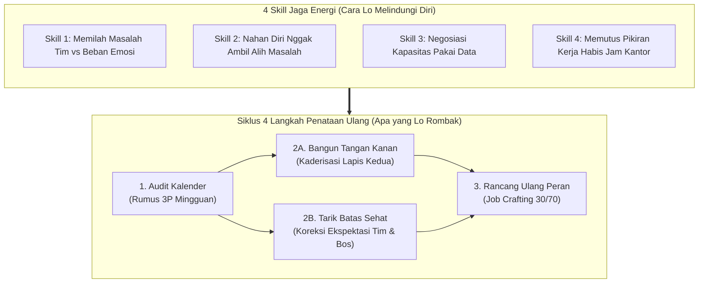
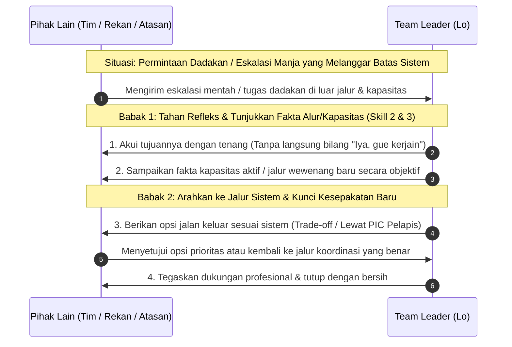
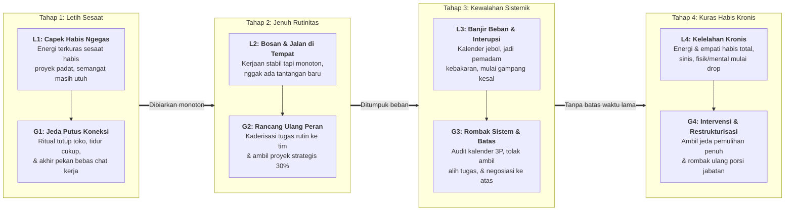

# Napas Panjang Memimpin Tim: Strategi Atasi Jenuh dan Bangun Sistem Kerja Otomatis

**Ditulis oleh:** `aiossan`</br>
**Ragam Bahasa:** Kasual / Akrab (`Gue/Lo`)</br>
**Format:** GitHub Flavored Markdown (GFM)

> [!NOTE] Cara Pakai Panduan Ini
> Buku kedua ini ditulis khusus buat lo yang udah ngelewatin masa adaptasi awal sebagai *team leader*, supervisor, atau manajer, tapi belakangan mulai ngerasa kehabisan bensin, jenuh sama rutinitas kantor, atau kejebak jadi "pemadam kebakaran" tiap hari. Lo bisa baca berurutan dari Pendahuluan sampai Bab 13, buka bagian lipat (*collapsible sections*) buat nyalin skrip negosiasi beban kerja dan simulasi kasus, atau langsung lompat ke **Lampiran** pas butuh contekan cepat buat nata ulang ritme kerja lo minggu ini.

## Daftar Isi

1. [Pendahuluan: Waktu Jabatan Udah di Tangan, tapi Tenaga Mulai Habis](#pendahuluan-waktu-jabatan-udah-di-tangan-tapi-tenaga-mulai-habis)
2. [Bab 1: Peralihan dari "Pemadam Kebakaran" ke Arsitek Sistem Kerja](#bab-1-peralihan-dari-pemadam-kebakaran-ke-arsitek-sistem-kerja)
3. [Bab 2: Kerangka Kerja 4x4 Ketahanan Diri (4 Langkah Penataan + 4 *Skill* Jaga Energi)](#bab-2-kerangka-kerja-4x4-ketahanan-diri-4-langkah-penataan--4-skill-jaga-energi)
4. [Bab 3: *Skill* 1: Memilah Masalah Tim vs Beban Emosi Pribadi](#bab-3-skill-1-memilah-masalah-tim-vs-beban-emosi-pribadi)
5. [Bab 4: *Skill* 2: Nahan Diri Biar Nggak Ambil Alih Masalah (*Anti-Rescue Habit*)](#bab-4-skill-2-nahan-diri-biar-nggak-ambil-alih-masalah-anti-rescue-habit)
6. [Bab 5: *Skill* 3: Negosiasi Kapasitas ke Atas Pakai Data, Bukan Keluhan](#bab-5-skill-3-negosiasi-kapasitas-ke-atas-pakai-data-bukan-keluhan)
7. [Bab 6: *Skill* 4: Memutus Pikiran Kerja Habis Jam Kantor (*Psychological Detachment*)](#bab-6-skill-4-memutus-pikiran-kerja-habis-jam-kantor-psychological-detachment)
8. [Bab 7: Langkah 1: Audit Kalender & Pangkas Rutinitas Mubazir (Rumus 3P)](#bab-7-langkah-1-audit-kalender--pangkas-rutinitas-mubazir-rumus-3p)
9. [Bab 8: Langkah 2A: Ngebangun Tangan Kanan & Kaderisasi Tim (*Bench Strength*)](#bab-8-langkah-2a-ngebangun-tangan-kanan--kaderisasi-tim-bench-strength)
10. [Bab 9: Langkah 2B: Mengatur Ulang Batas Saat Tim atau Atasan Kelewat Batas](#bab-9-langkah-2b-mengatur-ulang-batas-saat-tim-atau-atasan-kelewat-batas)
11. [Bab 10: Langkah 3: Merancang Ulang Peran Biar Semangat Balik Lagi (*Job Crafting* 30/70)](#bab-10-langkah-3-merancang-ulang-peran-biar-semangat-balik-lagi-job-crafting-3070)
12. [Bab 11: Studi Kasus & Simulasi 4 Minggu (Rina, Budi, dan Siska)](#bab-11-studi-kasus--simulasi-4-minggu-rina-budi-dan-siska)
13. [Bab 12: Mengenali Sinyal Kejenuhan (Level L1 sampai L4 ke Mode Pemulihan G1 sampai G4)](#bab-12-mengenali-sinyal-kejenuhan-level-l1-sampai-l4-ke-mode-pemulihan-g1-sampai-g4)
14. [Bab 13: Rencana Pemulihan & Penataan Kerja 30 Hari di Kantor](#bab-13-rencana-pemulihan--penataan-kerja-30-hari-di-kantor)
15. [Lampiran: Contekan Meja Kerja & Rujukan Riset](#lampiran-contekan-meja-kerja--rujukan-riset)

## Pendahuluan: Waktu Jabatan Udah di Tangan, tapi Tenaga Mulai Habis

Udah jalan satu, dua, atau tiga tahun lebih lo pegang peran sebagai *team leader*, supervisor, atau manajer?

Kalau di tahun pertama dulu masalah lo adalah rasa canggung waktu harus negur anggota tim atau bingung cara ngasih arahan, sekarang masalah yang lo rasain kemungkinan besar udah bergeser jauh. Coba cek, mana situasi di bawah ini yang paling sering kejadian sama lo belakangan ini:

- Bangun tidur tiap Senin pagi dengan perasaan hambar, berat, dan mikir, *"Duh, minggu ini harus ngeberesin drama apa lagi ya di kantor?"*
- Kalender kerja lo penuh sesak sama rapat koordinasi dari jam sembilan pagi sampai lima sore, sampai lo baru bisa ngerjain tugas strategis lo sendiri pas jam kantor udah bubar.
- Ngerasa kayak "bantalan tinju" hidup: dari atas ditekan target manajemen yang makin naik, dari bawah diserbu keluhan, revisi, dan masalah pribadi anggota tim.
- Tim lo sebenernya udah jalan cukup stabil, tapi lo justru ngerasa jalan di tempat (*stuck*), nggak lagi belajar hal baru, dan kehilangan rasa antusias yang dulu bikin lo semangat berangkat kerja.
- Biarpun badan lo udah di rumah atau lagi liburan akhir pekan bareng keluarga, kepala lo masih muter mikirin *chat* kerjaan, revisi klien, atau target kuartal depan.

Kalau lo ngangguk baca poin-poin di atas, tarik napas dulu. <mark>Lo nggak sendirian, dan lo bukannya berubah jadi *leader* yang buruk.</mark>

Yang lagi lo alamin itu adalah **kejenuhan peran kepemimpinan (*leadership plateau & role exhaustion*)**. Di buku pertama, kita udah ngebahas cara ngebangun fondasi komunikasi biar tim lo bisa jalan. Nah, di buku kedua ini, fokus kita naik satu tahap: **gimana caranya menjaga energi, menata ulang sistem kerja, dan memperpanjang napas kepemimpinan lo biar nggak habis terbakar (*burnout*) di tengah jalan.**

Riset dari *Center for Creative Leadership* (<abbr title="Center for Creative Leadership">CCL</abbr>) nunjukin kalau pemimpin tingkat pertama dan menengah adalah kelompok paling rentan ngalamin kelelahan kronis di perusahaan karena posisi mereka yang terjepit di tengah (*sandwich pressure*): harus nerjemahin tuntutan eksekutif sekaligus nampung beban operasional harian tim[^4].

Kabar baiknya, ketahanan diri (*resilience*) di tempat kerja itu bukan soal seberapa tebal mental lo nahan stres sambil gigit jari. Riset psikologi organisasi selama puluhan tahun ngebuktiin kalau ketahanan diri seorang *leader* ditentukan oleh **cara lo menata batas peran, mendelegasikan sistem, dan memulihkan energi kognitif lo setiap hari**.

Buku ini gue susun sebagai panduan taktis yang langsung bisa lo praktikin buat keluar dari jebakan kejenuhan. Kita bakal fokus ke tiga hal utama:

1. **4 Langkah Penataan Ulang (*Structural Resets*):** Empat langkah konkret buat ngerombak cara kerja lo, mulai dari nguras isi kalender yang mubazir, nyiapin tangan kanan (*kaderisasi*), narik batas sehat sama tim maupun bos, sampai ngerancang ulang peran lo (*job crafting*).
2. **4 *Skill* Jaga Energi (*Energy Management Skills*):** Empat keterampilan buat ngelindungi kapasitas mental lo, yaitu memilah masalah kerjaan dari beban emosi pribadi, nahan diri biar nggak ngambil alih masalah tim, negosiasi kapasitas ke atas pakai data, dan mutus pikiran kerja habis jam kantor.
3. **Kalibrasi Mode Pemulihan (Level L1 sampai L4 ke Mode G1 sampai G4):** Cara ngedeteksi sinyal kejenuhan diri lo sendiri (maupun anggota tim senior lo) sejak dini, biar lo tahu kapan cukup istirahat akhir pekan dan kapan harus ngerombak total beban kerja.

> [!IMPORTANT] Dasar Riset Panduan Ini
> Seluruh strategi di buku ini berpijak pada riset ilmiah psikologi kerja dan perilaku organisasi: model enam area kehidupan kerja dan kelelahan kronis (*Burnout & Six Areas of Worklife*) dari Profesor Christina Maslach[^1], teori perancangan ulang pekerjaan (*Job Crafting Theory*) dari Amy Wrzesniewski dan Jane Dutton[^2], studi pelepasan psikologis (*Psychological Detachment*) dari Profesor Sabine Sonnentag[^3], serta riset ketahanan pemimpin menengah dan kaderisasi dari *Center for Creative Leadership* (CCL)[^4]. Semuanya diterjemahin ke dalam bahasa praktis sehari-hari di kantor.

Yuk, kita bedah akar masalah kenapa banyak *leader* yang rajin dan peduli justru paling gampang kehabisan bensin di **Bab 1**.

## Bab 1: Peralihan dari "Pemadam Kebakaran" ke Arsitek Sistem Kerja

Pernah nggak lo ngerasa kalau sehari-hari di kantor, kerjaan lo lebih mirip petugas pemadam kebakaran daripada seorang pemimpin tim?

Pagi-pagi baru buka laptop, udah ada pesan darurat soal *server* atau pengiriman yang telat. Jam sepuluh, ada dua anggota tim yang salah paham soal pembagian tugas. Siang dikit, bos lo mendadak minta bahan presentasi buat rapat direksi besok pagi. Sorenya, lo masih harus ngecek laporan yang formatnya masih keliru. Pas lo lihat jam dinding, tahu-tahu udah jam enam sore dan kerjaan utama lo sendiri belum kesentuh sama sekali.

Waktu lo baru pertama kali diangkat jadi *team leader*, turun tangan langsung ngeberesin tiap masalah kecil itu wajar karena lo lagi bangun kredibilitas dan ngenalin medan. Tapi kalau setelah satu atau dua tahun pola kerja lo masih persis kayak gitu, badan dan pikiran lo pasti bakal ngirim sinyal protes.

Studi Profesor Christina Maslach dari University of California, Berkeley, jelasin kalau kelelahan kerja kronis (*burnout*) itu bukan sekadar capek fisik gara-gara banyak kerjaan, melainkan respons terhadap **ketidakseimbangan kronis antara tuntutan kerja dan kendali yang lo punya atas pekerjaan itu**[^1]. Maslach mengidentifikasi tiga gejala utama yang muncul berurutan saat seorang *leader* kehabisan bensin:

1. **Kuras Habis Energi (*Exhaustion*):** Rasa capek fisik dan mental yang nggak hilang biarpun lo udah tidur panjang di akhir pekan.
2. **Sikap Sinis & Jaga Jarak (*Cynicism / Depersonalization*):** Lo mulai kehilangan empati, gampang kesel sama pertanyaan tim, sinis sama kebijakan kantor, dan milih kerja sekadar gugur kewajiban (*autopilot*).
3. **Merasa Nggak Berdaya (*Inefficacy*):** Biarpun kerja dari pagi sampai malam, lo ngerasa nggak menghasilkan dampak apa-apa yang berarti dan ngerasa karier lo mentok.

### Bedanya Pemimpin "Pemadam Kebakaran" vs Arsitek Sistem Kerja

Buat keluar dari lingkaran kejenuhan itu, lo perlu ngelakuin pergeseran cara main yang kedua dalam karier kepemimpinan lo. Kalau dulu di Buku Pertama lo bergeser dari *kerja sendiri* ke *ngarahin tim*, sekarang lo harus bergeser dari **Pemadam Kebakaran Harian** menjadi **Arsitek Sistem Kerja**:

| Urusan Kerja | Gaya "Pemadam Kebakaran" (Bikin Cepat Jenuh) | Gaya Arsitek Sistem (Napas Panjang & Tenang) |
| :--- | :--- | :--- |
| **Sumber Kepuasan Diri** | Merasa berguna kalau dicariin tim terus-menerus buat nyelesaiin masalah. | Merasa berhasil kalau tim bisa nyelesaiin masalah sendiri tanpa harus nunggu lo. |
| **Isi Kalender Harian** | Penuh rapat dadakan, revisi mikro, dan interupsi sepanjang hari. | Punya blok waktu fokus (*deep work*), rapat yang terstruktur, dan ruang buat mikir jangka panjang. |
| **Posisi di Dalam Tim** | Jadi pusat sumbatan (*bottleneck*): semua keputusan kecil harus lewat meja lo. | Membangun lapis kedua (*kader/tangan kanan*) yang bisa ngambil keputusan operasional. |
| **Cara Merespons Tugas Baru** | Selalu bilang *"Siap, nanti kami usahain"* ke atasan biarpun kapasitas tim udah mentok. | Berani negosiasi prioritas dan pertukaran beban (*trade-off*) pakai data kapasitas nyata. |

Kenapa banyak *team leader* yang sebenernya pintar justru kejebak bertahun-tahun di mode Pemadam Kebakaran? Biasanya karena mereka tanpa sadar kejeblos ke salah satu dari dua jebakan psikologis ini:

#### 1. Jebakan "Pahlawan Kantor" (*The Hero Leader Syndrome*)

Diam-diam, ada rasa bangga waktu lo jadi satu-satunya orang yang bisa nyelametin proyek di detik terakhir. Lo ngerasa kalau nggak ada lo, tim bakal berantakan. Lo senang dicariin, senang ditanyain semua hal, dan nggak rela ngelepas wewenang penting ke anggota tim senior lo.

- **Akibatnya buat lo:** Lo emang kelihatan sibuk dan dibutuhkan, tapi lo mengunci diri lo sendiri di dalam sangkar operasional. Lo nggak bakal bisa naik jabatan (karena nggak ada yang bisa gantiin posisi lo), dan lama-lama lo muak sendiri karena semua beban numpuk di pundak lo.

#### 2. Jebakan "Bantalan Tanpa Batas" (*The Endless Sponge*)

Karena lo peduli sama tim dan pengen dianggap atasan yang suportif, lo nyerap semua keluhan tim sekaligus nelen bulat-bulat semua tekanan dari manajemen atas. Lo nggak tega nolak permintaan dadakan dari bos, dan di saat yang sama lo nggak tega nuntut anggota tim lo buat naik kelas.

- **Akibatnya buat lo:** Lo jadi penyangga emosional yang diperas dari dua arah. Tim lo tetap nyaman di zona aman, bos lo makin rajin ngasih tugas dadakan karena tahu lo nggak pernah nolak, sementara kesehatan mental dan waktu istirahat lo sendiri hancur pelan-pelan.

### Posisi yang Sehat: Membangun Sistem yang Nggak Bergantung Penuh Sama Lo

Ukuran tertinggi keberhasilan seorang *team leader* di tahun kedua dan seterusnya bukanlah seberapa sibuk lo terlihat di kantor, melainkan <ins>seberapa lancar tim lo tetap bisa jalan dan ngambil keputusan yang tepat waktu lo lagi cuti seminggu tanpa buka laptop</ins>.

Pegangan dasarnya simpel:

> **Berhentilah mengukur nilai diri lo dari seberapa banyak api yang lo padamkan hari ini; ukurlah dari seberapa tahan api sistem dan orang-orang yang lo bangun di tim lo.**

Biar perubahan ini nggak cuma berhenti jadi teori motivasi, buku ini ngerangkum strategi ketahanan diri dan penataan ulang kerja ke dalam **Kerangka Kerja 4x4 Ketahanan Diri**:

1. **4 Langkah Penataan Ulang (Apa yang Perlu Lo Rombak?):** Empat langkah struktural buat nguras beban mubazir, nyiapin tangan kanan, narik batas sehat, dan nyegerin ulang peran kerja lo.
2. **4 *Skill* Jaga Energi (Gimana Cara Lo Melindungi Fokus & Mental?):** Empat kebiasaan harian buat memilah beban emosi, nolak ngambil alih tugas tim, negosiasi beban ke atas pakai data, dan mutus pikiran kerja pas waktunya istirahat.

Yuk, kita lihat peta lengkapnya di **Bab 2**.

## Bab 2: Kerangka Kerja 4x4 Ketahanan Diri (4 Langkah Penataan + 4 *Skill* Jaga Energi)

Sama kayak waktu lo belajar dasar-dasar memimpin di Buku Pertama, keluar dari kejenuhan dan kelelahan kerja juga butuh sistem yang konkret. Seluruh isi buku kedua ini diringkas jadi **8 kebiasaan praktis** yang dibagi ke dalam dua kelompok:

1. **4 Langkah Penataan Ulang (*Structural Resets*)** - urutan langkah buat merombak kalender, tim, batas kerja, dan makna peran lo.
2. **4 *Skill* Jaga Energi (*Energy Management Skills*)** - empat keterampilan mental dan komunikasi buat menjaga kapasitas diri lo tiap hari.

Perhatikan gimana kedua kelompok ini saling menopang di diagram berikut:



Cara kerjanya saling ngunci: **lo pakai 4 *Skill* Jaga Energi setiap hari supaya 4 Langkah Penataan Ulang yang lo bangun nggak roboh lagi pas kerjaan kantor lagi padat-padatnya.**

> [!NOTE]
> Penjelasan lengkap soal `Rumus 3P` (Pangkas, Pindahin, Pertahanin) bakal kita kupas tuntas di Bab 7.

### Empat Langkah Penataan Ulang dalam Siklus Kerja

- **1. Audit Kalender & Pangkas Rutinitas Mubazir (Rumus 3P)**
  Langkah awal buat membebaskan minimal 4 sampai 6 jam waktu kerja lo tiap minggu dengan cara menyaring ulang rapat, laporan, dan proses persetujuan (*approval*) pakai Rumus 3P: **Pangkas**, **Pindahin**, dan **Pertahanin**.
- **2A. Ngebangun Tangan Kanan & Kaderisasi Tim (*Bench Strength*)**
  Langkah proaktif memilih dan melatih 1 sampai 2 anggota tim senior (level L3/L4) buat jadi lapis kedua yang bisa mewakili lo mimpin rapat harian, ngecek kualitas kerjaan teman-temannya, dan ngambil keputusan operasional.
- **2B. Mengatur Ulang Batas Saat Tim atau Atasan Kelewat Batas (*Boundary Reset*)**
  Langkah tegas tapi tetap profesional waktu anggota tim mulai balik manja (dikit-dikit lempar masalah ke lo) atau waktu atasan/divisi lain terus-terusan ngasih kerjaan dadakan di luar jam dan kapasitas wajar.
- **3. Merancang Ulang Peran Biar Semangat Balik Lagi (*Job Crafting* 30/70)**
  Langkah evaluasi berkala buat diri lo sendiri: membatasi urusan pemeliharaan rutin cukup di 70% kapasitas, dan mengalokasikan 30% energi terbaik lo buat proyek strategis, inovasi, atau pengembangan diri yang bikin lo kembali bersemangat.

> [!TIP] Urutan Ini Jangan Dibalik
> Banyak *leader* yang lagi jenuh langsung pengen nyoba hal baru atau ambil proyek keren (Langkah 3), padahal kalendernya masih penuh sesak dan belum punya tangan kanan di tim. Akibatnya malah makin *burnout*. Bersihin dulu kalender lo (Langkah 1), bangun kader dan batas kerja (Langkah 2A & 2B), baru isi ruang kosongnya sama hal yang bermakna (Langkah 3).

### Empat *Skill* Jaga Energi Sehari-hari

Buat ngejalanin empat langkah perombakan di atas tanpa rasa bersalah atau takut dicap lepas tangan, lo butuh empat keterampilan dasar ini:

1. **Memilah Masalah Tim vs Beban Emosi Pribadi:** Dengerin dan bantu urai kendala kerja anggota tim dengan empati yang sehat, tanpa ikut nyerap rasa panik, kesal, atau drama emosionalnya ke dalam dada lo sendiri.
2. **Nahan Diri Biar Nggak Ambil Alih Masalah (*Anti-Rescue Habit*):** Menghentikan kebiasaan buruk "ngambil alih monyet di punggung anak tim" (saat anak tim curhat masalah, tahu-tahu tugasnya pindah jadi PR lo).
3. **Negosiasi Kapasitas ke Atas Pakai Data, Bukan Keluhan:** Cara ngomong ke bos atau klien waktu beban tim udah penuh, dengan menyodorkan fakta kapasitas dan pilihan pertukaran prioritas (*trade-off*), bukan sekadar ngeluh capek.
4. **Memutus Pikiran Kerja Habis Jam Kantor (*Psychological Detachment*):** Keterampilan menutup "tab mental" kerjaan begitu keluar dari kantor, biar otak dan saraf lo beneran pulih sebelum besok pagi mulai memimpin lagi.

Di **Bagian 2 (Bab 3 sampai Bab 6)**, kita bakal latih keempat *Skill* Jaga Energi ini satu per satu lengkap sama skrip kalimatnya. Habis itu, di **Bagian 3 (Bab 7 sampai Bab 10)** kita langsung eksekusi keempat Langkah Penataan Ulangnya.

## Bab 3: *Skill* 1: Memilah Masalah Tim vs Beban Emosi Pribadi

Pernah nggak lo habis sesi *one-on-one* atau habis dengerin curhatan anggota tim yang lagi stres berat, orangnya keluar ruangan dengan wajah lega, tapi giliran lo yang duduk lemes, pusing, dan kepikiran sampai malam?

Kalau pernah, artinya lo baru aja ngalamin yang disebut **penularan emosi (*emotional contagion*)**. Sebagai *leader* yang baik, lo pasti pengen hadir dan nyimak keluhan tim lo. Tapi kalau lo nggak punya penyaring mental yang sehat, lo bakal berubah jadi "tempat sampah emosional" satu divisi.

Riset Profesor Christina Maslach nunjukin kalau kelelahan emosional (*emotional exhaustion*) adalah pintu masuk utama menuju *burnout* parah pada profesi yang menuntut interaksi intens sama orang lain, termasuk manajer lini pertama dan menengah[^1]. Pemimpin yang bertahan lama bukanlah pemimpin yang dingin kayak robot, melainkan pemimpin yang bisa membedakan antara **kepedulian kognitif (memahami duduk masalah dan bantu cari jalan keluar)** dengan **penyerapan emosional (ikut larut dalam rasa panik dan frustrasi lawan bicara)**.

### Tiga Kebiasaan yang Bikin Emosi Lo Ikut Terkuras

Coba perhatiin cara lo ngerespons waktu ada anggota tim atau rekan kerja datang dengan nada panik, marah, atau mengeluh panjang lebar:

- **Ikut panik waktu tim panik:** Pas anak tim lapor, *"Kak, gawat! Klien minta revisi besar padahal besok pagi harus tayang!"*, jantung lo langsung ikut berdebar kencang, nada suara lo ikut naik, dan lo langsung nyebarin kepanikan itu ke seluruh grup tim.
- **Ngerasa bertanggung jawab atas semua perasaan anggota tim:** Kalau ada satu anggota tim yang hari itu kelihatan murung atau cemberut, lo langsung gelisah seharian, nebak-nebak apa lo ada salah ngomong, dan ngerasa gagal jadi atasan kalau belum bikin dia senyum lagi.
- **Menampung sesi "curhat melingkar" tanpa ujung:** Lo ngebiarin obrolan koordinasi kerja berubah jadi sesi ngeluh 45 menit yang isinya muter-muter nyalahin divisi lain atau keadaan, tanpa ada satu pun langkah solusi yang disepakatin.

Tiga kebiasaan ini bikin baterai mental lo tekor sebelum jam makan siang, padahal masalah teknisnya sendiri belum tentu seberat itu.

### Tiga Langkah Praktis Memilah Fakta dari Beban Emosi

Supaya lo tetap jadi *leader* yang hangat dan suportif tanpa ikut tenggelam di dalam drama emosional, biasain tiga langkah ini:

#### 1. Pasang "Kaca Pelindung Mental" (*Observe, Don't Absorb*)

Waktu anggota tim datang dengan emosi tinggi (entah panik, kesal, atau kecewa), bayangin ada kaca bening di antara lo dan dia. Lo bisa ngelihat jelas ekspresinya dan denger suaranya, tapi "asap" kepanikannya nggak tembus ke badan lo.

- Sadari di dalam kepala lo: *"Dia lagi panik karena belum lihat jalan keluarnya. Tugas gue adalah tetap tenang biar salah satu dari kita bisa mikir jernih."*
- Turunin tempo bicara dan volume suara lo 20% lebih pelan dari biasanya. Dalam psikologi komunikasi, ketenangan itu sama menularnya dengan kepanikan.

#### 2. Validasi Perasaannya Singkat, Lalu Langsung Jangkar ke Fakta

Lo nggak perlu mendebat perasaannya (*"Ah, gitu aja kok panik!"*), tapi jangan juga ikut mengompori (*"Iya nih, klien itu emang nyebelin banget dari dulu!"*). Cukup akui perasaannya dalam **satu kalimat singkat**, lalu langsung geser obrolan ke fakta kerjaan yang bisa dikendalikan:

- *"Gue paham situasi ini bikin frustrasi karena kita udah kerja keras nyiapin drafnya. Sekarang, coba kita bedah: dari lima poin revisi klien tadi, mana dua poin yang paling krusial buat besok pagi?"*
- *"Wajar banget kalau lo kesel karena datanya telat dikirim tim sebelah. Biar waktu kita nggak habis buat nunggu, bagian mana dari laporan ini yang bisa kita kunci duluan pakai data yang udah ada?"*

#### 3. Batasi Durasi Keluhan dengan Aturan "5 Menit Lepas Uap"

Kalau anggota tim lo emang lagi butuh ngeluarin unek-unek, kasih ruang secara sadar tapi batasi waktunya biar nggak berubah jadi kubangan keluhan:

- *"Oke, silakan keluarin dulu semua yang bikin lo kesel soal kejadian tadi selama 5 menit. Gue dengerin. Habis 5 menit, kita fokus 100% nyusun langkah taktisnya ya."*

Begitu batas 5 menit lewat, tarik garis tegas menuju tindakan. Dengan cara ini, anggota tim tetap ngerasa didengerin, sementara kepala lo tetap bersih dari sampah keluhan yang berlarut-larut.

### Perbandingan Respons di Kantor (*Skill* 1)

| Hindari Respons Ini (Bikin Energi Terkuras) | Gunakan Respons Ini (Empati Sehat & Jaga Energi) |
| :--- | :--- |
| *"Aduh, mati kita! Kok bisa kejadian gini sih?! Terus gimana dong?!"* (Ikut panik) | *"Oke, tarik napas dulu. Ceritain ke gue fakta kejadiannya satu per satu biar kita lihat solusinya."* |
| Ikut ngomel 30 menit bareng tim nyalahin divisi lain. | *"Gue paham keterlambatan mereka bikin jadwal kita sempit. Sekarang, apa langkah yang ada di dalam kendali tim kita hari ini?"* |
| Kepikiran seharian waktu lihat staf kelihatan kurang bersemangat. | Tanya singkat secara empat mata: *"Pagi ini lo kelihatan agak capek, ada kendala kerjaan yang perlu gue tahu?"* Kalau dia bilang aman, percaya dan lanjut fokus kerja. |
| Ngebiarin rapat *1-on-1* berubah jadi sesi curhat tanpa kesimpulan. | *"Makasih udah cerita terbuka. Biar beban lo berkurang nyata, satu tindakan apa yang kita sepakatin buat diberesin minggu ini?"* |

### Latihan Praktik Bab 3

Minggu ini, latih keterampilan memilah emosi dan fakta lewat tiga langkah berikut:

- [ ] **Praktikkan "Kaca Pelindung" 1 kali:** Waktu ada yang datang bawa kabar mendadak atau keluhan dengan nada tinggi, sengaja pelanin suara lo dan ambil satu tarikan napas dalam sebelum menjawab.
- [ ] **Gunakan rumus "1 Kalimat Validasi + Geser ke Fakta":** Batasi kalimat empati di 1 kalimat pembuka, lalu langsung ajukan pertanyaan tentang fakta yang bisa dikendalikan hari ini.
- [ ] **Cek residu emosi sore hari:** Sebelum tutup laptop, tanya ke diri sendiri: *"Masalah mana di kepala gue sore ini yang sebenernya murni tanggung jawab gue, dan mana yang cuma beban emosi orang lain yang nggak sengaja gue bawa pulang?"*

## Bab 4: *Skill* 2: Nahan Diri Biar Nggak Ambil Alih Masalah (*Anti-Rescue Habit*)

Coba bayangin adegan klasik di lorong kantor atau di ruang *chat* ini:

Anggota tim lo, sebut aja Dani, nyamperin meja lo sambil bilang, *"Kak, gue ada masalah nih sama vendor percetakan. Mereka bilang bahan kertas yang kita pilih kemarin kosong, dan gue bingung harus ganti pakai spesifikasi yang mana."*

Karena lo lagi buru-buru mau masuk rapat lain, lo jawab, *"Oke deh, coba sini nomor kontak vendornya dan berkas spesifikasinya. Biar nanti siang gue yang telepon dan cekin dulu ya, nanti gue kabarin lo."*

Perhatiin apa yang baru aja kejadian dalam waktu 30 detik itu:

1. Sebelum ngobrol, masalah ("monyet") itu nangkring di pundak Dani.
2. Setelah ngobrol, masalah itu pindah nangkring ke pundak lo.
3. Dani sekarang berubah jadi pengawas yang santai-santai nunggu kabar dari lo: *"Kak, gimana? Udah ditelepon belum vendornya?"*

Kalau lo punya 6 anggota tim, dan tiap hari masing-masing dari mereka nitipin 2 masalah ke meja lo dengan cara kayak gitu, di hari Jumat lo bakal ngurusin 60 masalah orang lain sambil lembur sendirian, sementara anggota tim lo pulang tepat waktu jam lima sore!

> [!WARNING] Bahaya Refleks "Penyelamat" (*The Rescuer Trap*)
> Setiap kali lo ngambil alih tugas atau masalah yang sebenernya bagian dari tanggung jawab anggota tim lo, lo lagi ngajarin dua hal buruk sekaligus: (1) kalau ada tugas susah, cukup ngeluh ke *leader* maka tugasnya bakal diambil alih, dan (2) kapasitas waktu lo sendiri boleh dikorbankan kapan aja.

### Tiga Kalimat Jebakan yang Sering Bikin Tugas Tim Pindah ke Meja Lo

Waspadai tiga kalimat otomatis yang sering keluar dari mulut *leader* yang lagi capek atau nggak sabaran:

- *"Ya udah, sini kirim filenya ke gue, biar gue aja yang benerin sekalian."* (Karena lo ngerasa lebih cepat ngerjain sendiri 15 menit daripada ngejelasin ulang).
- *"Nanti biar gue yang coba tanyain dulu ke tim keuangan ya."* (Padahal anggota tim lo sendiri yang pegang proyek itu dan bisa langsung koordinasi).
- *"Taruh aja dulu di meja gue, nanti malam gue pikirin jalan keluarnya."* (Mengubah diri lo jadi tempat parkir masalah seluruh tim).

### Tiga Langkah Praktis Menolak Ambil Alih Masalah (Tanpa Kesan Lepas Tangan)

Menolak mengambil alih masalah bukan berarti lo cuek atau menelantarkan tim. Lo tetap hadir membantu, tapi **kepemilikan tugasnya nggak boleh pindah tangan ke lo sedetik pun**. Gunakan tiga langkah ini:

#### 1. Pastikan "Bola Langkah Berikutnya" Tetap di Tangan Anggota Tim

Prinsip utamanya tegas: **di akhir setiap obrolan konsultasi, orang yang keluar ruangan sambil membawa daftar tindakan berikutnya (*next action*) haruslah anggota tim lo, bukan lo.**

Kalau Dani datang bawa masalah kertas vendor tadi, tahan tangan lo biar nggak ngambil berkasnya. Bantu dia mikir di tempat selama 3 menit, lalu pastikan Dani sendiri yang nelpon vendornya:

- *"Oke Dan, dari katalog alternatif yang dikasih vendor, mana dua jenis kertas yang paling mendekati anggaran kita? Coba lo minta sampel harganya ke mereka siang ini, terus bawa dua opsinya ke gue jam tiga sore nanti."*

#### 2. Terapkan Aturan "Bawa Minimal 2 Opsi Sebelum Lapor Mentok"

Supaya anggota tim nggak dikit-dikit lempar masalah mentah ke meja lo, sepakati aturan main yang sehat di tim: setiap kali mau eskalasi masalah, mereka wajib nyiapin minimal **1 atau 2 usulan solusi** versi mereka sendiri:

- *"Gue siap banget bantu lo mutusin. Tapi sesuai kesepakatan tim kita, sebelum gue kasih keputusan, apa dua opsi jalan keluar yang udah lo pertimbangin beserta plus-minusnya?"*

Kalau mereka datang dengan tangan kosong tanpa mikir sama sekali, minta mereka balik ke meja kerja selama 15 menit buat nyusun dua opsi dulu, baru balik lagi ngobrol sama lo.

#### 3. Batasi Bantuan Lo Hanya pada Hal yang Memang Butuh Wewenang Jabatan Lo

Kapan seorang *team leader* baru boleh turun tangan langsung? Cuma kalau hambatannya emang **butuh otoritas jabatan lo** yang nggak dimiliki anggota tim (misalnya persetujuan anggaran di atas batas wewenang staf, atau eskalasi konflik antar-kepala divisi). Selama tindakan itu masih bisa dilakukan oleh staf (nelpon vendor, nyusun draf revisi, minta data ke rekan selevel di divisi lain), biarkan mereka yang mengeksekusinya.

### Perbandingan Tindakan di Kantor (*Skill* 2)

| Hindari Kebiasaan Ambil Alih Ini | Gunakan Kebiasaan Pelatih Mandiri Ini |
| :--- | :--- |
| *"Sini biar gue yang ketik ulang bagian analisisnya biar cepat."* | *"Bagian kesimpulan di halaman 2 ini masih kurang angka perbandingannya. Tolong lo lengkapi dulu pakai data kuartal lalu, jam 14.00 kita cek lagi ya."* |
| *"Oke, nanti malam gue pikirin solusinya terus gue kabarin lo besok."* | *"Kita bedah 5 menit sekarang. Menurut lo, langkah pertama apa yang paling masuk akal lo jalanin sore ini buat ngurai macetnya?"* |
| Menerima limpahan koordinasi: *"Biar gue aja yang nge-chat anak tim desain."* | *"Lo kan PIC proyek ini. Coba lo hubungi langsung PIC tim desainnya, sepakatin jadwal revisinya, dan kabarin gue kalau butuh bantuan eskalasi."* |
| Langsung ngerjain tugas staf yang ngaku "nggak ngerti caranya". | *"Buka laptop lo di sebelah gue, coba lo kerjain langkah pertamanya sambil gue pandu lisan. Biar minggu depan lo udah lancar sendiri."* |

### Latihan Praktik Bab 4

Selama seminggu ke depan, jaga punggung lo tetap bebas dari "monyet" tambahan lewat tiga latihan ini:

- [ ] **Audit tumpukan tugas lo hari ini:** Cek daftar kerjaan lo sekarang. Tandai mana tugas yang sebenernya porsi anggota tim tapi nggak sengaja lo ambil alih minggu lalu, lalu kembalikan kepemilikannya ke mereka hari ini.
- [ ] **Haramkan kalimat *"Sini biar gue aja"*:** Selama 5 hari kerja ke depan, tahan diri 100% dari ngucapin kalimat *"Sini filenya biar gue aja yang benerin"*.
- [ ] **Kunci pemilik *Next Action* di akhir obrolan:** Setiap kali selesai diskusi kendala sama anggota tim, tutup dengan kalimat: *"Sip, berarti langkah berikutnya yang bakal lo jalanin siang ini adalah X, dan lo bakal kabarin gue hasilnya jam Y ya."*

## Bab 5: *Skill* 3: Negosiasi Kapasitas ke Atas Pakai Data, Bukan Keluhan

Salah satu penyebab terbesar *team leader* ngerasa jenuh, sinis, dan kehabisan napas adalah perasaan nggak berdaya waktu berhadapan sama atasan atau manajemen puncak.

Bayangin situasi ini: tim lo lagi kerja keras ngejar tiga proyek besar yang *deadline*-nya barengan di akhir bulan. Tiba-tiba di hari Rabu siang, Manajer Divisi atau Direktur manggil lo dan bilang, *"Eh, tolong tim lo garap proyek tambahan X ini ya. Harus tayang minggu depan soalnya penting buat kuartal ini."*

Waktu berhadapan sama situasi kayak gitu, kebanyakan *team leader* jatuh ke salah satu dari dua respons ekstrem yang sama-sama merugikan:

1. **Asal Bapak/Ibu Senang (Pasrah Nelen Beban):** Lo jawab *"Siap Pak/Bu, kami usahakan!"* sambil senyum kecut. Begitu balik ke meja tim, lo terpaksa nyuruh anak tim lo lembur lagi, atau lo sendiri yang ngerjain proyek tambahan itu sampai tengah malam.
2. **Menolak Pakai Keluhan Emosional (Kelihatan Defensif):** Lo langsung protes dengan nada ngeluh, *"Waduh Pak, tim saya udah capek banget, kerjaan kami udah numpuk banget nih, nggak mungkin sanggup!"* Di telinga manajemen, respons tanpa data kayak gini sering kedengeran kayak alasan orang yang kurang sigap.

Riset Christina Maslach tentang enam area kehidupan kerja (*Six Areas of Worklife*) negesin kalau kemampuan pekerja dan manajer buat punya **kendali (*control*) atas beban kerja (*workload*)** adalah penentu utama apakah seseorang bakal bertahan sehat atau tumbang karena *burnout*[^1]. Dan kunci buat punya kendali di depan atasan bukanlah dengan ngeluh, melainkan dengan **menyajikan transparansi kapasitas dan pilihan pertukaran prioritas (*trade-off*) berbasis data**.

### Prinsip Dasar: Bos Lo Jarang Hafal Rincian Beban Harian Tim Lo

Satu fakta kantor yang perlu lo pegang: waktu atasan lo ngasih tugas dadakan, 90% kemungkinannya bukan karena dia sengaja pengen nyiksa tim lo, tapi karena **dia nggak ngelihat rincian beban jam kerja tim lo di kepala dia.** Di kepala atasan lo, dia cuma lihat masalah baru yang butuh diberesin, dan dia inget lo sebagai *leader* yang bisa diandelin.

Jadi, tugas lo bukanlah marah-marah atau pasrah, melainkan **memperlihatkan peta kapasitas tim lo secara visual dan mengajak atasan ikut menanggung konsekuensi pilihan prioritasnya**.

### Tiga Langkah Negosiasi Kapasitas Pakai Bahasa Pertukaran (*Trade-Off*)

Gunakan rumus **"Ya untuk Prioritas Baru, dengan Menggeser Prioritas Lama"** lewat tiga langkah ini:

#### 1. Terima Urgensinya dan Tunjukkan Kesiapan Membantu

Jangan pernah buka kalimat dengan kata *"Nggak bisa"* atau *"Nggak sanggup"*. Buka dengan mengakui pentingnya proyek yang dibawa atasan lo biar dia nggak pasang kuda-kuda defensif:

- *"Siap Pak/Bu, saya tangkap proyek X ini memang strategis buat ngejar target kuartal ini. Mari kita lihat cara paling aman buat nyelipin ini ke jadwal tim."*

#### 2. Beberkan Fakta Kapasitas Aktif Tim Secara Spesifik (Bukan Kata "Sibuk")

Jangan pakai kata sifat yang kabur kayak *"sibuk banget"*, *"kewalahan"*, atau *"numpuk"*. Sebutkan **nama proyek aktif, jumlah orang yang megang, dan tanggal *deadline*-nya**:

- *"Saat ini kapasitas 4 anggota tim kita lagi terpakai 100% di tiga proyek utama yang udah Bapak/Ibu kunci minggu lalu: (1) Peluncuran Produk A yang *deadline*-nya Jumat ini (dipegang Budi & Siska), (2) Audit Data Klien B yang jatuh tempo Senin depan (dipegang Dani), dan (3) Laporan Bulanan Divisi."*

#### 3. Sodorkan Pilihan Pertukaran Prioritas (*Trade-Off Options*) ke Meja Atasan

Di sinilah letak kunci negosiasinya. Karena jam kerja sehari tetap 8 jam, masuknya tugas baru secara matematis harus menggeser salah satu tugas lama, menambah sumber daya, atau menyederhanakan cakupan (*scope*). Minta atasan lo yang memilih:

- *"Kalau proyek tambahan X ini perlu kita selesaikan minggu depan dengan kualitas standar penuh, ada tiga opsi yang bisa kita ambil sekarang, Pak/Bu:*
  - ***Opsi A (Geser Jadwal):*** *Kita langsung kerjain Proyek X minggu ini, dan jadwal Audit Data Klien B kita geser mundur 4 hari ke Jumat depan.*
  - ***Opsi B (Pangkas Cakupan / Versi Minimum):*** *Semua jadwal tetap jalan, tapi untuk Proyek X minggu depan kita rilis versi ringkasnya dulu (3 halaman inti), baru sisanya menyusul bulan depan.*
  - ***Opsi C (Tambah Bantuan Lintas Tim):*** *Kita pinjam 1 staf dari tim sebelah buat bantu olah data dasarnya.*
  *Dari kacamata prioritas manajemen, opsi mana yang paling pas kita ambil, Pak/Bu?"*

Perhatiin betapa tenangnya kalimat di atas! Lo nggak nolak perintah, lo nggak ngeluh capek, tapi lo memindahkan beban keputusan prioritas balik ke pundak atasan lo dengan data yang tak terbantahkan.

### Perbandingan Kalimat di Kantor (*Skill* 3)

| Hindari Respons Ini ke Atasan / Klien | Gunakan Negosiasi Berbasis Data Ini |
| :--- | :--- |
| *"Siap Pak, nanti kami kerjain!"* (Padahal kapasitas udah lewat batas 120%) | *"Siap Pak, proyek ini penting. Supaya hasilnya tetap rapi, mari kita sesuaikan antrean proyek yang lagi jalan."* |
| *"Tim saya udah lembur terus Pak minggu ini, kasihan kalau ditambah lagi."* (Mengeluh tanpa opsi) | *"Saat ini 100% jam kerja tim terikat di Proyek A dan B yang tenggatnya Jumat. Kalau Proyek C masuk sekarang, mana di antara A atau B yang aman kita mundurkan 3 hari?"* |
| *"Wah, nggak mungkin kelar kalau cuma dikasih waktu 3 hari!"* (Menolak mentah-mentah) | *"Dengan waktu 3 hari kerja, cakupan yang realistis kita selesaikan dengan akurat adalah bagian 1 dan 2. Bagian 3 bisa kita susulkan di tahap kedua hari Rabu depan."* |
| Menggerutu di belakang layar sama anggota tim soal bos yang suka ngasih kerjaan dadakan. | Menyiapkan papan antrean proyek (*project kanban/tracker*) yang transparan dan selalu ditunjukin tiap kali bos minta tambahan tugas. |

### Latihan Praktik Bab 5

Minggu ini, latih otot negosiasi kapasitas lo lewat tiga langkah berikut:

- [ ] **Bikin Daftar Kapasitas Aktif 1 Halaman:** Tulis daftar seluruh proyek aktif tim lo minggu ini lengkap sama nama penanggung jawab dan tanggal *deadline*-nya, biar siap ditunjukin dalam 10 detik kapan pun atasan nanya.
- [ ] **Hapus kata "Sibuk" dan "Capek" saat bicara ke atas:** Ganti keluhan emosional dengan kalimat berbasis angka dan jadwal (*"Saat ini 40 jam kerja Budi minggu ini udah teralokasi ke A dan B"*).
- [ ] **Praktikkan Rumus 3 Opsi Pertukaran (*Trade-Off*):** Saat ada permintaan dadakan minggu ini, sodorkan opsi **Geser Jadwal Tugas Lama**, **Sederhanakan Cakupan Tugas Baru**, atau **Tambah Sumber Daya**.

## Bab 6: *Skill* 4: Memutus Pikiran Kerja Habis Jam Kantor (*Psychological Detachment*)

Pernah nggak lo lagi makan malam bareng keluarga atau lagi nongkrong sama teman di hari Sabtu, badan lo emang duduk di kursi restoran, tapi jempol lo tiap lima menit ngecek grup WhatsApp kantor dan otak lo sibuk nyusun kalimat balasan email buat hari Senin?

Di zaman kerja hibrida dan ponsel pintar sekarang, musuh terbesar ketahanan diri seorang *team leader* bukanlah jam kerja fisik di kantor, melainkan **ketidakmampuan memutus sambungan pikiran dari pekerjaan setelah jam kerja selesai**.

Riset komprehensif dari Profesor Sabine Sonnentag dan Charlotte Fritz (2015) yang merangkum puluhan studi pemulihan stres kerja membuktikan satu temuan krusial: **istirahat fisik saja tidak cukup untuk mencegah *burnout* jika tidak disertai pelepasan psikologis (*psychological detachment*)**[^3]. Pelepasan psikologis artinya lo berhenti memikirkan, merencanakan, atau mencemaskan urusan pekerjaan di luar jam kerja.

Studi Sonnentag menunjukkan bahwa ketika otak lo terus-menerus memikirkan masalah kantor di malam hari (meskipun lo tidak sedang mengetik di laptop), sistem saraf simpatik dan hormon stres (kortisol) di tubuh lo tetap menyala persis seperti saat lo sedang rapat tegang di kantor[^3]. Akibatnya, lo bangun keesokan paginya dengan baterai mental yang masih kosong.

### Tiga Kebiasaan yang Bikin Otak Lo "Ngantor 24 Jam"

Kenapa banyak *team leader* susah banget matiin saklar kerjaan di kepala mereka? Biasanya gara-gara tiga kebiasaan ini:

- **Ninggalin kerjaan dalam kondisi "menggantung" sore hari:** Lo langsung nutup laptop jam enam sore pas lagi ruwet-ruwetnya tanpa nulis rangkuman sampai mana kerjaan lo tadi dan apa yang harus dilanjutin besok pagi. Akibatnya, sepanjang malam otak bawah sadar lo terus muter nyoba "mengingat-ingat" kerjaan yang belum beres itu (dikenal dalam psikologi sebagai *Zeigarnik Effect*).
- **Menjadikan cek *chat* malam hari sebagai pelarian kecemasan:** Lo buka grup chat kantor jam 9 malam bukan karena ada darurat beneran, tapi karena lo cemas takut ketinggalan info. Ironisnya, begitu lo lihat ada pesan masuk dari klien atau bos jam 9 malam, lo jadi kepikiran sampai susah tidur.
- **Ikut membudayakan kirim instruksi ke tim di luar jam kerja:** Karena baru inget sesuatu jam 10 malam, lo langsung nge-chat anggota tim lo malam itu juga. Akibatnya, anggota tim lo ikut stres dan balas nanya, lalu terjadilah diskusi kerja tengah malam yang merusak waktu istirahat kalian semua.

### Tiga Langkah Praktis Memutus Pikiran Kerja (*Shutdown Ritual*)

Biar otak lo beneran bisa istirahat dan segar lagi besok pagi, bangun tiga kebiasaan penutup hari ini:

#### 1. Lakukan "Ritual Tutup Toko" 10 Menit Sebelum Pulang

Jangan pernah nutup laptop secara mendadak pas lagi di tengah kalimat. Sisihkan 10 menit terakhir sebelum jam kerja lo berakhir buat ngelakuin tiga hal singkat ini:

1. Cek kalender besok pagi biar nggak ada jadwal pagi yang mengejutkan lo.
2. Tulis **3 Prioritas Utama Besok Pagi** di buku catatan atau aplikasi *to-do list* lo, lengkap sama langkah pertama yang bakal lo kerjain jam sembilan pagi besok.
3. Tutup semua *tab* kerjaan di browser, kunci layar laptop (<kbd>Win</kbd> + <kbd>L</kbd> atau <kbd>Cmd</kbd> + <kbd>Ctrl</kbd> + <kbd>Q</kbd>), dan ucapkan kalimat penutup di kepala lo: *"Kerjaan hari ini selesai. Sisanya udah tercatat aman buat besok pagi jam sembilan."*

Begitu otak lo lihat daftar rencana besok pagi udah tertulis rapi di atas kertas, otak lo berhenti ngerasa wajib "menjaga" ingatan itu sepanjang malam.

#### 2. Gunakan Fitur *Scheduled Send* & Pisahkan Saluran Darurat

Banyak *leader* takut matiin notifikasi chat kerjaan malam hari karena mikir, *"Gimana kalau ada kondisi darurat beneran?"*

Solusinya simpel: **bedakan saluran komunikasi rutin (chat/email) dengan saluran darurat (telepon langsung).** Sepakati aturan jelas di tim lo:

- *"Teman-teman, di atas jam 18.30 WIB dan di akhir pekan, gue matiin notifikasi grup chat dan email biar kita semua bisa istirahat. Kalau ada ide atau laporan malam hari, silakan pakai fitur *Scheduled Send* (kirim terjadwal) buat besok pagi jam 08.30. Kalau ada insiden darurat yang beneran nggak bisa nunggu besok pagi (misalnya sistem utama mati total), langsung telepon nomor HP gue."*

Dengan kesepakatan ini, lo bisa tenang matiin notifikasi aplikasi kerja tanpa rasa waswas, karena lo tahu kalau nggak ada telepon masuk berarti dunia kantor aman terkendali.

#### 3. Pasang "Kegiatan Penyangga" (*Transition Buffer*) Antara Kantor dan Rumah

Otak manusia butuh jembatan transisi buat pindah dari mode "Manajer Pengambil Keputusan" ke mode "Manusia Biasa di Rumah". Apalagi kalau lo kerja dari rumah (*WFH*) di mana meja kerja cuma berjarak tiga langkah dari kasur.

Buat satu aktivitas fisik singkat selama 15 sampai 20 menit tepat setelah jam kerja berakhir sebagai penanda batas:

- Jalan kaki keliling komplek tanpa bawa HP kerjaan, olahraga ringan, mandi air hangat sambil dengerin musik/podcast non-kerjaan, atau ganti baju kerja begitu sampai di rumah.

### Perbandingan Kebiasaan di Kantor (*Skill* 4)

| Hindari Kebiasaan Ini (Bikin Burnout Kronis) | Gunakan Kebiasaan Ini (Pulih Maksimal Tiap Malam) |
| :--- | :--- |
| Langsung nutup laptop pas lagi pusing, terus kepikiran kerjaan di meja makan. | Luangin 10 menit terakhir buat nulis **3 Prioritas Besok Pagi** di kertas sebelum nutup laptop. |
| Nge-chat anggota tim jam 22.00 malam cuma karena takut lupa besok pagi. | Tulis pesannya sekarang, lalu pakai fitur **Kirim Terjadwal (*Scheduled Send*)** untuk jam 08.30 besok pagi. |
| Tetap nyalain notifikasi pop-up Slack/WhatsApp kerjaan dan email kantor di layar kunci HP sepanjang malam. | Matiin notifikasi aplikasi kerja di atas jam 18.30, dan sepakati bahwa urusan darurat murni wajib lewat telepon suara. |
| Rebahan di kasur sambil *scrolling* dokumen kerjaan di HP sebelum tidur. | Lakukan aktivitas fisik 15 menit (jalan kaki, peregangan, atau ngobrol santai) tanpa layar HP begitu jam kerja selesai. |

### Latihan Praktik Bab 6

Minggu ini, latih pemulihan energi harian lo lewat tiga eksperimen ini:

- [ ] **Praktikkan Ritual Tutup Toko 3 hari berturut-turut:** Tulis 3 prioritas besok pagi sebelum mematikan laptop, lalu rasakan bedanya di ketenangan pikiran lo malam itu.
- [ ] **Pakai *Scheduled Send* untuk semua pesan di luar jam kerja:** Jangan kirim satu pun chat kerjaan langsung ke tim di atas jam 18.30 minggu ini; jadwalkan semuanya untuk jam kerja esok pagi.
- [ ] **Umumkan aturan "Darurat = Telepon" ke tim:** Sampaikan ke anggota tim lo bahwa malam hari lo menonaktifkan notifikasi chat untuk istirahat, dan minta mereka menelepon langsung hanya jika ada krisis operasional yang mendesak.

## Bab 7: Langkah 1: Audit Kalender & Pangkas Rutinitas Mubazir (Rumus 3P)

Setelah lo menguasai empat *Skill* Jaga Energi di Bagian 2, sekarang kita masuk ke **Bagian 3: Empat Langkah Penataan Ulang (*Structural Resets*)** buat merombak cara kerja lo secara nyata.

Kita mulai dari sumber kebocoran energi paling kasatmata di kantor: **kalender kerja dan tumpukan rutinitas harian lo.**

Kenapa banyak *team leader* yang udah kerja lebih dari setahun ngerasa waktunya makin sempit? Karena di kantor berlaku hukum akumulasi tugas: **tugas dan rapat baru terus ditambahin tiap bulan, tapi tugas dan rapat lama dari tahun lalu nggak pernah ada yang resmi dihentikan.**

Lo masih hadir di rapat mingguan yang sebenernya udah bisa diwakilin staf lo. Lo masih nyusun rekap tabel yang sebenernya jarang dibaca manajemen. Lo masih meriksa satu-satu draf rutin yang sebenernya udah dikuasai penuh sama tim lo.

### Masalah Klasik: Sindrom Kalender Penuh Tapi Nggak Produktif

Kalau lo perhatiin jadwal mingguan lo sekarang, kemungkinan besar waktu lo habis tersedot oleh tiga jenis kegiatan berdaya ungkit rendah (*low-leverage activities*) ini:

- **Rapat "Wisatawan" (*Meeting Tourist*):** Rapat berdurasi 60 menit di mana lo cuma ikut dengerin tanpa ngambil keputusan apa-apa, atau cuma kebagian ngomong 3 menit buat bacain status yang sebenernya bisa dikirim lewat 3 poin chat.
- **Laporan & Rekap Warisan:** Laporan mingguan atau pengisian tabel berulang yang dulu dibuat waktu proyek awal jalan, tapi sekarang udah nggak pernah jadi dasar pengambilan keputusan siapa pun.
- **Gerbang Persetujuan Semu (*Rubber-Stamp Bottleneck*):** Aturan tak tertulis bahwa setiap hal kecil (mulai dari draf pesan klien rutin sampai pengajuan klaim receh) harus nunggu tanda tangan atau "ACC" lo dulu, yang bikin kerjaan tim macet tiap kali lo lagi sibuk rapat.

### Cara Menjalankan Audit Kalender dengan Rumus 3P (Pangkas, Pindahin, Pertahanin)

Buat ngedapetin kembali minimal **4 sampai 6 jam waktu bernapas** setiap minggu, buka kalender dan daftar rutinitas kerja lo selama dua minggu terakhir, lalu saring semuanya pakai **Rumus 3P**:

#### 1. Pangkas (*Eliminate*): Hentikan atau Perpendek yang Nggak Punya Dampak Nyata

Tanyakan secara jujur untuk setiap rapat rutin dan laporan di jadwal lo: *"Kalau minggu depan kegiatan ini nggak kita lakuin atau durasinya kita potong separuh, apakah target utama tim bakal terganggu?"*

- **Potong durasi rapat baku sebesar 50%:** Ubah pengaturan bawaan rapat dari 60 menit jadi 25 atau 30 menit, dan rapat 30 menit jadi 15 menit.
- **Ubah rapat "baca laporan" jadi pembaruan tertulis (*async update*):** Kalau tujuan rapat cuma buat tahu kabar progres masing-masing orang, ganti rapatnya dengan format tertulis 3 poin di grup setiap Senin pagi (1. Apa yang kelar, 2. Apa yang dikerjain hari ini, 3. Apa kendalanya). Rapat tatap muka/video cuma dipakai buat membedah kendala.
- **Pensiunkan laporan yang nggak dibaca:** Tanyakan ke penerima laporan: *"Kami lagi merapikan alur kerja. Untuk laporan rutin X, bagian mana yang masih paling Bapak/Ibu pakai buat ngambil keputusan, dan bagian mana yang sudah bisa kami ringkas?"*

#### 2. Pindahin (*Transfer & Automate*): Geser ke Anggota Tim atau Otomatisasi

Untuk tugas rutin yang memang masih penting tapi nggak lagi menuntut keahlian spesifik level *leader*, pindahkan kepemilikannya:

- **Pindahin kepemimpinan rapat rutin ke anggota tim secara bergilir:** Biarkan anggota tim level L3/L4 yang memimpin jalannya rapat mingguan tim atau menjadi wakil divisi di rapat koordinasi lintas tim, sementara lo cukup menerima ringkasan keputusannya.
- **Kunci batas persetujuan otomatis (*pre-approved boundaries*):** Daripada semua hal harus nunggu ACC lo, tetapkan batas aman. Misalnya: *"Untuk revisi desain rutin yang nggak mengubah jadwal rilis dan anggarannya di bawah Rp2 juta, kalian bisa langsung eksekusi tanpa perlu nunggu ACC gue."*

#### 3. Pertahanin & Lindungi (*Protect*): Kunci Blok Waktu Fokus buat Diri Lo Sendiri

Setelah lo memangkas dan memindahkan rutinitas mubazir tadi, **jangan biarkan jam kosong yang baru tercipta langsung diserobot rapat dadakan orang lain!**

- Langsung blokir 2 sampai 3 sesi waktu fokus (*Focus Block*) berdurasi 90 menit di kalender kerja lo setiap minggu (misalnya Selasa dan Kamis pagi jam 09.00–10.30).
- Gunakan waktu terlindung ini khusus untuk mikirin strategi jangka panjang, evaluasi sistem tim, atau ngerjain proyek prioritas lo dengan tenang tanpa gangguan.

<details>
<summary><strong>Templat Skrip Langkah 1 (Mengusulkan Pemangkasan Rapat/Laporan) Siap Salin</strong></summary>

```text
"Halo [Nama Rekan/Atasan/Tim], bulan ini gue lagi ngevaluasi alur kerja tim kita biar waktu eksekusi proyek utama makin optimal. Untuk [Nama Rapat Rutin / Laporan Rutin], gue usul mulai minggu depan kita sesuaikan formatnya pakai Rumus 3P:
1. Pangkas durasi: Rapat rutin kita ringkas dari 60 menit jadi 25 menit fokus khusus bahas kendala (update progres rutin dikirim tertulis di grup sebelum rapat).
2. Pindahin perwakilan: Untuk rapat koordinasi teknis hari Rabu, [Nama Anggota Tim Senior] bakal hadir mewakili tim kita dan merangkum poin keputusannya.
3. Pertahanin waktu eksekusi: Dengan cara ini, tim punya tambahan 3 jam kerja fokus tiap minggu buat ngejar target [Nama Proyek Utama].
Gimana menurut pandangan lo, apakah penyesuaian ini aman kita coba selama dua minggu ke depan?"
```
</details>

### Perbandingan Pengelolaan Waktu di Kantor (Langkah 1)

| Kebiasaan Lama yang Menguras Kalender | Penataan Baru Pakai Rumus 3P |
| :--- | :--- |
| Menerima semua undangan rapat tanpa nanya agenda dan peran lo di sana. | Tanya dulu sebelum klik *Accept*: *"Di rapat ini keputusan apa yang butuh masukan langsung dari gue? Kalau sifatnya info, boleh gue diwakili [Nama Staf] atau baca notulennya aja?"* |
| Rapat mingguan tim 90 menit buat dengerin 6 orang bacain status kerjaan satu-satu. | Wajibkan tulis status di dokumen bersama 1 jam sebelum rapat; rapat cukup 25 menit khusus membedah titik macet. |
| Semua email keluar dan draf rutin wajib diperiksa *leader* dulu. | Buat daftar periksa (*checklist*) standar kualitas 5 poin; kalau sudah memenuhi 5 poin itu, staf berhak langsung kirim tanpa nunggu ACC lo. |
| Kalender terbuka bebas dari Senin sampai Jumat sehingga penuh tambalan rapat dadakan. | Mengunci 3 blok *Focus Time* (masing-masing 90 menit) di kalender setiap minggu untuk berpikir strategis. |

### Latihan Praktik Bab 7

- [ ] **Lakukan Audit Kalender 2 Minggu Terakhir:** Buka kalender lo, beri warna merah pada rapat/rutinitas yang bisa **Dipangkas**, warna kuning untuk yang bisa **Dipindahin** ke staf, dan warna hijau untuk yang wajib **Dipertahanin**.
- [ ] **Ubah minimal 1 rapat rutin jadi format tertulis (*async*) atau potong separuh durasinya:** Terapkan langsung mulai Senin depan dan ukur berapa jam waktu kerja yang berhasil lo hemat.
- [ ] **Kunci 2 blok waktu fokus (*Focus Block*) di kalender minggu depan:** Pasang judul jelas di kalender (misalnya *"Blok Kerja Fokus & Strategi Divisi"*) supaya tidak tertimpa undangan rapat mendadak.

## Bab 8: Langkah 2A: Ngebangun Tangan Kanan & Kaderisasi Tim (*Bench Strength*)

Setelah lo berhasil melonggarkan kalender lewat Rumus 3P di Bab 7, pertanyaan berikutnya adalah: **ke siapa tugas-tugas operasional dan koordinasi rutin itu bisa lo pindahin dengan aman?**

Banyak *team leader* mengeluh mereka nggak bisa cuti tenang dan nggak bisa lepas dari urusan teknis harian karena ngerasa *"nggak ada anggota tim yang siap diserahi tanggung jawab lebih"*. Padahal, kalau setelah dua tahun lo mimpin masih belum ada satu pun anggota tim yang siap jadi pelapis lo, itu tandanya lo selama ini cuma sibuk **memakai tenaga tim buat ngejar target harian**, tapi lupa **membangun kader lapis kedua (*bench strength*)**.

Riset dari *Center for Creative Leadership* (<abbr title="Center for Creative Leadership">CCL</abbr>) dan *Gallup Workplace* nunjukin kalau membangun kader penerus atau tangan kanan (*second-in-command*) menghasilkan keuntungan ganda yang luar biasa[^4]:

1. **Buat diri lo sebagai *leader*:** Beban pengawasan mikro lo berkurang drastis, lo punya rekan diskusi sepadan di dalam tim, dan posisi lo siap dipromosikan kapan saja karena sudah ada calon pengganti yang matang.
2. **Buat anggota tim senior lo:** Anggota tim yang udah mahir (level L3 dan L4) justru paling gampang bosan dan pindah kerja (*resign*) kalau terus-terusan cuma dikasih tugas eksekusi yang sama. Dikasih kepercayaan jadi pelapis *leader* adalah tantangan pertumbuhan karier yang bikin mereka betah dan makin loyal.

### Kenapa *Leader* Sering Gagal Ngebangun Tangan Kanan?

Ada tiga kesalahan klasik yang bikin proses kaderisasi di tim sering gagal di tengah jalan:

1. **Ngasih beban tambahan tanpa ngasih wewenang dan panggung:** Lo nyuruh staf senior lo bantu ngecek kerjaan anak baru, tapi lo nggak pernah ngumumin perannya secara resmi ke tim dan nggak ngasih dia hak ngambil keputusan. Di mata staf senior itu, dia cuma ngerasa "dikasih kerjaan tambahan gratis".
2. **Nuntut langsung sempurna kayak cara kerja lo:** Begitu tangan kanan lo mimpin rapat pertama kali dan jalannya agak kurang mulus, lo langsung nggak sabaran terus ngambil alih lagi mikrofonnya di depan umum.
3. **Takut tersaingi (*Insecurity*):** Ada ketakutan tersembunyi di hati sebagian *leader* kalau staf seniornya kelihatan terlalu pintar di depan manajemen, nanti posisi sang *leader* dianggap nggak penting lagi. Padahal di perusahaan yang sehat, manajer yang berhasil mencetak pemimpin baru justru manajer yang paling cepat ditarik naik ke level manajemen yang lebih tinggi.

### Lima Langkah Praktis Membangun Tangan Kanan (*Bench Strength*)

Gunakan 5 langkah terstruktur ini buat nyiapin 1 atau 2 anggota tim andalan lo jadi pelapis kepemimpinan yang tangguh:

1. **Pilih kandidat yang udah stabil di Level L3 atau L4 pada tugas utamanya:** Cari anggota tim yang hasil kerja hariannya udah rapi, punya komunikasi yang dewasa, dan dihormati teman-teman satu timnya.
2. **Bikin obrolan "Peluang Pertumbuhan Karier" (Bukan "Nambahin Beban"):** Ajak dia ngobrol empat mata dan bingkai penugasan ini sebagai persiapan karier dia menuju level *senior/lead*, lengkap dengan apresiasi spesifik atas rekam jejaknya selama ini.
3. **Delegasikan "Kepemilikan Sistem", Bukan Cuma "Tugas Eceran":** Jangan cuma nyuruh dia ngerjain serpihan tugas. Serahkan satu tanggung jawab utuh yang bergengsi, misalnya: (a) Jadi koordinator penjamin mutu (*quality reviewer*) untuk draf anak baru, (b) Memimpin rapat tinjauan mingguan tim secara bergilir, atau (c) Menjadi wakil resmi tim di proyek lintas divisi.
4. **Umumkan mandatnya secara terbuka di depan tim:** Supaya rekan-rekan satu tim nggak bingung atau ngerasa dilangkahi, umumkan di rapat tim bahwa untuk urusan X, lo udah memberi mandat resmi ke orang tersebut sebagai titik koordinasi pertama.
5. **Dampingi lewat sesi *Coaching* singkat 15 menit tiap minggu:** Jangan langsung dilepas buta. Sediakan waktu 15 menit tiap minggu khusus buat ngebahas pengalaman dia mengoordinasi teman-temannya, bantu urai kesulitannya, dan kasih pengakuan terbuka di depan atasan lo atas kontribusi kepemimpinannya.

> [!TIP] Bagi Peran Kalau Tim Lo Punya Lebih dari Satu Staf Senior
> Lo nggak harus numpuk semua peran tangan kanan ke satu orang doang. Misalnya, Siska lo percaya pegang kendali mutu teknis (*Quality Lead*), sementara Budi lo percaya pegang koordinasi jadwal lintas divisi (*Project Coordinator*). Beban terbagi rata, dan keduanya sama-sama tumbuh!

<details>
<summary><strong>Templat Skrip Langkah 2A (Mengajak Staf Senior Jadi Tangan Kanan) Siap Salin</strong></summary>

```text
"Halo [Nama], gue pengen ngobrol soal perkembangan peran lo di tim kita. Selama beberapa bulan terakhir, gue lihat penguasaan teknis dan ketelitian lo di [Sebutkan Area Kerja] udah sangat matang dan konsisten.
Supaya karier dan skill lo terus naik kelas, bulan ini gue pengen ngasih lo panggung dan kepercayaan lebih besar: gue mau lo jadi pelapis gue untuk memegang [Sebutkan Peran Utuh, misal: review kualitas draf tim / memimpin rapat mingguan proyek X].
Tujuannya jelas: biar lo punya rekam jejak nyata memimpin orang dan mengelola sistem sebelum promosi berikutnya, sekaligus bikin alur keputusan tim kita jauh lebih cepat. Nanti gue umumkan mandat resmi ini ke teman-teman tim di rapat Senin, dan gue bakal mendampingi lo lewat sesi diskusi 15 menit tiap minggu. Gimana menurut pandangan lo?"
```
</details>

### Perbandingan Cara Kaderisasi di Kantor (Langkah 2A)

| Cara Keliru (Kelihatan Kayak Lempar Kerjaan) | Cara Kaderisasi yang Membangun Kebanggaan |
| :--- | :--- |
| *"Siska, gue lagi sibuk banget nih, tolong lo cekin kerjaan anak-anak ya minggu ini."* | *"Siska, karena standar kualitas lo paling rapi di tim, mulai bulan ini gue percayakan peran Quality Reviewer tahap pertama ke lo sebagai bagian dari pengembangan karier lo."* |
| Nyuruh staf senior ngarahin temannya tanpa pengumuman resmi ke anggota tim lain. | Mengumumkan di rapat tim: *"Mulai minggu ini, untuk persetujuan draf teknis tahap awal, Siska memegang wewenang penuh mewakili gue."* |
| Mengakui keberhasilan proyek di depan bos besar sebagai hasil kerja lo sendirian. | Menyebut nama tangan kanan lo di depan manajemen: *"Keberhasilan rilis tepat waktu minggu ini berkat koordinasi lapangan yang dipimpin langsung oleh Siska."* |
| Langsung memotong omongan tangan kanan waktu dia lagi belajar mimpin rapat. | Membiarkan dia menyelesaikan rapat sampai tuntas, baru memberi masukan perbaikan secara empat mata setelah rapat selesai. |

### Latihan Praktik Bab 8

- [ ] **Identifikasi 1 atau 2 calon pelapis di tim lo:** Tulis nama anggota tim yang saat ini udah berada di level kemandirian L3 atau L4 pada pekerjaan utamanya.
- [ ] **Pilih 1 tanggung jawab tingkat sistem untuk didelegasikan bulan ini:** Misalnya memimpin salah satu rapat rutin, menjadi mentor orientasi staf baru (*onboarding buddy*), atau menjadi pemeriksa tahap pertama untuk laporan rutin.
- [ ] **Jalankan obrolan mandat karier & umumkan ke tim:** Gunakan skrip di atas dalam sesi *one-on-one*, sepakati batas wewenangnya, dan umumkan secara resmi kepada seluruh anggota tim.

## Bab 9: Langkah 2B: Mengatur Ulang Batas Saat Tim atau Atasan Kelewat Batas

Waktu lo mulai melonggarkan kalender (Bab 7) dan menyerahkan sebagian wewenang ke tangan kanan lo (Bab 8), bakal muncul ujian nyata di lapangan: **kebiasaan lama orang-orang di sekitar lo belum tentu langsung berubah.**

- Ada anggota tim yang udah terbiasa manja selama setahun terakhir, yang tetap aja langsung nge-chat lo jam 8 malam nanyain hal sepele atau nyoba melangkahi tangan kanan yang udah lo tunjuk.
- Ada rekan dari divisi lain atau atasan yang udah terbiasa ngelihat lo sebagai "tukang beresin semuanya", yang tiba-tiba nyodorin kerjaan dadakan tanpa prosedur di Jumat sore.

Kalau di momen-momen itu lo luluh lagi dan balik melayani semuanya kayak dulu, maka seluruh penataan sistem yang lo bangun bakal runtuh dalam seminggu. Di sinilah lo butuh **Langkah 2B: Mengatur Ulang Batas (*Boundary Reset*)**.

Sama kayak *Koreksi Empat Mata* di Buku Pertama, mengatur ulang batas kerja bukan berarti lo marah-marah, pasang muka jutek, atau jadi birokrat yang kaku. Tujuannya adalah **mengedukasi ulang orang-orang di sekitar lo tentang cara kerja baru yang lebih sehat, cepat, dan terstruktur.**

Di dalam obrolan inilah lo menggabungkan **Skill 2 (Nahan Diri Nggak Ambil Alih Masalah)**, **Skill 3 (Negosiasi Pakai Data)**, dan rasa hormat terhadap rekan kerja ke dalam **Alur 2 Babak Penataan Batas**.



### Dua Skenario Utama Penataan Batas di Kantor

Mari kita bedah cara ngejalanin alur dua babak di atas untuk dua situasi yang paling sering menguras energi *team leader*:

#### Skenario 1: Saat Anggota Tim Balik Manja atau Melangkahi Sistem Baru

Misalnya lo udah nunjuk Siska sebagai pemeriksa tahap pertama untuk laporan mingguan, atau lo udah nerapin aturan *"bawa 2 opsi solusi sebelum lapor mentok"*. Tapi Dani tetap langsung nyamperin meja lo bawa masalah mentah.

- **Babak 1 (Tahan Refleks & Ingatkan Kesepakatan Alur):**
  *"Dan, gue tangkap lo pengen draf ini cepat beres. Tapi kalau gue langsung cek dan benerin draf lo sekarang, alur review satu pintu yang udah kita sepakatin bareng Siska jadi nggak jalan, dan antrean kerjaan lain jadi ketahan."*
- **Babak 2 (Kembalikan ke Jalur Sistem & Kuatkan Kepercayaan):**
  *"Supaya sistem tim kita tetap rapi, tolong lo diskusikan dulu draf ini sama Siska sesuai jadwal jam dua siang nanti, sekalian siapin dua opsi perbaikan buat bagian yang lo ragukan. Gue percaya penuh sama penilaian kalian berdua. Kalau nanti masih ada hal prinsipil yang butuh keputusan anggaran dari gue, baru kalian berdua bawa ke gue ya."*

#### Skenario 2: Saat Atasan atau Divisi Lain Menabrak Batas Waktu & Kapasitas

Misalnya rekan kepala divisi sebelah atau atasan lo terus-menerus ngirim permintaan revisi mendadak di luar jam kerja atau melompati antrean proyek yang udah disepakati.

- **Babak 1 (Akui Kepentingan & Tunjukkan Fakta Dampak Sistemik):**
  *"Pak/Mbak, saya paham permintaan tambahan untuk kampanye Y ini penting buat ngejar target minggu depan. Namun perlu saya sampaikan faktanya: minggu ini sudah ada tiga permintaan dadakan serupa yang masuk di tengah jalan, dan dampaknya jadwal pengujian kualitas produk utama kita terpaksa mundur dua hari sehingga risiko error saat rilis naik."*
- **Babak 2 (Kunci Jalur Masuk & Sodorkan Opsi Pertukaran):**
  *"Supaya kualitas kerja tim tetap terjaga dan nggak ada target utama yang dikorbankan diam-diam, mulai minggu ini setiap tambahan tugas di tengah minggu perlu kita pilih pertukarannya (*trade-off*) di papan prioritas kita setiap pagi jam sembilan. Untuk permintaan kampanye Y ini, apakah kita masukkan ke antrean minggu depan, atau kita geser jadwal tugas Z yang sedang dikerjakan tim hari ini?"*

> [!CAUTION] Konsistensi Adalah Kunci: Jangan Bocor di Hari Jumat
> Batas kerja itu persis kayak pagar rumah. Kalau sembilan kali lo jaga pagarnya, tapi di kali kesepuluh lo biarin orang nerobos pagarnya karena lo "lagi malas debat", maka besok-besok semua orang bakal terus nerobos pagar itu. Sekali lo tetapkan jalur koordinasi baru, jaga secara konsisten dengan nada yang ramah dan tenang.

<details>
<summary><strong>Templat Skrip Langkah 2B (Menarik Batas ke Tim & ke Atas/Samping) Siap Salin</strong></summary>

```text
[Skrip A: Mengembalikan Eskalasi Manja ke Anggota Tim]
"Halo [Nama], makasih udah ngabarin kendala di [Nama Tugas] ini. Sesuai alur kerja baru kita biar lo makin mandiri dan proses tim nggak numpuk di satu titik, gue nggak langsung ngambil alih bagian ini ya. Coba lo susun dulu 2 opsi jalan keluar yang menurut lo paling masuk akal (atau diskusikan dulu dengan [Nama Tangan Kanan/PIC]), lalu kabarin gue opsi mana yang kalian rekomendasikan. Gue percaya lo bisa ngurai bagian ini."

[Skrip B: Menata Batas Permintaan Dadakan dari Atasan / Divisi Lain]
"Halo [Nama Atasan/Rekan], saya tangkap urgensi dari permintaan [Nama Tugas Baru] ini. Agar kualitas eksekusi tim tetap akurat, saya izin membagikan fakta kapasitas tim saat ini: seluruh jam kerja minggu ini sudah terkunci untuk [Proyek A] dan [Proyek B]. Jika [Tugas Baru] ini perlu dikerjakan sekarang, kita bisa memilih antara: (1) Menggeser tenggat [Proyek B] ke Rabu depan, atau (2) Menjadwalkan [Tugas Baru] ini di gelombang kerja Senin depan. Mana yang paling sesuai dengan prioritas Bapak/Ibu?"
```
</details>

### Perbandingan Kalimat di Kantor (Langkah 2B)

| Respons yang Merusak Batas Kerja | Penataan Batas yang Tegas dan Profesional |
| :--- | :--- |
| *"Aduh, aturan sih lewat Siska dulu, tapi ya udahlah khusus kali ini sini gue aja yang cek."* (Meruntuhkan wewenang tangan kanan lo sendiri) | *"Untuk tahap ini wewenangnya udah gue serahin penuh ke Siska. Silakan lo cek bareng Siska dulu ya, keputusan Siska mewakili keputusan gue."* |
| Membalas pesan kerjaan non-darurat jam 10 malam sambil menggerutu di dalam hati. | Tidak membalas malam itu; membalas keesokan paginya jam 08.30 dengan tenang tanpa perlu minta maaf berlebihan karena beristirahat di malam hari. |
| Marah-marah waktu tim masih sering nanya hal kecil: *"Kalian ini kapan mandirinya sih?!"* | Menanyakan balik dengan tenang: *"Sebelum gue jawab, kalau lo lihat di dokumen SOP yang kita bikin bulan lalu, langkah nomor berapa yang ngatur soal ini?"* |
| Mengiyakan permintaan lintas divisi yang memotong jalur resmi tim. | *"Boleh banget kita bantu, tapi biar antrean kerja anak-anak nggak tabrakan, tolong masukin permintaannya lewat formulir/papan antrean tim kita ya biar bisa kami jadwalkan."* |

### Latihan Praktik Bab 9

- [ ] **Identifikasi 1 kebocoran batas terbesar minggu ini:** Apakah itu kebiasaan anggota tim yang melompati SOP/tangan kanan, kebiasaan divisi lain minta bantuan dadakan lewat *chat* pribadi, atau kebiasaan lo sendiri membalas kerjaan tengah malam?
- [ ] **Siapkan skrip 2 babak yang tenang:** Tulis kalimat *Babak 1 (Fakta & Dampak)* dan *Babak 2 (Jalur Sistem Baru)* yang bebas dari nada menyalahkan.
- [ ] **Terapkan secara konsisten minimal 3 kali minggu ini:** Saat kebocoran batas itu terjadi lagi, jalankan skrip tersebut tanpa pengecualian *"khusus kali ini doang"*.

## Bab 10: Langkah 3: Merancang Ulang Peran Biar Semangat Balik Lagi (*Job Crafting* 30/70)

Sekarang bayangin lo udah berhasil ngejalanin Langkah 1 (kalender lo udah longgar 5 jam seminggu berkat Rumus 3P) dan Langkah 2A serta 2B (tangan kanan lo udah mulai jalan dan batas kerja lo udah dihormati).

Beban lo sekarang udah jauh lebih ringan. Tapi tunggu dulu: **nggak capek lagi belum tentu bikin lo otomatis semangat lagi.**

Banyak *team leader* yang udah nggak lembur tetap ngerasa hampa dan jenuh karena kerjaan mereka sehari-hari rasanya datar-datar aja (*monoton*). Setiap bulan cuma ngulang siklus yang sama: bagi target, cek progres, tutup laporan bulanan, lalu ulang lagi dari awal. Nggak ada lagi tantangan intelektual yang bikin mata lo berbinar kayak waktu awal karier dulu.

Di sinilah lo perlu ngejalanin **Langkah 3: Merancang Ulang Peran (*Job Crafting*) dengan Aturan 30/70**.

Riset klasik dari Profesor Amy Wrzesniewski (Yale University) dan Profesor Jane E. Dutton (University of Michigan) memperkenalkan konsep **Job Crafting**: proses proaktif di mana seorang pekerja atau pemimpin memodifikasi komposisi tugas, interaksi sosial, dan cara pandang terhadap perannya sendiri supaya pekerjaannya kembali bermakna dan sesuai dengan kekuatan terbaiknya[^2]. Artinya, lo nggak harus nunggu pindah kantor atau nunggu dipromosikan dulu buat ngerasain semangat baru di pekerjaan lo sekarang.

### Tiga Dimensi *Job Crafting* untuk Seorang *Team Leader*

Menurut kerangka Wrzesniewski dan Dutton[^2], ada tiga tuas yang bisa lo putar buat menyegarkan kembali peran kepemimpinan lo:

1. **Menata Ulang Komposisi Tugas (*Task Crafting*):** Mengurangi porsi tugas rutin yang udah bisa didelegasikan ke kader tim, lalu menambahkan porsi proyek baru yang menantang otak lo (misalnya membangun sistem otomatisasi baru, merancang eksperimen produk, atau merapikan alur kerja lintas departemen).
2. **Menata Ulang Jejaring Interaksi (*Relational Crafting*):** Mengubah siapa aja orang yang berinteraksi sama lo tiap minggu. Kalau selama ini 100% waktu lo cuma habis di dalam lingkup internal tim lo sendiri, mulailah meluangkan waktu buat ngobrol sama manajer divisi lain, ikut *mentoring* lintas fungsi, atau ngobrol langsung sama pelanggan utama buat dapet perspektif segar.
3. **Menata Ulang Makna Peran (*Cognitive Crafting*):** Menggeser cara lo memandang tujuan kerjaan lo. Misalnya, dari yang tadinya mikir *"Kerjaan gue cuma ngawasin 5 staf marketing bikin konten tiap minggu"* menjadi *"Peran gue adalah ngebangun mesin pemasaran yang mandiri dan mencetak 2 pemimpin baru di perusahaan ini tahun ini."*

### Aturan Alokasi Energi 70/30 untuk Pemimpin yang Berkelanjutan

Supaya komposisi kerja bulanan lo seimbang antara stabilitas operasional dan gairah pertumbuhan baru, gunakan rumus pembagian kapasitas **70/30**:

- **70% Kapasitas untuk Menjaga Mesin Utama (*Core Operations & Team Coaching*):**
  Tujuh puluh persen jam kerja lo dipakai buat memastikan target utama divisi tercapai lewat 4 Obrolan Inti dan mendampingi para pelapis di tim lo. Karena lo udah pakai Rumus 3P dan kaderisasi, urusan operasional yang dulunya nyedot 120% waktu lo sekarang cukup selesai di porsi 70% ini.
- **30% Kapasitas untuk Proyek Pertumbuhan & Pembaruan Diri (*Growth & Strategic Crafting*):**
  Tiga puluh persen sisanya (sekitar 1 sampai 1,5 hari kerja per minggu yang udah lo amankan lewat blok waktu fokus di Bab 7) wajib lo pakai buat hal yang memberi energi baru:
  - Menggarap **1 inisiatif perbaikan strategis** yang lo pilih sendiri (bukan sekadar tambalan masalah harian).
  - Mempelajari keterampilan baru yang relevan untuk langkah karier lo berikutnya (misalnya analisis bisnis tingkat lanjut, pemanfaatan otomasi AI untuk alur kerja tim, atau manajemen anggaran tingkat departemen).
  - Membangun jejaring strategis (*networking*) dengan pemimpin di level atas atau divisi lain.

> [!IMPORTANT] Jangan Biarkan Ruang Kosong Hasil Delegasi Kembali Diisi Sampah Operasional
> Ingat hukum ruang hampa di kantor: kalau lo berhasil menghemat 5 jam seminggu dari pendelegasian ke tangan kanan lo, tapi lo nggak sengaja mengisinya dengan proyek strategis 30% pilihan lo sendiri, maka 5 jam itu pasti bakal kesedot lagi buat ngurusin keributan-keributan kecil yang nggak penting.

### Empat Langkah Menjalankan *Job Crafting* Tiap Kuartal

1. **Audit Peta Energi Kerja Lo Saat Ini:**
   Ambil selembar kertas dan bagi jadi dua kolom:
   - *Kolom Penguras Energi:* Tugas apa selama sebulan terakhir yang paling bikin lo bosan, jengkel, atau ngerasa jalan di tempat?
   - *Kolom Pengisi Energi:* Momen kerja apa selama tiga bulan terakhir yang bikin lo lupa waktu saking asyiknya (misalnya waktu ngedesain sistem baru, waktu berhasil melatih anak tim naik kelas, atau waktu presentasi strategi ke direksi)?
2. **Geser Tugas Penguras Energi Lewat Rumus 3P & Kaderisasi (Bab 7 & 8):**
   Pilih minimal dua tugas dari Kolom Penguras Energi untuk dipangkas atau didelegasikan sebagai proyek pembelajaran buat tangan kanan lo.
3. **Pilih 1 "Proyek Pembangkit Semangat" (*Keystone Growth Project*) untuk Kuartal Ini:**
   Pilih satu inisiatif dari Kolom Pengisi Energi yang punya dampak nyata buat kinerja divisi sekaligus menantang kemampuan lo.
4. **Sepakati Proyek 30% Itu Bareng Atasan Lo:**
   Sampaikan ke atasan lo di sesi evaluasi bulanan/kuartalan: *"Pak/Bu, karena operasional harian tim sekarang udah stabil dipegang bareng Siska dan Budi, kuartal ini saya mau mengalokasikan sekitar 20–30% waktu fokus saya buat ngebangun [Nama Proyek Strategis/Inovasi] yang bakal bantu divisi kita mencapai [Manfaat Nyata]."* Atasan mana pun bakal senang melihat manajer di bawahnya punya inisiatif strategis kayak gini!

### Perbandingan Pola Kerja di Kantor (Langkah 3)

| Pola Kerja Stagnan (100% Rutinitas Pemeliharaan) | Pola Kerja *Job Crafting* 70/30 (Segar & Berkembang) |
| :--- | :--- |
| Menghabiskan 100% jam kerja buat ngulangin pengawasan rutin yang sama persis kayak tahun lalu. | Menjaga operasional di 70% waktu bersama kader tim, dan mengalokasikan 30% waktu untuk 1 proyek terobosan tiap kuartal. |
| Cuma ngobrol sama anggota tim yang sama di ruangan yang sama sepanjang tahun. | Menjadwalkan 1 sesi obrolan lintas divisi atau diskusi bareng mentor/manajer senior setiap dua minggu sekali. |
| Menunggu atasan ngasih tugas baru baru bergerak belajar hal baru. | Proaktif mengusulkan proyek perbaikan sistem yang sesuai sama minat dan target karier lo berikutnya. |
| Menganggap rasa jenuh sebagai nasib yang nggak bisa diubah kecuali pindah kantor. | Menggunakan rasa jenuh sebagai sinyal bahwa porsi tugas rutin sudah waktunya didelegasikan ke kader di bawah lo. |

### Latihan Praktik Bab 10

- [ ] **Tulis Tabel Penguras vs Pengisi Energi:** Catat 3 aktivitas kerja yang paling menguras energi lo bulan ini dan 3 aktivitas yang paling memberi lo kepuasan intelektual.
- [ ] **Tentukan 1 Proyek Pertumbuhan 30% untuk 30 hari ke depan:** Pilih satu inisiatif strategis atau peningkatan sistem yang selama ini ketunda terus gara-gara lo sibuk jadi pemadam kebakaran.
- [ ] **Jadwalkan 1 obrolan lintas fungsi bulan ini:** Ajak satu rekan *team leader* atau manajer dari divisi lain makan siang atau ngobrol 20 menit buat bertukar cara mereka mengelola sistem kerja di timnya.

## Bab 11: Studi Kasus & Simulasi 4 Minggu (Rina, Budi, dan Siska)

Masih ingat **Rina** dan **Budi** dari Buku Pertama?

Dua tahun udah lewat sejak Rina pertama kali diangkat jadi *Team Leader Digital Marketing*. Berkat menerapkan **Kerangka Kerja 4x4** dari buku pertama, tim Rina sekarang berkinerja bagus. Budi yang dulunya masih sering salah rumus Excel sekarang udah tumbuh jadi staf menengah yang andal, ditambah ada **Siska** (staf senior yang teliti) dan dua staf baru.

Tapi masuk tahun ketiga, Rina mulai ngalamin masalah baru: **Rina jenuh berat dan kelelahan.**

Karena timnya dianggap paling beres, Manajer Divisi terus-terusan ngelempar proyek dadakan ke meja Rina. Di sisi lain, karena Rina terbiasa ramah dan selalu sedia bantu, semua anggota timnya masih dikit-dikit minta persetujuan Rina buat urusan kecil. Rina rapat 6 jam sehari, masih balesin *chat* grup jam 10 malam, dan mulai mikir buat *resign* karena ngerasa hidupnya habis buat ngurusin kerjaan rutin yang itu-itu aja.

Yuk kita lihat gimana Rina membalikkan keadaan dalam 4 minggu pakai **Kerangka Kerja 4x4 Ketahanan Diri**.

### Minggu 1: Audit Kalender (Rumus 3P) & Ritual Tutup Toko (*Skill* 4)

**Situasi:** Senin pagi, Rina ngelihat kalender minggunya penuh sesak sama 18 jam rapat rutin dan ratusan *chat* yang masuk sampai malam hari.

- **Pola Lama Rina (Pasrah & Kelelahan):**
  Datang ke semua rapat sambil multitasking ngetik laporan, terus lanjut lembur di rumah sampai jam 10 malam.
- **Langkah Baru Rina (Rumus 3P + *Skill* 4):**
  Rina membedah kalendernya selama 30 menit dan mengambil tiga tindakan:
  1. **Pangkas:** Rapat update status tim tiap Senin dan Kamis (masing-masing 60 menit) diubah jadi laporan tertulis 3 poin di grup jam 09.00 pagi, dilanjutkan rapat berdiri (*standup*) singkat 20 menit khusus bahas kendala. (Hemat 80 menit/minggu).
  2. **Pindahin:** Rina menetapkan batas persetujuan otomatis: untuk konten media sosial harian yang nggak melibatkan klaim sensitif atau anggaran iklan tambahan, staf nggak perlu lagi nunggu ACC Rina satu per satu.
  3. **Pertahanin & Ritual Tutup Toko (*Skill* 4):** Rina mengunci Selasa dan Kamis jam 09.00–10.30 sebagai *Focus Block* di kalendernya. Setiap jam 17.50 sore, Rina nulis 3 prioritas besok pagi di buku catatannya, lalu mengumumkan ke tim:
     *"Teman-teman, mulai minggu ini di atas jam 18.30 gue matiin notifikasi chat kerjaan biar kita semua punya waktu istirahat yang bener. Kalau ada ide malam hari, pakai fitur Scheduled Send buat besok pagi jam 08.30 ya. Kalau ada iklan yang tiba-tiba error parah, langsung telepon nomor gue."*

### Minggu 2: Ngebangun Tangan Kanan (Langkah 2A) & Nolak Ambil Alih Masalah (*Skill* 2)

**Situasi:** Rina sadar dia butuh pelapis di dalam tim supaya dia nggak jadi satu-satunya titik tumpu. Di saat yang sama, staf barunya, Dani, datang ngeluh soal draf naskah iklan yang mentok.

- **Langkah Rina Membangun Kader (Langkah 2A ke Budi dan Siska):**
  Rina memanggil Budi dan Siska di sesi *one-on-one* terpisah:
  **Rina ke Siska:** *"Sis, ketelitian data dan kualitas konten lo selama setahun ini udah di level L4. Supaya karier lo makin matang menuju level Senior/Lead, mulai minggu ini gue mau kasih lo mandat resmi sebagai Quality Reviewer tahap pertama untuk semua draf konten harian anak-anak sebelum naik ke klien. Gue dampingin lo 15 menit tiap Jumat buat evaluasi."*
  **Rina ke Budi:** *"Bud, karena lo udah jago banget olah laporan performa iklan sejak tahun lalu, mulai bulan ini gue percayakan lo buat mimpin rapat koordinasi mingguan bareng tim Desain setiap Rabu siang mewakili gue."*
  Siska dan Budi justru senang banget karena ngerasa dipercaya dan dapet portofolio kepemimpinan baru!
- **Langkah Rina Menahan Diri Nggak Ambil Alih Masalah (*Skill* 2 ke Dani):**
  Siang harinya, Dani (staf baru) nyamperin meja Rina: *"Kak Rina, judul iklan buat kampanye produk baru ini susah banget, dari tadi gue mentok. Boleh Kak Rina aja yang bikinin judulnya?"*
  **Pola Lama:** *"Ya udah sini produknya apa, biar gue bikinin 3 judul sekarang."*
  **Cara Baru Rina (*Skill* 2 + Langkah 2B):** *"Dan, gue yakin lo bisa. Sesuai aturan tim kita, gue nggak ngambil alih penulisan drafnya ya. Sekarang coba lo balik ke meja 15 menit, tulis 3 alternatif judul sebisanya menurut analisis lo-nggak usah takut jelek-terus bawa ke Siska buat dibedah bareng. Jam tiga sore nanti kabarin gue judul mana yang kalian pilih."*

### Minggu 3: Negosiasi Kapasitas ke Atas Pakai Data (*Skill* 3 & Langkah 2B)

**Situasi:** Rabu sore di minggu ketiga, Pak Hendra (Manajer Divisi sekaligus atasan Rina) manggil Rina dan minta tim Rina nyiapin materi kampanye webinar dadakan untuk tayang Senin depan.

- **Pola Lama (Nelen Beban atau Ngeluh):**
  Bilang *"Siap Pak"* terus nyuruh tim lembur akhir pekan, atau ngeluh *"Aduh Pak, anak-anak udah capek banget minggu ini."*
- **Cara Baru Rina (*Skill* 3 - Negosiasi *Trade-Off* Berbasis Data):**
  **Rina:** *"Siap Pak Hendra, saya tangkap webinar ini penting buat dorong prospek penjualan akhir bulan. Supaya hasilnya tetap rapi dan nggak merusak proyek utama yang sedang jalan, saya izin menampilkan peta kapasitas tim minggu ini ya, Pak."*
  *(Rina membuka tabel antrean proyek 1 halaman di layar tabletnya).*
  **Rina:** *"Saat ini 100% jam kerja tim sedang terkunci di dua target utama yang Bapak tetapkan Senin lalu: (1) Kampanye Peluncuran Produk Baru yang tayang Jumat ini, dan (2) Pembaruan Halaman Website Utama yang tenggatnya Senin depan. Kalau kampanye webinar dadakan ini perlu tayang Senin depan, ada tiga opsi pertukaran prioritas (*trade-off*) yang bisa kita pilih, Pak:*
  - *Opsi 1: Kita prioritaskan webinar ini sekarang, dan tenggat Pembaruan Halaman Website kita geser mundur ke Kamis depan.*
  - *Opsi 2: Semua jadwal tetap jalan, tapi untuk webinar Senin depan kita gunakan template halaman pendaftaran standar tanpa video promosi baru.*
  - *Opsi 3: Kita jadwalkan webinar ini untuk gelombang Senin dua minggu lagi supaya persiapannya matang 100%.*
  *Menurut prioritas Bapak, opsi mana yang paling tepat kita ambil?"*
  **Pak Hendra:** *(Melihat tabel kapasitas dengan tenang)* *"Oh, saya baru ingat Jumat ini ada peluncuran produk utama ya. Kalau gitu jangan ganggu peluncuran produk. Kita ambil Opsi 2 saja: pakai template standar dulu biar tim kamu nggak keteteran."*

Dalam waktu 4 menit, Rina berhasil melindungi timnya dari lembur akhir pekan tanpa konflik sedikit pun!

### Minggu 4: Merancang Ulang Peran (*Job Crafting* 30/70 - Langkah 3)

**Situasi:** Masuk minggu keempat, beban operasional Rina udah turun hampir 35% karena rapat udah dipangkas, Siska udah jalan sebagai *Quality Reviewer*, dan Budi udah lancar mimpin rapat lintas tim. Rina menggunakan waktu luang itu untuk menjalankan **Langkah 3 (*Job Crafting* 30/70)**.

- Rina ngelihat catatan Peta Energinya: dia sadar hal yang paling bikin dia bersemangat adalah **merancang sistem otomatisasi laporan dan strategi akuisisi pelanggan baru**, bukan ngecek ejaan teks iklan tiap hari.
- Di sesi *one-on-one* bulanan bareng Pak Hendra, Rina memaparkan hasil penataan timnya:
  **Rina:** *"Pak Hendra, selama sebulan terakhir saya sudah menata ulang alur kerja tim. Siska sekarang memegang review kualitas harian dan Budi memimpin koordinasi mingguan dengan tim Desain, sehingga operasional harian berjalan jauh lebih mandiri. Karena itu, mulai bulan depan saya ingin mengalokasikan 30% waktu fokus saya untuk merancang sistem dasbor otomatis lintas kanal iklan kita, supaya waktu olah data divisi bisa hemat 50% di kuartal depan. Ini draf rencana singkatnya, Pak."*
  **Pak Hendra:** *"Wah, inisiatif bagus sekali, Rina! Justru pola pikir strategis seperti ini yang saya harapkan dari seorang kandidat Manajer Senior. Silakan jalankan!"*

Sore itu Rina pulang jam 17.30 tepat waktu dengan perasaan antusias yang udah lama banget nggak dia rasain sejak dua tahun terakhir.

<details>
<summary><strong>Simulasi Interaktif Mandiri: Uji Keputusan Lo Sebagai Rina (Klik untuk Buka)</strong></summary>

Pilih satu opsi di tiap skenario di bawah ini, lalu cocokkan dengan skor ketahanan diri dan dampaknya:

1. **Minggu 1 (Kalender Penuh 18 Jam Rapat & Chat Malam Hari):**
   - **Opsi A:** Tetap hadir di semua rapat sambil ngetik kerjaan lain dan balesin chat jam 11 malam. -> **+10 Poin** (Kualitas fokus hancur dan saraf nggak pernah istirahat).
   - **Opsi B:** Terapkan Rumus 3P (Pangkas rapat status jadi update tertulis + Pindahin ACC rutin + Kunci *Focus Block*) & mulai Ritual Tutup Toko jam 17.50. -> **+100 Poin** (Hemat 5+ jam seminggu dan tidur malam kembali nyenyak).
   - **Opsi C:** Langsung bolos rapat tanpa komunikasi dan matiin HP seharian. -> **+20 Poin** (Menimbulkan kekacauan koordinasi di tim).
2. **Minggu 2 (Staf Baru Minta Dibikinin Judul Iklan & Staf Senior Mulai Bosan):**
   - **Opsi A:** Bikinin judul iklan staf baru biar cepat beres, dan biarin staf senior kerja kayak biasa. -> **+20 Poin** (Staf baru tetap manja, staf senior bosan, dan beban lo makin numpuk).
   - **Opsi B:** Beri mandat resmi *Quality Reviewer* ke Siska & pimpinan rapat ke Budi, lalu minta staf baru nyusun 3 opsi judul sendiri sebelum diskusi sama Siska. -> **+100 Poin** (Kader lapis kedua terbentuk dan "monyet" masalah nggak pindah ke pundak lo).
   - **Opsi C:** Marahin staf baru di grup chat karena nggak mandiri. -> **+10 Poin** (Merusak rasa aman psikologis tim).
3. **Minggu 3 (Atasan Minta Proyek Webinar Dadakan untuk Senin Depan):**
   - **Opsi A:** Bilang *"Siap Pak!"* lalu paksa tim lembur Sabtu-Minggu. -> **+20 Poin** (Tim kelelahan dan mulai kehilangan respek).
   - **Opsi B:** Ngeluh ke atasan bahwa tim udah capek banget dan nolak mentah-mentah. -> **+30 Poin** (Atasan menilai lo defensif dan kurang solutif).
   - **Opsi C:** Tunjukkan data kapasitas aktif 100% dan sodorkan 3 opsi pertukaran prioritas (*trade-off*: geser tenggat tugas lain, gunakan versi minimum, atau jadwalkan minggu berikutnya). -> **+100 Poin** (Atasan memilih versi minimum, target aman tanpa lembur).
4. **Minggu 4 (Waktu Luang 5 Jam Seminggu Sudah Terbentuk):**
   - **Opsi A:** Biarkan waktu luang itu kosong tanpa rencana sampai akhirnya kesedot lagi buat ngurusin keributan receh harian. -> **+30 Poin** (Kembali terjebak rutinitas monoton).
   - **Opsi B:** Terapkan *Job Crafting* 70/30: jaga operasional bersama kader di porsi 70%, dan kunci 30% waktu fokus untuk proyek strategis yang memicu semangat baru. -> **+100 Poin** (Antusiasme kerja pulih dan membuka jalan promosi karier).

</details>

## Bab 12: Mengenali Sinyal Kejenuhan (Level L1 sampai L4 ke Mode Pemulihan G1 sampai G4)

Sama halnya kayak kemandirian anggota tim yang punya tahapan berbeda-beda di Buku Pertama, **tingkat kejenuhan dan kelelahan kerja (*leadership fatigue*) yang lo alami-maupun yang dialami anggota tim senior lo-juga punya tingkatan yang berbeda.**

Pertanyaan pentingnya adalah:

> **"Apakah setiap rasa capek atau jenuh di kantor bisa diselesaikan dengan cara yang sama, misalnya cuma dengan ambil cuti sehari atau liburan akhir pekan?"**

Jawabannya: **nggak bisa.**

Kalau kelelahan lo baru di tahap awal (sekadar capek fisik habis pekan proyek yang padat), tidur nyenyak dan libur akhir pekan tanpa buka laptop memang cukup buat ngisi ulang baterai lo. Tapi kalau kejenuhan lo udah sampai di tahap kehilangan makna atau kewalahan struktural selama berbulan-bulan, cuti dua hari cuma bakal jadi obat pereda nyeri sementara-begitu Senin pagi lo buka laptop lagi, rasa muak dan sesaknya langsung balik detik itu juga!

Di sinilah lo perlu menerapkan **Kalibrasi Pemulihan & Penataan Beban**. Mengacu pada riset pemulihan stres kerja Profesor Sabine Sonnentag[^3] dan model keseimbangan beban kerja Profesor Christina Maslach[^1], prinsip dasarnya jelas:

> **Kenali posisi kejenuhan lo (atau anggota tim lo) pada spektrum L1 sampai L4, lalu terapkan Mode Pemulihan dan Penataan (G1 sampai G4) yang setara dengan akar penyebabnya.**

### 1. Empat Level Kejenuhan di Tempat Kerja (L1 sampai L4)

Kita bisa memetakan kondisi ketahanan diri seorang pemimpin atau anggota tim dari dua indikator utama:

1. **Kapasitas Energi Harian (*Energy Reserve*):** Seberapa bugar kondisi fisik, fokus kognitif, dan kestabilan emosi saat menghadapi masalah harian di kantor.
2. **Keterhubungan Makna Kerja (*Role Engagement*):** Seberapa besar rasa antusias, rasa memiliki kendali, dan kepuasan batin terhadap peran yang sedang dijalani.

Gabungan kedua indikator ini membentuk 4 level kejenuhan (L1 sampai L4) yang berpasangan langsung dengan 4 mode pemulihan (G1 sampai G4):



Berikut cara mengenali ciri-ciri tiap level di keseharian kantor:

- **L1: Capek Habis Ngegas / Letih Sesaat (*Acute Sprint Fatigue*)**
  Kondisi capek wajar setelah baru aja nyelesaiin rilis proyek besar, tutup buku kuartalan, atau pekan kerja yang padat. Badan berasa pegal dan otak agak lambat, tapi di dalam hati lo masih suka sama kerjaan lo dan masih bangga sama hasil kerja tim.
- **L2: Bosan & Jalan di Tempat (*Role Stagnation / Boreout*)**
  Secara fisik lo nggak lembur-lembur amat, tapi lo ngerasa hambar setiap kali berangkat kerja. Semua tugas rutin udah bisa lo kerjain sambil merem saking hafalnya. Lo kehilangan rasa penasaran, ngerasa nggak lagi tumbuh, dan kerja sekadar menjalankan rutinitas otomatis (*autopilot*).
- **L3: Banjir Beban & Interupsi (*Systemic Overload*)**
  Kalender lo jebol. Lo terus-terusan dikejar *deadline* yang tumpang-tindih, rapat beruntun tanpa jeda, dan jadi tempat eskalasi semua masalah tim. Tanda utamanya: lo mulai gampang marah karena hal sepele, susah tidur malam karena kepala masih muter mikirin kerjaan, dan ngerasa selalu dikejar waktu.
- **L4: Kuras Habis Kronis (*Severe Role Exhaustion*)**
  Ini lampu merah. Kelelahan di level L3 yang dibiarin berbulan-bulan tanpa penataan batas akhirnya meledak jadi kelelahan kronis. Lo ngerasa sinis dan mati rasa terhadap tim maupun kantor, konsentrasi hancur, sering sakit fisik (kepala tegang, asam lambung, insomnia), dan ngerasa apa pun yang lo kerjain nggak ada gunanya lagi.

> [!WARNING] Jangan Mengobati Masalah Level L3 atau L4 Hanya dengan Resep Level L1
> Kesalahan paling fatal banyak manajer adalah mencoba menyembuhkan **L3 (Banjir Beban Sistemik)** hanya dengan ambil cuti sehari (resep L1) tanpa merombak kalender dan batas kerjanya. Akibatnya, selama cuti malah tambah stres karena kerjaan numpuk di meja, dan hari Senin langsung tumbang lagi!

### 2. Empat Mode Pemulihan dan Penataan yang Tepat (G1 sampai G4)

#### G1: Jeda Putus Koneksi (*Micro-Detachment Reset*) -> Untuk L1

- **Fokus tindakan:** Pemulihan biologis & pelepasan pikiran jangka pendek.
- **Cara jalaninnya:** Karena akar masalah di L1 murni kelelahan energi sesaat sehabis ngegas proyek, obatnya adalah **istirahat berkualitas tinggi tanpa gangguan kerjaan**.
- **Langkah & *skill* utama:** Terapkan **Skill 4 (Ritual Tutup Toko & *Psychological Detachment*)** secara disiplin selama beberapa hari ke depan, pulang tepat waktu, matikan notifikasi grup kerja di akhir pekan, dan beri apresiasi ke tim karena sudah melewati pekan padat bersama.

#### G2: Rancang Ulang Peran (*Job Crafting & Kaderisasi*) -> Untuk L2

- **Fokus tindakan:** Menyuntikkan tantangan baru & mendelegasikan rutinitas lama.
- **Cara jalaninnya:** Orang di level L2 nggak butuh tidur lebih lama; mereka butuh **alasan baru buat bersemangat**. Obat paling manjur buat rasa bosan di L2 adalah melepaskan tugas rutin yang udah terlalu mudah ke kader di bawahnya, lalu mengambil inisiatif strategis baru.
- **Langkah & *skill* utama:** Jalankan **Langkah 2A (Bangun Tangan Kanan)** untuk menyerahkan tugas rutin ke staf senior, lalu terapkan **Langkah 3 (*Job Crafting* 30/70)** buat menggarap 1 proyek inovasi baru yang menantang otak lo.

#### G3: Rombak Sistem & Batas (*Structural Workload Triage*) -> Untuk L3

- **Fokus tindakan:** Memangkas beban mubazir, menghentikan kebocoran delegasi, dan negosiasi prioritas ke atas.
- **Cara jalaninnya:** Di level L3, masalahnya ada pada **sistem kerja yang bocor dari atas dan bawah**. Lo harus berani melakukan operasi pemangkasan jadwal dan menarik garis batas yang tegas.
- **Langkah & *skill* utama:** Eksekusi **Langkah 1 (Audit Kalender Rumus 3P)** minggu ini juga, terapkan **Skill 2 (Tolak Ambil Alih Masalah Tim)**, dan jadwalkan pertemuan dengan atasan menggunakan **Skill 3 (Negosiasi Kapasitas Pakai Data *Trade-Off*)** serta **Langkah 2B (Penataan Batas)**.

#### G4: Intervensi & Restrukturisasi Penuh (*Full Recovery & Role Redesign*) -> Untuk L4

- **Fokus tindakan:** Penghentian darurat kebocoran energi, jeda pemulihan utuh, dan perombakan porsi tanggung jawab bersama manajemen.
- **Cara jalaninnya:** Kalau lo (atau anggota tim lo) udah masuk ke L4, jangan dipaksa "kuat-kuatin" jalan terus. Butuh jeda istirahat penuh (cuti pemulihan beberapa hari/minggu yang benar-benar terputus dari kantor) diikuti dengan **pembicaraan terbuka bersama atasan untuk merestrukturisasi lingkup jabatan, membagi ulang portofolio proyek, atau menambah personel pelapis**.
- **Langkah & *skill* utama:** Gunakan **Skill 1 (Memilah Beban Emosi)** dan **Skill 3 (Data Kapasitas)** untuk berbicara jujur secara empat mata dengan atasan/HR mengenai perlunya penataan ulang struktur beban divisi secara permanen, serta serahkan operasional harian sementara ke **Tangan Kanan (Langkah 2A)**.

<details>
<summary><strong>Kumpulan Skrip Siap Pakai untuk Mode Pemulihan G1 sampai G4 (Klik untuk Buka)</strong></summary>

- **Skrip G1 (Saat Lo atau Tim Berada di L1 - Capek Habis Proyek Besar):**
  *"Teman-teman, makasih banyak atas kerja keras kalian nyelesaiin rilis besar minggu ini. Karena kita udah ngegas penuh selama lima hari terakhir, akhir pekan ini gue minta kita semua beneran istirahat total. Jangan ada yang buka laptop atau kirim chat kerjaan Sabtu-Minggu ya, biar Senin depan kepala kita segar lagi."*
- **Skrip G2 (Saat Lo Berada di L2 - Mulai Jenuh Rutinitas & Mengajukan *Job Crafting* ke Bos):**
  *"Pak/Bu, operasional rutin tim saat ini sudah berjalan sangat stabil dan sebagian koordinasi harian sudah berhasil saya kaderkan ke [Nama Tangan Kanan]. Supaya kontribusi saya ke divisi makin berdampak sekaligus memberi tantangan baru, kuartal ini saya ingin mengalokasikan 30% waktu fokus saya untuk menggarap proyek [Nama Inisiatif Strategis Baru]. Bagaimana menurut pandangan Bapak/Ibu?"*
- **Skrip G3 (Saat Lo Berada di L3 - Kewalahan Sistemik & Menata Ulang Prioritas dengan Bos):**
  *"Pak/Bu, saya izin berdiskusi 10 menit soal kapasitas tim bulan ini. Saat ini terdapat 6 proyek paralel yang berjalan bersamaan sehingga jam rapat dan pengawasan menyita 120% kapasitas, yang berisiko menurunkan ketelitian hasil kerja kita. Saya sudah menyusun pemetaan Rumus 3P ini: saya usul proyek A dan B tetap jadi prioritas utama minggu ini, sementara proyek C kita delegasikan ke [Nama Kader] dan proyek D kita geser ke bulan depan. Apakah susunan prioritas ini sudah sejalan dengan target Bapak/Ibu?"*
- **Skrip G4 (Saat Lo atau Staf Senior Berada di L4 - Butuh Restrukturisasi Beban Darurat):**
  *"Pak/Bu, saya perlu menyampaikan kondisi objektif terkait beban peran saat ini. Selama tiga bulan terakhir, penggabungan tanggung jawab [Peran X] dan [Peran Y] secara terus-menerus sudah melewati batas kapasitas sehat dan mulai berdampak pada fisik serta ketajaman kerja saya. Saya sudah menyiapkan [Nama Tangan Kanan] untuk memegang operasional harian selama saya mengambil cuti pemulihan [X hari] minggu depan, dan sepulangnya nanti saya ingin kita merestrukturisasi pembagian peran ini secara permanen agar kinerja divisi tetap terjaga untuk jangka panjang."*

</details>

### Tabel Pencocokan Cepat L1 sampai L4 ke G1 sampai G4

| Level Kejenuhan | Gejala Energi & Perasaan di Kantor | Mode Pemulihan yang Tepat | Langkah & *Skill* Utama yang Dipakai |
| :---: | :--- | :--- | :--- |
| **L1** | Capek fisik habis pekan padat, semangat masih aman | **G1: Jeda Putus Koneksi** | **Skill 4 (*Psychological Detachment*)** + Ritual Tutup Toko tepat waktu. |
| **L2** | Kerjaan lancar tapi bosan, monoton, & jalan di tempat | **G2: Rancang Ulang Peran** | **Langkah 2A (Kaderisasi Tangan Kanan)** + **Langkah 3 (*Job Crafting* 30/70)**. |
| **L3** | Kalender jebol, interupsi nonstop, gampang kesal | **G3: Rombak Sistem & Batas** | **Langkah 1 (Audit 3P)** + **Skill 2 (Anti-Ambil Alih)** + **Skill 3 (Negosiasi Data)**. |
| **L4** | Energi & empati habis total, sinis, fisik mulai drop | **G4: Intervensi & Restrukturisasi** | Jeda pemulihan penuh + pelimpahan ke **Tangan Kanan** + restrukturisasi beban bersama atasan. |

## Bab 13: Rencana Pemulihan & Penataan Kerja 30 Hari di Kantor

Kalau saat ini lo lagi ngerasa jenuh atau kewalahan, hal terakhir yang lo butuhin adalah daftar tugas tambahan yang bikin kepala makin pening.

Karena itu, **Rencana 30 Hari** di bawah ini sengaja dirancang bukan buat nambahin beban kerja lo, melainkan buat **mengurangi beban mubazir dan mengembalikan kendali waktu ke tangan lo secara bertahap**, satu minggu demi satu minggu:

### Minggu 1: Hentikan Kebocoran Energi Harian

**Fokus Minggu 1:** Mempraktikkan **Skill 1 (Memilah Emosi)**, **Skill 4 (Memutus Pikiran Kerja)**, dan **Langkah 1 (Audit Kalender Rumus 3P)**. Tujuan minggu pertama adalah ngasih ruang bernapas buat otak dan jadwal lo.

- [ ] **Praktik 1 (Jalankan Ritual Tutup Toko setiap sore):** Sepuluh menit sebelum jam pulang kantor, tulis **3 Prioritas Utama Besok Pagi** di catatan lo, tutup semua *tab* kerjaan, dan matikan notifikasi aplikasi chat kerjaan di atas jam 18.30 (gunakan fitur *Scheduled Send* kalau terpaksa nulis pesan malam hari).
- [ ] **Praktik 2 (Pangkas minimal 2 jam rapat mubazir pakai Rumus 3P):** Pilih minimal satu rapat rutin mingguan untuk dipotong separuh durasinya (dari 60 menit jadi 30 menit) atau diubah menjadi laporan pembaruan tertulis (*async update*) di grup.
- [ ] **Praktik 3 (Kunci 2 blok waktu fokus di kalender):** Pasang dua jadwal *Focus Block* berdurasi 90 menit di kalender minggu depan di mana lo tidak menerima rapat kecuali darurat.

### Minggu 2: Berhenti Jadi "Penyelamat" & Bangun Tangan Kanan

**Fokus Minggu 2:** Mempraktikkan **Skill 2 (Nahan Diri Nggak Ambil Alih Masalah)** dan **Langkah 2A (Ngebangun Tangan Kanan / Kaderisasi)**. Tujuan minggu kedua adalah memindahkan tumpukan beban operasional dari pundak lo.

- [ ] **Praktik 1 (Terapkan aturan "Bawa 2 Opsi Solusi"):** Setiap kali anggota tim datang melapor kendala minggu ini, tahan refleks buat langsung ngambil alih tugasnya. Minta mereka menyebutkan minimal 2 opsi jalan keluar versi mereka dulu dan pastikan bola langkah berikutnya (*next action*) tetap di tangan mereka.
- [ ] **Praktik 2 (Pilih dan beri mandat resmi ke 1 Tangan Kanan):** Ajak satu anggota tim senior (level L3/L4) ngobrol empat mata, serahkan satu peran tingkat sistem (misalnya *Quality Reviewer* tahap pertama atau pemimpin rapat koordinasi rutin), dan umumkan mandatnya secara resmi ke tim.
- [ ] **Praktik 3 (Diagnosis level kejenuhan L1–L4):** Cek posisi diri lo sendiri dan anggota tim senior lo minggu ini menggunakan matriks **L1 sampai L4**, lalu tentukan mode penanganan (**G1 sampai G4**) yang paling dibutuhkan.

### Minggu 3: Tarik Batas Sehat ke Atas, Samping, dan Bawah

**Fokus Minggu 3:** Mempraktikkan **Skill 3 (Negosiasi Kapasitas Pakai Data)** dan **Langkah 2B (Mengatur Ulang Batas)**. Tujuan minggu ketiga adalah menjaga agar sistem yang baru lo rapikan tidak jebol lagi oleh permintaan dadakan.

- [ ] **Praktik 1 (Siapkan Peta Kapasitas Aktif 1 Halaman):** Buat daftar ringkas berisi proyek utama yang sedang dikerjakan tim minggu ini beserta nama PIC dan tanggal tenggatnya.
- [ ] **Praktik 2 (Negosiasikan minimal 1 permintaan dadakan pakai opsi *Trade-Off*):** Saat ada tambahan tugas dari atasan atau divisi lain minggu ini, tunjukkan peta kapasitas tim dan sodorkan pilihan pertukaran prioritas (geser jadwal tugas lama, sederhanakan cakupan tugas baru, atau jadwalkan untuk pekan depan).
- [ ] **Praktik 3 (Jaga konsistensi batas wewenang Tangan Kanan):** Kalau ada anggota tim yang mencoba melompati tangan kanan yang sudah lo tunjuk di Minggu 2, arahkan mereka kembali ke jalur koordinasi yang benar menggunakan alur 2 babak.

### Minggu 4: Nyalakan Kembali Api Antusiasme (*Job Crafting* 30/70)

**Fokus Minggu 4:** Mempraktikkan **Langkah 3 (Merancang Ulang Peran / *Job Crafting* 30/70)**. Tujuan minggu keempat adalah mengisi ruang waktu yang udah berhasil lo bebaskan dengan kegiatan yang bermakna dan mengembangkan karier lo.

- [ ] **Praktik 1 (Audit Penguras vs Pengisi Energi):** Tulis daftar tugas yang paling menguras energi lo bulan ini untuk terus didelegasikan ke kader tim, dan catat aktivitas strategis yang paling memicu rasa antusias lo.
- [ ] **Praktik 2 (Kunci 1 Proyek Pertumbuhan 30% untuk bulan depan):** Pilih satu inisiatif perbaikan sistem, inovasi produk/proses, atau pengembangan keahlian baru yang bakal lo garap di dalam jam *Focus Block* mingguan lo.
- [ ] **Praktik 3 (Presentasikan penataan peran baru ke atasan):** Di sesi *one-on-one* akhir bulan bersama atasan lo, tunjukkan bagaimana tim lo kini berjalan lebih mandiri bersama para pelapis yang lo bangun, dan sepakati alokasi porsi 30% waktu lo untuk proyek strategis bulan depan.

### Penutup: Memimpin Itu Lari Maraton, Bukan Lari Cepat 100 Meter

Banyak pemimpin baru mengawali karier mereka dengan berlari secepat-cepatnya kayak pelari *sprint* 100 meter: semua rapat dihadiri, semua *chat* dibalas dalam 10 detik tengah malam, dan semua masalah tim dipikul sendirian. Cara itu mungkin kelihatan heroik di bulan pertama, tapi nggak ada manusia yang sanggup lari *sprint* terus-menerus selama bertahun-tahun tanpa tumbang.

Menjadi pemimpin yang matang artinya lo berani mengubah ritme lari lo menjadi pelari maraton. Lo mengatur napas, membagi beban ke kader di belakang lo, berani bilang *"tunggu giliran"* pada beban yang di luar kapasitas, dan tahu kapan harus menepi sejenak buat mengisi ulang tenaga.

Bahkan, langkah paling sehat yang bisa lo mulai besok pagi adalah menyampaikan penataan baru ini secara terbuka dan tenang kepada tim lo:

> *"Teman-teman, supaya tim kita makin mandiri dan kita semua bisa kerja dengan ritme yang sehat buat jangka panjang, mulai bulan ini kita bakal ngerapiin cara kerja kita. Gue bakal mengurangi rapat status yang nggak perlu, ngasih panggung dan wewenang lebih besar ke rekan-rekan senior di tim ini, serta menjaga batas jam istirahat malam buat kita semua. Yuk, kita bangun sistem kerja yang rapi biar kita bisa capai target tanpa harus mengorbankan kesehatan dan waktu keluarga kita."*

Ketika lo memimpin dengan batas yang sehat dan sistem yang terukur, lo nggak cuma menyelamatkan diri lo sendiri dari kejenuhan-lo juga lagi ngasih contoh hidup ke seluruh anggota tim lo tentang gimana wujud seorang pemimpin masa depan yang tangguh, waras, dan bisa diandalkan dalam jangka panjang.

## Lampiran: Contekan Meja Kerja & Rujukan Riset

Simpan halaman ringkasan ini sebagai pengingat cepat setiap kali jadwal kerja lo mulai terasa semrawut atau energi lo mulai terkuras.

### 1. Ringkasan 4 *Skill* Jaga Energi Sehari-hari

| No | Nama *Skill* | Tujuan Utama | Cara Praktik & Kalimat Kunci |
| :---: | :--- | :--- | :--- |
| **1** | **Memilah Masalah Tim vs Beban Emosi** | Membantu tim mengurai kendala kerja tanpa ikut menyerap kepanikan dan frustrasinya. | • **Pasang kaca pelindung:** Pelankan tempo suara 20% saat lawan bicara panik.<br/>• **1 kalimat validasi + geser ke fakta:** *"Gue paham ini bikin kesel. Sekarang, mana 2 bagian yang ada di dalam kendali kita hari ini?"*<br/>• **Batas 5 menit:** Beri 5 menit buat lepas uap, lalu kunci ke solusi. |
| **2** | **Nahan Diri Nggak Ambil Alih Masalah** | Mencegah tugas anggota tim pindah balik ke meja kerja lo (*Anti-Rescue Habit*). | • **Pastikan *next action* tetap di tangan staf.**<br/>• **Aturan 2 opsi:** *"Sebelum gue putusin, apa 2 opsi jalan keluar yang udah lo pertimbangin?"*<br/>• Turun tangan hanya jika masalahnya mutlak butuh otoritas jabatan lo. |
| **3** | **Negosiasi Kapasitas Pakai Data** | Menjaga beban kerja tim tetap rasional di depan atasan/klien tanpa terdengar mengeluh. | • **Ganti kata "sibuk/capek" dengan data kapasitas aktif.**<br/>• **Sodorkan 3 opsi *Trade-Off*:**<br/>  *"Kapasitas tim minggu ini terikat 100% di Proyek A & B. Untuk tugas baru C ini, apakah kita (1) Geser jadwal B, (2) Buat versi ringkas C, atau (3) Jadwalkan C minggu depan?"* |
| **4** | **Memutus Pikiran Kerja (*Detachment*)** | Memulihkan energi kognitif dan saraf sepenuhnya setelah jam kerja berakhir. | • **Ritual Tutup Toko (10 menit sebelum pulang):** Tulis 3 prioritas besok pagi di catatan, lalu tutup laptop.<br/>• **Pakai *Scheduled Send*** untuk pesan malam hari.<br/>• **Pisahkan jalur darurat:** Matikan notifikasi chat malam hari; darurat murni wajib lewat telepon suara. |

### 2. Ringkasan 4 Langkah Penataan Ulang (*Structural Resets*)

| Langkah Penataan | Kapan Dilakukan? | Tujuan Utama | Urutan Langkah Singkat |
| :--- | :--- | :--- | :--- |
| **1. Audit Kalender (Rumus 3P)** | Awal bulan atau saat jadwal rapat mulai tidak terkendali. | Membebaskan 4–6 jam kerja fokus setiap minggu dari rutinitas mubazir. | 1. **Pangkas:** Potong 50% durasi rapat rutin & ubah rapat baca status jadi laporan tertulis (*async*).<br/>2. **Pindahin:** Tetapkan batas persetujuan otomatis (*pre-approved*) & wakilkan rapat teknis.<br/>3. **Pertahanin:** Kunci 2–3 blok *Focus Time* (90 menit) di kalender mingguan. |
| **2A. Bangun Tangan Kanan (*Kaderisasi*)** | Berkelanjutan bersama anggota tim level L3 dan L4. | Menciptakan lapis kepemimpinan kedua agar lo tidak menjadi sumbatan tunggal. | 1. Pilih 1–2 staf mahir (L3/L4).<br/>2. Bingkai sebagai peluang pertumbuhan karier.<br/>3. Delegasikan kepemilikan sistem (misal *Quality Reviewer* atau pimpinan rapat).<br/>4. Umumkan mandatnya secara resmi ke tim.<br/>5. Dampingi lewat sesi *coaching* 15 menit/minggu. |
| **2B. Mengatur Ulang Batas (*Boundary Reset*)** | Segera saat anggota tim kembali manja atau atasan menabrak batas kapasitas. | Mengedukasi ulang tim dan pemangku kepentingan agar menghormati sistem kerja baru. | **Babak 1 (Fakta & Dampak):**<br/>1. Akui maksud baiknya dengan tenang.<br/>2. Tunjukkan fakta kapasitas aktif atau aturan alur kerja satu pintu.<br/>**Babak 2 (Solusi Sistem):**<br/>3. Arahkan kembali ke PIC pelapis atau sodorkan opsi pertukaran prioritas (*trade-off*).<br/>4. Tutup dengan dukungan profesional. |
| **3. Merancang Ulang Peran (*Job Crafting* 30/70)** | Evaluasi diri setiap akhir bulan atau kuartal. | Mengembalikan antusiasme intelektual dan menyiapkan pijakan promosi karier. | 1. Audit tugas Penguras Energi vs Pengisi Energi.<br/>2. Jaga operasional rutin di porsi **70%** bersama kader tim.<br/>3. Alokasikan **30%** waktu fokus untuk 1 proyek strategis/inovasi pilihan lo.<br/>4. Sepakati proyek 30% tersebut bersama atasan. |

### 3. Ringkasan Matriks Kalibrasi Kejenuhan (L1 sampai L4 ke G1 sampai G4)

| Level | Kondisi & Sinyal Kejenuhan | Mode Pemulihan & Penataan | Fokus Intervensi | Langkah Utama yang Dipakai |
| :---: | :--- | :--- | :---: | :--- |
| **L1** | **Capek habis ngegas** (Letih fisik sesaat sehabis pekan padat, semangat masih utuh) | **G1: Jeda Putus Koneksi** | Pemulihan **Biologis**<br/>Pelepasan **Pikiran** | • Disiplinkan **Ritual Tutup Toko** & pulang tepat waktu.<br/>• Matikan notifikasi kerja di akhir pekan (**Skill 4**). |
| **L2** | **Bosan & jalan di tempat** (Kerjaan stabil tapi monoton, kehilangan tantangan baru) | **G2: Rancang Ulang Peran** | Delegasi **Rutinitas**<br/>Suntikan **Tantangan** | • Serahkan tugas rutin ke **Tangan Kanan (Langkah 2A)**.<br/>• Ambil 1 proyek strategis baru lewat ***Job Crafting* 30/70 (Langkah 3)**. |
| **L3** | **Banjir beban & interupsi** (Kalender jebol, jadi pemadam kebakaran, gampang kesal) | **G3: Rombak Sistem & Batas** | Pangkas **Jadwal**<br/>Tarik **Batas Tegas** | • Jalankan **Audit Kalender 3P (Langkah 1)**.<br/>• Hentikan ambil alih tugas (**Skill 2**) & negosiasi prioritas ke atas pakai data (**Skill 3**). |
| **L4** | **Kuras habis kronis** (Energi & empati habis, sinis, gejala fisik/mental mulai drop) | **G4: Intervensi & Restrukturisasi** | Jeda **Penuh**<br/>Rombak **Struktur Peran** | • Ambil cuti pemulihan penuh yang terputus dari kantor.<br/>• Limpahkan operasional ke pelapis & negosiasikan restrukturisasi beban permanen bersama atasan. |

### Pengingat 10 Detik Saat Lo Mulai Merasa Kewalahan di Kantor

1. **Tarik napas dalam dan jangan langsung bilang *"Biar gue aja yang kerjain"*.**
2. **Cek posisi lo sekarang:** *"Apakah rasa capek gue hari ini ada di level L1 (butuh tidur), L2 (butuh tantangan baru), L3 (butuh pangkas kalender & negosiasi prioritas), atau L4 (butuh jeda & restrukturisasi peran)?"*
3. **Kalau anak tim datang bawa masalah mentah:** *"Dengerin faktanya, tahan kaca pelindung emosi, lalu tanya: 'Apa dua opsi solusi yang udah lo siapkan?'"*
4. **Kalau bos minta tugas dadakan di tengah pekan padat:** *"Buka daftar kapasitas aktif 1 halaman, lalu tanyakan opsi pertukaran prioritasnya (Trade-Off)."*

## Rujukan Riset Primer

[^1]: **Maslach, C., & Leiter, M. P. (2016).** *Understanding the burnout experience: recent research and its implications for psychiatry*. World Psychiatry, 15(2), 103-111 (beserta kerangka *Six Areas of Worklife*: beban kerja, kendali, apresiasi, komunitas, keadilan, dan nilai). Tersedia di: https://pubmed.ncbi.nlm.nih.gov/27265691/
[^2]: **Wrzesniewski, A., & Dutton, J. E. (2001).** *Crafting a job: Revisioning employees as active crafters of their work*. Academy of Management Review, 26(2), 179-201. Riset fondasi mengenai bagaimana pekerja dan pemimpin menata ulang batas tugas, relasi, dan makna peran (*Job Crafting*) untuk memulihkan antusiasme dan kebermaknaan kerja. Tersedia di: https://journals.aom.org/doi/10.5465/amr.2001.4378011
[^3]: **Sonnentag, S., & Fritz, C. (2015).** *Recovery from job stress: The stressor-detachment model as an integrative framework*. Journal of Organizational Behavior, 36, 72-103. Studi komprehensif yang membuktikan bahwa pelepasan psikologis (*psychological detachment*) dari pekerjaan di luar jam kerja merupakan syarat mutlak pemulihan stres dan pencegahan kelelahan kronis. Tersedia di: https://onlinelibrary.wiley.com/doi/10.1002/job.1924
[^4]: **Center for Creative Leadership (CCL).** *Beat Burnout: 5 Ways to Sustain Your Energy & Build Bench Strength in Middle Management*. Membahas posisi terjepit pemimpin lini menengah (*sandwich pressure*), pendelegasian sistemik, serta pembentukan kader pelapis kepemimpinan. Tersedia di: https://www.ccl.org/articles/leading-effectively-articles/burnout-in-leadership/

> [!NOTE] Catatan Hak Cipta & Penafian Merek Dagang
> Seluruh kerangka kerja, skrip dialog, dan ilustrasi kasus di dalam buku ini disusun secara orisinal untuk tujuan edukasi praktis kepemimpinan dan ketahanan kerja. Penyebutan nama perangkat lunak atau layanan pihak ketiga (seperti WhatsApp, Slack, Zoom, Google Meet, Trello, Notion, Google Docs, dan Microsoft Excel) di dalam contoh skenario semata-mata bersifat ilustratif sebagai bagian dari keseharian kerja dan bukan merupakan bentuk afiliasi, lisensi, maupun dukungan resmi dari masing-masing pemilik merek dagang tersebut.
