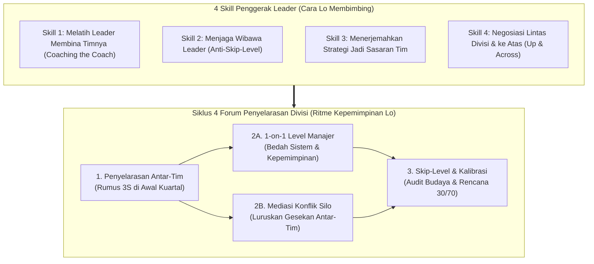
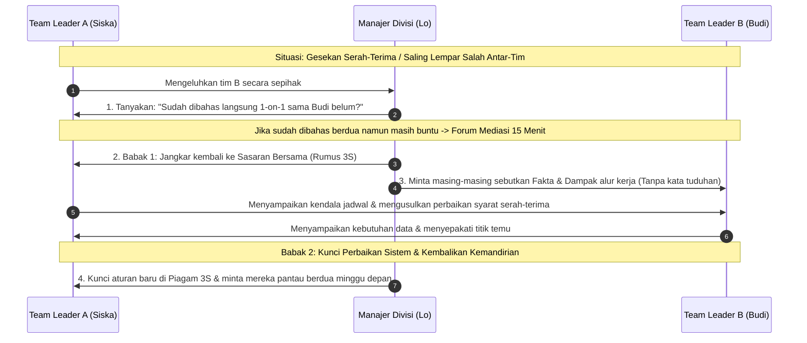
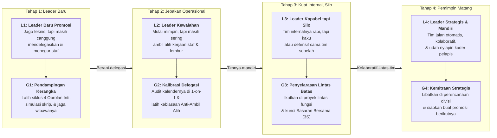

# Memimpin Para Leader: Strategi Naik Kelas dari Mengatur Tim ke Menggerakkan Divisi

**Ditulis oleh:** `aiossan`</br>
**Ragam Bahasa:** Kasual / Akrab (`Gue/Lo`)</br>
**Format:** GitHub Flavored Markdown (GFM)

> [!NOTE] Cara Pakai Panduan Ini
> Buku ketiga dari seri kepemimpinan praktis ini ditulis khusus buat lo yang baru aja dipromosikan naik ke posisi di atas *team leader*-entah sebagai Manajer Divisi, *Head of Department*, * Group Leader*, atau posisi apa pun yang membawahi beberapa *team leader* sekaligus (*Manager of Managers*). Lo bisa baca berurutan dari Pendahuluan sampai Bab 13, buka bagian lipat (*collapsible sections*) buat nyalin skrip pembimbingan *leader* dan simulasi kasus, atau langsung lompat ke **Lampiran** pas butuh contekan cepat sebelum mimpin rapat antar-tim.

## Daftar Isi

1. [Pendahuluan: Waktu Anak Buah Lo Sekarang Adalah Para *Team Leader*](#pendahuluan-waktu-anak-buah-lo-sekarang-adalah-para-team-leader)
2. [Bab 1: Peralihan dari Memimpin Eksekutor ke Memimpin Para *Leader*](#bab-1-peralihan-dari-memimpin-eksekutor-ke-memimpin-para-leader)
3. [Bab 2: Kerangka Kerja 4x4 Pemimpin Divisi (4 Forum Penyelarasan + 4 *Skill* Penggerak *Leader*)](#bab-2-kerangka-kerja-4x4-pemimpin-divisi-4-forum-penyelarasan--4-skill-penggerak-leader)
4. [Bab 3: *Skill* 1: Melatih *Leader* Memecahkan Masalah Timnya (*Coaching the Coach*)](#bab-3-skill-1-melatih-leader-memecahkan-masalah-timnya-coaching-the-coach)
5. [Bab 4: *Skill* 2: Menjaga Wibawa *Leader* di Bawah Lo (*Anti-Skip-Level Trap*)](#bab-4-skill-2-menjaga-wibawa-leader-di-bawah-lo-anti-skip-level-trap)
6. [Bab 5: *Skill* 3: Menerjemahkan Strategi Direksi Jadi Sasaran Operasional Tim](#bab-5-skill-3-menerjemahkan-strategi-direksi-jadi-sasaran-operasional-tim)
7. [Bab 6: *Skill* 4: Negosiasi Lintas Divisi & Mengelola Ekspektasi Bos Besar (*Managing Up & Across*)](#bab-6-skill-4-negosiasi-lintas-divisi--mengelola-ekspektasi-bos-besar-managing-up--across)
8. [Bab 7: Forum 1: Penyelarasan Sasaran Antar-Tim di Awal Kuartal (Rumus 3S)](#bab-7-forum-1-penyelarasan-sasaran-antar-tim-di-awal-kuartal-rumus-3s)
9. [Bab 8: Forum 2A: Sesi *1-on-1* Level Manajer: Membedah Sistem & Budaya Tim, Bukan Tugas Receh](#bab-8-forum-2a-sesi-1-on-1-level-manajer-membedah-sistem--budaya-tim-bukan-tugas-receh)
10. [Bab 9: Forum 2B: Mengurai Konflik Silo & Gesekan Antar-*Team Leader*](#bab-9-forum-2b-mengurai-konflik-silo--gesekan-antar-team-leader)
11. [Bab 10: Forum 3: Dialog Lintas Jenjang (*Skip-Level Check-In*) & Kalibrasi Kinerja Divisi (30/70)](#bab-10-forum-3-dialog-lintas-jenjang-skip-level-check-in--kalibrasi-kinerja-divisi-3070)
12. [Bab 11: Studi Kasus & Simulasi 4 Minggu (Rina Memimpin Siska, Budi, dan Rama)](#bab-11-studi-kasus--simulasi-4-minggu-rina-memimpin-siska-budi-dan-rama)
13. [Bab 12: Menyesuaikan Pendampingan buat Para *Team Leader* (Level L1 sampai L4 ke Gaya G1 sampai G4)](#bab-12-menyesuaikan-pendampingan-buat-para-team-leader-level-l1-sampai-l4-ke-gaya-g1-sampai-g4)
14. [Bab 13: Rencana Transisi 30 Hari Jadi Pemimpin Divisi yang Diandalkan](#bab-13-rencana-transisi-30-hari-jadi-pemimpin-divisi-yang-diandalkan)
15. [Lampiran: Contekan Meja Kerja & Rujukan Riset](#lampiran-contekan-meja-kerja--rujukan-riset)

## Pendahuluan: Waktu Anak Buah Lo Sekarang Adalah Para *Team Leader*

Selamat! Kerja keras lo ngebangun tim yang mandiri dan menata sistem kerja yang rapi akhirnya berbuah manis. Manajemen ngelihat kapasitas lo, dan sekarang lo dipercaya naik satu tingkat lebih tinggi: **lo membawahi beberapa tim sekaligus, dan orang-orang yang lapor langsung ke lo sekarang adalah para *team leader* atau supervisor.**

Sekilas, promosi ini kelihatan kayak kelanjutan alami dari kerjaan lo sebelumnya. Dalam hati mungkin lo mikir, *"Kemarin gue mimpin 5 orang staf, sekarang gue mimpin 3 orang team leader yang masing-masing punya 5 staf. Berarti caranya tinggal gue ulang aja kan?"*

Tunggu dulu. Begitu lo jalanin beberapa minggu di kursi baru ini, lo bakal sadar kalau tantangannya ternyata beda total. Coba cek, mana situasi di bawah ini yang mulai sering bikin lo garuk-garuk kepala belakangan ini:

- Gemes sendiri waktu ngelihat salah satu *team leader* baru di bawah lo cara ngasih arahannya masih kaku atau lambat, sampai tangan lo gatal pengen langsung nyamperin stafnya dan ngatur sendiri.
- Staf dari tim lama lo (yang sekarang udah dipimpin oleh pengganti lo) masih sering datang langsung ke meja lo buat minta persetujuan atau ngadu soal *leader* barunya.
- Dua *team leader* di bawah lo saling lempar tanggung jawab waktu ada masalah di perbatasan proyek (*"Itu kan urusan tim sebelah, bukan tim gue!"*).
- Direksi atau VP ngasih target bisnis yang abstrak banget (misalnya *"Kuartal ini kita harus dorong efisiensi biaya 15% sambil naikin retensi pelanggan"*), dan lo bingung gimana cara memecahnya jadi target konkret buat tiga tim yang fungsinya beda-beda.
- Lo ngerasa kehilangan pegangan karena sekarang lo nggak lagi nyentuh kerjaan teknis harian secara langsung; keseharian lo penuh sama urusan koordinasi antar-departemen, alokasi anggaran, dan menjaga kualitas kepemimpinan orang lain.

Kalau lo ngerasain hal-hal di atas, tenang aja. <mark>Lo lagi berada di salah satu belokan paling krusial dalam karier manajemen.</mark>

Dalam riset klasik tentang jalur kepemimpinan (*The Leadership Pipeline*), Ram Charan, Stephen Drotter, dan James Noel nunjukin kalau transisi dari **Memimpin Orang Lain (*Managing Others*)** ke **Memimpin Para Manajer (*Managing Managers*)** adalah titik di mana banyak pemimpin berbakat tergelincir karena mereka masih pakai kacamata supervisor lini pertama[^1].

Di Buku Pertama, kita belajar cara mengarahkan eksekutor teknis. Di Buku Kedua, kita belajar menata sistem dan ketahanan diri biar nggak *burnout*. Nah, di **Buku Ketiga** ini, kita fokus ke keahlian tingkat lanjut: **gimana cara memimpin melalui pemimpin lain (*leading through leaders*), menyelaraskan beberapa tim supaya nggak jalan sendiri-sendiri, dan menjadi jembatan strategis antara direksi dan operasional lapangan.**

Kita bakal langsung fokus ke tiga pilar praktis yang lo butuhin setiap minggu di posisi baru ini:

1. **4 Forum Penyelarasan (*Alignment Forums*):** Empat forum utama buat menggerakkan divisi lo, mulai dari menyelaraskan sasaran antar-tim di awal kuartal (Rumus 3S), menjalankan *one-on-one* level manajer, mengurai konflik silo antar-*leader*, sampai melakukan dialog lintas jenjang (*skip-level check-in*) yang etis.
2. **4 *Skill* Penggerak *Leader* (*Leader-Coaching Skills*):** Empat keterampilan komunikasi tingkat menengah, yaitu melatih *team leader* memecahkan masalah timnya (*coaching the coach*), menjaga wibawa *leader* di bawah lo, menerjemahkan strategi direksi jadi sasaran operasional, dan bernegosiasi lintas departemen (*managing up & across*).
3. **Kalibrasi Pendampingan *Team Leader* (Level L1 sampai L4 ke Gaya G1 sampai G4):** Cara memetakan kematangan para *team leader* di bawah lo-mulai dari *leader* yang baru kemarin dipromosikan sampai *leader* senior yang usianya lebih tua dari lo-biar pendampingan lo pas sasaran.

> [!IMPORTANT] Dasar Riset Panduan Ini
> Seluruh langkah taktis di buku ini disarikan dari riset manajemen tingkat menengah dan organisasi multi-tim: kerangka *The Leadership Pipeline* dari Ram Charan, Stephen Drotter, dan James Noel[^1], riset kepemimpinan tingkat menengah (*Leading Middle Managers*) dari *Center for Creative Leadership* (CCL)[^2], studi klasik *Managing Your Boss & Managing Across* dari Profesor John Gabarro dan John Kotter di Harvard Business School[^3], serta riset kolaborasi lintas batas (*Cross-Boundary Teaming*) dari Profesor Amy Edmondson dan Jean-François Harvey[^4]. Semuanya dikemas ke dalam bahasa praktis sehari-hari di kantor.

Yuk, kita mulai dari perubahan cara pikir terbesar yang wajib lo kuasai saat naik ke kursi ini di **Bab 1**.

## Bab 1: Peralihan dari Memimpin Eksekutor ke Memimpin Para *Leader*

Waktu lo pertama kali diangkat jadi *team leader* dulu, tantangan terberat lo adalah menahan tangan biar nggak ngerjain tugas teknis staf lo sendiri.

Sekarang, waktu lo naik jadi Manajer Divisi atau *Manager of Managers*, tantangannya naik satu lapis: **lo harus menahan diri biar nggak mengambil alih peran kepemimpinan milik para *team leader* yang ada di bawah lo.**

Studi dari *Center for Creative Leadership* (<abbr title="Center for Creative Leadership">CCL</abbr>) mencatat bahwa kesalahan paling umum manajer yang baru naik ke jenjang menengah adalah tetap bertindak sebagai "Supervisor Super" (*Super-Frontline Leader*)-mereka melompati *team leader* di bawahnya dan langsung mengatur staf pelaksana karena merasa itu cara paling cepat buat beresin masalah[^2].

Dulu, waktu jadi *team leader*, produk kerja lo adalah **hasil kerja tim lo**. Sekarang, sebagai pemimpin yang membawahi para *leader*, produk kerja utama lo adalah **kualitas keputusan para *team leader* lo dan kelancaran kerja sama antar-tim di dalam divisi lo**.

### Bedanya Memimpin Eksekutor vs Memimpin Para *Leader*

Pergeseran kursi ini menuntut perubahan cara kerja di empat urusan utama:

| Urusan Kerja | Dulu (Waktu Jadi *Team Leader*) | Sekarang (Membawahi Para *Team Leader*) |
| :--- | :--- | :--- |
| **Fokus Pembimbingan** | Melatih staf cara mengeksekusi tugas teknis dengan benar dan tepat waktu. | Melatih para *team leader* cara mengarahkan, menegur, dan memotivasi anggota tim mereka. |
| **Jangkauan Pandangan** | Fokus 100% pada target internal satu tim untuk minggu atau bulan ini. | Menyelaraskan alur kerja antar-tim dan menerjemahkan strategi bisnis 3–12 bulan ke depan. |
| **Saat Ada Masalah di Lapangan** | Berdiskusi langsung dengan staf pelaksana untuk mengurai hambatan teknisnya. | Bertanya kepada *team leader*-nya: *"Bagaimana rencana lo membimbing staf lo menyelesaikan masalah ini?"* |
| **Arah Komunikasi Utama** | 80% ke bawah (ke anggota tim), 20% ke atas/samping. | 40% ke bawah (ke para *leader*), 30% ke samping (kepala divisi lain), 30% ke atas (direksi/VP). |

Kalau seorang manajer baru di level ini belum mengubah cara mainnya, ia hampir pasti bakal kejeblos ke salah satu dari dua jebakan berbahaya berikut:

#### 1. Jebakan "Manajer Bayangan" (*The Skip-Level Micromanager*)

Karena lo dulunya mantan *team leader* di salah satu tim tersebut (dan lo kenal dekat sama staf-stafnya), setiap kali ada masalah lo langsung nge-chat staf pelaksananya, ngasih perintah langsung, atau ngubah keputusan yang udah dibuat oleh *team leader* baru mereka.

- **Akibatnya di divisi lo:** Wibawa *team leader* di bawah lo langsung hancur di mata anak buahnya. Staf bakal mikir, *"Ngapain gue dengerin kata Team Leader gue, orang nanti juga diubah lagi sama Bos Besar."* Akibatnya, *team leader* lo jadi pasif dan kehilangan rasa percaya diri, sementara meja lo kembali kebanjiran urusan receh dari 20 staf sekaligus.

#### 2. Jebakan "Kepala Suku Silo" (*The Tribal Silo Boss*)

Karena lo diangkat dari salah satu sub-tim (misalnya lo dulunya *Team Leader Konten*, lalu sekarang naik jadi *Manajer Marketing* yang membawahi Tim Konten, Tim Iklan, dan Tim Desain), lo tanpa sadar cuma menganakemaskan tim asal lo. Selain itu, setiap kali ada gesekan sama departemen lain (misalnya Sales atau Produk), lo ikut-ikutan ngomporin mentalitas "Kita vs Mereka".

- **Akibatnya di divisi lo:** Tim-tim lain di bawah lo ngerasa dianaktirikan, sementara para *team leader* di bawah lo meniru gaya lo dengan saling menyalahkan dan membangun tembok ego (*silo*) antar-tim.

### Posisi yang Sehat: Menjadi Pelatih bagi Para *Leader* & Penyelaras Sistem

Sebagai pemimpin yang membawahi para *leader*, tugas utama lo bukanlah menjadi orang paling pintar yang tahu setiap detail teknis di semua sub-tim, melainkan <ins>membangun para *team leader* yang kuat di bawah lo dan memastikan seluruh tim bergerak searah tanpa saling sikut</ins>.

Pegangan dasarnya simpel:

> **Jangan pernah melumpuhkan *leader* di bawah lo dengan mengambil alih kemudi timnya; berdirilah di belakangnya untuk menajamkan cara berpikirnya, dan berdirilah di depannya untuk membuka jalan lintas divisi.**

Supaya peran baru ini langsung bisa lo jalankan secara terukur tiap minggu, buku ini merangkum pola kerja pemimpin tingkat menengah ke dalam **Kerangka Kerja 4x4 Pemimpin Divisi**:

1. **4 Forum Penyelarasan (Kapan & Di Mana Lo Menggerakkan Divisi?):** Empat forum utama buat menyatukan arah antar-tim, membimbing *team leader* secara empat mata, mengurai gesekan silo, dan memantau kesehatan budaya kerja.
2. **4 *Skill* Penggerak *Leader* (Gimana Cara Lo Membimbing & Bernegosiasi?):** Empat keterampilan inti buat melatih *leader* membina timnya, menjaga rantai wewenang, menerjemahkan strategi atas, dan mengelola hubungan lintas departemen.

Yuk, kita bedah peta utuhnya di **Bab 2**.

## Bab 2: Kerangka Kerja 4x4 Pemimpin Divisi (4 Forum Penyelarasan + 4 *Skill* Penggerak *Leader*)

Waktu lo memimpin beberapa tim sekaligus, lo nggak bisa lagi mengandalkan obrolan spontan di lorong kantor. Lo butuh arsitektur komunikasi yang rapi supaya informasi dari direksi turun dengan jernih ke bawah, dan masalah antar-tim selesai tanpa drama.

Seluruh isi buku ketiga ini diringkas menjadi **8 kebiasaan praktis** yang dibagi ke dalam dua kelompok:

1. **4 Forum Penyelarasan (*Alignment Forums*)** - empat ritme pertemuan buat menyelaraskan sasaran lintas tim, membina *team leader*, menyelesaikan gesekan antar-tim, dan mengevaluasi kesehatan divisi.
2. **4 *Skill* Penggerak *Leader* (*Leader-Coaching Skills*)** - empat keterampilan komunikasi yang lo pakai di setiap forum tersebut.

Lihat hubungan keduanya pada diagram berikut:



Cara kerjanya terintegrasi penuh: **lo menggunakan 4 *Skill* Penggerak *Leader* sebagai fondasi saat memimpin 4 Forum Penyelarasan dari awal sampai akhir kuartal.**

> [!NOTE]
> Penjelasan lengkap soal `Rumus 3S` (Sasaran Bersama, Sekat Peran, Simpul Koordinasi) bakal kita kupas di Bab 7.

### Empat Forum Penyelarasan dalam Siklus Divisi

- **1. Penyelarasan Sasaran Antar-Tim di Awal Kuartal (Rumus 3S)**
  Forum bersama seluruh *team leader* di bawah lo pada awal kuartal atau awal proyek besar untuk menyepakati **Sasaran Bersama (*Shared Outcome*)**, **Sekat Peran (*Scope Boundary*)**, dan **Simpul Koordinasi (*Sync Cadence*)** supaya nggak ada area abu-abu antar-tim.
- **2A. Sesi *1-on-1* Level Manajer (*Coaching the Leader*)**
  Obrolan empat mata mingguan atau dua mingguan antara lo dan masing-masing *team leader*, di mana fokusnya bukan lagi ngecek tugas teknis eceran, melainkan membedah kesehatan sistem timnya, cara dia membina stafnya, dan hambatan sumber dayanya.
- **2B. Mediasi Konflik Silo & Gesekan Antar-*Team Leader***
  Forum penyelesaian cepat saat dua *team leader* di bawah lo berselisih soal batas tanggung jawab, prioritas sumber daya, atau kualitas serah-terima kerjaan (*handoff*).
- **3. Dialog Lintas Jenjang (*Skip-Level Check-In*) & Kalibrasi Kinerja Divisi (30/70)**
  Kombinasi obrolan berkala dengan staf lini depan (secara transparan dan tanpa melangkahi *team leader*-nya) untuk mendengar aspirasi lapangan, diikuti rapat kalibrasi akhir periode bersama para *team leader* untuk merancang strategi kuartal berikutnya.

> [!TIP] Beda *1-on-1* sama Staf vs *1-on-1* sama *Team Leader*
> Waktu lo *1-on-1* sama staf pelaksana dulu, lo nanya: *"Tugas X udah sampai mana?"* Waktu lo *1-on-1* sama seorang *team leader* sekarang, lo harus naik kelas dan nanya: *"Gimana perkembangan performa anggota tim lo bulan ini, siapa staf yang lagi butuh perhatian khusus, dan gimana rencana lo membimbing dia?"*

### Empat *Skill* Penggerak *Leader*

Untuk menjalankan keempat forum di atas dengan efektif, latih empat keterampilan komunikasi tingkat menengah ini:

1. **Melatih *Leader* Memecahkan Masalah Timnya (*Coaching the Coach*):** Membimbing *team leader* yang datang mengadu soal anak buahnya supaya dia menemukan cara menegur atau melatih anak buahnya sendiri, bukan lo yang turun tangan menegur stafnya.
2. **Menjaga Wibawa *Leader* di Bawah Lo (*Anti-Skip-Level Trap*):** Menahan diri dari memotong komando dan mengembalikan staf yang mencoba "mengadu langsung ke bos besar" ke jalur koordinasi bersama *team leader* mereka.
3. **Menerjemahkan Strategi Direksi Jadi Sasaran Operasional Tim:** Mengubah bahasa bisnis tingkat tinggi dari manajemen puncak menjadi peta kontribusi yang konkret dan relevan buat masing-masing sub-tim.
4. **Negosiasi Lintas Divisi & Mengelola Ekspektasi Bos Besar (*Managing Up & Across*):** Membangun aliansi sehat dengan kepala departemen lain dan mengelola komunikasi proaktif ke direksi supaya divisi lo punya dukungan sumber daya yang kuat.

Di **Bagian 2 (Bab 3 sampai Bab 6)**, kita bakal bahas tuntas keempat *Skill* Penggerak *Leader* ini lengkap dengan contoh kalimatnya. Setelah itu, di **Bagian 3 (Bab 7 sampai Bab 10)** kita langsung terapkan ke dalam keempat Forum Penyelarasan Divisi.

## Bab 3: *Skill* 1: Melatih *Leader* Memecahkan Masalah Timnya (*Coaching the Coach*)

Adegan ini hampir pasti bakal lo alami di bulan pertama membawahi para *team leader*:

Salah satu *team leader* baru di bawah lo, sebut aja Budi, masuk ke ruangan lo sambil menghela napas berat: *"Kak, gue pusing deh sama si Dani di tim gue. Udah dua kali gue kasih tahu format laporannya, tapi kemarin dia masih salah masukin data lagi. Enaknya gimana ya, Kak? Atau Kakak aja deh yang bantu tegur si Dani biar dia segan dikit?"*

Hati-hati! Ini adalah ujian pertama lo sebagai seorang *Manager of Managers*.

Kalau lo terpancing dan jawab, *"Waduh, kok Dani gitu sih? Ya udah panggil Dani ke ruangan gue sekarang biar gue yang ngomong!"*, atau kalau lo langsung ngedikte Budi, *"Lo bilang aja ke Dani A, B, C sekarang!"*, maka lo baru aja gagal melatih Budi jadi pemimpin yang mandiri.

Riset Ram Charan dalam *The Leadership Pipeline* menekankan bahwa tugas utama seorang manajer yang membawahi manajer lain adalah **mengajarkan keterampilan kepemimpinan kepada bawahannya melalui pertanyaan reflektif (*coaching the coach*)**[^1]. Kalau lo yang turun tangan menegur Dani, maka sampai kapan pun Dani nggak bakal respek sama Budi, dan Budi nggak bakal pernah berani menjalankan *Koreksi Empat Mata* sendiri.

### Tiga Kesalahan Umum Saat *Team Leader* Mengadu Soal Stafnya

Perhatikan tiga reaksi keliru yang sering dilakukan manajer menengah waktu *team leader*-nya curhat soal anggota tim:

- **Mengambil alih peran algojo:** Lo yang turun tangan memarahi atau menegur staf pelaksana yang bermasalah karena merasa *team leader* lo "kurang tegas".
- **Ikut bergosip membicarakan kelemahan staf:** Lo malah ikut-ikutan ngeluh bareng *team leader* lo, *"Iya tuh, si Dani emang dari dulu agak lambat orangnya,"* tanpa ngarahin *team leader* lo buat melakukan pembimbingan yang terukur.
- **Cuma ngasih solusi teknis proyeknya, tapi lupa membedah cara kepemimpinannya:** Lo cuma fokus benerin tabel laporan yang salah tadi, tapi nggak nanya ke *team leader* lo gimana cara dia ngasih instruksi awal ke stafnya.

### Tiga Langkah Praktis *Coaching the Coach*

Setiap kali ada *team leader* di bawah lo datang membawa masalah tentang anggota timnya, gunakan tiga langkah pembimbingan lapis kedua ini:

#### 1. Bedah Dulu "Cara *Leader*-nya Memimpin" Sebelum Menyalahkan Stafnya

Jangan langsung percaya 100% kalau masalahnya murni kesalahan staf. Ingat pelajaran dari Buku Pertama: sering kali staf salah kerja karena arahan awal *leader*-nya yang masih kabur! Tanyakan ke *team leader* lo dengan tenang:

- *"Oke Bud, sebelum kita bahas si Dani, coba ceritain ke gue: waktu pertama kali lo nyerahin tugas ini ke Dani kemarin, gimana kesepakatan Rumus 3K (Keluaran, Kriteria Sukses, Kalender) yang lo sampaikan ke dia? Apakah tertulis jelas atau baru lisan sambil lalu?"*
- *"Menurut pengamatan lo, di tugas spesifik ini posisi Dani sekarang ada di level kemandirian berapa (L1, L2, L3, atau L4)? Dan gaya pendampingan apa yang udah lo pakai ke dia minggu ini?"*

Pertanyaan kayak gini langsung bikin *team leader* lo berkaca dan belajar mengevaluasi cara dia memimpin!

#### 2. Pancing *Team Leader* Menyusun Rencana Obrolannya Sendiri

Setelah akar masalahnya jelas (misalnya instruksi awal udah jelas tapi Dani memang kurang teliti), tahan diri lo biar nggak ngambil alih. Minta *team leader* lo merancang langkah *Koreksi Empat Mata*-nya sendiri:

- *"Nah, karena target awalnya udah tertulis jelas tapi hasilnya masih meleset, berarti sekarang waktunya lo jalanin Koreksi Empat Mata sama Dani. Kalau menurut lo, fakta spesifik dan dampak nyata apa yang mau lo sampaikan ke Dani di Babak 1 nanti?"*

#### 3. Lakukan Simulasi Singkat (*Roleplay* 2 Menit) & Beri Kepercayaan Penuh

Kalau *team leader* di bawah lo masih baru dan agak grogi mau negur anak buahnya (apalagi kalau anak buahnya dulunya teman selevel), ajak dia latihan ngomong 2 menit di depan lo:

- *"Coba anggap gue ini Dani. Coba lo sampaikan kalimat pembuka koreksinya ke gue sekarang biar kita lihat nadanya udah pas atau belum."*
- Setelah dia nyoba dan nadanya udah objektif, kuatkan rasa percaya dirinya: *"Nah, kalimat lo barusan udah tenang, tegas, dan jelas banget! Jalanin persis kayak gitu ke Dani sore ini ya. Gue percaya penuh lo bisa nanganin ini. Besok pagi kabarin gue hasilnya."*

### Perbandingan Kalimat di Kantor (*Skill* 1)

| Hindari Respons Ini ke *Team Leader* Lo | Gunakan Respons *Coaching the Coach* Ini |
| :--- | :--- |
| *"Panggil staf lo ke sini, biar gue yang tegur langsung!"* (Merampas wibawa *team leader*) | *"Ini momen bagus buat melatih kepemimpinan lo. Gimana rencana lo menegur dia secara empat mata sore ini?"* |
| *"Kenapa anak buah lo bisa salah terus sih?!"* (Menyudutkan tanpa solusi) | *"Waktu lo delegasikan tugas itu kemarin, bagian mana dari instruksi awalnya yang menurut lo mungkin masih belum cukup jelas buat dia?"* |
| *"Lo chat aja dia sekarang, bilang kalau salah sekali lagi bakal kena SP!"* (Mengajarkan kepemimpinan berbasis ancaman) | *"Coba kita susun bareng poin Fakta dan Dampaknya dulu, terus kita latihan 2 menit sebelum lo panggil dia ngobrol empat mata."* |
| Langsung memindahkan staf yang bermasalah ke tim lain tanpa proses pembinaan. | *"Selama dua minggu ke depan, coba lo terapkan gaya G1 (Panduan Terstruktur) ke dia dan cek progresnya tiap dua hari. Kita evaluasi hasilnya di 1-on-1 kita minggu depan."* |

### Latihan Praktik Bab 3

Minggu ini, latih keterampilan *Coaching the Coach* lewat tiga langkah berikut:

- [ ] **Tahan diri dari menegur staf lapis kedua secara langsung:** Kalau ada staf di bawah *team leader* lo yang kinerjanya melenceng minggu ini, panggil *team leader*-nya dan bimbing dia untuk melakukan koreksi empat mata sendiri.
- [ ] **Ajukan pertanyaan "Audit Instruksi Awal":** Saat *team leader* mengeluhkan hasil kerja stafnya, tanyakan dulu bagaimana ia menyepakati target dan kriteria sukses di awal tugas tersebut.
- [ ] **Lakukan 1 kali simulasi singkat (*roleplay* 2 menit):** Bantu satu *team leader* di bawah lo melatih kalimat apresiasi atau koreksinya sebelum ia berbicara dengan anggota timnya.

## Bab 4: *Skill* 2: Menjaga Wibawa *Leader* di Bawah Lo (*Anti-Skip-Level Trap*)

Ujian besar kedua setelah lo naik jabatan justru sering datang dari kebaikan hati lo sendiri di masa lalu.

Bayangin skenario ini: dulu lo adalah *Team Leader* di Tim A selama dua tahun. Hubungan lo sama staf-staf di Tim A (misalnya Dani dan Riko) udah akrab banget. Sekarang, lo naik jadi Manajer Divisi, dan posisi *Team Leader* Tim A diserahkan ke Siska.

Di hari Selasa siang, Dani langsung nyamperin meja lo (atau nge-chat lo secara pribadi) sambil bilang: *"Kak Rina, gue mau nanya dong soal konsep kampanye klien X ini, menurut Kak Rina bagusnya pakai konsep yang mana ya? Soalnya tadi kata Kak Siska suruh pakai konsep A, tapi gue kurang sreg nih..."*

Atau di tengah rapat besar, lo ngelihat draf presentasi yang ditampilkan anak buah Budi ada bagian yang kurang pas, terus lo langsung nyamber di depan semua orang: *"Dani, itu slide nomor 4 tolong nanti langsung lo ganti pakai tabel bulan lalu ya, jangan pakai tabel yang itu!"*-tanpa nengok ke Budi sedikit pun.

> [!WARNING] Bahaya Memotong Komando (*Skip-Level Bypass*)
> Setiap kali lo mengizinkan staf melompati *team leader*-nya buat minta keputusan langsung ke lo, atau setiap kali lo membatalkan keputusan *team leader* lo di depan anak buahnya, lo lagi menggergaji kaki kursi *team leader* lo sendiri. Dalam waktu singkat, *team leader* lo bakal kehilangan respek dari timnya dan berubah jadi sekadar "tukang pos" tanpa wibawa.

### Tiga Kebiasaan yang Tanpa Sadar Melumpuhkan *Team Leader* di Bawah Lo

Coba cek apakah lo masih sering keceplosan melakukan salah satu dari tiga hal ini:

- **Melayani "konsultasi jalan pintas" dari mantan anak buah:** Karena merasa nggak enak menolak staf lama yang datang nanya teknis, lo langsung ngasih jawaban dan keputusan tanpa melibatkan *team leader* baru mereka.
- **Mengoreksi staf lapis kedua di ruang publik/grup besar:** Lo langsung menandai (*mention*) nama staf pelaksana di grup besar buat menegur kesalahannya, seolah-olah *team leader*-nya nggak ada di sana.
- **Mengubah keputusan teknis *team leader* secara sepihak:** *Team leader* lo udah menyepakati cara kerja A bersama timnya, tapi pas lo lewat, lo langsung nyuruh stafnya ganti ke cara B cuma karena cara B lebih mirip selera pribadi lo.

### Tiga Langkah Praktis Menjaga Rantai Wibawa Kepemimpinan

Supaya para *team leader* di bawah lo tumbuh jadi pemimpin yang disegani dan diandalkan oleh anggota timnya, pegang teguh tiga aturan ini:

#### 1. Terapkan Gerbang "Sudah Diskusi Sama *Team Leader* Lo Belum?"

Setiap kali ada staf pelaksana yang datang langsung ke lo buat minta persetujuan kerjaan atau ngeluh soal keputusan teknis, sambut dengan ramah tapi **jangan pernah langsung ngasih keputusan**. Pasang pertanyaan penyaring ini:

- *"Halo Dan, senang ngobrol sama lo. Tapi sebelum gue kasih masukan soal konsep ini, lo udah obrolin pertimbangan lo ini sama Siska belum? Apa kata Siska tadi?"*
- Kalau dia jawab *belum*: *"Nah, sekarang kan Siska yang pegang kendali penuh di tim kalian. Coba lo bawa dulu dua opsi konsep ini ke Siska ya, gue percaya penuh sama penilaian Siska."*
- Kalau dia jawab *udah, tapi gue kurang setuju sama keputusan Siska*: *"Kalau gitu, yuk kita obrolin bertiga bareng Siska siang ini biar transparan dan satu frekuensi."* (Jangan pernah merombak keputusan *team leader* lo di belakang punggungnya!).

#### 2. Salurkan Masukan Operasional Melalui *Team Leader*-nya

Kecuali dalam situasi bahaya darurat yang mengancam keselamatan atau sistem mati total, biasakan menyalurkan koreksi operasional melewati *team leader* yang bersangkutan:

- Alih-alih menegur stafnya langsung di grup, hubungi *team leader*-nya secara empat mata: *"Bud, tadi gue perhatiin di draf presentasi proyek X halaman 4 angkanya masih pakai data lama. Tolong lo cek bareng Dani dan pandu dia buat benerin sebelum dikirim ke klien sore ini ya."*

Dengan cara ini, staf melihat bahwa Budi-lah yang memegang kendali kualitas di tim tersebut.

#### 3. Bedakan "Standar Hasil Akhir" dengan "Gaya Teknis Pribadi"

Sebagai mantan eksekutor atau mantan *team leader*, godaan terbesarnya adalah nuntut semua *team leader* di bawah lo punya gaya kerja yang 100% kembar sama gaya lo.

Ingat aturan emas pendelegasian tingkat manajer: **kunci standar hasil akhir dan batas risikonya, tapi bebaskan para *team leader* menggunakan metode kepemimpinan mereka sendiri.** Kalau cara yang dipilih Budi berbeda dengan cara yang biasa lo pakai, selama cara Budi tidak melanggar nilai perusahaan dan tetap mencapai target kualitas serta waktu yang disepakati, **dukung keputusan Budi 100%**.

### Perbandingan Tindakan di Kantor (*Skill* 2)

| Hindari Kebiasaan Memotong Komando Ini | Gunakan Kebiasaan Penguat Wibawa *Leader* Ini |
| :--- | :--- |
| Menjawab staf yang lewat jalan pintas: *"Oh, kalau menurut gue sih mending pakai konsep B aja Dan, bilang ke Siska kata gue gitu ya."* | *"Untuk urusan konsep konten, wewenangnya udah gue serahin penuh ke Siska. Coba lo diskusikan alasan lo tadi langsung sama Siska ya."* |
| Menegur staf langsung di depan *team leader*-nya saat rapat: *"Riko, kerjaan lo kok telat terus sih?!"* | Menanyakan progres melalui *team leader*-nya di rapat: *"Bud, untuk pos kerjaan yang dipegang Riko, apa kendala utamanya dan gimana rencana tim lo mengejar jadwalnya?"* |
| Membatalkan keputusan *team leader* di grup chat tim: *"Eh, jangan pakai jadwal yang dikirim Budi tadi ya, ganti pakai jadwal dari gue ini."* | Berdiskusi empat mata dengan Budi di belakang layar, lalu membiarkan Budi sendiri yang mengumumkan penyesuaian jadwalnya kepada timnya. |
| Menerima curhatan sepihak staf yang menjelek-jelekkan *team leader*-nya tanpa konfirmasi. | *"Makasih udah cerita. Supaya adil dan masalahnya beneran beres, poin mana dari cerita tadi yang udah lo sampaikan langsung ke Team Leader lo, atau mau gue fasilitasi ngobrol bertiga?"* |

### Latihan Praktik Bab 4

Selama seminggu ke depan, perkuat wibawa para *team leader* di bawah lo lewat tiga langkah ini:

- [ ] **Pasang kalimat penyaring otomatis:** Setiap kali ada staf lapis kedua yang meminta keputusan teknis langsung ke lo minggu ini, tanyakan: *"Lo udah diskusiin hal ini sama Team Leader lo belum?"*
- [ ] **Berikan pujian terbuka untuk *Team Leader* di depan timnya:** Cari satu keberhasilan tim minggu ini, lalu sebutkan secara eksplisit di rapat atau grup bahwa keberhasilan itu berkat koordinasi yang dipimpin oleh *team leader* mereka.
- [ ] **Tahan 1 komentar selera pribadi:** Saat melihat *team leader* lo menjalankan cara kerja yang agak berbeda dari kebiasaan lo (namun tetap aman dan efektif), tahan diri untuk tidak mengintervensi dan biarkan ia menuntaskannya.

## Bab 5: *Skill* 3: Menerjemahkan Strategi Direksi Jadi Sasaran Operasional Tim

Waktu lo naik ke kursi Manajer Divisi atau *Head*, lo berdiri tepat di perbatasan antara dua dunia yang pakai "bahasa" yang sangat berbeda:

1. **Dunia Manajemen Puncak (Direksi / VP / C-Level):** Mereka bicara pakai bahasa bisnis makro, laporan keuangan, pangsa pasar, efisiensi biaya, dan target tahunan. Kalimat mereka sering kali abstrak, misalnya: *"Kuartal depan fokus perusahaan adalah meningkatkan retensi pelanggan korporat sebesar 15% dan menekan biaya akuisisi."*
2. **Dunia Lapangan (Para *Team Leader* & Staf Pelaksana):** Mereka hidup di dalam *ticket* kerjaan harian, jadwal desain, baris kode program, antrean keluhan pelanggan, dan tenggat hari Jumat.

Riset *Center for Creative Leadership* (<abbr title="Center for Creative Leadership">CCL</abbr>) menyebutkan bahwa salah satu kegagalan terbesar manajer tingkat menengah adalah bertindak sekadar sebagai "megafon" atau "tukang terusin pesan" (*message forwarder*)[^2]. Mereka keluar dari ruang rapat direksi, lalu langsung meneruskan *slide* direksi mentah-mentah ke para *team leader* di bawahnya sambil bilang: *"Nih guys, kata Pak Direktur kuartal depan kita harus naikin retensi 15% ya. Tolong dipikirin!"*

Hasilnya? Para *team leader* di bawah lo bengong. Tim Desain bingung apa hubungannya desain banner sama retensi 15%, Tim Admin bingung harus ngapain, dan akhirnya semua orang balik ngerjain rutinitas lama tanpa ada yang berubah.

### Tugas Utama Manajer Menengah: Menjadi "Penerjemah Bahasa Strategi"

Sebagai pemimpin yang membawahi para *leader*, nilai gaji lo yang paling mahal ada pada kemampuan lo menjadi **Prisma Penerjemah**: menangkap satu cahaya strategi besar dari atas, lalu menguraikannya menjadi sasaran operasional yang spesifik, relevan, dan bisa dieksekusi oleh masing-masing sub-tim di bawah lo.

### Tiga Langkah Praktis Menerjemahkan Strategi Atas ke Sasaran Sub-Tim

Gunakan tiga langkah ini setiap kali ada arahan strategis baru dari manajemen puncak:

#### 1. Jelaskan "Konteks Mengapa" (*The Strategic Why*) Tanpa Bahasa Korporat yang Kaku

Sebelum membagi tugas ke para *team leader* lo, terjemahkan dulu alasan bisnis di balik keputusan manajemen puncak ke dalam bahasa sehari-hari yang masuk akal buat mereka:

- **Jangan cuma bilang:** *"Direksi minta kita potong anggaran kampanye 20% kuartal ini, pokoknya harus nurut."* (Ini bikin tim merasa jadi korban kebijakan).
- **Terjemahkan konteksnya:** *"Teman-teman, kuartal ini harga bahan baku industri lagi naik, jadi perusahaan perlu menjaga arus kas tetap sehat tanpa mengurangi jumlah karyawan. Karena itu, anggaran iklan berbayar kita disesuaikan 20%, dan fokus kita digeser buat memaksimalkan pelanggan yang udah ada biar beli ulang."*

Begitu para *team leader* paham konteks besarnya, mereka bisa menjelaskannya kembali ke staf mereka dengan kepala tegak dan tenang.

#### 2. Pecah 1 Sasaran Besar Direksi Menjadi "Porsi Kontribusi" Tiap Sub-Tim

Jangan biarkan sasaran abstrak menggantung di udara. Ajak para *team leader* lo duduk bareng untuk membedah: **"Kalau target besar divisi kita adalah X, maka apa wujud kontribusi nyata di masing-masing tim kalian?"**

Lihat contoh bagaimana satu target direksi (*"Meningkatkan Retensi Pelanggan 15%"*) diterjemahkan menjadi sasaran spesifik untuk 3 *team leader* yang berbeda:

- **Untuk *Team Leader* Layanan Pelanggan (Customer Support):** *"Kontribusi tim lo adalah menurunkan waktu tunggu balasan keluhan pelanggan prioritas dari 4 jam menjadi di bawah 30 menit."*
- **Untuk *Team Leader* Konten & Edukasi:** *"Kontribusi tim lo adalah membuat 4 panduan video singkat cara pakai fitur lanjutan supaya pelanggan lama makin aktif memakai produk kita."*
- **Untuk *Team Leader* Teknis / Produk:** *"Kontribusi tim lo adalah membereskan 3 bug utama di halaman pembayaran ulang sebelum tanggal 15 bulan depan."*

Tiba-tiba, target "Retensi 15%" yang tadinya abstrak berubah menjadi rencana kerja yang sangat jernih buat setiap tim!

#### 3. Saring Kebisingan dari Atas (*Absorb the Noise, Pass Down the Signal*)

Di level manajemen atas, wajar kalau tiap minggu ada banyak wacana, lontaran ide mentah, atau perubahan suasana hati dari direksi.

Sebagai Manajer Divisi, **jangan bocorkan setiap kepanikan atau wacana mentah dari ruang direksi langsung ke tim di bawah lo.** Saring dulu mana yang baru sebatas wacana obrolan dan mana yang sudah menjadi keputusan resmi. Turunkan ke para *team leader* lo hanya sinyal keputusan yang sudah matang, supaya tim di bawah lo bisa bekerja dengan fokus tanpa merasa diombang-ambingkan setiap hari.

### Perbandingan Kalimat di Kantor (*Skill* 3)

| Hindari Gaya "Tukang Terusin Pesan" Ini | Gunakan Gaya "Penerjemah Strategi" Ini |
| :--- | :--- |
| Meneruskan email direksi ke grup disertai kalimat: *"FYI ya teman-teman, tolong dibaca dan ditindaklanjuti."* | Merangkum intinya: *"Dari pengumuman direksi tadi, ada 2 dampak langsung buat divisi kita bulan ini: (1)... dan (2)... Jumat pagi kita bedah pembagian perannya ya."* |
| Menyalahkan manajemen atas di depan *team leader* lo: *"Gue juga nggak ngerti kenapa bos-bos di atas bikin aturan aneh gini, jalanin aja deh."* | Menjelaskan alasan bisnisnya secara dewasa, lalu fokus pada apa yang bisa dikendalikan divisi: *"Tujuan kebijakan baru ini adalah menjaga keamanan data klien. Yuk kita atur cara paling praktis buat menerapkannya di tim kita."* |
| Memberikan target makro yang sama rata ke semua sub-tim tanpa membedah fungsinya. | Memfasilitasi para *team leader* menerjemahkan target makro tersebut menjadi metrik kerja yang sesuai dengan keahlian sub-tim masing-masing. |
| Menyebarkan kabar burung atau kepanikan dari rapat pimpinan ke grup kerja. | Menahan wacana yang belum matang, dan baru mengomunikasikan rencana perubahan setelah arah dan langkahnya jelas. |

### Latihan Praktik Bab 5

Minggu ini, latih ketajaman lo menerjemahkan strategi lewat tiga langkah berikut:

- [ ] **Ambil 1 target besar divisi/perusahaan kuartal ini:** Uji apakah setiap *team leader* di bawah lo bisa menjelaskan dalam 1 kalimat sederhana bagaimana kerjaan harian tim mereka menyumbang ke target besar tersebut.
- [ ] **Praktikkan rumus "Konteks Bisnis + Porsi Kontribusi Sub-Tim":** Saat menyampaikan arahan baru dari manajemen minggu ini, jelaskan dulu alasan bisnisnya (*Why*), baru bedah porsi masing-masing tim (*What*).
- [ ] **Tahan 1 "kebisingan mentah" dari atas:** Jika minggu ini ada wacana dari atas yang belum pasti ketok palu, simpan di catatan lo dulu dan jangan buru-buru diturunkan ke tim sebelum statusnya jelas.

## Bab 6: *Skill* 4: Negosiasi Lintas Divisi & Mengelola Ekspektasi Bos Besar (*Managing Up & Across*)

Waktu lo masih jadi *team leader*, 80% keberhasilan lo ditentukan oleh hubungan lo ke bawah (ke anggota tim lo). Tapi begitu lo naik jadi Manajer Divisi atau *Manager of Managers*, aturan mainnya berubah drastis: **tim di bawah lo nggak bakal bisa kerja tenang kalau lo gagal mengelola hubungan ke atas (sama bos besar/direksi) dan ke samping (sama kepala departemen lain).**

Studi legendaris dari Profesor John Gabarro dan Profesor John Kotter di Harvard Business School tentang *Managing Your Boss* dan kolaborasi horizontal membuktikan bahwa manajer menengah yang paling efektif bukanlah yang cuma patuh menunggu perintah, melainkan yang **proaktif mengelola ekspektasi atasannya dan membangun jaringan kerja sama lintas departemen sebelum krisis terjadi**[^3].

Coba perhatiin: sebagian besar kemacetan kerja yang bikin para *team leader* di bawah lo frustrasi sebenarnya berasal dari luar divisi lo-misalnya data dari Divisi Sales yang selalu telat, spesifikasi dari Divisi Produk yang berubah-ubah, atau persetujuan anggaran dari Divisi Keuangan yang macet. Dan urusan lintas batas (*cross-boundary*) itu **hanya bisa dibuka jalannya oleh lo sebagai Manajer Divisi**.

### Tiga Kesalahan Manajer Menengah Saat Berinteraksi ke Atas dan ke Samping

- **Menghindar dari bos besar sampai ditagih:** Karena takut ditanya macam-macam, lo jarang ngasih kabar progres ke Direktur/VP lo. Akibatnya, bos besar lo jadi cemas, terus mulai *micromanage* divisi lo dan nanya-nanya tiap hari.
- **Bawa masalah ke rekan kepala divisi lain dengan nada menuntut:** Lo baru ngobrol sama Manajer Divisi sebelah pas lagi ada masalah, itu pun langsung pakai kalimat tuduhan: *"Tim lo gimana sih, kok datanya salah terus?!"* Akibatnya, kepala divisi sebelah pasang perisai defensif dan kerja sama antar-tim makin beku.
- **Membiarkan *team leader* di bawah lo "berperang sendiri" melawan kepala divisi lain:** Lo nyuruh *team leader* junior lo berdebat langsung sama Kepala Departemen lain yang jabatannya jauh lebih tinggi, tanpa lo dampingi atau bukakan jalannya.

### Tiga Langkah Praktis *Managing Up & Across*

#### 1. Kelola Ekspektasi Bos Besar Lewat Prinsip "Kabar Cepat, Tanpa Kejutan" (*Proactive Managing Up*)

Apa yang paling dibutuhkan oleh seorang Direktur atau VP dari para manajer di bawahnya? **Ketenangan pikiran (*peace of mind*) bahwa divisi lo terkendali, dan peringatan dini kalau ada risiko sebelum meledak.**

Terapkan tiga kebiasaan ini ke atasan langsung lo:

- **Pahami gaya komunikasi bos lo:** Apakah bos lo tipe pembaca (lebih suka ringkasan tertulis 5 poin lewat email/chat tiap Jumat sore) atau tipe pendengar (lebih suka obrolan lisan 10 menit tiap Senin pagi)? Ikuti ritme alaminya[^3].
- **Kirim "Ringkasan Eksekutif 5 Poin" sebelum ditanya:** Setiap akhir minggu, kirim rangkuman singkat: (1) Capaian utama divisi minggu ini, (2) Metrik kunci dibanding target, (3) Risiko/kendala yang sedang ditangani, (4) Rencana fokus minggu depan, dan (5) Keputusan/dukungan yang lo butuhkan dari dia.
- **Jangan pernah menyembunyikan kabar buruk:** Kalau ada target besar yang berisiko meleset, kabari bos lo segera lengkap dengan rencana mitigasi yang udah lo siapkan: *"Pak/Bu, ada potensi keterlambatan 2 hari di rilis X karena kendala integrasi vendor. Kami sudah menyiapkan langkah cadangan A dan B supaya dampaknya ke klien minimal."*

#### 2. Bangun "Tabungan Kepercayaan" dengan Kepala Divisi Lain (*Managing Across*)

Jangan tunggu ada konflik proyek baru lo ngajak ngobrol Manajer Divisi sebelah. Riset Amy Edmondson tentang *Cross-Boundary Teaming* menunjukkan bahwa kolaborasi lintas silo berjalan jauh lebih cepat ketika para pemimpinnya punya hubungan komunikasi rutin di luar situasi krisis[^4].

- Luangkan waktu sebulan sekali buat ngobrol santai 15–20 menit sama 2 atau 3 rekan Manajer Divisi yang paling sering bersinggungan sama kerjaan tim lo.
- Tanyakan pertanyaan sederhana ini: *"Dari kacamata divisi lo, apa satu hal dari cara kerja divisi gue yang selama ini paling ngebantu kalian, dan apa satu hal yang kalau kami perbaiki bakal bikin kerjaan tim lo jauh lebih lancar?"*
- Ketika rekan kepala divisi lain merasa lo peduli sama target mereka, mereka bakal jauh lebih terbuka waktu lo butuh bantuan mempercepat proses untuk tim lo!

#### 3. Selesaikan Kebuntuan Lintas Departemen dengan Bingkai "Kepentingan Bersama Pelanggan/Perusahaan"

Kalau terjadi gesekan antara divisi lo dan divisi sebelah (misalnya antara Divisi Marketing dan Divisi Sales, atau Divisi Produk dan Divisi Engineering), jangan masuk ke ruang rapat dengan mentalitas *"Siapa yang salah?"*.

Masuklah dengan bingkai **Sasaran Bersama Tingkat Perusahaan**:

- *"Bro/Mbak, tujuan kita berdua kuartal ini sebenarnya sama: kita sama-sama pengen peluncuran produk X ini sukses dan target pendapatan perusahaan tercapai. Saat ini ada titik macet di proses serah-terima data antara tim kita. Yuk kita bedah alur serah-terimanya bareng biar tim lo nggak kerja dua kali dan tim gue juga bisa eksekusi tepat waktu."*

### Perbandingan Kalimat di Kantor (*Skill* 4)

| Hindari Kalimat Silo / Pasif Ini | Gunakan Kalimat *Managing Up & Across* Ini |
| :--- | :--- |
| Menunggu bos nanya baru lapor: *"Oh iya Pak, proyeknya ternyata mundur seminggu dari kemarin..."* | Melapor proaktif lebih awal: *"Pak, untuk Proyek X ada penyesuaian jadwal 3 hari karena faktor A. Tim sudah menjalankan langkah mitigasi B agar target akhir bulan tetap aman."* |
| Menyerang kepala divisi lain: *"Gara-gara tim Sales lo nggak disiplin isi data CRM, laporan tim gue jadi berantakan!"* | Mengajak kolaborasi sistem: *"Supaya tim Sales lo lebih praktis ngisi data dan tim gue bisa olah laporan tepat waktu, gimana kalau kita sederhanakan kolom wajib di formulir CRM-nya jadi 4 kolom inti aja?"* |
| Membiarkan *team leader* lo ditolak terus oleh manajer divisi lain tanpa bantuan. | Turun membuka jalur: *"Siska, biar gue bicara dulu sama Manajer Keuangan hari ini buat nyepakatin jalur resminya. Habis jalurnya kebuka, baru lo lanjut koordinasi teknis sama stafnya ya."* |
| Hanya membawa daftar masalah ke meja Direktur tanpa usulan jalan keluar. | Membawa masalah lengkap dengan rekomendasi keputusan: *"Kami menghadapi kendala X. Dari analisis lintas tim, kami merekomendasikan Opsi A karena paling hemat biaya. Apakah Bapak menyetujui arah ini?"* |

### Latihan Praktik Bab 6

Minggu ini, perkuat posisi strategis divisi lo lewat tiga langkah berikut:

- [ ] **Kirim 1 Ringkasan Eksekutif Proaktif ke atasan lo Jumat ini:** Sebelum atasan lo menanyakan kabar divisi, kirimkan rangkuman 5 poin (Capaian, Metrik, Risiko & Mitigasi, Fokus Pekan Depan, serta Dukungan yang Dibutuhkan).
- [ ] **Ajak ngobrol 1 rekan Manajer Divisi sebelah selama 15 menit:** Tanyakan apa satu hal dari alur serah-terima (*handoff*) antar-divisi kalian yang bisa dirapikan bersama kuartal ini.
- [ ] **Buka 1 sumbatan lintas divisi untuk *Team Leader* lo:** Tanyakan kepada para *team leader* di bawah lo: *"Hambatan lintas departemen mana yang minggu ini paling susah kalian tembus sendiri dan butuh gue bantu komunikasikan ke manajer sebelahnya?"*

## Bab 7: Forum 1: Penyelarasan Sasaran Antar-Tim di Awal Kuartal (Rumus 3S)

Setelah lo menguasai empat *Skill* Penggerak *Leader* di Bagian 2, sekarang kita masuk ke **Bagian 3: Empat Forum Penyelarasan Divisi**. Kita mulai dari forum paling krusial di awal kuartal atau awal proyek besar: **Forum 1: Penyelarasan Sasaran Antar-Tim (Rumus 3S).**

Waktu lo cuma memimpin satu tim dulu, menyepakati target cukup dilakukan lewat obrolan empat mata pakai *Rumus 3K* (Keluaran, Kriteria Sukses, Kalender) ke masing-masing staf.

Tapi waktu lo membawahi **beberapa tim sekaligus** (misalnya Tim A, Tim B, dan Tim C), menyepakati target secara terpisah satu per satu sama masing-masing *team leader* di ruang tertutup itu **berbahaya banget!**

Kenapa? Karena kalau lo cuma ngobrol sendiri-sendiri:

- *Team Leader* A ngira tugas pengujian akhir itu tanggung jawab *Team Leader* B.
- *Team Leader* B ngira itu tanggung jawab *Team Leader* A.
- Jadwal selesai Tim A ternyata nggak nyambung sama jadwal mulai Tim C.
- Di akhir bulan, waktu proyeknya macet di perbatasan antar-tim, ketiga *team leader* lo bakal duduk menunjuk hidung satu sama lain di depan lo!

Riset Profesor Amy Edmondson dan Jean-François Harvey tentang kolaborasi lintas tim (*Cross-Boundary Teaming*) membuktikan bahwa kegagalan eksekusi di organisasi multi-tim paling sering terjadi bukan di tengah-tengah satu tim, melainkan **di celah sambungan antar-tim (*the seams between teams*)**[^4].

### Cara Menjalankan Forum Penyelarasan Antar-Tim dengan Rumus 3S

Setiap awal kuartal atau setiap kali memulai proyek lintas tim, kumpulkan seluruh *team leader* yang ada di bawah lo dalam satu forum selama 45 sampai 60 menit. Jangan bubar sebelum kalian mengunci kesepakatan tertulis menggunakan **Rumus 3S**:

#### 1. Sasaran Bersama (*Shared Outcome*): Satu Ukuran Sukses Tingkat Divisi

Sebelum bicara target masing-masing sub-tim, kunci dulu **1 sampai 3 Sasaran Bersama Tingkat Divisi** yang mengikat semua *team leader* di ruangan itu.

Tujuannya tegas: **tidak boleh ada satu sub-tim yang merasa "sukses sendirian" kalau sasaran divisi secara utuh gagal tercapai.**

- *Contoh Keliru (Target Silo):* Tim Konten dinilai cuma dari jumlah postingan tayang, sedangkan Tim Iklan dinilai dari jumlah klik murah. Akibatnya Tim Konten bikin konten asal banyak tapi nggak relevan buat diiklankan Tim Iklan.
- *Contoh Rumus 3S (Sasaran Bersama):* *"Sasaran Bersama divisi kita kuartal ini adalah menghasilkan 1.500 prospek berkualitas (*qualified leads*) dengan biaya akuisisi di bawah Rp50.000. Keberhasilan Tim Konten, Tim Iklan, dan Tim Website semuanya diukur dari kontribusi nyata terhadap angka bersama ini."*

#### 2. Sekat Peran & Titik Serah-Terima (*Scope Boundary & Handoff Rule*)

Di hadapan seluruh *team leader* lo, petakan secara terang-benderang di mana tugas Tim A berakhir dan di mana tugas Tim B dimulai, lengkap dengan **Standar Kelayakan Serah-Terima (*Definition of Ready/Done*)**:

- **Siapa yang pegang kendali utama (*Owner*)** di tiap tahap?
- **Apa syarat sah serah-terima antar-tim?** Misalnya: *"Tim Konten menyerahkan materi ke Tim Iklan setiap hari Selasa jam 14.00 WIB. Materi baru dianggap sah diserahterimakan kalau (1) Teks sudah lolos cek ejaan, (2) Ukuran visual sudah tersedia dalam 3 rasio, dan (3) Tautan halaman tujuan sudah aktif."*

Dengan aturan serah-terima yang disepakati bersama di depan mata semua *team leader*, nggak bakal ada lagi drama Tim B ngeluh *"Materi dari Tim A mentah banget!"* di tengah jalan.

#### 3. Simpul Koordinasi (*Sync Cadence*): Jadwal Cek Antar-*Leader* Tanpa Harus Nunggu Lo

Jangan jadikan diri lo satu-satunya jembatan komunikasi di antara para *team leader* lo! Kalau setiap kali Siska mau minta sesuatu ke Budi dia harus lapor ke lo dulu, baru lo sampaikan ke Budi, maka lo bakal jadi sumbatan (*bottleneck*) raksasa.

Kunci jadwal dan saluran koordinasi langsung di antara para *team leader* lo:

- *"Untuk proyek kuartal ini, Siska dan Budi bakal ngadain cek singkat (*sync*) 15 menit setiap hari Rabu jam 10.00 pagi buat nyocokin performa konten dan iklan secara langsung, tanpa harus nunggu rapat bulanan sama gue. Gue cukup dikirim ringkasan 3 poin hasilnya di grup leader."*

<details>
<summary><strong>Templat Skrip Forum 1 (Penyelarasan Kuartalan Antar-Team Leader Rumus 3S) Siap Salin</strong></summary>

```text
"Teman-teman Team Leader, hari ini kita kumpul buat ngunci Piagam Rumus 3S divisi kita untuk [Nama Kuartal / Proyek Besar] supaya ketiga tim kita bergerak satu irama:
1. Sasaran Bersama (Shared Outcome): Ukuran sukses utama divisi kita bersama adalah [Sebutkan Metrik Utama Divisi & Tenggatnya]. Kita menang bareng dan dievaluasi bareng dari angka ini.
2. Sekat Peran & Syarat Serah-Terima (Scope & Handoff):
   - Tim [A] dipimpin [Nama TL A] bertanggung jawab penuh atas [Lingkup A] dan menyerahkan hasilnya ke Tim [B] setiap [Hari & Jam] dengan standar kelengkapan [Syarat 1, 2, 3].
   - Tim [B] dipimpin [Nama TL B] bertanggung jawab penuh atas [Lingkup B].
3. Simpul Koordinasi (Sync Cadence): Kalian berdua/bertiga akan melakukan cek silang langsung selama 15 menit setiap [Hari & Jam] untuk mengurai kendala perbatasan antar-tim, dan mengirimkan ringkasan keputusannya di kanal leader kita.
Sebelum kita kunci di dokumen bersama, apakah ada celah tugas di perbatasan tim yang menurut kalian masih abu-abu?"
```
</details>

### Perbandingan Penetapan Target Divisi (Forum 1)

| Cara Silo (Memicu Konflik Antar-Tim) | Cara Penyelarasan Rumus 3S (Satu Irama Divisi) |
| :--- | :--- |
| Membagi target kuartalan ke masing-masing *team leader* secara terpisah di ruang tertutup. | Mengumpulkan seluruh *team leader* dalam satu ruangan untuk menyepakati **Rumus 3S** secara terbuka. |
| Setiap sub-tim punya KPI sendiri-sendiri yang saling bertabrakan (misal: Tim Kuantitas vs Tim Kualitas). | Mengikat seluruh *team leader* pada 1–3 **Sasaran Bersama (*Shared Outcome*)** tingkat divisi di samping metrik teknis masing-masing. |
| Membiarkan syarat serah-terima (*handoff*) antar-tim tidak tertulis sehingga memicu saling lempar salah. | Menetapkan daftar periksa syarat sah serah-terima antar-tim yang disetujui oleh kedua *team leader* yang bersangkutan. |
| Semua koordinasi antar-tim harus lewat meja Manajer Divisi dulu. | Mewajibkan simpul koordinasi langsung (*peer-to-peer sync*) antar-*team leader* setiap minggu. |

### Latihan Praktik Bab 7

- [ ] **Audit celah abu-abu antar-tim di divisi lo:** Tanyakan kepada para *team leader* lo minggu ini: *"Di bagian alur kerja mana kalian paling sering bingung siapa yang sebenarnya bertanggung jawab?"*
- [ ] **Susun 1 Piagam Rumus 3S (1 Halaman):** Tuliskan **Sasaran Bersama**, **Sekat Peran & Syarat Serah-Terima**, serta **Simpul Koordinasi** untuk proyek utama divisi lo bulan ini.
- [ ] **Minta para *Team Leader* menyepakati syarat serah-terima secara langsung:** Biarkan *Team Leader* pengirim dan *Team Leader* penerima menyepakati bersama 3 kriteria draf yang dianggap "siap olah" sebelum pekerjaan dimulai.

## Bab 8: Forum 2A: Sesi *1-on-1* Level Manajer: Membedah Sistem & Budaya Tim, Bukan Tugas Receh

Di Buku Pertama dan Kedua, kita udah terbiasa sama rapat empat mata (*one-on-one*). Tapi waktu lo naik jadi pemimpin yang membawahi para *team leader*, isi obrolan *1-on-1* lo sama seorang *team leader* **nggak boleh lagi sama kayak waktu lo *1-on-1* sama staf pelaksana!**

Bayangin kalau di sesi *1-on-1* mingguan bareng Budi (yang sekarang udah jadi *Team Leader* membawahi 5 staf), lo masih ngabisin waktu 30 menit buat nanya: *"Bud, desain banner nomor 3 udah diganti warnanya belum? Terus tabel klien B udah dikirim belum?"*

Kalau isi *1-on-1* lo masih ngebahas hal-hal teknis eceran kayak gitu:

1. Lo lagi menurunkan pangkat Budi kembali jadi staf admin, bukan melatih dia berpikir sebagai *Team Leader*.
2. Lo nggak bakal punya waktu buat membedah hal yang jauh lebih penting: **apakah tim yang dipimpin Budi itu sehat, apakah cara Budi memimpin anak buahnya sudah benar, dan apakah ada staf Budi yang mau *resign* gara-gara salah urus!**

Mengacu pada riset *The Leadership Pipeline*[^1] dan *Center for Creative Leadership*[^2], sesi *1-on-1* antara seorang Manajer Divisi dan seorang *Team Leader* harus naik kelas dari "pemeriksaan tugas teknis" menjadi **"Audit Kesehatan Sistem & Kepemimpinan Tim"**.

### Empat Agenda Inti dalam *1-on-1* Bersama *Team Leader* (Rumus 4P)

Supaya sesi *1-on-1* lo bersama masing-masing *team leader* (cukup 30 menit setiap minggu atau dua minggu sekali) punya daya ungkit tinggi, bagi agendanya ke dalam **4 Pilar (4P)**:

#### 1. Performa & Sistem Proyek (Porsi 25% Waktu - Fokus pada Pola, Bukan Eceran)

Jangan tanya status tugas satu per satu (karena itu sudah ada di papan kerja bersama). Tanyakan kesehatan sistem dan prediktabilitas timnya:

- *"Bud, kalau kita lihat target kuartal tim lo di papan kerja, bagian mana yang melaju sesuai jadwal, dan di bagian mana ada pola keterlambatan yang berulang?"*
- *"Perubahan proses atau sistem apa yang lo terapkan di tim lo minggu ini supaya masalah kemarin nggak kejadian lagi?"*

#### 2. Pembinaan Orang & Dinamika Tim (Porsi 35% Waktu - Inti *Coaching the Coach*)

Ini adalah bagian paling penting yang membedakan *1-on-1* level manajer. Ajak *team leader* lo membedah kondisi manusia di dalam timnya:

- *"Dari 5 anggota tim lo sekarang, siapa yang minggu ini menunjukkan perkembangan paling bagus, dan kapan terakhir kali lo ngasih Apresiasi Langsung ke dia?"*
- *"Siapa satu orang di tim lo yang belakangan kinerjanya agak kendor atau kelihatan kewalahan? Dia lagi ada di level kemandirian berapa (L1–L4), dan gimana rencana lo mendampingi dia minggu depan?"*
- *"Gimana ritme *1-on-1* lo sendiri sama anak-anak tim lo bulan ini? Ada yang kelewat nggak?"* (Pertanyaan ini memastikan *team leader* di bawah lo benar-benar menjalankan kewajiban kepemimpinannya!).

#### 3. Pembuka Sumbatan Lintas Tim (Porsi 20% Waktu - Dukungan Manajer Divisi)

Gunakan bagian ini untuk menanyakan di mana wewenang jabatan lo dibutuhkan untuk membuka jalan bagi timnya:

- *"Hambatan lintas tim atau lintas departemen apa yang minggu ini bikin langkah tim lo ketahan dan butuh gue bantu komunikasikan di level manajer?"*

#### 4. Pertumbuhan Kepemimpinan *Team Leader* Itu Sendiri (Porsi 20% Waktu)

Jangan lupa bahwa *team leader* di depan lo juga manusia yang butuh tumbuh dan dijaga energinya:

- *"Sebagai seorang Team Leader, bagian mana dari peran memimpin orang yang bulan ini paling menguras energi lo atau paling bikin lo ragu? Apa satu keterampilan kepemimpinan yang pengen lo tajamkan kuartal ini?"*

<details>
<summary><strong>Templat Agenda & Skrip Forum 2A (1-on-1 Manajer ke Team Leader) Siap Salin</strong></summary>

```text
"Halo [Nama Team Leader], untuk sesi 1-on-1 kita selama 30 menit hari ini, yuk kita bahas 4 poin utama (4P) dari tim yang lo pimpin:
1. Performa & Sistem (5-7 menit): Dari target utama tim lo bulan ini, metrik mana yang aman dan sistem apa yang lagi lo rapikan di tim?
2. Pembinaan Anggota Tim (10 menit): Siapa anggota tim lo yang minggu ini layak dapet apresiasi khusus, dan siapa yang lagi butuh lo koreksi atau dampingi lebih rapat? Gimana rencana lo membimbing dia?
3. Pembuka Sumbatan Lintas Divisi (5 menit): Ada kendala dengan tim atau departemen lain yang butuh gue bantu buka jalannya minggu ini?
4. Pertumbuhan & Energi Lo Sendiri (5 menit): Gimana kondisi beban kerja lo pribadi minggu ini (L1-L4), dan di bagian kepemimpinan mana lo butuh masukan dari gue?"
```
</details>

### Perbandingan Pertanyaan *1-on-1* di Kantor (Forum 2A)

| Pertanyaan Level Staf (Keliru jika Ditanyakan ke *Team Leader*) | Pertanyaan Level Manajer Divisi (Melatih *Team Leader* Berpikir Sistemik) |
| :--- | :--- |
| *"File laporan klien X kemarin udah lo ketik belum?"* | *"Apakah alur pemeriksaan laporan klien X di tim lo udah berjalan otomatis tanpa harus lo ketik sendiri?"* |
| *"Kenapa si Dani salah mulu sih kerjaannya? Nanti gue panggil deh anaknya."* | *"Menurut diagnosis lo, kenapa kekeliruan Dani di tugas itu berulang, dan langkah Koreksi Empat Mata apa yang udah lo jadwalkan sama dia?"* |
| Menghabiskan 100% waktu *1-on-1* hanya membahas teknis proyek harian. | Membagi waktu secara disiplin untuk membahas **kesehatan sistem proyek**, **pembinaan anggota tim**, dan **perkembangan kepemimpinan sang *team leader***. |
| Tidak pernah mengecek apakah *team leader* di bawah lo rutin mengapresiasi dan membimbing stafnya. | Menanyakan secara berkala: *"Boleh ceritain apa poin utama yang muncul waktu lo ngadain 1-on-1 sama anggota tim lo minggu ini?"* |

### Latihan Praktik Bab 8

- [ ] **Perbarui agenda *1-on-1* bersama para *Team Leader* lo:** Kirimkan kerangka **4P (Performa Sistem, Pembinaan Tim, Pembuka Sumbatan, Pertumbuhan Leader)** kepada seluruh *team leader* di bawah lo sehari sebelum jadwal *1-on-1* berikutnya.
- [ ] **Tanyakan 1 pertanyaan "Audit Pembinaan Tim":** Di sesi *1-on-1* minggu ini, minta setiap *team leader* menceritakan bagaimana mereka menangani anggota tim terbaik dan anggota tim yang sedang kesulitan di kelompok mereka.
- [ ] **Cek konsistensi kepemimpinan mereka:** Pastikan setiap *team leader* di bawah lo benar-benar menjalankan jadwal *1-on-1* dan kesepakatan target yang sehat bersama staf mereka masing-masing.

## Bab 9: Forum 2B: Mengurai Konflik Silo & Gesekan Antar-*Team Leader*

Waktu lo membawahi dua, tiga, atau empat *team leader* yang punya kepribadian kuat dan target yang menantang, cepat atau lambat bakal muncul gesekan di antara mereka.

Contoh nyatanya di kantor:

- **Siska (*Team Leader* Konten)** ngeluh ke lo secara empat mata: *"Kak Rina, timnya Budi itu kalau ngasih masukan hasil iklan selalu mepet jam lima sore! Anak-anak tim gue jadi terpaksa revisi mendadak terus!"*
- Sementara besoknya, **Budi (*Team Leader* Iklan)** gantian ngeluh ke lo: *"Kak Rina, timnya Siska itu kalau bikin materi visual suka lama banget dan kurang menjual, makanya angka konversi iklan tim gue jadi turun!"*

Perhatiin apa yang sering dilakukan Manajer Divisi yang belum berpengalaman saat menghadapi situasi di atas: mereka terjebak main **"Segitiga Drama" (*Triangulation*)**.

Si Manajer dengerin keluhan Siska terus bilang *"Iya ya, nanti gue tegur si Budi"*, terus besoknya dengerin keluhan Budi dan bilang *"Iya ya, nanti gue bilangin si Siska."* Akibatnya:

1. Siska dan Budi nggak pernah belajar menyelesaikan masalah secara dewasa sebagai sesama rekan *leader*.
2. Lo berubah jadi "wasit keliling" dan kurir pesan bolak-balik yang kelelahan sendiri.
3. Hubungan antara Tim Konten dan Tim Iklan makin dingin karena masing-masing merasa udah "ngadu ke Bos Besar".

Riset Profesor Amy Edmondson tentang kepemimpinan lintas kelompok menunjukkan bahwa gesekan antar-subtim hampir selalu berakar dari **ketidakjelasan sistem serah-terima (*process seam*) yang berubah menjadi tuduhan personal (*interpersonal blame*)**[^4].

### Aturan Mutlak: Tolak "Curhat Segitiga" dan Pertemukan di Meja Sistem

Kecuali menyangkut pelanggaran etika berat atau pelecehan, setiap kali ada satu *team leader* datang mengeluhkan *team leader* lain di bawah lo, gunakan protokol tegas ini:

1. **Dengarkan faktanya secara singkat (maksimal 3 menit) tanpa ikut memihak.**
2. **Tanyakan: *"Lo udah sampaikan fakta dan dampak ini langsung ke Budi di simpul koordinasi mingguan kalian belum?"***
3. **Jika mereka sudah mencoba bicara berdua tapi masih buntu, panggil keduanya duduk bersama dalam Forum Mediasi 2 Babak (15 Menit) untuk memperbaiki sistem serah-terimanya, bukan mencari siapa yang kalah dan menang.**



### Alur 2 Babak Mediasi Konflik Antar-*Team Leader*

#### Babak 1: Jangkar ke Sasaran Bersama & Ubah Tuduhan Jadi Fakta Alur Kerja

1. **Buka dengan mengingatkan Sasaran Bersama (Rumus 3S):**
   *"Siska, Budi, gue ajak kalian duduk bareng 15 menit siang ini karena kita bertiga punya satu Sasaran Bersama yang sama bulan ini: nyuksesin peluncuran produk baru dan ngejar 1.500 prospek berkualitas. Gue tahu kalian berdua sama-sama peduli sama target ini."*
2. **Tetapkan aturan bicara berbasis fakta sistem (Pakai *Skill* 3 dari Buku Pertama):**
   *"Sekarang kita mau benerin titik sambungan kerja antara Tim Konten dan Tim Iklan yang kemarin agak seret. Aturannya simpel: kita fokus 100% ke celah proses dan jadwalnya, bukan nyalahin orang. Siska, silakan sampaikan fakta kendala di alur terima materi kemarin dalam 2 menit, lalu gantian Budi."*

#### Babak 2: Kunci Perbaikan Syarat Serah-Terima & Kembalikan Kemudi ke Mereka

Begitu keduanya menyebutkan fakta (misalnya data kampanye baru keluar jam 4 sore sehingga revisi menumpuk di sore hari), pancing mereka merumuskan kesepakatan sistem baru:

1. **Minta mereka merumuskan solusi alur (*Skill* 2):**
   *"Oke, duduk masalahnya jernih: data performa iklan baru ditarik jam 16.00 sore, sementara Tim Konten butuh waktu minimal 3 jam buat revisi visual tanpa lembur. Menurut kalian berdua, gimana cara kita menggeser jam penarikan data atau jadwal serah-terima ini biar kedua tim sama-sama enak kerjanya?"*
2. **Kunci di Piagam 3S & Tegaskan Kepercayaan:**
   *"Sepakat ya: mulai besok, Budi narik data awal jam 11.00 siang, dan Siska menyerahkan revisi visual jam 15.00 sore. Tolong kalian berdua catat perubahan ini di dokumen 3S kita dan evaluasi bareng di rapat Rabu depan. Gue senang lihat kalian berdua bisa nyelesaiin masalah lintas tim secara dewasa dan cepat kayak gini."*

<details>
<summary><strong>Templat Skrip Forum 2B (Mediasi Gesekan Antar-Team Leader) Siap Salin</strong></summary>

```text
[Saat 1 Team Leader Mengadu Sepihak]
"Makasih udah cerita konteksnya, [Nama TL A]. Supaya komunikasi di level leader kita tetap sehat dan nggak ada ngomong di belakang, coba lo sampaikan dulu fakta dan dampaknya tadi secara langsung ke [Nama TL B] pakai kerangka Fakta + Dampak hari ini ya. Kalau setelah kalian diskusi berdua masih ada kendala alur atau prioritas yang mentok, kabarin gue biar besok pagi kita duduk bertiga selama 15 menit buat merapikan sistemnya."

[Saat Memimpin Mediasi Bertiga 15 Menit]
"Halo [Nama TL A] dan [Nama TL B], tujuan kita duduk bertiga hari ini bukan buat nyari siapa yang salah, tapi buat memperbaiki alur serah-terima antara Tim [A] dan Tim [B] demi mengejar Sasaran Bersama kita di [Nama Target Divisi].
Coba masing-masing sampaikan secara singkat: di titik mana alur serah-terima kita kemarin macet secara teknis, dan satu perubahan aturan apa yang kalian usulkan supaya minggu depan kedua tim bisa kerja jauh lebih lancar?"
```
</details>

### Perbandingan Penanganan Gesekan Antar-Tim (Forum 2B)

| Penanganan Keliru (Memperuncing Silo) | Penanganan Pemimpin Divisi (Memperkuat Sistem) |
| :--- | :--- |
| Mendengarkan keluhan sepihak *Team Leader* A lalu langsung memarahi *Team Leader* B tanpa konfirmasi. | Menolak "curhat segitiga": meminta *Team Leader* A berbicara langsung dengan *Team Leader* B lebih dulu, atau mempertemukan keduanya secara terbuka. |
| Membiarkan rapat koordinasi divisi berubah jadi ajang saling lempar kesalahan antar-tim. | Menghentikan perdebatan personal dan mengarahkan diskusi pada perbaikan **Syarat Serah-Terima (*Handoff Rule*)** di dalam Piagam 3S. |
| Mengambil alih seluruh koordinasi antar-tim ke tangan lo sendiri karena kesal melihat mereka berdebat. | Memfasilitasi mereka menyepakati aturan main baru dalam 15 menit, lalu menugaskan mereka berdua memantau pelaksanaannya. |
| Ikut membanding-bandingkan sub-tim: *"Tuh lihat Tim Siska rapi banget, masa Tim Budi nggak bisa kayak gitu?!"* | Menghargai keunikan tantangan tiap sub-tim dan mengikat semuanya pada keberhasilan bersama tingkat divisi. |

### Latihan Praktik Bab 9

- [ ] **Hentikan 1 "Curhat Segitiga" minggu ini:** Jika ada *team leader* atau staf yang mengeluhkan rekan sejawatnya secara sepihak kepada lo, tanyakan apakah ia sudah menyampaikannya secara langsung dan objektif kepada rekan tersebut.
- [ ] **Perbaiki 1 titik serah-terima (*handoff*) yang paling sering memicu gesekan:** Ajak dua *team leader* yang alur kerjanya saling bersambung untuk menyepakati ulang jam dan syarat kelengkapan serah-terima mereka.
- [ ] **Berikan apresiasi atas kolaborasi lintas tim:** Setiap kali dua *team leader* berhasil menyelesaikan masalah bersama tanpa harus melibatkan lo, beri pengakuan terbuka di rapat divisi.

## Bab 10: Forum 3: Dialog Lintas Jenjang (*Skip-Level Check-In*) & Kalibrasi Kinerja Divisi (30/70)

Satu pertanyaan besar yang sering bikin cemas Manajer Divisi baru adalah:

> **"Kalau gue udah nggak terlibat di kerjaan teknis harian dan gue nggak boleh melangkahi *team leader* di bawah gue, terus gimana cara gue tahu kalau kondisi staf di lapangan beneran sehat dan *team leader* gue nggak menyembunyikan masalah?"**

Pertanyaan ini sangat valid! Kalau lo cuma duduk di ruangan lo dan 100% cuma dengerin laporan manis dari *team leader* lo tanpa pernah menyentuh realita lapangan, lo bisa kecolongan. Bisa aja ada *team leader* di bawah lo yang ternyata bergaya "Mandor Galak" ke anak buahnya, tapi di depan lo selalu manis dan lapor *"Semua aman terkendali, Kak!"*-sampai tahu-tahu tiga staf terbaik di tim itu ngajuin surat *resign* barengan!

Cara sehat buat memantau denyut nadi lapangan tanpa merusak wibawa *team leader* lo adalah lewat **Forum 3: Dialog Lintas Jenjang (*Ethical Skip-Level Check-In*) & Kalibrasi Kinerja Divisi (30/70)**.

### 1. Cara Menjalankan *Skip-Level Check-In* yang Etis (Tanpa Merusak Wibawa *Team Leader*)

*Skip-Level Check-In* adalah obrolan santai berdurasi 20–30 menit antara lo (sebagai Manajer Divisi) dengan staf pelaksana (anak buah dari *team leader* lo), yang dilakukan secara berkala (misalnya satu kuartal sekali untuk tiap staf atau dalam kelompok kecil).

Supaya sesi ini nggak berubah jadi ajang "mengadu domba" atau melangkahi *team leader* lo, patuhi **3 Aturan Etis *Skip-Level*** ini:

1. **Beri tahu *Team Leader* lo di awal secara terbuka (Jangan Sembunyi-sembunyi):**
   Katakan ke para *team leader* lo: *"Teman-teman, setiap kuartal gue bakal ngobrol santai 20 menit sama masing-masing staf di divisi kita. Tujuannya bukan buat memata-matai kalian atau ngambil alih komando teknis, tapi buat dengerin aspirasi karier mereka, ngecek alat kerja yang mereka butuhin dari divisi, dan ngumpulin masukan buat mendukung kalian jadi leader yang makin kuat."*
2. **Gunakan Pertanyaan Tingkat Sistem & Budaya (Bukan Menginterogasi Tugas Harian):**
   Saat ngobrol sama staf lapis kedua, tanyakan empat pertanyaan terbuka ini:
   - *"Apa bagian dari pekerjaan di tim ini yang paling bikin lo semangat kuartal ini?"*
   - *"Alat kerja, proses, atau aturan divisi apa yang menurut lo paling menghambat kecepatan kerja kalian di lapangan?"*
   - *"Hal apa yang udah dilakukan oleh [Nama Team Leader-nya] yang paling ngebantu lo bekerja dengan baik?"*
   - *"Kalau ada satu dukungan tambahan dari [Nama Team Leader-nya] atau dari gue sebagai kepala divisi yang bisa bikin tim kalian makin solid, apa usulan lo?"*
3. **Jaga Kerahasiaan Psikologis & Kembalikan Keputusan Teknis ke *Team Leader*:**
   Kalau di sesi itu staf mencoba meminta persetujuan teknis proyek (*"Kak, sekalian dong ACC desain gue ini"*), tetap konsisten pakai **Skill 2**: arahkan kembali ke *team leader*-nya. Dan kalau kamu menemukan pola masukan tentang gaya komunikasi sang *team leader* (misalnya 3 staf sama-sama merasa arahan awal *team leader* mereka kurang jelas), **jangan sebut nama staf yang melapor**, melainkan gunakan temuan pola itu sebagai bahan pembimbingan (*coaching*) yang konstruktif di sesi *1-on-1* lo bersama sang *team leader*!

### 2. Rapat Kalibrasi Kinerja & Strategi Divisi dengan Aturan 30/70

Di akhir bulan atau akhir kuartal, kumpulkan seluruh *team leader* di bawah lo untuk menjalankan evaluasi tingkat divisi dengan pembagian waktu **30/70**:

- **30% Waktu Pertama (Kilas Balik Metrik Divisi & Pelajaran Sistem):**
  - Meninjau pencapaian **Sasaran Bersama (Rumus 3S)** dari masing-masing sub-tim secara transparan tanpa kejutan baru.
  - Melakukan **Kalibrasi Talenta (*Talent Calibration*)**: menyamakan standar penilaian kinerja staf di seluruh sub-tim (supaya nggak ada kejadian *Team Leader* A ngasih nilai sempurna dengan gampang sedangkan *Team Leader* B pelit nilai, serta memetakan siapa staf berpotensi tinggi yang siap dikaderkan jadi *team leader* berikutnya).
- **70% Waktu Sisanya (Merancang Strategi & Alokasi Sumber Daya Kuartal Depan):**
  - Menerjemahkan arah bisnis baru dari direksi (**Skill 3**).
  - Menggeser alokasi anggaran, alat kerja, atau perbantuan personel antar-tim sesuai prioritas kuartal depan.
  - Mengunci kembali **Piagam Rumus 3S** untuk siklus berikutnya.

<details>
<summary><strong>Templat Skrip Forum 3 (Undangan Skip-Level Check-In yang Transparan) Siap Salin</strong></summary>

```text
[Pesan ke Team Leader Sebelum Jadwal Skip-Level]
"Halo para Team Leader, minggu depan gue bakal mulai jadwal obrolan kuartalan singkat (20 menit) bareng teman-teman staf di tim kalian masing-masing. Seperti biasa, tujuannya adalah mendengar hambatan fasilitas/proses di lapangan dan menangkap masukan positif buat perkembangan divisi kita. Semua keputusan operasional tetap 100% di tangan kalian. Nanti rangkuman tema umumnya kita bahas bareng di 1-on-1 kita ya."

[Pesan Undangan ke Staf Lapis Kedua]
"Halo [Nama Staf], minggu depan yuk kita ngobrol santai 20 menit di jadwal Skip-Level kuartalan divisi kita. Nggak perlu nyiapin slide laporan apa-apa ya! Gue cuma pengen denger pandangan lo soal: (1) Hal yang paling lancar dan menyenangkan di kerjaan lo belakangan ini, (2) Kendala proses atau alat kerja di lapangan yang bisa gue bantu rapikan dari sisi divisi, dan (3) Aspirasi perkembangan karier lo ke depan. Sampai ketemu hari [Hari] jam [Jam] ya!"
```
</details>

### Perbandingan Praktik Evaluasi Divisi (Forum 3)

| Praktik Keliru (Buta Lapangan atau Merusak Komando) | Praktik Pemimpin Divisi yang Sehat (Transparan & Terukur) |
| :--- | :--- |
| Sama sekali tidak pernah ngobrol sama staf lapis kedua selama setahun penuh karena merasa "itu urusan Team Leader". | Menjadwalkan *Skip-Level Check-In* terstruktur setiap kuartal dengan sepengetahuan penuh para *team leader*. |
| Memanggil staf lapis kedua diam-diam buat mengorek kesalahan *team leader*-nya. | Menanyakan hal terbaik yang sudah dilakukan *team leader*-nya lebih dulu, lalu menggali kebutuhan dukungan sistem secara objektif. |
| Membocorkan nama staf yang memberi masukan kepada *team leader*-nya: *"Kata si Dani kemarin lo orangnya galak ya?!"* | Melindungi privasi staf dan mengemas pola masukan menjadi latihan pengembangan keterampilan kepemimpinan bagi sang *team leader*. |
| Membiarkan tiap sub-tim menilai stafnya dengan standar yang timpang dan berjalan sendiri-sendiri. | Menjalankan kalibrasi kinerja bersama seluruh *team leader* dengan porsi **30% evaluasi pola masa lalu** dan **70% penyusunan strategi & Rumus 3S ke depan**. |

### Latihan Praktik Bab 10

- [ ] **Komunikasikan rencana *Skip-Level Check-In* kepada para *Team Leader* lo:** Jelaskan tujuan positifnya terlebih dahulu supaya para *team leader* merasa didukung, bukan diawasi diam-diam.
- [ ] **Jadwalkan 2 sesi *Skip-Level* (masing-masing 20 menit) bulan ini:** Gunakan 4 pertanyaan panduan di atas dan dengarkan penuh tanpa memotong komando teknis *team leader* mereka.
- [ ] **Jalankan sesi Kalibrasi 30/70 bersama para *Team Leader* di akhir bulan:** Gunakan 30% waktu untuk membedah pola keberhasilan serta pemetaan kader di tiap tim, dan 70% waktu untuk menyepakati prioritas lintas tim bulan depan.

## Bab 11: Studi Kasus & Simulasi 4 Minggu (Rina Memimpin Siska, Budi, dan Rama)

Mari kita ikuti kelanjutan perjalanan karier **Rina** dari Buku Pertama dan Buku Kedua!

Berkat keberhasilan Rina membangun sistem kerja otomatis dan menyiapkan kader pelapis di Buku Kedua, Pak Hendra (atasan Rina) dipromosikan menjadi Direktur Pemasaran (*VP of Marketing*), dan **Rina resmi dipromosikan naik menggantikan posisi Pak Hendra sebagai Manajer Divisi Pemasaran (*Head of Digital & Brand Marketing*)!**

Sekarang, Rina tidak lagi memimpin staf pelaksana secara langsung. Rina membawahi **3 *Team Leader*** yang masing-masing memimpin 4 sampai 5 staf (total 15 orang di divisi Rina):

1. **Siska (*Team Leader Content & Social Media*):** Mantan tangan kanan Rina yang baru aja dipromosikan bulan ini. Sangat teliti secara teknis, tapi masih kaku dan belum terbiasa menegur anak buahnya sendiri (termasuk **Dani** yang ada di timnya).
2. **Budi (*Team Leader Performance Ads & Analytics*):** Udah memimpin tim iklan selama 6 bulan. Cepat, kreatif, dan berorientasi angka, tapi kadang kurang sabar kalau berkoordinasi sama tim lain.
3. **Rama (*Team Leader Brand & Event*):** *Team leader* senior berusia 38 tahun (5 tahun lebih tua dari Rina) yang udah 4 tahun memimpin sub-tim Brand & Event. Berpengalaman dan disegani timnya, tapi terbiasa kerja dengan gaya lama yang agak tertutup (*silo*).

Yuk kita lihat gimana Rina menavigasi bulan pertamanya sebagai Manajer Divisi menggunakan **Kerangka Kerja 4x4 Pemimpin Divisi**.

### Minggu 1: Menerjemahkan Strategi Direksi (*Skill* 3) & Penyelarasan Rumus 3S (Forum 1)

**Situasi:** Di hari Senin minggu pertama, Pak Hendra (sekarang VP) memanggil Rina dan menyampaikan target direksi untuk kuartal baru: *"Rina, kuartal ini perusahaan mau meluncurkan lini produk B2B baru. Target divisi kamu adalah menghasilkan 2.000 prospek perusahaan (*corporate leads*) dengan kenaikan anggaran nol rupiah dari kuartal lalu."*

- **Gaya Manajer "Tukang Terusin Pesan" (Keliru):**
  Masuk ke grup chat para *team leader* dan nulis: *"Teman-teman, kata Pak Hendra kuartal ini kita wajib cari 2.000 corporate leads tanpa tambahan budget ya. Tolong masing-masing tim bikin rencananya."*
- **Cara Rina (Pakai *Skill* 3 & Forum 1 - Rumus 3S):**
  Rina mengundang Siska, Budi, dan Rama duduk bersama selama 45 menit di ruang rapat.
  **Rina (*Skill* 3 - Terjemahkan Konteks):** *"Teman-teman, kuartal ini perusahaan lagi ekspansi ke segmen B2B korporat. Karena anggaran iklan nggak ditambah, kuncinya ada di sinergi antara acara webinar edukasi (Tim Rama), materi studi kasus (Tim Siska), dan penargetan ulang iklan (Tim Budi). Kalau kita jalan sendiri-sendiri kayak kuartal lalu, target 2.000 prospek ini nggak bakal tembus. Tapi kalau tiga tim kita nyambung jadi satu corong, ini sangat masuk akal."*
  Rina lalu memfasilitasi mereka mengunci **Piagam Rumus 3S**:
  - **Sasaran Bersama:** 2.000 prospek B2B terverifikasi pada akhir kuartal (diukur bersama sebagai keberhasilan satu divisi).
  - **Sekat Peran & Syarat Serah-Terima:**
    1. **Tim Rama (Brand & Event)** menyelenggarakan 2 webinar industri per bulan dan menyerahkan rekaman inti + daftar pertanyaan peserta ke Tim Siska paling lambat H+1 jam 15.00 WIB.
    2. **Tim Siska (Content)** mengolah rekaman itu menjadi 5 potongan video singkat dan 1 *whitepaper* PDF dalam 3 hari kerja, lalu menyerahkannya ke Tim Budi setiap Senin jam 14.00 WIB (lengkap dengan 3 ukuran rasio visual).
    3. **Tim Budi (Performance Ads)** mendistribusikan aset tersebut ke audiens B2B dan membagikan data konversinya kembali ke Rama dan Siska.
  - **Simpul Koordinasi:** Siska, Budi, dan Rama menyepakati rapat koordinasi langsung (*peer sync*) selama 15 menit setiap hari Rabu jam 10.00 pagi tanpa harus menunggu Rina.

### Minggu 2: Menjaga Wibawa *Leader* (*Skill* 2) & Melatih *Leader* Membina Timnya (*Skill* 1 & Forum 2A)

**Situasi:** Di minggu kedua, muncul dua ujian klasik bagi Rina sebagai mantan *Team Leader Content*:

1. **Selasa pagi:** **Dani** (staf di Tim Konten yang dulunya anak buah langsung Rina) nyamperin meja Rina bawa draf artikel B2B: *"Kak Rina, cekin draf gue dong. Soalnya tadi Kak Siska minta gue rombak paragraf pembukanya, padahal dulu waktu sama Kak Rina gaya tulisan gini langsung di-ACC kok!"*
   - **Cara Rina (*Skill* 2 - Menjaga Wibawa Siska):**
     *"Halo Dan! Senang lihat lo semangat garap artikel B2B ini. Tapi inget ya, sekarang nakhoda penuh di Tim Konten adalah Siska, dan standar kualitas yang ditetapkan Siska itu mewakili keputusan gue 100%. Kalau Siska minta paragraf pembukanya dipertajam buat audiens korporat, pasti ada alasan kuatnya. Coba lo balik diskusiin sama Siska bagian mana yang perlu disesuaikan ya. Gue percaya penuh sama arahan Siska."*
2. **Kamis sore (Sesi *1-on-1* Level Manajer - Forum 2A bersama Siska):**
   Siska curhat ke Rina: *"Kak Rina, jujur gue agak kewalahan nih sama Dani. Dia kayak masih bandingin gue sama Kakak, dan kemarin draf videonya telat sehari dari jadwal. Apa Kak Rina aja ya yang bantu negur Dani?"*
   - **Cara Rina (*Skill* 1 - *Coaching the Coach*):**
     *"Sis, wajar banget di bulan pertama transisi ada staf yang masih menguji batas. Justru kalau gue yang turun tangan negur Dani, sampai kapan pun Dani bakal nganggap gue yang masih jadi bosnya, bukan lo. Sekarang coba kita bedah pakai kerangka Koreksi Empat Mata: apa fakta keterlambatannya dan apa dampaknya ke jadwal Tim Budi yang mau lo sampaikan ke Dani besok pagi?"*
     Siska menyebutkan poin Fakta dan Dampaknya, lalu Rina mengajak Siska latihan ngomong (*roleplay*) selama 2 menit. Besok paginya, Siska berhasil menegur Dani secara empat mata dengan tenang dan dewasa, dan sejak hari itu Dani jauh lebih menghormati kepemimpinan Siska!

### Minggu 3: Mengurai Konflik Silo Antar-*Leader* (Forum 2B) & Negosiasi Lintas Divisi (*Skill* 4)

**Situasi:** Masuk minggu ketiga, terjadi gesekan antara **Budi** dan **Rama**. Budi mengirim pesan pribadi ke Rina dengan nada kesal: *"Kak Rina, Tim Rama kemarin ngasih daftar peserta webinar ke Tim Siska telat sehari, terus materi yang nyampe ke tim iklan gue jadi ikut mundur! Kalau gini terus, KPI tim gue yang hancur Kak!"*

- **Cara Rina (Forum 2B - Mediasi 2 Babak Tanpa Segitiga Drama):**
  Rina menolak memihak sepihak lewat chat. Setelah memastikan Budi sudah mencoba bicara singkat dengan Rama namun masih belum ketemu solusi teknisnya, Rina mengundang Budi dan Rama duduk bersama selama 15 menit (bersama Siska).
  **Rina (Babak 1 - Jangkar ke Sasaran Bersama & Fakta Sistem):** *"Rama, Budi, Siska, kita duduk bareng 15 menit buat ngecek pipa serah-terima kita. Ingat, target 2.000 prospek B2B ini rapor kita bertiga bareng-bareng. Gue nggak mau kita nyari siapa yang salah, gue mau kita benerin titik macetnya. Rama, boleh ceritain fakta teknis apa yang bikin data peserta webinar kemarin mundur 24 jam?"*
  **Rama:** *"Jujur kemarin tim gue ketahan gara-gara sistem ekspor data dari platform webinar harus nunggu verifikasi manual dari Divisi IT dan Divisi Sales, Rin. Jadi anak buah gue nungguin dari pagi sampai malam belum dikasih akses."*
  **Budi:** *(Nada suaranya langsung melunak begitu tahu fakta sistemnya)* *"Oh... gue kira tim lo yang lupa narik datanya, Bang Rama. Kalau ketahan di akses IT dan Sales, pantesan lama."*
  **Rina (Babak 2 & *Skill* 4 - Membuka Sumbatan Lintas Departemen):** *"Nah, untung kita bedah bareng! Kalau urusannya akses lintas departemen sama Manajer IT dan Manajer Sales, itu bagian gue yang buka jalannya. Siang ini gue ketemu Manajer Sales dan IT buat ngunci akses otomatis H+2 jam setelah webinar selesai. Sambil itu beres, Budi dan Rama sepakat ya di hari webinar berlangsung, 1 staf Budi ikut memantau dasbor pendaftaran bareng staf Rama supaya tim iklan bisa langsung jalan?"*
  **Rama & Budi:** *"Sepakat banget, Rin!"*

Sore harinya, Rina menemui Manajer Divisi Sales dan IT menggunakan **Skill 4 (*Managing Across*)** dengan bingkai kepentingan bersama perusahaan (*"Supaya tim Sales dapat 2.000 prospek korporat lebih cepat minggu depan, yuk kita buka akses otomatis tabel webinarnya"*), dan sumbatan lintas divisi itu tuntas dalam 15 menit!

### Minggu 4: *Skip-Level Check-In* & Kalibrasi Kinerja Divisi (Forum 3)

**Situasi:** Di minggu keempat, Rina menjalankan dua agenda penutup siklus bulanannya:

1. **Sesi *Skip-Level Check-In* (20 Menit):** Dengan pemberitahuan terbuka kepada Siska, Budi, dan Rama sebelumnya, Rina ngobrol santai bersama 3 staf perwakilan dari masing-masing tim. Dari obrolan itu, Rina mendapati bahwa tim di bawah Rama sebenarnya sangat kagum dengan pengalaman Rama, hanya saja mereka butuh lisensi alat desain bersama supaya kerjaan nggak antre di satu komputer.
2. **Rapat Kalibrasi Divisi (30/70) & Laporan Proaktif ke VP (*Skill* 4):**
   Di rapat akhir bulan bersama Siska, Budi, dan Rama, mereka meninjau capaian bulan pertama (sudah tembus 750 prospek B2B-di atas target bulanan!), menyetujui pengadaan lisensi alat desain untuk tim Rama, dan mengunci strategi bulan kedua.
   Sore harinya, Rina mengirimkan **Ringkasan Eksekutif 5 Poin** ke Pak Hendra (VP) sebelum diminta. Pak Hendra membalas: *"Luar biasa, Rina. Divisi berjalan jauh lebih solid dan lintas tim tidak ada lagi yang jalan sendiri-sendiri."*

<details>
<summary><strong>Simulasi Interaktif Mandiri: Uji Keputusan Lo Sebagai Rina (Klik untuk Buka)</strong></summary>

Pilih satu opsi di setiap skenario di bawah ini, lalu cocokkan dengan skor kepemimpinan divisi dan dampaknya:

1. **Minggu 1 (VP Memberikan Target Makro 2.000 Prospek B2B Tanpa Tambahan Anggaran):**
   - **Opsi A:** Teruskan pesan VP mentah-mentah ke grup chat dan suruh tiap *team leader* mikir sendiri-sendiri. -> **+20 Poin** (Tiga sub-tim jalan sendiri-sendiri dan saling tumpang-tindih).
   - **Opsi B:** Terjemahkan konteks bisnisnya (*Skill* 3) dan kumpulkan ketiga *team leader* untuk mengunci Piagam Rumus 3S (Sasaran Bersama, Sekat Peran & Syarat Serah-Terima, Simpul Koordinasi). -> **+100 Poin** (Ketiga tim bergerak sebagai satu kesatuan corong).
   - **Opsi C:** Rina menyusun sendiri rencana kerja harian untuk seluruh 15 staf di ketiga tim. -> **+30 Poin** (Rina kelelahan dan ketiga *team leader* merasa tidak dipercaya).
2. **Minggu 2 (Mantan Anak Buah Datang Minta ACC Langsung Melangkahi Siska):**
   - **Opsi A:** Langsung periksa dan ACC draf Dani karena kasihan dan sudah kenal lama. -> **+10 Poin** (Wibawa Siska sebagai *Team Leader* baru langsung runtuh di mata timnya).
   - **Opsi B:** Tolak dengan ramah (*Skill* 2), tegaskan bahwa keputusan Siska mewakili keputusan lo 100%, lalu bimbing Siska lewat *roleplay* 2 menit (*Skill* 1) di sesi *1-on-1* agar Siska berani menegur keterlambatan Dani sendiri. -> **+100 Poin** (Wibawa Siska tegak dan kemandirian kepemimpinannya tumbuh pesat).
   - **Opsi C:** Panggil Dani ke ruangan lo dan marahi Dani karena berani melangkahi Siska. -> **+30 Poin** (Siska tetap terlihat lemah karena harus dibela oleh "Bos Besar").
3. **Minggu 3 (Budi Mengeluhkan Keterlambatan Data dari Tim Rama):**
   - **Opsi A:** Langsung menegur Rama di chat berdasarkan laporan sepihak Budi. -> **+10 Poin** (Memicu konflik personal dan Rama merasa diperlakukan tidak adil).
   - **Opsi B:** Gelar mediasi singkat 15 menit berbasis fakta sistem (Forum 2B), temukan bahwa sumbatan aslinya ada di akses Divisi IT/Sales, lalu gunakan *Skill* 4 (*Managing Across*) untuk membuka akses lintas departemen tersebut. -> **+100 Poin** (Akar masalah sistemik beres dan hubungan Budi–Rama makin kompak).
   - **Opsi C:** Minta Budi dan Rama mengurus sendiri urusan birokrasi tingkat Kepala Divisi IT dan Sales. -> **+30 Poin** (Masalah berlarut-larut karena beda level wewenang jabatan).
4. **Minggu 4 (Memantau Kondisi 15 Staf di Lapangan):**
   - **Opsi A:** Diam-diam memanggil staf untuk menginterogasi kelemahan *team leader* mereka. -> **+10 Poin** (Menciptakan budaya curiga dan politik kantor).
   - **Opsi B:** Jalankan *Skip-Level Check-In* kuartalan secara transparan dengan sepengetahuan para *team leader* untuk menggali kebutuhan fasilitas/sistem, lalu tutup bulan dengan Rapat Kalibrasi 30/70. -> **+100 Poin** (Kepercayaan tinggi di seluruh lapis divisi).

</details>

## Bab 12: Menyesuaikan Pendampingan buat Para *Team Leader* (Level L1 sampai L4 ke Gaya G1 sampai G4)

Di Buku Pertama, kita belajar memetakan level kemandirian staf pelaksana pada suatu tugas teknis. Di Buku Kedua, kita memetakan level kejenuhan kerja. Nah, di Buku Ketiga ini, muncul pertanyaan kunci bagi seorang *Manager of Managers*:

> **"Apakah seorang *team leader* yang baru dipromosikan minggu lalu (kayak Siska) bisa didampingi dengan cara yang sama persis kayak *team leader* senior yang udah menjabat empat tahun (kayak Rama)?"**

Jawabannya: **tentu beda jauh!**

Kesalahan banyak Manajer Divisi adalah memperlakukan semua *team leader* di bawahnya dengan satu cetakan yang sama. Kalau seorang *team leader* baru (yang dulunya jago teknis tapi baru pertama kali punya anak buah) langsung lo lepas tanpa panduan cara memimpin, dia bakal panik atau berubah jadi diktator kecil. Sebaliknya, kalau *team leader* senior yang timnya udah solid terus-terusan lo recokin cara dia mimpin rapat harian, dia bakal ngerasa diremehkan.

Berdasarkan kerangka transisi *The Leadership Pipeline*[^1] dan riset pembinaan manajer menengah dari *Center for Creative Leadership*[^2], prinsip utamanya adalah:

> **Sesuaikan porsi pembimbingan manajemen dan otonomi strategis yang lo berikan dengan Level Kematangan Kepemimpinan (*Leader Maturity Level* L1 sampai L4) dari masing-masing *team leader* di bawah lo.**

### 1. Empat Level Kematangan Seorang *Team Leader* (L1 sampai L4)

Saat menilai kematangan seorang *team leader*, jangan lagi melihat seberapa jago dia mengerjakan tugas teknis sendirian (karena itu ukuran waktu dia masih jadi staf!), melainkan ukur dari **dua indikator kepemimpinan**:

1. **Keterampilan Mengelola Tim (*Team Management Grip*):** Seberapa mahir dia menjalankan siklus 4 Obrolan Inti (menyepakati target, mengapresiasi, menegur secara empat mata, dan mengevaluasi) serta mendelegasikan tugas ke stafnya tanpa *micromanaging*.
2. **Sudut Pandang Lintas Tim & Strategis (*Cross-Team & Strategic Lens*):** Seberapa mampu dia berpikir melampaui ego sub-timnya sendiri, berkolaborasi dengan *team leader* lain, dan menerjemahkan sasaran bisnis divisi.

Gabungan kedua indikator ini membentuk 4 level kematangan *team leader* (L1 sampai L4) yang berpasangan dengan 4 gaya pendampingan manajer divisi (G1 sampai G4):



Berikut ciri-ciri nyata tiap level *team leader* di bawah lo:

- **L1: *Leader* Baru Promosi (*Newly Minted Team Lead*)**
  Baru diangkat dari posisi staf terbaik menjadi *team leader* (seperti Siska di bulan pertama). Secara teknis dia paling jago di timnya, tapi dia masih canggung menegur mantan rekan selevelnya, belum terbiasa menyusun kesepakatan target Rumus 3K untuk anak buahnya, dan butuh panduan dasar cara memimpin.
- **L2: *Leader* yang Kejebak Operasional (*Overwhelmed Doer-Leader*)**
  Udah jalan beberapa bulan jadi *team leader*, tapi masih belum bisa lepas dari kebiasaan kerja sendiri. Kalau stafnya lambat atau salah, dia langsung ngambil alih kerjaannya dan lembur sendirian. Timnya jadi pasif, dan dia sendiri mulai ngeluh kecapekan.
- **L3: *Leader* yang Kuat Internal tapi Silo (*Internally Solid, Externally Siloed*)**
  Secara internal, dia udah jago banget ngurusin timnya sendiri (seperti Rama atau Budi di awal): target internal timnya tercapai dan anak buahnya patuh. Cuma, kacamata dia masih sempit di sub-timnya doang. Kalau ada masalah di perbatasan antar-tim, dia cenderung defensif membela timnya sendiri dan kurang peduli sama dampak ke sub-tim lain di divisi.
- **L4: *Leader* Strategis & Pencetak Kader (*Autonomous Multiplier Leader*)**
  Pemimpin tim yang matang seutuhnya. Timnya berkinerja tinggi secara mandiri, dia udah punya tangan kanan di dalam timnya, dia aktif membantu *team leader* lain menyelesaikan masalah lintas tim, dan dia udah mampu berpikir pakai kacamata Manajer Divisi.

> [!WARNING] Jangan Menilai *Team Leader* Hanya dari Angka Teknis Sub-Timnya
> Hati-hati: seorang *team leader* yang angka output mingguan timnya tinggi belum tentu berada di level **L4**! Kalau angka itu dicapai dengan cara dia memeras timnya lewat gaya mandor (sampai stafnya mau *resign*), atau dengan cara dia ngerjain semuanya sendirian (L2), atau dengan mengorbankan tim sebelah (L3), maka lo tetap wajib membimbing cara kepemimpinannya.

### 2. Empat Gaya Pendampingan Manajer Divisi (G1 sampai G4)

#### G1: Pendampingan Kerangka Kepemimpinan (*Framework Onboarding*) -> Buat *Leader* L1

- **Fokus bimbingan:** Mengajarkan mekanika dasar memimpin orang + menjaga wibawa barunya di mata tim.
- **Cara jalaninnya:** Bekali *team leader* L1 dengan kerangka **Buku Pertama** (4 *Skill* Komunikasi & 4 Obrolan Inti). Di sesi *1-on-1* mingguan (**Forum 2A**), gunakan **Skill 1 (*Coaching the Coach*)** dan ajak dia latihan simulasi (*roleplay* 2 menit) sebelum dia memberikan koreksi pertama kepada stafnya. Di depan timnya, terapkan **Skill 2 (Anti-Skip-Level)** secara ketat supaya seluruh staf menghormati posisi barunya.

#### G2: Kalibrasi Delegasi & Sistem (*Delegation Unblocking*) -> Buat *Leader* L2

- **Fokus bimbingan:** Menghentikan kebiasaan sang *team leader* mengambil alih tugas stafnya.
- **Cara jalaninnya:** *Team leader* di level L2 lagi kejebak jadi "penyelamat" di timnya sendiri. Di sesi *1-on-1*, bedah isi kalendernya dan tanyakan untuk setiap tugas teknis yang masih dia pegang: *"Tugas ini kenapa masih lo yang ngerjain sendiri? Siapa staf di tim lo yang minggu ini harus mulai lo latih buat megang bagian ini?"* Bekali dia dengan kerangka **Buku Kedua** (khususnya kebiasaan menolak ambil alih masalah dan audit kalender Rumus 3P).

#### G3: Penyelarasan Lintas Batas (*Cross-Boundary Coaching*) -> Buat *Leader* L3

- **Fokus bimbingan:** Memperluas kacamata sang *team leader* dari "sukses tim gue" menjadi "sukses divisi kita".
- **Cara jalaninnya:** Buat *team leader* L3 (termasuk *leader* senior yang lebih tua dari lo), jangan mendikte cara dia mengurus internal timnya karena dia udah jago di situ! Hormati keahlian internalnya, lalu tantang dia naik kelas lewat **Forum 1 (Rumus 3S)**: ikat sebagian penilaian kinerjanya pada keberhasilan kolaborasi lintas tim, dan minta dia menjadi mentor atau rekan diskusi buat *team leader* L1 yang lebih junior.

#### G4: Kemitraan Strategis & Persiapan Suksesi (*Strategic Partnership*) -> Buat *Leader* L4

- **Fokus bimbingan:** Otonomi penuh di sub-tim + pelibatan dalam pengambilan keputusan tingkat divisi.
- **Cara jalaninnya:** Untuk *team leader* L4, lepaskan pengawasan operasional sepenuhnya. Gunakan sesi *1-on-1* kalian untuk mendiskusikan strategi kuartal depan, ajak dia hadir mendampingi lo di rapat lintas departemen bersama direksi (**Skill 4**), dan percayakan dia menjadi pelapis (*Acting Division Manager*) saat lo sedang cuti atau dinas luar.

<details>
<summary><strong>Kumpulan Skrip Siap Pakai untuk Membimbing Team Leader G1 sampai G4 (Klik untuk Buka)</strong></summary>

- **Skrip G1 (Buat Team Leader L1 - Baru Diangkat & Grogi Menegur Staf):**
  *"Halo [Nama TL], wajar banget kalau di bulan pertama ini lo masih ngerasa agak canggung waktu harus negur mantan teman selevel lo. Ingat, menegur pakai fakta dan dampak itu justru bentuk kepedulian lo biar dia berkembang. Yuk, sebelum lo ngobrol empat mata sama dia sore ini, coba lo tes dulu kalimat pembukanya ke gue selama 2 menit biar lo makin pede. Di depan tim, gue dukung penuh setiap keputusan yang lo ambil."*
- **Skrip G2 (Buat Team Leader L2 - Masih Sering Lembur Ngerjain Tugas Stafnya Sendiri):**
  *"Halo [Nama TL], gue perhatiin dua minggu ini lo masih sering lembur ngeberesin sendiri draf laporan staf lo. Gue hargain rasa tanggung jawab lo, tapi kalau pola ini terus jalan, lo bakal habis bensin dan staf lo nggak bakal pernah mandiri. Di 1-on-1 kita hari ini, yuk kita pilih 2 tugas teknis yang minggu depan wajib lo kembalikan ke staf lo pakai aturan 'Bawa 2 Opsi Solusi'. Tugas lo sekarang adalah melatih mereka, bukan menggantikan mereka."*
- **Skrip G3 (Buat Team Leader L3 - Kuat di Internal Tim tapi Masih Kaku Sama Tim Sebelah):**
  *"Halo [Nama TL], gue respek banget sama cara lo mengelola internal tim lo-target kalian selalu rapi dan tim lo solid. Nah, supaya level kepemimpinan lo makin lengkap menuju jenjang Manajer berikutnya, kuartal ini gue pengen lo memperluas dampak lo ke level lintas tim. Di proyek [Nama Proyek Divisi] ini, gue minta lo berpasangan langsung sama [Nama TL Lain] buat merapikan alur serah-terima antar-tim kita. Keberhasilan kolaborasi kalian berdua jadi prioritas utama gue kuartal ini."*
- **Skrip G4 (Buat Team Leader L4 - Matang, Kolaboratif, & Siap Naik Kelas):**
  *"Halo [Nama TL], sistem dan kader yang lo bangun di tim lo udah berjalan sangat mandiri. Karena operasional tim lo udah stabil, kuartal ini gue pengen melibatkan lo langsung di perencanaan anggaran dan strategi divisi kita, sekaligus mewakili gue di rapat lintas departemen hari Kamis. Ini bakal jadi bekal bagus buat langkah karier lo selanjutnya."*

</details>

### Tabel Pencocokan Cepat L1 sampai L4 ke G1 sampai G4 (Level *Team Leader*)

| Level Kematangan *Leader* | Profil Kepemimpinan & Kolaborasi | Gaya Pendampingan Manajer Divisi | Forum & *Skill* Utama yang Dipakai |
| :---: | :--- | :--- | :--- |
| **L1** | Jago teknis, baru promosi, masih canggung membina staf | **G1: Pendampingan Kerangka** | **Skill 1 (*Coaching the Coach* + *Roleplay*)** + **Skill 2 (Jaga Wibawanya)**. |
| **L2** | Sering ambil alih tugas staf, kejebak operasional & lembur | **G2: Kalibrasi Delegasi** | **Forum 2A (*1-on-1* Audit Delegasi)** + latih kebiasaan **Anti-Ambil Alih**. |
| **L3** | Internal timnya kuat, tapi masih defensif/silo ke tim lain | **G3: Penyelarasan Lintas Batas** | **Forum 1 (Rumus 3S)** + **Forum 2B (Mediasi Sistem)** + beri peran lintas tim. |
| **L4** | Tim mandiri, punya kader, kolaboratif & berpikir strategis | **G4: Kemitraan Strategis** | Libatkan di **Skill 3 & 4 (Strategi & Lintas Divisi)** + jadikan pelapis lo. |

## Bab 13: Rencana Transisi 30 Hari Jadi Pemimpin Divisi yang Diandalkan

Naik jabatan menjadi pemimpin yang membawahi para *team leader* adalah lompatan besar. Kalau lo nggak punya rencana transisi yang jelas di 30 hari pertama, lo bakal gampang tersedot balik mengurusi hal-hal teknis yang sudah familiar buat lo, sambil mengabaikan tugas strategis yang justru diharapkan oleh direksi.

Gunakan **Rencana Transisi 30 Hari** di bawah ini untuk membangun fondasi kepemimpinan divisi lo secara terukur dari minggu pertama sampai minggu keempat:

### Minggu 1: Lepaskan Kemudi Teknis & Petakan Kematangan Para *Leader*

**Fokus Minggu 1:** Menghentikan refleks *Skip-Level* (**Skill 2**) dan memetakan kondisi tiap *team leader* beserta sub-timnya (**Bab 12**).

- [ ] **Praktik 1 (Umumkan aturan rantai koordinasi yang jelas):** Sampaikan kepada seluruh anggota divisi (khususnya mantan staf langsung lo) bahwa seluruh keputusan teknis dan persetujuan harian kini berada penuh di tangan masing-masing *team leader* mereka.
- [ ] **Praktik 2 (Lakukan *1-on-1* pemetaan awal dengan setiap *Team Leader*):** Ajak masing-masing *team leader* di bawah lo berdiskusi empat mata menggunakan kerangka **4P (Forum 2A)**, dan petakan apakah saat ini mereka berada di level kematangan **L1, L2, L3, atau L4**.
- [ ] **Praktik 3 (Cek keselarasan ekspektasi bersama atasan baru lo / Direksi):** Diskusikan dengan Direktur/VP lo mengenai 3 ukuran keberhasilan utama divisi untuk kuartal ini dan sepakati format **Ringkasan Eksekutif Mingguan (Skill 4)** yang paling ia sukai.

### Minggu 2: Terjemahkan Strategi & Kunci Piagam Rumus 3S Antar-Tim

**Fokus Minggu 2:** Mempraktikkan **Skill 3 (Menerjemahkan Strategi)** dan **Forum 1 (Penyelarasan Sasaran Antar-Tim dengan Rumus 3S)**.

- [ ] **Praktik 1 (Susun terjemahan strategi divisi 1 halaman):** Ubah target makro dari direksi menjadi penjelasan konteks bisnis (*The Why*) dan draf porsi kontribusi untuk masing-masing sub-tim di bawah lo.
- [ ] **Praktik 2 (Gelar Forum Penyelarasan Rumus 3S bersama seluruh *Team Leader*):** Kumpulkan semua *team leader* lo selama 45–60 menit untuk mengunci **Sasaran Bersama (*Shared Outcome*)**, **Sekat Peran & Syarat Serah-Terima (*Scope & Handoff*)**, serta **Simpul Koordinasi (*Sync Cadence*)**.
- [ ] **Praktik 3 (Latih *Coaching the Coach* minimal 2 kali):** Saat ada *team leader* yang berkonsultasi soal stafnya minggu ini, tahan diri dari memberikan perintah langsung; gunakan pertanyaan reflektif (**Skill 1**) agar ia merumuskan rencana pembinaannya sendiri.

### Minggu 3: Buka Sumbatan Lintas Divisi & Runtuhkan Tembok Silo

**Fokus Minggu 3:** Mempraktikkan **Skill 4 (*Managing Up & Across*)** dan **Forum 2B (Mengurai Gesekan Antar-*Team Leader*)**.

- [ ] **Praktik 1 (Jadwalkan obrolan silaturahmi 15 menit dengan 2 rekan Manajer Divisi lain):** Temui dua kepala divisi yang alur kerjanya paling sering bersinggungan dengan divisi lo, dan tanyakan apa satu proses serah-terima yang bisa diperbaiki bersama kuartal ini.
- [ ] **Praktik 2 (Ambil alih dan selesaikan 1 sumbatan birokrasi tingkat antar-departemen):** Identifikasi satu hambatan eksternal yang selama ini menahan kecepatan tim di bawah lo, dan selesaikan melalui negosiasi sejawat antar-manajer.
- [ ] **Praktik 3 (Terapkan disiplin Anti-Segitiga Drama):** Jika ada *team leader* yang mengeluhkan sub-tim lain minggu ini, arahkan mereka untuk menyelesaikannya di simpul koordinasi mingguan atau fasilitasi mediasi sistem 15 menit berbasis Piagam 3S.

### Minggu 4: Jalankan *Skip-Level* Etis & Kalibrasi Kuartalan 30/70

**Fokus Minggu 4:** Mempraktikkan **Forum 3 (*Skip-Level Check-In* & Kalibrasi Kinerja Divisi 30/70)**.

- [ ] **Praktik 1 (Adakan 2 sampai 3 sesi *Skip-Level Check-In* secara transparan):** Setelah memberi tahu para *team leader* lo terlebih dahulu, ajak ngobrol beberapa staf pelaksana selama 20 menit untuk mendengar aspirasi karier dan hambatan fasilitas di lapangan.
- [ ] **Praktik 2 (Ubah temuan pola lapangan menjadi bahan *Coaching* untuk *Team Leader*):** Bagikan rangkuman tema umum dari sesi *skip-level* (tanpa membocorkan nama individu) di sesi *1-on-1* bersama masing-masing *team leader* untuk memperkuat cara mereka memimpin.
- [ ] **Praktik 3 (Pimpin rapat evaluasi divisi 30/70 & kirim laporan proaktif ke Direksi):** Gunakan 30% waktu rapat *leader* untuk meninjau metrik bersama serta kalibrasi kader, 70% waktu untuk mengunci rencana bulan depan, lalu kirimkan ringkasan 5 poin proaktif ke atasan lo.

### Penutup: Keberhasilan Puncak Seorang Pemimpin Adalah Mencetak Pemimpin Baru

Di awal perjalanan kita di Buku Pertama, ukuran keberhasilan lo adalah bertransformasi dari eksekutor mandiri menjadi pengarah tim yang jelas. Di Buku Kedua, ukuran keberhasilan lo adalah membangun sistem kerja yang tahan banting supaya lo nggak habis terbakar oleh rutinitas harian.

Sekarang, di puncak perjalanan trilogi ini, ukuran keberhasilan lo sebagai seorang pemimpin yang membawahi para *leader* menjadi jauh lebih mulia: **keberhasilan lo diukur dari seberapa banyak pemimpin baru yang tumbuh matang, percaya diri, dan kolaboratif di bawah bimbingan tangan lo.**

Langkah terbaik buat memulai babak baru ini besok pagi adalah mengumpulkan para *team leader* di bawah lo dan menyampaikan komitmen kemitraan ini secara lugas:

> *"Teman-teman, di peran baru gue ini, kesuksesan gue 100% ditentukan oleh kesuksesan kalian memimpin tim masing-masing. Gue janji nggak bakal melangkahi wewenang kalian di depan anak-anak tim kalian. Tugas gue sekarang adalah jadi rekan diskusi buat menajamkan kepemimpinan kalian, menjaga agar antar-tim kita kompak mengejar sasaran bersama, dan membuka sumbatan lintas divisi di atas. Kalau suatu saat gue keceplosan ikut campur terlalu teknis ke dalam tim kalian, tolong langsung ingetin gue ya. Yuk, kita gerakkan divisi ini bareng-bareng!"*

Selamat memimpin di level yang baru. Ketika lo berhasil mencetak para pemimpin yang tangguh dan mandiri di bawah lo, lo nggak cuma sedang menggerakkan satu divisi-lo sedang membangun warisan kepemimpinan yang bakal terus hidup di sepanjang karier profesional mereka.

## Lampiran: Contekan Meja Kerja & Rujukan Riset

Simpan halaman ringkasan ini sebagai pengingat cepat sebelum lo memimpin rapat para *team leader*, melakukan *1-on-1*, atau bernegosiasi dengan kepala divisi lain.

### 1. Ringkasan 4 *Skill* Penggerak *Leader* (*Leader-Coaching Skills*)

| No | Nama *Skill* | Tujuan Utama | Cara Praktik & Kalimat Kunci |
| :---: | :--- | :--- | :--- |
| **1** | **Melatih *Leader* Membina Timnya (*Coaching the Coach*)** | Membimbing *team leader* menyelesaikan masalah stafnya sendiri tanpa lo ambil alih. | • **Audit instruksi awalnya dulu:** *"Waktu lo serahin tugas itu ke staf lo, gimana kesepakatan Rumus 3K-nya?"*<br/>• **Pancing rencana koreksinya:** *"Fakta dan dampak apa yang mau lo sampaikan ke dia di Koreksi Empat Mata nanti?"*<br/>• **Simulasi 2 menit:** Latih kalimatnya sebentar, lalu beri kepercayaan penuh. |
| **2** | **Menjaga Wibawa *Leader* (*Anti-Skip-Level*)** | Mencegah staf melompati *team leader*-nya dan menjaga rantai wewenang tetap utuh. | • **Pasang pertanyaan penyaring:** *"Sebelum gue tanggapin, lo udah diskusiin hal ini sama Team Leader lo belum? Apa keputusannya?"*<br/>• **Salurkan koreksi lewat *leader*-nya:** Jangan pernah menegur staf lapis kedua di depan umum atau membatalkan keputusan *team leader* secara sepihak. |
| **3** | **Menerjemahkan Strategi Direksi ke Tim** | Mengubah target bisnis makro yang abstrak menjadi sasaran operasional yang jernih. | • **Jelaskan konteks *The Why*:** Terjemahkan alasan bisnis di balik kebijakan atas tanpa bahasa birokrasi kaku.<br/>• **Pecah porsi kontribusi tiap sub-tim.**<br/>• **Saring kebisingan (*noise*):** Tahan wacana mentah dari atas; turunkan hanya keputusan yang sudah matang. |
| **4** | **Negosiasi Lintas Divisi & ke Atas (*Up & Across*)** | Membuka sumbatan antar-departemen dan menjaga kepercayaan manajemen puncak. | • **Ke Atas (*Managing Up*):** Kirim *Ringkasan Eksekutif 5 Poin* tiap akhir pekan sebelum ditanya; laporkan risiko lebih awal lengkap dengan opsi mitigasi.<br/>• **Ke Samping (*Managing Across*):** Bangun hubungan rutin di luar krisis & selesaikan kebuntuan pakai bingkai *Sasaran Bersama Perusahaan*. |

### 2. Ringkasan 4 Forum Penyelarasan Divisi (*Alignment Forums*)

| Forum Penyelarasan | Kapan Dilakukan? | Tujuan Utama | Urutan Langkah Singkat |
| :--- | :--- | :--- | :--- |
| **1. Penyelarasan Antar-Tim (Rumus 3S)** | Awal kuartal atau awal proyek lintas tim (45–60 menit bersama seluruh *Team Leader*). | Menghilangkan area abu-abu dan mentalitas silo di perbatasan antar-tim. | 1. Kunci 1–3 **Sasaran Bersama (*Shared Outcome*)** tingkat divisi.<br/>2. Tetapkan **Sekat Peran & Syarat Sah Serah-Terima (*Scope & Handoff Rule*)**.<br/>3. Jadwalkan **Simpul Koordinasi (*Sync Cadence*)** langsung antar-*team leader* tiap minggu. |
| **2A. *1-on-1* Level Manajer (Agenda 4P)** | Mingguan atau dua mingguan bersama masing-masing *Team Leader* (30 menit). | Mengaudit kesehatan sistem tim dan membina kematangan kepemimpinan sang *leader*. | Gunakan **Agenda 4P**:<br/>1. **Performa & Sistem (25%):** Pola capaian & perbaikan proses.<br/>2. **Pembinaan Orang (35%):** Siapa staf yang diapresiasi & siapa yang sedang dibina.<br/>3. **Pembuka Sumbatan (20%):** Kendala lintas divisi.<br/>4. **Pertumbuhan *Leader* (20%):** Energi & *skill* kepemimpinan. |
| **2B. Mediasi Konflik Silo Antar-*Leader*** | Segera saat dua *Team Leader* mengalami kebuntuan koordinasi (15 menit). | Memperbaiki celah sistem serah-terima tanpa terjebak "curhat segitiga". | **Babak 1 (Sasaran Bersama & Fakta Alur):**<br/>1. Tolak keluhan sepihak; dudukkan bersama.<br/>2. Jangkar kembali ke Sasaran Bersama (3S) & minta sebutkan fakta alur tanpa kata tuduhan.<br/>**Babak 2 (Kunci Perbaikan Sistem):**<br/>3. Sepakati revisi syarat/jadwal serah-terima.<br/>4. Kembalikan kemudi pantauan ke mereka berdua. |
| **3. *Skip-Level Check-In* & Kalibrasi Divisi (30/70)** | Bulanan / Kuartalan (transparan dengan sepengetahuan para *Team Leader*). | Memantau kesehatan budaya lapangan & menyelaraskan strategi kuartal berikutnya. | • **Skip-Level (20 menit):** Beri tahu *Team Leader* di awal, gali hambatan fasilitas/proses & aspirasi staf tanpa memotong komando teknis.<br/>• **Kalibrasi Divisi (30/70):** 30% evaluasi metrik 3S & kalibrasi kader; 70% alokasi sumber daya & strategi periode depan. |

### 3. Ringkasan Matriks Kalibrasi Kematangan *Team Leader* (L1 sampai L4 ke G1 sampai G4)

| Level | Profil Kematangan *Team Leader* | Gaya Pendampingan Lo | Fokus Pembimbingan | Langkah Utama yang Dipakai |
| :---: | :--- | :--- | :---: | :--- |
| **L1** | ***Leader* Baru Promosi** (Jago teknis, masih canggung mendelegasikan & menegur staf) | **G1: Pendampingan Kerangka** | Mekanika Dasar **Memimpin**<br/>Menjaga **Wibawa Baru** | • Latih siklus 4 Obrolan Inti & lakukan *roleplay* 2 menit di *1-on-1* (**Skill 1**).<br/>• Terapkan **Anti-Skip-Level (Skill 2)** secara ketat di depan stafnya. |
| **L2** | ***Leader* Kejebak Operasional** (Masih sering ambil alih tugas stafnya & lembur sendiri) | **G2: Kalibrasi Delegasi** | Menghentikan **Refleks Penyelamat**<br/>Menata **Kalender** | • Audit beban teknis yang masih ia pegang di **Forum 2A (*1-on-1*)**.<br/>• Latih ia mengembalikan tugas ke stafnya dengan aturan *Bawa 2 Opsi Solusi*. |
| **L3** | ***Leader* Kuat Internal tapi Silo** (Internal timnya rapi, namun kaku/defensif ke tim sebelah) | **G3: Penyelarasan Lintas Batas** | Memperluas **Kacamata Divisi**<br/>Meruntuhkan **Ego Silo** | • Jangan dikte urusan internalnya; ikat kinerjanya pada **Sasaran Bersama (Rumus 3S)**.<br/>• Pasangkan dengan *leader* lain di proyek lintas fungsi. |
| **L4** | ***Leader* Strategis & Pencetak Kader** (Tim jalan otomatis, punya pelapis, & kolaboratif) | **G4: Kemitraan Strategis** | Otonomi **Penuh**<br/>Pelibatan **Strategi Divisi** | • Lepaskan pengawasan harian; libatkan dalam perencanaan strategi & negosiasi lintas divisi (**Skill 3 & 4**).<br/>• Siapkan sebagai suksesor kursi lo. |

### Pengingat 10 Detik Sebelum Bertindak Sebagai Pemimpin Divisi

1. **Saat mantan anak buah atau staf lapis kedua minta keputusan langsung ke lo:** *"Tahan jawaban lo, senyum, dan tanya: 'Lo udah diskusiin hal ini sama Team Leader lo belum?'"*
2. **Saat seorang *Team Leader* mengadu soal stafnya yang bermasalah:** *"Jangan ambil alih jadi tukang marah! Tanya: 'Gimana kesepakatan 3K awalnya, dan gimana rencana Koreksi Empat Mata yang mau lo jalanin ke dia sore ini?'"*
3. **Saat dua *Team Leader* saling menyalahkan soal keterlambatan:** *"Tolak curhat segitiga. Dudukkan berdua selama 15 menit dan perbaiki syarat serah-terima di Piagam Rumus 3S."*
4. **Saat menerima arahan baru dari Direksi/VP:** *"Saring kebisingannya, terjemahkan alasan bisnisnya (The Why), lalu ajak para Team Leader membedah porsi kontribusi tiap sub-tim."*

## Rujukan Riset Primer

[^1]: **Charan, R., Drotter, S., & Noel, J. (2011).** *The Leadership Pipeline: How to Build the Leadership Powered Company* (2nd ed.). Jossey-Bass / Wiley. Merumuskan enam belokan transisi karier kepemimpinan, khususnya pergeseran nilai kerja dan alokasi waktu dari *Managing Others* (memimpin pelaksana teknis) menuju *Managing Managers* (memimpin para manajer lini pertama). Tersedia di: https://daniels.du.edu/assets/Leadership-Pipeline.pdf
[^2]: **Center for Creative Leadership (CCL).** *Leading Middle Managers: Navigating the Challenges of Managing Other Leaders*. Membahas jebakan *skip-level micromanagement*, penerjemahan strategi organisasi ke tingkat operasional, serta cara membina kemandirian para pemimpin lini pertama. Tersedia di: https://www.ccl.org/articles/leading-effectively-articles/leading-middle-managers/
[^3]: **Gabarro, J. J., & Kotter, J. P. (2005).** *Managing Your Boss*. Harvard Business Review, 83(1), 92-99 (beserta panduan *HBR Guide to Managing Up and Across*). Riset lapangan yang membuktikan bahwa keberhasilan manajer tingkat menengah bergantung pada pengelolaan ekspektasi proaktif ke atas dan pembangunan aliansi kerja sama lintas departemen. Tersedia di: https://hbr.org/2005/01/managing-your-boss
[^4]: **Edmondson, A. C., & Harvey, J. F. (2018).** *Cross-Boundary Teaming: Leading Collaboration Across Silos*. Harvard Business Publishing / Administrative Science. Membahas cara menyatukan sasaran bersama (*shared outcomes*) dan merapikan titik serah-terima antar-kelompok kerja yang memiliki keahlian berbeda. Tersedia di: https://www.hbs.edu/faculty/Pages/item.aspx?num=52473

> [!NOTE] Catatan Hak Cipta & Penafian Merek Dagang
> Seluruh kerangka kerja, skrip dialog, dan ilustrasi kasus di dalam buku ini disusun secara orisinal untuk tujuan edukasi praktis kepemimpinan organisasi dan manajemen tingkat menengah. Penyebutan nama perangkat lunak atau layanan pihak ketiga (seperti WhatsApp, Slack, Zoom, Google Meet, Trello, Notion, Google Docs, dan Microsoft Excel) di dalam contoh skenario semata-mata bersifat ilustratif sebagai bagian dari keseharian kerja dan bukan merupakan bentuk afiliasi, lisensi, maupun dukungan resmi dari masing-masing pemilik merek dagang tersebut.
