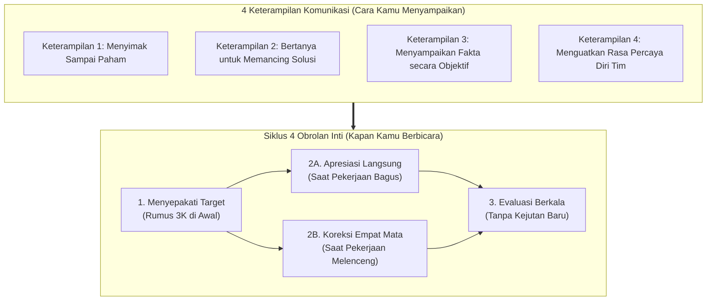
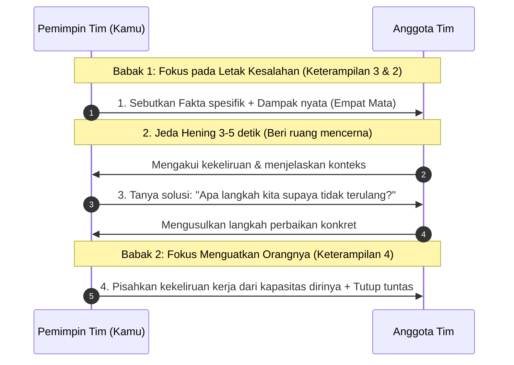
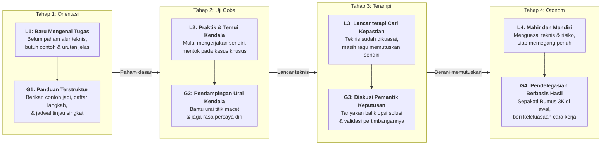

# Mahir Memimpin Tim: Strategi Menciptakan Tim yang Mandiri

**Ditulis oleh:** `aiossan`</br>
**Ragam Bahasa:** Standar Luwes (`Saya/Kamu` • Baku Tak Kaku)</br>
**Format:** GitHub Flavored Markdown (GFM)

> [!NOTE] Cara Menggunakan Panduan Ini
> Seluruh bab di dalam dokumen ini disusun dengan bahasa Indonesia standar yang mengalir seperti diskusi bersama mentor di kantor. Kamu bisa membacanya secara berurutan dari Pendahuluan hingga Bab 13, membuka bagian lipat (*collapsible sections*) untuk melihat templat skrip dan simulasi kasus, atau langsung menuju **Lampiran** saat membutuhkan ringkasan cepat sebelum memulai rapat.

## Daftar Isi

1. [Pendahuluan: Saat Pertama Kali Dipercaya Memimpin Tim](#pendahuluan-saat-pertama-kali-dipercaya-memimpin-tim)
2. [Bab 1: Peralihan dari Kerja Sendiri ke Mengarahkan Tim](#bab-1-peralihan-dari-kerja-sendiri-ke-mengarahkan-tim)
3. [Bab 2: Kerangka Kerja 4x4 (4 Obrolan Inti + 4 Keterampilan Komunikasi)](#bab-2-kerangka-kerja-4x4-4-obrolan-inti--4-keterampilan-komunikasi)
4. [Bab 3: Keterampilan 1: Menyimak Sampai Paham](#bab-3-keterampilan-1-menyimak-sampai-paham)
5. [Bab 4: Keterampilan 2: Bertanya untuk Memancing Solusi](#bab-4-keterampilan-2-bertanya-untuk-memancing-solusi)
6. [Bab 5: Keterampilan 3: Menyampaikan Fakta Tanpa Menyerang Pribadi](#bab-5-keterampilan-3-menyampaikan-fakta-tanpa-menyerang-pribadi)
7. [Bab 6: Keterampilan 4: Menguatkan Rasa Percaya Diri Tim](#bab-6-keterampilan-4-menguatkan-rasa-percaya-diri-tim)
8. [Bab 7: Obrolan 1: Menyepakati Target di Awal (Rumus 3K)](#bab-7-obrolan-1-menyepakati-target-di-awal-rumus-3k)
9. [Bab 8: Obrolan 2A: Apresiasi Langsung Saat Tim Bekerja Bagus](#bab-8-obrolan-2a-apresiasi-langsung-saat-tim-bekerja-bagus)
10. [Bab 9: Obrolan 2B: Koreksi Empat Mata Saat Pekerjaan Melenceng](#bab-9-obrolan-2b-koreksi-empat-mata-saat-pekerjaan-melenceng)
11. [Bab 10: Obrolan 3: Evaluasi Berkala Tanpa Kejutan (*No-Surprise Review*)](#bab-10-obrolan-3-evaluasi-berkala-tanpa-kejutan-no-surprise-review)
12. [Bab 11: Studi Kasus & Simulasi 4 Minggu (Rina dan Budi)](#bab-11-studi-kasus--simulasi-4-minggu-rina-dan-budi)
13. [Bab 12: Menyesuaikan Gaya Pendampingan (Level L1 sampai L4 ke Gaya G1 sampai G4)](#bab-12-menyesuaikan-gaya-pendampingan-level-l1-sampai-l4-ke-gaya-g1-sampai-g4)
14. [Bab 13: Rencana Praktik 30 Hari di Kantor](#bab-13-rencana-praktik-30-hari-di-kantor)
15. [Lampiran: Ringkasan Meja Kerja & Rujukan Riset](#lampiran-ringkasan-meja-kerja--rujukan-riset)

## Pendahuluan: Saat Pertama Kali Dipercaya Memimpin Tim

Baru diangkat menjadi *team leader*, supervisor, atau manajer? Atau baru diserahi tanggung jawab memegang proyek bersama beberapa orang?

Coba perhatikan, manakah situasi yang paling sering kamu rasakan belakangan ini:

- Merasa canggung dan serba salah ketika harus menegur anggota tim yang hasil kerjanya keliru.
- Bingung bagaimana cara memberi arahan yang jelas supaya tidak berulang kali ditanyai hal yang sama.
- Merasa sungkan dan khawatir dicap sebagai "atasan galak" atau "suka mengatur", apalagi kalau orang yang kamu pimpin dulunya rekan kerja selevel (*peer*).
- Sering lembur sendirian karena terpaksa membereskan ulang pekerjaan anggota tim yang hasilnya belum sesuai harapan.

Kalau kamu mengalami salah satunya, tenang saja, kok. <mark>Hampir semua pemimpin tim baru pernah melewati fase ini.</mark>

Memimpin tim adalah keterampilan kerja (*skill*), sama halnya dengan menulis kode program, menyusun laporan keuangan, membuat desain visual, atau bernegosiasi dengan klien. Artinya, cara memimpin orang selalu bisa dipelajari, dilatih, dan dibiasakan lewat praktik sehari-hari.

Masalah utamanya sederhana: jarang sekali ada perusahaan atau kampus yang membekali kita cara praktis memimpin orang sebelum jabatan itu diberikan. Riset dari *Center for Creative Leadership* (<abbr title="Center for Creative Leadership">CCL</abbr>) menunjukkan bahwa sebagian besar manajer lini pertama dipromosikan karena berprestasi secara teknis saat masih bekerja sendiri sebagai kontributor individu (*individual contributor*), lalu langsung dituntut mengarahkan orang lain tanpa bekal komunikasi kepemimpinan yang memadai[^1].

Panduan ini saya tulis sebagai pegangan praktis yang bisa langsung kamu terapkan besok pagi di kantor. Kita akan langsung berfokus pada tiga hal yang paling sering kamu hadapi setiap minggu bersama tim:

1. **4 Obrolan Inti:** Empat situasi utama kapan kamu perlu berbicara empat mata dengan anggota tim, mulai dari menyepakati target di awal hingga evaluasi berkala.
2. **4 Keterampilan Komunikasi:** Cara menyimak sampai paham, bertanya untuk memancing solusi, menegur berdasarkan fakta tanpa menjatuhkan mental, dan menguatkan rasa percaya diri tim.
3. **Menyesuaikan Gaya Pendampingan (L1 sampai L4):** Cara membaca tingkat penguasaan dan kemandirian tiap anggota tim pada satu tugas spesifik, supaya kamu tahu kapan perlu membimbing secara rinci dan kapan perlu memberikan otonomi penuh.

> [!IMPORTANT] Landasan Riset Panduan Ini
> Seluruh langkah praktis di dalam buku ini dirangkum dari riset perilaku organisasi selama puluhan tahun: studi peralihan peran manajer baru dari *Center for Creative Leadership* (CCL)[^1], teori penetapan tujuan (*Goal-Setting Theory*) Edwin Locke dan Gary Latham[^2], riset rasa aman psikologis (*Psychological Safety*) Amy Edmondson di Harvard[^3], serta studi global *Gallup Workplace* mengenai apresiasi kerja[^4]. Semuanya saya rangkum ulang ke dalam bahasa kerja sehari-hari yang lugas dan mudah dipraktikkan.

Mari kita mulai dari perubahan peran yang sedang kamu jalani di **Bab 1**, ya.

## Bab 1: Peralihan dari Kerja Sendiri ke Mengarahkan Tim

Ketika kamu baru menerima promosi sebagai manajer, koordinator proyek, supervisor, atau *senior* yang bertugas membimbing rekan baru, tolok ukur keberhasilan kerjamu di kantor ikut berubah.

Studi *Center for Creative Leadership* (<abbr title="Center for Creative Leadership">CCL</abbr>) mencatat bahwa peralihan dari rekan sejawat (*peer*) menjadi atasan adalah salah satu fase paling menantang dalam perjalanan karier seorang profesional[^1].

Dulu, saat masih menjadi eksekutor teknis (*individual contributor*), kinerjamu dinilai murni dari hasil kerja tanganmu sendiri. Kamu diandalkan karena terampil menulis kode, tajam membuat desain, teliti menyusun laporan keuangan, atau rutin menembus target penjualan. Selama pekerjaanmu sendiri tuntas, tugasmu selesai.

Begitu kamu menjadi *team leader*, cara kerjanya bergeser. Tugas utamamu sekarang adalah <ins>menciptakan kejelasan kerja supaya anggota timmu bisa bekerja dengan baik dan mencapai target bersama</ins>.

### Perbedaan Bekerja Sendiri vs Mengarahkan Tim

Perubahan posisi ini menuntut pergeseran pola pikir (*mindset*) pada tiga aspek berikut:

| Aspek Pekerjaan         | Saat Bekerja Sendiri (*Individual Contributor*)              | Saat Menjadi Pemimpin Tim (*Team Leader*)                                             |
| :---------------------- | :----------------------------------------------------------- | :------------------------------------------------------------------------------------ |
| **Ukuran Keberhasilan** | Diukur dari tugas yang kamu selesaikan sendiri.              | Diukur dari hasil kerja kolektif seluruh anggota timmu.                               |
| **Saat Ada Masalah**    | Langsung turun tangan membereskan masalah teknisnya sendiri. | Membimbing anggota tim agar mereka mampu menyelesaikan masalah tersebut.              |
| **Fokus Keterampilan**  | Berfokus pada *hard skill* (keahlian teknis sesuai bidang).  | Berfokus pada *soft skill* (komunikasi, pembagian kerja, dan pengelolaan ekspektasi). |

Karena belum terbiasa dengan peran baru ini, banyak pemimpin tim baru mudah terjatuh ke dalam salah satu dari dua kebiasaan keliru di bawah ini:

#### 1. Gaya "Mandor" (Mengatur Semua Sampai Detail Terkecil)

Karena khawatir target meleset, kamu berubah menjadi pemberi perintah. Kamu melakukan *micromanaging*, memeriksa pekerjaan anggota tim setiap beberapa menit, mendikte setiap langkah kecil, dan baru bersuara ketika mencari kesalahan.

- **Akibatnya pada tim:** Anggota tim merasa tertekan, takut mengambil inisiatif, pasif menunggu perintah, dan kamu sendiri kelelahan karena harus mengawasi semuanya sendirian.

#### 2. Gaya "Sungkan" (Membereskan Pekerjaan Tim Diam-diam)

Karena takut dicap sebagai "atasan galak" atau dijauhi teman kantor, kamu memilih memendam semuanya. Kamu tidak berani menegur ketika pekerjaan anggota tim melenceng, memberi arahan yang mengambang, lalu akhirnya memilih lembur tengah malam untuk memperbaiki pekerjaan mereka diam-diam.

- **Akibatnya pada tim:** Anggota tim tidak pernah tahu letak kesalahannya, kualitas kerja tim berjalan di tempat, dan beban kerjamu menumpuk dua kali lipat.

### Posisi yang Sehat: Menjadi Rekan Diskusi yang Mengarahkan

Kamu tidak perlu memilih antara menjadi mandor yang kaku atau atasan yang memendam kesal sendirian, kok. Prinsip dasarnya sederhana:

> **Jadilah pengarah sekaligus rekan diskusi bagi timmu: jelas saat menetapkan standar di awal, tetapi tetap terbuka membantu saat mereka menemui kendala di tengah jalan.**

Kepemimpinan adalah proses yang kamu jalankan **bersama** timmu, bukan sesuatu yang kamu paksakan kepada mereka. Kalau pekerjaan anggota timmu lancar, performanya meningkat, dan target tercapai, kinerjamu sebagai *team leader* otomatis ikut terangkat.

Agar mudah dipraktikkan setiap hari di kantor, buku ini merangkum pola kerja pemimpin tim ke dalam **Kerangka Kerja 4x4** _(baca: 4 eks 4)_:

1. **4 Obrolan Inti (Kapan Kamu Perlu Berbicara?):** Empat waktu penting untuk membicarakan pekerjaan bersama anggota tim, mulai dari menyepakati target di awal hingga evaluasi akhir periode.
2. **4 Keterampilan Komunikasi (Bagaimana Cara Menyampaikannya?):** Empat kebiasaan dasar saat berdiskusi, yaitu menyimak sampai paham, bertanya untuk memancing solusi, menyampaikan fakta tanpa menyerang pribadi, dan menguatkan rasa percaya diri tim.

Mari kita lihat gambaran utuhnya di **Bab 2**.

## Bab 2: Kerangka Kerja 4x4 (4 Obrolan Inti + 4 Keterampilan Komunikasi)

Agar kamu tidak bingung harus memulai dari mana, seluruh isi panduan ini diringkas menjadi **8 kebiasaan praktis** yang terbagi ke dalam dua kelompok:

1. **4 Obrolan Inti** (siklus percakapan kerja dari awal hingga akhir periode)
2. **4 Keterampilan Komunikasi** (cara berkomunikasi yang kamu gunakan di setiap obrolan)

Perhatikan hubungan keduanya pada diagram berikut:



Cara kerjanya sederhana: **kamu menggunakan 4 Keterampilan Komunikasi sebagai fondasi untuk menjalankan 4 Obrolan Inti dari awal hingga akhir bulan.**

> [!NOTE]
> Penjelasan `Rumus 3K` ada di bagian Bab 7

### Empat Obrolan Inti dalam Siklus Kerja

- **1. Menyepakati Target di Awal (Rumus 3K)**
  Obrolan di awal proyek, awal minggu, atau awal kuartal untuk menyepakati hasil akhir, ukuran keberhasilannya, dan tenggatnya (*deadline*). Tujuannya agar ekspektasi kerja jernih sejak hari pertama.
- **2A. Apresiasi Langsung (*Direct Recognition*)**
  Apresiasi singkat sehari-hari yang langsung kamu sampaikan saat melihat anggota tim bekerja dengan rapi atau mengambil inisiatif yang tepat.
- **2B. Koreksi Empat Mata (*Private Course Correction*)**
  Obrolan pribadi saat kamu melihat ada hasil kerja atau cara kerja yang keluar jalur, agar segera kembali ke kesepakatan awal tanpa menjatuhkan mental anggota tim.
- **3. Evaluasi Berkala Tanpa Kejutan (*No-Surprise Review*)**
  Obrolan penutup periode (bulanan atau kuartalan) untuk meninjau pola keberhasilan, merangkum pelajaran penting, dan menyusun target periode berikutnya.

> [!TIP] Kunci Agar Evaluasi Akhir Tidak Menegangkan
> Kalau kamu rutin menjalankan Obrolan 1 (*Menyepakati Target*), 2A (*Apresiasi Langsung*), dan 2B (*Koreksi Empat Mata*) sepanjang bulan, maka Obrolan 3 (*Evaluasi Berkala*) akan berjalan tenang dan terukur, ya. Tidak akan ada lagi cerita anggota tim terkejut karena baru ditegur di akhir kuartal.

### Empat Keterampilan Komunikasi Dasar

Untuk menjalankan keempat obrolan di atas dengan baik, ada empat kebiasaan komunikasi yang perlu kamu latih:

1. **Menyimak Sampai Paham:** Memberikan perhatian penuh tanpa teralihkan layar laptop atau ponsel agar kamu menangkap fakta dan kendala sebenarnya.
2. **Bertanya untuk Memancing Solusi:** Mengajukan pertanyaan terbuka dengan kata *"Apa"* dan *"Bagaimana"* supaya anggota tim terbiasa berpikir kritis dan mengusulkan jalan keluar, bukan hanya menunggu disuapi jawaban.
3. **Menyampaikan Fakta Tanpa Menyerang Pribadi:** Menunjukkan letak kekeliruan kerja dan dampaknya secara spesifik serta tenang, tanpa menghakimi karakter personal.
4. **Menguatkan Rasa Percaya Diri Tim:** Menyampaikan pengakuan yang spesifik saat mengapresiasi, sekaligus menegaskan kembali kepercayaanmu terhadap kemampuan anggota tim sesaat setelah mengoreksi kesalahannya.

Di **Bagian 2 (Bab 3 sampai Bab 6)**, kita akan membahas keempat keterampilan komunikasi ini satu per satu lengkap dengan contoh kalimatnya. Setelah itu, di **Bagian 3 (Bab 7 sampai Bab 10)** kita langsung mempraktikkannya ke dalam keempat obrolan kerja.

## Bab 3: Keterampilan 1: Menyimak Sampai Paham

Sekilas, urusan mendengarkan orang berbicara terlihat seperti hal paling dasar yang semua orang sudah bisa sejak kecil. Padahal, sekadar mendengar suara (*hearing*) sangat berbeda dengan menyimak secara aktif (*active listening*).

Menyimak aktif berarti menaruh perhatian penuh pada lawan bicara di depanmu, tanpa sambil melirik notifikasi WhatsApp atau sibuk menyiapkan kalimat sanggahan di kepala.

Mengapa keterampilan ini diletakkan paling awal? Karena **kamu tidak akan bisa membantu tim menyelesaikan masalah yang sebenarnya kalau kamu sendiri keliru menangkap akar kendala mereka.** Riset Profesor Amy Edmondson di Harvard University membuktikan bahwa kesediaan pemimpin mendengarkan laporan masalah secara terbuka tanpa buru-buru menyalahkan adalah syarat utama tumbuhnya rasa aman psikologis (*psychological safety*)[^3]. Tanpa rasa aman itu, anggota tim cenderung menyembunyikan masalah sampai akhirnya membesar menjadi krisis.

### Tiga Kebiasaan Keliru Saat Mendengarkan Tim

Coba perhatikan ketika ada anggota tim datang mengajak berbicara. Apakah kamu masih sering tanpa sadar melakukan salah satu dari tiga kebiasaan ini?

- **Langsung memotong dengan solusi instan:** Anggota tim baru berbicara dua kalimat, kamu langsung menyela, *"Oh, itu mudah kok! Kamu tinggal lakukan A, B, lalu C saja."* Padahal ia belum selesai menjelaskan letak hambatan utamanya.
- **Buru-buru membela diri:** Anggota tim sedang menyampaikan bahwa tenggat (*deadline*) proyek terlalu sempit, tetapi kepalamu langsung sibuk menyiapkan argumen untuk membela jadwal manajemen, alih-alih memahami rincian beban kerjanya lebih dulu.
- **Mendengarkan sambil menatap layar:** Anggota tim berbicara serius di dekat mejamu, tetapi matamu tetap menatap monitor, jarimu masih mengetik <kbd>Ctrl</kbd> + <kbd>C</kbd> dan <kbd>Ctrl</kbd> + <kbd>V</kbd>, atau tanganmu masih menggulir layar ponsel.

Ketiga kebiasaan di atas membuat anggota tim merasa hanya didengarkan untuk dijawab, bukan untuk dipahami.

### Tiga Langkah Praktis Menyimak Sampai Paham

Biasakan tiga langkah sederhana ini setiap kali anggota tim mengajak berdiskusi serius:

#### 1. Berikan Perhatian Penuh (Tutup Dulu Laptopnya)

Saat rekan tim mengajak berdiskusi penting, terlebih dalam sesi *one-on-one*, tunjukkan bahwa kamu hadir 100% untuk mereka:

- Tutup layar laptopmu setengah (atau tekan <kbd>Win</kbd> + <kbd>L</kbd> / <kbd>Cmd</kbd> + <kbd>Ctrl</kbd> + <kbd>Q</kbd> untuk mengunci layar), lalu putar kursimu menghadap langsung ke arahnya.
- Balikkan layar ponselmu menghadap meja dan aktifkan mode senyap.
- Kalau rapat dilakukan secara daring lewat Zoom atau Google Meet, tutup *tab* pekerjaan lain dan tatap kamera.

Sikap sesederhana ini langsung menunjukkan kepada lawan bicara bahwa masalah yang ia sampaikan itu penting dan kamu benar-benar mendengarkannya.

#### 2. Ulangi Inti Pesannya dengan Bahasamu Sendiri (*Parafrase*)

Setelah anggota tim selesai berbicara, rangkum dulu intinya untuk memastikan tidak ada salah paham:

- *"Jadi kalau saya tangkap, kendala utamanya ada di bagian..., betul begitu?"*
- *"Kalau boleh saya rangkum, hal yang paling membuat kamu khawatir di proyek ini adalah..., benar ya?"*
- *"Oke, berarti proses X tertahan karena masih menunggu data dari tim Y, begitu ya?"*

Cara ini memberikan dua manfaat sekaligus:

- **Bagi anggota tim:** Mereka merasa lega dan dihargai karena tahu pemimpinnya benar-benar menyimak.
- **Bagi kamu:** Kamu memastikan duduk perkaranya sudah tepat sebelum mengambil keputusan.

#### 3. Gali Lebih Lengkap Sebelum Memberi Saran

Jangan terburu-buru mendikte perintah. Sering kali, keluhan pertama yang disampaikan anggota tim baru menyentuh gejala di permukaan. Galilah lebih lengkap dengan pertanyaan singkat:

- *"Boleh ceritakan lebih rinci mengenai bagian itu?"*
- *"Bagaimana urutan kejadiannya dari awal?"*
- *"Bagian mana yang paling menghambat pekerjaanmu dari kejadian tadi?"*

### Perbandingan Kalimat di Kantor (Keterampilan 1)

| Hindari Respons Ini                                                  | Gunakan Respons Ini                                                                                   |
| :------------------------------------------------------------------- | :---------------------------------------------------------------------------------------------------- |
| *"Ah, itu mudah, tinggal..."* (Memotong pembicaraan sebelum tuntas)  | *"Oke, coba ceritakan lebih lengkap situasinya..."*                                                   |
| Menjawab *"Hmm, iya lalu?"* sambil mata tetap menatap layar laptop.  | *"Sebentar ya, saya tutup laptop dulu supaya fokus. Bagaimana tadi?"*                                 |
| *"Iya, tetapi aturan kantor memang begitu..."* (Langsung menyanggah) | *"Jadi kalau saya tangkap, kamu merasa kewalahan di bagian..., betul begitu?"* (Memastikan pemahaman) |
| *"Kamu terlalu terbawa perasaan saja."* (Meremehkan keluhan)         | *"Apa hal yang paling membuat kamu kepikiran dari kejadian tadi?"* (Menggali konteks)                 |

### Latihan Praktik Bab 3

Pada sesi diskusi atau *one-on-one* berikutnya, coba terapkan tiga latihan ini, ya:

- [ ] **Tahan solusi di 5 menit pertama:** Niatkan sejak awal diskusi untuk mendengarkan dan memetakan duduk perkara lebih dulu sebelum memberi saran.
- [ ] **Ulangi inti cerita minimal 1 kali:** Gunakan kalimat *"Jadi maksud kamu adalah..."* sebelum menanggapi.
- [ ] **Beri jeda 3 detik setelah mereka selesai berbicara:** Jangan langsung menyambar pembicaraan. Hitung 1 sampai 3 di dalam hati; sering kali kalimat paling jujur justru keluar setelah jeda hening tersebut.

## Bab 4: Keterampilan 2: Bertanya untuk Memancing Solusi

Di Bab 3, kamu sudah mempelajari cara menyimak duduk perkara dengan baik. Langkah berikutnya adalah membantu anggota tim memikirkan jalan keluarnya lewat pertanyaan yang tepat.

Namun perlu hati-hati: salah memilih kata tanya bisa langsung menjatuhkan mental anggota tim. Coba ingat-ingat, seberapa sering kalimat seperti ini terdengar saat terjadi masalah di kantor:

- *"Kenapa laporannya sampai sekarang belum selesai?"*
- *"Kenapa kamu bisa salah memasukkan data seperti ini?"*
- *"Kenapa kamu tidak memakai cara A saja dari kemarin?"*

Ketika seseorang diberondong kata **"Kenapa"** dalam situasi bermasalah, reaksi alaminya adalah membela diri, mencari alasan, atau justru terdiam karena takut salah berbicara lagi.

> [!WARNING] Efek Kata "Kenapa" Saat Terjadi Masalah
> Dalam situasi kerja yang sedang bermasalah, pertanyaan *"Kenapa"* hampir selalu terdengar seperti interogasi dan tuduhan. Kata *"Kenapa"* menyeret fokus diskusi ke masa lalu yang sudah tidak bisa diubah dan memicu pencarian kambing hitam.

### Ganti "Kenapa" dengan "Apa" dan "Bagaimana"

Menggeser kata tanya dari *"Kenapa"* ke *"Apa"* dan *"Bagaimana"* langsung mengubah arah diskusi menjadi jauh lebih sehat:

- **"Apa":** Mengarahkan fokus diskusi pada **fakta, data, dan letak kendala saat ini**.
- **"Bagaimana":** Mengarahkan fokus diskusi pada **langkah perbaikan dan pilihan solusi ke depan**.

Perhatikan perbedaan nada dan arah berpikir dari kalimat-kalimat berikut:

| Pertanyaan yang Menyudutkan                 | Pertanyaan yang Memancing Solusi                                                                       |
| :------------------------------------------ | :----------------------------------------------------------------------------------------------------- |
| *"Kenapa kamu terlambat?"*                  | *"Tadi tertahan macet di titik mana? Bagaimana caranya supaya besok bisa kita antisipasi lebih awal?"* |
| *"Kenapa laporannya salah?"*                | *"Bagian mana dari pengolahan laporan ini yang menurut kamu paling rumit atau membingungkan?"*         |
| *"Kenapa kamu tidak melapor dari kemarin?"* | *"Apa yang membuat kamu ragu mengabari kendala ini lebih awal kepada saya?"*                           |
| *"Kenapa kamu malah memakai cara ini?"*     | *"Boleh ceritakan bagaimana pertimbanganmu waktu memilih pendekatan ini?"*                             |

### Biasakan Bertanya Balik agar Tim Tumbuh Mandiri

Mengapa kebiasaan bertanya ini penting sekali bagi ketenangan kerjamu sebagai *leader*?

Kalau setiap kali muncul masalah kamu langsung menyuapi jawabannya, lama-kelamaan anggota timmu menjadi bergantung penuh kepadamu. Sedikit-sedikit bertanya, sedikit-sedikit menunggu persetujuanmu, dan tidak berani mengambil langkah sendiri.

Ingat, perusahaan menggaji anggota timmu untuk ikut berpikir dan memecahkan masalah bersama, bukan hanya menunggu dikte perintah.

Mulai sekarang, saat anggota tim datang membawa masalah, tahan dorongan untuk langsung memberi jawaban. Tanyakan dulu pandangan mereka, ya:

> **Anggota Tim:** *"Kak, klien X barusan komplain keras soal keterlambatan pengiriman fitur baru kita."*
> **Cara Lama (Langsung Menyuapi Solusi):** *"Wah, ya sudah, kamu balas emailnya sekarang, sampaikan A, B, dan C ya..."*
> **Cara Baru (Memancing Analisis Tim):** *"Oke, terima kasih infonya. Apa poin utama yang paling mereka khawatirkan dari keterlambatan ini? Menurut analisismu, apa penyebab utamanya dan dua langkah apa yang paling masuk akal kita tawarkan kepada mereka sekarang?"*

Lewat pertanyaan seperti itu, kamu melatih ketajaman analisis mereka sekaligus menumbuhkan rasa memiliki (*ownership*) terhadap solusi yang mereka usulkan sendiri.

### Perbandingan Kalimat di Kantor (Keterampilan 2)

| Hindari Pertanyaan Ini                                     | Gunakan Pertanyaan Ini                                                                   |
| :--------------------------------------------------------- | :--------------------------------------------------------------------------------------- |
| *"Kenapa tugas ini belum selesai juga?"*                   | *"Apa yang masih kamu butuhkan supaya tugas ini bisa tuntas sore ini?"*                  |
| *"Kamu sudah mencoba cara X belum?"* (Pertanyaan tertutup) | *"Opsi solusi apa saja yang sejauh ini sudah terpikirkan olehmu?"*                       |
| *"Ini datanya salah, kan?"* (Menyudutkan)                  | *"Bagaimana hasil pengecekanmu untuk akurasi angka di bagian ini?"*                      |
| *"Sebenarnya masalahmu apa, sih?!"* (Nada tidak sabar)     | *"Bantu saya memahami situasinya, apa kendala terbesar yang kamu hadapi di proyek ini?"* |

### Latihan Praktik Bab 4

Selama seminggu ke depan, coba latih tiga kebiasaan ini:

- [ ] **Rem kata "Kenapa":** Setiap kali kata *"Kenapa"* hendak keluar saat membahas kendala kerja, ganti kalimatnya dengan awalan *"Apa"* atau *"Bagaimana"*.
- [ ] **Tanya balik sebelum menjawab:** Ketika anggota tim bertanya, *"Kak, ini sebaiknya bagaimana ya?"*, tanyakan balik lebih dulu: *"Kalau menurut pertimbanganmu sendiri, opsi mana yang paling masuk akal untuk kita ambil?"*
- [ ] **Gabungkan dengan Keterampilan 1:** Setelah mengajukan pertanyaan pemantik, diam dan simak jawaban mereka sampai tuntas tanpa memotong.

## Bab 5: Keterampilan 3: Menyampaikan Fakta Tanpa Menyerang Pribadi

Menegur anggota tim yang hasil kerjanya keliru sering menjadi hal yang paling dihindari oleh pemimpin tim baru.

Karena merasa sungkan atau khawatir merusak suasana kerja, banyak atasan memilih memendamnya sendiri, menyindir secara halus di grup WhatsApp kantor, atau mengeluh di belakang kepada rekan kerja lain. Padahal, kalau kesalahan kerja terus didiamkan, ada tiga dampak buruk yang pasti muncul:

- Masalah kecil yang dibiarkan akan membesar menjadi kegagalan proyek.
- Anggota tim mengira hasil kerjanya sudah benar karena tidak pernah dikoreksi, sehingga mereka kehilangan kesempatan berkembang.
- Kamu sendiri menumpuk rasa kesal sampai suatu hari "meledak" secara emosional di saat yang tidak tepat.

Agar kamu bisa menyampaikan koreksi secara lugas tanpa melukai harga diri orang lain, pegang satu prinsip dasar ini:

> [!IMPORTANT] Prinsip Dasar Koreksi Objektif
> Pisahkan **letak kesalahan kerjanya** (perilaku atau hasil kerja) dari **orangnya** (karakter atau harga diri). Yang sedang kamu luruskan adalah tindakan atau datanya yang keliru, bukan menghakimi sifat pribadi manusianya.

Perhatikan perbedaan jelas antara kalimat yang menyerang pribadi dan kalimat yang menunjuk fakta pekerjaan:

- **Menyerang pribadi (Keliru):** *"Laporanmu berantakan sekali."* (Penilaian kabur yang merendahkan orangnya).
- **Menunjuk fakta (Tepat):** *"Data di halaman 5 laporan ini masih menggunakan angka bulan lalu, jadi belum akurat untuk rapat pagi ini."* (Langsung menunjuk letak kekeliruan secara spesifik).
- **Menyerang karakter (Keliru):** *"Kamu memang orangnya malas dan tidak disiplin."* (Menghakimi sifat personal).
- **Menunjuk fakta (Tepat):** *"Minggu ini pengumpulan laporanmu sudah tiga kali melewati jam tenggat pukul 15.00 yang kita sepakati."* (Berfokus pada kejadian yang terukur).

### Tiga Langkah Koreksi Objektif: Fakta, Dampak, dan Jeda Hening

Tinggalkan kebiasaan membungkus teguran dengan pujian basa-basi di awal dan akhir (*sandwich feedback*), karena sering membuat pesan koreksi utamanya justru kabur.

Saat ada pekerjaan yang melenceng, panggil anggota tim berbicara **empat mata (privat)** dan sampaikan tiga langkah ini secara berurutan:

#### 1. Sebutkan Faktanya Secara Spesifik Tanpa Emosi

Sampaikan apa yang kamu lihat atau temukan apa adanya, tanpa tambahan kata sifat yang menghakimi:

> *"Budi, waktu presentasi ke klien tadi pagi, grafik penjualan di slide ke-4 masih memakai angka kuartal lalu, belum diperbarui ke data kuartal ini."*
> *(Bukan: "Budi, presentasimu tadi pagi kacau sekali!")*

#### 2. Jelaskan Dampaknya bagi Tim atau Pekerjaan

Sering kali anggota tim kurang teliti karena belum melihat dampak kesalahannya terhadap proses kerja berikutnya. Tunjukkan konsekuensi nyatanya:

> *"Dampaknya, klien tadi tampak bingung saat mencocokkan angka, dan mereka jadi meragukan ketelitian olahan data tim kita."*
> *(Bukan: "Gara-gara kamu, muka saya mau ditaruh di mana?!")*

#### 3. Berikan Jeda Hening 3 sampai 5 Detik

Setelah menyebutkan fakta dan dampaknya, **berhentilah berbicara sejenak selama 3 sampai 5 detik.**

Jangan tergoda untuk langsung mencairkan suasana dengan kalimat seperti, *"Tetapi ya sudahlah tidak apa-apa kok, santai saja..."* Kalau memang tidak apa-apa, untuk apa kamu memanggilnya berbicara empat mata, ya kan?

Jeda hening ini memberi ruang bagi anggota timmu untuk mencerna fakta tadi, menyadari dampaknya, dan menanggapi lebih dulu. Setelah ia merespons (biasanya berupa pengakuan atau permintaan maaf), barulah kamu lanjutkan dengan **Keterampilan 2 (Bertanya untuk Memancing Solusi)**: *"Menurut kamu, langkah apa yang perlu kita lakukan sekarang supaya di presentasi berikutnya hal ini tidak terlewat lagi?"*

### Perbandingan Kalimat di Kantor (Keterampilan 3)

| Hindari Kalimat Ini                                                                        | Gunakan Kalimat Ini                                                                                                            |
| :----------------------------------------------------------------------------------------- | :----------------------------------------------------------------------------------------------------------------------------- |
| *"Pekerjaanmu akhir-akhir ini sepertinya agak kendur, ya."* (Mengambang dan menebak-nebak) | *"Dua tenggat terakhir di proyek X mundur dua hari dari jadwal yang kita sepakati."* (Fakta spesifik)                          |
| Menyindir di grup chat: *"Wah, pagi ini ada yang hobi datang siang lagi..."*               | Berbicara empat mata: *"Jadwal rapat harian kita pukul 09.00, dan pagi ini kamu baru bergabung pukul 09.20. Ada kendala apa?"* |
| *"Kamu memang orangnya ceroboh dan tidak teliti!"* (Menyerang sifat pribadi)               | *"Ada tiga salah ketik pada nama jabatan klien di draf surat yang kamu kirim tadi."* (Fokus pada hasil kerja)                  |
| *"Tidak apa-apa kok, santai saja..."* (Padahal di dalam hati kesal)                        | *"Keterlambatan draf ini membuat waktu pengerjaan tim desain berkurang satu hari."* (Jujur menyampaikan dampak)                |

### Latihan Praktik Bab 5

Minggu ini, coba latih langkah koreksi objektif ini pada satu kasus nyata:

- [ ] **Pilih 1 kekeliruan kerja yang nyata:** Ambil satu kesalahan data atau keterlambatan minggu ini yang tadinya ingin kamu biarkan saja.
- [ ] **Tulis draf Fakta & Dampaknya lebih dulu:** Sebelum memanggil orangnya, catat singkat apa fakta kejadiannya dan apa dampak nyatanya bagi pekerjaan.
- [ ] **Sampaikan empat mata + beri jeda:** Ajak ia berbicara berdua dengan nada tenang, sampaikan kedua poin tadi, lalu diam 3 sampai 5 detik untuk mendengarkan tanggapannya.

## Bab 6: Keterampilan 4: Menguatkan Rasa Percaya Diri Tim

Tiga keterampilan pertama yang sudah kita bahas membantu kamu memahami masalah (Bab 3), memancing pemikiran tim (Bab 4), dan menyampaikan koreksi secara objektif (Bab 5). Keterampilan keempat ini adalah pengikatnya: **menguatkan rasa percaya diri anggota tim.**

Mengapa rasa percaya diri anggota tim perlu dijaga? Karena orang yang yakin pada kemampuannya akan berani mengambil inisiatif, berani bertanggung jawab, dan tidak takut melapor lebih awal ketika menemui kendala di tengah jalan.

Ada **dua situasi utama** kapan kamu perlu menerapkan keterampilan ini:

1. **Saat mengapresiasi pekerjaan yang bagus:** Agar pujianmu spesifik dan anggota tim tahu standar kerja mana yang perlu dipertahankan.
2. **Sesaat setelah menegur kesalahan:** Agar mental anggota tim tidak jatuh dan mereka tetap bersemangat memperbaiki pekerjaannya.

### 1. Mengapresiasi Secara Spesifik, Jangan Hanya Bilang "Good Job!"

Ucapan singkat seperti *"Bagus!"*, *"Mantap!"*, *"Good job!"*, atau sekadar mengirim jempol di grup percakapan memang ramah, tetapi cepat terlupakan karena tidak memberi tahu bagian mana yang sudah baik.

Ubah pujian singkat menjadi pengakuan yang menyebutkan **fakta pekerjaannya** dan **dampak positifnya**:

| Pujian yang Terlalu Umum               | Apresiasi yang Spesifik dan Menguatkan                                                                                                         |
| :------------------------------------- | :--------------------------------------------------------------------------------------------------------------------------------------------- |
| *"Good job ya presentasinya tadi!"*    | *"Presentasimu tadi rapi sekali. Saya senang melihat cara kamu menjawab pertanyaan mendadak dari Klien X dengan tenang dan data yang akurat."* |
| *"Oke, terima kasih laporannya."*      | *"Terima kasih laporannya, ya. Tambahan grafik perbandingan di halaman 3 yang kamu buat membantu manajemen membaca datanya jauh lebih cepat."* |
| *"Mantap, target kuartal ini tembus!"* | *"Target kuartal ini berhasil kita lampaui. Saya sangat menghargai ketekunan kalian menindaklanjuti klien selama dua minggu terakhir."*        |

### 2. Menegaskan Kepercayaan Setelah Menegur Kesalahan

Seobjektif apa pun cara kamu menegur di Bab 5, ditegur atas kesalahan kerja pasti membuat seseorang merasa tidak nyaman atau kecewa pada dirinya sendiri.

Begitu mereka sudah mengakui kekeliruannya dan menyepakati langkah perbaikan, tutup obrolan dengan menegaskan bahwa **kesalahan pada satu tugas ini tidak mengubah kepercayaanmu terhadap kemampuan mereka secara keseluruhan, kok.**

Perhatikan contoh kalimat penutup setelah koreksi berikut:

- **Contoh 1 (Setelah menegur ketelitian data):**
  *"Saya menyampaikan hal ini secara terbuka karena saya tahu hasil tadi di luar standar kerjamu biasanya. Biasanya kamu teliti dan bisa diandalkan. Saya yakin kamu bisa segera membereskan bagian ini."*
- **Contoh 2 (Setelah menegur keterlambatan tenggat):**
  *"Saya tahu beban proyek ini cukup padat, tetapi saya percaya penuh pada kapasitasmu. Ingat proyek Y bulan lalu? Waktu itu situasinya juga rumit dan kamu berhasil menyelesaikannya dengan rapi. Mari kita kembalikan lagi ritme kerja itu, ya."*
- **Contoh 3 (Setelah menegur sikap atau cara komunikasi):**
  *"Saya bicarakan ini secara langsung karena peranmu penting di tim ini. Saya menghargai kontribusimu selama ini, dan saya percaya kamu bisa memperbaiki cara koordinasi ini ke depannya."*

Penutup seperti ini membuat anggota tim keluar dari ruang diskusi tanpa rasa minder dan langsung fokus membereskan revisinya.

### Perbandingan Kalimat di Kantor (Keterampilan 4)

| Hindari Penutup Ini                                                            | Gunakan Penutup Ini                                                                                                              |
| :----------------------------------------------------------------------------- | :------------------------------------------------------------------------------------------------------------------------------- |
| *"Awas ya, lain kali jangan sampai terulang lagi!"* (Menutup dengan ancaman)   | *"Saya percaya kamu sudah memahami letak kekeliruannya dan bisa menangani bagian ini dengan jauh lebih rapi ke depannya."*       |
| *"Kerja bagus!"* (Terlalu singkat dan tidak jelas bagian mananya)              | *"Pekerjaanmu di bagian [Fakta Spesifik] sangat rapi, dampaknya [Dampak Positif bagi Tim/Proyek]."*                              |
| Setelah menegur kesalahan, langsung pergi atau memasang wajah dingin seharian. | Setelah menegur kesalahan, tutup dengan jelas: *"Oke, urusan ini selesai, ya. Saya tetap percaya penuh pada kemampuan kerjamu."* |
| *"Masa mengurus hal sepele begini saja salah?"* (Merendahkan kapasitas)        | *"Saya tahu kemampuanmu jauh lebih baik daripada draf awal ini. Mari kita rapikan bersama."*                                     |

### Latihan Praktik Bab 6

Minggu ini, coba jalankan dua latihan berikut:

- [ ] **Sampaikan 1 apresiasi spesifik:** Cari satu anggota tim yang mengerjakan tugasnya dengan rapi minggu ini, lalu apresiasi dengan rumus **Fakta Spesifik + Dampak Positif + Kalimat Penguat**.
- [ ] **Ingatkan 1 keberhasilan lama:** Pilih satu anggota tim yang belakangan tampak kurang percaya diri atau sedang memegang tugas berat, lalu ingatkan ia pada satu proyek sulit yang pernah berhasil ia selesaikan sebelumnya.

## Bab 7: Obrolan 1: Menyepakati Target di Awal (Rumus 3K)

Setelah mempelajari empat keterampilan komunikasi di Bagian 2, sekarang kita masuk ke **4 Obrolan Inti** dalam siklus kerja sehari-hari. Kita mulai dari langkah paling pertama: **Obrolan 1: Menyepakati Target di Awal.**

Mengapa obrolan ini wajib berada di urutan pertama? Karena secara logika, **kamu tidak bisa mengapresiasi ataupun menegur anggota tim kalau sejak hari pertama mereka tidak diberi tahu ukuran pekerjaan yang dianggap "beres" dan "melenceng".**

Riset meta-analisis selama 35 tahun oleh Edwin A. Locke dan Gary P. Latham terhadap lebih dari 400 studi membuktikan bahwa **target yang spesifik dan jelas (*specific, clear goals*)** merupakan penentu utama tingginya motivasi dan kinerja tim, jauh lebih efektif dibandingkan instruksi kabur seperti *"lakukan saja yang terbaik"*[^2]. Mayoritas kegagalan eksekusi di kantor berakar pada arahan awal yang masih mengambang saat tugas pertama kali diberikan.

### Masalah Klasik: Instruksi "Pokoknya Beres"

Banyak *team leader* merasa sudah memberi arahan, padahal kalimat yang disampaikan masih punya banyak tafsir. Contohnya:

- *"Tolong nanti kamu pegang proyek X, ya."* (Sejauh mana batas wewenangnya? Apa ukuran keberhasilannya? Kapan tenggatnya?)
- *"Pokoknya kuartal ini penjualan kita harus naik!"* (Naik berapa persen? 2% atau 30%? Segmen mana yang diprioritaskan?)
- *"Tugasmu menyusun laporan bulanan divisi."* (Data apa saja yang wajib masuk? Siapa pembacanya? Bagaimana formatnya?)

Kalau instruksi di awal mengambang, anggota tim terpaksa menebak-nebak sendiri isi kepalamu. Ketika hasil tebakan mereka berbeda dengan bayanganmu, pekerjaan harus diulang dari awal dan waktu terbuang percuma.

### Cara Menyusun Kesepakatan Target yang Ringkas (Rumus 3K)

Setiap tanggung jawab utama yang kamu delegasikan sebaiknya disepakati dan ditulis secara ringkas dalam satu blok catatan (cukup 3 sampai 5 poin inti, sehingga mudah dipindai ulang setiap awal minggu).

Berikut 3 langkah praktis menjalankan obrolan *Menyepakati Target*:

#### 1. Diskusikan Secara Dua Arah (Gunakan Keterampilan 1 & 2)

Jangan hanya mendikte daftar tugas secara sepihak. Libatkan anggota tim agar mereka merasa memiliki tanggung jawab atas target tersebut:

- **Gunakan Keterampilan 2 (Bertanya untuk Memancing Solusi):** *"Proyek X ini penting bagi divisi kita bulan ini. Menurut pandanganmu, gambaran hasil akhir seperti apa yang bisa kita sebut berhasil untuk proyek ini?"*
- **Gunakan Keterampilan 1 (Menyimak Sampai Paham):** Dengarkan usulan mereka, ulangi poin utamanya, lalu lengkapi dengan standar yang dibutuhkan manajemen.

#### 2. Kunci dan Tulis dengan Rumus 3K (Keluaran, Kriteria Sukses, Kalender)

Setelah berdiskusi, tuliskan kesepakatannya secara singkat untuk menjawab tiga komponen **3K**:

1. **Keluaran (*Output*):** Apa bentuk tugas atau hasil akhir spesifik yang harus diserahkan?
2. **Kriteria Sukses:** Seperti apa wujud nyata pekerjaan yang dianggap tuntas dengan baik? (Angka, metrik, atau standar kualitas).
3. **Kalender (Tenggat / *Deadline*):** Kapan batas waktu pengumpulannya (hari dan jam)?

> [!IMPORTANT] Batasi 3 sampai 5 Target Utama per Periode
> Jangan menumpuk 15 target sekaligus pada satu orang. Kalau seseorang memiliki 15 prioritas utama sekaligus, pada praktiknya ia tidak memiliki prioritas sama sekali.

#### 3. Simpan di Dokumen Bersama agar Mudah Ditinjau

Jangan biarkan catatan target tadi tenggelam di tumpukan pesan percakapan. Simpan di tempat yang mudah dibuka bersama (seperti Trello, Notion, Google Docs, atau pesan yang disematkan). Ajak tim meluangkan waktu sejenak setiap Senin pagi untuk membaca ulang target ini supaya pekerjaan mingguan tetap selaras.

<details>
<summary><strong>Templat Skrip Obrolan 1 (Menyepakati Target Rumus 3K) Siap Salin</strong></summary>

```text
"Halo [Nama], untuk tugas [Nama Tugas/Proyek] ini, mari kita sepakati dulu Rumus 3K-nya supaya kita satu pemahaman sejak awal, ya:
1. Keluaran utamanya: [Sebutkan bentuk hasil akhir].
2. Kriteria suksesnya: [Sebutkan metrik, jumlah halaman, atau standar kualitas].
3. Kalender tenggatnya: [Sebutkan hari dan jam pengumpulan].
Menurut pandanganmu, apakah ada bagian yang perlu kita sesuaikan lebih dulu atau ada dukungan yang kamu butuhkan dari saya?"
```
</details>

### Perbandingan Kalimat di Kantor (Obrolan 1)

| Arahan yang Masih Mengambang                                                                  | Kesepakatan Target dengan Rumus 3K                                                                                                                                                   |
| :-------------------------------------------------------------------------------------------- | :----------------------------------------------------------------------------------------------------------------------------------------------------------------------------------- |
| *"Tolong tingkatkan engagement media sosial kita, ya."*                                       | *"Target kuartal ini adalah menaikkan rata-rata engagement rate Instagram dari 1,5% menjadi 3% pada akhir Juni melalui 3 konten Reels edukatif per minggu."*                         |
| *"Proposal proyek ini harus selesai secepatnya!"* (Kata "secepatnya" bagi tiap orang berbeda) | *"Draf pertama proposal klien A sudah harus masuk ke email saya paling lambat Kamis pukul 15.00 WIB."*                                                                               |
| *"Kerjakan laporannya yang rapi dan benar, ya."*                                              | *"Standar laporan yang kita sepakati: 1) Maksimal 3 halaman PDF, 2) Memuat angka Reach, Leads, dan Konversi, 3) Tanpa kesalahan rumus/typo, 4) Dikirim tiap Jumat pukul 16.00 WIB."* |

### Latihan Praktik Bab 7

- [ ] **Pilih 1 tugas minggu ini:** Ambil satu pekerjaan atau proyek yang hendak kamu delegasikan kepada anggota tim.
- [ ] **Tulis Rumus 3K:** Rumuskan lebih dulu **(1) Keluaran hasil akhirnya, (2) Kriteria suksesnya, dan (3) Kalender tenggatnya.**
- [ ] **Minta anggota tim merangkum ulang:** Di akhir diskusi, minta anggota tim menyebutkan kembali kesepakatan tadi dengan bahasanya sendiri untuk memastikan tidak ada salah paham.

## Bab 8: Obrolan 2A: Apresiasi Langsung Saat Tim Bekerja Bagus

Setelah target disepakati di awal (Bab 7), anggota tim mulai bekerja. Pada tahap pelaksanaan ini, kesalahan banyak atasan adalah baru bersuara ketika ada yang keliru, tetapi diam saja ketika pekerjaan berjalan rapi.

Biasakan sebaliknya, ya: **peka melihat anggota tim yang sedang bekerja dengan baik, lalu sampaikan apresiasi saat itu juga.**

Riset **Gallup Workplace** di Amerika Serikat mengungkapkan bahwa **hanya 1 dari 3 pekerja (sekitar 33%)** yang merasa menerima pengakuan atau apresiasi atas pekerjaan yang baik dalam tujuh hari terakhir[^4]. Padahal, meta-analisis global Gallup terhadap **3,3 juta pekerja di lebih dari 100.000 tim** membuktikan bahwa tim yang skor apresiasi dan keterikatannya (*engagement*) masuk kuartil atas mencatatkan **tingkat perpindahan karyawan (*turnover*) 21% hingga 51% lebih rendah**, **produktivitas 14% hingga 18% lebih tinggi**, serta **profitabilitas 23% lebih tinggi** dibandingkan tim di kuartil bawah[^4].

### Mengapa Pujian Sambil Lalu Kurang Berdampak?

Ketika anggota timmu sudah bekerja keras menyelesaikan sesuatu, lalu kamu hanya membalas sambil lalu dengan kata *"Good job!"*, *"Mantap!"*, atau sekadar mengirim stiker jempol di grup percakapan, pujian itu kurang membekas karena tiga alasan:

1. **Tidak spesifik:** Anggota tim tidak tahu bagian mana dari usahanya yang kamu nilai baik dan perlu dipertahankan.
2. **Terdengar formalitas:** Terasa seperti balasan otomatis (*auto-reply*) yang diucapkan kepada semua orang tanpa perhatian nyata.
3. **Tidak membentuk kebiasaan:** Kebiasaan kerja yang baik baru akan diulangi secara konsisten kalau orangnya tahu persis mengapa cara kerjanya diapresiasi.

### Lima Langkah Apresiasi Langsung (*Direct Recognition*)

Gunakan 5 langkah sederhana ini supaya apresiasimu terasa tulus dan jelas:

1. **Segera (Jangan ditunda):** Begitu kamu melihat anggota tim mengambil inisiatif yang baik atau menyelesaikan tahapan kerja dengan rapi, sampaikan apresiasi di hari yang sama. Jangan disimpan untuk rapat evaluasi tiga bulan lagi.
2. **Spesifik (Sebutkan fakta kerjanya):** Tunjuk secara jelas tindakan atau bagian pekerjaan mana yang mereka kerjakan dengan baik. Contoh: *"Budi, waktu rapat bersama klien tadi pagi..."*
3. **Jelaskan dampak positifnya:** Hubungkan tindakan spesifik tadi dengan manfaatnya bagi tim, klien, atau target proyek. Contoh: *"...cara kamu menyiapkan data cadangan saat klien menanyakan proyeksi biaya tadi sangat sigap. Klien jadi langsung yakin dan rapat kita selesai lebih cepat."*
4. **Berikan jeda singkat (2 sampai 3 detik):** Berhentilah berbicara sejenak supaya mereka merasakan apresiasi itu dengan utuh. Jangan langsung menyambungnya dengan tugas baru di kalimat yang sama (*"Bagus ya, nah sekarang tolong kerjakan yang ini..."* karena itu langsung merusak momen apresiasinya).
5. **Tutup dengan kalimat penguat:** Akhiri obrolan singkat itu dengan dorongan semangat: *"Pertahankan cara kerja rapi seperti ini, ya. Terima kasih banyak atas inisiatifmu."*

> [!TIP] Apresiasi Kemajuannya, Jangan Menunggu Sempurna 100%
> Kalau kamu menunggu proyek besar selesai 100% baru memberi apresiasi, timmu bisa kehabisan tenaga di tengah jalan. Terutama bagi anggota tim yang sedang mempelajari tugas baru, berikan pengakuan setiap kali mereka menunjukkan progres awal yang benar, kok.

<details>
<summary><strong>Templat Skrip Obrolan 2A (Apresiasi Langsung) Siap Salin</strong></summary>

```text
"Halo [Nama], saya barusan memeriksa hasil kerjamu di bagian [Sebutkan Fakta Spesifik]. Itu dikerjakan dengan rapi dan tepat sasaran. Dampaknya bagi tim kita, [Sebutkan Dampak Positifnya]. (Jeda 3 detik). Pertahankan inisiatif seperti ini, ya. Terima kasih banyak atas kerja kerasmu."
```
</details>

### Perbandingan Kalimat di Kantor (Obrolan 2A)

| Pujian Sambil Lalu                                                                                          | Apresiasi Langsung yang Spesifik                                                                                                                                                 |
| :---------------------------------------------------------------------------------------------------------- | :------------------------------------------------------------------------------------------------------------------------------------------------------------------------------- |
| Di akhir rapat umum: *"Oke teman-teman, good job untuk semuanya, ya!"*                                      | Menghampiri atau mengirim pesan langsung seusai rapat: *"Bud, cara kamu menjawab pertanyaan kritis dari Pak Anton tadi tenang dan datanya jelas sekali. Rapat jadi terkendali."* |
| *"Terima kasih ya laporannya, mantap!"*                                                                     | *"Terima kasih laporannya, ya. Tabel perbandingan kompetitor yang kamu tambahkan di halaman 4 membuat analisis kita jauh lebih kuat."*                                           |
| *"Pekerjaanmu kemarin bagus sekali, tetapi sayang hari ini kok malah..."* (Mencampur pujian dengan teguran) | Pisahkan waktu memuji dan menegur. Saat mengapresiasi, fokuslah 100% pada hal yang baik tanpa embel-embel kata *"tetapi"*.                                                       |

### Latihan Praktik Bab 8

- [ ] **Perhatikan hasil kerja yang rapi setiap hari:** Niatkan untuk menemukan minimal satu hal tepat yang dikerjakan anggota timmu sesuai kesepakatan target.
- [ ] **Sampaikan dengan 5 langkah di atas:** Sampaikan secara tatap muka atau lewat pesan pribadi (**Segera + Fakta Spesifik + Dampak Positif + Jeda + Penguatan**).

## Bab 9: Obrolan 2B: Koreksi Empat Mata Saat Pekerjaan Melenceng

Mari kita jujur: menegur hasil kerja yang melenceng adalah bagian dari peran *team leader* yang paling sering membuat canggung dan paling sering ditunda-tunda.

Padahal, tujuan utama **Koreksi Empat Mata (*Private Course Correction*)** adalah **mengembalikan pekerjaan anggota tim ke jalur target yang sudah disepakati secepat mungkin, tanpa merusak motivasi dan harga diri mereka.**

Bayangkan cara kerja aplikasi peta digital (GPS) di ponselmu. Ketika kamu salah mengambil belokan di jalan raya, aplikasi peta itu langsung memberi tahu secara objektif bahwa jalurmu keliru lalu menunjukkan rute perbaikannya, tanpa memaki pengendaranya.

Di dalam obrolan inilah kamu menggabungkan **Keterampilan 3 (Menyampaikan Fakta Tanpa Menyerang Pribadi)**, **Keterampilan 2 (Bertanya untuk Memancing Solusi)**, dan **Keterampilan 4 (Menguatkan Rasa Percaya Diri Tim)** ke dalam alur dua babak.



### Dua Syarat Mutlak Sebelum Koreksi Empat Mata

1. **Target dan standarnya memang sudah disepakati sebelumnya:** Pastikan kekeliruan tersebut memang melenceng dari standar yang sudah pernah disepakati di awal (kalau kamu belum pernah menjelaskan standarnya, berarti instruksi awalmu yang perlu diperbaiki lebih dulu di Bab 7).
2. **Lakukan segera dan empat mata (privat):** Jangan pernah menegur anggota tim di grup percakapan umum atau di depan rekan kerja lainnya.

> [!CAUTION] Aturan Privasi Mutlak: Jangan Menegur di Depan Umum
> Menegur kesalahan individu di grup WhatsApp kantor atau di depan rekan kerja lain membuat orang tersebut merasa dipermalukan di depan umum (*public shaming*). Riset membuktikan hal ini langsung merusak rasa aman psikologis[^3] dan memicu sikap defensif. Selalu panggil berbicara empat mata, ya.

### Alur 2 Babak Koreksi Empat Mata

#### Babak 1: Fokus pada Letak Kesalahannya (Gunakan Keterampilan 3 & 2)

1. **Sebutkan fakta kekeliruannya secara spesifik dan tenang:**
   *"Budi, bisa bicara sebentar? Saya barusan memeriksa laporan kampanye iklan yang kamu kirim pagi ini. Di halaman 3, angka biaya per klik yang tertulis masih memakai data bulan lalu, belum data minggu ini."*
2. **Jelaskan dampak nyatanya:**
   *"Dampaknya, klien tadi langsung mengirim pesan kepada saya karena angkanya tidak cocok dengan dashboard mereka. Kita jadi harus bekerja dua kali untuk revisi dan kepercayaan klien terhadap akurasi data kita bisa menurun."*
3. **Berikan jeda hening 3 sampai 5 detik, lalu tanyakan solusinya:**
   Setelah menyebutkan fakta dan dampak, **diamlah sejenak.** Biarkan Budi mencerna letak kesalahannya dan menanggapi lebih dulu. Setelah itu, lanjutkan dengan **Keterampilan 2**: *"Apa yang membuat bagian itu terlewat tadi, dan bagaimana langkah kita supaya minggu depan tidak terulang?"*

#### Babak 2: Fokus Menguatkan Orangnya (Gunakan Keterampilan 4)

Begitu anggota timmu sudah menyadari kekeliruannya dan menyepakati langkah perbaikan, geser fokus percakapan untuk menguatkan kembali rasa percaya dirinya:

1. **Tegaskan kembali kepercayaanmu terhadap kemampuannya:**
   *"Oke, terima kasih sudah langsung sigap mau memperbaiki, Bud. Saya berbicara terbuka soal ini karena saya menghargai pekerjaanmu. Saya tahu kekeliruan tadi di luar standar kerjamu biasanya. Biasanya kamu teliti dan rapi, kok. Saya percaya penuh kamu bisa menyelesaikan revisi ini dengan tuntas."*
2. **Tutup dengan bersih (selesai berarti selesai):**
   *"Baik, saya tunggu hasil perbaikannya pukul 14.00 siang ini, ya."*
   Begitu percakapan selesai, masalah selesai. Jangan menyindirnya lagi di sore hari dan jangan mengungkitnya lagi di minggu depan.

<details>
<summary><strong>Templat Skrip Obrolan 2B (Koreksi Empat Mata 2 Babak) Siap Salin</strong></summary>

```text
[Babak 1: Fokus Masalah]
"Halo [Nama], saya perhatikan pada bagian [Sebutkan Fakta Spesifik] masih belum sesuai dengan kesepakatan awal kita. Dampaknya, [Sebutkan Dampak Nyata bagi Tim/Klien]. (Jeda 3-5 detik, simak tanggapannya). Menurut kamu, langkah apa yang perlu kita ambil sekarang supaya hal ini tidak terulang?"

[Babak 2: Fokus Menguatkan Orangnya]
"Oke, terima kasih sudah langsung sigap merespons. Saya sampaikan ini secara terbuka karena saya menghargai pekerjaanmu. Saya tahu ini di luar standar ketelitianmu biasanya, dan saya percaya penuh kamu bisa membereskan bagian ini dengan rapi."
```
</details>

### Perbandingan Kalimat di Kantor (Obrolan 2B)

| Teguran yang Menjatuhkan Mental                                                     | Koreksi Empat Mata yang Terarah                                                                                |
| :---------------------------------------------------------------------------------- | :------------------------------------------------------------------------------------------------------------- |
| *"Kenapa kamu bisa teledor sekali, sih?!"* (Menyerang pribadi dengan kata "Kenapa") | (Empat mata): *"Di tabel halaman 2 ini ada selisih angka 15% dari data sumbernya."* (Fakta spesifik)           |
| *"Gara-gara kamu, seluruh tim ikut kena masalah!"* (Menyalahkan secara emosional)   | *"Dampaknya, persetujuan anggaran dari divisi keuangan jadi tertunda satu hari."* (Dampak objektif)            |
| Menegur di grup WhatsApp/Slack kantor agar dilihat semua orang.                     | Meminta waktu 3 menit lewat pesan pribadi atau memanggil ke ruang diskusi kecil.                               |
| Setelah menegur, memasang wajah dingin dan mendiamkan anggota tim seharian.         | Menutup dengan jelas: *"Saya tahu ini di luar standar kerjamu biasanya. Saya tetap percaya pada kemampuanmu."* |

### Latihan Praktik Bab 9

- [ ] **Pilih 1 momen koreksi minggu ini:** Saat ada hasil kerja anggota tim yang melenceng dari kesepakatan, jangan didiamkan dan jangan kamu kerjakan ulang sendiri.
- [ ] **Siapkan catatan 2 babak:** Tulis singkat poin **Babak 1 (Fakta + Dampak + Jeda)** dan **Babak 2 (Penguatan kepercayaan diri)**.
- [ ] **Jalankan empat mata:** Bicarakan berdua selama 3 sampai 5 menit hingga langkah perbaikannya disepakati.

## Bab 10: Obrolan 3: Evaluasi Berkala Tanpa Kejutan (*No-Surprise Review*)

Obrolan keempat dalam siklus kerja adalah **Evaluasi Berkala**, baik evaluasi bulanan, kuartalan, maupun akhir proyek (*performance review*).

Bagi banyak pekerja, undangan evaluasi kinerja dari atasan sering terasa menegangkan karena suasananya mirip sidang pengadilan. Penyebab utamanya sederhana: sepanjang bulan atau kuartal, sang *leader* tidak pernah menjalankan Obrolan 1 (*Menyepakati Target*), Obrolan 2A (*Apresiasi Langsung*), dan Obrolan 2B (*Koreksi Empat Mata*):

- Di awal periode, targetnya mengambang.
- Saat anggota tim bekerja bagus, atasannya diam saja karena menganggap *"itu memang sudah kewajiban gajinya"*.
- Saat anggota tim berbuat salah, atasannya juga diam karena merasa sungkan, tetapi menyimpan daftar kesalahan itu untuk ditumpahkan sekaligus saat rapat evaluasi akhir.

Akibatnya, anggota tim terkejut karena baru diberi tahu kesalahannya setelah berbulan-bulan berlalu, ketika semuanya sudah terlambat untuk diperbaiki.

### Pegangan Utama Evaluasi Akhir: Jangan Ada Kejutan Baru (*No Surprises*)

Kalau kamu sudah rutin menyepakati target (Bab 7), memberi apresiasi langsung (Bab 8), dan melakukan koreksi empat mata (Bab 9) dari minggu ke minggu, maka sesi evaluasi akhir tinggal merangkum obrolan-obrolan yang memang sudah pernah kalian bahas sebelumnya, kok.

> [!IMPORTANT] Jangan Menabung Teguran untuk Evaluasi Akhir
> Jangan pernah memunculkan teguran atas kesalahan lama yang belum pernah kamu bahas pada sesi *Koreksi Empat Mata* harian. Evaluasi akhir adalah tempat melihat pola perkembangan kerja dan menyusun target periode berikutnya.

### Empat Langkah Menjalankan Evaluasi Berkala

1. **Minta anggota tim mengevaluasi dirinya sendiri lebih dulu (Gunakan Keterampilan 2):**
   Jangan membuka rapat dengan langsung membacakan daftar penilaian darimu. Biarkan anggota tim berbicara lebih dulu lewat pertanyaan reflektif:
   - *"Bud, hari ini kita akan meninjau pekerjaan kita selama kuartal ini. Kalau dari sudut pandangmu sendiri, bagaimana penilaianmu terhadap performamu sejauh ini?"*
   - *"Capaian apa yang paling membuat kamu puas di periode ini, dan di bagian mana kamu merasa paling berkembang?"*
   - *"Sebaliknya, kendala apa yang paling terasa berat, dan pelajaran apa yang kamu ambil dari situ?"*
2. **Simak sepenuhnya tanpa menyela (Gunakan Keterampilan 1):**
   Dengarkan dan catat poin-poinnya. Anggota tim yang terbiasa diajak berdiskusi secara terbuka umumnya mampu menilai kelebihan dan kekurangannya sendiri secara jujur.
3. **Sampaikan rangkuman catatanmu (Porsi 30% waktu rapat):**
   Tambahkan pandanganmu dengan merujuk pada apresiasi dan koreksi yang sudah pernah dibahas sepanjang bulan:
   - **Merujuk pada apresiasi:** *"Saya sepakat dengan poin yang kamu sampaikan tadi. Di catatan saya juga terlihat analisis data yang kamu buat bulan lalu sangat membantu tim menentukan prioritas konten..."*
   - **Merujuk pada perbaikan:** *"Terkait tantangan ketelitian rumus di minggu ketiga yang kamu sebutkan tadi, saya senang kamu langsung mengunci rumus template-nya saat kita bahas kemarin, sehingga laporan minggu keempat sudah akurat."*
4. **Fokuskan 70% sisa waktu untuk rencana ke depan (Kembali ke Rumus 3K):**
   Masa lalu cukup dibahas 30% untuk diambil pelajarannya. Gunakan 70% sisa waktu rapat untuk menyusun target periode berikutnya (langsung menyambung kembali ke **Bab 7**).

### Perbandingan Kalimat di Kantor (Obrolan 3)

| Evaluasi Model Sidang Pengadilan                                                                       | Evaluasi Dua Arah Tanpa Kejutan                                                                                                    |
| :----------------------------------------------------------------------------------------------------- | :--------------------------------------------------------------------------------------------------------------------------------- |
| Membuka rapat dengan monolog: *"Oke, ini daftar penilaian dan kesalahanmu selama 3 bulan terakhir..."* | Membuka rapat dengan bertanya: *"Menurut pandanganmu sendiri, bagaimana perjalanan kerjamu selama 3 bulan ini?"*                   |
| Mengeluarkan daftar kesalahan lama yang belum pernah ditegur sebelumnya.                               | Merujuk pada obrolan mingguan yang sudah pernah dibahas bersama.                                                                   |
| Menghabiskan 90% waktu rapat untuk mengungkit masa lalu.                                               | Membagi porsi **30% evaluasi periode lalu** dan **70% penyusunan target periode depan**.                                           |
| Menutup rapat dengan suasana tegang tanpa kejelasan langkah lanjutan.                                  | Menutup dengan kalimat penguat: *"Kamu berkembang pesat di periode ini, dan kuartal depan kita tingkatkan tanggung jawabnya, ya."* |

### Latihan Praktik Bab 10

- [ ] **Jadwalkan evaluasi bulanan singkat:** Gunakan sesi *one-on-one* akhir bulan ini untuk berlatih meninjau pekerjaan sebulan terakhir.
- [ ] **Kirim 3 pertanyaan sehari sebelum rapat:** Kirim pesan kepada anggota timmu: *"Besok di sesi 1-on-1 kita, tolong siapkan 3 hal, ya: (1) Hal yang paling berhasil bulan ini, (2) Kendala utama yang kamu hadapi, dan (3) Usulan prioritas untuk bulan depan."*
- [ ] **Jaga porsi waktu 30/70:** Dengarkan mereka lebih dulu, bahas kilas balik maksimal 30% durasi rapat, dan gunakan 70% sisanya untuk menyepakati target bulan depan.

## Bab 11: Studi Kasus & Simulasi 4 Minggu (Rina dan Budi)

Agar terbayang bagaimana wujud praktiknya dari minggu ke minggu di kantor, mari kita ikuti perjalanan satu bulan penuh antara dua tokoh berikut:

- **Rina:** *Team leader* baru di divisi *Digital Marketing* yang mulai menerapkan **Kerangka Kerja 4x4**.
- **Budi:** Anggota tim Rina. Kreatif dan cepat belajar, tetapi terkadang konsistensi dan ketelitian angkanya masih naik-turun.

### Minggu 1: Menyepakati Target di Awal (Rumus 3K)

**Situasi:** Rina ingin menyerahkan tugas baru kepada Budi, yaitu menyusun dan menganalisis laporan mingguan performa media sosial perusahaan.

- **Cara Lama (Mengambang):**
  *"Bud, mulai minggu depan laporan media sosial kamu yang pegang, ya. Pokoknya buat yang lengkap dan kirim ke saya setiap Jumat."*
- **Cara Rina (Menggunakan Kerangka Kerja 4x4):**
  **Rina:** *"Bud, mulai bulan ini kita ingin merapikan evaluasi konten. Saya lihat kamu cukup tajam membaca tren konten, jadi saya ingin menyerahkan tanggung jawab laporan mingguan media sosial kepadamu. Bagaimana menurutmu?"*
  **Budi:** *"Siap, Kak Rina! Menarik itu. Tetapi rincian laporan yang Kakak harapkan seperti apa, ya?"*
  **Rina (Keterampilan 2 - Bertanya):** *"Sebelum saya beri masukan, kalau menurut pandanganmu sendiri, angka apa saja yang paling penting kita pantau setiap minggu supaya kita tahu konten kita berhasil atau tidak?"*
  **Budi:** *"Hmm, menurut saya jangkauan (*reach*), interaksi (*likes/komentar*), serta pertambahan pengikut baru, Kak."*
  **Rina (Keterampilan 1 - Menyimak & Parafrase):** *"Setuju, tiga metrik utama itu wajib ada. Supaya makin tajam, saya usul kita tambahkan satu poin lagi: kesimpulan singkat mengapa satu konten bisa ramai dan mengapa ada konten yang sepi. Masuk akal tidak menurutmu?"*
  **Budi:** *"Masuk akal sekali, Kak. Jadi tidak hanya deretan angka saja, ya."*
  **Rina:** *"Baik! Mari kita tulis kesepakatan Rumus 3K-nya di dokumen bersama kita, ya:"*
  - **Keluaran:** Laporan Mingguan Performa Instagram & TikTok.
  - **Kriteria Sukses:** Maksimal 2 halaman *slide*, berisi 3 metrik utama (*Reach*, *Engagement Rate*, Pengikut Baru) + 1 paragraf *insight* konten terbaik & terendah, tanpa kesalahan rumus.
  - **Kalender (Tenggat / *Deadline*):** Dikirim ke email saya setiap Jumat paling lambat pukul 15.00 WIB.

### Minggu 2: Apresiasi Langsung Saat Bekerja Bagus

**Situasi:** Jumat minggu kedua, Budi mengirimkan laporan pertamanya pukul 14.00 WIB (satu jam sebelum *deadline*). Seluruh kriteria terpenuhi dan analisisnya tajam.

- **Cara Lama (Basa-basi):**
  Membalas email singkat: *"Noted. Thanks, Bud."*
- **Cara Rina (Apresiasi Langsung):**
  **Rina:** *"Bud, laporan mingguan pertamamu barusan selesai saya baca. Saya suka bagian analisis yang kamu tulis soal mengapa video tutorial 30 detik kemarin memiliki interaksi tertinggi. Poinnya tajam, datanya rapi, dan kamu kirim satu jam sebelum deadline. Insight darimu ini sangat membantu saya menyiapkan bahan presentasi ke Manajer Divisi minggu depan."*
  *(Rina berhenti berbicara 3 detik sambil tersenyum).*
  **Budi:** *"Syukurlah kalau membantu, Kak. Tadi saya sempat ragu mau menulis analisis itu atau tidak."*
  **Rina (Keterampilan 4 - Penguatan):** *"Justru itu bagian terbaiknya, kok. Pertahankan cara analisis seperti ini, ya, Bud."*

### Minggu 3: Koreksi Empat Mata Saat Ada Kesalahan

**Situasi:** Jumat minggu ketiga, Budi mengirim laporan tepat waktu. Namun saat Rina memeriksanya, angka *Engagement Rate* TikTok tertulis **8,5%**. Setelah dicek ke tabel mentahnya, ternyata Budi salah menarik sel pembagi di Excel (seharusnya **1,8%**).

- **Gaya "Sungkan":** Memperbaiki sendiri rumus Excel Budi malam-malam tanpa memberi tahu Budi.
- **Gaya "Mandor":** Menulis di grup WhatsApp tim: *"@Budi kalau membuat laporan diperiksa dulu rumusnya! Masa angka 1,8% bisa menjadi 8,5%?! Jangan asal kirim!"*
- **Cara Rina (Koreksi Empat Mata 2 Babak):**
  *(Rina mengajak Budi berbicara berdua selama 3 menit di ruang diskusi kecil).*
  **Babak 1 (Fokus Masalah - Keterampilan 3 & 2):**
  **Rina:** *"Bud, terima kasih laporan minggu ini sudah masuk tepat waktu pukul 14.00 tadi. Waktu saya periksa rinciannya barusan, ada kekeliruan rumus di bagian Engagement Rate TikTok. Di slide tertulis 8,5%, padahal di tabel mentahnya 1,8% karena sel pembaginya bergeser. Ini cukup berisiko bagi kita, Bud, karena laporan ini menjadi dasar penentuan anggaran iklan minggu depan. Kalau angkanya meleset, alokasi anggaran kita bisa salah sasaran."*
  *(Rina diam 4 detik memberi ruang bagi Budi untuk mencerna dan menanggapi).*
  **Budi:** *"Astaga... iya Kak, maaf sekali! Tadi waktu menyalin tabel dari minggu lalu, saya lupa mengunci sel pembaginya."*
  **Rina (Keterampilan 2):** *"Oke. Menurut kamu, langkah apa yang bisa kamu lakukan supaya minggu depan rumus ini tidak bergeser lagi saat disalin?"*
  **Budi:** *"Saya akan mengunci rumus sel pembaginya menggunakan tanda `$` di template Excel-nya, Kak, lalu saya periksa ulang satu sampel memakai kalkulator sebelum diekspor ke PDF. Saya revisi sekarang, ya, Kak."*
  **Babak 2 (Fokus Menguatkan Orangnya - Keterampilan 4):**
  **Rina:** *"Ide yang bagus soal mengunci rumus template itu. Bud, saya sampaikan ini secara lugas kepadamu karena saya menghargai pekerjaanmu. Saya tahu kekeliruan tadi di luar standar ketelitianmu biasanya; dua minggu pertama kemarin pekerjaanmu rapi sekali, kok. Saya percaya penuh kamu bisa membereskan revisi ini."*

### Minggu 4: Evaluasi Berkala Tanpa Kejutan

**Situasi:** Akhir bulan tiba, Rina mengadakan sesi *one-on-one* evaluasi bulanan bersama Budi.

- **Rina:** *"Halo Bud, sudah sebulan penuh kamu memegang laporan media sosial kita. Sebelum saya menyampaikan catatan dari sisi saya, bagaimana penilaianmu sendiri atas hasil kerjamu selama sebulan ini?"*
- **Budi:** *"Saya senang diberi kepercayaan ini, Kak. Saya jadi belajar banyak soal membaca data konten dan senang karena insight mingguan saya terpakai untuk strategi tim. Catatan terbesar saya ada di minggu ketiga kemarin waktu salah rumus Excel, tetapi sekarang template-nya sudah saya kunci sehingga di minggu keempat kemarin sudah aman."*
- **Rina:** *"Catatan saya persis sama dengan yang baru kamu sampaikan. Saya sangat menghargai kecepatan belajarmu dan tajamnya analisis konten yang kamu tulis sejak minggu kedua. Soal rumus di minggu ketiga, saya senang kamu langsung memperbaiki sistem template-nya sehingga di minggu keempat akurasinya 100% tepat. Nah, karena bagian ini sudah kamu kuasai, bulan depan kita tingkatkan targetnya, ya: selain menyusun laporan, saya ingin memberimu kesempatan mempresentasikan langsung insight tersebut selama 5 menit di rapat mingguan divisi. Saya yakin kamu siap!"*

<details>
<summary><strong>Simulasi Interaktif Mandiri: Uji Keputusanmu Sebagai Rina (Klik untuk Buka)</strong></summary>

Pilih satu opsi pada setiap minggu di bawah ini, lalu cocokkan dengan skor dan dampaknya:

1. **Minggu 1 (Delegasi Awal):**
   - **Opsi A:** *"Pokoknya buat laporan lengkap setiap Jumat."* -> **+20 Poin** (Budi bingung menebak format laporan).
   - **Opsi B:** Diskusi dua arah + sepakati Rumus 3K tertulis. -> **+100 Poin** (Ekspektasi jernih sejak hari pertama).
   - **Opsi C:** *"Bantu rekap sedikit ya kalau tidak sibuk, sisanya biar saya."* -> **+40 Poin** (Beban analisis kembali ke pundakmu).
2. **Minggu 2 (Budi Mengirim Analisis Tajam Sejam Sebelum *Deadline*):**
   - **Opsi A:** Membalas singkat *"Noted, thanks"* lalu memberi tugas baru. -> **+30 Poin** (Inisiatif Budi lewat begitu saja).
   - **Opsi B:** Apresiasi langsung sebut fakta + dampak + jeda 3 detik. -> **+100 Poin** (Kebiasaan baik Budi terus dipertahankan).
   - **Opsi C:** Diam saja karena menganggap itu kewajiban gaji. -> **+10 Poin** (Minggu depan Budi berhenti menulis analisis).
3. **Minggu 3 (Salah Rumus Excel 8,5% vs 1,8%):**
   - **Opsi A:** Menegur keras di grup WhatsApp tim. -> **+10 Poin** (Merusak *psychological safety* tim).
   - **Opsi B:** Memperbaiki sendiri diam-diam malam hari. -> **+30 Poin** (Budi tidak sadar salah, bulan depan terulang kembali).
   - **Opsi C:** Koreksi empat mata 2 babak (Fakta + Dampak + Jeda + Penguatan). -> **+100 Poin** (Masalah selesai dalam 3 menit tanpa menjatuhkan mental).
4. **Minggu 4 (Evaluasi Bulanan):**
   - **Opsi A:** Menanyakan evaluasi diri Budi lebih dulu + merangkum tanpa kejutan (30%) + menaikkan target bulan depan (70%). -> **+100 Poin** (Budi siap naik kelas).
   - **Opsi B:** Membacakan daftar kesalahan selama 30 menit. -> **+20 Poin** (Semangat Budi langsung turun).

</details>

## Bab 12: Menyesuaikan Gaya Pendampingan (Level L1 sampai L4 ke Gaya G1 sampai G4)

Setelah menguasai 4 Keterampilan Komunikasi dan 4 Obrolan Inti, muncul satu pertanyaan penting ketika kamu harus memimpin anggota tim yang tingkat penguasaan kerjanya berbeda-beda:

> **"Apakah saya harus menggunakan gaya komunikasi dan tingkat pengawasan yang sama persis kepada setiap orang di dalam tim?"**

Coba bayangkan dua orang berbeda di timmu:

- **Andi:** Karyawan *fresh graduate* yang baru bergabung tiga hari lalu. Semangat belajarnya tinggi sekali, tetapi belum pernah menggunakan sistem kerja kantor.
- **Siska:** Staf senior yang sudah bekerja empat tahun, menguasai seluk-beluk teknis di bidangnya, dan selalu menuntaskan tugas dengan teliti.

Kalau kamu melepas Andi bekerja sendiri tanpa panduan rinci (seperti cara kamu memperlakukan Siska), Andi akan kebingungan menentukan langkah awal. Sebaliknya, kalau kamu mendikte Siska langkah demi langkah setiap jam (seperti cara kamu membimbing Andi), Siska akan merasa tidak dipercaya.

Di sinilah kamu perlu menerapkan **Kalibrasi Pendampingan Kerja**. Porsi panduan teknis dari seorang pemimpin berfungsi layaknya penyangga belajar (*scaffolding*): dipasang rapat saat anggota tim baru mengenal tugasnya, lalu dikurangi secara bertahap seiring tumbuhnya kemandirian mereka. Prinsip dasarnya sangat jelas:

> **Sesuaikan porsi panduan teknis dan ruang diskusimu dengan level kemandirian anggota tim (L1 sampai L4) pada tugas spesifik yang sedang mereka kerjakan.**

### 1. Empat Level Kemandirian Anggota Tim pada Suatu Tugas (L1 sampai L4)

Setiap kali kamu mendelegasikan satu tugas spesifik, amati posisi kemandirian anggota timmu dari dua ukuran praktis:

1. **Penguasaan Alur Kerja (*Technical Grip*):** Seberapa paham dan terbiasa ia menangani urutan teknis, perangkat kerja, serta standar mutu pada tugas spesifik tersebut.
2. **Kemandirian Keputusan (*Decision Autonomy*):** Seberapa siap ia mengurai hambatan di lapangan dan mengambil keputusan teknis sendiri tanpa harus terus-menerus menunggu validasi darimu.

Perpaduan kedua ukuran ini membentuk 4 tahapan kemandirian tugas (L1 sampai L4) yang dipasangkan langsung dengan 4 gaya pendampingan (G1 sampai G4):



Berikut ciri-ciri setiap level kemandirian tugas di lapangan:

- **L1: Baru Mengenal Tugas (Penguasaan Teknis Awal, Butuh Contoh Konkret)**
  Sangat siap dan antusias menerima tugas baru (*"Siap, Kak!"*), tetapi belum memiliki pengalaman praktis pada alur tugas tersebut dan belum mengetahui rincian cara mengerjakannya. Contoh: karyawan baru di minggu pertama, atau staf lama yang baru pertama kali memegang jenis pekerjaan baru.
- **L2: Praktik & Temui Kendala (Mulai Menjalankan Sendiri, Mentok pada Kasus Khusus)**
  Setelah mulai mencoba mengerjakan sendiri, ia menemui kerumitan nyata di lapangan yang belum terlihat di awal. Ia mulai menghadapi hambatan teknis dan membutuhkan rekan diskusi untuk mengurai titik macetnya (*"Wah, bagian ini ternyata cukup rumit ya, saya tertahan di tahap kedua"*).
- **L3: Lancar tetapi Cari Kepastian (Penguasaan Teknis Tinggi, Masih Menunggu Validasi)**
  Secara teknis ia sebenarnya sudah menguasai alur pekerjaan tersebut dan jarang berbuat salah. Namun, ia masih sering meminta konfirmasi darimu sebelum berani mengambil keputusan penting sendiri (*"Kak, drafnya sudah selesai, tetapi boleh diperiksa dulu sebelum saya kirimkan ke klien?"*).
- **L4: Mahir dan Mandiri (Penguasaan Teknis Tinggi, Otonomi Penuh)**
  Sudah ahli secara teknis sekaligus matang dalam mengambil keputusan. Ia proaktif mengantisipasi risiko, mampu memecahkan masalah sendiri dari hulu ke hilir, bahkan sudah bisa ikut membimbing rekan kerja lainnya.

> [!WARNING] Ukur per Tugas Spesifik, Jangan Dijadikan Label Permanen bagi Orangnya
> Level L1 sampai L4 ini **melekat spesifik pada tugas yang sedang dikerjakan**, bukan label permanen untuk orangnya, ya. Misalnya, Budi sudah berada di level **L4 (Mahir dan Mandiri)** saat membuat desain konten harian, tetapi otomatis kembali ke **L1 (Baru Mengenal Tugas)** saat kamu menugaskannya menegosiasikan kontrak vendor untuk pertama kalinya.

### 2. Empat Gaya Pendampingan yang Sesuai (G1 sampai G4)

#### G1: Panduan Terstruktur -> Untuk L1

- **Takaran pendampingan:** Panduan teknis **rapat & rinci**, ruang mandiri **bertahap**.
- **Cara menjalankannya:** Karena anggota tim di level L1 belum mengenal medan kerjanya, jangan dilepas menebak-nebak sendiri. Berikan **panduan langkah demi langkah (*step-by-step*)**, contoh format jadi, *checklist* kerja, dan jadwal pengecekan singkat.
- **Obrolan & keterampilan utama:** Gunakan **Obrolan 1 (Menyepakati Target)** secara rinci, lalu berikan **Obrolan 2A (Apresiasi Langsung)** setiap kali ia berhasil menyelesaikan tahapan dasar. Jangan terlalu banyak bertanya *"Menurut kamu bagaimana caranya?"* kepada L1 karena ia memang belum memiliki referensi teknisnya.

#### G2: Pendampingan Urai Kendala -> Untuk L2

- **Takaran pendampingan:** Panduan pemecahan masalah **aktif**, dukungan moral **tinggi**.
- **Cara menjalankannya:** Anggota tim di level L2 sedang menemui hambatan teknis saat mulai berpraktik. Kamu perlu hadir untuk **membantu mengurai bagian yang macet** sekaligus **mendengarkan kesulitannya dan menjaga rasa percaya dirinya agar tetap terjaga**.
- **Obrolan & keterampilan utama:** Gabungkan **Keterampilan 1 (Menyimak)** dan **Keterampilan 2 (Bertanya)** untuk memetakan letak kesulitannya, gunakan **Obrolan 2B (Koreksi Empat Mata)** bila ada langkah yang keliru, lalu tutup dengan **Keterampilan 4 (Menguatkan Rasa Percaya Diri)**.

#### G3: Diskusi Pemantik Keputusan -> Untuk L3

- **Takaran pendampingan:** Instruksi teknis **minimal**, pemantik diskusi & validasi **tinggi**.
- **Cara menjalankannya:** Anggota tim di level L3 sebenarnya sudah menguasai cara kerjanya, hanya saja masih ragu mengambil keputusan sendiri. Kurangi mendikte teknisnya; posisikan dirimu sebagai rekan diskusi yang memancing analisis mereka dan memvalidasi pertimbangannya supaya berani mandiri.
- **Obrolan & keterampilan utama:** Andalkan **Keterampilan 2 (Bertanya balik)**: *"Kalau menurut analisismu sendiri, langkah mana yang paling tepat?"*, lalu kuatkan keputusannya dengan **Keterampilan 4**.

#### G4: Pendelegasian Berbasis Hasil -> Untuk L4

- **Takaran pendampingan:** Instruksi teknis harian **lepas**, kepercayaan pengelolaan **penuh** (diikat dengan kesepakatan hasil akhir di awal).
- **Cara menjalankannya:** Sepakati hasil akhir, tenggat, dan batas wewenang di awal, lalu **berikan keleluasaan baginya untuk mengatur metode dan ritme kerjanya sendiri**.
- **Obrolan & keterampilan utama:** Cukup jalankan **Obrolan 1 (Menyepakati Target)** di awal, berikan **Obrolan 2A (Apresiasi Langsung)** atas pencapaiannya, dan tinjau bersama pada **Obrolan 3 (Evaluasi Berkala)**. Ingat: kalau anggota tim di level L4 kamu perlakukan dengan gaya G1 yang mendikte setiap detail kecil, ia akan merasa dikekang.

<details>
<summary><strong>Kumpulan Skrip Siap Pakai untuk Gaya G1 sampai G4 (Klik untuk Buka)</strong></summary>

- **Skrip G1 (Untuk L1 - Baru Mengenal Tugas):**
  *"Halo [Nama], untuk tugas [Nama Tugas] ini, saya sudah menyiapkan panduan langkah demi langkah dan contoh formatnya. Kita sepakati dulu Rumus 3K-nya, ya: (1) Keluarannya adalah draf pertama sesuai template ini, (2) Kriteria suksesnya semua bagian terisi lengkap sebelum deadline, dan (3) Kalendernya kita periksa bersama besok pukul 14.00 WIB. Saya akan mendampingimu di tahap awal ini."*
- **Skrip G2 (Untuk L2 - Praktik & Temui Kendala):**
  *"Halo [Nama], saya perhatikan tugas [Nama Tugas] ini memang memiliki beberapa detail teknis yang cukup menantang, ya. Boleh ceritakan kepada saya, bagian mana yang paling membuat kamu mentok sekarang? (Simak & Parafrase). Oke, saya paham. Untuk bagian itu, langkah teknisnya kita pecah menjadi dua tahap kecil ini, ya. Saya percaya pada kapasitas belajarmu, mari kita selesaikan bersama."*
- **Skrip G3 (Untuk L3 - Lancar tetapi Cari Kepastian):**
  *"Halo [Nama], secara teknis kamu sudah menguasai [Nama Tugas] ini. Jadi sebelum saya memberi masukan, menurut pertimbanganmu sendiri, pendekatan mana yang paling efektif untuk kita ambil? (Simak). Nah, pertimbanganmu itu sudah tajam, kok. Jalankan sesuai rencanamu itu, ya, saya mendukung penuh keputusanmu."*
- **Skrip G4 (Untuk L4 - Mahir dan Mandiri):**
  *"Halo [Nama], untuk [Nama Tugas] kali ini, saya serahkan penuh pengelolaan eksekusinya kepadamu. Kita cukup sepakati hasil akhir dan deadline-nya pada Jumat depan pukul 15.00 WIB. Soal metode dan teknis pengerjaannya, silakan kamu atur sesuai cara kerja terbaikmu. Kabari saya kalau ada hambatan lintas divisi yang perlu saya bantu komunikasikan, ya."*

</details>

### Tabel Pencocokan Cepat L1 sampai L4 ke G1 sampai G4

| Level Kemandirian | Kondisi Penguasaan & Kemandirian Tugas             | Gaya Pendampingan yang Sesuai        | Fokus Obrolan & Keterampilan Utama                                                       |
| :---------------: | :------------------------------------------------- | :----------------------------------- | :--------------------------------------------------------------------------------------- |
|      **L1**       | Baru mengenal tugas, butuh contoh & urutan kerja   | **G1: Panduan Terstruktur**          | **Menyepakati Target** ekstra detail + **Apresiasi Langsung** tiap tahap awal.           |
|      **L2**       | Mulai praktik sendiri, mentok pada kendala teknis  | **G2: Pendampingan Urai Kendala**    | **Koreksi Empat Mata** + **Keterampilan 2 (Bertanya)** + **Keterampilan 4 (Penguatan)**. |
|      **L3**       | Teknis sudah lancar, masih ragu memutuskan sendiri | **G3: Diskusi Pemantik Keputusan**   | **Keterampilan 1 (Menyimak)** + **Keterampilan 2 (Tanya balik)** + **Keterampilan 4**.   |
|      **L4**       | Mahir teknis, proaktif, dan siap mandiri penuh     | **G4: Pendelegasian Berbasis Hasil** | **Menyepakati Target** hasil akhir + **Evaluasi Berkala**.                               |

## Bab 13: Rencana Praktik 30 Hari di Kantor

Membaca panduan kepemimpinan sampai selesai baru langkah awal. Tantangan sebenarnya muncul besok pagi saat kamu kembali ke meja kerja dan disambut tumpukan pekerjaan.

Kalau kamu mencoba mengubah seluruh kebiasaan sekaligus dalam satu hari, kamu akan cepat merasa kewalahan lalu kembali ke pola lama. Jauh lebih ringan dan efektif kalau kamu melatihnya secara bertahap setiap minggu melalui **Rencana Praktik 30 Hari** di bawah ini:

### Minggu 1: Menahan Diri dan Belajar Menyimak

**Fokus Minggu 1:** Melatih **Keterampilan 1 (Menyimak Sampai Paham)** dan **Keterampilan 2 (Bertanya untuk Memancing Solusi)**. Tahan dulu keinginan untuk mengatur semuanya sendiri.

- [ ] **Praktik 1 (Hadir penuh minimal 3 kali):** Saat ada anggota tim yang mengajak berbicara serius minggu ini, berhenti mengetik, tutup atau alihkan pandangan dari layar laptop, dan balikkan layar ponselmu.
- [ ] **Praktik 2 (Parafrase minimal 3 kali):** Di dalam rapat atau diskusi *one-on-one*, gunakan kalimat ini sebelum kamu menanggapi: *"Jadi kalau saya tangkap, maksud kamu adalah..., betul begitu?"*
- [ ] **Praktik 3 (Rem kata "Kenapa" & tanya balik):** Saat anggota tim datang membawa kendala, tahan keinginan untuk langsung mendiktekan solusi. Ajukan minimal satu pertanyaan yang diawali kata **"Apa"** atau **"Bagaimana"** (*"Menurut kamu, apa kendala utamanya dan bagaimana opsi jalan keluar terbaik kita?"*).

### Minggu 2: Merapikan Target dan Membiasakan Apresiasi

**Fokus Minggu 2:** Mempraktikkan **Obrolan 1 (Menyepakati Target)**, **Obrolan 2A (Apresiasi Langsung)**, dan **Kalibrasi Pendampingan Tugas (L1 sampai L4)**.

- [ ] **Praktik 1 (Susun 1 kesepakatan Rumus 3K):** Pilih satu tugas atau proyek yang kamu delegasikan minggu ini. Diskusikan secara dua arah dan tuliskan dengan jelas rumus **3K: (1) Keluaran tugasnya, (2) Kriteria suksesnya, dan (3) Kalender tenggatnya.**
- [ ] **Praktik 2 (Petakan level kemandirian tugas L1 sampai L4):** Tulis daftar nama anggota timmu beserta satu tugas utama mereka minggu ini. Tentukan apakah pada tugas tersebut mereka berada di level **L1, L2, L3, atau L4**, lalu sesuaikan gaya pendampinganmu (**G1 sampai G4**).
- [ ] **Praktik 3 (Sampaikan 3 apresiasi spesifik):** Temukan minimal 3 momen saat anggota timmu menyelesaikan pekerjaan dengan rapi minggu ini, lalu sampaikan apresiasi di hari yang sama (**Fakta Spesifik + Dampak Positif + Jeda + Penguatan**).

### Minggu 3: Melatih Koreksi Empat Mata yang Objektif

**Fokus Minggu 3:** Mempraktikkan **Keterampilan 3 (Menyampaikan Fakta)**, **Keterampilan 4 (Menguatkan Rasa Percaya Diri)**, dan **Obrolan 2B (Koreksi Empat Mata)**.

- [ ] **Praktik 1 (Pilih 1 kekeliruan kerja kecil):** Jangan menunggu ada kesalahan besar. Pilih satu hal kecil yang melenceng dari kesepakatan (misalnya keterlambatan draf atau selisih angka laporan) yang biasanya kamu diamkan atau kamu perbaiki sendiri.
- [ ] **Praktik 2 (Tulis catatan singkat 2 babak):** Sebelum memanggil anggota timmu, catat singkat poin *Babak 1* (Fakta objektif + dampak nyata bagi pekerjaan) dan *Babak 2* (Kalimat penguat bahwa kamu tetap percaya pada kemampuannya).
- [ ] **Praktik 3 (Jalankan Koreksi Empat Mata):** Panggil anggota timmu secara pribadi. Sampaikan Babak 1, **berikan jeda hening 3 sampai 5 detik**, dengarkan tanggapannya, lalu tutup dengan Babak 2.

### Minggu 4: Menjalankan Siklus Evaluasi Utuh

**Fokus Minggu 4:** Mempraktikkan **Obrolan 3 (Evaluasi Berkala Tanpa Kejutan)** dengan porsi waktu 30/70.

- [ ] **Praktik 1 (Jadwalkan evaluasi bulanan singkat):** Pada sesi *one-on-one* akhir minggu keempat, mintalah anggota tim menyiapkan penilaian diri singkat atas hasil kerjanya selama sebulan terakhir.
- [ ] **Praktik 2 (Dengarkan penilaian tim lebih dulu):** Buka sesi dengan bertanya (Keterampilan 2): *"Capaian apa yang paling membuat kamu puas bulan ini, dan apa kendala terbesarnya?"* lalu simak sampai tuntas (Keterampilan 1).
- [ ] **Praktik 3 (Rangkum tanpa kejutan & kunci target bulan depan):** Sampaikan rangkuman catatanmu yang merujuk pada apresiasi dan koreksi yang sudah pernah dibahas (30% waktu), berikan penguatan (Keterampilan 4), lalu gunakan 70% sisa waktu untuk menyepakati **Rumus 3K** bulan berikutnya.

### Penutup: Terbuka Belajar Bersama Tim

Saat kamu mulai mengubah kebiasaan berkomunikasi di kantor, wajar sekali kalau awalnya terasa sedikit canggung saat mencoba *Koreksi Empat Mata*, atau sesekali kamu lupa dan memotong pembicaraan tim ketika sedang lelah. Tidak masalah, kok; cukup sadari dan perbaiki pada obrolan berikutnya.

Bahkan, salah satu langkah paling jujur yang bisa kamu lakukan besok pagi adalah berbicara terbuka kepada anggota timmu:

> *"Teman-teman, saya sedang belajar memperbaiki cara saya berkoordinasi di tim ini. Ke depannya, saya akan lebih sering menanyakan pendapat kalian, memperjelas rincian target di awal, dan lebih terbuka memberi masukan. Kalau ada cara komunikasi saya yang kurang pas, tolong ingatkan saya, ya."*

Keterbukaan seperti itu tidak akan mengurangi wibawamu sebagai pemimpin tim. Sebaliknya, anggota tim akan jauh lebih menghargai atasan yang mau terus bertumbuh bersama mereka.

## Lampiran: Ringkasan Meja Kerja & Rujukan Riset

Simpan bagian ini sebagai pengingat cepat sebelum kamu memulai rapat atau sesi *one-on-one* bersama anggota tim.

### 1. Ringkasan 4 Keterampilan Komunikasi Dasar

|  No   | Keterampilan Komunikasi                | Tujuan Utama                                                               | Cara Praktik & Kalimat Kunci                                                                                                                                                                                                                                                        |
| :---: | :------------------------------------- | :------------------------------------------------------------------------- | :---------------------------------------------------------------------------------------------------------------------------------------------------------------------------------------------------------------------------------------------------------------------------------- |
| **1** | **Menyimak Sampai Paham**              | Memahami duduk perkara dan akar kendala sebelum menanggapi.                | • **Hadir penuh:** Tutup laptop, balikkan ponsel, jaga kontak mata.<br/>• **Parafrase:** *"Jadi kalau saya tangkap, maksud kamu adalah..."*<br/>• **Gali & jeda 3 detik:** *"Boleh ceritakan lebih rinci bagian itu?"*                                                              |
| **2** | **Bertanya untuk Memancing Solusi**    | Melatih tim berpikir kritis dan mengusulkan solusi sendiri (*ownership*).  | • **Rem kata "Kenapa"** yang memicu sikap defensif.<br/>• **Ganti dengan "Apa" & "Bagaimana":**<br/>  *"Apa kendala utamanya?"* / *"Menurut kamu, bagaimana opsi terbaik yang bisa kita ambil?"*                                                                                    |
| **3** | **Menyampaikan Fakta secara Objektif** | Menyampaikan koreksi secara lugas tanpa menyerang sifat pribadi.           | • **Pisahkan kesalahan kerja dari karakter orangnya.**<br/>• **Urutan:** Sebutkan **Fakta Spesifik** + Jelaskan **Dampak Nyata** + **Berikan Jeda Hening 3-5 detik**.<br/>• *"Di laporan hal. 3 angkanya masih memakai data bulan lalu (Fakta), dampaknya klien bingung (Dampak)."* |
| **4** | **Menguatkan Rasa Percaya Diri Tim**   | Menjaga semangat dan keyakinan diri tim saat dipuji maupun seusai ditegur. | • **Saat mengapresiasi:** Sebutkan fakta spesifik + dampak positifnya.<br/>• **Seusai menegur:** *"Saya bicara terbuka karena saya menghargai pekerjaanmu. Saya tahu ini di luar standar kerjamu biasanya, dan saya percaya kamu bisa membereskan bagian ini."*                     |

### 2. Ringkasan 4 Obrolan Inti dalam Siklus Kerja

| Obrolan Inti                          | Waktu Pelaksanaan                                     | Tujuan Utama                                                                  | Urutan Langkah Singkat                                                                                                                                                                                                                                                                                                          |
| :------------------------------------ | :---------------------------------------------------- | :---------------------------------------------------------------------------- | :------------------------------------------------------------------------------------------------------------------------------------------------------------------------------------------------------------------------------------------------------------------------------------------------------------------------------ |
| **1. Menyepakati Target (Rumus 3K)**  | Awal proyek, awal bulan, atau awal kuartal.           | Menyamakan ekspektasi agar target dan ukuran sukses jelas sejak hari pertama. | 1. Diskusi 2 arah (Keterampilan 1 & 2).<br/>2. Kunci 3 sampai 5 target utama (**Rumus 3K**): **Keluaran**, **Kriteria Sukses**, **Kalender (Tenggat)**.<br/>3. Simpan di dokumen bersama & tinjau tiap Senin.                                                                                                                   |
| **2A. Apresiasi Langsung**            | Harian, segera saat melihat hasil kerja yang rapi.    | Menguatkan perilaku dan inisiatif yang tepat agar terus dipertahankan.        | 1. Sampaikan di hari yang sama.<br/>2. Sebutkan fakta spesifik keberhasilannya.<br/>3. Jelaskan dampak positifnya bagi tim/klien.<br/>4. Beri jeda 2 sampai 3 detik.<br/>5. Tutup dengan kalimat penguat.                                                                                                                       |
| **2B. Koreksi Empat Mata**            | Harian, segera & empat mata saat pekerjaan melenceng. | Mengembalikan pekerjaan ke jalur target tanpa menjatuhkan mental anggota tim. | **Babak 1 (Fokus Masalah - Keterampilan 3 & 2):**<br/>1. Sebutkan fakta kekeliruan secara objektif.<br/>2. Jelaskan dampak nyatanya.<br/>3. Beri jeda 3-5 detik & tanya solusi.<br/>**Babak 2 (Fokus Orangnya - Keterampilan 4):**<br/>4. Tegaskan kepercayaanmu pada kemampuannya.<br/>5. Tutup tuntas tanpa diungkit kembali. |
| **3. Evaluasi Berkala Tanpa Kejutan** | Akhir bulan, akhir kuartal, atau akhir proyek.        | Merangkum pola kinerja tanpa kejutan baru & menyusun rencana ke depan.        | 1. Minta anggota tim menilai dirinya lebih dulu (Keterampilan 2).<br/>2. Simak sepenuhnya tanpa menyela (Keterampilan 1).<br/>3. Sampaikan rangkuman pola (30% waktu).<br/>4. Sepakati target periode berikutnya (70% waktu).                                                                                                   |

### 3. Ringkasan Matriks Kalibrasi Pendampingan (L1 sampai L4 ke G1 sampai G4)

| Level  | Kondisi Kemandirian Tugas                                               | Gaya Pendampingan                    |             Takaran Pendampingan              | Langkah Utama yang Dipakai                                                                                                                                                             |
| :----: | :---------------------------------------------------------------------- | :----------------------------------- | :-------------------------------------------: | :------------------------------------------------------------------------------------------------------------------------------------------------------------------------------------- |
| **L1** | **Baru mengenal tugas** (Belum paham alur teknis, butuh contoh)         | **G1: Panduan Terstruktur**          | Panduan **Rinci**<br/>Ruang Mandiri **Awal**  | • Jelaskan **Rumus 3K** secara rinci & *step-by-step*.<br/>• Berikan **Apresiasi Langsung** setiap kali tahapan dasar selesai.                                                         |
| **L2** | **Praktik & temui kendala** (Mulai mencoba, mentok pada kasus khusus)   | **G2: Pendampingan Urai Kendala**    | Panduan **Aktif**<br/>Dukungan **Tinggi**     | • Bantu urai bagian yang macet & jalankan **Koreksi Empat Mata** bila keliru.<br/>• Gunakan **Keterampilan 1, 2, dan 4** untuk menguatkan kembali keyakinan dirinya.                   |
| **L3** | **Lancar tetapi cari kepastian** (Teknis mahir, ragu memutuskan)        | **G3: Diskusi Pemantik Keputusan**   | Panduan **Ringan**<br/>Validasi **Tinggi**    | • Tahan diri dari mendikte teknisnya.<br/>• Gunakan **Keterampilan 2 (Tanya balik)**: *"Menurut kamu langkah paling tepat apa?"*<br/>• Kuatkan keputusannya dengan **Keterampilan 4**. |
| **L4** | **Mahir dan mandiri** (Menguasai teknis & siap memegang penuh)          | **G4: Pendelegasian Berbasis Hasil** | Panduan **Lepas**<br/>Otonomi **Penuh**       | • Sepakati hasil akhir lewat **Rumus 3K** di awal, lalu beri keleluasaan cara kerja.<br/>• Berikan apresiasi & tinjau pada **Evaluasi Berkala**.                                       |

### Pengingat 10 Detik Sebelum Berbicara dengan Anggota Tim

1. **Tarik napas dan tutup laptopmu.** *(Hadir 100%)*
2. **Periksa di kepalamu:** *"Untuk tugas spesifik ini, apakah ia berada di level L1, L2, L3, atau L4? Berarti saya perlu memakai gaya G1, G2, G3, atau G4?"*
3. **Kalau perlu menegur:** *"Fokus pada Fakta + Dampak, beri jeda hening 3-5 detik, lalu tutup dengan menguatkan kepercayaan diri orangnya."*
4. **Kalau tim bertanya meminta solusi:** *"Tanyakan balik lebih dulu: 'Menurut pertimbanganmu sendiri, opsi mana yang paling tepat?'"*

## Rujukan Riset Primer

[^1]: **Center for Creative Leadership (CCL).** *12 Common Challenges of New Managers & Understanding the Leadership Challenges of First-Time Managers*. Membahas tantangan peralihan peran dari *Individual Contributor* menjadi pemimpin lini pertama. Tersedia di: https://www.ccl.org/articles/leading-effectively-articles/first-time-managers-must-conquer-these-challenges/
[^2]: **Locke, E. A., & Latham, G. P. (2002).** *Building a practically useful theory of goal setting and task motivation: A 35-year odyssey*. American Psychologist, 57(9), 705-717. Meta-analisis atas lebih dari 400 studi yang membuktikan bahwa target yang spesifik dan jelas menghasilkan kinerja jauh lebih tinggi dibandingkan instruksi kabur. Tersedia di: https://pubmed.ncbi.nlm.nih.gov/12237980/
[^3]: **Edmondson, A. C. (1999).** *Psychological Safety and Learning Behavior in Work Teams*. Administrative Science Quarterly, 44(2), 350-383. Riset empiris yang membuktikan bahwa rasa aman psikologis mendorong keterbukaan pelaporan masalah dan pembelajaran tim. Tersedia di: https://web.mit.edu/curhan/www/docs/Articles/15341_Readings/Group_Performance/Edmondson%20Psychological%20safety.pdf
[^4]: **Gallup Workplace Analytics.** *The Importance of Employee Recognition: Low Cost, High Impact* & *Gallup Global Workplace Engagement Meta-Analysis* (studi atas 3,3 juta pekerja di lebih dari 100.000 tim). Tersedia di: https://www.gallup.com/workplace/236441/employee-recognition-low-cost-high-impact.aspx

> [!NOTE] Catatan Hak Cipta & Penafian Merek Dagang
> Seluruh kerangka kerja, skrip dialog, dan ilustrasi kasus di dalam buku ini disusun secara orisinal untuk tujuan edukasi praktis kepemimpinan di tempat kerja. Penyebutan nama perangkat lunak atau layanan pihak ketiga (seperti WhatsApp, Slack, Zoom, Google Meet, Trello, Notion, Google Docs, Microsoft Excel, Instagram, dan TikTok) di dalam contoh skenario semata-mata bersifat ilustratif sebagai bagian dari keseharian kerja dan bukan merupakan bentuk afiliasi, lisensi, maupun dukungan resmi dari masing-masing pemilik merek dagang tersebut.
