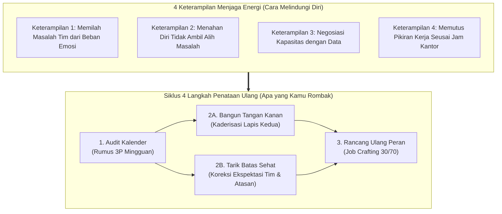
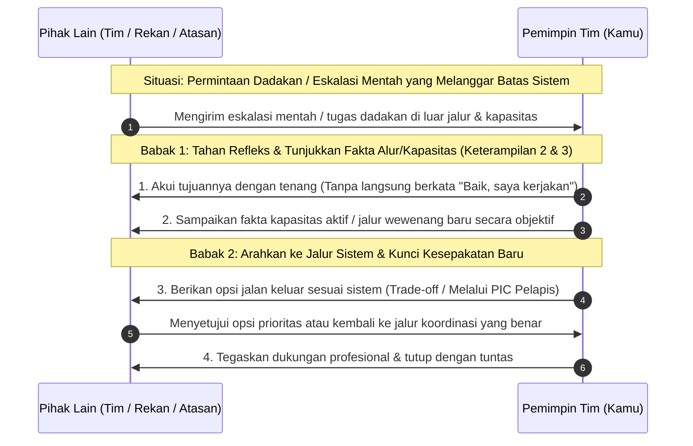
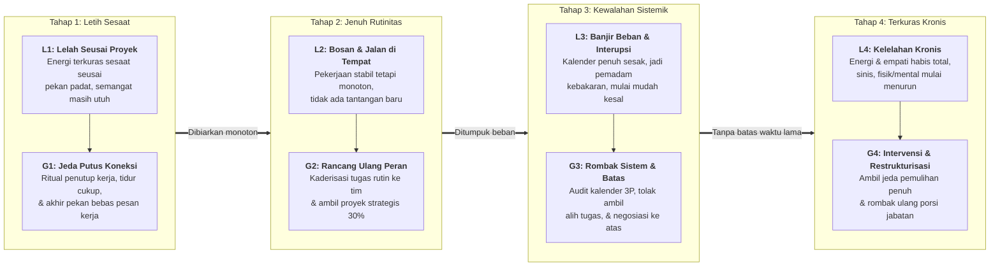

# Napas Panjang Memimpin Tim: Strategi Mengatasi Kejenuhan dan Membangun Sistem Kerja Mandiri

**Ditulis oleh:** `aiossan`</br>
**Ragam Bahasa:** Standar Luwes (`Saya/Kamu` • Baku Tak Kaku)</br>
**Format:** GitHub Flavored Markdown (GFM)

> [!NOTE] Cara Menggunakan Panduan Ini
> Buku kedua ini disusun khusus untuk kamu yang sudah melewati fase adaptasi awal sebagai *team leader*, supervisor, atau manajer, tetapi belakangan mulai merasa kehabisan energi, jenuh terhadap rutinitas kantor, atau terjebak menjadi "pemadam kebakaran" setiap hari. Kamu bisa membacanya secara berurutan dari Pendahuluan hingga Bab 13, membuka bagian lipat (*collapsible sections*) untuk menyalin templat skrip negosiasi beban kerja dan simulasi kasus, atau langsung menuju **Lampiran** saat membutuhkan ringkasan cepat untuk menata ulang ritme kerjamu minggu ini.

## Daftar Isi

1. [Pendahuluan: Saat Jabatan Sudah di Tangan, tetapi Energi Mulai Terkuras](#pendahuluan-saat-jabatan-sudah-di-tangan-tetapi-energi-mulai-terkuras)
2. [Bab 1: Peralihan dari "Pemadam Kebakaran" ke Arsitek Sistem Kerja](#bab-1-peralihan-dari-pemadam-kebakaran-ke-arsitek-sistem-kerja)
3. [Bab 2: Kerangka Kerja 4x4 Ketahanan Diri (4 Langkah Penataan + 4 Keterampilan Menjaga Energi)](#bab-2-kerangka-kerja-4x4-ketahanan-diri-4-langkah-penataan--4-keterampilan-menjaga-energi)
4. [Bab 3: Keterampilan 1: Memilah Masalah Tim dari Beban Emosi Pribadi](#bab-3-keterampilan-1-memilah-masalah-tim-dari-beban-emosi-pribadi)
5. [Bab 4: Keterampilan 2: Menahan Diri agar Tidak Mengambil Alih Masalah (*Anti-Rescue Habit*)](#bab-4-keterampilan-2-menahan-diri-agar-tidak-mengambil-alih-masalah-anti-rescue-habit)
6. [Bab 5: Keterampilan 3: Menegosiasikan Kapasitas ke Atas dengan Data, Bukan Keluhan](#bab-5-keterampilan-3-menegosiasikan-kapasitas-ke-atas-dengan-data-bukan-keluhan)
7. [Bab 6: Keterampilan 4: Memutus Pikiran Kerja Seusai Jam Kantor (*Psychological Detachment*)](#bab-6-keterampilan-4-memutus-pikiran-kerja-seusai-jam-kantor-psychological-detachment)
8. [Bab 7: Langkah 1: Mengaudit Kalender & Memangkas Rutinitas Mubazir (Rumus 3P)](#bab-7-langkah-1-mengaudit-kalender--memangkas-rutinitas-mubazir-rumus-3p)
9. [Bab 8: Langkah 2A: Membangun Tangan Kanan & Kaderisasi Tim (*Bench Strength*)](#bab-8-langkah-2a-membangun-tangan-kanan--kaderisasi-tim-bench-strength)
10. [Bab 9: Langkah 2B: Mengatur Ulang Batas Saat Tim atau Atasan Melewati Batas](#bab-9-langkah-2b-mengatur-ulang-batas-saat-tim-atau-atasan-melewati-batas)
11. [Bab 10: Langkah 3: Merancang Ulang Peran agar Antusiasme Pulih (*Job Crafting* 30/70)](#bab-10-langkah-3-merancang-ulang-peran-agar-antusiasme-pulih-job-crafting-3070)
12. [Bab 11: Studi Kasus & Simulasi 4 Minggu (Rina, Budi, dan Siska)](#bab-11-studi-kasus--simulasi-4-minggu-rina-budi-dan-siska)
13. [Bab 12: Mengenali Sinyal Kejenuhan (Level L1 sampai L4 ke Mode Pemulihan G1 sampai G4)](#bab-12-mengenali-sinyal-kejenuhan-level-l1-sampai-l4-ke-mode-pemulihan-g1-sampai-g4)
14. [Bab 13: Rencana Pemulihan & Penataan Kerja 30 Hari di Kantor](#bab-13-rencana-pemulihan--penataan-kerja-30-hari-di-kantor)
15. [Lampiran: Ringkasan Meja Kerja & Rujukan Riset](#lampiran-ringkasan-meja-kerja--rujukan-riset)

## Pendahuluan: Saat Jabatan Sudah di Tangan, tetapi Energi Mulai Terkuras

Sudah berjalan satu, dua, atau tiga tahun lebih kamu memegang peran sebagai *team leader*, supervisor, atau manajer?

Kalau di tahun pertama dulu tantangan utamamu adalah rasa canggung ketika harus menegur anggota tim atau bingung bagaimana memberi arahan yang jelas, sekarang masalah yang kamu rasakan kemungkinan besar sudah bergeser jauh. Coba perhatikan, manakah situasi di bawah ini yang paling sering kamu alami belakangan ini:

- Bangun tidur setiap Senin pagi dengan perasaan hambar, berat, dan berpikir, *"Aduh, minggu ini harus membereskan drama apa lagi ya di kantor?"*
- Kalender kerjamu penuh sesak oleh rapat koordinasi dari pukul sembilan pagi hingga lima sore, sehingga kamu baru bisa mengerjakan tugas strategismu sendiri setelah jam kantor usai.
- Merasa seperti "bantalan" yang terjepit di tengah: dari atas ditekan target manajemen yang terus meningkat, sedangkan dari bawah diserbu keluhan, revisi, dan kendala harian anggota tim.
- Timmu sebenarnya sudah berjalan cukup stabil, tetapi kamu justru merasa jalan di tempat (*stuck*), tidak lagi mempelajari hal baru, dan kehilangan antusiasme yang dulu membuatmu bersemangat berangkat kerja.
- Meskipun tubuhmu sudah berada di rumah atau sedang berlibur akhir pekan bersama keluarga, pikiranmu masih terus berputar memikirkan pesan pekerjaan, revisi klien, atau target kuartal depan.

Kalau kamu mengangguk saat membaca poin-poin di atas, tarik napas sejenak, ya. <mark>Kamu tidak sendirian, dan kondisi ini bukan berarti kamu berubah menjadi pemimpin yang buruk.</mark>

Apa yang sedang kamu alami adalah **kejenuhan peran kepemimpinan (*leadership plateau & role exhaustion*)**. Di buku pertama, kita sudah membahas cara membangun fondasi komunikasi supaya timmu bisa berjalan dengan baik. Di buku kedua ini, fokus kita naik satu tingkat: **bagaimana menjaga energi, menata ulang sistem kerja, dan memperpanjang napas kepemimpinanmu agar tidak habis terbakar (*burnout*) di tengah jalan.**

Riset dari *Center for Creative Leadership* (<abbr title="Center for Creative Leadership">CCL</abbr>) menunjukkan bahwa pemimpin lini pertama dan menengah adalah kelompok paling rentan mengalami kelelahan kronis di organisasi karena posisi mereka yang terjepit di tengah (*sandwich pressure*): harus menerjemahkan tuntutan eksekutif sekaligus menampung beban operasional harian tim[^4].

Kabar baiknya, ketahanan diri (*resilience*) di tempat kerja bukanlah soal seberapa kuat kamu menahan stres sambil memaksakan diri. Riset psikologi organisasi selama puluhan tahun membuktikan bahwa ketahanan diri seorang pemimpin ditentukan oleh **cara kamu menata batas peran, mendelegasikan sistem kerja, dan memulihkan energi kognitifmu setiap hari**.

Buku ini saya susun sebagai panduan praktis yang bisa langsung kamu terapkan untuk keluar dari jebakan kejenuhan tersebut. Kita akan berfokus pada tiga pilar utama:

1. **4 Langkah Penataan Ulang (*Structural Resets*):** Empat langkah konkret untuk merombak cara kerjamu, mulai dari memangkas isi kalender yang mubazir, menyiapkan tangan kanan (*kaderisasi*), menarik batas yang sehat dengan tim maupun atasan, hingga merancang ulang peranmu (*job crafting*).
2. **4 Keterampilan Menjaga Energi (*Energy Management Skills*):** Empat kebiasaan untuk melindungi kapasitas mentalmu, yaitu memilah masalah pekerjaan dari beban emosi pribadi, menahan diri agar tidak mengambil alih masalah tim, menegosiasikan kapasitas ke atas dengan data, dan memutus pikiran kerja seusai jam kantor.
3. **Kalibrasi Mode Pemulihan (Level L1 sampai L4 ke Mode G1 sampai G4):** Cara mendeteksi sinyal kejenuhan dirimu sendiri (maupun anggota tim seniormu) sejak dini, supaya kamu tahu kapan cukup beristirahat di akhir pekan dan kapan harus merombak total beban kerja.

> [!IMPORTANT] Landasan Riset Panduan Ini
> Seluruh strategi di dalam buku ini berpijak pada riset ilmiah psikologi kerja dan perilaku organisasi: model enam area kehidupan kerja dan kelelahan kronis (*Burnout & Six Areas of Worklife*) dari Profesor Christina Maslach[^1], teori perancangan ulang pekerjaan (*Job Crafting Theory*) dari Amy Wrzesniewski dan Jane Dutton[^2], studi pelepasan psikologis (*Psychological Detachment*) dari Profesor Sabine Sonnentag[^3], serta riset ketahanan pemimpin menengah dan kaderisasi dari *Center for Creative Leadership* (CCL)[^4]. Semuanya saya rangkum ulang ke dalam bahasa kerja sehari-hari yang lugas dan mudah dipraktikkan.

Mari kita bedah akar masalah mengapa banyak pemimpin yang rajin dan peduli justru paling mudah kehabisan energi di **Bab 1**, ya.

## Bab 1: Peralihan dari "Pemadam Kebakaran" ke Arsitek Sistem Kerja

Pernahkah kamu merasa bahwa sehari-hari di kantor, pekerjaanmu lebih mirip petugas pemadam kebakaran daripada seorang pemimpin tim?

Pagi hari baru membuka laptop, sudah ada pesan darurat soal sistem atau pengiriman yang terlambat. Pukul sepuluh pagi, ada dua anggota tim yang salah paham soal pembagian tugas. Siang sedikit, atasanmu mendadak meminta bahan presentasi untuk rapat direksi besok pagi. Sore harinya, kamu masih harus memeriksa laporan rutin yang formatnya masih keliru. Saat kamu menengok jam dinding, tahu-tahu sudah pukul enam sore dan pekerjaan utamamu sendiri belum tersentuh sama sekali.

Ketika kamu baru pertama kali diangkat menjadi *team leader*, turun tangan langsung membereskan setiap masalah kecil adalah hal yang wajar karena kamu sedang membangun kredibilitas dan mengenali medan kerja. Namun, kalau setelah satu atau dua tahun pola kerjamu masih persis seperti itu, tubuh dan pikiranmu pasti akan mengirim sinyal kelelahan.

Studi Profesor Christina Maslach dari University of California, Berkeley, menjelaskan bahwa kelelahan kerja kronis (*burnout*) bukanlah sekadar lelah fisik akibat banyaknya pekerjaan, melainkan respons terhadap **ketidakseimbangan kronis antara tuntutan kerja dan kendali yang kamu miliki atas pekerjaan tersebut**[^1]. Maslach mengidentifikasi tiga gejala utama yang muncul secara berurutan saat seorang pemimpin kehabisan bahan bakar:

1. **Terkurasnya Energi (*Exhaustion*):** Rasa lelah fisik dan mental yang tidak kunjung hilang meskipun kamu sudah tidur panjang di akhir pekan.
2. **Sikap Sinis & Menjaga Jarak (*Cynicism / Depersonalization*):** Kamu mulai kehilangan empati, mudah kesal terhadap pertanyaan anggota tim, sinis terhadap kebijakan perusahaan, dan memilih bekerja sekadar menggugurkan kewajiban (*autopilot*).
3. **Perasaan Tidak Berdaya (*Inefficacy*):** Meskipun bekerja dari pagi hingga malam, kamu merasa tidak menghasilkan dampak yang berarti dan merasa kariermu berjalan di tempat.

### Perbedaan Pemimpin "Pemadam Kebakaran" vs Arsitek Sistem Kerja

Untuk keluar dari lingkaran kejenuhan tersebut, kamu perlu melakukan pergeseran pola pikir yang kedua dalam karier kepemimpinanmu. Kalau dulu di Buku Pertama kamu bergeser dari *bekerja sendiri* ke *mengarahkan tim*, sekarang kamu perlu bergeser dari **Pemadam Kebakaran Harian** menjadi **Arsitek Sistem Kerja**:

| Aspek Pekerjaan | Gaya "Pemadam Kebakaran" (Memicu Kejenuhan) | Gaya Arsitek Sistem (Napas Panjang & Tenang) |
| :--- | :--- | :--- |
| **Sumber Kepuasan Diri** | Merasa berguna ketika terus-menerus dicari tim untuk menyelesaikan masalah. | Merasa berhasil ketika tim mampu menyelesaikan masalah sendiri tanpa harus menunggumu. |
| **Isi Kalender Harian** | Penuh rapat dadakan, revisi mikro, dan interupsi sepanjang hari. | Memiliki blok waktu fokus (*deep work*), rapat yang terstruktur, dan ruang berpikir jangka panjang. |
| **Posisi di Dalam Tim** | Menjadi pusat sumbatan (*bottleneck*): semua keputusan kecil harus melewati mejamu. | Membangun lapis kedua (*kader/tangan kanan*) yang mampu mengambil keputusan operasional. |
| **Cara Merespons Tugas Baru** | Selalu berkata *"Siap, nanti kami usahakan"* kepada atasan meskipun kapasitas tim sudah penuh. | Berani menegosiasikan prioritas dan pertukaran beban (*trade-off*) menggunakan data kapasitas nyata. |

Mengapa banyak *team leader* yang cerdas justru terjebak bertahun-tahun dalam mode Pemadam Kebakaran? Biasanya karena mereka tanpa sadar terjatuh ke dalam salah satu dari dua jebakan psikologis berikut:

#### 1. Jebakan "Pahlawan Kantor" (*The Hero Leader Syndrome*)

Diam-diam, ada rasa bangga ketika kamu menjadi satu-satunya orang yang mampu menyelamatkan proyek di detik terakhir. Kamu merasa kalau tidak ada kamu, tim akan berantakan. Kamu senang dicari, senang ditanyai segala hal, dan enggan melepas wewenang penting kepada anggota tim seniormu.

- **Akibatnya bagimu:** Kamu memang terlihat sibuk dan dibutuhkan, tetapi kamu sedang mengunci dirimu sendiri di dalam sangkar operasional. Kamu sulit dipromosikan ke jabatan yang lebih tinggi (karena tidak ada kader yang siap menggantikan posisimu), dan lama-kelamaan kamu jenuh sendiri karena seluruh beban menumpuk di pundakmu.

#### 2. Jebakan "Bantalan Tanpa Batas" (*The Endless Sponge*)

Karena kamu peduli pada anggota tim dan ingin menjadi atasan yang suportif, kamu menyerap semua keluhan tim sekaligus menelan bulat-bulat seluruh tekanan dari manajemen atas. Kamu merasa sungkan menolak permintaan dadakan dari atasan, dan di saat yang sama kamu tidak tega menuntut anggota timmu untuk naik kelas.

- **Akibatnya bagimu:** Kamu menjadi penyangga emosional yang diperas dari dua arah. Anggota timmu tetap nyaman di zona aman, atasanmu makin sering memberi tugas dadakan karena tahu kamu tidak pernah menolak, sementara kesehatan mental dan waktu istirahatmu sendiri terkikis perlahan.

### Posisi yang Sehat: Membangun Sistem yang Tidak Bergantung Penuh Kepadamu

Ukuran tertinggi keberhasilan seorang *team leader* di tahun kedua dan seterusnya bukanlah seberapa sibuk kamu terlihat di kantor, melainkan <ins>seberapa lancar timmu tetap bisa berjalan dan mengambil keputusan yang tepat saat kamu sedang mengambil cuti seminggu penuh tanpa membuka laptop</ins>.

Pegangan dasarnya sederhana:

> **Berhentilah mengukur nilai dirimu dari seberapa banyak api yang kamu padamkan hari ini; ukurlah dari seberapa tahan api sistem dan kader yang kamu bangun di dalam timmu.**

Agar perubahan ini mudah diterapkan setiap hari di kantor, buku ini merangkum strategi ketahanan diri dan penataan ulang kerja ke dalam **Kerangka Kerja 4x4 Ketahanan Diri**:

1. **4 Langkah Penataan Ulang (Apa yang Perlu Kamu Rombak?):** Empat langkah struktural untuk memangkas beban mubazir, menyiapkan tangan kanan, menarik batas yang sehat, dan menyegarkan kembali peran kerjamu.
2. **4 Keterampilan Menjaga Energi (Bagaimana Cara Melindungi Fokus & Mentalmu?):** Empat kebiasaan harian untuk memilah beban emosi, menolak mengambil alih tugas tim, menegosiasikan beban ke atas dengan data, dan memutus pikiran kerja saat waktunya beristirahat.

Mari kita lihat peta lengkapnya di **Bab 2**.

## Bab 2: Kerangka Kerja 4x4 Ketahanan Diri (4 Langkah Penataan + 4 Keterampilan Menjaga Energi)

Sama seperti saat kamu mempelajari dasar-dasar memimpin di Buku Pertama, keluar dari kejenuhan dan kelelahan kerja juga membutuhkan sistem yang konkret. Seluruh isi buku kedua ini diringkas menjadi **8 kebiasaan praktis** yang terbagi ke dalam dua kelompok:

1. **4 Langkah Penataan Ulang (*Structural Resets*)** - urutan langkah untuk merombak kalender, tim, batas kerja, dan makna peranmu.
2. **4 Keterampilan Menjaga Energi (*Energy Management Skills*)** - empat keterampilan mental dan komunikasi untuk menjaga kapasitas dirimu setiap hari.

Perhatikan bagaimana kedua kelompok ini saling menopang pada diagram berikut:



Cara kerjanya saling mengunci: **kamu menggunakan 4 Keterampilan Menjaga Energi setiap hari supaya 4 Langkah Penataan Ulang yang kamu bangun tidak runtuh kembali saat pekerjaan kantor sedang padat-padatnya.**

> [!NOTE]
> Penjelasan lengkap mengenai `Rumus 3P` (Pangkas, Pindahkan, Pertahankan) akan kita bahas di Bab 7.

### Empat Langkah Penataan Ulang dalam Siklus Kerja

- **1. Mengaudit Kalender & Memangkas Rutinitas Mubazir (Rumus 3P)**
  Langkah awal untuk membebaskan minimal 4 sampai 6 jam waktu kerjamu setiap minggu dengan cara menyaring ulang rapat, laporan, dan proses persetujuan (*approval*) menggunakan Rumus 3P: **Pangkas**, **Pindahkan**, dan **Pertahankan**.
- **2A. Membangun Tangan Kanan & Kaderisasi Tim (*Bench Strength*)**
  Langkah proaktif memilih dan melatih 1 sampai 2 anggota tim senior (level L3/L4) untuk menjadi lapis kedua yang mampu mewakilimu memimpin rapat harian, memeriksa kualitas pekerjaan rekan-rekannya, dan mengambil keputusan operasional.
- **2B. Mengatur Ulang Batas Saat Tim atau Atasan Melewati Batas (*Boundary Reset*)**
  Langkah tegas namun tetap profesional ketika anggota tim mulai kembali bergantung penuh kepadamu, atau ketika atasan maupun divisi lain terus-menerus memberikan pekerjaan dadakan di luar jam dan kapasitas yang wajar.
- **3. Merancang Ulang Peran agar Antusiasme Pulih (*Job Crafting* 30/70)**
  Langkah evaluasi berkala bagi dirimu sendiri: membatasi urusan pemeliharaan rutin cukup di 70% kapasitas, dan mengalokasikan 30% energi terbaikmu untuk proyek strategis, inovasi, atau pengembangan diri yang membuatmu kembali bersemangat.

> [!TIP] Jangan Membalik Urutan Ini
> Banyak pemimpin yang sedang jenuh langsung ingin mencoba hal baru atau mengambil proyek tambahan yang menarik (Langkah 3), padahal kalendernya masih penuh sesak dan belum memiliki tangan kanan di dalam tim. Akibatnya justru makin kelelahan. Bersihkan dulu kalendermu (Langkah 1), bangun kader dan batas kerja (Langkah 2A & 2B), barulah isi ruang waktu yang tercipta dengan inisiatif baru yang bermakna (Langkah 3), ya.

### Empat Keterampilan Menjaga Energi Sehari-hari

Untuk menjalankan keempat langkah perombakan di atas tanpa rasa bersalah atau khawatir dianggap lepas tangan, kamu memerlukan empat keterampilan dasar ini:

1. **Memilah Masalah Tim dari Beban Emosi Pribadi:** Mendengarkan dan membantu mengurai kendala kerja anggota tim dengan empati yang sehat, tanpa ikut menyerap rasa panik, kesal, atau drama emosionalnya ke dalam pikiranmu sendiri.
2. **Menahan Diri agar Tidak Mengambil Alih Masalah (*Anti-Rescue Habit*):** Menghentikan kebiasaan keliru mengambil alih tugas anggota tim yang sedang mengeluh kesulitan, sehingga masalah mereka tidak berpindah menjadi beban lemburmu.
3. **Menegosiasikan Kapasitas ke Atas dengan Data, Bukan Keluhan:** Cara berbicara kepada atasan atau klien saat kapasitas tim sudah penuh, dengan menyodorkan fakta kapasitas aktif dan pilihan pertukaran prioritas (*trade-off*), bukan sekadar mengeluh lelah.
4. **Memutus Pikiran Kerja Seusai Jam Kantor (*Psychological Detachment*):** Keterampilan menutup pikiran tentang pekerjaan begitu jam kantor berakhir, supaya otak dan sistem sarafmu benar-benar pulih sebelum kembali memimpin keesokan paginya.

Di **Bagian 2 (Bab 3 sampai Bab 6)**, kita akan melatih keempat *Keterampilan Menjaga Energi* ini satu per satu lengkap dengan contoh kalimatnya. Setelah itu, di **Bagian 3 (Bab 7 sampai Bab 10)** kita langsung mempraktikkan keempat *Langkah Penataan Ulang*-nya.

## Bab 3: Keterampilan 1: Memilah Masalah Tim dari Beban Emosi Pribadi

Pernahkah kamu seusai sesi *one-on-one* atau setelah mendengarkan keluhan anggota tim yang sedang stres berat, orang tersebut keluar ruangan dengan wajah lega, tetapi giliran kamu yang duduk lemas, pusing, dan kepikiran sampai malam?

Kalau pernah, artinya kamu baru saja mengalami **penularan emosi (*emotional contagion*)**. Sebagai pemimpin yang baik, kamu tentu ingin hadir dan menyimak keluhan timmu. Namun, kalau kamu tidak memiliki penyaring mental yang sehat, kamu akan berubah menjadi penampung beban emosional seluruh divisi.

Riset Profesor Christina Maslach menunjukkan bahwa kelelahan emosional (*emotional exhaustion*) adalah pintu masuk utama menuju *burnout* parah pada peran yang menuntut interaksi intens dengan orang lain, termasuk manajer lini pertama dan menengah[^1]. Pemimpin yang bertahan lama bukanlah pemimpin yang dingin seperti robot, melainkan pemimpin yang mampu membedakan antara **kepedulian kognitif (memahami duduk masalah dan membantu mencari jalan keluar)** dan **penyerapan emosional (ikut larut dalam rasa panik dan frustrasi lawan bicara)**.

### Tiga Kebiasaan yang Membuat Emosimu Ikut Terkuras

Coba perhatikan cara kamu merespons ketika ada anggota tim atau rekan kerja datang dengan nada panik, marah, atau mengeluh panjang lebar:

- **Ikut panik saat tim panik:** Ketika anggota tim melapor, *"Kak, gawat! Klien meminta revisi besar padahal besok pagi harus tayang!"*, jantungmu langsung ikut berdebar kencang, nada suaramu ikut naik, dan kamu langsung menyebarkan kepanikan itu ke seluruh grup tim.
- **Merasa bertanggung jawab atas suasana hati semua orang:** Kalau ada satu anggota tim yang hari itu tampak murung atau diam, kamu langsung gelisah seharian, menebak-nebak apakah kamu salah bicara, dan merasa gagal menjadi atasan kalau belum membuatnya tersenyum kembali.
- **Menampung sesi "keluhan melingkar" tanpa ujung:** Kamu membiarkan diskusi koordinasi kerja berubah menjadi sesi mengeluh selama 45 menit yang isinya berputar-putar menyalahkan divisi lain atau keadaan, tanpa ada satu pun langkah solusi yang disepakati.

Ketiga kebiasaan ini membuat baterai mentalmu habis sebelum jam makan siang, padahal masalah teknisnya sendiri belum tentu seberat itu.

### Tiga Langkah Praktis Memilah Fakta dari Beban Emosi

Agar kamu tetap menjadi pemimpin yang hangat dan suportif tanpa ikut tenggelam di dalam pusaran emosi, biasakan tiga langkah ini:

#### 1. Pasang "Kaca Pelindung Mental" (*Observe, Don't Absorb*)

Saat anggota tim datang dengan emosi tinggi (entah panik, kesal, atau kecewa), bayangkan ada kaca bening di antara kamu dan dirinya. Kamu bisa melihat jelas ekspresinya dan mendengar suaranya, tetapi "asap" kepanikannya tidak menembus ke dalam dirimu.

- Sadari di dalam kepalamu: *"Ia sedang panik karena belum melihat jalan keluarnya. Tugasku adalah tetap tenang supaya salah satu dari kami bisa berpikir jernih."*
- Turunkan tempo bicara dan volume suaramu sekitar 20% lebih pelan dari biasanya. Dalam psikologi komunikasi, ketenangan sama menularnya dengan kepanikan.

#### 2. Validasi Perasaannya Secara Singkat, Lalu Jangkar ke Fakta

Kamu tidak perlu mendebat perasaannya (*"Ah, begitu saja kok panik!"*), tetapi jangan pula ikut mengompori (*"Iya, klien itu memang menyebalkan sekali dari dulu!"*). Cukup akui perasaannya dalam **satu kalimat singkat**, lalu langsung arahkan diskusi pada fakta pekerjaan yang bisa dikendalikan:

- *"Saya paham situasi ini membuat frustrasi karena kita sudah bekerja keras menyiapkan drafnya. Sekarang, mari kita bedah: dari lima poin revisi klien tadi, mana dua poin yang paling krusial untuk besok pagi?"*
- *"Wajar kalau kamu kesal karena datanya terlambat dikirim oleh tim sebelah. Supaya waktu kita tidak habis untuk menunggu, bagian mana dari laporan ini yang bisa kita selesaikan lebih dulu dengan data yang sudah ada?"*

#### 3. Batasi Durasi Keluhan dengan Aturan "5 Menit Lepas Uap"

Kalau anggota timmu memang sedang butuh mengeluarkan unek-unek, berikan ruang secara sadar tetapi batasi waktunya agar tidak berubah menjadi sesi keluhan tanpa akhir:

- *"Oke, silakan keluarkan dulu semua hal yang membuatmu kesal soal kejadian tadi selama 5 menit. Saya dengarkan. Setelah 5 menit, kita fokus 100% menyusun langkah perbaikannya, ya."*

Begitu batas 5 menit lewat, tarik garis tegas menuju tindakan. Dengan cara ini, anggota tim tetap merasa didengarkan, sementara pikiranmu tetap jernih dan terlindung dari kelelahan emosional.

### Perbandingan Respons di Kantor (Keterampilan 1)

| Hindari Respons Ini (Menguras Energi) | Gunakan Respons Ini (Empati Sehat & Menjaga Energi) |
| :--- | :--- |
| *"Aduh, celaka kita! Mengapa bisa terjadi seperti ini?! Lalu bagaimana?!"* (Ikut panik) | *"Oke, tarik napas dulu. Ceritakan kepada saya fakta kejadiannya satu per satu supaya kita bisa melihat solusinya."* |
| Ikut mengomel selama 30 menit bersama tim menyalahkan divisi lain. | *"Saya paham keterlambatan mereka membuat jadwal kita sempit. Sekarang, apa langkah yang berada di dalam kendali tim kita hari ini?"* |
| Kepikiran seharian saat melihat staf tampak kurang bersemangat. | Tanyakan singkat secara empat mata: *"Pagi ini kamu tampak agak lelah, apakah ada kendala pekerjaan yang perlu saya ketahui?"* Bila ia menjawab aman, percayalah dan lanjutkan fokus kerjamu. |
| Membiarkan rapat *1-on-1* berubah menjadi sesi keluhan tanpa kesimpulan. | *"Terima kasih sudah bercerita secara terbuka. Agar bebanmu berkurang secara nyata, satu tindakan apa yang kita sepakati untuk diselesaikan minggu ini?"* |

### Latihan Praktik Bab 3

Minggu ini, latih keterampilan memilah emosi dan fakta melalui tiga langkah berikut:

- [ ] **Praktikkan "Kaca Pelindung" minimal 1 kali:** Saat ada yang datang membawa kabar mendadak atau keluhan dengan nada tinggi, sengaja pelankan suaramu dan ambil satu tarikan napas dalam sebelum menanggapi.
- [ ] **Gunakan rumus "1 Kalimat Validasi + Geser ke Fakta":** Batasi kalimat empati pada satu kalimat pembuka, lalu langsung ajukan pertanyaan tentang fakta yang bisa dikendalikan hari ini.
- [ ] **Periksa residu emosi di sore hari:** Sebelum menutup laptop, tanyakan pada dirimu sendiri: *"Masalah mana di kepalaku sore ini yang memang murni tanggung jawabku, dan mana yang hanya beban emosi orang lain yang tidak sengaja kubawa pulang?"*

## Bab 4: Keterampilan 2: Menahan Diri agar Tidak Mengambil Alih Masalah (*Anti-Rescue Habit*)

Coba bayangkan adegan klasik di ruang kerja atau di grup percakapan ini:

Anggota timmu, sebut saja Dani, menghampiri mejamu sambil berkata, *"Kak, saya menemui kendala dengan vendor percetakan. Mereka mengabari bahwa bahan kertas yang kita pilih kemarin habis, dan saya bingung harus menggantinya dengan spesifikasi yang mana."*

Karena kamu sedang terburu-buru hendak masuk ke rapat lain, kamu menjawab, *"Oke, coba kirimkan nomor kontak vendornya dan berkas spesifikasinya ke saya. Biar nanti siang saya yang telepon dan periksa dulu ya, nanti saya kabari kamu."*

Perhatikan apa yang baru saja terjadi dalam waktu 30 detik tersebut:

1. Sebelum berbicara, masalah itu berada di pundak Dani.
2. Setelah berbicara, masalah itu berpindah ke pundakmu.
3. Dani sekarang berubah menjadi pengawas yang dengan santai menanyakan kabar darimu: *"Kak, bagaimana? Sudah dihubungi belum vendornya?"*

Kalau kamu memimpin 6 anggota tim, dan setiap hari masing-masing dari mereka menitipkan 2 masalah ke mejamu dengan cara seperti itu, pada hari Jumat kamu akan mengurusi 60 masalah orang lain sambil lembur sendirian, sementara anggota timmu pulang tepat waktu pukul lima sore!

> [!WARNING] Bahaya Refleks "Penyelamat" (*The Rescuer Trap*)
> Setiap kali kamu mengambil alih tugas atau masalah yang sebenarnya merupakan bagian dari tanggung jawab anggota timmu, kamu sedang mengajarkan dua kebiasaan buruk sekaligus: (1) kalau menemui tugas sulit, cukup mengeluh kepada *leader* maka tugasnya akan diambil alih, dan (2) kapasitas waktumu sendiri boleh dikorbankan kapan saja.

### Tiga Kalimat Jebakan yang Membuat Tugas Tim Pindah ke Mejamu

Waspadai tiga kalimat otomatis yang sering keluar dari mulut pemimpin yang sedang lelah atau kurang sabar:

- *"Ya sudah, kirimkan saja berkasnya ke saya, biar saya perbaiki sekalian."* (Karena kamu merasa lebih cepat mengerjakannya sendiri selama 15 menit daripada menjelaskan ulang).
- *"Nanti biar saya yang coba tanyakan dulu ke divisi keuangan, ya."* (Padahal anggota timmu sendiri yang memegang proyek tersebut dan bisa langsung berkoordinasi).
- *"Taruh saja dulu di meja saya, nanti malam saya pikirkan jalan keluarnya."* (Mengubah dirimu menjadi tempat parkir masalah seluruh tim).

### Tiga Langkah Praktis Menolak Mengambil Alih Masalah (Tanpa Terkesan Lepas Tangan)

Menolak mengambil alih masalah bukan berarti kamu acuh tak acuh atau menelantarkan tim. Kamu tetap hadir membimbing, tetapi **kepemilikan tugasnya tidak boleh berpindah tangan kepadamu sedetik pun**. Gunakan tiga langkah ini:

#### 1. Pastikan "Bola Langkah Berikutnya" Tetap di Tangan Anggota Tim

Prinsip utamanya tegas: **di akhir setiap diskusi konsultasi, orang yang keluar ruangan sambil membawa daftar tindakan berikutnya (*next action*) haruslah anggota timmu, bukan kamu.**

Saat Dani datang membawa masalah kertas vendor tadi, tahan tanganmu agar tidak mengambil berkasnya. Bantu ia berpikir di tempat selama 3 menit, lalu pastikan Dani sendiri yang menghubungi vendornya:

- *"Oke Dan, dari katalog alternatif yang diberikan vendor, mana dua jenis kertas yang paling mendekati anggaran kita? Coba kamu minta rincian harganya kepada mereka siang ini, lalu bawa dua opsinya kepada saya pukul tiga sore nanti, ya."*

#### 2. Terapkan Aturan "Bawa Minimal 2 Opsi Sebelum Melapor Mentok"

Supaya anggota tim tidak sedikit-sedikit melempar masalah mentah ke mejamu, sepakati aturan main yang sehat di dalam tim: setiap kali hendak melakukan eskalasi masalah, mereka wajib menyiapkan minimal **1 atau 2 usulan solusi** versi mereka sendiri:

- *"Saya siap membantu kamu memutuskan. Namun sesuai kesepakatan tim kita, sebelum saya memberikan keputusan, apa dua opsi jalan keluar yang sudah kamu pertimbangkan beserta kelebihan dan kekurangannya?"*

Kalau mereka datang dengan tangan kosong tanpa analisis sama sekali, mintalah mereka kembali ke meja kerja selama 15 menit untuk menyusun dua opsi lebih dulu, baru kembali berdiskusi denganmu.

#### 3. Batasi Bantuanmu Hanya pada Hal yang Membutuhkan Otoritas Jabatanmu

Kapan seorang *team leader* baru perlu turun tangan secara langsung? Hanya apabila hambatannya memang **membutuhkan wewenang jabatanmu** yang tidak dimiliki oleh anggota tim (misalnya persetujuan anggaran di atas batas wewenang staf, atau penyelesaian kebuntuan antar-kepala divisi). Selama tindakan tersebut masih bisa dilakukan oleh staf (menghubungi vendor, menyusun draf revisi, meminta data kepada rekan selevel di divisi lain), biarkan mereka yang mengeksekusinya.

### Perbandingan Tindakan di Kantor (Keterampilan 2)

| Hindari Kebiasaan Mengambil Alih Ini | Gunakan Kebiasaan Pelatih Mandiri Ini |
| :--- | :--- |
| *"Sini biar saya ketik ulang bagian analisisnya supaya cepat selesai."* | *"Bagian kesimpulan di halaman 2 ini masih kurang angka perbandingannya. Tolong kamu lengkapi dulu memakai data kuartal lalu, pukul 14.00 kita periksa kembali, ya."* |
| *"Oke, nanti malam saya pikirkan solusinya lalu saya kabari kamu besok."* | *"Mari kita bedah 5 menit sekarang. Menurut kamu, langkah pertama apa yang paling masuk akal kamu jalankan sore ini untuk mengurai kemacetannya?"* |
| Menerima limpahan koordinasi: *"Biar saya saja yang menghubungi tim desain."* | *"Kamu adalah penanggung jawab proyek ini. Coba kamu hubungi langsung rekan tim desainnya, sepakati jadwal revisinya, dan kabari saya kalau memerlukan bantuan eskalasi."* |
| Langsung mengerjakan tugas staf yang mengaku "belum mengerti caranya". | *"Buka laptopmu di sebelah saya, coba kamu kerjakan langkah pertamanya sambil saya pandu secara lisan. Supaya minggu depan kamu sudah lancar mengerjakannya sendiri."* |

### Latihan Praktik Bab 4

Selama seminggu ke depan, jaga pundakmu tetap bebas dari limpahan masalah tim melalui tiga latihan ini:

- [ ] **Audit daftar tugasmu hari ini:** Periksa daftar pekerjaanmu sekarang. Tandai mana tugas yang sebenarnya merupakan porsi anggota tim tetapi tidak sengaja kamu ambil alih minggu lalu, lalu kembalikan kepemilikannya kepada mereka hari ini.
- [ ] **Hindari kalimat *"Sini biar saya saja"*:** Selama 5 hari kerja ke depan, tahan diri 100% dari mengucapkan kalimat *"Sini berkasnya biar saya saja yang perbaiki"*.
- [ ] **Kunci pemilik *Next Action* di akhir diskusi:** Setiap kali selesai membahas kendala bersama anggota tim, tutup dengan kalimat: *"Baik, berarti langkah berikutnya yang akan kamu jalankan siang ini adalah X, dan kamu akan mengabari saya hasilnya pukul Y, ya."*

## Bab 5: Keterampilan 3: Menegosiasikan Kapasitas ke Atas dengan Data, Bukan Keluhan

Salah satu penyebab terbesar *team leader* merasa jenuh, sinis, dan kehabisan napas adalah perasaan tidak berdaya saat berhadapan dengan atasan atau manajemen puncak.

Bayangkan situasi ini: timmu sedang bekerja keras mengejar tiga proyek besar yang tenggatnya (*deadline*) bersamaan di akhir bulan. Tiba-tiba pada hari Rabu siang, Manajer Divisi atau Direktur memanggilmu dan berkata, *"Tolong tim kamu garap proyek tambahan X ini, ya. Harus tayang minggu depan karena penting untuk kuartal ini."*

Saat menghadapi situasi seperti itu, kebanyakan *team leader* jatuh ke dalam salah satu dari dua respons ekstrem yang sama-sama merugikan:

1. **Asal Atasan Senang (Pasrah Menelan Beban):** Kamu menjawab *"Siap Pak/Bu, kami usahakan!"* sambil tersenyum getir. Begitu kembali ke meja tim, kamu terpaksa meminta anggota timmu lembur lagi, atau kamu sendiri yang mengerjakan proyek tambahan itu sampai larut malam.
2. **Menolak dengan Keluhan Emosional (Terkesan Defensif):** Kamu langsung memprotes dengan nada mengeluh, *"Waduh Pak, tim saya sudah lelah sekali, pekerjaan kami sudah menumpuk, tidak mungkin sanggup!"* Di telinga manajemen, respons tanpa data seperti ini sering terdengar seperti alasan orang yang kurang sigap.

Riset Christina Maslach mengenai enam area kehidupan kerja (*Six Areas of Worklife*) menegaskan bahwa kemampuan pekerja dan manajer untuk memiliki **kendali (*control*) atas beban kerja (*workload*)** adalah penentu utama apakah seseorang akan bertahan sehat atau tumbang akibat *burnout*[^1]. Dan kunci untuk memiliki kendali di hadapan atasan bukanlah dengan mengeluh, melainkan dengan **menyajikan transparansi kapasitas serta pilihan pertukaran prioritas (*trade-off*) berbasis data**.

### Prinsip Dasar: Atasanmu Jarang Menghafal Rincian Beban Harian Timmu

Satu fakta kantor yang perlu kamu pegang: ketika atasanmu memberikan tugas dadakan, 90% kemungkinannya bukan karena ia sengaja ingin membebani timmu, melainkan karena **ia tidak melihat rincian alokasi jam kerja timmu di dalam kepalanya.** Di kepala atasanmu, ia hanya melihat masalah baru yang perlu diselesaikan, dan ia mengingatmu sebagai pemimpin tim yang bisa diandalkan.

Jadi, tugasmu bukanlah marah atau pasrah, melainkan **memperlihatkan peta kapasitas timmu secara objektif dan mengajak atasan ikut menentukan konsekuensi pilihan prioritasnya**.

### Tiga Langkah Negosiasi Kapasitas dengan Bahasa Pertukaran (*Trade-Off*)

Gunakan rumus **"Ya untuk Prioritas Baru, dengan Menggeser Prioritas Lama"** melalui tiga langkah ini:

#### 1. Terima Urgensinya dan Tunjukkan Kesiapan Membantu

Jangan pernah membuka kalimat dengan kata *"Tidak bisa"* atau *"Tidak sanggup"*. Bukalah dengan mengakui pentingnya proyek yang dibawa atasanmu supaya ia merasa didukung:

- *"Baik Pak/Bu, saya menangkap proyek X ini memang strategis untuk mengejar target kuartal ini. Mari kita lihat cara paling aman untuk memasukkan tugas ini ke dalam jadwal tim."*

#### 2. Tunjukkan Fakta Kapasitas Aktif Tim Secara Spesifik (Bukan Kata "Sibuk")

Jangan menggunakan kata sifat yang kabur seperti *"sibuk sekali"*, *"kewalahan"*, atau *"menumpuk"*. Sebutkan **nama proyek aktif, jumlah anggota tim yang menangani, dan tanggal tenggatnya**:

- *"Saat ini kapasitas 4 anggota tim kita sedang terpakai 100% pada tiga proyek utama yang sudah Bapak/Ibu kunci minggu lalu: (1) Peluncuran Produk A yang tenggatnya Jumat ini (ditangani Budi & Siska), (2) Audit Data Klien B yang jatuh tempo Senin depan (ditangani Dani), dan (3) Laporan Bulanan Divisi."*

#### 3. Sodorkan Pilihan Pertukaran Prioritas (*Trade-Off Options*) kepada Atasan

Di sinilah letak kunci negosiasinya. Karena jam kerja sehari tetap terbatas, masuknya tugas baru secara matematis harus menggeser salah satu tugas lama, menambah sumber daya, atau menyederhanakan cakupan (*scope*). Mintalah atasanmu yang memilih:

- *"Kalau proyek tambahan X ini perlu kita selesaikan minggu depan dengan standar kualitas penuh, ada tiga opsi yang bisa kita ambil sekarang, Pak/Bu:*
  - ***Opsi A (Geser Jadwal):*** *Kita langsung kerjakan Proyek X minggu ini, dan jadwal Audit Data Klien B kita geser mundur 4 hari ke Jumat depan.*
  - ***Opsi B (Sederhanakan Cakupan / Versi Minimum):*** *Semua jadwal tetap berjalan, tetapi untuk Proyek X minggu depan kita rilis versi ringkasnya lebih dulu (3 halaman inti), baru sisanya menyusul bulan depan.*
  - ***Opsi C (Tambah Bantuan Lintas Tim):*** *Kita meminjam 1 staf dari tim sebelah untuk membantu mengolah data dasarnya.*
  *Dari sudut pandang prioritas manajemen, opsi mana yang paling tepat kita ambil, Pak/Bu?"*

Perhatikan betapa tenangnya kalimat di atas. Kamu tidak menolak perintah dan tidak mengeluh lelah, tetapi kamu mengembalikan keputusan prioritas kepada atasanmu dengan data yang jelas.

### Perbandingan Kalimat di Kantor (Keterampilan 3)

| Hindari Respons Ini kepada Atasan / Klien | Gunakan Negosiasi Berbasis Data Ini |
| :--- | :--- |
| *"Siap Pak, nanti kami kerjakan!"* (Padahal kapasitas sudah melewati batas 120%) | *"Baik Pak, proyek ini penting. Supaya hasilnya tetap rapi, mari kita sesuaikan antrean proyek yang sedang berjalan."* |
| *"Tim saya sudah lembur terus Pak minggu ini, kasihan kalau ditambah lagi."* (Mengeluh tanpa solusi) | *"Saat ini 100% jam kerja tim terikat pada Proyek A dan B yang tenggatnya Jumat. Kalau Proyek C masuk sekarang, mana di antara A atau B yang aman kita mundurkan 3 hari?"* |
| *"Wah, tidak mungkin selesai kalau hanya diberi waktu 3 hari!"* (Menolak mentah-mentah) | *"Dengan waktu 3 hari kerja, cakupan yang realistis kita selesaikan secara akurat adalah bagian 1 dan 2. Bagian 3 bisa kita susulkan pada tahap kedua hari Rabu depan."* |
| Menggerutu di belakang layar bersama anggota tim soal atasan yang gemar memberi tugas dadakan. | Menyiapkan papan antrean proyek (*project tracker*) yang transparan dan selalu ditunjukkan setiap kali atasan meminta tambahan tugas. |

### Latihan Praktik Bab 5

Minggu ini, latih keterampilan negosiasi kapasitasmu melalui tiga langkah berikut:

- [ ] **Buat Daftar Kapasitas Aktif 1 Halaman:** Tulis daftar seluruh proyek aktif timmu minggu ini lengkap dengan nama penanggung jawab dan tanggal tenggatnya, agar siap ditunjukkan dalam 10 detik kapan pun atasan bertanya.
- [ ] **Hapus kata "Sibuk" dan "Lelah" saat berbicara ke atas:** Ganti keluhan emosional dengan kalimat berbasis angka dan jadwal (*"Saat ini 40 jam kerja Budi minggu ini sudah teralokasi untuk proyek A dan B"*).
- [ ] **Praktikkan Rumus 3 Opsi Pertukaran (*Trade-Off*):** Saat ada permintaan dadakan minggu ini, sodorkan opsi **Geser Jadwal Tugas Lama**, **Sederhanakan Cakupan Tugas Baru**, atau **Tambah Sumber Daya**.

## Bab 6: Keterampilan 4: Memutus Pikiran Kerja Seusai Jam Kantor (*Psychological Detachment*)

Pernahkah kamu sedang makan malam bersama keluarga atau bersantai di hari Sabtu, tubuhmu memang duduk di kursi ruang makan, tetapi jarimu setiap lima menit memeriksa grup WhatsApp kantor dan pikiranmu sibuk menyusun kalimat balasan email untuk hari Senin?

Di era kerja hibrida dan ponsel pintar saat ini, musuh terbesar ketahanan diri seorang *team leader* bukanlah jam kerja fisik di kantor, melainkan **ketidakmampuan memutus sambungan pikiran dari pekerjaan setelah jam kerja selesai**.

Riset komprehensif dari Profesor Sabine Sonnentag dan Charlotte Fritz (2015) yang merangkum puluhan studi pemulihan stres kerja membuktikan satu temuan penting: **istirahat fisik saja tidak cukup untuk mencegah *burnout* apabila tidak disertai pelepasan psikologis (*psychological detachment*)**[^3]. Pelepasan psikologis berarti kamu berhenti memikirkan, merencanakan, atau mencemaskan urusan pekerjaan di luar jam kerja.

Studi Sonnentag menunjukkan bahwa ketika otakmu terus-menerus memikirkan masalah kantor di malam hari (meskipun kamu tidak sedang mengetik di depan laptop), sistem saraf simpatik dan hormon stres (kortisol) di dalam tubuhmu tetap aktif bekerja persis seperti saat kamu sedang memimpin rapat tegang di kantor[^3]. Akibatnya, kamu bangun keesokan paginya dengan baterai mental yang masih kosong.

### Tiga Kebiasaan yang Membuat Otakmu "Bekerja 24 Jam"

Mengapa banyak *team leader* sulit sekali mematikan saklar pekerjaan di kepala mereka? Biasanya karena tiga kebiasaan ini:

- **Meninggalkan pekerjaan dalam kondisi "menggantung" di sore hari:** Kamu langsung menutup laptop pukul enam sore saat pekerjaan sedang ruwet-ruwetnya tanpa menulis rangkuman sampai di mana progresmu tadi dan apa yang harus dilanjutkan besok pagi. Akibatnya, sepanjang malam pikiran bawah sadarmu terus berputar mencoba "mengingat-ingat" pekerjaan yang belum tuntas tersebut (dikenal dalam psikologi sebagai *Zeigarnik Effect*).
- **Menjadikan pemeriksaan pesan malam hari sebagai pelarian kecemasan:** Kamu membuka grup percakapan kantor pukul sembilan malam bukan karena ada kondisi darurat, melainkan karena cemas ketinggalan informasi. Ironisnya, begitu kamu melihat ada pesan masuk dari klien atau atasan di malam hari, kamu justru kepikiran sampai sulit tidur.
- **Ikut membudayakan pengiriman instruksi kepada tim di luar jam kerja:** Karena baru teringat sesuatu pukul sepuluh malam, kamu langsung mengirim pesan kepada anggota timmu malam itu juga. Akibatnya, anggota timmu ikut merasa tegang dan membalas bertanya, lalu terjadilah diskusi kerja tengah malam yang merusak waktu istirahat kalian bersama.

### Tiga Langkah Praktis Memutus Pikiran Kerja (*Shutdown Ritual*)

Supaya otakmu benar-benar bisa beristirahat dan kembali segar keesokan paginya, bangun tiga kebiasaan penutup hari ini:

#### 1. Lakukan "Ritual Penutup Kerja" 10 Menit Sebelum Pulang

Jangan pernah menutup laptop secara mendadak saat sedang berada di tengah kalimat. Sisihkan 10 menit terakhir sebelum jam kerjamu berakhir untuk melakukan tiga hal singkat ini:

1. Periksa kalender besok pagi supaya tidak ada jadwal pagi yang mengejutkanmu.
2. Tulis **3 Prioritas Utama Besok Pagi** di buku catatan atau aplikasi daftar tugasmu, lengkap dengan langkah pertama yang akan kamu kerjakan pukul sembilan pagi besok.
3. Tutup semua *tab* pekerjaan di peramban, kunci layar laptop (<kbd>Win</kbd> + <kbd>L</kbd> atau <kbd>Cmd</kbd> + <kbd>Ctrl</kbd> + <kbd>Q</kbd>), dan ucapkan kalimat penutup di dalam hati: *"Pekerjaan hari ini selesai. Sisanya sudah tercatat aman untuk besok pagi pukul sembilan."*

Begitu otakmu melihat daftar rencana besok pagi sudah tertulis rapi, pikiranmu berhenti merasa wajib "menjaga" ingatan tersebut sepanjang malam.

#### 2. Gunakan Fitur Kirim Terjadwal (*Scheduled Send*) & Pisahkan Saluran Darurat

Banyak pemimpin ragu mematikan notifikasi pesan kerja di malam hari karena berpikir, *"Bagaimana kalau ada kondisi darurat yang nyata?"*

Solusinya sederhana: **pisahkan saluran komunikasi rutin (pesan teks/email) dari saluran darurat (panggilan telepon langsung).** Sepakati aturan yang jelas bersama timmu:

- *"Teman-teman, di atas pukul 18.30 WIB dan di akhir pekan, saya mematikan notifikasi grup percakapan dan email supaya kita semua bisa beristirahat dengan baik. Kalau terpikir ide atau laporan di malam hari, silakan gunakan fitur Kirim Terjadwal (*Scheduled Send*) untuk besok pagi pukul 08.30. Kalau ada insiden darurat yang benar-benar tidak bisa menunggu besok pagi (misalnya sistem utama mati total), silakan langsung telepon nomor ponsel saya."*

Dengan kesepakatan ini, kamu bisa tenang mematikan notifikasi aplikasi kerja tanpa rasa cemas, karena kamu tahu selama ponselmu tidak berdering oleh panggilan telepon, berarti urusan kantor aman terkendali.

#### 3. Pasang "Kegiatan Penyangga" (*Transition Buffer*) Antara Kantor dan Rumah

Otak manusia membutuhkan jembatan transisi untuk berpindah dari peran "Manajer Pengambil Keputusan" kembali menjadi "Pribadi di Rumah". Terlebih apabila kamu bekerja dari rumah (*WFH*) di mana meja kerja hanya berjarak beberapa langkah dari ruang keluarga.

Buatlah satu aktivitas fisik singkat selama 15 sampai 20 menit tepat setelah jam kerja berakhir sebagai penanda batas waktu:

- Berjalan kaki mengelilingi lingkungan rumah tanpa membawa ponsel kerja, berolahraga ringan, mandi air hangat sambil mendengarkan musik, atau segera berganti pakaian kerja begitu tiba di rumah.

### Perbandingan Kebiasaan di Kantor (Keterampilan 4)

| Hindari Kebiasaan Ini (Memicu Kelelahan Kronis) | Gunakan Kebiasaan Ini (Pulih Maksimal Setiap Malam) |
| :--- | :--- |
| Langsung menutup laptop saat sedang pusing, lalu kepikiran pekerjaan di meja makan. | Luangkan 10 menit terakhir untuk menulis **3 Prioritas Besok Pagi** di catatan sebelum menutup laptop. |
| Mengirim pesan kepada anggota tim pukul 22.00 malam hanya karena takut lupa besok pagi. | Tulis pesannya sekarang, lalu gunakan fitur **Kirim Terjadwal (*Scheduled Send*)** untuk pukul 08.30 besok pagi. |
| Tetap menyalakan notifikasi aplikasi kerja dan email kantor di layar kunci ponsel sepanjang malam. | Matikan notifikasi aplikasi kerja di atas pukul 18.30, dan sepakati bahwa urusan darurat murni wajib melalui panggilan telepon. |
| Berbaring di tempat tidur sambil membaca dokumen pekerjaan di ponsel sebelum tidur. | Lakukan aktivitas fisik 15 menit (berjalan kaki, peregangan, atau mengobrol santai) tanpa layar ponsel begitu jam kerja selesai. |

### Latihan Praktik Bab 6

Minggu ini, latih pemulihan energi harianmu melalui tiga langkah ini:

- [ ] **Praktikkan Ritual Penutup Kerja selama 3 hari berturut-turut:** Tulis 3 prioritas besok pagi sebelum mematikan laptop, lalu rasakan perbedaannya pada ketenangan pikiranmu malam itu.
- [ ] **Gunakan *Scheduled Send* untuk semua pesan di luar jam kerja:** Jangan mengirim satu pun pesan pekerjaan langsung kepada tim di atas pukul 18.30 minggu ini; jadwalkan semuanya untuk jam kerja esok pagi.
- [ ] **Sampaikan aturan "Darurat = Telepon" kepada tim:** Beri tahu anggota timmu bahwa di malam hari kamu menonaktifkan notifikasi pesan untuk beristirahat, dan minta mereka menelepon langsung hanya apabila terjadi krisis operasional yang mendesak.

## Bab 7: Langkah 1: Mengaudit Kalender & Memangkas Rutinitas Mubazir (Rumus 3P)

Setelah kamu menguasai empat *Keterampilan Menjaga Energi* di Bagian 2, sekarang kita masuk ke **Bagian 3: Empat Langkah Penataan Ulang (*Structural Resets*)** untuk merombak sistem kerjamu secara nyata.

Kita mulai dari sumber kebocoran energi yang paling jelas terlihat di kantor: **kalender kerja dan tumpukan rutinitas harianmu.**

Mengapa banyak *team leader* yang sudah menjabat lebih dari satu tahun merasa waktunya makin sempit? Karena di tempat kerja berlaku hukum akumulasi tugas: **tugas dan rapat baru terus ditambahkan setiap bulan, tetapi tugas dan rapat lama dari tahun lalu hampir tidak pernah ada yang secara resmi dihentikan.**

Kamu masih menghadiri rapat mingguan yang sebenarnya sudah bisa diwakilkan kepada stafmu. Kamu masih menyusun rekapitulasi tabel yang sebenarnya jarang dibaca manajemen. Kamu masih memeriksa satu per satu draf rutin yang sebenarnya sudah dikuasai penuh oleh anggota timmu.

### Masalah Klasik: Sindrom Kalender Penuh tetapi Tidak Produktif

Kalau kamu mengamati jadwal mingguanmu saat ini, kemungkinan besar waktumu habis tersedot oleh tiga jenis kegiatan berdaya ungkit rendah (*low-leverage activities*) berikut:

- **Rapat "Penonton" (*Meeting Tourist*):** Rapat berdurasi 60 menit di mana kamu hanya ikut mendengarkan tanpa mengambil keputusan apa pun, atau hanya kebagian berbicara 3 menit untuk membacakan status yang sebenarnya bisa dikirimkan lewat 3 poin pesan tertulis.
- **Laporan & Rekapitulasi Warisan:** Laporan mingguan atau pengisian tabel berulang yang dulu dibuat saat proyek awal berjalan, tetapi sekarang sudah tidak lagi menjadi dasar pengambilan keputusan.
- **Gerbang Persetujuan Semu (*Rubber-Stamp Bottleneck*):** Kebiasaan tak tertulis bahwa setiap hal kecil (mulai dari draf pesan klien rutin hingga pengajuan operasional sederhana) harus menunggu persetujuan atau "ACC" darimu lebih dulu, yang membuat pekerjaan tim terhambat setiap kali kamu sedang rapat.

### Cara Menjalankan Audit Kalender dengan Rumus 3P (Pangkas, Pindahkan, Pertahankan)

Untuk mendapatkan kembali minimal **4 sampai 6 jam waktu bernapas** setiap minggu, buka kalender dan daftar rutinitas kerjamu selama dua minggu terakhir, lalu saring semuanya menggunakan **Rumus 3P**:

#### 1. Pangkas (*Eliminate*): Hentikan atau Perpendek Kegiatan yang Kurang Berdampak

Tanyakan secara jujur untuk setiap rapat rutin dan laporan di jadwalmu: *"Kalau minggu depan kegiatan ini tidak kita lakukan atau durasinya kita potong separuh, apakah target utama tim akan terganggu?"*

- **Potong durasi rapat baku sebesar 50%:** Ubah pengaturan bawaan rapat dari 60 menit menjadi 25 atau 30 menit, dan rapat 30 menit menjadi 15 menit.
- **Ubah rapat "baca status" menjadi pembaruan tertulis (*async update*):** Kalau tujuan rapat hanya untuk mengetahui kabar progres masing-masing orang, ganti rapatnya dengan format tertulis 3 poin di grup setiap Senin pagi (1. Apa yang sudah selesai, 2. Apa yang dikerjakan hari ini, 3. Apa kendalanya). Pertemuan tatap muka atau video hanya dipakai untuk membedah kendala.
- **Ringkas laporan yang jarang dibaca:** Tanyakan kepada penerima laporan: *"Kami sedang merapikan alur kerja divisi. Untuk laporan rutin X, bagian mana yang masih paling Bapak/Ibu gunakan untuk mengambil keputusan, dan bagian mana yang sudah bisa kami ringkas?"*

#### 2. Pindahkan (*Transfer & Automate*): Geser kepada Anggota Tim atau Otomatisasi

Untuk tugas rutin yang memang masih penting tetapi tidak lagi menuntut keahlian spesifik level *leader*, pindahkan kepemilikannya:

- **Pindahkan kepemimpinan rapat rutin kepada anggota tim secara bergilir:** Biarkan anggota tim level L3/L4 yang memimpin jalannya rapat mingguan tim atau menjadi wakil divisi dalam rapat koordinasi lintas tim, sementara kamu cukup menerima ringkasan keputusannya.
- **Kunci batas persetujuan otomatis (*pre-approved boundaries*):** Daripada semua hal harus menunggu persetujuanmu, tetapkan batas aman. Misalnya: *"Untuk revisi desain rutin yang tidak mengubah jadwal rilis dan anggarannya di bawah Rp2 juta, kalian bisa langsung mengeksekusinya tanpa perlu menunggu persetujuan saya."*

#### 3. Pertahankan & Lindungi (*Protect*): Kunci Blok Waktu Fokus untuk Dirimu Sendiri

Setelah kamu memangkas dan memindahkan rutinitas mubazir tadi, **jangan biarkan jam kosong yang baru tercipta langsung diserobot oleh rapat dadakan orang lain!**

- Langsung blokir 2 sampai 3 sesi waktu fokus (*Focus Block*) berdurasi 90 menit di kalender kerjamu setiap minggu (misalnya Selasa dan Kamis pagi pukul 09.00–10.30).
- Gunakan waktu terlindung ini khusus untuk memikirkan strategi jangka panjang, mengevaluasi sistem tim, atau mengerjakan proyek prioritasmu dengan tenang tanpa interupsi.

<details>
<summary><strong>Templat Skrip Langkah 1 (Mengusulkan Pemangkasan Rapat/Laporan) Siap Salin</strong></summary>

```text
"Halo [Nama Rekan/Atasan/Tim], bulan ini saya sedang mengevaluasi alur kerja tim kita supaya waktu eksekusi proyek utama makin optimal. Untuk [Nama Rapat Rutin / Laporan Rutin], saya mengusulkan mulai minggu depan kita sesuaikan formatnya menggunakan Rumus 3P:
1. Pangkas durasi: Rapat rutin kita ringkas dari 60 menit menjadi 25 menit khusus membahas kendala (pembaruan progres rutin dikirim secara tertulis di grup sebelum rapat).
2. Pindahkan perwakilan: Untuk rapat koordinasi teknis hari Rabu, [Nama Anggota Tim Senior] akan hadir mewakili tim kita dan merangkum poin keputusannya.
3. Pertahankan waktu eksekusi: Dengan cara ini, tim memiliki tambahan 3 jam kerja fokus setiap minggu untuk mengejar target [Nama Proyek Utama].
Bagaimana menurut pandanganmu, apakah penyesuaian ini aman kita uji coba selama dua minggu ke depan?"
```
</details>

### Perbandingan Pengelolaan Waktu di Kantor (Langkah 1)

| Kebiasaan Lama yang Menguras Kalender | Penataan Baru dengan Rumus 3P |
| :--- | :--- |
| Menerima semua undangan rapat tanpa menanyakan agenda dan peranmu di sana. | Tanyakan dulu sebelum menerima undangan: *"Di rapat ini keputusan apa yang membutuhkan masukan langsung dari saya? Kalau sifatnya informasi, bolehkah saya diwakili oleh [Nama Staf] atau membaca notulennya saja?"* |
| Rapat mingguan tim 90 menit untuk mendengarkan 6 orang membacakan status pekerjaan satu per satu. | Wajibkan menulis status di dokumen bersama 1 jam sebelum rapat; rapat cukup 25 menit khusus membedah titik kendala. |
| Semua email keluar dan draf rutin wajib diperiksa oleh *leader* lebih dulu. | Buat daftar periksa (*checklist*) standar mutu 5 poin; bila sudah memenuhi 5 poin tersebut, staf berhak langsung mengirimkan tanpa menunggu persetujuanmu. |
| Kalender terbuka bebas dari Senin sampai Jumat sehingga penuh tambalan rapat dadakan. | Mengunci 3 blok *Focus Time* (masing-masing 90 menit) di kalender setiap minggu untuk pekerjaan strategis. |

### Latihan Praktik Bab 7

- [ ] **Lakukan Audit Kalender 2 Minggu Terakhir:** Buka kalendermu, beri tanda merah pada rapat/rutinitas yang bisa **Dipangkas**, tanda kuning untuk yang bisa **Dipindahkan** kepada staf, dan tanda hijau untuk yang wajib **Dipertahankan**.
- [ ] **Ubah minimal 1 rapat rutin menjadi format tertulis (*async*) atau potong separuh durasinya:** Terapkan langsung mulai Senin depan dan hitung berapa jam waktu kerja yang berhasil kamu hemat.
- [ ] **Kunci 2 blok waktu fokus (*Focus Block*) di kalender minggu depan:** Pasang judul yang jelas di kalender (misalnya *"Blok Kerja Fokus & Evaluasi Strategi Divisi"*) supaya tidak tertimpa undangan rapat mendadak.

## Bab 8: Langkah 2A: Membangun Tangan Kanan & Kaderisasi Tim (*Bench Strength*)

Setelah kamu berhasil melonggarkan kalender melalui Rumus 3P di Bab 7, pertanyaan berikutnya adalah: **kepada siapa tugas-tugas operasional dan koordinasi rutin itu bisa kamu pindahkan dengan aman?**

Banyak *team leader* mengeluh mereka tidak bisa mengambil cuti dengan tenang dan tidak bisa lepas dari urusan teknis harian karena merasa *"belum ada anggota tim yang siap diserahi tanggung jawab lebih"*. Padahal, kalau setelah dua tahun kamu memimpin masih belum ada satu pun anggota tim yang siap menjadi pelapismu, itu tandanya selama ini kamu hanya sibuk **menggunakan tenaga tim untuk mengejar target harian**, tetapi lupa **membangun kader lapis kedua (*bench strength*)**.

Riset dari *Center for Creative Leadership* (<abbr title="Center for Creative Leadership">CCL</abbr>) dan *Gallup Workplace* membuktikan bahwa membangun kader penerus atau tangan kanan (*second-in-command*) memberikan manfaat ganda yang sangat besar[^4]:

1. **Bagi dirimu sebagai *leader*:** Beban pengawasan mikromu berkurang drastis, kamu memiliki rekan diskusi yang sepadan di dalam tim, dan posisimu siap dipromosikan kapan saja karena sudah ada calon pengganti yang matang.
2. **Bagi anggota tim seniormu:** Anggota tim yang sudah mahir (level L3 dan L4) justru paling mudah merasa bosan dan pindah kerja (*resign*) apabila terus-menerus hanya diberi tugas eksekusi yang sama. Diberi kepercayaan menjadi pelapis *leader* adalah tantangan pertumbuhan karier yang membuat mereka betah dan makin berkembang.

### Mengapa Pemimpin Sering Gagal Membangun Tangan Kanan?

Ada tiga kesalahan klasik yang membuat proses kaderisasi di dalam tim sering gagal di tengah jalan:

1. **Memberi beban tambahan tanpa memberi wewenang dan pengakuan:** Kamu meminta staf seniormu membantu memeriksa pekerjaan staf baru, tetapi kamu tidak pernah mengumumkan perannya secara resmi kepada tim dan tidak memberinya hak mengambil keputusan. Di mata staf senior tersebut, ia hanya merasa "diberi pekerjaan tambahan tanpa wewenang".
2. **Menuntut langsung sempurna seperti cara kerjamu:** Begitu tangan kananmu memimpin rapat untuk pertama kalinya dan jalannya rapat sedikit kurang mulus, kamu langsung tidak sabar lalu mengambil alih kembali pembicaraan di depan umum.
3. **Khawatir tersaingi (*Insecurity*):** Ada kekhawatiran tersembunyi di hati sebagian pemimpin bahwa kalau staf seniornya terlihat terlalu cakap di depan manajemen, nanti posisi sang pemimpin dianggap tidak penting lagi. Padahal di organisasi yang sehat, manajer yang berhasil mencetak pemimpin baru justru merupakan kandidat terkuat untuk dipromosikan ke jenjang berikutnya.

### Lima Langkah Praktis Membangun Tangan Kanan (*Bench Strength*)

Gunakan 5 langkah terstruktur ini untuk menyiapkan 1 atau 2 anggota tim andalanmu menjadi pelapis kepemimpinan yang tangguh:

1. **Pilih kandidat yang sudah stabil di Level L3 atau L4 pada tugas utamanya:** Cari anggota tim yang hasil kerja hariannya sudah rapi, memiliki komunikasi yang dewasa, dan dihormati oleh rekan-rekan satu timnya.
2. **Lakukan percakapan "Peluang Pertumbuhan Karier" (Bukan "Menambah Beban"):** Ajak ia berbicara empat mata dan bingkai penugasan ini sebagai persiapan kariernya menuju jenjang *senior/lead*, lengkap dengan apresiasi spesifik atas rekam jejaknya selama ini.
3. **Delegasikan "Kepemilikan Sistem", Bukan Sekadar "Tugas Eceran":** Jangan hanya menyuruhnya mengerjakan serpihan tugas. Serahkan satu tanggung jawab utuh yang bernilai strategis, misalnya: (a) Menjadi koordinator penjamin mutu (*quality reviewer*) untuk draf staf baru, (b) Memimpin rapat tinjauan mingguan tim secara bergilir, atau (c) Menjadi wakil resmi tim dalam proyek lintas divisi.
4. **Umumkan mandatnya secara terbuka di hadapan tim:** Supaya rekan-rekan satu tim tidak bingung atau merasa dilangkahi, umumkan dalam rapat tim bahwa untuk urusan X, kamu sudah memberikan mandat resmi kepada orang tersebut sebagai titik koordinasi pertama.
5. **Dampingi melalui sesi pembimbingan singkat 15 menit setiap minggu:** Jangan langsung dilepas tanpa pendampingan. Sediakan waktu 15 menit setiap minggu khusus untuk membahas pengalamannya mengoordinasi rekan-rekannya, bantu urai kesulitannya, dan berikan pengakuan terbuka di hadapan atasanmu atas kontribusi kepemimpinannya.

> [!TIP] Bagi Peran Apabila Timmu Memiliki Lebih dari Satu Staf Senior
> Kamu tidak harus menumpuk seluruh peran tangan kanan pada satu orang saja, kok. Misalnya, Siska kamu percayakan memegang kendali mutu teknis (*Quality Lead*), sementara Budi kamu percayakan memegang koordinasi jadwal lintas divisi (*Project Coordinator*). Beban terbagi secara adil, dan keduanya sama-sama bertumbuh!

<details>
<summary><strong>Templat Skrip Langkah 2A (Mengajak Staf Senior Menjadi Tangan Kanan) Siap Salin</strong></summary>

```text
"Halo [Nama], saya ingin berdiskusi mengenai perkembangan peranmu di dalam tim kita. Selama beberapa bulan terakhir, saya melihat penguasaan teknis dan ketelitianmu pada bagian [Sebutkan Area Kerja] sudah sangat matang dan konsisten.
Supaya karier dan keterampilanmu terus naik kelas, bulan ini saya ingin memberimu kepercayaan yang lebih besar: saya ingin kamu menjadi pelapis saya untuk memegang [Sebutkan Peran Utuh, misal: peninjauan kualitas draf tim / memimpin rapat mingguan proyek X].
Tujuannya jelas: supaya kamu memiliki rekam jejak nyata dalam memimpin orang dan mengelola sistem sebelum promosi berikutnya, sekaligus membuat alur keputusan tim kita jauh lebih cepat. Nanti saya akan mengumumkan mandat resmi ini kepada teman-teman tim pada rapat hari Senin, dan saya akan mendampingimu lewat sesi diskusi 15 menit setiap minggu. Bagaimana menurut pandanganmu?"
```
</details>

### Perbandingan Cara Kaderisasi di Kantor (Langkah 2A)

| Cara Keliru (Terkesan Melempar Pekerjaan) | Cara Kaderisasi yang Membangun Kebanggaan |
| :--- | :--- |
| *"Siska, saya sedang sibuk sekali minggu ini, tolong kamu periksa pekerjaan teman-teman, ya."* | *"Siska, karena standar kualitasmu paling rapi di tim, mulai bulan ini saya percayakan peran Quality Reviewer tahap pertama kepadamu sebagai bagian dari pengembangan kariermu."* |
| Meminta staf senior mengarahkan rekannya tanpa pengumuman resmi kepada anggota tim lain. | Mengumumkan di dalam rapat tim: *"Mulai minggu ini, untuk persetujuan draf teknis tahap awal, Siska memegang wewenang penuh mewakili saya."* |
| Mengakui keberhasilan proyek di hadapan manajemen puncak sebagai hasil kerjamu sendirian. | Menyebutkan nama tangan kananmu di hadapan manajemen: *"Keberhasilan rilis tepat waktu minggu ini berkat koordinasi lapangan yang dipimpin langsung oleh Siska."* |
| Langsung memotong pembicaraan tangan kanan saat ia sedang belajar memimpin rapat. | Membiarkan ia menyelesaikan rapat sampai tuntas, baru memberikan masukan perbaikan secara empat mata setelah rapat selesai. |

### Latihan Praktik Bab 8

- [ ] **Identifikasi 1 atau 2 calon pelapis di dalam timmu:** Tulis nama anggota tim yang saat ini sudah berada pada level kemandirian L3 atau L4 dalam pekerjaan utamanya.
- [ ] **Pilih 1 tanggung jawab tingkat sistem untuk didelegasikan bulan ini:** Misalnya memimpin salah satu rapat rutin, menjadi mentor orientasi staf baru (*onboarding buddy*), atau menjadi pemeriksa tahap pertama untuk laporan rutin.
- [ ] **Jalankan percakapan mandat karier & umumkan kepada tim:** Gunakan templat skrip di atas dalam sesi *one-on-one*, sepakati batas wewenangnya, dan umumkan secara resmi kepada seluruh anggota tim.

## Bab 9: Langkah 2B: Mengatur Ulang Batas Saat Tim atau Atasan Melewati Batas

Ketika kamu mulai melonggarkan kalender (Bab 7) dan menyerahkan sebagian wewenang kepada tangan kananmu (Bab 8), akan muncul ujian nyata di lapangan: **kebiasaan lama orang-orang di sekitarmu belum tentu langsung berubah.**

- Ada anggota tim yang sudah terbiasa bergantung kepadamu selama setahun terakhir, yang tetap saja langsung mengirim pesan pukul delapan malam menanyakan hal sepele atau mencoba melangkahi tangan kanan yang sudah kamu tunjuk.
- Ada rekan dari divisi lain atau atasan yang sudah terbiasa melihatmu sebagai "pemecah segala masalah dadakan", yang tiba-tiba menyodorkan pekerjaan mendadak tanpa prosedur di Jumat sore.

Kalau pada momen-momen tersebut kamu luluh kembali dan melayani semuanya seperti dulu, maka seluruh penataan sistem yang kamu bangun akan runtuh dalam waktu seminggu. Di sinilah kamu memerlukan **Langkah 2B: Mengatur Ulang Batas (*Boundary Reset*)**.

Sama seperti *Koreksi Empat Mata* di Buku Pertama, mengatur ulang batas kerja bukan berarti kamu marah, memasang wajah kaku, atau menjadi birokrat yang sulit dihubungi. Tujuannya adalah **mengedukasi ulang orang-orang di sekitarmu mengenai cara kerja baru yang lebih sehat, cepat, dan terstruktur.**

Di dalam percakapan inilah kamu menggabungkan **Keterampilan 2 (Menahan Diri Tidak Mengambil Alih Masalah)**, **Keterampilan 3 (Negosiasi dengan Data)**, dan rasa hormat terhadap rekan kerja ke dalam **Alur 2 Babak Penataan Batas**.



### Dua Skenario Utama Penataan Batas di Kantor

Mari kita bedah cara menjalankan alur dua babak di atas untuk dua situasi yang paling sering menguras energi seorang *team leader*:

#### Skenario 1: Saat Anggota Tim Kembali Bergantung atau Melangkahi Sistem Baru

Misalnya kamu sudah menunjuk Siska sebagai pemeriksa tahap pertama untuk laporan mingguan, atau kamu sudah menerapkan aturan *"bawa 2 opsi solusi sebelum melapor mentok"*. Namun Dani tetap langsung menghampiri mejamu membawa masalah mentah.

- **Babak 1 (Tahan Refleks & Ingatkan Kesepakatan Alur):**
  *"Dan, saya paham kamu ingin draf ini cepat selesai. Namun kalau saya langsung memeriksa dan memperbaiki drafmu sekarang, alur peninjauan satu pintu yang sudah kita sepakati bersama Siska menjadi tidak berjalan, dan antrean pekerjaan lain ikut tertahan."*
- **Babak 2 (Kembalikan ke Jalur Sistem & Kuatkan Kepercayaan):**
  *"Supaya sistem tim kita tetap rapi, tolong kamu diskusikan dulu draf ini bersama Siska sesuai jadwal pukul dua siang nanti, sekaligus siapkan dua opsi perbaikan untuk bagian yang masih kamu ragukan. Saya percaya penuh pada penilaian kalian berdua, kok. Kalau nanti masih ada hal prinsipil yang membutuhkan keputusan anggaran dari saya, barulah kalian berdua membawanya kepada saya, ya."*

#### Skenario 2: Saat Atasan atau Divisi Lain Menabrak Batas Waktu & Kapasitas

Misalnya rekan kepala divisi sebelah atau atasanmu terus-menerus mengirimkan permintaan revisi mendadak di luar jam kerja atau melompati antrean proyek yang sudah disepakati.

- **Babak 1 (Akui Kepentingan & Tunjukkan Fakta Dampak Sistemik):**
  *"Pak/Bu, saya memahami permintaan tambahan untuk kampanye Y ini penting untuk mengejar target minggu depan. Namun perlu saya sampaikan faktanya: minggu ini sudah ada tiga permintaan dadakan serupa yang masuk di tengah jalan, dan dampaknya jadwal pengujian mutu produk utama kita terpaksa mundur dua hari sehingga risiko kesalahan saat rilis meningkat."*
- **Babak 2 (Kunci Jalur Masuk & Sodorkan Opsi Pertukaran):**
  *"Supaya kualitas kerja tim tetap terjaga dan tidak ada target utama yang dikorbankan secara diam-diam, mulai minggu ini setiap tambahan tugas di tengah pekan perlu kita pilih pertukarannya (*trade-off*) pada papan prioritas kita setiap pagi pukul sembilan. Untuk permintaan kampanye Y ini, apakah kita masukkan ke antrean minggu depan, atau kita geser jadwal tugas Z yang sedang dikerjakan tim hari ini?"*

> [!CAUTION] Konsistensi Adalah Kunci: Jangan Bocor di Hari Jumat
> Batas kerja itu ibarat pagar rumah. Kalau sembilan kali kamu menjaga pagarnya, tetapi pada kali kesepuluh kamu membiarkan orang menerobos pagar tersebut karena kamu "sedang malas berdiskusi", maka keesokan harinya semua orang akan kembali menerobos pagar itu. Sekali kamu menetapkan jalur koordinasi baru, jagalah secara konsisten dengan nada yang ramah dan tenang.

<details>
<summary><strong>Templat Skrip Langkah 2B (Menarik Batas kepada Tim & Atasan/Rekan) Siap Salin</strong></summary>

```text
[Skrip A: Mengembalikan Eskalasi Mentah kepada Anggota Tim]
"Halo [Nama], terima kasih sudah mengabari kendala pada [Nama Tugas] ini. Sesuai alur kerja baru kita supaya kamu makin mandiri dan proses tim tidak menumpuk di satu titik, saya tidak langsung mengambil alih bagian ini, ya. Coba kamu susun dulu 2 opsi jalan keluar yang menurutmu paling masuk akal (atau diskusikan lebih dulu dengan [Nama Tangan Kanan/PIC]), lalu kabari saya opsi mana yang kalian rekomendasikan. Saya percaya kamu bisa mengurai bagian ini."

[Skrip B: Menata Batas Permintaan Dadakan dari Atasan / Divisi Lain]
"Halo [Nama Atasan/Rekan], saya menangkap urgensi dari permintaan [Nama Tugas Baru] ini. Agar kualitas eksekusi tim tetap akurat, saya izin membagikan fakta kapasitas tim saat ini: seluruh jam kerja minggu ini sudah terkunci untuk [Proyek A] dan [Proyek B]. Apabila [Tugas Baru] ini perlu dikerjakan sekarang, kita bisa memilih antara: (1) Menggeser tenggat [Proyek B] ke Rabu depan, atau (2) Menjadwalkan [Tugas Baru] ini pada gelombang kerja Senin depan. Mana yang paling sesuai dengan prioritas Bapak/Ibu?"
```
</details>

### Perbandingan Kalimat di Kantor (Langkah 2B)

| Respons yang Merusak Batas Kerja | Penataan Batas yang Tegas dan Profesional |
| :--- | :--- |
| *"Sebenarnya aturan kita lewat Siska dulu, tetapi ya sudahlah khusus kali ini sini saya saja yang periksa."* (Meruntuhkan wewenang tangan kananmu sendiri) | *"Untuk tahap ini wewenangnya sudah saya serahkan penuh kepada Siska. Silakan kamu periksa bersama Siska dulu ya, keputusan Siska mewakili keputusan saya."* |
| Membalas pesan pekerjaan non-darurat pukul 10 malam sambil menggerutu di dalam hati. | Tidak membalas malam itu; membalas keesokan paginya pukul 08.30 dengan tenang tanpa perlu meminta maaf berlebihan karena beristirahat di malam hari. |
| Memarahi tim saat mereka masih sering menanyakan hal kecil: *"Kalian ini kapan mandirinya, sih?!"* | Menanyakan balik dengan tenang: *"Sebelum saya jawab, kalau kamu lihat pada dokumen panduan kerja yang kita susun bulan lalu, langkah nomor berapa yang mengatur hal ini?"* |
| Mengiyakan permintaan lintas divisi yang memotong jalur resmi tim. | *"Tentu bisa kami bantu, tetapi supaya antrean kerja teman-teman tidak bertabrakan, tolong masukkan permintaannya melalui papan antrean tim kita ya agar bisa kami jadwalkan."* |

### Latihan Praktik Bab 9

- [ ] **Identifikasi 1 kebocoran batas terbesar minggu ini:** Apakah itu kebiasaan anggota tim yang melompati panduan kerja/tangan kanan, kebiasaan divisi lain meminta bantuan dadakan lewat pesan pribadi, atau kebiasaanmu sendiri membalas pekerjaan di tengah malam?
- [ ] **Siapkan skrip 2 babak yang tenang:** Tulis kalimat *Babak 1 (Fakta & Dampak)* dan *Babak 2 (Jalur Sistem Baru)* yang bebas dari nada menyalahkan.
- [ ] **Terapkan secara konsisten minimal 3 kali minggu ini:** Saat kebocoran batas itu kembali terjadi, jalankan skrip tersebut tanpa pengecualian *"khusus kali ini saja"*.

## Bab 10: Langkah 3: Merancang Ulang Peran agar Antusiasme Pulih (*Job Crafting* 30/70)

Sekarang bayangkan kamu sudah berhasil menjalankan Langkah 1 (kalendermu sudah longgar 5 jam seminggu berkat Rumus 3P) serta Langkah 2A dan 2B (tangan kananmu sudah mulai berjalan dan batas kerjamu sudah dihormati).

Beban kerjamu sekarang sudah jauh lebih ringan. Namun tunggu dulu: **tidak lagi kelelahan belum tentu membuatmu otomatis bersemangat kembali.**

Banyak *team leader* yang sudah tidak lagi lembur tetap merasa hampa dan jenuh karena pekerjaan mereka sehari-hari terasa datar (*monoton*). Setiap bulan hanya mengulang siklus yang sama: membagi target, memeriksa progres, menutup laporan bulanan, lalu mengulanginya lagi dari awal. Tidak ada lagi tantangan intelektual yang membuat matamu berbinar seperti saat awal meniti karier dulu.

Di sinilah kamu perlu menjalankan **Langkah 3: Merancang Ulang Peran (*Job Crafting*) dengan Aturan 30/70**.

Riset klasik dari Profesor Amy Wrzesniewski (Yale University) dan Profesor Jane E. Dutton (University of Michigan) memperkenalkan konsep **Job Crafting**: proses proaktif di mana seorang pekerja atau pemimpin memodifikasi komposisi tugas, interaksi sosial, dan cara pandang terhadap perannya sendiri supaya pekerjaannya kembali bermakna dan selaras dengan kekuatan terbaiknya[^2]. Artinya, kamu tidak harus menunggu pindah perusahaan atau menunggu dipromosikan lebih dulu untuk merasakan semangat baru di dalam pekerjaanmu saat ini.

### Tiga Dimensi *Job Crafting* bagi Seorang *Team Leader*

Berdasarkan kerangka Wrzesniewski dan Dutton[^2], ada tiga tuas yang bisa kamu gerakkan untuk menyegarkan kembali peran kepemimpinanmu:

1. **Menata Ulang Komposisi Tugas (*Task Crafting*):** Mengurangi porsi tugas rutin yang sudah bisa didelegasikan kepada kader tim, lalu menambahkan porsi proyek baru yang menantang pemikiranmu (misalnya membangun sistem otomatisasi baru, merancang eksperimen produk, atau merapikan alur kerja lintas departemen).
2. **Menata Ulang Jejaring Interaksi (*Relational Crafting*):** Mengubah siapa saja orang yang berinteraksi denganmu setiap minggu. Kalau selama ini 100% waktumu hanya habis di dalam lingkup internal timmu sendiri, mulailah meluangkan waktu untuk berdiskusi dengan manajer divisi lain, mengikuti sesi *mentoring* lintas fungsi, atau berbincang langsung dengan pelanggan utama untuk mendapatkan sudut pandang segar.
3. **Menata Ulang Makna Peran (*Cognitive Crafting*):** Menggeser cara kamu memandang tujuan pekerjaanmu. Misalnya, dari yang semula berpikir *"Pekerjaanku hanya mengawasi 5 staf pemasaran membuat konten setiap minggu"* menjadi *"Peranku adalah membangun mesin pemasaran yang mandiri dan mencetak 2 pemimpin baru di perusahaan ini tahun ini."*

### Aturan Alokasi Energi 70/30 untuk Pemimpin yang Berkelanjutan

Agar komposisi kerja bulananmu seimbang antara stabilitas operasional dan gairah pertumbuhan baru, gunakan rumus pembagian kapasitas **70/30**:

- **70% Kapasitas untuk Menjaga Mesin Utama (*Core Operations & Team Coaching*):**
  Tujuh puluh persen jam kerjamu digunakan untuk memastikan target utama divisi tercapai melalui 4 Obrolan Inti dan mendampingi para pelapis di dalam timmu. Karena kamu sudah menerapkan Rumus 3P dan kaderisasi, urusan operasional yang dulunya menyedot 120% waktumu kini cukup tuntas di dalam porsi 70% ini.
- **30% Kapasitas untuk Proyek Pertumbuhan & Pembaruan Diri (*Growth & Strategic Crafting*):**
  Tiga puluh persen sisanya (sekitar 1 sampai 1,5 hari kerja per minggu yang sudah kamu amankan melalui blok waktu fokus di Bab 7) wajib kamu gunakan untuk hal yang memberi energi baru:
  - Menggarap **1 inisiatif perbaikan strategis** yang kamu pilih sendiri (bukan sekadar tambalan masalah harian).
  - Mempelajari keterampilan baru yang relevan untuk langkah kariermu berikutnya (misalnya analisis bisnis tingkat lanjut, pemanfaatan otomasi untuk alur kerja tim, atau pengelolaan anggaran tingkat departemen).
  - Membangun jejaring strategis (*networking*) bersama pemimpin di jenjang yang lebih tinggi atau dari divisi lain.

> [!IMPORTANT] Jangan Biarkan Ruang Kosong Hasil Delegasi Kembali Diisi Rutinitas Receh
> Ingat hukum ruang hampa di tempat kerja: kalau kamu berhasil menghemat 5 jam seminggu dari pendelegasian kepada tangan kananmu, tetapi kamu tidak secara sengaja mengisinya dengan proyek strategis 30% pilihanmu sendiri, maka 5 jam tersebut pasti akan tersedot kembali untuk mengurusi keributan-keributan kecil yang kurang berdampak.

### Empat Langkah Menjalankan *Job Crafting* Setiap Kuartal

1. **Audit Peta Energi Kerjamu Saat Ini:**
   Ambil selembar kertas dan bagi menjadi dua kolom:
   - *Kolom Penguras Energi:* Tugas apa selama sebulan terakhir yang paling membuatmu bosan, jengkel, atau merasa jalan di tempat?
   - *Kolom Pengisi Energi:* Momen kerja apa selama tiga bulan terakhir yang membuatmu lupa waktu karena begitu antusias mengerjakannya (misalnya saat merancang sistem baru, saat berhasil melatih anggota tim naik kelas, atau saat mempresentasikan strategi kepada direksi)?
2. **Geser Tugas Penguras Energi Melalui Rumus 3P & Kaderisasi (Bab 7 & 8):**
   Pilih minimal dua tugas dari Kolom Penguras Energi untuk dipangkas atau didelegasikan sebagai proyek pembelajaran bagi tangan kananmu.
3. **Pilih 1 "Proyek Pembangkit Semangat" (*Keystone Growth Project*) untuk Kuartal Ini:**
   Pilih satu inisiatif dari Kolom Pengisi Energi yang memiliki dampak nyata bagi kinerja divisi sekaligus menantang kemampuanmu.
4. **Sepakati Proyek 30% Tersebut Bersama Atasanmu:**
   Sampaikan kepada atasanmu pada sesi evaluasi bulanan atau kuartalan: *"Pak/Bu, karena operasional harian tim sekarang sudah berjalan stabil bersama Siska dan Budi, kuartal ini saya ingin mengalokasikan sekitar 20–30% waktu fokus saya untuk membangun [Nama Proyek Strategis/Inovasi] yang akan membantu divisi kita mencapai [Manfaat Nyata]."* Atasan mana pun akan senang melihat pemimpin di bawahnya memiliki inisiatif strategis seperti ini, kok.

### Perbandingan Pola Kerja di Kantor (Langkah 3)

| Pola Kerja Stagnan (100% Rutinitas Pemeliharaan) | Pola Kerja *Job Crafting* 70/30 (Segar & Berkembang) |
| :--- | :--- |
| Menghabiskan 100% jam kerja untuk mengulangi pengawasan rutin yang sama persis seperti tahun lalu. | Menjaga operasional di 70% waktu bersama kader tim, dan mengalokasikan 30% waktu untuk 1 proyek terobosan setiap kuartal. |
| Hanya berdiskusi dengan anggota tim yang sama di ruangan yang sama sepanjang tahun. | Menjadwalkan 1 sesi diskusi lintas divisi atau berbincang bersama mentor/manajer senior setiap dua minggu sekali. |
| Menunggu atasan memberikan tugas baru untuk mulai mempelajari keterampilan baru. | Proaktif mengusulkan proyek perbaikan sistem yang selaras dengan minat dan target kariermu berikutnya. |
| Menganggap rasa jenuh sebagai nasib yang tidak bisa diubah kecuali pindah perusahaan. | Menggunakan rasa jenuh sebagai sinyal bahwa porsi tugas rutin sudah waktunya didelegasikan kepada kader di bawahmu. |

### Latihan Praktik Bab 10

- [ ] **Tulis Tabel Penguras vs Pengisi Energi:** Catat 3 aktivitas kerja yang paling menguras energimu bulan ini dan 3 aktivitas yang paling memberimu kepuasan intelektual.
- [ ] **Tentukan 1 Proyek Pertumbuhan 30% untuk 30 hari ke depan:** Pilih satu inisiatif strategis atau peningkatan sistem yang selama ini terus tertunda karena kamu sibuk menjadi pemadam kebakaran.
- [ ] **Jadwalkan 1 diskusi lintas fungsi bulan ini:** Ajak satu rekan *team leader* atau manajer dari divisi lain makan siang atau berdiskusi 20 menit untuk bertukar pengalaman mengenai cara mereka mengelola sistem kerja di timnya.

## Bab 11: Studi Kasus & Simulasi 4 Minggu (Rina, Budi, dan Siska)

Masih ingat tokoh **Rina** dan **Budi** dari Buku Pertama?

Dua tahun sudah berlalu sejak Rina pertama kali diangkat menjadi *Team Leader Digital Marketing*. Berkat menerapkan **Kerangka Kerja 4x4** dari buku pertama, tim Rina kini berkinerja sangat baik. Budi yang dulunya masih sering keliru memasukkan rumus Excel sekarang sudah tumbuh menjadi staf menengah yang andal, ditambah ada **Siska** (staf senior yang teliti) serta dua staf baru.

Namun memasuki tahun ketiga, Rina mulai mengalami masalah baru: **Rina merasa sangat jenuh dan kelelahan.**

Karena timnya dinilai paling rapi, Manajer Divisi terus-menerus melemparkan proyek dadakan ke meja Rina. Di sisi lain, karena Rina terbiasa ramah dan selalu siap membantu, seluruh anggota timnya masih sedikit-sedikit meminta persetujuan Rina untuk urusan kecil. Rina menghadiri rapat 6 jam sehari, masih membalas pesan grup pukul sepuluh malam, dan mulai berpikir untuk mengundurkan diri (*resign*) karena merasa hidupnya habis untuk mengurusi pekerjaan rutin yang berulang.

Mari kita ikuti bagaimana Rina membalikkan keadaan dalam 4 minggu menggunakan **Kerangka Kerja 4x4 Ketahanan Diri**.

### Minggu 1: Mengaudit Kalender (Rumus 3P) & Ritual Penutup Kerja (Keterampilan 4)

**Situasi:** Senin pagi, Rina melihat kalender minggunya penuh sesak oleh 18 jam rapat rutin dan ratusan pesan yang masuk hingga larut malam.

- **Pola Lama Rina (Pasrah & Kelelahan):**
  Menghadiri semua rapat sambil mengerjakan laporan lain secara bersamaan (*multitasking*), lalu lanjut bekerja di rumah sampai pukul sepuluh malam.
- **Langkah Baru Rina (Rumus 3P + Keterampilan 4):**
  Rina membedah kalendernya selama 30 menit dan mengambil tiga tindakan konkret:
  1. **Pangkas:** Rapat pembaruan status tim setiap Senin dan Kamis (masing-masing 60 menit) diubah menjadi laporan tertulis 3 poin di grup pukul 09.00 pagi, dilanjutkan rapat koordinasi singkat 20 menit khusus membahas kendala. (Menghemat 80 menit/minggu).
  2. **Pindahkan:** Rina menetapkan batas persetujuan otomatis: untuk konten media sosial harian yang tidak melibatkan klaim sensitif atau anggaran iklan tambahan, staf tidak perlu lagi menunggu persetujuan Rina satu per satu.
  3. **Pertahankan & Ritual Penutup Kerja (Keterampilan 4):** Rina mengunci Selasa dan Kamis pukul 09.00–10.30 sebagai *Focus Block* di kalendernya. Setiap pukul 17.50 sore, Rina menulis 3 prioritas besok pagi di buku catatannya, lalu menyampaikan kepada tim:
     *"Teman-teman, mulai minggu ini di atas pukul 18.30 saya mematikan notifikasi pesan pekerjaan supaya kita semua memiliki waktu istirahat yang berkualitas. Kalau ada ide di malam hari, silakan gunakan fitur Kirim Terjadwal (*Scheduled Send*) untuk besok pagi pukul 08.30, ya. Kalau ada iklan yang tiba-tiba mengalami kendala darurat, silakan langsung telepon nomor saya."*

### Minggu 2: Membangun Tangan Kanan (Langkah 2A) & Menolak Mengambil Alih Masalah (Keterampilan 2)

**Situasi:** Rina menyadari bahwa ia membutuhkan pelapis di dalam tim supaya tidak menjadi satu-satunya titik tumpu. Di saat yang sama, staf barunya, Dani, datang mengeluhkan draf naskah iklan yang belum selesai.

- **Langkah Rina Membangun Kader (Langkah 2A kepada Budi dan Siska):**
  Rina mengajak Budi dan Siska berdiskusi dalam sesi *one-on-one* terpisah:
  **Rina kepada Siska:** *"Sis, ketelitian data dan kualitas kontenmu selama setahun ini sudah berada di level L4. Supaya kariermu makin matang menuju jenjang Senior/Lead, mulai minggu ini saya ingin memberimu mandat resmi sebagai Quality Reviewer tahap pertama untuk semua draf konten harian teman-teman sebelum dikirim ke klien. Saya akan mendampingimu 15 menit setiap Jumat untuk evaluasi."*
  **Rina kepada Budi:** *"Bud, karena kamu sudah sangat mahir mengolah laporan performa iklan sejak tahun lalu, mulai bulan ini saya percayakan kamu untuk memimpin rapat koordinasi mingguan bersama tim Desain setiap Rabu siang mewakili saya."*
  Siska dan Budi menyambut kepercayaan tersebut dengan antusias karena mendapatkan portofolio kepemimpinan baru!
- **Langkah Rina Menahan Diri Tidak Mengambil Alih Masalah (Keterampilan 2 kepada Dani):**
  Siang harinya, Dani (staf baru) menghampiri meja Rina: *"Kak Rina, judul iklan untuk kampanye produk baru ini sulit sekali, dari tadi saya mentok. Bolehkah Kak Rina saja yang membuatkan judulnya?"*
  **Pola Lama:** *"Ya sudah, sini produknya apa, biar saya buatkan 3 judul sekarang."*
  **Cara Baru Rina (Keterampilan 2 + Langkah 2B):** *"Dan, saya yakin kamu mampu, kok. Sesuai aturan tim kita, saya tidak mengambil alih penulisan drafnya, ya. Sekarang coba kamu kembali ke meja selama 15 menit, tuliskan 3 alternatif judul sebisamu menurut analisismu-tidak perlu takut kurang pas-lalu bawa kepada Siska untuk dibedah bersama. Pukul tiga sore nanti kabari saya judul mana yang kalian pilih."*

### Minggu 3: Menegosiasikan Kapasitas ke Atas dengan Data (Keterampilan 3 & Langkah 2B)

**Situasi:** Rabu sore di minggu ketiga, Pak Hendra (Manajer Divisi sekaligus atasan Rina) memanggil Rina dan meminta tim Rina menyiapkan materi kampanye webinar dadakan untuk ditayangkan Senin depan.

- **Pola Lama (Menelan Beban atau Mengeluh):**
  Menjawab *"Siap Pak"* lalu meminta tim lembur akhir pekan, atau mengeluh *"Waduh Pak, teman-teman sudah lelah sekali minggu ini."*
- **Cara Baru Rina (Keterampilan 3 - Negosiasi *Trade-Off* Berbasis Data):**
  **Rina:** *"Baik Pak Hendra, saya menangkap webinar ini penting untuk mendorong prospek penjualan akhir bulan. Supaya hasilnya tetap rapi dan tidak mengganggu proyek utama yang sedang berjalan, saya izin menampilkan peta kapasitas tim minggu ini ya, Pak."*
  *(Rina membuka tabel antrean proyek 1 halaman di layar tabletnya).*
  **Rina:** *"Saat ini 100% jam kerja tim sedang terkunci pada dua target utama yang Bapak tetapkan Senin lalu: (1) Kampanye Peluncuran Produk Baru yang tayang Jumat ini, dan (2) Pembaruan Halaman Situs Utama yang tenggatnya Senin depan. Kalau kampanye webinar dadakan ini perlu tayang Senin depan, ada tiga opsi pertukaran prioritas (*trade-off*) yang bisa kita pilih, Pak:*
  - *Opsi 1: Kita prioritaskan webinar ini sekarang, dan tenggat Pembaruan Halaman Situs kita geser mundur ke Kamis depan.*
  - *Opsi 2: Semua jadwal tetap berjalan, tetapi untuk webinar Senin depan kita gunakan template halaman pendaftaran standar tanpa pembuatan video promosi baru.*
  - *Opsi 3: Kita jadwalkan webinar ini untuk gelombang Senin dua minggu lagi supaya persiapannya matang 100%.*
  *Menurut prioritas Bapak, opsi mana yang paling tepat kita ambil?"*
  **Pak Hendra:** *(Melihat tabel kapasitas dengan tenang)* *"Oh, saya baru ingat Jumat ini ada peluncuran produk utama, ya. Kalau begitu jangan mengganggu peluncuran produk. Kita ambil Opsi 2 saja: gunakan template standar dulu supaya tim kamu tidak kewalahan."*

Dalam waktu 4 menit, Rina berhasil melindungi timnya dari lembur akhir pekan tanpa memicu konflik sedikit pun!

### Minggu 4: Merancang Ulang Peran (*Job Crafting* 30/70 - Langkah 3)

**Situasi:** Memasuki minggu keempat, beban operasional Rina sudah berkurang hampir 35% karena rapat sudah dipangkas, Siska sudah berjalan sebagai *Quality Reviewer*, dan Budi sudah lancar memimpin rapat lintas tim. Rina memanfaatkan waktu luang tersebut untuk menjalankan **Langkah 3 (*Job Crafting* 30/70)**.

- Rina memeriksa catatan Peta Energinya: ia menyadari bahwa hal yang paling membuatnya bersemangat adalah **merancang sistem otomatisasi laporan dan strategi akuisisi pelanggan baru**, bukan memeriksa ejaan teks iklan setiap hari.
- Pada sesi *one-on-one* bulanan bersama Pak Hendra, Rina memaparkan hasil penataan timnya:
  **Rina:** *"Pak Hendra, selama sebulan terakhir saya sudah menata ulang alur kerja tim. Siska sekarang memegang peninjauan mutu harian dan Budi memimpin koordinasi mingguan bersama tim Desain, sehingga operasional harian berjalan jauh lebih mandiri. Karena itu, mulai bulan depan saya ingin mengalokasikan 30% waktu fokus saya untuk merancang sistem dasbor otomatis lintas kanal iklan kita, supaya waktu pengolahan data divisi bisa dihemat 50% pada kuartal depan. Ini draf rencana singkatnya, Pak."*
  **Pak Hendra:** *"Wah, inisiatif yang sangat bagus, Rina! Justru pola pikir strategis seperti ini yang saya harapkan dari seorang kandidat Manajer Senior. Silakan dijalankan!"*

Sore itu Rina pulang pukul 17.30 tepat waktu dengan perasaan antusias yang sudah lama sekali tidak ia rasakan selama dua tahun terakhir.

<details>
<summary><strong>Simulasi Interaktif Mandiri: Uji Keputusanmu Sebagai Rina (Klik untuk Buka)</strong></summary>

Pilih satu opsi pada setiap skenario di bawah ini, lalu cocokkan dengan skor ketahanan diri dan dampaknya:

1. **Minggu 1 (Kalender Penuh 18 Jam Rapat & Pesan Malam Hari):**
   - **Opsi A:** Tetap menghadiri semua rapat sambil mengetik pekerjaan lain dan membalas pesan pukul 11 malam. -> **+10 Poin** (Kualitas fokus menurun dan sistem saraf tidak pernah beristirahat).
   - **Opsi B:** Terapkan Rumus 3P (Pangkas rapat status menjadi pembaruan tertulis + Pindahkan persetujuan rutin + Kunci *Focus Block*) & mulai Ritual Penutup Kerja pukul 17.50. -> **+100 Poin** (Menghemat 5+ jam seminggu dan tidur malam kembali nyenyak).
   - **Opsi C:** Langsung absen dari rapat tanpa komunikasi dan mematikan ponsel seharian. -> **+20 Poin** (Menimbulkan kebingungan koordinasi di dalam tim).
2. **Minggu 2 (Staf Baru Meminta Dibuatkan Judul Iklan & Staf Senior Mulai Bosan):**
   - **Opsi A:** Membuatkan judul iklan staf baru supaya cepat selesai, dan membiarkan staf senior bekerja seperti biasa. -> **+20 Poin** (Staf baru tetap bergantung, staf senior bosan, dan bebanmu makin menumpuk).
   - **Opsi B:** Beri mandat resmi *Quality Reviewer* kepada Siska & pimpinan rapat kepada Budi, lalu minta staf baru menyusun 3 opsi judul sendiri sebelum berdiskusi dengan Siska. -> **+100 Poin** (Kader lapis kedua terbentuk dan masalah tidak berpindah ke pundakmu).
   - **Opsi C:** Memarahi staf baru di grup percakapan karena dinilai tidak mandiri. -> **+10 Poin** (Merusak rasa aman psikologis tim).
3. **Minggu 3 (Atasan Meminta Proyek Webinar Dadakan untuk Senin Depan):**
   - **Opsi A:** Menjawab *"Siap Pak!"* lalu meminta tim lembur di akhir pekan. -> **+20 Poin** (Tim kelelahan dan mulai kehilangan motivasi).
   - **Opsi B:** Mengeluh kepada atasan bahwa tim sudah terlalu lelah dan menolak tanpa solusi. -> **+30 Poin** (Atasan menilai kamu defensif dan kurang solutif).
   - **Opsi C:** Tunjukkan data kapasitas aktif 100% dan sodorkan 3 opsi pertukaran prioritas (*trade-off*: geser tenggat tugas lain, gunakan versi minimum, atau jadwalkan pekan berikutnya). -> **+100 Poin** (Atasan memilih versi minimum, target aman tanpa lembur).
4. **Minggu 4 (Waktu Luang 5 Jam Seminggu Sudah Terbentuk):**
   - **Opsi A:** Membiarkan waktu luang itu kosong tanpa rencana sampai akhirnya tersedot kembali untuk mengurusi rutinitas kecil harian. -> **+30 Poin** (Kembali terjebak kejenuhan).
   - **Opsi B:** Terapkan *Job Crafting* 70/30: jaga operasional bersama kader di porsi 70%, dan kunci 30% waktu fokus untuk proyek strategis yang memicu semangat baru. -> **+100 Poin** (Antusiasme kerja pulih dan membuka jalan promosi karier).

</details>

## Bab 12: Mengenali Sinyal Kejenuhan (Level L1 sampai L4 ke Mode Pemulihan G1 sampai G4)

Sama seperti kemandirian anggota tim yang memiliki tahapan berbeda-beda di Buku Pertama, **tingkat kejenuhan dan kelelahan kerja (*leadership fatigue*) yang kamu alami-maupun yang dialami oleh anggota tim seniormu-juga memiliki tingkatan yang berbeda.**

Pertanyaan pentingnya adalah:

> **"Apakah setiap rasa lelah atau jenuh di kantor bisa diselesaikan dengan cara yang sama, misalnya hanya dengan mengambil cuti sehari atau berlibur di akhir pekan?"**

Jawabannya: **tidak bisa.**

Kalau kelelahanmu baru berada di tahap awal (sekadar lelah fisik seusai pekan proyek yang padat), tidur cukup dan berlibur di akhir pekan tanpa membuka laptop memang memadai untuk mengisi ulang energimu. Namun, kalau kejenuhanmu sudah sampai pada tahap kehilangan makna atau kewalahan struktural selama berbulan-bulan, cuti dua hari hanya akan menjadi pereda nyeri sementara-begitu Senin pagi kamu membuka laptop kembali, rasa jenuh dan sesaknya langsung datang kembali saat itu juga.

Di sinilah kamu perlu menerapkan **Kalibrasi Pemulihan & Penataan Beban**. Mengacu pada riset pemulihan stres kerja Profesor Sabine Sonnentag[^3] dan model keseimbangan beban kerja Profesor Christina Maslach[^1], prinsip dasarnya sangat jelas:

> **Kenali posisi kejenuhanmu (atau anggota timmu) pada spektrum L1 sampai L4, lalu terapkan Mode Pemulihan dan Penataan (G1 sampai G4) yang sesuai dengan akar penyebabnya.**

### 1. Empat Level Kejenuhan di Tempat Kerja (L1 sampai L4)

Kita dapat memetakan kondisi ketahanan diri seorang pemimpin atau anggota tim dari dua indikator utama:

1. **Kapasitas Energi Harian (*Energy Reserve*):** Seberapa bugar kondisi fisik, fokus kognitif, dan kestabilan emosi saat menghadapi masalah harian di kantor.
2. **Keterhubungan Makna Kerja (*Role Engagement*):** Seberapa besar rasa antusias, rasa memiliki kendali, dan kepuasan batin terhadap peran yang sedang dijalani.

Perpaduan kedua indikator ini membentuk 4 level kejenuhan (L1 sampai L4) yang berpasangan langsung dengan 4 mode pemulihan (G1 sampai G4):



Berikut cara mengenali ciri-ciri setiap level di dalam keseharian kantor:

- **L1: Lelah Seusai Proyek / Letih Sesaat (*Acute Sprint Fatigue*)**
  Kondisi lelah yang wajar setelah baru saja menyelesaikan peluncuran proyek besar, penutupan laporan kuartalan, atau pekan kerja yang padat. Tubuh terasa pegal dan konsentrasi agak melambat, tetapi di dalam hati kamu masih menyukai pekerjaanmu dan masih bangga terhadap hasil kerja tim.
- **L2: Bosan & Jalan di Tempat (*Role Stagnation / Boreout*)**
  Secara fisik kamu tidak terlalu sering lembur, tetapi kamu merasa hambar setiap kali berangkat bekerja. Semua tugas rutin sudah bisa kamu kerjakan di luar kepala karena begitu hafal. Kamu kehilangan rasa ingin tahu, merasa tidak lagi bertumbuh, dan bekerja sekadar menjalankan rutinitas otomatis (*autopilot*).
- **L3: Banjir Beban & Interupsi (*Systemic Overload*)**
  Kalendermu penuh sesak. Kamu terus-menerus dikejar tenggat yang tumpang-tindih, rapat beruntun tanpa jeda, dan menjadi tempat eskalasi seluruh masalah tim. Tanda utamanya: kamu mulai mudah tersulut emosi karena hal sepele, sulit tidur nyenyak karena pikiran masih berputar memikirkan pekerjaan, dan merasa selalu dikejar waktu.
- **L4: Terkuras Kronis (*Severe Role Exhaustion*)**
  Ini adalah sinyal lampu merah. Kelelahan pada level L3 yang dibiarkan berbulan-bulan tanpa penataan batas akhirnya memuncak menjadi kelelahan kronis. Kamu merasa sinis dan mati rasa terhadap tim maupun pekerjaan, konsentrasi menurun drastis, sering mengalami keluhan fisik (sakit kepala tegang, gangguan lambung, gangguan tidur), dan merasa apa pun yang kamu kerjakan tidak lagi berdampak.

> [!WARNING] Jangan Mengobati Masalah Level L3 atau L4 Hanya dengan Resep Level L1
> Kesalahan paling sering yang dilakukan banyak manajer adalah mencoba mengatasi **L3 (Banjir Beban Sistemik)** hanya dengan mengambil cuti sehari (resep L1) tanpa merombak kalender dan batas kerjanya. Akibatnya, selama cuti justru makin cemas karena pekerjaan menumpuk di meja, dan pada hari Senin langsung kembali kewalahan!

### 2. Empat Mode Pemulihan dan Penataan yang Sesuai (G1 sampai G4)

#### G1: Jeda Putus Koneksi (*Micro-Detachment Reset*) -> Untuk L1

- **Fokus tindakan:** Pemulihan biologis & pelepasan pikiran jangka pendek.
- **Cara menjalankannya:** Karena akar masalah pada L1 murni kelelahan energi sesaat seusai pekan proyek yang padat, solusinya adalah **istirahat berkualitas tinggi tanpa gangguan pekerjaan**.
- **Langkah & keterampilan utama:** Terapkan **Keterampilan 4 (Ritual Penutup Kerja & *Psychological Detachment*)** secara disiplin selama beberapa hari ke depan, pulang tepat waktu, matikan notifikasi grup kerja di akhir pekan, dan berikan apresiasi kepada tim karena sudah melewati pekan padat bersama.

#### G2: Rancang Ulang Peran (*Job Crafting & Kaderisasi*) -> Untuk L2

- **Fokus tindakan:** Menyuntikkan tantangan baru & mendelegasikan rutinitas lama.
- **Cara menjalankannya:** Orang pada level L2 tidak membutuhkan jam tidur tambahan; mereka membutuhkan **alasan baru untuk bersemangat**. Solusi paling efektif untuk mengatasi kejenuhan di L2 adalah menyerahkan tugas rutin yang sudah terlalu mudah kepada kader di bawahnya, lalu mengambil inisiatif strategis baru.
- **Langkah & keterampilan utama:** Jalankan **Langkah 2A (Membangun Tangan Kanan)** untuk menyerahkan tugas rutin kepada staf senior, lalu terapkan **Langkah 3 (*Job Crafting* 30/70)** untuk menggarap 1 proyek inovasi baru yang menantang pemikiranmu.

#### G3: Rombak Sistem & Batas (*Structural Workload Triage*) -> Untuk L3

- **Fokus tindakan:** Memangkas beban mubazir, menghentikan kebocoran delegasi, dan menegosiasikan prioritas ke atas.
- **Cara menjalankannya:** Pada level L3, masalahnya terletak pada **sistem kerja yang bocor dari atas maupun bawah**. Kamu perlu berani melakukan pemangkasan jadwal dan menarik garis batas yang jelas.
- **Langkah & keterampilan utama:** Jalankan **Langkah 1 (Audit Kalender Rumus 3P)** minggu ini juga, terapkan **Keterampilan 2 (Menolak Mengambil Alih Masalah Tim)**, serta jadwalkan diskusi bersama atasan menggunakan **Keterampilan 3 (Negosiasi Kapasitas dengan Data *Trade-Off*)** dan **Langkah 2B (Penataan Batas)**.

#### G4: Intervensi & Restrukturisasi Penuh (*Full Recovery & Role Redesign*) -> Untuk L4

- **Fokus tindakan:** Penghentian darurat kebocoran energi, jeda pemulihan utuh, dan perombakan porsi tanggung jawab bersama manajemen.
- **Cara menjalankannya:** Apabila kamu (atau anggota timmu) sudah memasuki level L4, jangan dipaksakan terus berjalan seperti biasa. Dibutuhkan jeda istirahat penuh (cuti pemulihan beberapa hari atau minggu yang benar-benar terputus dari pekerjaan kantor) yang diikuti dengan **percakapan terbuka bersama atasan untuk merestrukturisasi lingkup jabatan, membagi ulang portofolio proyek, atau menambah personel pelapis**.
- **Langkah & keterampilan utama:** Gunakan **Keterampilan 1 (Memilah Beban Emosi)** dan **Keterampilan 3 (Data Kapasitas)** untuk berbicara jujur secara empat mata dengan atasan/HR mengenai perlunya penataan ulang struktur beban divisi secara permanen, serta serahkan operasional harian sementara kepada **Tangan Kanan (Langkah 2A)**.

<details>
<summary><strong>Kumpulan Skrip Siap Pakai untuk Mode Pemulihan G1 sampai G4 (Klik untuk Buka)</strong></summary>

- **Skrip G1 (Saat Kamu atau Tim Berada di L1 - Lelah Seusai Proyek Besar):**
  *"Teman-teman, terima kasih banyak atas kerja keras kalian menuntaskan rilis besar minggu ini. Karena kita sudah bekerja penuh selama lima hari terakhir, akhir pekan ini saya minta kita semua benar-benar beristirahat total. Jangan ada yang membuka laptop atau mengirim pesan pekerjaan di hari Sabtu-Minggu ya, supaya Senin depan pikiran kita kembali segar."*
- **Skrip G2 (Saat Kamu Berada di L2 - Mulai Jenuh Rutinitas & Mengajukan *Job Crafting* kepada Atasan):**
  *"Pak/Bu, operasional rutin tim saat ini sudah berjalan sangat stabil dan sebagian koordinasi harian sudah berhasil saya kaderkan kepada [Nama Tangan Kanan]. Supaya kontribusi saya bagi divisi makin berdampak sekaligus memberi tantangan baru, kuartal ini saya ingin mengalokasikan 30% waktu fokus saya untuk menggarap proyek [Nama Inisiatif Strategis Baru]. Bagaimana menurut pandangan Bapak/Ibu?"*
- **Skrip G3 (Saat Kamu Berada di L3 - Kewalahan Sistemik & Menata Ulang Prioritas Bersama Atasan):**
  *"Pak/Bu, saya izin berdiskusi 10 menit mengenai kapasitas tim bulan ini. Saat ini terdapat 6 proyek paralel yang berjalan bersamaan sehingga jam rapat dan pengawasan menyita 120% kapasitas, yang berisiko menurunkan ketelitian hasil kerja kita. Saya sudah menyusun pemetaan Rumus 3P ini: saya mengusulkan proyek A dan B tetap menjadi prioritas utama minggu ini, sementara proyek C kita delegasikan kepada [Nama Kader] dan proyek D kita geser ke bulan depan. Apakah susunan prioritas ini sudah sejalan dengan target Bapak/Ibu?"*
- **Skrip G4 (Saat Kamu atau Staf Senior Berada di L4 - Membutuhkan Restrukturisasi Beban Darurat):**
  *"Pak/Bu, saya perlu menyampaikan kondisi objektif terkait beban peran saat ini. Selama tiga bulan terakhir, penggabungan tanggung jawab [Peran X] dan [Peran Y] secara terus-menerus sudah melewati batas kapasitas sehat dan mulai berdampak pada kondisi fisik serta ketajaman kerja saya. Saya sudah menyiapkan [Nama Tangan Kanan] untuk memegang operasional harian selama saya mengambil cuti pemulihan [X hari] minggu depan, dan sepulangnya nanti saya ingin kita merestrukturisasi pembagian peran ini secara permanen agar kinerja divisi tetap terjaga untuk jangka panjang."*

</details>

### Tabel Pencocokan Cepat L1 sampai L4 ke G1 sampai G4

| Level Kejenuhan | Gejala Energi & Perasaan di Kantor | Mode Pemulihan yang Sesuai | Langkah & Keterampilan Utama yang Dipakai |
| :---: | :--- | :--- | :--- |
| **L1** | Lelah fisik seusai pekan padat, semangat masih aman | **G1: Jeda Putus Koneksi** | **Keterampilan 4 (*Psychological Detachment*)** + Ritual Penutup Kerja tepat waktu. |
| **L2** | Pekerjaan lancar tetapi bosan, monoton, & jalan di tempat | **G2: Rancang Ulang Peran** | **Langkah 2A (Kaderisasi Tangan Kanan)** + **Langkah 3 (*Job Crafting* 30/70)**. |
| **L3** | Kalender penuh sesak, interupsi nonstop, mudah kesal | **G3: Rombak Sistem & Batas** | **Langkah 1 (Audit 3P)** + **Keterampilan 2 (Anti-Ambil Alih)** + **Keterampilan 3 (Negosiasi Data)**. |
| **L4** | Energi & empati habis total, sinis, fisik mulai menurun | **G4: Intervensi & Restrukturisasi** | Jeda pemulihan penuh + pelimpahan kepada **Tangan Kanan** + restrukturisasi beban bersama atasan. |

## Bab 13: Rencana Pemulihan & Penataan Kerja 30 Hari di Kantor

Kalau saat ini kamu sedang merasa jenuh atau kewalahan, hal terakhir yang kamu butuhkan adalah daftar tugas tambahan yang membuat kepalamu makin penat.

Oleh karena itu, **Rencana 30 Hari** di bawah ini sengaja dirancang bukan untuk menambah beban kerjamu, melainkan untuk **mengurangi beban mubazir dan mengembalikan kendali waktu ke tanganmu secara bertahap**, satu minggu demi satu minggu:

### Minggu 1: Menghentikan Kebocoran Energi Harian

**Fokus Minggu 1:** Mempraktikkan **Keterampilan 1 (Memilah Emosi)**, **Keterampilan 4 (Memutus Pikiran Kerja)**, dan **Langkah 1 (Audit Kalender Rumus 3P)**. Tujuan minggu pertama adalah memberikan ruang bernapas bagi pikiran dan jadwalmu.

- [ ] **Praktik 1 (Jalankan Ritual Penutup Kerja setiap sore):** Sepuluh menit sebelum jam pulang kantor, tulis **3 Prioritas Utama Besok Pagi** di catatanmu, tutup semua *tab* pekerjaan, dan matikan notifikasi aplikasi pesan kerja di atas pukul 18.30 (gunakan fitur *Scheduled Send* bila perlu menulis pesan di malam hari).
- [ ] **Praktik 2 (Pangkas minimal 2 jam rapat mubazir dengan Rumus 3P):** Pilih minimal satu rapat rutin mingguan untuk dipotong separuh durasinya (dari 60 menit menjadi 30 menit) atau diubah menjadi laporan pembaruan tertulis (*async update*) di grup.
- [ ] **Praktik 3 (Kunci 2 blok waktu fokus di kalender):** Pasang dua jadwal *Focus Block* berdurasi 90 menit di kalender minggu depan di mana kamu tidak menerima undangan rapat kecuali darurat.

### Minggu 2: Berhenti Menjadi "Penyelamat" & Membangun Tangan Kanan

**Fokus Minggu 2:** Mempraktikkan **Keterampilan 2 (Menahan Diri Tidak Mengambil Alih Masalah)** dan **Langkah 2A (Membangun Tangan Kanan / Kaderisasi)**. Tujuan minggu kedua adalah memindahkan tumpukan beban operasional dari pundakmu.

- [ ] **Praktik 1 (Terapkan aturan "Bawa 2 Opsi Solusi"):** Setiap kali anggota tim datang melaporkan kendala minggu ini, tahan dorongan untuk langsung mengambil alih tugasnya. Mintalah mereka menyebutkan minimal 2 opsi jalan keluar versi mereka lebih dulu dan pastikan bola langkah berikutnya (*next action*) tetap berada di tangan mereka.
- [ ] **Praktik 2 (Pilih dan berikan mandat resmi kepada 1 Tangan Kanan):** Ajak satu anggota tim senior (level L3/L4) berbicara empat mata, serahkan satu peran tingkat sistem (misalnya *Quality Reviewer* tahap pertama atau pemimpin rapat koordinasi rutin), dan umumkan mandatnya secara resmi kepada tim.
- [ ] **Praktik 3 (Petakan level kejenuhan L1–L4):** Periksa posisi dirimu sendiri dan anggota tim seniormu minggu ini menggunakan matriks **L1 sampai L4**, lalu tentukan mode pemulihan (**G1 sampai G4**) yang paling dibutuhkan.

### Minggu 3: Menarik Batas Sehat ke Atas, Samping, dan Bawah

**Fokus Minggu 3:** Mempraktikkan **Keterampilan 3 (Negosiasi Kapasitas dengan Data)** dan **Langkah 2B (Mengatur Ulang Batas)**. Tujuan minggu ketiga adalah menjaga agar sistem yang baru kamu rapikan tidak kembali bocor oleh permintaan dadakan.

- [ ] **Praktik 1 (Siapkan Peta Kapasitas Aktif 1 Halaman):** Buat daftar ringkas berisi proyek utama yang sedang dikerjakan tim minggu ini beserta nama penanggung jawab dan tanggal tenggatnya.
- [ ] **Praktik 2 (Negosiasikan minimal 1 permintaan dadakan dengan opsi *Trade-Off*):** Saat ada tambahan tugas dari atasan atau divisi lain minggu ini, tunjukkan peta kapasitas tim dan sodorkan pilihan pertukaran prioritas (geser jadwal tugas lama, sederhanakan cakupan tugas baru, atau jadwalkan untuk pekan depan).
- [ ] **Praktik 3 (Jaga konsistensi batas wewenang Tangan Kanan):** Apabila ada anggota tim yang mencoba melompati tangan kanan yang sudah kamu tunjuk di Minggu 2, arahkan mereka kembali ke jalur koordinasi yang benar menggunakan alur 2 babak.

### Minggu 4: Menyalakan Kembali Api Antusiasme (*Job Crafting* 30/70)

**Fokus Minggu 4:** Mempraktikkan **Langkah 3 (Merancang Ulang Peran / *Job Crafting* 30/70)**. Tujuan minggu keempat adalah mengisi ruang waktu yang sudah berhasil kamu bebaskan dengan kegiatan yang bermakna dan mengembangkan kariermu.

- [ ] **Praktik 1 (Audit Penguras vs Pengisi Energi):** Tulis daftar tugas yang paling menguras energimu bulan ini untuk terus didelegasikan kepada kader tim, dan catat aktivitas strategis yang paling memicu rasa antusiasmu.
- [ ] **Praktik 2 (Kunci 1 Proyek Pertumbuhan 30% untuk bulan depan):** Pilih satu inisiatif perbaikan sistem, inovasi produk/proses, atau pengembangan keahlian baru yang akan kamu garap di dalam jam *Focus Block* mingguanmu.
- [ ] **Praktik 3 (Presentasikan penataan peran baru kepada atasan):** Pada sesi *one-on-one* akhir bulan bersama atasanmu, tunjukkan bagaimana timmu kini berjalan lebih mandiri bersama para pelapis yang kamu bangun, dan sepakati alokasi porsi 30% waktumu untuk proyek strategis bulan depan.

### Penutup: Memimpin Adalah Lari Maraton, Bukan Lari Cepat 100 Meter

Banyak pemimpin baru mengawali karier mereka dengan berlari secepat-cepatnya seperti pelari *sprint* 100 meter: semua rapat dihadiri, semua pesan dibalas dalam 10 detik di tengah malam, dan semua masalah tim dipikul sendirian. Cara tersebut mungkin tampak heroik di bulan pertama, tetapi tidak ada manusia yang sanggup berlari *sprint* terus-menerus selama bertahun-tahun tanpa tumbang.

Menjadi pemimpin yang matang berarti kamu berani mengubah ritme larimu menjadi pelari maraton. Kamu mengatur napas, membagi peran kepada kader di belakangmu, berani berkata *"tunggu giliran"* pada beban yang melampaui kapasitas, dan tahu kapan harus menepi sejenak untuk mengisi ulang tenaga.

Bahkan, langkah paling sehat yang bisa kamu mulai besok pagi adalah menyampaikan penataan baru ini secara terbuka dan tenang kepada anggota timmu:

> *"Teman-teman, supaya tim kita makin mandiri dan kita semua bisa bekerja dengan ritme yang sehat untuk jangka panjang, mulai bulan ini kita akan merapikan cara kerja kita. Saya akan mengurangi rapat status yang tidak perlu, memberikan panggung dan wewenang lebih besar kepada rekan-rekan senior di tim ini, serta menjaga batas jam istirahat malam bagi kita semua. Mari kita bangun sistem kerja yang rapi supaya kita bisa mencapai target tanpa harus mengorbankan kesehatan dan waktu keluarga kita, ya."*

Ketika kamu memimpin dengan batas yang sehat dan sistem yang terukur, kamu tidak hanya menyelamatkan dirimu sendiri dari kejenuhan-kamu juga sedang memberikan teladan nyata kepada seluruh anggota timmu tentang bagaimana wujud seorang pemimpin masa depan yang tangguh, seimbang, dan dapat diandalkan dalam jangka panjang.

## Lampiran: Ringkasan Meja Kerja & Rujukan Riset

Simpan halaman ringkasan ini sebagai pengingat cepat setiap kali jadwal kerjamu mulai terasa padat atau energimu mulai terkuras.

### 1. Ringkasan 4 Keterampilan Menjaga Energi Sehari-hari

| No | Keterampilan Menjaga Energi | Tujuan Utama | Cara Praktik & Kalimat Kunci |
| :---: | :--- | :--- | :--- |
| **1** | **Memilah Masalah Tim dari Beban Emosi** | Membantu tim mengurai kendala kerja tanpa ikut menyerap kepanikan dan frustrasinya. | • **Pasang kaca pelindung:** Pelankan tempo suara 20% saat lawan bicara panik.<br/>• **1 kalimat validasi + geser ke fakta:** *"Saya paham situasi ini membuat kesal. Sekarang, mana 2 bagian yang berada di dalam kendali kita hari ini?"*<br/>• **Batas 5 menit:** Beri 5 menit untuk melepas ketegangan, lalu kunci ke solusi. |
| **2** | **Menahan Diri Tidak Ambil Alih Masalah** | Mencegah tugas anggota tim berpindah kembali ke meja kerjamu (*Anti-Rescue Habit*). | • **Pastikan *next action* tetap di tangan staf.**<br/>• **Aturan 2 opsi:** *"Sebelum saya putuskan, apa 2 opsi jalan keluar yang sudah kamu pertimbangkan?"*<br/>• Turun tangan hanya apabila masalahnya mutlak membutuhkan otoritas jabatanmu. |
| **3** | **Negosiasi Kapasitas dengan Data** | Menjaga beban kerja tim tetap rasional di hadapan atasan/klien tanpa terdengar mengeluh. | • **Ganti kata "sibuk/lelah" dengan data kapasitas aktif.**<br/>• **Sodorkan 3 opsi *Trade-Off*:**<br/>  *"Kapasitas tim minggu ini terikat 100% pada Proyek A & B. Untuk tugas baru C ini, apakah kita (1) Menggeser jadwal B, (2) Membuat versi ringkas C, atau (3) Menjadwalkan C minggu depan?"* |
| **4** | **Memutus Pikiran Kerja (*Detachment*)** | Memulihkan energi kognitif dan saraf sepenuhnya setelah jam kerja berakhir. | • **Ritual Penutup Kerja (10 menit sebelum pulang):** Tulis 3 prioritas besok pagi di catatan, lalu tutup laptop.<br/>• **Gunakan *Scheduled Send*** untuk pesan malam hari.<br/>• **Pisahkan jalur darurat:** Matikan notifikasi pesan di malam hari; kondisi darurat murni wajib melalui panggilan telepon. |

### 2. Ringkasan 4 Langkah Penataan Ulang (*Structural Resets*)

| Langkah Penataan | Waktu Pelaksanaan | Tujuan Utama | Urutan Langkah Singkat |
| :--- | :--- | :--- | :--- |
| **1. Audit Kalender (Rumus 3P)** | Awal bulan atau saat jadwal rapat mulai tidak terkendali. | Membebaskan 4–6 jam kerja fokus setiap minggu dari rutinitas mubazir. | 1. **Pangkas:** Potong 50% durasi rapat rutin & ubah rapat baca status menjadi laporan tertulis (*async*).<br/>2. **Pindahkan:** Tetapkan batas persetujuan otomatis (*pre-approved*) & wakilkan rapat teknis.<br/>3. **Pertahankan:** Kunci 2–3 blok *Focus Time* (90 menit) di kalender mingguan. |
| **2A. Bangun Tangan Kanan (*Kaderisasi*)** | Berkelanjutan bersama anggota tim level L3 dan L4. | Menciptakan lapis kepemimpinan kedua agar kamu tidak menjadi sumbatan tunggal. | 1. Pilih 1–2 staf mahir (L3/L4).<br/>2. Bingkai sebagai peluang pertumbuhan karier.<br/>3. Delegasikan kepemilikan sistem (misal *Quality Reviewer* atau pimpinan rapat).<br/>4. Umumkan mandatnya secara resmi kepada tim.<br/>5. Dampingi lewat sesi pembimbingan 15 menit/minggu. |
| **2B. Mengatur Ulang Batas (*Boundary Reset*)** | Segera saat anggota tim kembali bergantung atau atasan menabrak batas kapasitas. | Mengedukasi ulang tim dan pemangku kepentingan agar menghormati sistem kerja baru. | **Babak 1 (Fakta & Dampak):**<br/>1. Akui maksud baiknya dengan tenang.<br/>2. Tunjukkan fakta kapasitas aktif atau aturan alur kerja satu pintu.<br/>**Babak 2 (Solusi Sistem):**<br/>3. Arahkan kembali kepada PIC pelapis atau sodorkan opsi pertukaran prioritas (*trade-off*).<br/>4. Tutup dengan dukungan profesional. |
| **3. Merancang Ulang Peran (*Job Crafting* 30/70)** | Evaluasi diri setiap akhir bulan atau kuartal. | Mengembalikan antusiasme intelektual dan menyiapkan pijakan promosi karier. | 1. Audit tugas Penguras Energi vs Pengisi Energi.<br/>2. Jaga operasional rutin di porsi **70%** bersama kader tim.<br/>3. Alokasikan **30%** waktu fokus untuk 1 proyek strategis/inovasi pilihanmu.<br/>4. Sepakati proyek 30% tersebut bersama atasan. |

### 3. Ringkasan Matriks Kalibrasi Kejenuhan (L1 sampai L4 ke G1 sampai G4)

| Level | Kondisi & Sinyal Kejenuhan | Mode Pemulihan & Penataan | Fokus Intervensi | Langkah Utama yang Dipakai |
| :---: | :--- | :--- | :---: | :--- |
| **L1** | **Lelah seusai proyek** (Letih fisik sesaat sehabis pekan padat, semangat masih utuh) | **G1: Jeda Putus Koneksi** | Pemulihan **Biologis**<br/>Pelepasan **Pikiran** | • Disiplinkan **Ritual Penutup Kerja** & pulang tepat waktu.<br/>• Matikan notifikasi kerja di akhir pekan (**Keterampilan 4**). |
| **L2** | **Bosan & jalan di tempat** (Pekerjaan stabil tetapi monoton, kehilangan tantangan baru) | **G2: Rancang Ulang Peran** | Delegasi **Rutinitas**<br/>Suntikan **Tantangan** | • Serahkan tugas rutin kepada **Tangan Kanan (Langkah 2A)**.<br/>• Ambil 1 proyek strategis baru melalui ***Job Crafting* 30/70 (Langkah 3)**. |
| **L3** | **Banjir beban & interupsi** (Kalender penuh sesak, jadi pemadam kebakaran, mudah kesal) | **G3: Rombak Sistem & Batas** | Pangkas **Jadwal**<br/>Tarik **Batas Tegas** | • Jalankan **Audit Kalender 3P (Langkah 1)**.<br/>• Hentikan ambil alih tugas (**Keterampilan 2**) & negosiasi prioritas ke atas dengan data (**Keterampilan 3**). |
| **L4** | **Terkuras kronis** (Energi & empati habis, sinis, gejala fisik/mental mulai menurun) | **G4: Intervensi & Restrukturisasi** | Jeda **Penuh**<br/>Rombak **Struktur Peran** | • Ambil cuti pemulihan penuh yang terputus dari kantor.<br/>• Limpahkan operasional kepada pelapis & negosiasikan restrukturisasi beban permanen bersama atasan. |

### Pengingat 10 Detik Saat Kamu Mulai Merasa Kewalahan di Kantor

1. **Tarik napas dalam dan jangan langsung berkata *"Biar saya saja yang mengerjakan"*.**
2. **Periksa posisimu sekarang:** *"Apakah rasa lelahku hari ini berada di level L1 (butuh tidur), L2 (butuh tantangan baru), L3 (butuh pangkas kalender & negosiasi prioritas), atau L4 (butuh jeda & restrukturisasi peran)?"*
3. **Kalau anggota tim datang membawa masalah mentah:** *"Dengarkan faktanya, jaga kaca pelindung emosi, lalu tanyakan: 'Apa dua opsi solusi yang sudah kamu siapkan?'"*
4. **Kalau atasan meminta tugas dadakan di tengah pekan padat:** *"Buka daftar kapasitas aktif 1 halaman, lalu tanyakan opsi pertukaran prioritasnya (Trade-Off)."*

## Rujukan Riset Primer

[^1]: **Maslach, C., & Leiter, M. P. (2016).** *Understanding the burnout experience: recent research and its implications for psychiatry*. World Psychiatry, 15(2), 103-111 (beserta kerangka *Six Areas of Worklife*: beban kerja, kendali, apresiasi, komunitas, keadilan, dan nilai). Tersedia di: https://pubmed.ncbi.nlm.nih.gov/27265691/
[^2]: **Wrzesniewski, A., & Dutton, J. E. (2001).** *Crafting a job: Revisioning employees as active crafters of their work*. Academy of Management Review, 26(2), 179-201. Riset fondasi mengenai bagaimana pekerja dan pemimpin menata ulang batas tugas, relasi, dan makna peran (*Job Crafting*) untuk memulihkan antusiasme dan kebermaknaan kerja. Tersedia di: https://journals.aom.org/doi/10.5465/amr.2001.4378011
[^3]: **Sonnentag, S., & Fritz, C. (2015).** *Recovery from job stress: The stressor-detachment model as an integrative framework*. Journal of Organizational Behavior, 36, 72-103. Studi komprehensif yang membuktikan bahwa pelepasan psikologis (*psychological detachment*) dari pekerjaan di luar jam kerja merupakan syarat mutlak pemulihan stres dan pencegahan kelelahan kronis. Tersedia di: https://onlinelibrary.wiley.com/doi/10.1002/job.1924
[^4]: **Center for Creative Leadership (CCL).** *Beat Burnout: 5 Ways to Sustain Your Energy & Build Bench Strength in Middle Management*. Membahas posisi terjepit pemimpin lini menengah (*sandwich pressure*), pendelegasian sistemik, serta pembentukan kader pelapis kepemimpinan. Tersedia di: https://www.ccl.org/articles/leading-effectively-articles/burnout-in-leadership/

> [!NOTE] Catatan Hak Cipta & Penafian Merek Dagang
> Seluruh kerangka kerja, skrip dialog, dan ilustrasi kasus di dalam buku ini disusun secara orisinal untuk tujuan edukasi praktis kepemimpinan dan ketahanan kerja. Penyebutan nama perangkat lunak atau layanan pihak ketiga (seperti WhatsApp, Slack, Zoom, Google Meet, Trello, Notion, Google Docs, dan Microsoft Excel) di dalam contoh skenario semata-mata bersifat ilustratif sebagai bagian dari keseharian kerja dan bukan merupakan bentuk afiliasi, lisensi, maupun dukungan resmi dari masing-masing pemilik merek dagang tersebut.
