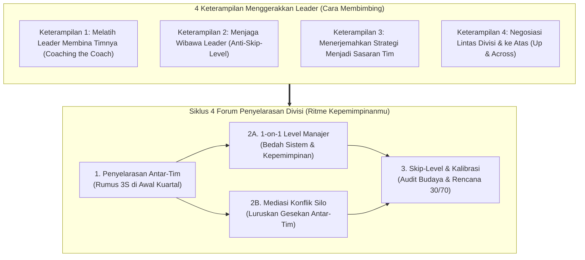
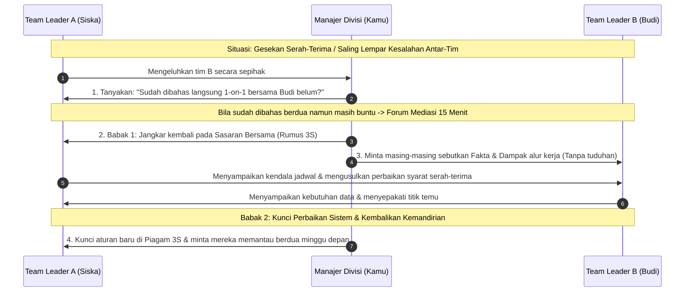
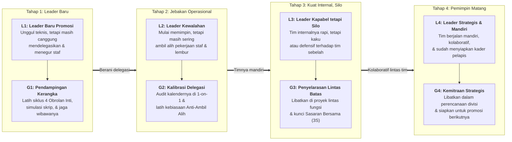

# Memimpin Para Leader: Strategi Naik Kelas dari Mengarahkan Tim ke Menggerakkan Divisi

**Ditulis oleh:** `aiossan`</br>
**Ragam Bahasa:** Standar Luwes (`Saya/Kamu` • Baku Tak Kaku)</br>
**Format:** GitHub Flavored Markdown (GFM)

> [!NOTE] Cara Menggunakan Panduan Ini
> Buku ketiga dari seri kepemimpinan praktis ini disusun khusus untuk kamu yang baru saja dipromosikan naik ke posisi di atas *team leader*-baik sebagai Manajer Divisi, *Head of Department*, *Group Leader*, maupun posisi apa pun yang membawahi beberapa *team leader* sekaligus (*Manager of Managers*). Kamu bisa membacanya secara berurutan dari Pendahuluan hingga Bab 13, membuka bagian lipat (*collapsible sections*) untuk menyalin templat skrip pembimbingan *leader* dan simulasi kasus, atau langsung menuju **Lampiran** saat membutuhkan ringkasan cepat sebelum memimpin rapat lintas tim.

## Daftar Isi

1. [Pendahuluan: Saat Bawahan Langsungmu Sekarang Adalah Para Pemimpin Tim](#pendahuluan-saat-bawahan-langsungmu-sekarang-adalah-para-pemimpin-tim)
2. [Bab 1: Peralihan dari Memimpin Eksekutor ke Memimpin Para Pemimpin](#bab-1-peralihan-dari-memimpin-eksekutor-ke-memimpin-para-pemimpin)
3. [Bab 2: Kerangka Kerja 4x4 Pemimpin Divisi (4 Forum Penyelarasan + 4 Keterampilan Menggerakkan *Leader*)](#bab-2-kerangka-kerja-4x4-pemimpin-divisi-4-forum-penyelarasan--4-keterampilan-menggerakkan-leader)
4. [Bab 3: Keterampilan 1: Melatih Pemimpin Tim Memecahkan Masalah Timnya (*Coaching the Coach*)](#bab-3-keterampilan-1-melatih-pemimpin-tim-memecahkan-masalah-timnya-coaching-the-coach)
5. [Bab 4: Keterampilan 2: Menjaga Wibawa Pemimpin Tim di Bawahmu (*Anti-Skip-Level Trap*)](#bab-4-keterampilan-2-menjaga-wibawa-pemimpin-tim-di-bawahmu-anti-skip-level-trap)
6. [Bab 5: Keterampilan 3: Menerjemahkan Strategi Manajemen Menjadi Sasaran Operasional Tim](#bab-5-keterampilan-3-menerjemahkan-strategi-manajemen-menjadi-sasaran-operasional-tim)
7. [Bab 6: Keterampilan 4: Bernegosiasi Lintas Divisi & Mengelola Ekspektasi Manajemen Puncak (*Managing Up & Across*)](#bab-6-keterampilan-4-bernegosiasi-lintas-divisi--mengelola-ekspektasi-manajemen-puncak-managing-up--across)
8. [Bab 7: Forum 1: Menyelaraskan Sasaran Antar-Tim di Awal Kuartal (Rumus 3S)](#bab-7-forum-1-menyelaraskan-sasaran-antar-tim-di-awal-kuartal-rumus-3s)
9. [Bab 8: Forum 2A: Sesi *1-on-1* Level Manajer: Membedah Sistem & Budaya Tim, Bukan Tugas Teknis](#bab-8-forum-2a-sesi-1-on-1-level-manajer-membedah-sistem--budaya-tim-bukan-tugas-teknis)
10. [Bab 9: Forum 2B: Mengurai Konflik Silo & Gesekan Antar-Pemimpin Tim](#bab-9-forum-2b-mengurai-konflik-silo--gesekan-antar-pemimpin-tim)
11. [Bab 10: Forum 3: Dialog Lintas Jenjang (*Skip-Level Check-In*) & Kalibrasi Kinerja Divisi (30/70)](#bab-10-forum-3-dialog-lintas-jenjang-skip-level-check-in--kalibrasi-kinerja-divisi-3070)
12. [Bab 11: Studi Kasus & Simulasi 4 Minggu (Rina Memimpin Siska, Budi, dan Rama)](#bab-11-studi-kasus--simulasi-4-minggu-rina-memimpin-siska-budi-dan-rama)
13. [Bab 12: Menyesuaikan Pendampingan bagi Para Pemimpin Tim (Level L1 sampai L4 ke Gaya G1 sampai G4)](#bab-12-menyesuaikan-pendampingan-bagi-para-pemimpin-tim-level-l1-sampai-l4-ke-gaya-g1-sampai-g4)
14. [Bab 13: Rencana Transisi 30 Hari Menjadi Pemimpin Divisi yang Diandalkan](#bab-13-rencana-transisi-30-hari-menjadi-pemimpin-divisi-yang-diandalkan)
15. [Lampiran: Ringkasan Meja Kerja & Rujukan Riset](#lampiran-ringkasan-meja-kerja--rujukan-riset)

## Pendahuluan: Saat Bawahan Langsungmu Sekarang Adalah Para Pemimpin Tim

Selamat! Kerja kerasmu membangun tim yang mandiri dan menata sistem kerja yang rapi akhirnya membuahkan hasil. Manajemen melihat kapasitasmu, dan sekarang kamu dipercaya naik satu jenjang lebih tinggi: **kamu membawahi beberapa tim sekaligus, dan orang-orang yang melapor langsung kepadamu sekarang adalah para *team leader* atau supervisor.**

Sekilas, promosi ini tampak seperti kelanjutan alami dari peranmu sebelumnya. Di dalam hati mungkin kamu berpikir, *"Kemarin saya memimpin 5 orang staf, sekarang saya memimpin 3 orang team leader yang masing-masing membawahi 5 staf. Berarti caranya tinggal saya ulangi saja, bukan?"*

Tunggu dulu. Begitu kamu menjalaninya selama beberapa minggu di kursi baru ini, kamu akan menyadari bahwa tantangannya ternyata berbeda sama sekali. Coba perhatikan, manakah situasi di bawah ini yang mulai sering membuatmu berpikir keras belakangan ini:

- Merasa gemas saat melihat salah satu *team leader* baru di bawahmu masih kaku atau lambat dalam memberi arahan, sampai rasanya kamu ingin langsung menghampiri stafnya dan mengatur sendiri.
- Staf dari tim lamamu (yang sekarang sudah dipimpin oleh penggantimu) masih sering datang langsung ke mejamu untuk meminta persetujuan atau mengeluhkan *leader* barunya.
- Dua *team leader* di bawahmu saling melempar tanggung jawab ketika muncul masalah di perbatasan proyek (*"Itu kan urusan tim sebelah, bukan tim saya!"*).
- Direksi atau VP memberikan target bisnis yang sangat abstrak (misalnya *"Kuartal ini kita harus mendorong efisiensi biaya 15% sambil menaikkan retensi pelanggan"*), dan kamu bingung bagaimana cara memecahnya menjadi target konkret bagi tiga tim yang fungsinya berbeda-beda.
- Kamu merasa kehilangan pegangan karena sekarang kamu tidak lagi menyentuh pekerjaan teknis harian secara langsung; keseharianmu dipenuhi urusan koordinasi lintas departemen, alokasi anggaran, dan menjaga kualitas kepemimpinan orang lain.

Kalau kamu merasakan hal-hal di atas, tenang saja, ya. <mark>Kamu sedang berada di salah satu belokan paling menentukan dalam perjalanan karier manajemen.</mark>

Dalam riset klasik mengenai jalur kepemimpinan (*The Leadership Pipeline*), Ram Charan, Stephen Drotter, dan James Noel menunjukkan bahwa transisi dari **Memimpin Orang Lain (*Managing Others*)** menuju **Memimpin Para Manajer (*Managing Managers*)** adalah titik di mana banyak pemimpin berbakat tergelincir karena mereka masih menggunakan kacamata supervisor lini pertama[^1].

Di Buku Pertama, kita telah mempelajari cara mengarahkan eksekutor teknis. Di Buku Kedua, kita telah mempelajari cara menata sistem dan ketahanan diri agar tidak mengalami *burnout*. Di **Buku Ketiga** ini, kita berfokus pada keahlian tingkat lanjut: **bagaimana memimpin melalui pemimpin lain (*leading through leaders*), menyelaraskan beberapa tim supaya tidak berjalan sendiri-sendiri, dan menjadi jembatan strategis antara manajemen puncak dan operasional lapangan.**

Kita akan langsung berfokus pada tiga pilar praktis yang kamu butuhkan setiap minggu di posisi baru ini:

1. **4 Forum Penyelarasan (*Alignment Forums*):** Empat forum utama untuk menggerakkan divisimu, mulai dari menyelaraskan sasaran antar-tim di awal kuartal (Rumus 3S), menjalankan *one-on-one* level manajer, mengurai konflik silo antar-*leader*, hingga melakukan dialog lintas jenjang (*skip-level check-in*) yang etis.
2. **4 Keterampilan Menggerakkan *Leader* (*Leader-Coaching Skills*):** Empat keterampilan komunikasi tingkat menengah, yaitu melatih *team leader* memecahkan masalah timnya (*coaching the coach*), menjaga wibawa *leader* di bawahmu, menerjemahkan strategi direksi menjadi sasaran operasional, dan bernegosiasi lintas departemen (*managing up & across*).
3. **Kalibrasi Pendampingan *Team Leader* (Level L1 sampai L4 ke Gaya G1 sampai G4):** Cara memetakan kematangan para *team leader* di bawahmu-mulai dari *leader* yang baru kemarin dipromosikan hingga *leader* senior yang usianya lebih tua darimu-agar pendampinganmu tepat sasaran.

> [!IMPORTANT] Landasan Riset Panduan Ini
> Seluruh langkah taktis di dalam buku ini disarikan dari riset manajemen tingkat menengah dan organisasi multi-tim: kerangka *The Leadership Pipeline* dari Ram Charan, Stephen Drotter, dan James Noel[^1], riset kepemimpinan tingkat menengah (*Leading Middle Managers*) dari *Center for Creative Leadership* (CCL)[^2], studi klasik *Managing Your Boss & Managing Across* dari Profesor John Gabarro dan John Kotter di Harvard Business School[^3], serta riset kolaborasi lintas batas (*Cross-Boundary Teaming*) dari Profesor Amy Edmondson dan Jean-François Harvey[^4]. Semuanya saya rangkum ke dalam bahasa kerja sehari-hari yang lugas dan mudah dipraktikkan.

Mari kita mulai dari perubahan pola pikir terbesar yang wajib kamu kuasai saat naik ke kursi ini di **Bab 1**, ya.

## Bab 1: Peralihan dari Memimpin Eksekutor ke Memimpin Para Pemimpin

Ketika kamu pertama kali diangkat menjadi *team leader* dulu, tantangan terberatmu adalah menahan tangan agar tidak mengerjakan tugas teknis stafmu sendiri.

Sekarang, ketika kamu naik menjadi Manajer Divisi atau *Manager of Managers*, tantangannya naik satu lapis: **kamu harus menahan diri agar tidak mengambil alih peran kepemimpinan milik para *team leader* yang berada di bawahmu.**

Studi dari *Center for Creative Leadership* (<abbr title="Center for Creative Leadership">CCL</abbr>) mencatat bahwa kesalahan paling umum manajer yang baru naik ke jenjang menengah adalah tetap bertindak sebagai "Supervisor Super" (*Super-Frontline Leader*)-mereka melompati *team leader* di bawahnya dan langsung mengatur staf pelaksana karena merasa itu cara tercepat untuk membereskan masalah[^2].

Dulu, saat menjadi *team leader*, hasil kerjamu diukur dari **output teknis timmu**. Sekarang, sebagai pemimpin yang membawahi para *leader*, hasil kerja utamamu adalah **kualitas keputusan para *team leader*-mu serta kelancaran kolaborasi antar-tim di dalam divisimu**.

### Perbedaan Memimpin Eksekutor vs Memimpin Para Pemimpin

Pergeseran kursi ini menuntut perubahan cara kerja pada empat aspek utama:

| Aspek Pekerjaan | Dulu (Saat Menjadi *Team Leader*) | Sekarang (Membawahi Para *Team Leader*) |
| :--- | :--- | :--- |
| **Fokus Pembimbingan** | Melatih staf cara mengeksekusi tugas teknis dengan benar dan tepat waktu. | Melatih para *team leader* cara mengarahkan, menegur, dan memotivasi anggota tim mereka. |
| **Jangkauan Pandangan** | Berfokus penuh pada target internal satu tim untuk minggu atau bulan ini. | Menyelaraskan alur kerja antar-tim dan menerjemahkan strategi bisnis 3–12 bulan ke depan. |
| **Saat Ada Masalah di Lapangan** | Berdiskusi langsung dengan staf pelaksana untuk mengurai hambatan teknisnya. | Bertanya kepada *team leader*-nya: *"Bagaimana rencanamu membimbing stafmu menyelesaikan masalah ini?"* |
| **Arah Komunikasi Utama** | 80% ke bawah (kepada anggota tim), 20% ke atas/samping. | 40% ke bawah (kepada para *leader*), 30% ke samping (kepala divisi lain), 30% ke atas (direksi/VP). |

Kalau seorang manajer baru di jenjang ini belum mengubah cara kerjanya, ia hampir pasti akan terjatuh ke dalam salah satu dari dua jebakan berbahaya berikut:

#### 1. Jebakan "Manajer Bayangan" (*The Skip-Level Micromanager*)

Karena kamu dulunya mantan *team leader* di salah satu tim tersebut (dan kamu sudah mengenal dekat staf-stafnya), setiap kali muncul masalah kamu langsung menghubungi staf pelaksananya, memberi perintah langsung, atau mengubah keputusan yang sudah dibuat oleh *team leader* baru mereka.

- **Akibatnya pada divisimu:** Wibawa *team leader* di bawahmu langsung runtuh di mata anggota timnya. Staf akan berpikir, *"Untuk apa saya mendengarkan arahan Team Leader saya kalau nanti diubah lagi oleh Manajer Divisi?"* Akibatnya, *team leader*-mu menjadi pasif dan kehilangan rasa percaya diri, sementara mejamu kembali kebanjiran urusan teknis dari puluhan staf sekaligus.

#### 2. Jebakan "Kepala Suku Silo" (*The Tribal Silo Boss*)

Karena kamu dipromosikan dari salah satu sub-tim (misalnya kamu dulunya *Team Leader Konten*, lalu sekarang naik menjadi *Manajer Pemasaran* yang membawahi Tim Konten, Tim Iklan, dan Tim Desain), kamu tanpa sadar lebih menganakemaskan tim asalmu. Selain itu, setiap kali terjadi gesekan dengan departemen lain (misalnya Penjualan atau Produk), kamu ikut memelihara mentalitas "Kita vs Mereka".

- **Akibatnya pada divisimu:** Tim-tim lain di bawahmu merasa diperlakukan tidak adil, sementara para *team leader* di bawahmu meniru gayamu dengan saling menyalahkan dan membangun tembok pemisah (*silo*) antar-tim.

### Posisi yang Sehat: Menjadi Pelatih bagi Para *Leader* & Penyelaras Sistem

Sebagai pemimpin yang membawahi para *leader*, tugas utamamu bukanlah menjadi orang paling serbabisa yang mengetahui setiap detail teknis di semua sub-tim, melainkan <ins>membangun para *team leader* yang tangguh di bawahmu dan memastikan seluruh tim bergerak selaras tanpa saling menjatuhkan</ins>.

Pegangan dasarnya sederhana:

> **Jangan pernah melumpuhkan *leader* di bawahmu dengan mengambil alih kemudi timnya; berdirilah di belakangnya untuk menajamkan cara berpikirnya, dan berdirilah di depannya untuk membuka jalan lintas divisi.**

Supaya peran baru ini bisa langsung kamu jalankan secara terukur setiap minggu, buku ini merangkum pola kerja pemimpin tingkat menengah ke dalam **Kerangka Kerja 4x4 Pemimpin Divisi**:

1. **4 Forum Penyelarasan (Kapan & Di Mana Kamu Menggerakkan Divisi?):** Empat forum utama untuk menyatukan arah antar-tim, membimbing *team leader* secara empat mata, mengurai gesekan silo, dan memantau kesehatan budaya kerja.
2. **4 Keterampilan Menggerakkan *Leader* (Bagaimana Cara Membimbing & Bernegosiasi?):** Empat keterampilan inti untuk melatih *leader* membina timnya, menjaga rantai wewenang, menerjemahkan strategi manajemen atas, dan mengelola hubungan lintas departemen.

Mari kita lihat gambaran utuhnya di **Bab 2**.

## Bab 2: Kerangka Kerja 4x4 Pemimpin Divisi (4 Forum Penyelarasan + 4 Keterampilan Menggerakkan *Leader*)

Ketika kamu memimpin beberapa tim sekaligus, kamu tidak bisa lagi mengandalkan obrolan spontan di sela-sela meja kerja. Kamu membutuhkan arsitektur komunikasi yang rapi supaya arahan dari direksi turun dengan jernih ke bawah, dan masalah antar-tim tuntas tanpa kesalahpahaman.

Seluruh isi buku ketiga ini diringkas menjadi **8 kebiasaan praktis** yang terbagi ke dalam dua kelompok:

1. **4 Forum Penyelarasan (*Alignment Forums*)** - empat ritme pertemuan untuk menyelaraskan sasaran lintas tim, membina *team leader*, menyelesaikan gesekan antar-tim, dan mengevaluasi kesehatan divisi.
2. **4 Keterampilan Menggerakkan *Leader* (*Leader-Coaching Skills*)** - empat keterampilan komunikasi yang kamu gunakan di setiap forum tersebut.

Perhatikan hubungan keduanya pada diagram berikut:



Cara kerjanya terintegrasi penuh: **kamu menggunakan 4 Keterampilan Menggerakkan *Leader* sebagai fondasi saat memimpin 4 Forum Penyelarasan dari awal hingga akhir kuartal.**

> [!NOTE]
> Penjelasan lengkap mengenai `Rumus 3S` (Sasaran Bersama, Sekat Peran, Simpul Koordinasi) akan kita bahas di Bab 7.

### Empat Forum Penyelarasan dalam Siklus Divisi

- **1. Menyelaraskan Sasaran Antar-Tim di Awal Kuartal (Rumus 3S)**
  Forum bersama seluruh *team leader* di bawahmu pada awal kuartal atau awal proyek besar untuk menyepakati **Sasaran Bersama (*Shared Outcome*)**, **Sekat Peran (*Scope Boundary*)**, dan **Simpul Koordinasi (*Sync Cadence*)** supaya tidak ada area abu-abu antar-tim.
- **2A. Sesi *1-on-1* Level Manajer (*Coaching the Leader*)**
  Percakapan empat mata mingguan atau dua mingguan antara kamu dan masing-masing *team leader*, di mana fokusnya bukan lagi memeriksa tugas teknis eceran, melainkan membedah kesehatan sistem timnya, cara ia membina stafnya, dan hambatan sumber dayanya.
- **2B. Mediasi Konflik Silo & Gesekan Antar-Pemimpin Tim**
  Forum penyelesaian cepat saat dua *team leader* di bawahmu berselisih mengenai batas tanggung jawab, prioritas sumber daya, atau kualitas serah-terima pekerjaan (*handoff*).
- **3. Dialog Lintas Jenjang (*Skip-Level Check-In*) & Kalibrasi Kinerja Divisi (30/70)**
  Kombinasi diskusi berkala bersama staf lini depan (secara transparan dan tanpa melangkahi *team leader*-nya) untuk mendengar aspirasi lapangan, diikuti rapat kalibrasi akhir periode bersama para *team leader* untuk merancang strategi kuartal berikutnya.

> [!TIP] Perbedaan *1-on-1* dengan Staf vs *1-on-1* dengan *Team Leader*
> Saat kamu melakukan *1-on-1* bersama staf pelaksana dulu, kamu bertanya: *"Tugas X sudah sampai mana?"* Saat kamu melakukan *1-on-1* bersama seorang *team leader* sekarang, kamu perlu naik kelas dan bertanya: *"Bagaimana perkembangan performa anggota timmu bulan ini, siapa staf yang sedang membutuhkan perhatian khusus, dan bagaimana rencanamu membimbingnya?"*

### Empat Keterampilan Menggerakkan *Leader*

Untuk menjalankan keempat forum di atas dengan baik, latihlah empat keterampilan komunikasi tingkat menengah ini:

1. **Melatih Pemimpin Tim Memecahkan Masalah Timnya (*Coaching the Coach*):** Membimbing *team leader* yang datang mengeluhkan anggota timnya supaya ia menemukan cara menegur atau melatih stafnya sendiri, bukan kamu yang turun tangan menegur staf tersebut.
2. **Menjaga Wibawa Pemimpin Tim di Bawahmu (*Anti-Skip-Level Trap*):** Menahan diri dari memotong komando dan mengembalikan staf yang mencoba meminta jalan pintas ke jalur koordinasi bersama *team leader* mereka.
3. **Menerjemahkan Strategi Manajemen Menjadi Sasaran Operasional Tim:** Mengubah bahasa bisnis tingkat tinggi dari direksi menjadi peta kontribusi yang konkret dan relevan bagi masing-masing sub-tim.
4. **Bernegosiasi Lintas Divisi & Mengelola Ekspektasi Manajemen Puncak (*Managing Up & Across*):** Membangun aliansi yang sehat bersama kepala departemen lain dan mengelola komunikasi proaktif kepada direksi supaya divisimu memperoleh dukungan sumber daya yang memadai.

Di **Bagian 2 (Bab 3 sampai Bab 6)**, kita akan membahas keempat *Keterampilan Menggerakkan Leader* ini lengkap dengan contoh kalimatnya. Setelah itu, di **Bagian 3 (Bab 7 sampai Bab 10)** kita langsung menerapkannya ke dalam keempat Forum Penyelarasan Divisi.

## Bab 3: Keterampilan 1: Melatih Pemimpin Tim Memecahkan Masalah Timnya (*Coaching the Coach*)

Adegan ini hampir pasti akan kamu temui di bulan pertama membawahi para *team leader*:

Salah satu *team leader* baru di bawahmu, sebut saja Budi, masuk ke ruanganmu sambil menghela napas: *"Kak, saya pusing menghadapi Dani di tim saya. Sudah dua kali saya beri tahu format laporannya, tetapi kemarin ia masih salah memasukkan data lagi. Sebaiknya bagaimana ya, Kak? Atau Kakak saja yang membantu menegur Dani supaya ia lebih segan?"*

Hati-hati, ya. Ini adalah ujian pertamamu sebagai seorang *Manager of Managers*.

Kalau kamu terpancing dan menjawab, *"Waduh, mengapa Dani begitu? Ya sudah, panggil Dani ke ruangan saya sekarang biar saya yang bicara!"*, atau kalau kamu langsung mendikte Budi, *"Kamu katakan saja kepada Dani A, B, C sekarang!"*, maka kamu baru saja melewatkan kesempatan melatih Budi menjadi pemimpin yang mandiri.

Riset Ram Charan dalam *The Leadership Pipeline* menekankan bahwa tugas utama seorang manajer yang membawahi manajer lain adalah **mengajarkan keterampilan kepemimpinan kepada bawahannya melalui pertanyaan reflektif (*coaching the coach*)**[^1]. Kalau kamu yang turun tangan menegur Dani, maka sampai kapan pun Dani tidak akan menghormati kepemimpinan Budi, dan Budi tidak akan pernah berani menjalankan *Koreksi Empat Mata* sendiri.

### Tiga Kesalahan Umum Saat *Team Leader* Mengeluhkan Stafnya

Perhatikan tiga reaksi keliru yang sering dilakukan manajer menengah ketika *team leader*-nya mengeluhkan anggota tim:

- **Mengambil alih peran penegur:** Kamu yang turun tangan memarahi atau menegur staf pelaksana yang bermasalah karena merasa *team leader*-mu "kurang tegas".
- **Ikut mengeluhkan kelemahan staf:** Kamu justru ikut menggerutu bersama *team leader*-mu, *"Iya, Dani memang dari dulu agak lambat orangnya,"* tanpa mengarahkan *team leader*-mu untuk melakukan pembimbingan yang terukur.
- **Hanya memberi solusi teknis proyeknya, tetapi lupa membedah cara kepemimpinannya:** Kamu hanya fokus memperbaiki tabel laporan yang keliru tadi, tetapi tidak menanyakan kepada *team leader*-mu bagaimana cara ia memberikan instruksi awal kepada stafnya.

### Tiga Langkah Praktis *Coaching the Coach*

Setiap kali ada *team leader* di bawahmu datang membawa masalah mengenai anggota timnya, gunakan tiga langkah pembimbingan lapis kedua ini:

#### 1. Bedah Dulu "Cara *Leader*-nya Memimpin" Sebelum Menyalahkan Stafnya

Jangan langsung menyimpulkan bahwa masalahnya 100% kesalahan staf. Ingat pelajaran dari Buku Pertama: sering kali staf keliru bekerja karena arahan awal *leader*-nya yang masih mengambang. Tanyakan kepada *team leader*-mu dengan tenang:

- *"Oke Bud, sebelum kita membahas Dani, coba ceritakan kepada saya: waktu pertama kali kamu menyerahkan tugas ini kepada Dani kemarin, bagaimana kesepakatan Rumus 3K (Keluaran, Kriteria Sukses, Kalender) yang kamu sampaikan kepadanya? Apakah tertulis jelas atau baru lisan sambil lalu?"*
- *"Menurut pengamatanmu, pada tugas spesifik ini posisi Dani sekarang berada di level kemandirian berapa (L1, L2, L3, atau L4)? Dan gaya pendampingan apa yang sudah kamu terapkan kepadanya minggu ini?"*

Pertanyaan seperti ini langsung mengajak *team leader*-mu berkaca dan mengevaluasi cara ia memimpin.

#### 2. Pancing *Team Leader* Menyusun Rencana Percakapannya Sendiri

Setelah akar masalahnya jelas (misalnya instruksi awal sudah tertulis rapi tetapi Dani memang kurang teliti memeriksa rumus), tahan dirimu agar tidak mengambil alih. Mintalah *team leader*-mu merancang langkah *Koreksi Empat Mata*-nya sendiri:

- *"Nah, karena target awalnya sudah tertulis jelas tetapi hasilnya masih meleset, berarti sekarang waktunya kamu menjalankan Koreksi Empat Mata bersama Dani. Menurut kamu, fakta spesifik dan dampak nyata apa yang hendak kamu sampaikan kepada Dani pada Babak 1 nanti?"*

#### 3. Lakukan Simulasi Singkat (*Roleplay* 2 Menit) & Berikan Kepercayaan Penuh

Kalau *team leader* di bawahmu masih baru dan merasa canggung hendak menegur anggota timnya (terlebih bila anggota timnya dulunya rekan selevel), ajak ia berlatih berbicara selama 2 menit di hadapanmu:

- *"Coba anggap saya ini Dani. Silakan sampaikan kalimat pembuka koreksinya kepada saya sekarang supaya kita bisa melihat apakah nadanya sudah pas."*
- Setelah ia mencoba dan nadanya sudah objektif, kuatkan rasa percaya dirinya: *"Nah, kalimatmu barusan sudah tenang, lugas, dan jelas sekali! Jalankan persis seperti itu kepada Dani sore ini, ya. Saya percaya penuh kamu mampu menangani hal ini. Besok pagi kabari saya hasilnya."*

### Perbandingan Kalimat di Kantor (Keterampilan 1)

| Hindari Respons Ini kepada *Team Leader*-mu | Gunakan Respons *Coaching the Coach* Ini |
| :--- | :--- |
| *"Panggil stafmu ke sini, biar saya yang menegurnya langsung!"* (Meruntuhkan wibawa *team leader*) | *"Ini momen yang baik untuk melatih kepemimpinanmu. Bagaimana rencanamu menegurnya secara empat mata sore ini?"* |
| *"Kenapa anggota timmu bisa salah terus, sih?!"* (Menyudutkan tanpa solusi) | *"Waktu kamu mendelegasikan tugas itu kemarin, bagian mana dari instruksi awalnya yang menurutmu mungkin masih belum cukup jelas baginya?"* |
| *"Kirim pesan saja kepadanya sekarang, katakan kalau salah sekali lagi akan diberi surat peringatan!"* (Mengajarkan kepemimpinan berbasis ancaman) | *"Mari kita susun bersama poin Fakta dan Dampaknya lebih dulu, lalu kita latih selama 2 menit sebelum kamu memanggilnya berbicara empat mata."* |
| Langsung memindahkan staf yang bermasalah ke tim lain tanpa proses pembinaan. | *"Selama dua minggu ke depan, coba kamu terapkan gaya G1 (Panduan Terstruktur) kepadanya dan periksa progresnya setiap dua hari. Kita evaluasi hasilnya pada sesi 1-on-1 minggu depan."* |

### Latihan Praktik Bab 3

Minggu ini, latih keterampilan *Coaching the Coach* melalui tiga langkah berikut:

- [ ] **Tahan diri dari menegur staf lapis kedua secara langsung:** Apabila ada staf di bawah *team leader*-mu yang kinerjanya melenceng minggu ini, panggil *team leader*-nya dan bimbing ia untuk melakukan koreksi empat mata sendiri.
- [ ] **Ajukan pertanyaan "Audit Instruksi Awal":** Saat *team leader* mengeluhkan hasil kerja stafnya, tanyakan lebih dulu bagaimana ia menyepakati target dan kriteria sukses di awal tugas tersebut.
- [ ] **Lakukan 1 kali simulasi singkat (*roleplay* 2 menit):** Bantu satu *team leader* di bawahmu melatih kalimat apresiasi atau koreksinya sebelum ia berbicara dengan anggota timnya.

## Bab 4: Keterampilan 2: Menjaga Wibawa Pemimpin Tim di Bawahmu (*Anti-Skip-Level Trap*)

Ujian besar kedua setelah kamu naik jabatan justru sering datang dari kedekatan hubunganmu di masa lalu.

Bayangkan skenario ini: dulu kamu adalah *Team Leader* di Tim A selama dua tahun. Hubunganmu dengan staf-staf di Tim A (misalnya Dani dan Riko) sudah sangat akrab. Sekarang, kamu naik menjadi Manajer Divisi, dan posisi *Team Leader* Tim A diserahkan kepada Siska.

Pada hari Selasa siang, Dani langsung menghampiri mejamu (atau mengirim pesan pribadi kepadamu) sambil berkata: *"Kak Rina, saya mau bertanya soal konsep kampanye klien X ini, menurut Kak Rina sebaiknya memakai konsep yang mana, ya? Soalnya tadi kata Kak Siska disuruh memakai konsep A, tetapi saya merasa kurang cocok..."*

Atau di tengah rapat besar, kamu melihat draf presentasi yang ditampilkan oleh staf Budi memiliki bagian yang kurang tepat, lalu kamu langsung menyela di depan semua orang: *"Dani, slide nomor 4 itu tolong nanti langsung kamu ganti memakai tabel bulan lalu ya, jangan memakai tabel yang itu!"*-tanpa menoleh kepada Budi sedikit pun.

> [!WARNING] Bahaya Memotong Komando (*Skip-Level Bypass*)
> Setiap kali kamu mengizinkan staf melompati *team leader*-nya untuk meminta keputusan langsung kepadamu, atau setiap kali kamu membatalkan keputusan *team leader*-mu di hadapan anggota timnya, kamu sedang meruntuhkan wibawa *team leader*-mu sendiri. Dalam waktu singkat, *team leader*-mu akan kehilangan respek dari timnya dan berubah menjadi sekadar penyampai pesan tanpa wewenang nyata.

### Tiga Kebiasaan yang Tanpa Sadar Melumpuhkan *Team Leader* di Bawahmu

Coba periksa apakah kamu masih sering tanpa sengaja melakukan salah satu dari tiga kebiasaan ini:

- **Melayani "konsultasi jalan pintas" dari mantan anggota tim:** Karena merasa sungkan menolak staf lama yang datang bertanya hal teknis, kamu langsung memberikan jawaban dan keputusan tanpa melibatkan *team leader* baru mereka.
- **Mengoreksi staf lapis kedua di ruang terbuka atau grup besar:** Kamu langsung menandai (*mention*) nama staf pelaksana di grup divisi untuk menegur kesalahannya, seolah-olah *team leader*-nya tidak ada di sana.
- **Mengubah keputusan teknis *team leader* secara sepihak:** *Team leader*-mu sudah menyepakati cara kerja A bersama timnya, tetapi saat kamu melintas, kamu langsung menyuruh stafnya mengganti ke cara B hanya karena cara B lebih sesuai dengan selera pribadimu.

### Tiga Langkah Praktis Menjaga Rantai Wibawa Kepemimpinan

Supaya para *team leader* di bawahmu tumbuh menjadi pemimpin yang dihormati dan diandalkan oleh anggota timnya, pegang teguh tiga aturan ini:

#### 1. Terapkan Gerbang "Sudah Diskusi dengan *Team Leader*-mu Belum?"

Setiap kali ada staf pelaksana yang datang langsung kepadamu untuk meminta persetujuan pekerjaan atau mengeluhkan keputusan teknis, sambut dengan ramah tetapi **jangan pernah langsung memberikan keputusan**. Pasang pertanyaan penyaring ini:

- *"Halo Dan, senang berbincang denganmu. Namun sebelum saya memberi masukan soal konsep ini, apakah kamu sudah mendiskusikan pertimbanganmu ini bersama Siska? Apa tanggapan Siska tadi?"*
- Kalau ia menjawab *belum*: *"Nah, sekarang Siska yang memegang kendali penuh di tim kalian. Coba kamu bawa dulu dua opsi konsep ini kepada Siska ya, saya percaya penuh pada penilaian Siska."*
- Kalau ia menjawab *sudah, tetapi saya kurang setuju dengan keputusan Siska*: *"Kalau begitu, mari kita bicarakan bertiga bersama Siska siang ini supaya transparan dan satu pemahaman."* (Jangan pernah merombak keputusan *team leader*-mu di belakang punggungnya!).

#### 2. Salurkan Masukan Operasional Melalui *Team Leader*-nya

Kecuali dalam situasi darurat yang mengancam keselamatan atau sistem utama mati total, biasakan menyalurkan koreksi operasional melewati *team leader* yang bersangkutan:

- Alih-alih menegur stafnya secara langsung di grup, hubungi *team leader*-nya secara empat mata: *"Bud, tadi saya perhatikan pada draf presentasi proyek X halaman 4 angkanya masih memakai data lama. Tolong kamu periksa bersama Dani dan pandu ia untuk memperbaikinya sebelum dikirim ke klien sore ini, ya."*

Dengan cara ini, staf melihat bahwa Budi-lah yang memegang kendali mutu di dalam tim tersebut.

#### 3. Bedakan "Standar Hasil Akhir" dari "Gaya Teknis Pribadi"

Sebagai mantan eksekutor atau mantan *team leader*, godaan terbesarnya adalah menuntut seluruh *team leader* di bawahmu memiliki cara kerja yang 100% identik dengan gayamu.

Ingat aturan emas pendelegasian tingkat manajer: **kunci standar hasil akhir dan batas risikonya, tetapi berikan keleluasaan bagi para *team leader* untuk menggunakan metode kepemimpinan mereka sendiri.** Kalau pendekatan yang dipilih Budi berbeda dengan cara yang biasa kamu gunakan, selama cara Budi tidak melanggar nilai perusahaan dan tetap mencapai target mutu serta waktu yang disepakati, **dukung keputusan Budi sepenuhnya**.

### Perbandingan Tindakan di Kantor (Keterampilan 2)

| Hindari Kebiasaan Memotong Komando Ini | Gunakan Kebiasaan Penguat Wibawa *Leader* Ini |
| :--- | :--- |
| Menjawab staf yang mencari jalan pintas: *"Oh, kalau menurut saya sebaiknya pakai konsep B saja Dan, sampaikan kepada Siska kata saya begitu, ya."* | *"Untuk urusan konsep konten, wewenangnya sudah saya serahkan penuh kepada Siska. Coba kamu diskusikan alasanmu tadi langsung bersama Siska, ya."* |
| Menegur staf langsung di depan *team leader*-nya saat rapat: *"Riko, mengapa pekerjaanmu terlambat terus?!"* | Menanyakan progres melalui *team leader*-nya di dalam rapat: *"Bud, untuk pos pekerjaan yang ditangani Riko, apa kendala utamanya dan bagaimana rencana timmu mengejar jadwalnya?"* |
| Membatalkan keputusan *team leader* di grup percakapan tim: *"Jangan memakai jadwal yang dikirim Budi tadi ya, ganti dengan jadwal dari saya ini."* | Berdiskusi empat mata dengan Budi di belakang layar, lalu membiarkan Budi sendiri yang mengumumkan penyesuaian jadwalnya kepada anggota timnya. |
| Menerima keluhan sepihak staf yang menyudutkan *team leader*-nya tanpa konfirmasi. | *"Terima kasih sudah menyampaikan hal ini. Supaya adil dan masalahnya tuntas, poin mana dari cerita tadi yang sudah kamu sampaikan langsung kepada Team Leader-mu, atau perlu saya fasilitasi bicara bertiga?"* |

### Latihan Praktik Bab 4

Selama seminggu ke depan, perkuat wibawa para *team leader* di bawahmu melalui tiga langkah ini:

- [ ] **Pasang kalimat penyaring otomatis:** Setiap kali ada staf lapis kedua yang meminta keputusan teknis langsung kepadamu minggu ini, tanyakan: *"Apakah kamu sudah mendiskusikan hal ini bersama Team Leader-mu?"*
- [ ] **Berikan apresiasi terbuka bagi *Team Leader* di hadapan timnya:** Cari satu keberhasilan tim minggu ini, lalu sebutkan secara jelas di dalam rapat atau grup bahwa keberhasilan tersebut tercapai berkat koordinasi yang dipimpin oleh *team leader* mereka.
- [ ] **Tahan 1 komentar selera pribadi:** Saat melihat *team leader*-mu menjalankan metode kerja yang sedikit berbeda dari kebiasaanmu (namun tetap aman dan efektif), tahan diri untuk tidak mengintervensi dan biarkan ia menuntaskannya.

## Bab 5: Keterampilan 3: Menerjemahkan Strategi Manajemen Menjadi Sasaran Operasional Tim

Ketika kamu naik ke kursi Manajer Divisi atau *Head*, kamu berdiri tepat di jembatan antara dua dunia yang menggunakan "bahasa" yang sangat berbeda:

1. **Dunia Manajemen Puncak (Direksi / VP / C-Level):** Mereka berbicara dengan bahasa bisnis makro, laporan keuangan, pangsa pasar, efisiensi biaya, dan target tahunan. Arahan mereka sering kali bersifat garis besar, misalnya: *"Kuartal depan fokus perusahaan adalah meningkatkan retensi pelanggan korporat sebesar 15% dan menekan biaya akuisisi."*
2. **Dunia Lapangan (Para *Team Leader* & Staf Pelaksana):** Mereka bekerja di dalam rincian tugas harian, jadwal desain, baris kode program, antrean layanan pelanggan, dan tenggat hari Jumat.

Riset *Center for Creative Leadership* (<abbr title="Center for Creative Leadership">CCL</abbr>) menyebutkan bahwa salah satu kekeliruan terbesar manajer tingkat menengah adalah bertindak sekadar sebagai "penerus pesan" (*message forwarder*)[^2]. Mereka keluar dari ruang rapat direksi, lalu langsung meneruskan *slide* direksi mentah-mentah kepada para *team leader* di bawahnya sambil berkata: *"Teman-teman, kata Pak Direktur kuartal depan kita harus menaikkan retensi 15%, ya. Tolong dipikirkan!"*

Akibatnya? Para *team leader* di bawahmu kebingungan. Tim Desain bingung apa kaitan desain visual dengan retensi 15%, Tim Operasional bingung harus mengubah apa, dan akhirnya semua orang kembali mengerjakan rutinitas lama tanpa ada perubahan nyata.

### Tugas Utama Manajer Menengah: Menjadi "Prisma Penerjemah Strategi"

Sebagai pemimpin yang membawahi para *leader*, kontribusi terbesarmu terletak pada kemampuanmu menjadi **Prisma Penerjemah**: menangkap satu arah strategis besar dari atas, lalu menguraikannya menjadi sasaran operasional yang spesifik, relevan, dan dapat dieksekusi oleh masing-masing sub-tim di bawahmu.

### Tiga Langkah Praktis Menerjemahkan Strategi Atas ke Sasaran Sub-Tim

Gunakan tiga langkah ini setiap kali turun arahan strategis baru dari manajemen puncak:

#### 1. Jelaskan "Konteks Mengapa" (*The Strategic Why*) dengan Bahasa yang Membumi

Sebelum membagi sasaran kepada para *team leader*-mu, terjemahkan lebih dulu alasan bisnis di balik keputusan manajemen puncak ke dalam bahasa kerja yang masuk akal bagi mereka:

- **Hindari hanya berkata:** *"Direksi meminta kita memangkas anggaran kampanye 20% kuartal ini, pokoknya harus dijalankan."* (Kalimat seperti ini membuat tim merasa menjadi korban kebijakan).
- **Terjemahkan konteksnya:** *"Teman-teman, kuartal ini biaya logistik industri sedang naik, sehingga perusahaan perlu menjaga arus kas tetap sehat tanpa mengurangi jumlah karyawan. Oleh karena itu, anggaran iklan berbayar kita disesuaikan 20%, dan fokus kita digeser untuk memaksimalkan pelanggan lama agar melakukan pembelian berulang."*

Begitu para *team leader* memahami konteks besarnya, mereka dapat menjelaskannya kembali kepada staf mereka dengan tenang dan meyakinkan.

#### 2. Pecah 1 Sasaran Besar Direksi Menjadi "Porsi Kontribusi" Tiap Sub-Tim

Jangan biarkan sasaran makro menggantung di udara. Ajak para *team leader*-mu duduk bersama untuk membedah: **"Kalau target besar divisi kita adalah X, maka apa wujud kontribusi nyata di masing-masing tim kalian?"**

Perhatikan contoh bagaimana satu target direksi (*"Meningkatkan Retensi Pelanggan 15%"*) diterjemahkan menjadi sasaran spesifik untuk 3 *team leader* yang berbeda:

- **Untuk *Team Leader* Layanan Pelanggan (*Customer Support*):** *"Kontribusi timmu adalah menurunkan waktu tunggu balasan keluhan pelanggan prioritas dari 4 jam menjadi di bawah 30 menit."*
- **Untuk *Team Leader* Konten & Edukasi:** *"Kontribusi timmu adalah menyusun 4 panduan video singkat cara menggunakan fitur lanjutan supaya pelanggan lama makin aktif memakai produk kita."*
- **Untuk *Team Leader* Teknis / Produk:** *"Kontribusi timmu adalah menuntaskan 3 kendala teknis utama pada halaman perpanjangan langganan sebelum tanggal 15 bulan depan."*

Seketika itu juga, target "Retensi 15%" yang semula abstrak berubah menjadi rencana kerja yang jernih bagi setiap tim!

#### 3. Saring Kebisingan dari Atas (*Absorb the Noise, Pass Down the Signal*)

Di tingkat manajemen puncak, wajar apabila setiap minggu muncul beragam wacana, lontaran ide awal, atau perubahan prioritas yang masih didiskusikan.

Sebagai Manajer Divisi, **jangan meneruskan setiap kepanikan atau wacana mentah dari ruang direksi langsung kepada tim di bawahmu.** Saring lebih dulu mana yang baru sebatas penjajakan ide dan mana yang sudah menjadi keputusan resmi. Turunkan kepada para *team leader*-mu hanya sinyal keputusan yang sudah matang, supaya tim di bawahmu dapat bekerja dengan fokus tanpa merasa diombang-ambingkan setiap hari.

### Perbandingan Kalimat di Kantor (Keterampilan 3)

| Hindari Gaya "Penerus Pesan Mentah" Ini | Gunakan Gaya "Penerjemah Strategi" Ini |
| :--- | :--- |
| Meneruskan email direksi ke grup disertai kalimat: *"FYI ya teman-teman, tolong dibaca dan ditindaklanjuti."* | Merangkum intinya: *"Dari pengumuman direksi tadi, ada 2 dampak langsung bagi divisi kita bulan ini: (1)... dan (2)... Jumat pagi kita bedah pembagian perannya, ya."* |
| Menyalahkan manajemen atas di hadapan *team leader*-mu: *"Saya juga tidak paham mengapa manajemen membuat aturan seperti ini, jalankan saja."* | Menjelaskan alasan bisnisnya secara dewasa, lalu berfokus pada hal yang bisa dikendalikan divisi: *"Tujuan kebijakan baru ini adalah menjaga keamanan data klien. Mari kita atur cara paling praktis untuk menerapkannya di tim kita."* |
| Memberikan target makro yang seragam kepada seluruh sub-tim tanpa membedah fungsinya. | Memfasilitasi para *team leader* menerjemahkan target makro tersebut menjadi metrik kerja yang sesuai dengan keahlian sub-tim masing-masing. |
| Menyebarkan kabar burung atau kecemasan dari rapat pimpinan ke grup kerja. | Menahan wacana yang belum matang, dan baru mengomunikasikan rencana perubahan setelah arah dan langkahnya jelas. |

### Latihan Praktik Bab 5

Minggu ini, latih ketajamanmu menerjemahkan strategi melalui tiga langkah berikut:

- [ ] **Ambil 1 target besar divisi/perusahaan kuartal ini:** Uji apakah setiap *team leader* di bawahmu dapat menjelaskan dalam 1 kalimat sederhana bagaimana pekerjaan harian tim mereka berkontribusi pada target besar tersebut.
- [ ] **Praktikkan rumus "Konteks Bisnis + Porsi Kontribusi Sub-Tim":** Saat menyampaikan arahan baru dari manajemen minggu ini, jelaskan lebih dulu alasan bisnisnya (*Why*), baru bedah porsi masing-masing tim (*What*).
- [ ] **Saring 1 "kebisingan mentah" dari atas:** Apabila minggu ini ada wacana dari manajemen atas yang belum diputuskan secara resmi, simpan di catatanmu lebih dulu dan jangan terburu-buru diturunkan kepada tim sebelum statusnya pasti.

## Bab 6: Keterampilan 4: Bernegosiasi Lintas Divisi & Mengelola Ekspektasi Manajemen Puncak (*Managing Up & Across*)

Saat kamu masih menjadi *team leader*, 80% keberhasilanmu ditentukan oleh hubunganmu ke bawah (kepada anggota timmu). Namun begitu kamu naik menjadi Manajer Divisi atau *Manager of Managers*, cara kerjanya bergeser: **tim di bawahmu tidak akan bisa bekerja dengan tenang kalau kamu gagal mengelola hubungan ke atas (dengan manajemen puncak/direksi) dan ke samping (dengan kepala departemen lain).**

Studi klasik dari Profesor John Gabarro dan Profesor John Kotter di Harvard Business School mengenai *Managing Your Boss* serta kolaborasi horizontal membuktikan bahwa manajer menengah yang paling efektif bukanlah yang hanya patuh menunggu instruksi, melainkan yang **proaktif mengelola ekspektasi atasannya dan membangun jaringan kerja sama lintas departemen sebelum krisis terjadi**[^3].

Coba perhatikan: sebagian besar kemacetan kerja yang membuat para *team leader* di bawahmu frustrasi sebenarnya berasal dari luar divisimu-misalnya data dari Divisi Penjualan yang sering terlambat, spesifikasi dari Divisi Produk yang berubah-ubah, atau persetujuan anggaran dari Divisi Keuangan yang tersendat. Dan urusan lintas batas (*cross-boundary*) tersebut **hanya bisa dibuka jalannya olehmu sebagai Manajer Divisi**.

### Tiga Kesalahan Manajer Menengah Saat Berinteraksi ke Atas dan ke Samping

- **Menghindar dari atasan puncak sampai ditagih:** Karena khawatir ditanyai macam-macam, kamu jarang memberikan kabar progres kepada Direktur/VP-mu. Akibatnya, atasanmu menjadi cemas, lalu mulai melakukan *micromanaging* terhadap divisimu setiap hari.
- **Membawa masalah kepada rekan kepala divisi lain dengan nada menuntut:** Kamu baru berbicara dengan Manajer Divisi sebelah saat terjadi masalah, itu pun langsung menggunakan kalimat tuduhan: *"Tim kamu bagaimana sih, mengapa datanya keliru terus?!"* Akibatnya, kepala divisi sebelah memasang sikap defensif dan kerja sama antar-tim makin kaku.
- **Membiarkan *team leader* di bawahmu "berjuang sendiri" menghadapi kepala divisi lain:** Kamu meminta *team leader* juniormu berdebat langsung dengan Kepala Departemen lain yang jenjang jabatannya jauh lebih tinggi, tanpa kamu dampingi atau bukakan jalannya.

### Tiga Langkah Praktis *Managing Up & Across*

#### 1. Kelola Ekspektasi Manajemen Puncak dengan Prinsip "Kabar Cepat, Tanpa Kejutan" (*Proactive Managing Up*)

Apa yang paling dibutuhkan oleh seorang Direktur atau VP dari para manajer di bawahnya? **Ketenangan pikiran (*peace of mind*) bahwa divisimu terkendali, serta peringatan dini apabila muncul risiko sebelum membesar.**

Terapkan tiga kebiasaan ini kepada atasan langsungmu:

- **Kenali preferensi komunikasi atasanmu:** Apakah atasanmu tipe pembaca (lebih menyukai ringkasan tertulis 5 poin lewat email/pesan setiap Jumat sore) atau tipe pendengar (lebih menyukai diskusi lisan 10 menit setiap Senin pagi)? Sesuaikan dengan ritme kerjanya[^3].
- **Kirimkan "Ringkasan Eksekutif 5 Poin" sebelum ditanya:** Setiap akhir pekan, kirimkan rangkuman singkat: (1) Capaian utama divisi minggu ini, (2) Metrik kunci dibandingkan target, (3) Risiko/kendala yang sedang ditangani, (4) Rencana fokus minggu depan, dan (5) Keputusan/dukungan yang kamu butuhkan darinya.
- **Jangan pernah menyembunyikan kabar buruk:** Kalau ada target besar yang berisiko mundur, kabari atasanmu segera lengkap dengan rencana mitigasi yang sudah kamu siapkan: *"Pak/Bu, ada potensi penyesuaian jadwal 2 hari pada rilis X karena kendala integrasi vendor. Kami sudah menyiapkan langkah cadangan A dan B supaya dampaknya terhadap klien tetap minimal."*

#### 2. Bangun "Tabungan Kepercayaan" Bersama Kepala Divisi Lain (*Managing Across*)

Jangan menunggu terjadi konflik proyek baru kamu mengajak berbicara Manajer Divisi sebelah. Riset Amy Edmondson mengenai *Cross-Boundary Teaming* menunjukkan bahwa kolaborasi lintas silo berjalan jauh lebih cepat ketika para pemimpinnya memiliki komunikasi rutin di luar situasi krisis[^4].

- Luangkan waktu sebulan sekali untuk berbincang santai 15–20 menit bersama 2 atau 3 rekan Manajer Divisi yang paling sering bersinggungan dengan pekerjaan timmu.
- Ajukan pertanyaan sederhana ini: *"Dari sudut pandang divisimu, apa satu hal dari cara kerja divisi kami yang selama ini paling membantu kalian, dan apa satu hal yang kalau kami perbaiki akan membuat pekerjaan timmu jauh lebih lancar?"*
- Ketika rekan kepala divisi lain merasa kamu peduli pada keberhasilan target mereka, mereka akan jauh lebih terbuka saat kamu membutuhkan bantuan untuk mempercepat proses bagi timmu.

#### 3. Selesaikan Kebuntuan Lintas Departemen dengan Bingkai "Sasaran Bersama Perusahaan"

Apabila terjadi gesekan antara divisimu dan divisi sebelah (misalnya antara Divisi Pemasaran dan Divisi Penjualan, atau Divisi Produk dan Divisi Teknologi), jangan masuk ke ruang rapat dengan mentalitas *"Siapa yang salah?"*.

Masuklah dengan bingkai **Kepentingan Bersama Tingkat Perusahaan**:

- *"Rekan-rekan, tujuan kita berdua kuartal ini sebenarnya satu: kita sama-sama ingin peluncuran produk X ini berhasil dan target pendapatan perusahaan tercapai. Saat ini ada titik macet pada proses serah-terima data di antara tim kita. Mari kita bedah alur serah-terimanya bersama supaya timmu tidak bekerja dua kali dan tim saya juga bisa mengeksekusi tepat waktu."*

### Perbandingan Kalimat di Kantor (Keterampilan 4)

| Hindari Kalimat Silo / Pasif Ini | Gunakan Kalimat *Managing Up & Across* Ini |
| :--- | :--- |
| Menunggu atasan bertanya baru melapor: *"Oh iya Pak, proyeknya ternyata mundur seminggu sejak kemarin..."* | Melapor secara proaktif lebih awal: *"Pak, untuk Proyek X ada penyesuaian jadwal 3 hari karena faktor A. Tim sudah menjalankan langkah mitigasi B agar target akhir bulan tetap aman."* |
| Menyerang kepala divisi lain: *"Gara-gara tim Penjualanmu tidak disiplin mengisi data CRM, laporan tim saya jadi berantakan!"* | Mengajak kolaborasi sistem: *"Supaya tim Penjualanmu lebih praktis mengisi data dan tim saya bisa mengolah laporan tepat waktu, bagaimana kalau kita sederhanakan kolom wajib pada formulir CRM-nya menjadi 4 kolom inti saja?"* |
| Membiarkan *team leader*-mu ditolak terus oleh manajer divisi lain tanpa bantuan. | Turun membuka jalur: *"Siska, biar saya berbicara dulu dengan Manajer Keuangan hari ini untuk menyepakati jalur resminya. Setelah jalurnya terbuka, baru kamu lanjutkan koordinasi teknis bersama stafnya, ya."* |
| Hanya membawa daftar masalah ke meja Direktur tanpa usulan jalan keluar. | Membawa masalah lengkap dengan rekomendasi keputusan: *"Kami menghadapi kendala X. Dari analisis lintas tim, kami merekomendasikan Opsi A karena paling efisien. Apakah Bapak/Ibu menyetujui arah ini?"* |

### Latihan Praktik Bab 6

Minggu ini, perkuat posisi strategis divisimu melalui tiga langkah berikut:

- [ ] **Kirimkan 1 Ringkasan Eksekutif Proaktif kepada atasanmu Jumat ini:** Sebelum atasanmu menanyakan kabar divisi, kirimkan rangkuman 5 poin (Capaian, Metrik, Risiko & Mitigasi, Fokus Pekan Depan, serta Dukungan yang Dibutuhkan).
- [ ] **Ajak berdiskusi 1 rekan Manajer Divisi sebelah selama 15 menit:** Tanyakan apa satu hal dari alur serah-terima (*handoff*) antar-divisi kalian yang bisa dirapikan bersama kuartal ini.
- [ ] **Buka 1 sumbatan lintas divisi bagi *Team Leader*-mu:** Tanyakan kepada para *team leader* di bawahmu: *"Hambatan lintas departemen mana yang minggu ini paling sulit kalian tembus sendiri dan perlu saya bantu komunikasikan kepada manajer terkait?"*

## Bab 7: Forum 1: Menyelaraskan Sasaran Antar-Tim di Awal Kuartal (Rumus 3S)

Setelah kamu menguasai empat *Keterampilan Menggerakkan Leader* di Bagian 2, sekarang kita masuk ke **Bagian 3: Empat Forum Penyelarasan Divisi**. Kita mulai dari forum paling krusial di awal kuartal atau awal proyek besar: **Forum 1: Menyelaraskan Sasaran Antar-Tim (Rumus 3S).**

Saat kamu hanya memimpin satu tim dulu, menyepakati target cukup dilakukan lewat diskusi empat mata menggunakan *Rumus 3K* (Keluaran, Kriteria Sukses, Kalender) kepada masing-masing staf.

Namun ketika kamu membawahi **beberapa tim sekaligus** (misalnya Tim A, Tim B, dan Tim C), menyepakati target secara terpisah satu per satu bersama masing-masing *team leader* di ruang tertutup **sangat berisiko menimbulkan celah koordinasi!**

Mengapa demikian? Karena kalau kamu hanya berdiskusi secara terpisah:

- *Team Leader* A mengira tugas pengujian akhir merupakan tanggung jawab *Team Leader* B.
- *Team Leader* B mengira tugas tersebut tanggung jawab *Team Leader* A.
- Jadwal selesai Tim A ternyata tidak bersambung dengan jadwal mulai Tim C.
- Di akhir bulan, ketika proyeknya macet di perbatasan antar-tim, ketiga *team leader*-mu akan saling menunjuk di hadapanmu!

Riset Profesor Amy Edmondson dan Jean-François Harvey mengenai kolaborasi lintas kelompok (*Cross-Boundary Teaming*) membuktikan bahwa kegagalan eksekusi di dalam organisasi multi-tim paling sering terjadi bukan di tengah-tengah satu tim, melainkan **di celah sambungan antar-tim (*the seams between teams*)**[^4].

### Cara Menjalankan Forum Penyelarasan Antar-Tim dengan Rumus 3S

Setiap awal kuartal atau setiap kali memulai proyek lintas tim, kumpulkan seluruh *team leader* yang berada di bawahmu dalam satu forum selama 45 sampai 60 menit. Jangan mengakhiri pertemuan sebelum kalian mengunci kesepakatan tertulis menggunakan **Rumus 3S**:

#### 1. Sasaran Bersama (*Shared Outcome*): Satu Ukuran Keberhasilan Tingkat Divisi

Sebelum membicarakan target masing-masing sub-tim, kunci lebih dulu **1 sampai 3 Sasaran Bersama Tingkat Divisi** yang mengikat seluruh *team leader* di ruangan tersebut.

Prinsipnya tegas: **tidak boleh ada satu sub-tim yang merasa "berhasil sendirian" apabila sasaran divisi secara utuh gagal tercapai.**

- *Contoh Keliru (Target Silo):* Tim Konten dinilai hanya dari jumlah unggahan yang tayang, sedangkan Tim Iklan dinilai dari biaya klik yang murah. Akibatnya Tim Konten membuat konten asal banyak tetapi kurang relevan untuk diiklankan oleh Tim Iklan.
- *Contoh Rumus 3S (Sasaran Bersama):* *"Sasaran Bersama divisi kita kuartal ini adalah menghasilkan 1.500 prospek berkualitas (*qualified leads*) dengan biaya akuisisi di bawah Rp50.000. Keberhasilan Tim Konten, Tim Iklan, dan Tim Situs Web semuanya diukur dari kontribusi nyata terhadap angka bersama ini."*

#### 2. Sekat Peran & Titik Serah-Terima (*Scope Boundary & Handoff Rule*)

Di hadapan seluruh *team leader*-mu, petakan secara jelas di mana tugas Tim A berakhir dan di mana tugas Tim B dimulai, lengkap dengan **Standar Kelayakan Serah-Terima (*Definition of Ready/Done*)**:

- **Siapa yang memegang tanggung jawab utama (*Owner*)** pada setiap tahap?
- **Apa syarat sah serah-terima antar-tim?** Misalnya: *"Tim Konten menyerahkan materi kepada Tim Iklan setiap hari Selasa pukul 14.00 WIB. Materi baru dianggap sah diserahterimakan apabila (1) Teks sudah lolos pemeriksaan ejaan, (2) Ukuran visual sudah tersedia dalam 3 rasio, dan (3) Tautan halaman tujuan sudah aktif."*

Dengan aturan serah-terima yang disepakati bersama di hadapan seluruh *team leader*, tidak akan ada lagi keluhan Tim B bahwa *"Materi dari Tim A masih mentah!"* di tengah jalan.

#### 3. Simpul Koordinasi (*Sync Cadence*): Jadwal Cek Antar-*Leader* Tanpa Harus Menunggumu

Jangan menjadikan dirimu satu-satunya jembatan komunikasi di antara para *team leader*-mu. Kalau setiap kali Siska ingin meminta sesuatu kepada Budi ia harus melapor kepadamu lebih dulu, baru kamu sampaikan kepada Budi, maka kamu akan menjadi titik sumbatan (*bottleneck*) terbesar di divisimu.

Kunci jadwal dan saluran koordinasi langsung di antara para *team leader*-mu:

- *"Untuk proyek kuartal ini, Siska dan Budi akan mengadakan pemeriksaan singkat (*sync*) selama 15 menit setiap hari Rabu pukul 10.00 pagi untuk mencocokkan performa konten dan iklan secara langsung, tanpa harus menunggu rapat bulanan bersama saya. Saya cukup dikirimkan ringkasan 3 poin keputusannya di grup leader."*

<details>
<summary><strong>Templat Skrip Forum 1 (Penyelarasan Kuartalan Antar-Team Leader Rumus 3S) Siap Salin</strong></summary>

```text
"Rekan-rekan Team Leader, hari ini kita berkumpul untuk mengunci Piagam Rumus 3S divisi kita pada [Nama Kuartal / Proyek Besar] supaya ketiga tim kita bergerak dalam satu irama:
1. Sasaran Bersama (Shared Outcome): Ukuran keberhasilan utama divisi kita bersama adalah [Sebutkan Metrik Utama Divisi & Tenggatnya]. Kita berhasil bersama dan dievaluasi bersama dari capaian angka ini.
2. Sekat Peran & Syarat Serah-Terima (Scope & Handoff):
   - Tim [A] yang dipimpin [Nama TL A] bertanggung jawab penuh atas [Lingkup A] dan menyerahkan hasilnya kepada Tim [B] setiap [Hari & Jam] dengan standar kelengkapan [Syarat 1, 2, 3].
   - Tim [B] yang dipimpin [Nama TL B] bertanggung jawab penuh atas [Lingkup B].
3. Simpul Koordinasi (Sync Cadence): Kalian akan melakukan koordinasi silang secara langsung selama 15 menit setiap [Hari & Jam] untuk mengurai kendala perbatasan antar-tim, dan mengirimkan ringkasan keputusannya di kanal leader kita.
Sebelum kita kunci di dokumen bersama, apakah ada celah tugas di perbatasan tim yang menurut kalian masih belum jelas?"
```
</details>

### Perbandingan Penetapan Target Divisi (Forum 1)

| Cara Silo (Memicu Konflik Antar-Tim) | Cara Penyelarasan Rumus 3S (Satu Irama Divisi) |
| :--- | :--- |
| Membagi target kuartalan kepada masing-masing *team leader* secara terpisah di ruang tertutup. | Mengumpulkan seluruh *team leader* dalam satu forum untuk menyepakati **Rumus 3S** secara terbuka. |
| Setiap sub-tim memiliki indikator kinerja sendiri-sendiri yang saling bertabrakan (misal: Tim Kuantitas vs Tim Kualitas). | Mengikat seluruh *team leader* pada 1–3 **Sasaran Bersama (*Shared Outcome*)** tingkat divisi di samping metrik teknis masing-masing. |
| Membiarkan syarat serah-terima (*handoff*) antar-tim tidak tertulis sehingga memicu saling lempar kesalahan. | Menetapkan daftar periksa syarat sah serah-terima antar-tim yang disetujui oleh kedua *team leader* terkait. |
| Seluruh koordinasi antar-tim harus melewati meja Manajer Divisi lebih dulu. | Mewajibkan simpul koordinasi langsung (*peer-to-peer sync*) antar-*team leader* setiap minggu. |

### Latihan Praktik Bab 7

- [ ] **Audit celah abu-abu antar-tim di divisimu:** Tanyakan kepada para *team leader*-mu minggu ini: *"Pada bagian alur kerja mana kalian paling sering bingung siapa yang sebenarnya bertanggung jawab?"*
- [ ] **Susun 1 Piagam Rumus 3S (1 Halaman):** Tuliskan **Sasaran Bersama**, **Sekat Peran & Syarat Serah-Terima**, serta **Simpul Koordinasi** untuk proyek utama divisimu bulan ini.
- [ ] **Minta para *Team Leader* menyepakati syarat serah-terima secara langsung:** Biarkan *Team Leader* pengirim dan *Team Leader* penerima menyepakati bersama 3 kriteria hasil kerja yang dianggap "siap olah" sebelum pekerjaan dimulai.

## Bab 8: Forum 2A: Sesi *1-on-1* Level Manajer: Membedah Sistem & Budaya Tim, Bukan Tugas Teknis

Di Buku Pertama dan Kedua, kita sudah terbiasa menjalankan diskusi empat mata (*one-on-one*). Namun ketika kamu naik menjadi pemimpin yang membawahi para *team leader*, isi percakapan *1-on-1*-mu bersama seorang *team leader* **tidak boleh lagi sama seperti saat kamu melakukan *1-on-1* bersama staf pelaksana.**

Bayangkan kalau di dalam sesi *1-on-1* mingguan bersama Budi (yang sekarang sudah menjadi *Team Leader* membawahi 5 staf), kamu masih menghabiskan waktu 30 menit untuk bertanya: *"Bud, desain banner nomor 3 sudah diganti warnanya belum? Lalu tabel klien B sudah dikirim belum?"*

Kalau isi *1-on-1*-mu masih membahas rincian teknis eceran seperti itu:

1. Kamu sedang menurunkan peran Budi kembali menjadi staf administrasi, bukan melatihnya berpikir sebagai seorang *Team Leader*.
2. Kamu kehabisan waktu untuk membedah hal yang jauh lebih penting: **apakah tim yang dipimpin Budi berjalan sehat, apakah cara Budi membina anggota timnya sudah tepat, dan apakah ada staf Budi yang hendak mengundurkan diri karena salah penanganan!**

Mengacu pada riset *The Leadership Pipeline*[^1] dan *Center for Creative Leadership*[^2], sesi *1-on-1* antara seorang Manajer Divisi dan seorang *Team Leader* harus naik kelas dari "pemeriksaan tugas teknis" menjadi **"Audit Kesehatan Sistem & Kepemimpinan Tim"**.

### Empat Agenda Inti dalam *1-on-1* Bersama *Team Leader* (Rumus 4P)

Supaya sesi *1-on-1*-mu bersama masing-masing *team leader* (cukup 30 menit setiap minggu atau dua minggu sekali) memiliki daya ungkit tinggi, bagilah agendanya ke dalam **4 Pilar (4P)**:

#### 1. Performa & Sistem Proyek (Porsi 25% Waktu - Fokus pada Pola, Bukan Eceran)

Jangan menanyakan status tugas satu per satu (karena itu sudah terlihat di papan kerja bersama). Tanyakan kesehatan sistem dan keteraturan timnya:

- *"Bud, kalau kita melihat target kuartal timmu di papan kerja, bagian mana yang melaju sesuai jadwal, dan di bagian mana terdapat pola keterlambatan yang berulang?"*
- *"Perubahan proses atau sistem apa yang kamu terapkan di timmu minggu ini supaya kendala kemarin tidak terulang kembali?"*

#### 2. Pembinaan Orang & Dinamika Tim (Porsi 35% Waktu - Inti *Coaching the Coach*)

Ini adalah bagian terpenting yang membedakan *1-on-1* level manajer. Ajak *team leader*-mu membedah kondisi anggota timnya:

- *"Dari 5 anggota timmu sekarang, siapa yang minggu ini menunjukkan perkembangan paling baik, dan kapan terakhir kali kamu menyampaikan Apresiasi Langsung kepadanya?"*
- *"Siapa satu orang di timmu yang belakangan kinerjanya agak menurun atau tampak kewalahan? Ia sedang berada di level kemandirian berapa (L1–L4), dan bagaimana rencanamu mendampinginya minggu depan?"*
- *"Bagaimana keteraturan jadwal *1-on-1*-mu sendiri bersama anggota timmu bulan ini? Apakah semuanya berjalan rutin?"* (Pertanyaan ini memastikan *team leader* di bawahmu benar-benar menjalankan tanggung jawab kepemimpinannya).

#### 3. Pembuka Sumbatan Lintas Tim (Porsi 20% Waktu - Dukungan Manajer Divisi)

Gunakan bagian ini untuk menanyakan di mana wewenang jabatanmu dibutuhkan guna membuka jalan bagi timnya:

- *"Hambatan lintas tim atau lintas departemen apa yang minggu ini menahan laju timmu dan perlu saya bantu komunikasikan di tingkat manajer?"*

#### 4. Pertumbuhan Kepemimpinan *Team Leader* Itu Sendiri (Porsi 20% Waktu)

Ingatlah bahwa *team leader* di hadapanmu juga seorang pembelajar yang perlu terus berkembang dan dijaga energinya:

- *"Sebagai seorang Team Leader, bagian mana dari peran memimpin orang yang bulan ini paling menguras energimu atau paling membuatmu ragu? Apa satu keterampilan kepemimpinan yang ingin kamu tajamkan kuartal ini?"*

<details>
<summary><strong>Templat Agenda & Skrip Forum 2A (1-on-1 Manajer kepada Team Leader) Siap Salin</strong></summary>

```text
"Halo [Nama Team Leader], untuk sesi 1-on-1 kita selama 30 menit hari ini, mari kita bahas 4 poin utama (4P) dari tim yang kamu pimpin:
1. Performa & Sistem (5-7 menit): Dari target utama timmu bulan ini, metrik mana yang aman dan sistem apa yang sedang kamu rapikan di dalam tim?
2. Pembinaan Anggota Tim (10 menit): Siapa anggota timmu yang minggu ini layak mendapatkan apresiasi khusus, dan siapa yang sedang perlu kamu koreksi atau dampingi lebih rapat? Bagaimana rencanamu membimbingnya?
3. Pembuka Sumbatan Lintas Divisi (5 menit): Apakah ada kendala dengan tim atau departemen lain yang perlu saya bantu bukakan jalannya minggu ini?
4. Pertumbuhan & Energimu Sendiri (5 menit): Bagaimana kondisi beban kerjamu pribadi minggu ini (L1-L4), dan pada bagian kepemimpinan mana kamu membutuhkan masukan dari saya?"
```
</details>

### Perbandingan Pertanyaan *1-on-1* di Kantor (Forum 2A)

| Pertanyaan Level Staf (Keliru bila Ditanyakan kepada *Team Leader*) | Pertanyaan Level Manajer Divisi (Melatih *Team Leader* Berpikir Sistemik) |
| :--- | :--- |
| *"Berkas laporan klien X kemarin sudah kamu ketik belum?"* | *"Apakah alur pemeriksaan laporan klien X di timmu sudah berjalan mandiri tanpa harus kamu ketik sendiri?"* |
| *"Mengapa Dani salah terus pekerjaannya? Nanti saya panggil saja anaknya."* | *"Menurut analisismu, mengapa kekeliruan Dani pada tugas tersebut berulang, dan langkah Koreksi Empat Mata apa yang sudah kamu jadwalkan bersamanya?"* |
| Menghabiskan 100% waktu *1-on-1* hanya membahas rincian teknis proyek harian. | Membagi waktu secara disiplin untuk membahas **kesehatan sistem proyek**, **pembinaan anggota tim**, dan **perkembangan kepemimpinan sang *team leader***. |
| Tidak pernah memeriksa apakah *team leader* di bawahmu rutin mengapresiasi dan membimbing stafnya. | Menanyakan secara berkala: *"Boleh ceritakan apa poin utama yang muncul saat kamu mengadakan 1-on-1 bersama anggota timmu minggu ini?"* |

### Latihan Praktik Bab 8

- [ ] **Perbarui agenda *1-on-1* bersama para *Team Leader*-mu:** Kirimkan kerangka **4P (Performa Sistem, Pembinaan Tim, Pembuka Sumbatan, Pertumbuhan Leader)** kepada seluruh *team leader* di bawahmu sehari sebelum jadwal *1-on-1* berikutnya.
- [ ] **Ajukan 1 pertanyaan "Audit Pembinaan Tim":** Pada sesi *1-on-1* minggu ini, mintalah setiap *team leader* menceritakan bagaimana mereka membina anggota tim terbaik dan anggota tim yang sedang mengalami kesulitan di kelompok mereka.
- [ ] **Periksa konsistensi kepemimpinan mereka:** Pastikan setiap *team leader* di bawahmu benar-benar menjalankan jadwal *1-on-1* dan kesepakatan target yang sehat bersama staf mereka masing-masing.

## Bab 9: Forum 2B: Mengurai Konflik Silo & Gesekan Antar-Pemimpin Tim

Ketika kamu membawahi dua, tiga, atau empat *team leader* yang memiliki target menantang, cepat atau lambat akan muncul gesekan di antara mereka.

Contoh nyatanya di tempat kerja:

- **Siska (*Team Leader* Konten)** mengeluh kepadamu secara empat mata: *"Kak Rina, timnya Budi kalau memberikan masukan hasil iklan selalu mepet pukul lima sore! Anggota tim saya jadi terpaksa melakukan revisi mendadak terus!"*
- Sementara keesokan harinya, **Budi (*Team Leader* Iklan)** bergantian mengeluh kepadamu: *"Kak Rina, timnya Siska kalau membuat materi visual sering kali lambat dan kurang tajam, sehingga angka konversi iklan tim saya ikut turun!"*

Perhatikan apa yang sering dilakukan Manajer Divisi yang belum berpengalaman saat menghadapi situasi di atas: mereka terjebak dalam **"Segitiga Drama" (*Triangulation*)**.

Sang Manajer mendengarkan keluhan Siska lalu berkata *"Iya, nanti saya tegur Budi"*, kemudian besoknya mendengarkan keluhan Budi dan berkata *"Iya, nanti saya beri tahu Siska."* Akibatnya:

1. Siska dan Budi tidak pernah belajar menyelesaikan masalah secara dewasa sebagai sesama rekan *leader*.
2. Kamu berubah menjadi "wasit keliling" dan perantara pesan bolak-balik yang kelelahan sendiri.
3. Hubungan antara Tim Konten dan Tim Iklan makin merenggang karena masing-masing merasa sudah mengadu kepada atasan.

Riset Profesor Amy Edmondson mengenai kepemimpinan lintas kelompok menunjukkan bahwa gesekan antar-subtim hampir selalu berakar pada **ketidakjelasan sistem serah-terima (*process seam*) yang berubah menjadi tuduhan personal (*interpersonal blame*)**[^4].

### Aturan Mutlak: Tolak "Keluhan Segitiga" dan Pertemukan di Meja Sistem

Kecuali menyangkut pelanggaran etika berat, setiap kali ada satu *team leader* datang mengeluhkan *team leader* lain di bawahmu, gunakan langkah tegas ini:

1. **Dengarkan faktanya secara singkat (maksimal 3 menit) tanpa ikut memihak.**
2. **Tanyakan: *"Apakah kamu sudah menyampaikan fakta dan dampak ini secara langsung kepada Budi pada simpul koordinasi mingguan kalian?"***
3. **Apabila mereka sudah mencoba berbicara berdua tetapi masih menemui jalan buntu, panggil keduanya duduk bersama dalam Forum Mediasi 2 Babak (15 Menit) untuk memperbaiki sistem serah-terimanya, bukan mencari siapa yang kalah dan menang.**



### Alur 2 Babak Mediasi Konflik Antar-Pemimpin Tim

#### Babak 1: Jangkar pada Sasaran Bersama & Ubah Tuduhan Menjadi Fakta Alur Kerja

1. **Buka dengan mengingatkan Sasaran Bersama (Rumus 3S):**
   *"Siska, Budi, saya mengajak kalian duduk bersama 15 menit siang ini karena kita bertiga memiliki satu Sasaran Bersama yang sama bulan ini: menyukseskan peluncuran produk baru dan mencapai 1.500 prospek berkualitas. Saya tahu kalian berdua sama-sama peduli pada target ini."*
2. **Tetapkan aturan diskusi berbasis fakta sistem (Gunakan Keterampilan 3 dari Buku Pertama):**
   *"Sekarang kita ingin memperbaiki titik sambungan kerja antara Tim Konten dan Tim Iklan yang kemarin agak tersendat. Aturannya sederhana: kita fokus 100% pada celah proses dan jadwalnya, bukan menyalahkan orang. Siska, silakan sampaikan fakta kendala pada alur penerimaan materi kemarin dalam 2 menit, lalu bergantian Budi."*

#### Babak 2: Kunci Perbaikan Syarat Serah-Terima & Kembalikan Kemudi kepada Mereka

Begitu keduanya menyebutkan fakta (misalnya data kampanye baru ditarik pukul 4 sore sehingga revisi menumpuk di penghujung jam kerja), pancing mereka merumuskan kesepakatan sistem baru:

1. **Minta mereka merumuskan solusi alur:**
   *"Baik, duduk perkaranya sekarang jernih: data performa iklan baru ditarik pukul 16.00 sore, sementara Tim Konten membutuhkan waktu minimal 3 jam untuk melakukan revisi visual tanpa lembur. Menurut kalian berdua, bagaimana cara kita menggeser jam penarikan data atau jadwal serah-terima ini supaya kedua tim sama-sama nyaman bekerja?"*
2. **Kunci di Piagam 3S & Tegaskan Kepercayaan:**
   *"Sepakat, ya: mulai besok, Budi menarik data awal pukul 11.00 siang, dan Siska menyerahkan revisi visual pukul 15.00 sore. Tolong kalian berdua catat perubahan ini di dokumen 3S kita dan evaluasi bersama pada rapat Rabu depan. Saya senang melihat kalian berdua mampu menyelesaikan kendala lintas tim secara dewasa dan cepat seperti ini."*

<details>
<summary><strong>Templat Skrip Forum 2B (Mediasi Gesekan Antar-Team Leader) Siap Salin</strong></summary>

```text
[Saat 1 Team Leader Mengeluh Secara Sepihak]
"Terima kasih sudah menceritakan konteksnya, [Nama TL A]. Supaya komunikasi di jajaran leader kita tetap sehat dan terbuka, coba kamu sampaikan dulu fakta dan dampaknya tadi secara langsung kepada [Nama TL B] menggunakan kerangka Fakta + Dampak hari ini, ya. Kalau setelah kalian berdiskusi berdua masih ada kendala alur atau prioritas yang belum menemukan titik temu, kabari saya supaya besok pagi kita duduk bertiga selama 15 menit untuk merapikan sistemnya."

[Saat Memimpin Mediasi Bertiga 15 Menit]
"Halo [Nama TL A] dan [Nama TL B], tujuan kita duduk bertiga hari ini bukan untuk mencari siapa yang salah, melainkan memperbaiki alur serah-terima antara Tim [A] dan Tim [B] demi mengejar Sasaran Bersama kita pada [Nama Target Divisi].
Silakan masing-masing sampaikan secara singkat: di titik mana alur serah-terima kita kemarin tersendat secara teknis, dan satu perubahan aturan apa yang kalian usulkan supaya minggu depan kedua tim bisa bekerja jauh lebih lancar?"
```
</details>

### Perbandingan Penanganan Gesekan Antar-Tim (Forum 2B)

| Penanganan Keliru (Memperuncing Silo) | Penanganan Pemimpin Divisi (Memperkuat Sistem) |
| :--- | :--- |
| Mendengarkan keluhan sepihak *Team Leader* A lalu langsung menegur *Team Leader* B tanpa konfirmasi. | Menolak "keluhan segitiga": meminta *Team Leader* A berbicara langsung dengan *Team Leader* B lebih dulu, atau mempertemukan keduanya secara terbuka. |
| Membiarkan rapat koordinasi divisi berubah menjadi ajang saling lempar kesalahan antar-tim. | Menghentikan perdebatan personal dan mengarahkan diskusi pada perbaikan **Syarat Serah-Terima (*Handoff Rule*)** di dalam Piagam 3S. |
| Mengambil alih seluruh koordinasi antar-tim ke tanganmu sendiri karena kesal melihat mereka berdebat. | Memfasilitasi mereka menyepakati aturan main baru dalam 15 menit, lalu menugaskan mereka berdua memantau pelaksanaannya. |
| Ikut membanding-bandingkan sub-tim: *"Lihat Tim Siska rapi sekali, masa Tim Budi tidak bisa seperti itu?!"* | Menghargai keunikan tantangan tiap sub-tim dan mengikat semuanya pada keberhasilan bersama tingkat divisi. |

### Latihan Praktik Bab 9

- [ ] **Hentikan 1 "Keluhan Segitiga" minggu ini:** Apabila ada *team leader* atau staf yang mengeluhkan rekan sejawatnya secara sepihak kepadamu, tanyakan apakah ia sudah menyampaikannya secara langsung dan objektif kepada rekan tersebut.
- [ ] **Perbaiki 1 titik serah-terima (*handoff*) yang paling sering memicu gesekan:** Ajak dua *team leader* yang alur kerjanya saling bersambung untuk menyepakati ulang waktu dan syarat kelengkapan serah-terima mereka.
- [ ] **Berikan apresiasi atas kolaborasi lintas tim:** Setiap kali dua *team leader* berhasil menyelesaikan masalah bersama tanpa harus melibatkanmu, berikan pengakuan terbuka di dalam rapat divisi.

## Bab 10: Forum 3: Dialog Lintas Jenjang (*Skip-Level Check-In*) & Kalibrasi Kinerja Divisi (30/70)

Satu pertanyaan besar yang sering membuat cemas Manajer Divisi baru adalah:

> **"Kalau saya sudah tidak terlibat dalam pekerjaan teknis harian dan saya tidak boleh melangkahi *team leader* di bawah saya, lalu bagaimana cara saya mengetahui apakah kondisi staf di lapangan benar-benar sehat dan *team leader* saya tidak menyembunyikan masalah?"**

Pertanyaan ini sangat beralasan. Kalau kamu hanya duduk di ruanganmu dan 100% hanya mendengarkan laporan dari *team leader*-mu tanpa pernah menyentuh realita lapangan, kamu bisa kehilangan gambaran utuh. Bisa saja ada *team leader* di bawahmu yang ternyata menerapkan gaya "Mandor Kaku" kepada anggota timnya, tetapi di hadapanmu selalu melapor *"Semua aman terkendali, Kak!"*-sampai tiba-tiba tiga staf terbaik di tim tersebut mengajukan pengunduran diri secara bersamaan.

Cara sehat untuk memantau denyut nadi lapangan tanpa merusak wibawa *team leader*-mu adalah melalui **Forum 3: Dialog Lintas Jenjang (*Ethical Skip-Level Check-In*) & Kalibrasi Kinerja Divisi (30/70)**.

### 1. Cara Menjalankan *Skip-Level Check-In* yang Etis (Tanpa Merusak Wibawa *Team Leader*)

*Skip-Level Check-In* adalah diskusi santai berdurasi 20–30 menit antara kamu (sebagai Manajer Divisi) dan staf pelaksana (anggota tim dari *team leader*-mu), yang dilakukan secara berkala (misalnya satu kuartal sekali untuk tiap staf atau dalam kelompok kecil).

Supaya sesi ini tidak berubah menjadi ajang mengadu domba atau melangkahi *team leader*-mu, patuhi **3 Aturan Etis *Skip-Level*** ini:

1. **Beri tahu *Team Leader*-mu di awal secara terbuka (Jangan Sembunyi-sembunyi):**
   Sampaikan kepada para *team leader*-mu: *"Rekan-rekan, setiap kuartal saya akan berbincang santai 20 menit bersama masing-masing staf di divisi kita. Tujuannya bukan untuk memata-matai kalian atau mengambil alih komando teknis, melainkan mendengarkan aspirasi karier mereka, memeriksa alat kerja yang mereka butuhkan dari divisi, dan mengumpulkan masukan untuk mendukung kalian menjadi pemimpin yang makin kuat."*
2. **Gunakan Pertanyaan Tingkat Sistem & Budaya (Bukan Menginterogasi Tugas Harian):**
   Saat berbincang bersama staf lapis kedua, ajukan empat pertanyaan terbuka ini:
   - *"Bagian mana dari pekerjaan di tim ini yang paling membuatmu bersemangat kuartal ini?"*
   - *"Alat kerja, proses, atau aturan divisi apa yang menurutmu paling menghambat kelancaran kerja kalian di lapangan?"*
   - *"Hal apa yang sudah dilakukan oleh [Nama Team Leader-nya] yang paling membantumu bekerja dengan baik?"*
   - *"Kalau ada satu dukungan tambahan dari [Nama Team Leader-nya] atau dari saya sebagai kepala divisi yang bisa membuat tim kalian makin solid, apa usulanmu?"*
3. **Jaga Kerahasiaan Psikologis & Kembalikan Keputusan Teknis kepada *Team Leader*:**
   Kalau di dalam sesi tersebut staf mencoba meminta persetujuan teknis proyek (*"Kak, sekalian setujui desain saya ini, ya"*), tetaplah konsisten menggunakan **Keterampilan 2**: arahkan kembali kepada *team leader*-nya. Dan apabila kamu menemukan pola masukan mengenai gaya komunikasi sang *team leader* (misalnya 3 staf sama-sama merasa arahan awal *team leader* mereka kurang rinci), **jangan menyebutkan nama staf yang melapor**, melainkan gunakan temuan pola tersebut sebagai bahan pembimbingan (*coaching*) yang membangun pada sesi *1-on-1*-mu bersama sang *team leader*.

### 2. Rapat Kalibrasi Kinerja & Strategi Divisi dengan Aturan 30/70

Di akhir bulan atau akhir kuartal, kumpulkan seluruh *team leader* di bawahmu untuk menjalankan evaluasi tingkat divisi dengan pembagian waktu **30/70**:

- **30% Waktu Pertama (Kilas Balik Metrik Divisi & Pelajaran Sistem):**
  - Meninjau pencapaian **Sasaran Bersama (Rumus 3S)** dari masing-masing sub-tim secara transparan tanpa kejutan baru.
  - Melakukan **Kalibrasi Talenta (*Talent Calibration*)**: menyamakan standar penilaian kinerja staf di seluruh sub-tim (supaya tidak terjadi ketimpangan di mana *Team Leader* A sangat mudah memberi nilai tinggi sedangkan *Team Leader* B sangat ketat, sekaligus memetakan siapa staf berpotensi tinggi yang siap dikaderkan menjadi *team leader* berikutnya).
- **70% Waktu Sisanya (Merancang Strategi & Alokasi Sumber Daya Kuartal Depan):**
  - Menerjemahkan arah bisnis baru dari direksi (**Keterampilan 3**).
  - Menggeser alokasi anggaran, perangkat kerja, atau perbantuan personel antar-tim sesuai prioritas kuartal depan.
  - Mengunci kembali **Piagam Rumus 3S** untuk siklus berikutnya.

<details>
<summary><strong>Templat Skrip Forum 3 (Undangan Skip-Level Check-In yang Transparan) Siap Salin</strong></summary>

```text
[Pesan kepada Team Leader Sebelum Jadwal Skip-Level]
"Halo rekan-rekan Team Leader, minggu depan saya akan memulai jadwal bincang kuartalan singkat (20 menit) bersama teman-teman staf di tim kalian masing-masing. Seperti biasa, tujuannya adalah mendengar hambatan fasilitas/proses di lapangan dan menangkap masukan positif bagi perkembangan divisi kita. Seluruh keputusan operasional tetap 100% berada di tangan kalian. Nanti rangkuman tema umumnya akan kita bahas bersama pada sesi 1-on-1 kita, ya."

[Pesan Undangan kepada Staf Lapis Kedua]
"Halo [Nama Staf], minggu depan mari kita berbincang santai selama 20 menit pada jadwal Skip-Level kuartalan divisi kita. Tidak perlu menyiapkan slide laporan apa pun, ya! Saya hanya ingin mendengar pandanganmu mengenai: (1) Hal yang paling lancar dan menyenangkan dalam pekerjaanmu belakangan ini, (2) Kendala proses atau alat kerja di lapangan yang bisa saya bantu rapikan dari sisi divisi, dan (3) Aspirasi perkembangan kariermu ke depan. Sampai bertemu hari [Hari] pukul [Jam], ya!"
```
</details>

### Perbandingan Praktik Evaluasi Divisi (Forum 3)

| Praktik Keliru (Buta Lapangan atau Merusak Komando) | Praktik Pemimpin Divisi yang Sehat (Transparan & Terukur) |
| :--- | :--- |
| Sama sekali tidak pernah berbicara dengan staf lapis kedua selama setahun penuh karena menganggap "itu urusan Team Leader". | Menjadwalkan *Skip-Level Check-In* terstruktur setiap kuartal dengan sepengetahuan penuh para *team leader*. |
| Memanggil staf lapis kedua secara diam-diam untuk mengorek kesalahan *team leader*-nya. | Menanyakan hal terbaik yang sudah dilakukan *team leader*-nya lebih dulu, lalu menggali kebutuhan dukungan sistem secara objektif. |
| Membocorkan nama staf yang memberi masukan kepada *team leader*-nya: *"Kata Dani kemarin kamu orangnya galak, ya?!"* | Melindungi privasi staf dan mengemas pola masukan menjadi latihan pengembangan keterampilan kepemimpinan bagi sang *team leader*. |
| Membiarkan setiap sub-tim menilai stafnya dengan standar yang timpang dan berjalan sendiri-sendiri. | Menjalankan kalibrasi kinerja bersama seluruh *team leader* dengan porsi **30% evaluasi pola masa lalu** dan **70% penyusunan strategi & Rumus 3S ke depan**. |

### Latihan Praktik Bab 10

- [ ] **Komunikasikan rencana *Skip-Level Check-In* kepada para *Team Leader*-mu:** Jelaskan tujuan positifnya terlebih dahulu supaya para *team leader* merasa didukung, bukan diawasi secara diam-diam.
- [ ] **Jadwalkan 2 sesi *Skip-Level* (masing-masing 20 menit) bulan ini:** Gunakan 4 pertanyaan panduan di atas dan dengarkan sepenuhnya tanpa memotong komando teknis *team leader* mereka.
- [ ] **Jalankan sesi Kalibrasi 30/70 bersama para *Team Leader* di akhir bulan:** Gunakan 30% waktu untuk membedah pola keberhasilan serta pemetaan kader di setiap tim, dan 70% waktu untuk menyepakati prioritas lintas tim bulan depan.

## Bab 11: Studi Kasus & Simulasi 4 Minggu (Rina Memimpin Siska, Budi, dan Rama)

Mari kita ikuti kelanjutan perjalanan karier **Rina** dari Buku Pertama dan Buku Kedua!

Berkat keberhasilan Rina membangun sistem kerja mandiri dan menyiapkan kader pelapis di Buku Kedua, Pak Hendra (atasan Rina) dipromosikan menjadi Direktur Pemasaran (*VP of Marketing*), dan **Rina resmi dipromosikan naik menggantikan posisi Pak Hendra sebagai Manajer Divisi Pemasaran (*Head of Digital & Brand Marketing*)!**

Sekarang, Rina tidak lagi memimpin staf pelaksana secara langsung. Rina membawahi **3 *Team Leader*** yang masing-masing memimpin 4 sampai 5 staf (total 15 orang di dalam divisi Rina):

1. **Siska (*Team Leader Content & Social Media*):** Mantan tangan kanan Rina yang baru saja dipromosikan bulan ini. Sangat teliti secara teknis, tetapi masih canggung dan belum terbiasa menegur anggota timnya sendiri (termasuk **Dani** yang berada di timnya).
2. **Budi (*Team Leader Performance Ads & Analytics*):** Sudah memimpin tim iklan selama 6 bulan. Cepat, kreatif, dan berorientasi angka, tetapi terkadang kurang sabar saat berkoordinasi dengan tim lain.
3. **Rama (*Team Leader Brand & Event*):** *Team leader* senior berusia 38 tahun (5 tahun lebih senior daripada Rina) yang sudah 4 tahun memimpin sub-tim Brand & Event. Berpengalaman dan dihormati timnya, tetapi terbiasa bekerja dengan pola lama yang agak tertutup (*silo*).

Mari kita lihat bagaimana Rina menavigasi bulan pertamanya sebagai Manajer Divisi menggunakan **Kerangka Kerja 4x4 Pemimpin Divisi**.

### Minggu 1: Menerjemahkan Strategi Direksi (Keterampilan 3) & Penyelarasan Rumus 3S (Forum 1)

**Situasi:** Pada hari Senin minggu pertama, Pak Hendra (sekarang VP) memanggil Rina dan menyampaikan target direksi untuk kuartal baru: *"Rina, kuartal ini perusahaan akan meluncurkan lini produk B2B baru. Target divisimu adalah menghasilkan 2.000 prospek perusahaan (*corporate leads*) tanpa penambahan anggaran dari kuartal lalu."*

- **Gaya Manajer "Penerus Pesan Mentah" (Keliru):**
  Masuk ke grup percakapan para *team leader* dan menulis: *"Rekan-rekan, kata Pak Hendra kuartal ini kita wajib mencari 2.000 corporate leads tanpa tambahan anggaran, ya. Tolong masing-masing tim membuat rencananya."*
- **Cara Rina (Menggunakan Keterampilan 3 & Forum 1 - Rumus 3S):**
  Rina mengundang Siska, Budi, dan Rama duduk bersama selama 45 menit di ruang rapat.
  **Rina (Keterampilan 3 - Menerjemahkan Konteks):** *"Teman-teman, kuartal ini perusahaan sedang berekspansi ke segmen B2B korporat. Karena anggaran iklan tidak ditambah, kuncinya terletak pada sinergi antara acara webinar edukasi (Tim Rama), materi studi kasus (Tim Siska), dan penargetan ulang iklan (Tim Budi). Kalau kita berjalan sendiri-sendiri seperti kuartal lalu, target 2.000 prospek ini sulit tercapai. Namun kalau tiga tim kita menyatu menjadi satu alur corong, target ini sangat realistis."*
  Rina kemudian memfasilitasi mereka mengunci **Piagam Rumus 3S**:
  - **Sasaran Bersama:** 2.000 prospek B2B terverifikasi pada akhir kuartal (diukur bersama sebagai keberhasilan satu divisi).
  - **Sekat Peran & Syarat Serah-Terima:**
    1. **Tim Rama (Brand & Event)** menyelenggarakan 2 webinar industri per bulan dan menyerahkan rekaman inti beserta daftar pertanyaan peserta kepada Tim Siska paling lambat H+1 pukul 15.00 WIB.
    2. **Tim Siska (Content)** mengolah rekaman tersebut menjadi 5 potongan video singkat dan 1 *whitepaper* PDF dalam 3 hari kerja, lalu menyerahkannya kepada Tim Budi setiap Senin pukul 14.00 WIB (lengkap dengan 3 ukuran rasio visual).
    3. **Tim Budi (Performance Ads)** mendistribusikan aset tersebut kepada audiens B2B dan membagikan data konversinya kembali kepada Rama dan Siska.
  - **Simpul Koordinasi:** Siska, Budi, dan Rama menyepakati rapat koordinasi langsung (*peer sync*) selama 15 menit setiap hari Rabu pukul 10.00 pagi tanpa harus menunggu Rina.

### Minggu 2: Menjaga Wibawa *Leader* (Keterampilan 2) & Melatih *Leader* Membina Timnya (Keterampilan 1 & Forum 2A)

**Situasi:** Memasuki minggu kedua, muncul dua ujian klasik bagi Rina sebagai mantan *Team Leader Content*:

1. **Selasa pagi:** **Dani** (staf di Tim Konten yang dulunya bawahan langsung Rina) menghampiri meja Rina membawa draf artikel B2B: *"Kak Rina, tolong periksa draf saya, ya. Soalnya tadi Kak Siska meminta saya merombak paragraf pembukanya, padahal dulu waktu bersama Kak Rina gaya tulisan seperti ini langsung disetujui, kok!"*
   - **Cara Rina (Keterampilan 2 - Menjaga Wibawa Siska):**
     *"Halo Dan! Senang melihat kamu bersemangat menggarap artikel B2B ini. Namun ingat ya, sekarang nakhoda penuh di Tim Konten adalah Siska, dan standar kualitas yang ditetapkan Siska mewakili keputusan saya 100%. Kalau Siska meminta paragraf pembukanya dipertajam untuk audiens korporat, tentu ada alasan kuatnya. Silakan kamu diskusikan kembali bersama Siska bagian mana yang perlu disesuaikan, ya. Saya percaya penuh pada arahan Siska."*
2. **Kamis sore (Sesi *1-on-1* Level Manajer - Forum 2A bersama Siska):**
   Siska menceritakan kendalanya kepada Rina: *"Kak Rina, jujur saya agak kewalahan menghadapi Dani. Ia tampak masih membandingkan saya dengan Kakak, dan kemarin draf videonya terlambat sehari dari jadwal. Apakah sebaiknya Kak Rina saja yang membantu menegur Dani?"*
   - **Cara Rina (Keterampilan 1 - *Coaching the Coach*):**
     *"Sis, wajar sekali di bulan pertama transisi ada staf yang masih menguji batas. Justru kalau saya yang turun tangan menegur Dani, sampai kapan pun Dani akan menganggap saya yang masih menjadi atasannya, bukan kamu. Sekarang mari kita bedah menggunakan kerangka Koreksi Empat Mata: apa fakta keterlambatannya dan apa dampaknya terhadap jadwal Tim Budi yang hendak kamu sampaikan kepada Dani besok pagi?"*
     Siska menyebutkan poin Fakta dan Dampaknya, lalu Rina mengajak Siska berlatih berbicara (*roleplay*) selama 2 menit. Keesokan paginya, Siska berhasil menegur Dani secara empat mata dengan tenang dan dewasa, dan sejak hari itu Dani jauh lebih menghormati kepemimpinan Siska!

### Minggu 3: Mengurai Konflik Silo Antar-*Leader* (Forum 2B) & Negosiasi Lintas Divisi (Keterampilan 4)

**Situasi:** Pada minggu ketiga, terjadi gesekan antara **Budi** dan **Rama**. Budi mengirim pesan pribadi kepada Rina dengan nada kesal: *"Kak Rina, Tim Rama kemarin menyerahkan daftar peserta webinar kepada Tim Siska terlambat sehari, akibatnya materi yang sampai ke tim iklan saya ikut mundur! Kalau begini terus, target tim saya yang terganggu, Kak!"*

- **Cara Rina (Forum 2B - Mediasi 2 Babak Tanpa Segitiga Drama):**
  Rina menolak memihak secara sepihak lewat pesan. Setelah memastikan Budi sudah mencoba berbicara singkat dengan Rama namun belum menemukan jalan keluar teknisnya, Rina mengundang Budi dan Rama duduk bersama selama 15 menit (bersama Siska).
  **Rina (Babak 1 - Jangkar pada Sasaran Bersama & Fakta Sistem):** *"Rama, Budi, Siska, kita duduk bersama 15 menit untuk memeriksa alur serah-terima kita. Ingat, target 2.000 prospek B2B ini adalah rapor kita bertiga bersama. Saya tidak ingin kita mencari siapa yang salah, melainkan memperbaiki titik macetnya. Rama, boleh ceritakan fakta teknis apa yang membuat data peserta webinar kemarin mundur 24 jam?"*
  **Rama:** *"Jujur kemarin tim saya tertahan karena sistem ekspor data dari platform webinar harus menunggu verifikasi manual dari Divisi IT dan Divisi Penjualan, Rin. Jadi anggota tim saya menunggu dari pagi sampai malam belum diberikan akses."*
  **Budi:** *(Nada suaranya langsung melunak begitu mengetahui fakta sistemnya)* *"Oh... saya kira tim Mas Rama yang terlambat menarik datanya. Kalau tertahan di akses IT dan Penjualan, pantas saja memakan waktu."*
  **Rina (Babak 2 & Keterampilan 4 - Membuka Sumbatan Lintas Departemen):** *"Nah, syukurlah kita bedah bersama! Kalau urusannya akses lintas departemen bersama Manajer IT dan Manajer Penjualan, itu bagian saya yang membuka jalannya. Siang ini saya akan menemui Manajer Penjualan dan IT untuk mengunci akses otomatis H+2 jam setelah webinar selesai. Sambil hal itu dibereskan, apakah Budi dan Rama sepakat bahwa pada hari webinar berlangsung, 1 staf Budi ikut memantau dasbor pendaftaran bersama staf Rama supaya tim iklan bisa langsung bergerak?"*
  **Rama & Budi:** *"Sepakat sekali, Rin!"*

Sore harinya, Rina menemui Manajer Divisi Penjualan dan IT menggunakan **Keterampilan 4 (*Managing Across*)** dengan bingkai kepentingan bersama perusahaan (*"Supaya tim Penjualan memperoleh 2.000 prospek korporat lebih cepat minggu depan, mari kita buka akses otomatis tabel webinarnya"*), dan sumbatan lintas divisi tersebut tuntas dalam 15 menit!

### Minggu 4: *Skip-Level Check-In* & Kalibrasi Kinerja Divisi (Forum 3)

**Situasi:** Pada minggu keempat, Rina menjalankan dua agenda penutup siklus bulanannya:

1. **Sesi *Skip-Level Check-In* (20 Menit):** Dengan pemberitahuan terbuka kepada Siska, Budi, dan Rama sebelumnya, Rina berbincang santai bersama 3 staf perwakilan dari masing-masing tim. Dari diskusi tersebut, Rina mendapati bahwa tim di bawah Rama sebenarnya sangat menghormati pengalaman Rama, hanya saja mereka membutuhkan lisensi perangkat desain tambahan supaya pekerjaan tidak mengantre di satu komputer.
2. **Rapat Kalibrasi Divisi (30/70) & Laporan Proaktif kepada VP (Keterampilan 4):**
   Dalam rapat akhir bulan bersama Siska, Budi, dan Rama, mereka meninjau capaian bulan pertama (sudah menembus 750 prospek B2B-melampaui target bulanan!), menyetujui pengadaan lisensi perangkat desain bagi tim Rama, dan mengunci strategi bulan kedua.
   Sore harinya, Rina mengirimkan **Ringkasan Eksekutif 5 Poin** kepada Pak Hendra (VP) sebelum diminta. Pak Hendra membalas: *"Sangat rapi, Rina. Divisi berjalan jauh lebih solid dan antar-tim kini bergerak selaras."*

<details>
<summary><strong>Simulasi Interaktif Mandiri: Uji Keputusanmu Sebagai Rina (Klik untuk Buka)</strong></summary>

Pilih satu opsi pada setiap skenario di bawah ini, lalu cocokkan dengan skor kepemimpinan divisi dan dampaknya:

1. **Minggu 1 (VP Memberikan Target Makro 2.000 Prospek B2B Tanpa Tambahan Anggaran):**
   - **Opsi A:** Meneruskan pesan VP mentah-mentah ke grup percakapan dan meminta tiap *team leader* memikirkannya sendiri-sendiri. -> **+20 Poin** (Tiga sub-tim berjalan sendiri-sendiri dan saling tumpang-tindih).
   - **Opsi B:** Menerjemahkan konteks bisnisnya (Keterampilan 3) dan mengumpulkan ketiga *team leader* untuk mengunci Piagam Rumus 3S (Sasaran Bersama, Sekat Peran & Syarat Serah-Terima, Simpul Koordinasi). -> **+100 Poin** (Ketiga tim bergerak sebagai satu kesatuan alur kerja).
   - **Opsi C:** Rina menyusun sendiri rencana kerja harian untuk seluruh 15 staf di ketiga tim. -> **+30 Poin** (Rina kelelahan dan ketiga *team leader* merasa tidak dipercaya).
2. **Minggu 2 (Mantan Anggota Tim Datang Meminta Persetujuan Langsung Melangkahi Siska):**
   - **Opsi A:** Langsung memeriksa dan menyetujui draf Dani karena merasa sungkan dan sudah kenal lama. -> **+10 Poin** (Wibawa Siska sebagai *Team Leader* baru langsung runtuh di mata timnya).
   - **Opsi B:** Menolak dengan ramah (Keterampilan 2), menegaskan bahwa keputusan Siska mewakili keputusanmu 100%, lalu membimbing Siska melalui *roleplay* 2 menit (Keterampilan 1) pada sesi *1-on-1* agar Siska berani menegur keterlambatan Dani sendiri. -> **+100 Poin** (Wibawa Siska tegak dan kemandirian kepemimpinannya tumbuh pesat).
   - **Opsi C:** Memanggil Dani ke ruanganmu dan memarahi Dani karena melangkahi Siska. -> **+30 Poin** (Siska tetap terlihat lemah karena harus dibela oleh Manajer Divisi).
3. **Minggu 3 (Budi Mengeluhkan Keterlambatan Data dari Tim Rama):**
   - **Opsi A:** Langsung menegur Rama lewat pesan berdasarkan laporan sepihak Budi. -> **+10 Poin** (Memicu konflik personal dan Rama merasa diperlakukan tidak adil).
   - **Opsi B:** Mengadakan mediasi singkat 15 menit berbasis fakta sistem (Forum 2B), menemukan bahwa sumbatan aslinya berada pada akses Divisi IT/Penjualan, lalu menggunakan Keterampilan 4 (*Managing Across*) untuk membuka akses lintas departemen tersebut. -> **+100 Poin** (Akar masalah sistemik tuntas dan hubungan Budi–Rama makin kompak).
   - **Opsi C:** Meminta Budi dan Rama mengurus sendiri birokrasi tingkat Kepala Divisi IT dan Penjualan. -> **+30 Poin** (Masalah berlarut-larut karena perbedaan jenjang wewenang jabatan).
4. **Minggu 4 (Memantau Kondisi 15 Staf di Lapangan):**
   - **Opsi A:** Memanggil staf secara diam-diam untuk mengorek kelemahan *team leader* mereka. -> **+10 Poin** (Menciptakan budaya saling curiga di dalam divisi).
   - **Opsi B:** Menjalankan *Skip-Level Check-In* kuartalan secara transparan dengan sepengetahuan para *team leader* untuk menggali kebutuhan fasilitas/sistem, lalu menutup bulan dengan Rapat Kalibrasi 30/70. -> **+100 Poin** (Kepercayaan tinggi terbangun di seluruh jenjang divisi).

</details>

## Bab 12: Menyesuaikan Pendampingan bagi Para Pemimpin Tim (Level L1 sampai L4 ke Gaya G1 sampai G4)

Di Buku Pertama, kita telah mempelajari cara memetakan level kemandirian staf pelaksana pada suatu tugas teknis. Di Buku Kedua, kita memetakan level kejenuhan kerja. Di Buku Ketiga ini, muncul pertanyaan penting bagi seorang *Manager of Managers*:

> **"Apakah seorang *team leader* yang baru dipromosikan minggu lalu (seperti Siska) bisa didampingi dengan cara yang sama persis seperti *team leader* senior yang sudah menjabat empat tahun (seperti Rama)?"**

Jawabannya: **tentu sangat berbeda.**

Kesalahan banyak Manajer Divisi adalah memperlakukan seluruh *team leader* di bawahnya dengan satu pendekatan yang seragam. Kalau seorang *team leader* baru (yang dulunya unggul secara teknis tetapi baru pertama kali membawahi orang) langsung kamu lepas tanpa panduan cara memimpin, ia akan kebingungan atau berubah menjadi pengawas yang kaku. Sebaliknya, kalau *team leader* senior yang timnya sudah solid terus-menerus kamu atur cara ia memimpin rapat harian, ia akan merasa tidak dihargai.

Berdasarkan kerangka transisi *The Leadership Pipeline*[^1] dan riset pembinaan manajer menengah dari *Center for Creative Leadership*[^2], prinsip utamanya adalah:

> **Sesuaikan porsi pembimbingan manajemen dan otonomi strategis yang kamu berikan dengan Level Kematangan Kepemimpinan (*Leader Maturity Level* L1 sampai L4) dari masing-masing *team leader* di bawahmu.**

### 1. Empat Level Kematangan Seorang *Team Leader* (L1 sampai L4)

Saat menilai kematangan seorang *team leader*, jangan lagi melihat seberapa terampil ia mengerjakan tugas teknis sendirian (karena itu ukuran saat ia masih menjadi staf), melainkan ukurlah dari **dua indikator kepemimpinan**:

1. **Keterampilan Mengelola Tim (*Team Management Grip*):** Seberapa mahir ia menjalankan siklus 4 Obrolan Inti (menyepakati target, mengapresiasi, menegur secara empat mata, dan mengevaluasi) serta mendelegasikan tugas kepada stafnya tanpa *micromanaging*.
2. **Sudut Pandang Lintas Tim & Strategis (*Cross-Team & Strategic Lens*):** Seberapa mampu ia berpikir melampaui kepentingan sub-timnya sendiri, berkolaborasi dengan *team leader* lain, dan menerjemahkan sasaran bisnis divisi.

Perpaduan kedua indikator ini membentuk 4 level kematangan *team leader* (L1 sampai L4) yang berpasangan dengan 4 gaya pendampingan manajer divisi (G1 sampai G4):



Berikut ciri-ciri nyata setiap level *team leader* di bawahmu:

- **L1: *Leader* Baru Promosi (*Newly Minted Team Lead*)**
  Baru diangkat dari posisi staf berprestasi menjadi *team leader* (seperti Siska di bulan pertama). Secara teknis ia paling terampil di timnya, tetapi ia masih canggung menegur mantan rekan selevelnya, belum terbiasa menyusun kesepakatan target Rumus 3K bagi anggota timnya, dan membutuhkan panduan dasar cara memimpin.
- **L2: *Leader* yang Terjebak Operasional (*Overwhelmed Doer-Leader*)**
  Sudah berjalan beberapa bulan menjadi *team leader*, tetapi masih belum bisa lepas dari kebiasaan bekerja sendiri. Apabila stafnya lambat atau keliru, ia langsung mengambil alih pekerjaannya dan lembur sendirian. Timnya menjadi pasif, dan ia sendiri mulai mengeluh kelelahan.
- **L3: *Leader* yang Kuat Internal tetapi Silo (*Internally Solid, Externally Siloed*)**
  Secara internal, ia sudah sangat mahir mengelola timnya sendiri (seperti Rama atau Budi di awal): target internal timnya tercapai dan anggota timnya terarah. Namun, sudut pandangnya masih terbatas pada sub-timnya saja. Apabila muncul kendala di perbatasan antar-tim, ia cenderung defensif membela timnya sendiri dan kurang memperhatikan dampak terhadap sub-tim lain di dalam divisi.
- **L4: *Leader* Strategis & Pencetak Kader (*Autonomous Multiplier Leader*)**
  Pemimpin tim yang matang seutuhnya. Timnya berkinerja tinggi secara mandiri, ia sudah menyiapkan tangan kanan di dalam timnya, ia aktif membantu *team leader* lain menyelesaikan masalah lintas tim, dan ia sudah mampu berpikir dengan sudut pandang Manajer Divisi.

> [!WARNING] Jangan Menilai *Team Leader* Hanya dari Angka Teknis Sub-Timnya
> Perlu diingat: seorang *team leader* yang angka capaian mingguan timnya tinggi belum tentu berada di level **L4**. Kalau angka tersebut dicapai dengan cara menekan timnya secara berlebihan (sampai stafnya ingin mengundurkan diri), atau dengan cara mengerjakan semuanya sendirian (L2), atau dengan mengorbankan kelancaran tim sebelah (L3), maka kamu tetap wajib membimbing cara kepemimpinannya.

### 2. Empat Gaya Pendampingan Manajer Divisi (G1 sampai G4)

#### G1: Pendampingan Kerangka Kepemimpinan (*Framework Onboarding*) -> Untuk *Leader* L1

- **Fokus bimbingan:** Mengajarkan mekanika dasar memimpin orang + menjaga wibawa barunya di mata tim.
- **Cara menjalankannya:** Bekali *team leader* L1 dengan kerangka **Buku Pertama** (4 Keterampilan Komunikasi & 4 Obrolan Inti). Pada sesi *1-on-1* mingguan (**Forum 2A**), gunakan **Keterampilan 1 (*Coaching the Coach*)** dan ajak ia berlatih simulasi (*roleplay* 2 menit) sebelum ia menyampaikan koreksi pertama kepada stafnya. Di hadapan timnya, terapkan **Keterampilan 2 (Anti-Skip-Level)** secara disiplin supaya seluruh staf menghormati peran barunya.

#### G2: Kalibrasi Delegasi & Sistem (*Delegation Unblocking*) -> Untuk *Leader* L2

- **Fokus bimbingan:** Menghentikan kebiasaan sang *team leader* mengambil alih tugas stafnya.
- **Cara menjalankannya:** *Team leader* pada level L2 sedang terjebak menjadi "penyelamat" di dalam timnya sendiri. Pada sesi *1-on-1*, bedah isi kalendernya dan tanyakan untuk setiap tugas teknis yang masih ia kerjakan sendiri: *"Mengapa tugas ini masih kamu yang mengerjakan sendiri? Siapa staf di timmu yang minggu ini perlu mulai kamu latih untuk memegang bagian ini?"* Bekali ia dengan kerangka **Buku Kedua** (khususnya kebiasaan menolak mengambil alih masalah dan audit kalender Rumus 3P).

#### G3: Penyelarasan Lintas Batas (*Cross-Boundary Coaching*) -> Untuk *Leader* L3

- **Fokus bimbingan:** Memperluas sudut pandang sang *team leader* dari "keberhasilan timku" menjadi "keberhasilan divisi kita".
- **Cara menjalankannya:** Bagi *team leader* L3 (termasuk *leader* senior yang lebih tua darimu), jangan mendikte cara ia mengurus internal timnya karena ia sudah mahir di sana. Hormati keahlian internalnya, lalu ajak ia naik kelas melalui **Forum 1 (Rumus 3S)**: ikat sebagian penilaian kinerjanya pada keberhasilan kolaborasi lintas tim, dan mintalah ia menjadi rekan diskusi bagi *team leader* L1 yang lebih junior.

#### G4: Kemitraan Strategis & Persiapan Suksesi (*Strategic Partnership*) -> Untuk *Leader* L4

- **Fokus bimbingan:** Otonomi penuh pada sub-tim + pelibatan dalam pengambilan keputusan tingkat divisi.
- **Cara menjalankannya:** Untuk *team leader* L4, lepaskan pengawasan operasional sepenuhnya. Gunakan sesi *1-on-1* kalian untuk mendiskusikan strategi kuartal depan, ajak ia hadir mendampingimu dalam rapat lintas departemen bersama direksi (**Keterampilan 4**), dan percayakan ia menjadi pelapis (*Acting Division Manager*) saat kamu sedang mengambil cuti atau perjalanan dinas.

<details>
<summary><strong>Kumpulan Skrip Siap Pakai untuk Membimbing Team Leader G1 sampai G4 (Klik untuk Buka)</strong></summary>

- **Skrip G1 (Untuk Team Leader L1 - Baru Diangkat & Canggung Menegur Staf):**
  *"Halo [Nama TL], wajar sekali kalau di bulan pertama ini kamu masih merasa sedikit canggung saat harus menegur mantan rekan selevelmu. Ingat, menegur berdasarkan fakta dan dampak justru merupakan bentuk kepedulianmu supaya ia berkembang. Sebelum kamu berbicara empat mata dengannya sore ini, mari kita latih dulu kalimat pembukanya selama 2 menit supaya kamu makin yakin. Di hadapan tim, saya mendukung penuh setiap keputusan yang kamu ambil."*
- **Skrip G2 (Untuk Team Leader L2 - Masih Sering Lembur Mengerjakan Tugas Stafnya Sendiri):**
  *"Halo [Nama TL], saya perhatikan dua minggu ini kamu masih sering lembur membereskan sendiri draf laporan stafmu. Saya menghargai rasa tanggung jawabmu, tetapi kalau pola ini terus berjalan, kamu akan kelelahan dan stafmu tidak akan pernah mandiri. Pada sesi 1-on-1 kita hari ini, mari kita pilih 2 tugas teknis yang minggu depan wajib kamu kembalikan kepada stafmu menggunakan aturan 'Bawa 2 Opsi Solusi'. Tugasmu sekarang adalah melatih mereka, bukan menggantikan mereka."*
- **Skrip G3 (Untuk Team Leader L3 - Kuat di Internal Tim tetapi Masih Kaku terhadap Tim Sebelah):**
  *"Halo [Nama TL], saya sangat menghargai cara kamu mengelola internal timmu-target kalian selalu rapi dan timmu solid. Supaya kapasitas kepemimpinanmu makin lengkap menuju jenjang Manajer berikutnya, kuartal ini saya ingin kamu memperluas dampakmu ke tingkat lintas tim. Pada proyek [Nama Proyek Divisi] ini, saya meminta kamu berpasangan langsung dengan [Nama TL Lain] untuk merapikan alur serah-terima antar-tim kita. Keberhasilan kolaborasi kalian berdua menjadi prioritas utama saya kuartal ini."*
- **Skrip G4 (Untuk Team Leader L4 - Matang, Kolaboratif, & Siap Naik Kelas):**
  *"Halo [Nama TL], sistem dan kader yang kamu bangun di timmu sudah berjalan sangat mandiri. Karena operasional timmu sudah stabil, kuartal ini saya ingin melibatkanmu langsung dalam perencanaan anggaran dan strategi divisi kita, sekaligus mewakiliku dalam rapat lintas departemen hari Kamis. Ini akan menjadi bekal yang sangat baik untuk langkah kariermu selanjutnya."*

</details>

### Tabel Pencocokan Cepat L1 sampai L4 ke G1 sampai G4 (Level *Team Leader*)

| Level Kematangan *Leader* | Profil Kepemimpinan & Kolaborasi | Gaya Pendampingan Manajer Divisi | Forum & Keterampilan Utama yang Dipakai |
| :---: | :--- | :--- | :--- |
| **L1** | Unggul teknis, baru promosi, masih canggung membina staf | **G1: Pendampingan Kerangka** | **Keterampilan 1 (*Coaching the Coach* + *Roleplay*)** + **Keterampilan 2 (Jaga Wibawanya)**. |
| **L2** | Sering ambil alih tugas staf, terjebak operasional & lembur | **G2: Kalibrasi Delegasi** | **Forum 2A (*1-on-1* Audit Delegasi)** + latih kebiasaan **Anti-Ambil Alih**. |
| **L3** | Internal timnya kuat, tetapi masih defensif/silo ke tim lain | **G3: Penyelarasan Lintas Batas** | **Forum 1 (Rumus 3S)** + **Forum 2B (Mediasi Sistem)** + beri peran lintas tim. |
| **L4** | Tim mandiri, punya kader, kolaboratif & berpikir strategis | **G4: Kemitraan Strategis** | Libatkan dalam **Keterampilan 3 & 4 (Strategi & Lintas Divisi)** + jadikan pelapismu. |

## Bab 13: Rencana Transisi 30 Hari Menjadi Pemimpin Divisi yang Diandalkan

Naik jabatan menjadi pemimpin yang membawahi para *team leader* adalah lompatan besar. Kalau kamu tidak memiliki rencana transisi yang jelas pada 30 hari pertama, kamu akan mudah tersedot kembali mengurusi hal-hal teknis yang sudah akrab bagimu, sambil mengabaikan peran strategis yang justru diharapkan oleh manajemen puncak.

Gunakan **Rencana Transisi 30 Hari** di bawah ini untuk membangun fondasi kepemimpinan divisimu secara terukur dari minggu pertama hingga minggu keempat:

### Minggu 1: Melepaskan Kemudi Teknis & Memetakan Kematangan Para *Leader*

**Fokus Minggu 1:** Menghentikan refleks *Skip-Level* (**Keterampilan 2**) dan memetakan kondisi setiap *team leader* beserta sub-timnya (**Bab 12**).

- [ ] **Praktik 1 (Sampaikan aturan rantai koordinasi yang jelas):** Umumkan kepada seluruh anggota divisi (khususnya mantan staf langsungmu) bahwa seluruh keputusan teknis dan persetujuan harian kini berada penuh di tangan masing-masing *team leader* mereka.
- [ ] **Praktik 2 (Lakukan *1-on-1* pemetaan awal bersama setiap *Team Leader*):** Ajak masing-masing *team leader* di bawahmu berdiskusi empat mata menggunakan kerangka **4P (Forum 2A)**, dan petakan apakah saat ini mereka berada pada level kematangan **L1, L2, L3, atau L4**.
- [ ] **Praktik 3 (Selaraskan ekspektasi bersama atasan barumu / Direksi):** Diskusikan bersama Direktur/VP-mu mengenai 3 ukuran keberhasilan utama divisi untuk kuartal ini dan sepakati format **Ringkasan Eksekutif Mingguan (Keterampilan 4)** yang paling ia sukai.

### Minggu 2: Menerjemahkan Strategi & Mengunci Piagam Rumus 3S Antar-Tim

**Fokus Minggu 2:** Mempraktikkan **Keterampilan 3 (Menerjemahkan Strategi)** dan **Forum 1 (Menyelaraskan Sasaran Antar-Tim dengan Rumus 3S)**.

- [ ] **Praktik 1 (Susun terjemahan strategi divisi 1 halaman):** Ubah target makro dari direksi menjadi penjelasan konteks bisnis (*The Why*) dan draf porsi kontribusi bagi masing-masing sub-tim di bawahmu.
- [ ] **Praktik 2 (Adakan Forum Penyelarasan Rumus 3S bersama seluruh *Team Leader*):** Kumpulkan seluruh *team leader*-mu selama 45–60 menit untuk mengunci **Sasaran Bersama (*Shared Outcome*)**, **Sekat Peran & Syarat Serah-Terima (*Scope & Handoff*)**, serta **Simpul Koordinasi (*Sync Cadence*)**.
- [ ] **Praktik 3 (Latih *Coaching the Coach* minimal 2 kali):** Saat ada *team leader* yang berkonsultasi mengenai stafnya minggu ini, tahan diri dari memberikan instruksi langsung; gunakan pertanyaan reflektif (**Keterampilan 1**) agar ia merumuskan rencana pembinaannya sendiri.

### Minggu 3: Membuka Sumbatan Lintas Divisi & Meruntuhkan Tembok Silo

**Fokus Minggu 3:** Mempraktikkan **Keterampilan 4 (*Managing Up & Across*)** dan **Forum 2B (Mengurai Gesekan Antar-Pemimpin Tim)**.

- [ ] **Praktik 1 (Jadwalkan diskusi silaturahmi 15 menit bersama 2 rekan Manajer Divisi lain):** Temui dua kepala divisi yang alur kerjanya paling sering bersinggungan dengan divisimu, dan tanyakan apa satu proses serah-terima yang bisa diperbaiki bersama kuartal ini.
- [ ] **Praktik 2 (Ambil alih dan selesaikan 1 sumbatan birokrasi tingkat antar-departemen):** Identifikasi satu hambatan eksternal yang selama ini menahan kecepatan tim di bawahmu, dan selesaikan melalui negosiasi sejawat antar-manajer.
- [ ] **Praktik 3 (Terapkan disiplin Anti-Segitiga Drama):** Apabila ada *team leader* yang mengeluhkan sub-tim lain minggu ini, arahkan mereka untuk menyelesaikannya pada simpul koordinasi mingguan atau fasilitasi mediasi sistem 15 menit berbasis Piagam 3S.

### Minggu 4: Menjalankan *Skip-Level* Etis & Kalibrasi Kuartalan 30/70

**Fokus Minggu 4:** Mempraktikkan **Forum 3 (*Skip-Level Check-In* & Kalibrasi Kinerja Divisi 30/70)**.

- [ ] **Praktik 1 (Adakan 2 sampai 3 sesi *Skip-Level Check-In* secara transparan):** Setelah memberi tahu para *team leader*-mu terlebih dahulu, ajak berbincang beberapa staf pelaksana selama 20 menit untuk mendengar aspirasi karier dan hambatan fasilitas di lapangan.
- [ ] **Praktik 2 (Ubah temuan pola lapangan menjadi bahan *Coaching* bagi *Team Leader*):** Bagikan rangkuman tema umum dari sesi *skip-level* (tanpa menyebutkan nama individu) pada sesi *1-on-1* bersama masing-masing *team leader* untuk memperkuat cara mereka memimpin.
- [ ] **Praktik 3 (Pimpin rapat evaluasi divisi 30/70 & kirim laporan proaktif kepada Direksi):** Gunakan 30% waktu rapat *leader* untuk meninjau metrik bersama serta kalibrasi kader, 70% waktu untuk mengunci rencana bulan depan, lalu kirimkan ringkasan 5 poin proaktif kepada atasanmu.

### Penutup: Keberhasilan Puncak Seorang Pemimpin Adalah Mencetak Pemimpin Baru

Di awal perjalanan kita pada Buku Pertama, ukuran keberhasilanmu adalah bertransformasi dari eksekutor mandiri menjadi pengarah tim yang jelas. Pada Buku Kedua, ukuran keberhasilanmu adalah membangun sistem kerja yang tangguh supaya kamu tidak habis terbakar oleh rutinitas harian.

Sekarang, di puncak perjalanan trilogi ini, ukuran keberhasilanmu sebagai seorang pemimpin yang membawahi para *leader* menjadi jauh lebih bermakna: **keberhasilanmu diukur dari seberapa banyak pemimpin baru yang tumbuh matang, percaya diri, dan kolaboratif di bawah bimbingan tanganmu.**

Langkah terbaik untuk memulai babak baru ini besok pagi adalah mengumpulkan para *team leader* di bawahmu dan menyampaikan komitmen kemitraan ini secara terbuka:

> *"Rekan-rekan, dalam peran baru saya ini, keberhasilan saya 100% ditentukan oleh keberhasilan kalian memimpin tim masing-masing. Saya berkomitmen tidak akan melangkahi wewenang kalian di hadapan anggota tim kalian. Tugas saya sekarang adalah menjadi rekan diskusi untuk menajamkan kepemimpinan kalian, menjaga agar antar-tim kita kompak mengejar sasaran bersama, dan membuka sumbatan lintas divisi di atas. Kalau suatu saat saya tanpa sengaja ikut campur terlalu teknis ke dalam tim kalian, tolong langsung ingatkan saya, ya. Mari kita gerakkan divisi ini bersama-sama!"*

Selamat memimpin di jenjang yang baru. Ketika kamu berhasil mencetak para pemimpin yang tangguh dan mandiri di bawahmu, kamu tidak hanya sedang menggerakkan satu divisi-kamu sedang membangun warisan kepemimpinan yang akan terus hidup di sepanjang perjalanan karier profesional mereka.

## Lampiran: Ringkasan Meja Kerja & Rujukan Riset

Simpan halaman ringkasan ini sebagai pengingat cepat sebelum kamu memimpin rapat para *team leader*, melakukan *1-on-1*, atau bernegosiasi bersama kepala divisi lain.

### 1. Ringkasan 4 Keterampilan Menggerakkan *Leader* (*Leader-Coaching Skills*)

| No | Keterampilan Menggerakkan *Leader* | Tujuan Utama | Cara Praktik & Kalimat Kunci |
| :---: | :--- | :--- | :--- |
| **1** | **Melatih *Leader* Membina Timnya (*Coaching the Coach*)** | Membimbing *team leader* menyelesaikan masalah stafnya sendiri tanpa kamu ambil alih. | • **Audit instruksi awalnya dulu:** *"Waktu kamu menyerahkan tugas itu kepada stafmu, bagaimana kesepakatan Rumus 3K-nya?"*<br/>• **Pancing rencana koreksinya:** *"Fakta dan dampak apa yang hendak kamu sampaikan kepadanya dalam Koreksi Empat Mata nanti?"*<br/>• **Simulasi 2 menit:** Latih kalimatnya sebentar, lalu berikan kepercayaan penuh. |
| **2** | **Menjaga Wibawa *Leader* (*Anti-Skip-Level*)** | Mencegah staf melompati *team leader*-nya dan menjaga rantai wewenang tetap utuh. | • **Pasang pertanyaan penyaring:** *"Sebelum saya tanggapi, apakah kamu sudah mendiskusikan hal ini bersama Team Leader-mu? Apa keputusannya?"*<br/>• **Salurkan koreksi lewat *leader*-nya:** Jangan pernah menegur staf lapis kedua di depan umum atau membatalkan keputusan *team leader* secara sepihak. |
| **3** | **Menerjemahkan Strategi Direksi ke Tim** | Mengubah target bisnis makro yang abstrak menjadi sasaran operasional yang jernih. | • **Jelaskan konteks *The Why*:** Terjemahkan alasan bisnis di balik kebijakan atas dengan bahasa yang membumi.<br/>• **Pecah porsi kontribusi tiap sub-tim.**<br/>• **Saring kebisingan (*noise*):** Tahan wacana mentah dari atas; turunkan hanya keputusan yang sudah matang. |
| **4** | **Negosiasi Lintas Divisi & ke Atas (*Up & Across*)** | Membuka sumbatan antar-departemen dan menjaga kepercayaan manajemen puncak. | • **Ke Atas (*Managing Up*):** Kirim *Ringkasan Eksekutif 5 Poin* setiap akhir pekan sebelum ditanya; laporkan risiko lebih awal lengkap dengan opsi mitigasi.<br/>• **Ke Samping (*Managing Across*):** Bangun hubungan rutin di luar krisis & selesaikan kebuntuan menggunakan bingkai *Sasaran Bersama Perusahaan*. |

### 2. Ringkasan 4 Forum Penyelarasan Divisi (*Alignment Forums*)

| Forum Penyelarasan | Waktu Pelaksanaan | Tujuan Utama | Urutan Langkah Singkat |
| :--- | :--- | :--- | :--- |
| **1. Penyelarasan Antar-Tim (Rumus 3S)** | Awal kuartal atau awal proyek lintas tim (45–60 menit bersama seluruh *Team Leader*). | Menghilangkan area abu-abu dan mentalitas silo di perbatasan antar-tim. | 1. Kunci 1–3 **Sasaran Bersama (*Shared Outcome*)** tingkat divisi.<br/>2. Tetapkan **Sekat Peran & Syarat Sah Serah-Terima (*Scope & Handoff Rule*)**.<br/>3. Jadwalkan **Simpul Koordinasi (*Sync Cadence*)** langsung antar-*team leader* setiap minggu. |
| **2A. *1-on-1* Level Manajer (Agenda 4P)** | Mingguan atau dua mingguan bersama masing-masing *Team Leader* (30 menit). | Mengaudit kesehatan sistem tim dan membina kematangan kepemimpinan sang *leader*. | Gunakan **Agenda 4P**:<br/>1. **Performa & Sistem (25%):** Pola capaian & perbaikan proses.<br/>2. **Pembinaan Orang (35%):** Siapa staf yang diapresiasi & siapa yang sedang dibina.<br/>3. **Pembuka Sumbatan (20%):** Kendala lintas divisi.<br/>4. **Pertumbuhan *Leader* (20%):** Energi & keterampilan kepemimpinan. |
| **2B. Mediasi Konflik Silo Antar-*Leader*** | Segera saat dua *Team Leader* mengalami kebuntuan koordinasi (15 menit). | Memperbaiki celah sistem serah-terima tanpa terjebak "keluhan segitiga". | **Babak 1 (Sasaran Bersama & Fakta Alur):**<br/>1. Tolak keluhan sepihak; dudukkan bersama.<br/>2. Jangkar kembali pada Sasaran Bersama (3S) & minta sebutkan fakta alur tanpa tuduhan.<br/>**Babak 2 (Kunci Perbaikan Sistem):**<br/>3. Sepakati revisi syarat/jadwal serah-terima.<br/>4. Kembalikan kemudi pemantauan kepada mereka berdua. |
| **3. *Skip-Level Check-In* & Kalibrasi Divisi (30/70)** | Bulanan / Kuartalan (transparan dengan sepengetahuan para *Team Leader*). | Memantau kesehatan budaya lapangan & menyelaraskan strategi kuartal berikutnya. | • **Skip-Level (20 menit):** Beri tahu *Team Leader* di awal, gali hambatan fasilitas/proses & aspirasi staf tanpa memotong komando teknis.<br/>• **Kalibrasi Divisi (30/70):** 30% evaluasi metrik 3S & kalibrasi kader; 70% alokasi sumber daya & strategi periode depan. |

### 3. Ringkasan Matriks Kalibrasi Kematangan *Team Leader* (L1 sampai L4 ke G1 sampai G4)

| Level | Profil Kematangan *Team Leader* | Gaya Pendampinganmu | Fokus Pembimbingan | Langkah Utama yang Dipakai |
| :---: | :--- | :--- | :---: | :--- |
| **L1** | ***Leader* Baru Promosi** (Unggul teknis, masih canggung mendelegasikan & menegur staf) | **G1: Pendampingan Kerangka** | Mekanika Dasar **Memimpin**<br/>Menjaga **Wibawa Baru** | • Latih siklus 4 Obrolan Inti & lakukan *roleplay* 2 menit dalam *1-on-1* (**Keterampilan 1**).<br/>• Terapkan **Anti-Skip-Level (Keterampilan 2)** secara ketat di hadapan stafnya. |
| **L2** | ***Leader* Terjebak Operasional** (Masih sering ambil alih tugas stafnya & lembur sendiri) | **G2: Kalibrasi Delegasi** | Menghentikan **Refleks Penyelamat**<br/>Menata **Kalender** | • Audit beban teknis yang masih ia pegang pada **Forum 2A (*1-on-1*)**.<br/>• Latih ia mengembalikan tugas kepada stafnya dengan aturan *Bawa 2 Opsi Solusi*. |
| **L3** | ***Leader* Kuat Internal tetapi Silo** (Internal timnya rapi, namun kaku/defensif ke tim sebelah) | **G3: Penyelarasan Lintas Batas** | Memperluas **Sudut Pandang Divisi**<br/>Meruntuhkan **Ego Silo** | • Jangan mendikte urusan internalnya; ikat kinerjanya pada **Sasaran Bersama (Rumus 3S)**.<br/>• Pasangkan dengan *leader* lain dalam proyek lintas fungsi. |
| **L4** | ***Leader* Strategis & Pencetak Kader** (Tim berjalan mandiri, punya pelapis, & kolaboratif) | **G4: Kemitraan Strategis** | Otonomi **Penuh**<br/>Pelibatan **Strategi Divisi** | • Lepaskan pengawasan harian; libatkan dalam perencanaan strategi & negosiasi lintas divisi (**Keterampilan 3 & 4**).<br/>• Siapkan sebagai suksesor posisimu. |

### Pengingat 10 Detik Sebelum Bertindak Sebagai Pemimpin Divisi

1. **Saat mantan anggota tim atau staf lapis kedua meminta keputusan langsung kepadamu:** *"Tahan jawabanmu, tersenyum, dan tanyakan: 'Apakah kamu sudah mendiskusikan hal ini bersama Team Leader-mu?'"*
2. **Saat seorang *Team Leader* mengeluhkan stafnya yang bermasalah:** *"Jangan ambil alih menjadi penegur! Tanyakan: 'Bagaimana kesepakatan 3K awalnya, dan bagaimana rencana Koreksi Empat Mata yang hendak kamu jalankan kepadanya sore ini?'"*
3. **Saat dua *Team Leader* saling menyalahkan soal keterlambatan:** *"Tolak keluhan segitiga. Dudukkan berdua selama 15 menit dan perbaiki syarat serah-terima di dalam Piagam Rumus 3S."*
4. **Saat menerima arahan baru dari Direksi/VP:** *"Saring kebisingannya, terjemahkan alasan bisnisnya (The Why), lalu ajak para Team Leader membedah porsi kontribusi tiap sub-tim."*

## Rujukan Riset Primer

[^1]: **Charan, R., Drotter, S., & Noel, J. (2011).** *The Leadership Pipeline: How to Build the Leadership Powered Company* (2nd ed.). Jossey-Bass / Wiley. Merumuskan enam belokan transisi karier kepemimpinan, khususnya pergeseran nilai kerja dan alokasi waktu dari *Managing Others* (memimpin pelaksana teknis) menuju *Managing Managers* (memimpin para manajer lini pertama). Tersedia di: https://daniels.du.edu/assets/Leadership-Pipeline.pdf
[^2]: **Center for Creative Leadership (CCL).** *Leading Middle Managers: Navigating the Challenges of Managing Other Leaders*. Membahas jebakan *skip-level micromanagement*, penerjemahan strategi organisasi ke tingkat operasional, serta cara membina kemandirian para pemimpin lini pertama. Tersedia di: https://www.ccl.org/articles/leading-effectively-articles/leading-middle-managers/
[^3]: **Gabarro, J. J., & Kotter, J. P. (2005).** *Managing Your Boss*. Harvard Business Review, 83(1), 92-99 (beserta panduan *HBR Guide to Managing Up and Across*). Riset lapangan yang membuktikan bahwa keberhasilan manajer tingkat menengah bergantung pada pengelolaan ekspektasi proaktif ke atas dan pembangunan aliansi kerja sama lintas departemen. Tersedia di: https://hbr.org/2005/01/managing-your-boss
[^4]: **Edmondson, A. C., & Harvey, J. F. (2018).** *Cross-Boundary Teaming: Leading Collaboration Across Silos*. Harvard Business Publishing / Administrative Science. Membahas cara menyatukan sasaran bersama (*shared outcomes*) dan merapikan titik serah-terima antar-kelompok kerja yang memiliki keahlian berbeda. Tersedia di: https://www.hbs.edu/faculty/Pages/item.aspx?num=52473

> [!NOTE] Catatan Hak Cipta & Penafian Merek Dagang
> Seluruh kerangka kerja, skrip dialog, dan ilustrasi kasus di dalam buku ini disusun secara orisinal untuk tujuan edukasi praktis kepemimpinan organisasi dan manajemen tingkat menengah. Penyebutan nama perangkat lunak atau layanan pihak ketiga (seperti WhatsApp, Slack, Zoom, Google Meet, Trello, Notion, Google Docs, dan Microsoft Excel) di dalam contoh skenario semata-mata bersifat ilustratif sebagai bagian dari keseharian kerja dan bukan merupakan bentuk afiliasi, lisensi, maupun dukungan resmi dari masing-masing pemilik merek dagang tersebut.
