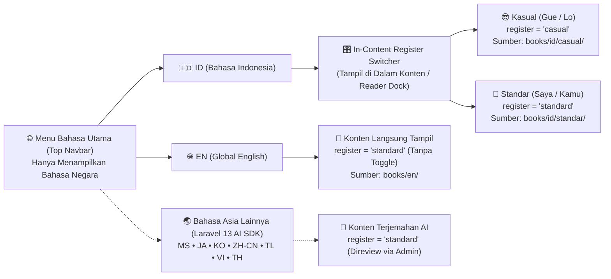

# Product Requirements Document (PRD): `crow.asia` v1.0 (Greenfield Project)

| Atribut Dokumen | Detail |
| :--- | :--- |
| **Nama Produk & Domain** | **`crow.asia`** — Tactical Leadership Field Playbook Platform for Asia |
| **Tipe Proyek** | **Greenfield Build (Proyek Baru dari Nol)** |
| **Tanggal Spesifikasi** | 24 Oktober 2026 |
| **Modal Aset Awal** | 9 File Naskah Buku GitHub Flavored Markdown (`books/{en,id/casual,id/standar}/book-{1,2,3}.md`) |
| **Bahasa Utama Saat Ini** | **2 Bahasa Utama di Menu Global**: `ID` (Indonesia) & `EN` (English) *(Siap ekspansi bahasa Asia via Laravel 13 AI SDK)* |
| **Fitur Khusus Bahasa ID** | **In-Content Register Switcher**: Pilihan gaya `Kasual (Gue/Lo)` vs `Standar (Saya/Kamu)` berada **di dalam area konten web**, bukan di menu bahasa utama |
| **Layout Desktop & Mobile** | **Desktop Full-Width Layout (`100vw`)** yang tetap responsif penuh di **Tablet** dan **Mobile** |

---

## 1. Visi Produk & Filosofi Brand `crow.asia`

### 1.1 Identitas `crow.asia`
Burung gagak (*Crow*) dikenal dalam sains perilaku sebagai makhluk cerdas, adaptif, taktis, dan mampu memecahkan masalah rumit menggunakan perkakas (*tool-maker*). **`crow.asia`** hadir sebagai platform *Interactive Field Playbook* bagi para pemimpin tim, supervisor, tech lead, hingga manajer divisi di Indonesia dan seluruh Asia—menyediakan perkakas meja kerja (*actionable scripts, visual frameworks, & interactive simulations*) yang langsung bisa dipakai tanpa basa-basi teoretis.

### 1.2 Modal Aset Awal (9 File Naskah Markdown)
Proyek ini dimulai dengan modal **9 file naskah buku berformat GitHub Flavored Markdown (`.md`)** (~16.000 kata / 15 bab per file, total 135 bab lintas edisi):
1. **Volume 01 (`book-1` — Rp 49.000 / $4.99)**:
   - *ID Kasual (`id` + `casual`)*: **Mahir Memimpin Tim: Strategi Bikin Tim Jadi Mandiri**
   - *ID Standar (`id` + `standard`)*: **Mahir Memimpin Tim: Strategi Menciptakan Tim yang Mandiri**
   - *EN (`en` + `standard`)*: **Practical Team Leadership: Developing Autonomous Teams**
2. **Volume 02 (`book-2` — Rp 49.000 / $4.99)**:
   - *ID Kasual (`id` + `casual`)*: **Napas Panjang Memimpin Tim: Strategi Atasi Jenuh dan Bangun Sistem Kerja Otomatis**
   - *ID Standar (`id` + `standard`)*: **Napas Panjang Memimpin Tim: Strategi Mengatasi Kejenuhan dan Membangun Sistem Kerja Mandiri**
   - *EN (`en` + `standard`)*: **Sustaining Your Leadership: Practical Strategies to Beat Burnout and Build Self-Running Teams**
3. **Volume 03 (`book-3` — Rp 99.000 / $9.99)**:
   - *ID Kasual (`id` + `casual`)*: **Memimpin Para Leader: Strategi Naik Kelas dari Mengatur Tim ke Menggerakkan Divisi**
   - *ID Standar (`id` + `standard`)*: **Memimpin Para Leader: Strategi Naik Kelas dari Mengarahkan Tim ke Menggerakkan Divisi**
   - *EN (`en` + `standard`)*: **Leading Other Leaders: Practical Strategies for Moving from Team Lead to Manager of Managers**
4. **Paket Bundel Trilogi (`bundle-all-3` — Rp 129.000 / $12.99 — Harga Coret Rp 197.000)**:
   - Membuka akses penuh ke seluruh 3 Volume Playbook (45 bab utama × seluruh bahasa & register) + unduhan Master PDF A5.

---

## 2. Arsitektur Bahasa (`Locale`) vs Gaya Bahasa (`Register`) & Ekspansi Asia

Pemisahan antara bahasa negara (`locale`) dan ragam sapaan (`register`) merupakan aturan produk inti pada `crow.asia`:

### 2.1 Menu Bahasa Global (Top Navigation Bar)
- Saat peluncuran awal (`v1.0`), menu pemilihan bahasa di Navbar atas (`GlobalLocaleMenu.tsx`) **hanya menampilkan 2 bahasa utama**:
  1. **`ID` — Bahasa Indonesia**
  2. **`EN` — English**
- **Ekspansi Pasar Asia (`crow.asia` Multi-Locale Ready)**:
  - Admin dapat menambahkan dan mengaktifkan bahasa negara Asia baru kapan saja (seperti **Melayu `ms`**, **Jepang `ja`**, **Korea `ko`**, **Mandarin `zh-CN`**, **Tagalog `tl`**, **Vietnam `vi`**, **Thailand `th`**) menggunakan fitur **One-Click LLM Translation Pipeline** berbasis **Laravel 13 AI SDK** di Dashboard Admin. Begitu satu bahasa Asia selesai diterjemahkan dan di-*publish* oleh Admin, bahasa tersebut otomatis muncul di Menu Bahasa Global.

### 2.2 Pemilih Gaya Bahasa Indonesia di Dalam Konten (*In-Content Register Switcher*)
- **Aturan Mutlak UX**: Pilihan **Kasual (`Gue/Lo`)** dan **Standar (`Saya/Kamu`)** **TIDAK BOLEH** ditaruh di dalam menu dropdown bahasa utama di Navbar.
- Ketika pengguna memilih bahasa **`ID`**, di **dalam area konten web** (pada *Tactical Reader Dock*, sub-header mobile, serta bagian atas *Hero & Live Script Demo* di Landing Page) muncul *segmented pill toggle* (`InContentRegisterToggle.tsx`):
  - **`😎 Santai (Gue/Lo)`** (`register = 'casual'`, Default untuk `ID`)
  - **`👔 Standar (Saya/Kamu)`** (`register = 'standard'`)
- Ketika pengguna memilih bahasa **`EN`** (atau bahasa Asia lainnya), *In-Content Register Switcher* otomatis disembunyikan dan sistem mengunci nilai `register = 'standard'`.

---

## 3. Spesifikasi Pengalaman Pengguna & Layout (User Experience Scope)

### 3.1 Desktop Full-Width Layout (`100vw`) yang Responsif di Tablet & Mobile
- **Tampilan Desktop (`>= 1024px`) — Full-Width Workspace**:
  - Ketika dibuka di layar desktop/laptop, `crow.asia` menggunakan **Full-Width Layout (`w-full max-w-none`)** yang memanfaatkan seluruh lebar layar monitor secara optimal:
    - **Di Halaman Web Reader**: Menggunakan **3-Pane Fluid App Shell**:
      1. *Left Pane (`280px–320px`, Collapsible)*: Navigasi cepat Volume 01–03, daftar 15 bab, indikator gembok/terbuka, dan bar progres latihan.
      2. *Center Pane (`flex-1 min-w-0`, Full Fluid Width)*: Panggung utama untuk **Mode Baca Interaktif** (dengan lebar baris teks baca dibatasi ergonomis `65ch–75ch` di tengah kanvas) maupun **Mode Animasi Landscape 16:9** yang melebar proporsional memenuhi panggung tengah.
      3. *Right Pane (`300px–340px`, Sticky Tactical Dock)*: Tempat mengubah **In-Content Register Switcher (`Kasual` | `Standar` untuk ID)**, mengetik **Nama Anggota Tim (`[Nama]`)**, memilih **Tema Kertas & Ukuran Huruf**, menekan tombol **SOS Topik (`Ctrl+K`)**, dan memantau ringkasan progres checklist bab aktif.
    - **Di Landing Page**: Menggunakan grid *Full-Width Editorial Bento* (`w-full px-6 lg:px-12 xl:px-16`) sehingga komposisi Hero Remotion 16:9 di kanan dan proposisi nilai utama di kiri tampil lega memenuhi layar lebar.
- **Tampilan Tablet (`768px–1023px`) & Mobile (`< 768px`)**:
  - Tetap 100% responsif: *Left Pane* dan *Right Pane* bertransformasi menjadi *Slide-Over Drawer* dan *Bottom Sheet* dengan target sentuh minimal `44×44px`, tanpa ada elemen yang meluber (*zero horizontal overflow*).

### 3.2 Fokus 2 Mode Utama di Web Reader
Di bagian atas *Center Pane* halaman Reader, pengguna dihadapkan pada **2 tab mode utama**:

1. **Mode 1: `📖 Mode Baca Interaktif` (Scrolling Mode — "Sat Set")**:
   - Menyajikan konten bab yang sudah dikompilasi dan disanitasi menjadi HTML matang (`compiled_html`) dari **Redis 8 Cache** (`< 25ms` respon server).
   - **Instant Script Personalizer**: Mengetik nama anggota tim (misal: `"Budi"`) langsung mengubah seluruh placeholder `[Nama]` di dalam seluruh skrip bab tersebut dalam `< 2ms` via manipulasi DOM langsung tanpa *re-parsing* Markdown.
   - **Copyable 1-on-1 Script Drawers**: Kotak lipat `
` dilengkapi tombol **"Salin Skrip"** dengan umpan balik instan.
   - **Tactical Diagrams**: Merender bagan alur Mermaid secara tajam dan responsif.
   - **Cloud-Synced Checklists**: Setiap centang latihan langsung tersimpan ke akun pengguna secara *optimistic* via Inertia.js v3.

2. **Mode 2: `🎬 Mode Animasi` (Landscape 16:9 `@remotion/player` — Bukan Video MP4)**:
   - Menampilkan panggung presentasi interaktif berasio **Landscape 16:9 (`1280×720`)** menggunakan [`@remotion/player`](https://www.remotion.dev/docs/player) v4.0 di atas React 19.3.
   - **Bukan Video Statis**: Seluruh visualisasi dirender sebagai komponen React + SVG secara *real-time* di browser (payload ringan `< 25 KB`, tanpa buffering video).
   - **Interactive Step Markers**: Dilengkapi 4 tombol navigasi segmen di bawah kanvas 16:9 (*Step 1: Masalah*, *Step 2: Kerangka*, *Step 3: Simulasi Dialog 1-on-1*, *Step 4: Rencana Aksi*) yang bisa diklik untuk melompat antar-bagian.
   - **Live Name & Register Sync**: Teks di dalam animasi Remotion 16:9 otomatis mengikuti pilihan bahasa (`ID`/`EN`), pilihan gaya bahasa (`Kasual`/`Standar`), dan nama anggota tim (`teammateName`) yang diketik pembaca.

3. **Modul Tambahan Opsional: Video YouTube (`is_youtube_enabled = false` Default)**:
   - Fitur video YouTube bersifat **opsional penuh**. Secara default, seluruh 45 bab hanya menggunakan Remotion Player 16:9.
   - Jika pada bab tertentu Admin mengaktifkan toggle `Enable Optional YouTube Video` dan mengisi ID video *Unlisted*, barulah muncul tombol sub-mode **`▶️ Video Penjelasan`** yang memutar video via *Shielded Player* (`youtube-nocookie.com` + *DOM Shield Overlay* anti klik kanan).

### 3.3 Fitur Konversi & Retensi Utama di Landing Page & Reader
1. **Kuis Diagnosis Kepemimpinan 45 Detik**: 3 pertanyaan situasional di Landing Page yang merekomendasikan Volume Playbook paling tepat (Buku 1, 2, atau 3) beserta tautan langsung ke bab sampel gratisnya.
2. **SOS Topik (`Ctrl+K` / `Cmd+K`)**: Modal pencarian darurat berbasis **PostgreSQL 18 Hybrid Search** (gabungan pencarian kata kunci `tsvector` + kemiripan makna `pgvector`) untuk menemukan skrip 1-on-1 dalam hitungan milidetik (misal: ketik *"staf defensif"* atau *"tolak lembur"*).
3. **Share Quote Card Generator**: Memungkinkan pembaca menyorot kalimat penting dan mengunduh kartu kutipan beridentitas `crow.asia` (rasio `1:1` atau `16:9`) untuk dibagikan ke LinkedIn/WhatsApp.

---

## 4. Spesifikasi Dashboard Admin (`Filament v5` Back-Office CMS)

Dashboard Admin (`/admin`) menggunakan **Filament v5 (Livewire v4)** untuk pengelolaan penuh `crow.asia` tanpa menyentuh kode:
1. **Manajemen Buku, Bab & Multi-Register Editor**:
   - Mengedit naskah bab untuk `ID (Kasual)`, `ID (Standar)`, dan `EN` (serta bahasa Asia lainnya) dengan *Live Preview* dan *Auto Pre-Compiler* ke PostgreSQL 18 & Redis 8 saat tombol **Save** ditekan.
2. **One-Click LLM Asian Translation Pipeline (`Laravel\Ai`)**:
   - Admin memilih bahasa target Asia (`ms`, `ja`, `ko`, `zh-CN`, `tl`, `vi`, `th`) dan menekan tombol **"Translate Book via AI"**. Queue worker menerjemahkan naskah bab demi bab menggunakan **Laravel 13 AI SDK** (dengan model **Gemini 3.8 Flash** / **Gemini 4 Argon**) sambil menjaga keutuhan struktur Markdown, tabel, diagram Mermaid, catatan kaki `[^n]`, dan token `[Nama]`, lalu menyimpannya sebagai `DRAFT` atau `REVIEW` sebelum di-*publish*.
3. **Remotion 16:9 Scene Configurator & Optional YouTube Toggle**:
   - Mengatur teks 4 *Step Markers* dan dialog pada komposisi Remotion 16:9 per bab, serta menyalakan/mematikan modul video YouTube opsional.
4. **Manajemen Paket Harga, Order Mayar & 1-Click Entitlements**:
   - Mengatur harga satuan & bundel, memantau log webhook pembayaran Mayar.id, dan membuka akses buku ke email pembaca dengan 1 klik.
