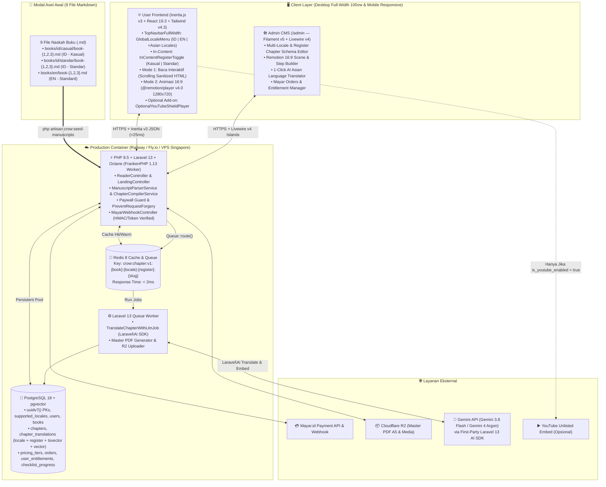

# Software Architecture Document (SADoc): `crow.asia` v1.0 (Greenfield)

| Atribut Dokumen | Detail |
| :--- | :--- |
| **Nama Sistem** | **`crow.asia`** — Pan-Asian Interactive Leadership Field Playbook Platform |
| **Pola Arsitektur** | **Modern High-Speed Monolith** (PHP 8.5 + Laravel 13 + Octane FrankenPHP 1.13 + Filament v5 + Inertia v3 React 19.3 + PostgreSQL 18 + Redis 8) |
| **Modal Konten Awal** | 9 File Naskah Markdown (`books/{en,id/casual,id/standar}/book-{1,2,3}.md`) |

---

## 1. Diagram Arsitektur Container (C4 Level 2 — Mermaid)



---

## 2. Struktur Direktori Monorepo `crow.asia`

```text
crow.asia/
├── AGENTS.md                                 # Guardrails utama untuk OpenCode Agent
├── books/                                    # 📂 Modal Awal: 9 File Naskah Markdown (.md)
│   ├── en/book-{1,2,3}.md
│   ├── id/casual/book-{1,2,3}.md
│   └── id/standar/book-{1,2,3}.md
├── app/
│   ├── Ai/
│   │   └── Agents/
│   │       └── ManuscriptTranslatorAgent.php # Agent Laravel 13 AI SDK untuk translasi bahasa Asia
│   ├── Console/Commands/
│   │   ├── SeedManuscriptsCommand.php        # php artisan crow:seed-manuscripts
│   │   ├── WarmChapterCacheCommand.php       # php artisan crow:warm-cache
│   │   └── GenerateIllustrationsCommand.php  # php artisan crow:generate-illustrations
│   ├── Enums/
│   │   ├── ContentRegister.php               # 'casual', 'standard'
│   │   ├── PaymentStatus.php                 # 'PENDING', 'PAID', 'CLOSED', 'EXPIRED'
│   │   └── TranslationStatus.php             # 'DRAFT', 'REVIEW', 'PUBLISHED'
│   ├── Filament/
│   │   ├── Resources/
│   │   │   ├── BookResource.php
│   │   │   ├── ChapterResource.php           # Filament v5 Schema Editor + Remotion 16:9 Builder + Toggle YouTube
│   │   │   ├── SupportedLocaleResource.php   # Manajemen Bahasa (ID, EN, MS, JA, KO, ZH-CN, TL, VI, TH) & AI Trigger
│   │   │   ├── PricingTierResource.php
│   │   │   ├── OrderResource.php
│   │   │   └── UserResource.php
│   ├── Http/Controllers/
│   │   ├── LandingController.php
│   │   ├── ReaderController.php
│   │   ├── ChecklistController.php
│   │   ├── SearchController.php
│   │   ├── DashboardController.php
│   │   ├── CheckoutController.php
│   │   ├── DownloadPdfController.php
│   │   └── Webhooks/MayarWebhookController.php
│   ├── Jobs/
│   │   └── TranslateChapterWithLlmJob.php    # Job penerjemah otomatis ke bahasa Asia via Laravel\Ai
│   ├── Models/
│   │   ├── User.php
│   │   ├── SupportedLocale.php
│   │   ├── Book.php
│   │   ├── Chapter.php
│   │   ├── ChapterTranslation.php
│   │   ├── PricingTier.php
│   │   ├── Order.php
│   │   ├── UserEntitlement.php
│   │   └── ChecklistProgress.php
│   └── Services/
│       ├── Content/
│       │   ├── ManuscriptParserService.php
│       │   ├── ChapterCompilerService.php
│       │   ├── ChapterCacheService.php
│       │   └── LlmTranslationService.php
│       ├── Payment/
│       │   ├── MayarInvoiceService.php
│       │   └── EntitlementSyncService.php
│       └── Storage/
│           └── CloudflareR2Service.php
├── resources/
│   ├── css/
│   │   └── app.css                           # Tailwind CSS v4.3 (@import "tailwindcss"; + @theme tokens)
│   └── js/
│       ├── app.tsx                           # Entrypoint Inertia.js v3 + React 19.3
│       ├── types/
│       │   ├── crow.ts
│       │   └── remotion.ts
│       ├── Layouts/
│       │   ├── FullWidthWorkspaceLayout.tsx  # Layout Desktop 100vw (Left Sidebar + Fluid Center + Right Dock)
│       │   └── MarketingFullWidthLayout.tsx  # Layout Full-Width untuk Landing Page
│       ├── Pages/
│       │   ├── Landing.tsx
│       │   ├── Dashboard.tsx
│       │   ├── Auth/Login.tsx
│       │   └── Reader/ChapterView.tsx
│       └── Components/
│           ├── navigation/
│           │   ├── TopNavbarFullWidth.tsx    # Navbar Full-Width utama
│           │   ├── GlobalLocaleMenu.tsx      # Hanya Bahasa Utama: ID, EN, (+Bahasa Asia Aktif)
│           │   └── InContentRegisterToggle.tsx # Toggle [😎 Kasual (Gue/Lo)] | [👔 Standar (Saya/Kamu)] khusus ID
│           ├── reader/
│           │   ├── ReaderModeSwitch.tsx      # Toggle [📖 Mode Baca] | [🎬 Mode Animasi 16:9]
│           │   ├── PreCompiledArticle.tsx
│           │   ├── ScriptPersonalizerInput.tsx
│           │   ├── TacticalRightDock.tsx
│           │   ├── SosSearchModal.tsx
│           │   ├── ShareQuoteModal.tsx
│           │   └── PaywallModal.tsx
│           └── remotion/                     # 🎬 ENGINE ANIMASI LANDSCAPE 16:9 (@remotion/player v4.0)
│               ├── LandscapeAnimationStage.tsx
│               ├── OptionalYouTubeShieldPlayer.tsx
│               └── compositions/
│                   ├── HeroTrilogy16x9Comp.tsx
│                   ├── Framework3KLoop16x9Comp.tsx
│                   └── ChapterInteractiveStory16x9Comp.tsx
├── tests/
│   ├── Feature/
│   │   ├── ModelTest.php
│   │   ├── ReaderAccessTest.php
│   │   ├── SearchTest.php
│   │   ├── MayarWebhookTest.php
│   │   ├── AdminPanelTest.php
│   │   └── LlmTranslationTest.php
│   └── Unit/
│       └── ArchitectureTest.php              # Pest 5 arch()->preset()->laravel()
├── Dockerfile
└── compose.yaml
```

---

## 3. Skema Database PostgreSQL 18 (Multi-Locale, In-Content Register & Hybrid Search Ready)

> **Catatan PostgreSQL 18**: Menggunakan fungsi bawaan `uuidv7()` pada seluruh kolom UUID Primary Key agar penyisipan baris terurut berdasarkan waktu pembuatan (*time-ordered UUID*) dan menjaga performa B-Tree Index tetap optimal.

```sql
-- Aktifkan ekstensi pgvector untuk Hybrid Semantic Search (Laravel 13 AI SDK)
CREATE EXTENSION IF NOT EXISTS vector;

-- 1. Tabel Bahasa yang Didukung (supported_locales)
-- Mengatur bahasa apa saja yang tampil di Menu Bahasa Utama Navbar (Saat ini: 'id' & 'en', siap ekspansi Asia)
CREATE TABLE supported_locales (
    code VARCHAR(16) PRIMARY KEY,             -- 'id', 'en', 'ms', 'ja', 'ko', 'zh-CN', 'tl', 'vi', 'th'
    name VARCHAR(64) NOT NULL,                -- 'Indonesian', 'English', 'Japanese', 'Korean', dll.
    native_name VARCHAR(64) NOT NULL,         -- 'Bahasa Indonesia', 'English', '日本語', '한국어', dll.
    flag_emoji VARCHAR(16) NOT NULL,          -- '🇮🇩', '🌐', '🇯🇵', '🇰🇷', '🇲🇾'
    has_dual_register BOOLEAN NOT NULL DEFAULT false, -- TRUE hanya untuk 'id' (Kasual & Standar)
    is_active BOOLEAN NOT NULL DEFAULT false, -- TRUE untuk 'id' dan 'en' saat rilis awal
    is_llm_translated BOOLEAN NOT NULL DEFAULT false,
    sort_order SMALLINT NOT NULL DEFAULT 1,
    created_at TIMESTAMPTZ NOT NULL DEFAULT NOW(),
    updated_at TIMESTAMPTZ NOT NULL DEFAULT NOW()
);

INSERT INTO supported_locales (code, name, native_name, flag_emoji, has_dual_register, is_active, sort_order) VALUES
('id', 'Indonesian', 'Bahasa Indonesia', '🇮🇩', true, true, 1),
('en', 'English', 'English', '🌐', false, true, 2),
('ms', 'Malay', 'Bahasa Melayu', '🇲🇾', false, false, 3),
('ja', 'Japanese', '日本語', '🇯🇵', false, false, 4),
('ko', 'Korean', '한국어', '🇰🇷', false, false, 5),
('zh-CN', 'Simplified Chinese', '简体中文', '🇨🇳', false, false, 6),
('tl', 'Tagalog', 'Tagalog', '🇵🇭', false, false, 7),
('vi', 'Vietnamese', 'Tiếng Việt', '🇻🇳', false, false, 8),
('th', 'Thai', 'ภาษาไทย', '🇹🇭', false, false, 9);

-- 2. Tabel Pengguna (users)
CREATE TABLE users (
    id UUID PRIMARY KEY DEFAULT uuidv7(),
    name VARCHAR(120) NULL,
    email VARCHAR(255) NOT NULL UNIQUE,
    password VARCHAR(255) NULL,
    role VARCHAR(20) NOT NULL DEFAULT 'reader' CHECK (role IN ('reader', 'editor', 'admin')),
    preferred_locale VARCHAR(16) NOT NULL DEFAULT 'id' REFERENCES supported_locales(code),
    preferred_id_register VARCHAR(16) NOT NULL DEFAULT 'casual' CHECK (preferred_id_register IN ('casual', 'standard')),
    email_verified_at TIMESTAMPTZ NULL,
    remember_token VARCHAR(100) NULL,
    created_at TIMESTAMPTZ NOT NULL DEFAULT NOW(),
    updated_at TIMESTAMPTZ NOT NULL DEFAULT NOW()
);

-- 3. Tabel Master Buku (books)
CREATE TABLE books (
    id VARCHAR(32) PRIMARY KEY,               -- 'book-1', 'book-2', 'book-3'
    volume_number SMALLINT NOT NULL UNIQUE,   -- 1, 2, 3
    volume_code VARCHAR(20) NOT NULL,         -- 'VOL. 01', 'VOL. 02', 'VOL. 03'
    price_single_idr INTEGER NOT NULL,
    price_single_usd NUMERIC(6,2) NOT NULL DEFAULT 4.99,
    accent_hex VARCHAR(16) NOT NULL DEFAULT '#1D4ED8',
    titles JSONB NOT NULL,                    -- {"id:casual": "...", "id:standard": "...", "en:standard": "..."}
    subtitles JSONB NOT NULL,
    target_roles JSONB NOT NULL,
    key_frameworks JSONB NOT NULL,
    pdf_r2_keys JSONB NOT NULL,
    is_active BOOLEAN NOT NULL DEFAULT true,
    created_at TIMESTAMPTZ NOT NULL DEFAULT NOW(),
    updated_at TIMESTAMPTZ NOT NULL DEFAULT NOW()
);

-- 4. Tabel Struktur Bab & Konfigurasi Mode Animasi 16:9 (chapters)
CREATE TABLE chapters (
    id BIGSERIAL PRIMARY KEY,
    book_id VARCHAR(32) NOT NULL REFERENCES books(id) ON DELETE CASCADE,
    chapter_index SMALLINT NOT NULL,          -- 0..14
    slug VARCHAR(32) NOT NULL,                -- 'ch-0'..'ch-14'
    is_free_sample BOOLEAN NOT NULL DEFAULT false, -- true untuk ch-0 & ch-1
    motif_icon VARCHAR(32) NOT NULL DEFAULT 'compass',
    illustration_path VARCHAR(255) NULL,      -- '/illustrations/book-1/ch-0.webp'
    
    -- Engine Utama: Remotion Landscape 16:9 (1280x720)
    remotion_composition_id VARCHAR(64) NOT NULL DEFAULT 'ChapterInteractiveStory16x9',
    remotion_duration_frames INTEGER NOT NULL DEFAULT 540,
    remotion_fps SMALLINT NOT NULL DEFAULT 30,
    
    -- Modul Video YouTube (OPSIONAL, Default = false)
    is_youtube_enabled BOOLEAN NOT NULL DEFAULT false,
    youtube_unlisted_id VARCHAR(64) NULL,
    
    created_at TIMESTAMPTZ NOT NULL DEFAULT NOW(),
    updated_at TIMESTAMPTZ NOT NULL DEFAULT NOW(),
    CONSTRAINT uq_book_chapter_slug UNIQUE (book_id, slug),
    CONSTRAINT uq_book_chapter_index UNIQUE (book_id, chapter_index)
);

-- 5. Tabel Konten Bab Multi-Locale & Multi-Register (chapter_translations)
CREATE TABLE chapter_translations (
    id BIGSERIAL PRIMARY KEY,
    chapter_id BIGINT NOT NULL REFERENCES chapters(id) ON DELETE CASCADE,
    locale VARCHAR(16) NOT NULL REFERENCES supported_locales(code), -- 'id', 'en', 'ja', 'ms', dll.
    register VARCHAR(16) NOT NULL DEFAULT 'standard' CHECK (register IN ('casual', 'standard')),
    
    title VARCHAR(255) NOT NULL,
    illustration_caption TEXT NULL,
    
    -- Sumber Markdown & Output Pre-Compiler (Sanitized HTML)
    raw_markdown TEXT NOT NULL,
    compiled_html TEXT NOT NULL,
    safe_preview_html TEXT NOT NULL,
    has_scripts BOOLEAN NOT NULL DEFAULT false,
    extracted_checklists JSONB NOT NULL DEFAULT '[]'::jsonb,
    remotion_scene_props JSONB NOT NULL DEFAULT '{}'::jsonb,
    
    -- Status Publikasi (Mendukung Review Hasil Terjemahan AI Bahasa Asia)
    translation_status VARCHAR(20) NOT NULL DEFAULT 'PUBLISHED' CHECK (translation_status IN ('DRAFT', 'REVIEW', 'PUBLISHED')),
    
    -- Kolom Hybrid Search (Lexical FTS + Semantic Vector Search)
    search_vector TSVECTOR,
    embedding vector(768) NULL,
    
    compiled_at TIMESTAMPTZ NOT NULL DEFAULT NOW(),
    updated_at TIMESTAMPTZ NOT NULL DEFAULT NOW(),
    CONSTRAINT uq_chapter_locale_register UNIQUE (chapter_id, locale, register)
);

CREATE INDEX idx_chapter_translations_search ON chapter_translations USING GIN (search_vector);
CREATE INDEX idx_chapter_translations_embedding ON chapter_translations USING hnsw (embedding vector_cosine_ops);

-- 6. Tabel Paket Harga (pricing_tiers), Pesanan (orders), Hak Akses (user_entitlements), & Checklist (checklist_progress)
CREATE TABLE pricing_tiers (
    id VARCHAR(32) PRIMARY KEY,               -- 'tier-book-1', 'tier-book-2', 'tier-book-3', 'bundle-all-3'
    names JSONB NOT NULL,                     -- {"id": "...", "en": "..."}
    descriptions JSONB NOT NULL,
    features JSONB NOT NULL,
    badges JSONB NULL,
    price_idr INTEGER NOT NULL,
    strike_price_idr INTEGER NULL,
    price_usd NUMERIC(6,2) NOT NULL,
    included_book_ids JSONB NOT NULL,         -- ["book-1"] atau ["book-1", "book-2", "book-3"]
    sort_order SMALLINT NOT NULL DEFAULT 1,
    is_best_value BOOLEAN NOT NULL DEFAULT false,
    is_active BOOLEAN NOT NULL DEFAULT true,
    created_at TIMESTAMPTZ NOT NULL DEFAULT NOW(),
    updated_at TIMESTAMPTZ NOT NULL DEFAULT NOW()
);

CREATE TABLE orders (
    id UUID PRIMARY KEY DEFAULT uuidv7(),
    order_number VARCHAR(64) NOT NULL UNIQUE,
    user_id UUID NULL REFERENCES users(id) ON DELETE SET NULL,
    customer_email VARCHAR(255) NOT NULL,
    pricing_tier_id VARCHAR(32) NOT NULL REFERENCES pricing_tiers(id),
    amount_idr INTEGER NOT NULL,
    mayar_invoice_id VARCHAR(128) NULL UNIQUE,
    mayar_transaction_id VARCHAR(128) NULL UNIQUE,
    payment_link TEXT NULL,
    payment_status VARCHAR(20) NOT NULL DEFAULT 'PENDING' CHECK (payment_status IN ('PENDING', 'PAID', 'CLOSED', 'EXPIRED')),
    raw_webhook_payload JSONB NULL,
    paid_at TIMESTAMPTZ NULL,
    created_at TIMESTAMPTZ NOT NULL DEFAULT NOW(),
    updated_at TIMESTAMPTZ NOT NULL DEFAULT NOW()
);

CREATE INDEX idx_orders_customer_email ON orders (customer_email);

CREATE TABLE user_entitlements (
    id UUID PRIMARY KEY DEFAULT uuidv7(),
    user_id UUID NOT NULL REFERENCES users(id) ON DELETE CASCADE,
    book_id VARCHAR(32) NOT NULL REFERENCES books(id) ON DELETE RESTRICT,
    order_id UUID NULL REFERENCES orders(id) ON DELETE SET NULL,
    is_active BOOLEAN NOT NULL DEFAULT true,
    granted_at TIMESTAMPTZ NOT NULL DEFAULT NOW(),
    CONSTRAINT uq_user_book UNIQUE (user_id, book_id)
);

CREATE TABLE checklist_progress (
    id UUID PRIMARY KEY DEFAULT uuidv7(),
    user_id UUID NOT NULL REFERENCES users(id) ON DELETE CASCADE,
    book_id VARCHAR(32) NOT NULL REFERENCES books(id) ON DELETE CASCADE,
    chapter_slug VARCHAR(32) NOT NULL,
    item_index SMALLINT NOT NULL,
    is_completed BOOLEAN NOT NULL DEFAULT false,
    updated_at TIMESTAMPTZ NOT NULL DEFAULT NOW(),
    CONSTRAINT uq_user_checklist UNIQUE (user_id, book_id, chapter_slug, item_index)
);
```

---

## 4. Kontrak Props Inertia v3 untuk Halaman Reader (`ReaderController.php`)

Saat pengguna mengakses `/read/{bookId}/{locale}/{chapterSlug}` (dengan opsional query `?reg=casual` atau cookie `crow:id-register`), `ReaderController` mengembalikan payload JSON Inertia v3 yang sudah dipangkas secara aman di sisi server sesuai hak akses (`hasAccess`):

```typescript
// resources/js/types/crow.ts
import { ChapterLandscapeStoryProps, ContentRegister, LocaleCode } from './remotion';

export interface ReaderPageInertiaProps {
  book: {
    id: 'book-1' | 'book-2' | 'book-3';
    volumeCode: string;
    accentHex: string;
    title: string;
    subtitle: string;
  };
  locale: LocaleCode; // 'id' | 'en' | 'ja' | 'ms' ...
  activeRegister: ContentRegister; // 'casual' | 'standard' (Selalu 'standard' jika locale !== 'id')
  showRegisterSwitcher: boolean; // TRUE hanya jika locale === 'id'
  supportedLocales: {
    code: LocaleCode;
    name: string;
    nativeName: string;
    flagEmoji: string;
    isLlmTranslated: boolean;
  }[];
  currentChapter: {
    index: number;
    slug: string;
    title: string;
    isFreeSample: boolean;
    hasAccess: boolean;
    hasScripts: boolean;
    illustrationPath: string | null;
    illustrationCaption: string | null;
    // Jika hasAccess === true, berisi compiled_html penuh; jika false, HANYA berisi safe_preview_html (3 paragraf)
    displayHtml: string;
    checklists: { itemIndex: number; labelHtml: string; isCompleted: boolean }[];
    remotionConfig: {
      compositionId: string;
      width: 1280;
      height: 720;
      fps: 30;
      durationInFrames: number;
      // Jika hasAccess === false, hanya Step 1 (Preview Masalah) yang dikirim; Step 2-4 dikosongkan di server
      sceneProps: ChapterLandscapeStoryProps;
    };
    optionalYoutube: {
      isEnabled: boolean; // Default: false
      videoId: string | null; // Hanya dikirim jika isEnabled === true && hasAccess === true
    };
  };
  allChapters: {
    index: number;
    slug: string;
    title: string;
    isFreeSample: boolean;
    isUnlocked: boolean;
  }[];
}
```

---

## 5. Komponen Keamanan, Shielded YouTube Player & Hybrid Search

### 5.1 Arsitektur `OptionalYouTubeShieldPlayer.tsx`
- Hanya dirender ketika `currentChapter.optionalYoutube.isEnabled === true` dan `currentChapter.optionalYoutube.videoId !== null`.
- Menggunakan domain privasi `https://www.youtube-nocookie.com/embed/{videoId}?rel=0&modestbranding=1&playsinline=1`.
- Dilapisi elemen transparan *DOM Shield Overlay* di bagian header atas iframe dan intercept `onContextMenu={(e) => e.preventDefault()}` untuk mencegah penyalinan URL *Unlisted* secara kasual.

### 5.2 Arsitektur `SearchController.php` (SOS Topik `Ctrl+K`)
- Menerima parameter `q` (minimal 2 karakter), `locale`, dan `register`.
- Memfilter hanya pada baris `chapter_translations` dengan `translation_status = 'PUBLISHED'`, `locale = :locale`, dan `register = (:locale === 'id' ? :register : 'standard')`.
- Mengembalikan maksimal 8 hasil teratas beserta `book_id`, `chapter_slug`, `chapter_title`, `ts_headline` snippet aman (35 kata), dan flag `is_unlocked` agar pembaca dapat langsung melompat ke bab terkait.
