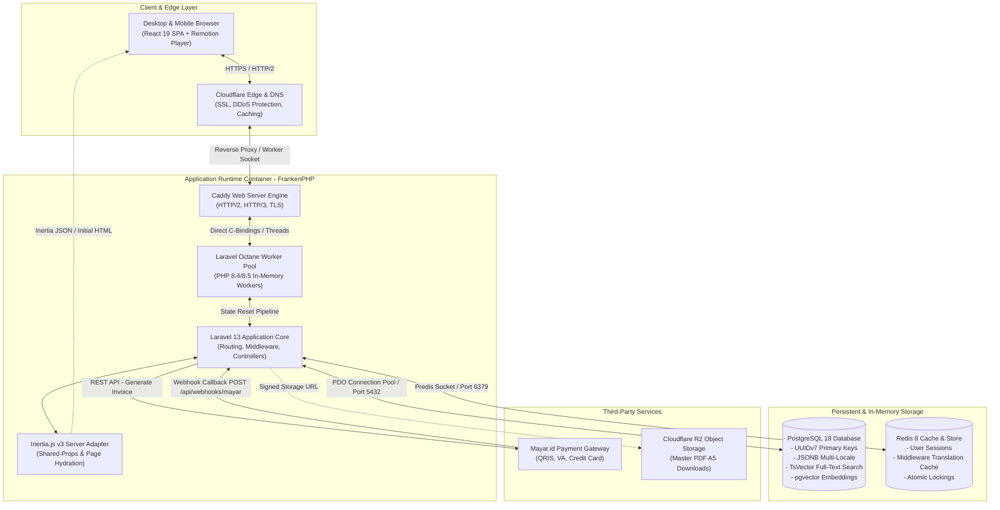
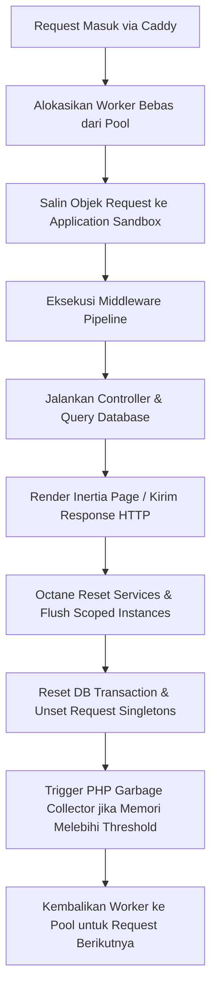
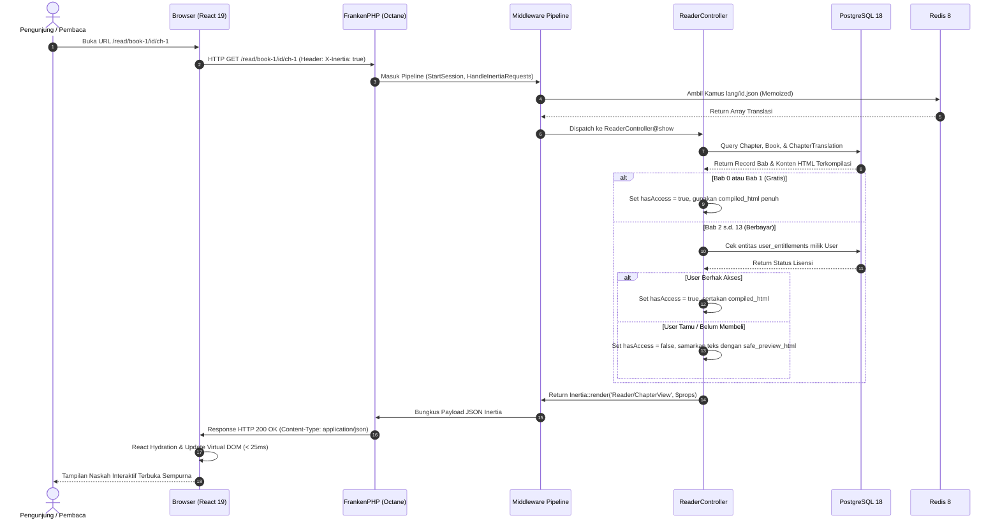

# 01. Arsitektur Sistem & Runtime Environment

Dokumen ini memaparkan arsitektur runtime, siklus hidup request (*request-response lifecycle*), dan integrasi hybrid antara backend Laravel 13 dan frontend React 19 melalui Inertia.js v3 pada platform **`crow.asia`**.

---

## 1. Diagram Arsitektur Sistem (C4 Container Diagram)

Platform `crow.asia` dirancang menggunakan arsitektur monolitik modern yang sangat teroptimasi (*high-performance monolithic architecture*), menggabungkan kecepatan pemrosesan data di server dengan fleksibilitas antarmuka pengguna berbasis komponen.



---

## 2. FrankenPHP Worker Mode & Siklus Hidup Octane

Aplikasi berjalan di atas **FrankenPHP** menggunakan driver **Laravel Octane**. Berbeda dengan model tradisional PHP-FPM di mana setiap request HTTP melakukan *cold-boot* seluruh framework dari nol, FrankenPHP memuat kernel Laravel ke dalam memori RAM sekali saat container dijalankan (*bootstrap once, run indefinitely*).

### A. Keuntungan Performa:
- **Zero Framework Boot Overhead:** Waktu inisialisasi framework (~30–50ms pada PHP-FPM) terpangkas hingga 0ms.
- **Persistent Database Connection:** Koneksi PostgreSQL dipertahankan tetap terbuka antar-request (*connection pooling* bawaan), menghemat latensi handshake TCP dan autentikasi TLS database.
- **Sub-25ms Response Time:** Waktu respon (*Time to First Byte* / TTFB) halaman landing dan pembaca stabil di bawah 25 milidetik pada beban konkurensi tinggi.

### B. Manajemen State & Pencegahan Memory Leak:
Karena proses PHP berjalan terus-menerus di memori, Laravel Octane menerapkan siklus pembersihan state antar-request:



### C. Konfigurasi Container (`compose.yaml`):
```yaml
services:
  app:
    image: dunglas/frankenphp:latest-php8.4-alpine
    restart: unless-stopped
    ports:
      - "8000:8000"
    environment:
      OCTANE_SERVER: frankenphp
      OCTANE_WORKERS: 4
      OCTANE_MAX_REQUESTS: 2500
    volumes:
      - .:/app
    depends_on:
      - postgres
      - redis
```
- `OCTANE_WORKERS`: Menjalankan 4 worker paralel yang sesuai dengan jumlah core CPU.
- `OCTANE_MAX_REQUESTS`: Melakukan daur ulang (*graceful worker restart*) setiap 2.500 request untuk mengantisipasi potensi akumulasi memori tak terduga pada library pihak ketiga.

---

## 3. Integrasi Inertia.js v3 & React 19 Client Hydration

Platform ini memanfaatkan arsitektur **Inertia.js v3** sebagai jembatan yang menghubungkan Laravel dan React 19 tanpa memerlukan pembangunan lapisan REST API boilerplate secara terpisah.

### A. Mekanisme Komunikasi:
1. **Kunjungan Pertama (*Initial Page Load*):**  
   Server mengembalikan dokumen HTML lengkap dengan root element `<div id="app" data-page="..."></div>` yang berisi data props awal dalam format JSON yang aman. React 19 melakukan *client-side hydration* pada DOM tersebut.
2. **Navigasi Selanjutnya (*Subsequent Visits*):**  
   Ketika pengguna mengeklik tautan navigasi atau berpindah bab, Inertia melakukan request AJAX via header `X-Inertia: true`. Laravel merespon murni dengan payload JSON ramping (~2–5KB). React merender ulang komponen halaman tanpa memuat ulang seluruh aset CSS atau JS browser.

### B. Shared Props Contract (`HandleInertiaRequests.php`):
Middleware `App\Http\Middleware\HandleInertiaRequests` membagikan data global ke seluruh komponen React di setiap response:

```php
public function share(Request $request): array
{
    $locale = $this->resolveLocale($request);

    return [
        ...parent::share($request),
        'auth' => [
            'user' => $request->user() ? [
                'id' => $request->user()->id,
                'name' => $request->user()->name,
                'email' => $request->user()->email,
                'role' => $request->user()->role->value,
            ] : null,
        ],
        'locale' => $locale,
        'currency' => $locale === 'id' ? 'IDR' : 'USD',
        'translations' => $this->getTranslations($locale),
        'flash' => [
            'success' => fn () => $request->session()->get('success'),
            'error' => fn () => $request->session()->get('error'),
        ],
    ];
}
```

- **Translasi Ter-memoize:** Kamus bahasa (`lang/id.json` atau `lang/en.json`) di-cache di memori aplikasi sehingga pembacaan berkas JSON dari disk tidak diulang-ulang di setiap request.
- **Lazy Evaluation:** Penggunaan Closure (`fn () => ...`) memastikan evaluasi data sesi flash hanya dilakukan saat response benar-benar dikonsumsi.

---

## 4. Pipeline Middleware & Routing

Aplikasi memisahkan rute ke dalam dua domain utama:

### A. Peta Rute Aplikasi (`routes/web.php` & `routes/api.php`):

| Method | URI Path | Controller & Action | Akses / Guard | Fungsi |
| :--- | :--- | :--- | :--- | :--- |
| `GET` | `/` | `LandingController@index` | Publik | Landing page marketing, carousel 16:9, kuis, katalog, dan harga |
| `GET` | `/read/{bookId}/{locale}/{slug}` | `ReaderController@show` | Publik / Gated | Antarmuka pembaca Web Reader (Bab 0 & 1 gratis; Bab 2–13 berlisensi) |
| `GET` | `/checkout/{tierId}` | `CheckoutController@show` | Publik / Auth | Halaman ringkasan pembelian dan form data pembeli |
| `POST` | `/checkout/{tierId}/process` | `CheckoutController@process` | Publik / Auth | Inisiasi pesanan Mayar dan pengalihan ke payment gateway |
| `GET` | `/dashboard` | `DashboardController@index` | `auth` | Dashboard pembaca berlisensi, unduhan PDF, dan status pesanan |
| `POST` | `/api/reader/checklist-toggle` | `ReaderController@toggleChecklist` | `auth` | API sinkronisasi status checklist interaktif per bab |
| `POST` | `/api/webhooks/mayar` | `MayarWebhookController@handle` | Webhook Token | Endpoint penerima callback pembayaran Mayar (idempotent) |
| `GET` | `/admin` | Filament Admin Panel | `auth`, `admin` | Panel superadmin untuk mengelola naskah, lisensi, dan user |

### B. Urutan Eksekusi Global Middleware:
```text
1. Illuminate\Http\Middleware\TrustProxies (Menyelaraskan header Cloudflare/Reverse Proxy)
2. Illuminate\Http\Middleware\HandleCors (Mengatur header CORS)
3. Illuminate\Foundation\Http\Middleware\PreventRequestsDuringMaintenance
4. Illuminate\Cookie\Middleware\EncryptCookies (Enkripsi cookie browser)
5. Illuminate\Session\Middleware\StartSession (Mengaktifkan session Redis)
6. Illuminate\View\Middleware\ShareErrorsFromSession
7. App\Http\Middleware\HandleInertiaRequests (Menyuntikkan kamus i18n, auth, dan currency)
8. Route Dispatcher & Controller Invocation
```

---

## 5. Diagram Alur Lifecycle Request (End-to-End)

Diagram sequence berikut mengilustrasikan bagaimana request dari browser diproses hingga komponen React dihidrasi di sisi klien:


