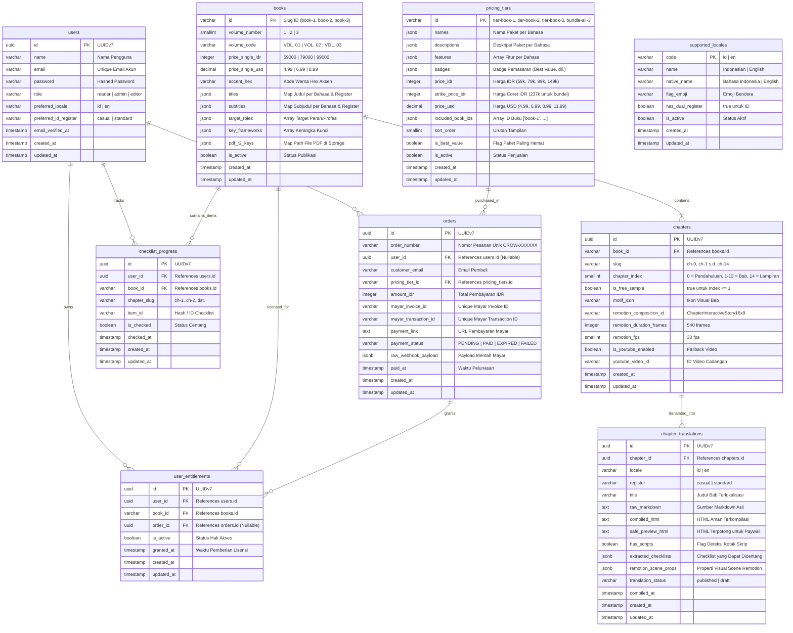

# 02. Skema Basis Data & Model Domain

Dokumen ini memaparkan arsitektur data, skema tabel relasional PostgreSQL 18, model domain Eloquent, tipe data khusus (UUIDv7, JSONB, TsVector, pgvector), serta kebijakan tata kelola basis data platform **`crow.asia`**.

---

## 1. Diagram Hubungan Entitas (*Entity-Relationship Diagram / ERD*)

Seluruh model data saling terhubung untuk mendukung penerbitan naskah multi-buku, translasi berformat JSONB, sistem lisensi hak baca, dan pencatatan pesanan berulang:



---

## 2. Standar Desain Basis Data

1. **Primary Key UUIDv7 (`uuidv7()`):**  
   Seluruh tabel dinamis (`users`, `chapters`, `chapter_translations`, `orders`, `user_entitlements`, `checklist_progress`) menggunakan UUIDv7 sebagai kunci utama bawaan PostgreSQL:
   ```sql
   id UUID PRIMARY KEY DEFAULT uuidv7()
   ```
   UUIDv7 mengombinasikan timestamp 48-bit presisi milidetik dengan byte acak kriptografis. Ini menjamin identitas unik global tanpa fragmentasi indeks B-Tree yang lazim terjadi pada UUIDv4 acak.
2. **Kamus Dokumen Bersarang (*JSONB Multi-Locale*):**  
   Kolom seperti `names`, `descriptions`, dan `features` pada `pricing_tiers` disimpan dalam format JSONB terstruktur:
   ```json
   {
     "id": ["Buka Penuh Bab 2 s.d. 13", "Master PDF A5", "Akses Selamanya"],
     "en": ["Full Access to Chapters 2-13", "A5 Master PDF", "Lifetime Access"]
   }
   ```
   Pola ini memungkinkan penambahan bahasa baru tanpa perlu mengubah struktur tabel (*zero schema migration*).
3. **Pencarian Teks Cepat (*TsVector Full-Text Search*):**  
   Tabel `chapter_translations` memanfaatkan kolom terindeks TsVector dan GIN (*Generalized Inverted Index*) untuk mendukung modal SOS Topic Search berkecepatan tinggi di dalam Web Reader:
   ```sql
   CREATE INDEX idx_chapter_translations_fts ON chapter_translations 
   USING gin(to_tsvector('simple', title || ' ' || raw_markdown));
   ```
4. **Kapasitas Vektor (*pgvector*):**  
   Ekstensi `pgvector` telah diaktifkan pada container PostgreSQL 18 untuk memfasilitasi kebutuhan pencarian semantik embedding teks dan rekomendasi bab berbasis kesamaan kosinus (*cosine similarity*) di masa mendatang.

---

## 3. Kamus Kolom & Integritas Relasional

### A. Tabel `books`
- `id` (VARCHAR 32, PK): Pengenal statis buku (`book-1`, `book-2`, `book-3`).
- `price_single_idr` (INTEGER): Harga pembelian satuan dalam Rupiah (`59000`, `79000`, `99000`).
- `price_single_usd` (DECIMAL 6,2): Harga pembelian satuan internasional dalam Dollar AS (`4.99`, `6.99`, `8.99`).
- `titles` & `subtitles` (JSONB): Memetakan judul per kombinasi bahasa dan register:
  `{"id:casual": "...", "id:standard": "...", "en:standard": "..."}`.
- `pdf_r2_keys` (JSONB): Lokasi objek berkas PDF A5 siap unduh di storage Cloudflare R2.

### B. Tabel `chapters`
- `book_id` (VARCHAR 32, FK): Menautkan bab ke induk buku (`ON DELETE CASCADE`).
- `slug` (VARCHAR 64): Pengenal ramah URL (`ch-0` untuk Pendahuluan, `ch-1` s.d. `ch-13` untuk Bab, `ch-14` untuk Lampiran).
- `is_free_sample` (BOOLEAN): Bernilai `true` untuk bab indeks 0 dan 1. Mengizinkan pembaca tamu membaca naskah tanpa lisensi berbayar.
- `remotion_composition_id` (VARCHAR 64): ID komposisi video Remotion pendamping bab.

### C. Tabel `chapter_translations`
- `chapter_id` (UUID, FK): Menautkan terjemahan ke entitas bab.
- `locale` (VARCHAR 16) & `register` (VARCHAR 16): Menentukan bahasa (`id`, `en`) dan gaya sapaan (`casual`, `standard`).
- `compiled_html` (TEXT): Hasil kompilasi aman dari `ChapterCompilerService`, siap dirender di Web Reader.
- `safe_preview_html` (TEXT): Pratinjau teks yang telah dipotong dan disamarkan untuk pengguna yang belum membeli lisensi.
- `extracted_checklists` (JSONB): Berisi array objek instrumen checklist:
  `[{"id": "chk-01", "text": "Melakukan audit 3P", "order": 1}]`.

### D. Tabel `pricing_tiers`
- `id` (VARCHAR 32, PK): `tier-book-1`, `tier-book-2`, `tier-book-3`, dan `bundle-all-3`.
- `price_idr` (INTEGER): `59000`, `79000`, `99000`, dan `149000`.
- `strike_price_idr` (INTEGER, Nullable): `237000` (khusus bundel untuk menampilkan penghematan Rp88.000).
- `included_book_ids` (JSONB): Array buku yang dicakup oleh tier: `["book-1", "book-2", "book-3"]`.

### E. Tabel `user_entitlements`
- `user_id` (UUID, FK): Pengguna yang berhak membaca.
- `book_id` (VARCHAR 32, FK): Buku yang dilisensikan.
- `order_id` (UUID, FK, Nullable): Tautan ke pesanan transaksi yang mendasari pemberian lisensi.
- Unique Index: `(user_id, book_id)` untuk mencegah duplikasi kepemilikan lisensi yang sama.

---

## 4. Model Domain Eloquent & Method Accessor

### A. Model `Book` (`app/Models/Book.php`):
```php
class Book extends Model
{
    // Relasi ke seluruh bab buku
    public function chapters(): HasMany
    {
        return $this->hasMany(Chapter::class)->orderBy('chapter_index');
    }

    // Accessor judul dinamis berbasis locale dan register
    public function title(string $locale = 'id', ?ContentRegister $register = null): string
    {
        $reg = $register?->value ?? ($locale === 'id' ? 'standard' : 'standard');
        $key = "{$locale}:{$reg}";
        return $this->titles[$key] ?? $this->titles["{$locale}:standard"] ?? reset($this->titles) ?? '';
    }
}
```

### B. Model `PricingTier` (`app/Models/PricingTier.php`):
```php
class PricingTier extends Model
{
    // Mengambil fitur sesuai locale aktif
    public function features(string $locale = 'id'): array
    {
        $raw = $this->getAttribute('features');
        if (!is_array($raw)) return [];
        if (array_is_list($raw)) return $raw;

        $features = $raw[$locale] ?? $raw['id'] ?? reset($raw);
        return is_array($features) ? array_values($features) : [];
    }

    // Accessor harga coret USD otomatis untuk paket bundel
    public function getStrikePriceUsdAttribute(): ?float
    {
        return ($this->id === 'bundle-all-3' || $this->strike_price_idr !== null) ? 20.97 : null;
    }
}
```

### C. Model `User` (`app/Models/User.php`):
```php
class User extends Authenticatable
{
    // Relasi ke lisensi buku aktif
    public function entitlements(): HasMany
    {
        return $this->hasMany(UserEntitlement::class)->where('is_active', true);
    }

    // Pengecekan otorisasi baca buku
    public function hasAccessToBook(string $bookId): bool
    {
        if ($this->role === UserRole::ADMIN) return true;
        return $this->entitlements()->where('book_id', $bookId)->exists();
    }
}
```

---

## 5. Tata Kelola Database & Kebijakan MCP DBX

Sesuai aturan operasional yang ditetapkan pada `AGENTS.md`:

1. **Akses Resmi melalui MCP DBX:** Seluruh agen coding dilarang menggunakan terminal interaktif `psql` secara langsung jika kebutuhan inspeksi dapat dipenuhi melalui server MCP `dbx`.
2. **Koneksi Terdaftar:**
   - Nama Koneksi: `crow.asia - dbcrow` (`connection_id: 9fc17fc1-d5b1-408f-b4d7-2484a47be10d`)
   - Host: `127.0.0.1`, Port: `5432`, Database: `dbcrow`, User: `crow`.
3. **Pemberlakuan Mode Aman (*Read-Safe Policy*):**  
   Tool `tools.dbx.dbx_execute_query` menerapkan proteksi bawaan terhadap query destruktif tingkat tinggi (`DROP DATABASE`, `DELETE FROM` tanpa where). Perubahan skema dilakukan secara terstruktur melalui migrasi Laravel (`php artisan migrate`).
