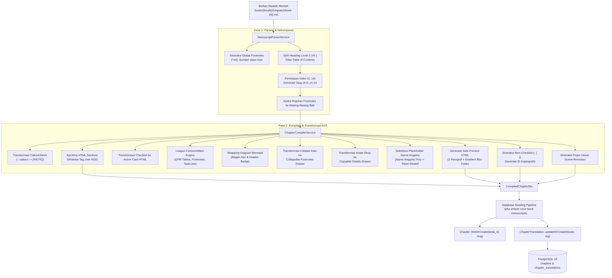

# 03. Pipeline Pengolahan Naskah & Kompiler

[← 02. Skema Basis Data](./02-database-schema-and-models.md) | [📚 Indeks Utama](./00-index-and-overview.md) | [04. Mesin Multibahasa →](./04-i18n-and-multilingual-engine.md)

---

Dokumen ini memaparkan arsitektur pipeline pengolahan naskah Markdown (*manuscript ingestion pipeline*), proses parsing *Abstract Syntax Tree* (AST), kompilasi HTML aman, transformasi blok taktis (Mermaid, kotak skrip, laci catatan kaki, checklist cloud), hingga eksekusi seeder pada platform **`crow.asia`**.

---

## 1. Struktur Berkas Naskah Sumber (`books/`)

Seluruh konten buku disimpan dalam bentuk berkas Markdown murni yang terlokalisasi dan terstruktur di direktori `books/`:

```text
books/
├── id/
│   ├── casual/                  # Register Kasual (Sapaan Gue/Lo)
│   │   ├── book-1.md            # VOL. 01: Mahir Memimpin Tim
│   │   ├── book-2.md            # VOL. 02: Napas Panjang Memimpin Tim
│   │   └── book-3.md            # VOL. 03: Memimpin Para Leader
│   └── standar/                 # Register Standar (Sapaan Saya/Kamu)
│       ├── book-1.md
│       ├── book-2.md
│       └── book-3.md
└── en/                          # Edisi Bahasa Inggris (Register Standar Internasional)
    ├── book-1.md                # VOL. 01: Mastering Team Leadership
    ├── book-2.md                # VOL. 02: Endurance in Team Leadership
    └── book-3.md                # VOL. 03: Leading Other Leaders
```

Setiap berkas naskah buku memuat 15 bagian utama yang dipisahkan oleh *Level-2 Headings* (`## `):
- **Index 0 (`ch-0`):** Pendahuluan, Cara Membaca Playbook, dan Kerangka Kunci (*Free Sample*).
- **Index 1 (`ch-1`):** Bab 1 — Fondasi & Intervensi Pertama (*Free Sample*).
- **Index 2 s.d. 13 (`ch-2` s.d. `ch-13`):** Bab 2 hingga Bab 13 — Inti Taktis & Skrip Percakapan (*Gated Paywall*).
- **Index 14 (`ch-14`):** Lampiran Ringkasan Meja Kerja & Rujukan Riset (*Gated Paywall*).

---

## 2. Diagram Alur Pipeline Kompilasi (*Ingestion Flowchart*)

Pipeline mengubah berkas Markdown mentah berukuran puluhan ribu baris menjadi entitas bab terpisah yang siap saji:



---

## 3. Arsitektur Parser (`ManuscriptParserService`)

Service `App\Services\Content\ManuscriptParserService` bertanggung jawab memecah naskah monolitik menjadi bab-bab terisolasi:

```php
public function parse(string $content): array
{
    // 1. Ekstraksi referensi sitasi global di akhir dokumen
    preg_match_all('/^\[\^([^\]]+)\]:\s*(.+)$/m', $content, $fnMatches, PREG_SET_ORDER);
    $globalFootnotes = [];
    foreach ($fnMatches as $m) {
        $globalFootnotes[$m[1]] = trim($m[2]);
    }

    // 2. Pemotongan berdasarkan Level-2 Headings (## )
    $sections = preg_split('/^##\s+/m', $content);
    array_shift($sections); // Buang preamble sebelum bab pertama

    $chapters = [];
    foreach ($sections as $s) {
        // Ekstraksi baris pertama sebagai Judul Bab
        $title = trim(substr($s, 0, strpos($s, "\n")));
        $body = trim(substr($s, strpos($s, "\n")));

        // Lewati jika merupakan Daftar Isi
        if (preg_match('/(daftar isi|table of contents)/i', $title)) continue;

        // Gabungkan bibliografi penutup ke dalam Bab 14 (Lampiran)
        if (preg_match('/(rujukan riset|daftar pustaka)/i', $title) && count($chapters) >= 15) {
            $chapters[count($chapters) - 1]['rawMarkdown'] .= "\n\n### " . $title . "\n\n" . $body;
            continue;
        }

        $index = count($chapters);
        $chapters[] = [
            'index' => $index,
            'slug' => "ch-{$index}",
            'title' => $this->cleanTitle($title),
            'rawMarkdown' => "## {$title}\n\n{$body}",
        ];
    }

    // 3. Injeksi catatan kaki yang relevan ke dalam badan bab terkait
    foreach ($chapters as &$chapter) {
        $chapter['rawMarkdown'] = $this->injectFootnotes($chapter['rawMarkdown'], $globalFootnotes);
    }

    return $chapters;
}
```

### Karakteristik Penting:
- **Footnote Self-Containment:** Footnote yang didefinisikan di bagian paling bawah naskah buku dipetakan dan diinjeksikan ulang secara lokal ke masing-masing bab yang mengutipnya. Dengan demikian, setiap bab bersifat mandiri (*atomic*) dan dapat dirender terpisah.
- **Daftar Isi Bypassing:** Bagian daftar isi statis di dalam file Markdown otomatis dibersihkan agar navigasi sepenuhnya dikendalikan oleh antarmuka reaktif aplikasi.

---

## 4. Arsitektur Kompiler (`ChapterCompilerService`)

Service `App\Services\Content\ChapterCompilerService` mengonfigurasi AST markdown dan mengaplikasikan transformasi elemen taktis:

### A. Ekstensi League CommonMark:
1. `CommonMarkCoreExtension`: Standar kepatuhan Markdown CommonMark.
2. `TableExtension`: Konversi tabel GFM dengan pembungkus `<div class="table-responsive">` agar ramah scroll horizontal di perangkat mobile.
3. `FootnoteExtension`: Konversi sitasi `[^1]` menjadi tautan jangkar inline `<sup><a href="#fn-1">1</a></sup>`.
4. `TaskListExtension`: Konversi `- [ ]` dan `- [x]` menjadi elemen input daftar tugas.

### B. Transformasi Blok Khusus (*Custom Callouts & Widgets*):

1. **Diagram Alur Kerja Mermaid (`crow-mermaid-block`):**
   ```php
   $html = preg_replace(
       '/<pre><code class="language-mermaid">(.*?)<\/code><\/pre>/s',
       '<div class="crow-mermaid-block"><div class="crow-mermaid-header"><span class="crow-mermaid-badge">' 
       . $mermaidBadge . '</span></div><pre class="mermaid">$1</pre></div>',
       $html
   );
   ```
   Diagram alur Mermaid dibungkus dengan kartu khusus bernuansa taktis, siap dirender langsung di browser klien via library `mermaid.js`.

2. **Laci Catatan Kaki Interaktif (*Collapsible Footnotes Drawer*):**
   ```php
   $html = preg_replace(
       '/<div class="footnotes"([^>]*)>(.*?)<\/div>/s',
       '<details class="crow-footnotes-drawer"><summary class="crow-footnotes-summary">'
       . '<span class="crow-footnotes-title">' . $footnoteLabel . '</span>'
       . '<span class="crow-footnotes-hint">' . $footnoteHint . '</span></summary>'
       . '<div class="footnotes"$1>$2</div></details>',
       $html
   );
   ```
   Daftar catatan kaki di bagian bawah bab ditransformasikan menjadi elemen `<details>` akordeon (default tertutup) agar tidak mengganggu fokus alur membaca naskah. Saat rujukan angka diklik di dalam naskah, laci ini membuka diri secara otomatis (*auto-expand*) melalui event listener di `ChapterView.tsx`.

3. **Kotak Skrip Siap Salin (*Copyable Script Drawers*):**
   Elemen `<details>` percakapan diinjeksi dengan atribut `class="crow-script-drawer"` dan `data-copy-script="true"`, memungkinkan antarmuka React menampilkan tombol **`📋 Salin Skrip`** dengan visual feedback tersalin (*copied confirmation*).

4. **Token Nama Rekan Tim Reaktif:**
   Placeholder seperti `[Nama Anggota Tim]` diubah menjadi:
   ```html
   <span class="teammate-token" data-default="Alex">Alex</span>
   ```
   Di masa depan, pembaca dapat mengganti nama ini dengan nama asli anak buahnya dan seluruh dialog di naskah akan berganti secara reaktif.

### C. Pemotongan Aman Paywall (`safe_preview_html`):
Untuk bab berbayar (Bab 2–13), kompiler menghasilkan cuplikan aman:
```php
private function generateSafePreview(string $fullHtml): string
{
    // Ambil maksimal 3 elemen pembuka pertama (<p> atau <blockquote>)
    preg_match_all('/<(p|blockquote)[^>]*>.*?<\/\1>/si', $fullHtml, $matches);
    if (!empty($matches[0])) {
        $previewBlocks = array_slice($matches[0], 0, 3);
        return implode("\n", $previewBlocks);
    }

    return Str::limit(strip_tags($fullHtml), 300);
}
```
Konten naskah selebihnya **sama sekali tidak dikirimkan ke browser** jika pengguna belum memiliki hak akses, menjamin keamanan hak cipta naskah dari inspeksi *DevTools*. Efek visual gradien buram (*fade out blur*) diterapkan di sisi frontend React (`ChapterView.tsx`).

---

## 5. Eksekusi Perintah Seeding (`php artisan crow:seed-manuscripts`)

Perintah artisan `App\Console\Commands\SeedManuscriptsCommand` mengorkestrasi kompilasi seluruh korpus naskah dalam satu operasi atomik:

```bash
php artisan crow:seed-manuscripts
```

### Tahapan yang Dijalankan Seeder:
1. **Inisialisasi Locale:** Menyimpan entitas `SupportedLocale` (`id` dan `en`).
2. **Inisialisasi Buku:** Menyimpan entitas 3 buku (`book-1`, `book-2`, `book-3`) beserta harga baru (Rp59rb, Rp79rb, Rp99rb).
3. **Kompilasi Naskah Bab (135 Terjemahan):**
   - 3 Buku x 3 Varian Bahasa/Register (`id:casual`, `id:standar`, `en:standard`).
   - Setiap varian memiliki 15 bab (Bab 0 s.d. 14).
   - Total pemrosesan: **3 x 3 x 15 = 135 berkas bab terjemahan**.
4. **Inisialisasi Paket Harga (`pricing_tiers`):**  
   Menyimpan 4 tier aktif (`tier-book-1`, `tier-book-2`, `tier-book-3`, dan `bundle-all-3` Rp149rb).

Proses seeder ini beroperasi secara *idempotent* menggunakan `updateOrCreate`, sehingga aman dijalankan berulang kali saat terjadi pembaruan teks naskah.

---

[← 02. Skema Basis Data](./02-database-schema-and-models.md) | [📚 Indeks Utama](./00-index-and-overview.md) | [04. Mesin Multibahasa →](./04-i18n-and-multilingual-engine.md)

