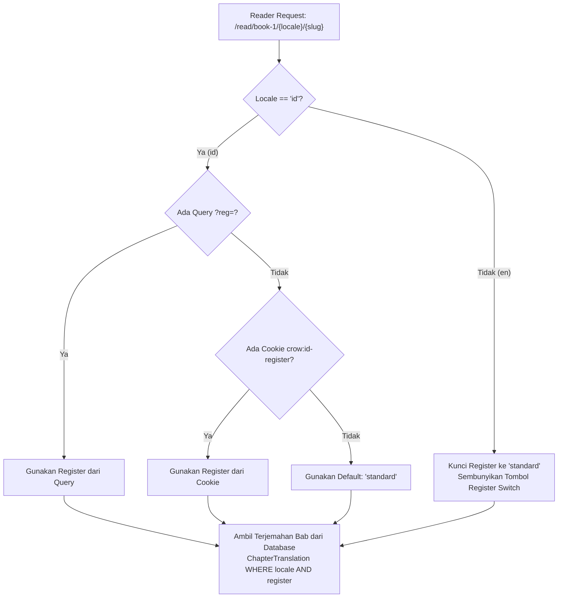
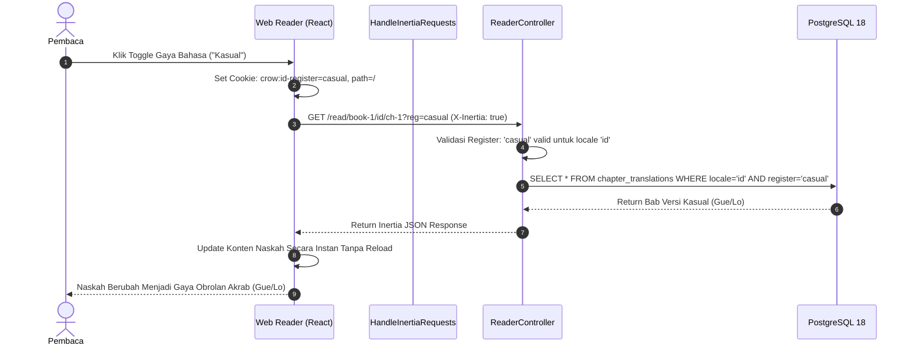

# 04. Mesin Multibahasa Dinamis & Sistem Dual-Register

[← 03. Pipeline Naskah](./03-manuscript-pipeline-and-compiler.md) | [📚 Indeks Utama](./00-index-and-overview.md) | [05. Web Reader & Remotion →](./05-reader-ui-and-remotion-engine.md)

---

Dokumen ini memaparkan arsitektur internasionalisasi (*i18n*), sistem kamus JSON terpusat, hook reaktif `useTranslation`, mesin register ganda bahasa Indonesia (Kasual vs Standar), dan penanganan mata uang ganda (*dual-currency*) pada platform **`crow.asia`**.

---

## 1. Arsitektur Kamus JSON Terpusat (`lang/`)

Alih-alih membebani bundel frontend dengan library pihak ketiga yang berat seperti `react-i18next`, `crow.asia` mengadopsi pendekatan **Native Zero-Dependency i18n Architecture**:

```text
lang/
├── id.json                      # Kamus resmi Bahasa Indonesia
└── en.json                      # Kamus resmi Bahasa Inggris
```

### Taksonomi Struktur Kamus:
Kamus diorganisasi berdasarkan domain fungsional halaman:
- `nav`: Label navigasi, tautan menu, placeholder pencarian, tombol autentikasi.
- `landing`: Seluruh teks landing page (Hero, Carousel 16:9, Kuis Diagnostik, Katalog 3 Buku, Paket Harga, Tabel Perbandingan 5 Baris, dan Akordeon FAQ).
- `reader`: Label UI pembaca naskah (tombol bab, laci catatan kaki, estimasi waktu baca, salin skrip, modal SOS Topic Search).
- `paywall`: Teks pengaman konten berbayar dan ajakan membeli akses penuh.
- `checkout`: Ringkasan transaksi, form data pembeli, dan garansi aktivasi instan.
- `dashboard`: Label pustaka buku pembaca dan riwayat pembelian.
- `auth`: Formulir login dan verifikasi kredensial.
- `compiler`: Badge penanda diagram alur Mermaid dan latihan meja kerja.
- `footer`: Tagline, deskripsi merek, dan hak cipta.

---

## 2. Shared Props Memoization (`HandleInertiaRequests.php`)

Middleware `App\Http\Middleware\HandleInertiaRequests` membagikan kamus terjemahan ke seluruh komponen React secara otomatis:

```php
class HandleInertiaRequests extends Middleware
{
    private static array $cachedTranslations = [];

    public function share(Request $request): array
    {
        $locale = $this->resolveLocale($request);

        return [
            ...parent::share($request),
            'locale' => $locale,
            'currency' => $locale === 'id' ? 'IDR' : 'USD',
            'translations' => $this->getTranslations($locale),
        ];
    }

    private function resolveLocale(Request $request): string
    {
        $supported = ['id', 'en'];
        $query = $request->query('locale');
        
        if ($query && in_array($query, $supported, true)) {
            return $query;
        }

        $cookie = $request->cookie('crow:locale');
        if ($cookie && in_array($cookie, $supported, true)) {
            return $cookie;
        }

        return 'id'; // Default sistem
    }

    private function getTranslations(string $locale): array
    {
        // Memoization di memori worker untuk mencegah pembacaan disk berulang
        if (!isset(self::$cachedTranslations[$locale])) {
            $path = base_path("lang/{$locale}.json");
            self::$cachedTranslations[$locale] = file_exists($path)
                ? json_decode(file_get_contents($path), true) ?? []
                : [];
        }

        return self::$cachedTranslations[$locale];
    }
}
```

### Mekanisme Hirarki Resolusi Bahasa:
1. **Query Parameter (`?locale=en`):** Mengambil prioritas tertinggi untuk memungkinkan pergantian bahasa instan via tautan atau dropdown.
2. **Cookie Persisten (`crow:locale`):** Menyimpan preferensi bahasa pengguna selama 1 tahun (`max-age: 31536000`, `SameSite: Lax`).
3. **Fallback Default (`'id'`):** Menjamin bahwa setiap pengguna lokal Indonesia langsung disambut dengan konten bahasa Indonesia tanpa konfigurasi manual.

---

## 3. Hook Reaktif `useTranslation.ts`

Di sisi frontend React 19, custom hook `resources/js/hooks/useTranslation.ts` menyediakan antarmuka sederhana untuk membaca kamus:

```typescript
export function useTranslation(): UseTranslationReturn {
    const pageProps = usePage().props as unknown as {
        translations?: Record<string, any>;
        locale?: LocaleCode;
        currency?: 'IDR' | 'USD';
    };

    const translations = pageProps?.translations || {};
    const locale = (pageProps?.locale || 'id') as LocaleCode;
    const currency = (pageProps?.currency || (locale === 'id' ? 'IDR' : 'USD')) as 'IDR' | 'USD';

    // Resolusi key dot-path: t('landing.hero.title')
    const t = (key: string, replacements?: TranslationReplacements): any => {
        const segments = key.split('.');
        let current: any = translations;

        for (const segment of segments) {
            if (current && typeof current === 'object' && segment in current) {
                current = current[segment];
            } else {
                current = null;
                break;
            }
        }

        if (current === null || current === undefined) return key;
        if (typeof current !== 'string') return current; // Mendukung return array/object

        let result = current;
        if (replacements) {
            for (const [rKey, rVal] of Object.entries(replacements)) {
                result = result.replaceAll(`:${rKey}`, String(rVal));
                result = result.replaceAll(`{${rKey}}`, String(rVal));
            }
        }
        return result;
    };

    // Format harga otomatis berbasis mata uang aktif
    const formatPrice = (amountIdr: number, amountUsd?: number | null): string => {
        if (currency === 'USD' && amountUsd !== undefined && amountUsd !== null) {
            return new Intl.NumberFormat('en-US', {
                style: 'currency',
                currency: 'USD',
                minimumFractionDigits: 2,
            }).format(amountUsd);
        }

        return new Intl.NumberFormat('id-ID', {
            style: 'currency',
            currency: 'IDR',
            maximumFractionDigits: 0,
        }).format(amountIdr);
    };

    return { t, locale, currency, formatPrice };
}
```

### Fitur Kunci Hook:
- **Nested Traversal:** Mampu membaca struktur data bersarang sedalam apa pun (`landing.catalog.cta_paragraphs.book-1`).
- **Flexible Return Types:** Jika nilai yang dituju adalah array atau objek (seperti daftar baris tabel perbandingan atau butir FAQ), hook mengembalikan struktur aslinya tanpa memaksakan konversi string.
- **Dual Parameter Syntax:** Mendukung format Laravel `t('chapter', { num: 1 })` untuk token `:num` maupun `{num}`.

---

## 4. Sistem Dual-Register Bahasa Indonesia (Kasual vs Standar)

Salah satu keunggulan unik `crow.asia` adalah penyediaan dua gaya bahasa Indonesia dalam naskah yang sama:
- **Register Kasual (`Gue/Lo`):** Menggunakan gaya tutur mentoring sebaya yang hangat, blak-blakan, dan akrab. Sangat cocok bagi pemimpin di kultur startup digital, agensi kreatif, dan generasi muda.
- **Register Standar (`Saya/Kamu`):** Menggunakan bahasa Indonesia yang mengalir, santun, lugas, dan profesional tanpa kaku seperti jurnal akademik. Cocok untuk lingkungan korporat, BUMN, perbankan, dan bisnis multi-cabang.

### Batasan Arsitektur yang Ketat (*Strict Domain Boundary*):
Sesuai rancangan arsitektur `restrict-id-registers-to-reader`:
1. **Landing Page 100% Formal:** Halaman depan, kuis, katalog, dan harga hanya menyajikan satu gaya bahasa resmi yang ramah dan konsisten menggunakan sapaan **"Kamu"**.
2. **Pilihan Register Terisolasi di Web Reader:** Tombol beralih sapaan (*register switch*) **hanya ada di Dok Kanan Web Reader**.
3. **Edisi Internasional:** Ketika pembaca memilih bahasa Inggris (`locale=en`), sistem secara otomatis menyembunyikan kontrol register dan menetapkan register ke `standard`.



---

## 5. Mesin Mata Uang Ganda (*Dual Currency Engine*)

Sistem secara cerdas menyesuaikan tampilan mata uang transaksi tanpa memerlukan pengaturan manual:

| Locale Aktif | Mata Uang | Simbol | Contoh Format Buku 1 | Contoh Format Bundel |
| :---: | :---: | :---: | :---: | :---: |
| **`id` (Indonesia)** | IDR (Rupiah) | `Rp` | `Rp59.000` | `Rp149.000` *(Coret Rp237.000)* |
| **`en` (Internasional)** | USD (US Dollar) | `$` | `$4.99` | `$11.99` *(Coret $20.97)* |

Saat pembaca berpindah dari bahasa Indonesia ke bahasa Inggris via dropdown navigasi, seluruh label harga di Landing Page, kartu katalog, tabel perbandingan, hingga formulir checkout Mayar otomatis beralih ke satuan USD.

---

## 6. Diagram Sequence Resolusi Bahasa & Register



---

[← 03. Pipeline Naskah](./03-manuscript-pipeline-and-compiler.md) | [📚 Indeks Utama](./00-index-and-overview.md) | [05. Web Reader & Remotion →](./05-reader-ui-and-remotion-engine.md)

