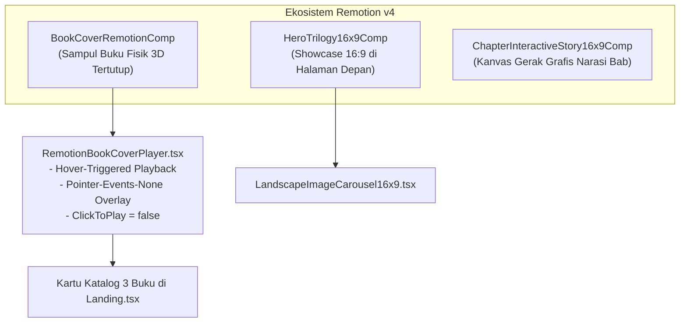

# 05. Antarmuka Web Reader & Engine Video Remotion

[← 04. Mesin Multibahasa](./04-i18n-and-multilingual-engine.md) | [📚 Indeks Utama](./00-index-and-overview.md) | [06. Commerce & Mayar →](./06-commerce-auth-and-entitlements.md)

---

Dokumen ini memaparkan arsitektur antarmuka pembaca naskah (*Web Reader*), sistem laci catatan kaki dinamis (*footnotes drawer*), sinkronisasi checklist cloud, dan integrasi grafis gerak terprogram berbasis **Remotion v4** pada platform **`crow.asia`**.

---

## 1. Tata Letak Tiga Kolom Web Reader (`ChapterView.tsx`)

Web Reader dibangun menggunakan layout kanvas penuh tiga kolom yang teroptimasi secara ergonomis (*ergonomic reading workspace*) di `resources/js/Layouts/FullWidthWorkspaceLayout.tsx`:

```text
+-----------------------------------------------------------------------------------------+
| [🦅 crow.asia] [VOL. 01: Mahir Memimpin Tim]              [Mode Baca | Animasi 16:9]   |
+---------------------+---------------------------------------------+---------------------+
| KOLOM KIRI (260px)  | KOLOM TENGAH (Maks. 740px)                  | KOLOM KANAN (240px) |
|                     |                                             |                     |
| ☰ DAFTAR BAB        | ── Bab 01: Intervensi Pertama               | DOK PENGATURAN      |
|                     |                                             |                     |
| [✓] Pendahuluan     | Tipografi: Newsreader Serif (18-20px)       | • Gaya Bahasa:      |
| [▶] Bab 1 (Aktif)   | Line-Height: 1.75 (Kenyamanan Optimal)      |   [Kasual | Standar]|
| [🔒] Bab 2          |                                             | • Tema Kertas:      |
| [🔒] Bab 3          | [:::callout Kotak Skrip Percakapan:::]      |   [Ivory|White|Dark]|
| ...                 | [📋 Salin Skrip]                            | • Ukuran Huruf:     |
| [🔒] Lampiran       |                                             |   [ A- | A | A+ ]   |
|                     | [📚 Catatan Kaki (Collapsible Drawer)]      | • Progres Baca: 15% |
|                     |                                             | • SOS Topic Search  |
+---------------------+---------------------------------------------+---------------------+
```

### A. Kolom Kiri: Navigasi Daftar Bab (*Sidebar Navigation*)
- Menampilkan seluruh 15 bab (Indeks 0 s.d. 14).
- Menandai bab aktif, status keterbukaan bab (ikon gembok `🔒` untuk bab berbayar yang belum terbeli), dan indikator centang bab yang telah selesai dibaca.
- Dapat diciutkan (*collapsible*) melalui pintasan keyboard `Ctrl + \` untuk mode membaca layar penuh (*zen mode*).

### B. Kolom Tengah: Kanvas Membaca Utama (*Reading Canvas*)
- **Tipografi Buku Fisik:** Menggunakan font serif **Newsreader** yang elegan dengan skala visual modular (*rhythmic vertical cadence*), menciptakan pengalaman membaca seperti buku cetak premium.
- **Tiga Pilihan Tema Kertas:**
  1. *Ivory Vintage* (`#FAF8F5`): Meniru tekstur kertas novel klasik, nyaman untuk membaca lama di siang hari.
  2. *Pure Studio* (`#FFFFFF`): Tampilan modern kontras tinggi untuk monitor kerja.
  3. *Dark Velvet* (`#111113`): Mode malam rendah silau untuk membaca di kondisi pencahayaan redup.

### C. Kolom Kanan: Dok Aksi & Penyetelan (*Action Dock*)
- **Pemilih Gaya Bahasa Indonesia:** Tombol radio instan untuk berpindah antara varian **Kasual (`Gue/Lo`)** dan **Standar (`Saya/Kamu`)**.
- **Pengatur Skala Teks:** Tiga pilihan ukuran font (`sm: 16px`, `base: 18px`, `lg: 20px`).
- **Indikator Progres:** Lingkaran progres keterbacaan bab berbasis scroll viewport.

---

## 2. Fitur Interaktif Web Reader

### A. Laci Catatan Kaki Interaktif (*Collapsible Footnotes Drawer*):
Untuk menjaga kemurnian alur baca tanpa gangguan teks referensi yang panjang di akhir naskah:
- Kompiler secara otomatis membungkus bagian bibliografi sitasi ke dalam elemen `<details class="crow-footnotes-drawer">` yang default-nya **tertutup**.
- Ketika pembaca mengeklik angka catatan kaki inline pada kalimat (misal: `[^1]`), script di `ChapterView.tsx` mendeteksi event klik tersebut:
  1. Membuka atribut `open` pada drawer secara otomatis.
  2. Menggulir (*smooth scroll*) layar ke posisi sitasi catatan kaki terkait.
  3. Menandai nomor catatan kaki dengan highlight emas sementara.
- Tautan balik (`↩`) di samping catatan kaki memungkinkan pembaca kembali seketika ke paragraf bacaan semula.

### B. Sinkronisasi Checklist Cloud (`/api/checklists/toggle`):
Setiap bab dilengkapi instrumen aksi kerja praktis yang dapat dicentang langsung di layar:
```typescript
const handleToggleChecklist = async (itemIndex: number, currentChecked: boolean) => {
    // 1. Optimistic UI update di klien
    setChecklistState(prev => ({ ...prev, [itemIndex]: !currentChecked }));

    // 2. Kirim update ke server secara asinkron
    await fetch('/api/checklists/toggle', {
        method: 'POST',
        headers: { 'Content-Type': 'application/json', 'X-CSRF-TOKEN': csrfToken },
        body: JSON.stringify({
            book_id: book.id,
            chapter_slug: currentChapter.slug,
            item_index: itemIndex,
            is_completed: !currentChecked,
        }),
    });
};
```
Progres centang disimpan di tabel `checklist_progress` (kolom `item_index` dan `is_completed`) dan tetap tersimpan saat pembaca membuka aplikasi dari perangkat lain.

### C. Modal Pencarian Cepat SOS Topic Search:
Pintasan tombol keyboard `Ctrl + K` (atau `Cmd + K` di macOS) memunculkan dialog pencarian darurat `SosSearchModal.tsx`. Pembaca dapat mengetikkan kata kunci kendala lapangan (contoh: *"menegur anak buah"*, *"rapat molor"*, *"staf defensif"*), dan sistem akan menampilkan cuplikan skrip dialog yang relevan dalam hitungan milidetik menggunakan indeks TsVector PostgreSQL.

---

## 3. Arsitektur Video Berbasis Kode Remotion v4

Platform `crow.asia` tidak mengandalkan video rekaman statis MP4 berukuran besar yang lambat di-buffer. Seluruh animasi diprogram secara deterministik sebagai komponen React menggunakan framework **Remotion v4** (`@remotion/player`).

### A. Tiga Komposisi Utama Remotion:



### B. Sampul Buku Tertutup 3D Beranimasi saat Hover (`BookCoverRemotionComp.tsx`):
Sampul kartu katalog di Seksi 3 didesain menyerupai buku fisik tertutup berkualitas tinggi:
- **Aspek Rasio Fisik 2:3:** Berdimensi 400x600px dengan borderless papercraft artwork (`portrait.png`).
- **Efek Punggung Buku (*Spine Crease*):** Gradien bayangan natural di sisi kiri (`linear-gradient(to right, rgba(0,0,0,0.65) 0%, rgba(0,0,0,0.25) 50%, transparent 100%)`) tanpa garis putih yang mengganggu.
- **Sudut Lengkung Realistis:** Sudut kiri punggung buku dibuat tegas (`4px`), sedangkan sudut kanan lembaran buku dibuat melengkung lembut (`16px`).
- **Ken Burns Slow Breathing:** Animasi pembesaran halus (`scale: 1.0 -> 1.04`) dan pergeseran vertikal lembut (`translateY: 0 -> -6px`) yang berulang secara mulus (*smooth loop*).
- **Sweep Kilau Cahaya Emas (*Light Sheen Sweep*):**
  ```typescript
  const sheenProgress = (frame % 90) / 90;
  const sheenX = interpolate(sheenProgress, [0, 0.5, 1], [-160, 140, 260]);
  const sheenOpacity = interpolate(sheenProgress, [0, 0.25, 0.5, 0.75, 1], [0, 0.35, 0.15, 0, 0]);
  ```
  Setiap 90 frame (3 detik pada 30 fps), seberkas kilauan cahaya emas menyapu permukaan cover dari sudut 115 derajat.
- **Trigger Hover Mulus (Tanpa Perlu Klik):**  
  Melalui wrapper `RemotionBookCoverPlayer.tsx`, properti `clickToPlay={false}` disetel dan event hover dipasang di tingkat kartu buku (`div.group`). Saat kursor mouse masuk ke area kartu mana saja, player langsung berputar secara instan.

### C. Carousel Lanskap 16:9 Hero Section (`LandscapeImageCarousel16x9.tsx`):
Menggantikan pemutar video hitam kosong tradisional dengan carousel gambar lanskap 16:9 (`landscape.jpeg`) yang responsif:
- Rotasi otomatis setiap 5 detik (*auto-advance*), otomatis berhenti saat kursor berada di atas gambar.
- Navigasi panah kiri/kanan (`44x44px` ramah layar sentuh) dan 3 tombol pil (*dot indicators*).
- Overlay gradien gelap di bawah gambar menampilkan badge volume, judul buku, dan tombol **`[📖 Baca Gratis Bab 1 →]`** yang mengarahkan pembaca langsung ke Web Reader.

---

## 4. Standar Desain Sistem & Kepatuhan Antislop (WCAG AA)

Seluruh antarmuka tunduk pada filter kualitas desain **Antislop** yang terdokumentasi dalam `AGENTS.md`:

1. **Palet Warna Resmi Tactile Crow Studio:**
   - Ink Canvas / Primary Text: `#111113`
   - Ivory Paper Background: `#FAF8F5`
   - Clean Border Line: `#E5E0D5`
   - Highlight Gold Accent: `#FFE66D`
   - Royal Blue Primary Accent: `#1D4ED8`
   - Emerald Success Accent: `#059669`
2. **Kontras Aksesibilitas WCAG AA:**  
   Rasio kontras seluruh teks utama terhadap latar belakang kertas dijamin minimal **4.5:1** (dan minimal 3:1 untuk teks besar/badge).
3. **Target Sentuh Minimum:**  
   Seluruh tombol, panah navigasi, dan checkbox memiliki ukuran area sentuh minimal **44x44 piksel** guna memastikan kenyamanan penggunaan di perangkat smartphone.
4. **Navigasi Keyboard Penuh:**  
   Setiap elemen interaktif dapat diakses melalui tombol `Tab`, `Enter`, dan `Space`, dengan cincin fokus visual tegas (`focus-visible:outline-2 focus-visible:outline-[#1D4ED8]`).

---

[← 04. Mesin Multibahasa](./04-i18n-and-multilingual-engine.md) | [📚 Indeks Utama](./00-index-and-overview.md) | [06. Commerce & Mayar →](./06-commerce-auth-and-entitlements.md)

