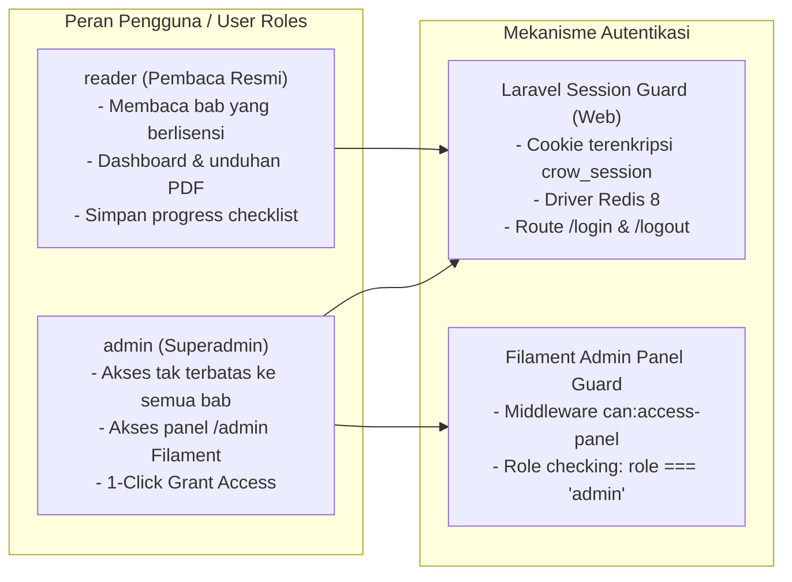
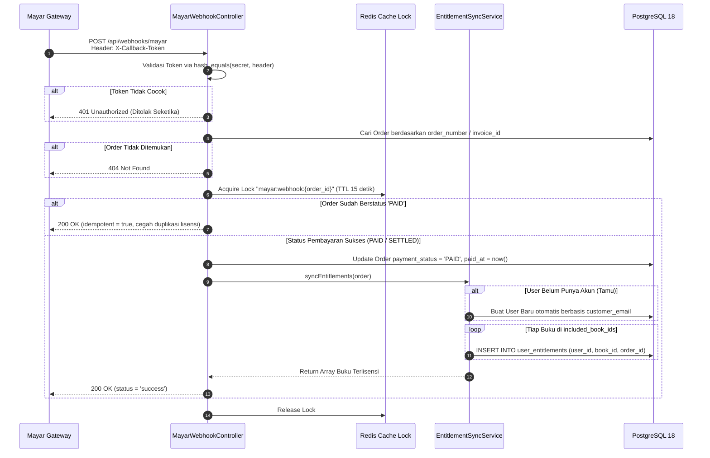

# 06. Sistem Autentikasi, Commerce & Integrasi Mayar

Dokumen ini memaparkan arsitektur autentikasi pengguna, panel superadmin Filament v5, model pembatasan akses (*paywall & content gating*), serta alur transaksi pembayaran Mayar.id dengan validasi token dan proteksi idempotensi pada platform **`crow.asia`**.

---

## 1. Arsitektur Autentikasi & Otorisasi

Sistem membedakan dua tingkatan hak akses pengguna:



### A. Autentikasi Pembaca (*Reader Auth*):
- Pengguna masuk melalui `/login` (`AuthController@login`).
- Session dikelola terpusat di Redis 8 untuk efisiensi tinggi pada arsitektur worker persistent.
- Navbar di `MarketingFullWidthLayout.tsx` secara dinamis menampilkan tombol **`Masuk`** untuk pengunjung tamu, dan tombol **`Dashboard`** jika pengguna telah terautentikasi.

### B. Panel Administrasi Superadmin Filament v5 (`/admin`):
- Hanya pengguna dengan kolom `role === 'admin'` yang diizinkan mengakses rute `/admin`. Pengguna dengan peran `reader` yang mencoba mengakses panel ini otomatis ditolak (*HTTP 403 Forbidden*).
- Resource Filament yang tersedia:
  - `BookResource`: Manajemen metadata buku dan daftar harga.
  - `ChapterResource`: Inspeksi bab terkompilasi.
  - `PricingTierResource`: Konfigurasi paket harga satuan dan bundel.
  - `OrderResource`: Pemantauan riwayat transaksi, invoice Mayar, dan status pembayaran.
  - `UserResource`: Manajemen pengguna, dilengkapi aksi **`1-Click Grant Access Playbook`** untuk memberikan lisensi instan tanpa jalur pembayaran manual.

---

## 2. Model Paywall & Content Gating

Platform menerapkan strategi *Freemium Reading Funnel* untuk memaksimalkan konversi pembaca:

```mermaid
flowchart TD
    Req[Reader membuka /read/book-1/id/ch-X] --> IndexCheck{Index Bab <= 1?}
    
    IndexCheck -->|Ya (Bab 0 & Bab 1)| AllowFree[Gratis Tanpa Syarat:<br/>- compiled_html lengkap dikirimkan<br/>- hasAccess = true<br/>- Bebas dibaca tanpa login]
    
    IndexCheck -->|Tidak (Bab 2 s.d. 13)| CheckAuth{User Login?}
    
    CheckAuth -->|Tidak| DenyMask[Akses Terkunci:<br/>- compiled_html TIDAK dikirimkan<br/>- safe_preview_html dikirimkan<br/>- hasAccess = false<br/>- Tampilkan Paywall Banner]
    
    CheckAuth -->|Ya| CheckRole{Role == 'admin'?}
    CheckRole -->|Ya| AllowFull[Admin Bypass:<br/>- Full compiled_html dikirimkan<br/>- hasAccess = true]
    
    CheckRole -->|Tidak| CheckEntitlement{user_entitlements exists<br/>WHERE user_id AND book_id?}
    CheckEntitlement -->|Ya| AllowFull
    CheckEntitlement -->|Tidak| DenyMask
```

### Keamanan Hak Cipta (*Content Masking*):
Pada bab yang terkunci, teks utuh naskah **sama sekali tidak dikirimkan ke browser**. Server hanya mengirimkan `safe_preview_html` yang berisi 2 paragraf awal dengan efek visual blur gradien, sehingga naskah berbayar tidak dapat diekstrak melalui DevTools browser.

---

## 3. Struktur Harga & Nilai Paket

Model penetapan harga bergradasi diterapkan untuk memberikan proposisi nilai (*value proposition*) yang menarik bagi pembaca:

| Nama Paket / Tier | Kode ID | Harga IDR | Harga USD | Cakupan Lisensi | Keterangan Hemat |
| :--- | :--- | :---: | :---: | :--- | :--- |
| **VOL. 01: Mahir Memimpin Tim** | `tier-book-1` | **Rp59.000** | **$4.99** | Buku 1 Penuh (Bab 2–13 + Lampiran) | Harga satuan terjangkau |
| **VOL. 02: Napas Panjang Memimpin Tim** | `tier-book-2` | **Rp79.000** | **$6.99** | Buku 2 Penuh (Bab 2–13 + Lampiran) | Menengah |
| **VOL. 03: Memimpin Para Leader** | `tier-book-3` | **Rp99.000** | **$8.99** | Buku 3 Penuh (Bab 2–13 + Lampiran) | Skala divisi / cabang |
| **Complete Trilogy Box Set** | `bundle-all-3` | **Rp149.000** | **$11.99** | **Seluruh 3 Buku Sekaligus** (Total 39 Bab + 3 Lampiran & PDF) | **Hemat Rp88.000 / $8.98** *(Harga coret Rp237.000 / $20.97)* |

---

## 4. Integrasi Payment Gateway Mayar.id

### A. Inisiasi Transaksi (`CheckoutController@process`):
1. Pengunjung mengeklik tombol beli pada tier harga (`/checkout/{tierId}`).
2. Sistem membuat record `Order` baru dengan status `PENDING` dan nomor pesanan unik format `CROW-YYYYMMDD-XXXXXX`.
3. Server memanggil API Mayar (`MayarInvoiceService`) untuk membuat tautan pembayaran (*payment link*).
4. Pengunjung dialihkan ke halaman pembayaran resmi Mayar yang mendukung QRIS instan, Virtual Account, dan Kartu Kredit.

### B. Keamanan & Idempotensi Webhook (`MayarWebhookController`):
Ketika pembayaran lunas, Mayar mengirimkan callback POST ke endpoint `/api/webhooks/mayar`.



### Fitur Kunci Webhook Handler:
1. **Constant-Time Token Verification:**  
   Pengecekan token menggunakan fungsi PHP `hash_equals()` untuk melindungi server dari serangan kebocoran waktu (*timing attacks*).
2. **Distributed Atomic Locking:**  
   Menggunakan `Cache::lock("mayar:webhook:{$order->id}", 15)` di Redis guna mencegah *race condition* jika Mayar mengirimkan webhook ganda secara paralel dalam selang waktu sepersekian milidetik.
3. **Idempotensi Sempurna:**  
   Jika webhook untuk pesanan yang sama diterima kembali (akibat retry jaringan), sistem mendeteksi bahwa pesanan sudah berstatus `PAID` dan langsung merespon `HTTP 200 OK` tanpa membuat ulang entitas hak akses (*duplicate grant prevention*).
4. **Auto-Account Creation:**  
   Bagi pembeli yang belum mendaftar, `EntitlementSyncService` secara otomatis membuatkan akun pembaca dan menautkan lisensi ke email yang digunakan saat pembayaran.
