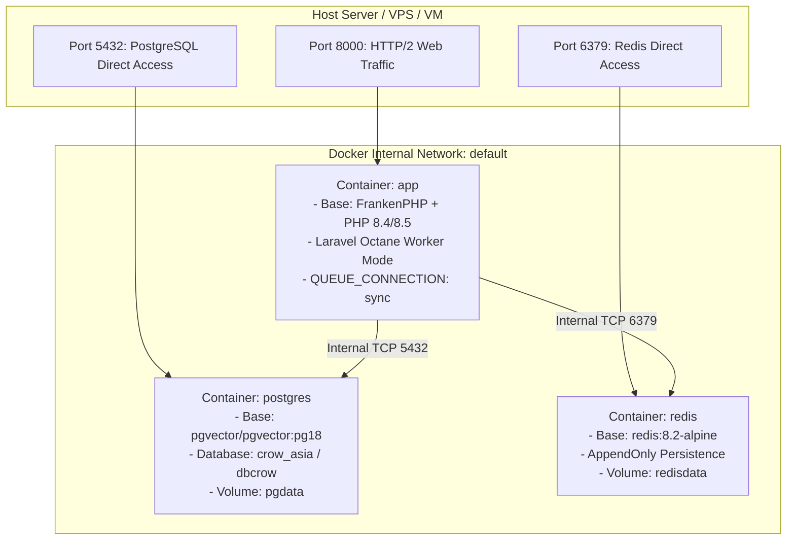

# 07. Operasional, Pengujian & Runbook Pemeliharaan

[← 06. Commerce & Mayar](./06-commerce-auth-and-entitlements.md) | [📚 Indeks Utama](./00-index-and-overview.md)

---

Dokumen ini memaparkan panduan operasional teknis, orkestrasi container Docker, referensi perintah artisan, strategi suite pengujian Pest 5, serta prosedur pemeliharaan dan pemulihan sistem (*disaster recovery*) pada platform **`crow.asia`**.

---

## 1. Topologi Infrastruktur & Orkestrasi Docker

Platform `crow.asia` diorkestrasi menggunakan arsitektur multi-container yang ramping melalui `compose.yaml`:



### A. Rincian Konfigurasi Container:
- **`app` (FrankenPHP Octane):**
  - Menggabungkan server Caddy dan worker Laravel Octane dalam satu container.
  - Tanpa antrean latar belakang terpisah: `QUEUE_CONNECTION: sync` (seluruh pekerjaan selesai seketika dalam satu siklus request).
- **`postgres` (PostgreSQL 18 + pgvector):**
  - Menggunakan image resmi `pgvector/pgvector:pg18`.
  - Dilengkapi healthcheck periodik `pg_isready -U crow -d crow_asia`.
  - Data dipersistensikan pada volume Docker `pgdata`.
- **`redis` (Redis 8.2 Alpine):**
  - Dikonfigurasi dengan mode persistensi `appendonly yes`.
  - Kebijakan alokasi memori: `maxmemory 512mb` dengan eviksi `allkeys-lru`.
  - Healthcheck periodik menggunakan perintah `redis-cli ping`.

---

## 2. Panduan Setup Lokal (*Local Development Quickstart*)

### A. Prasyarat Sistem:
- PHP `8.4+` (CLI) & Composer `2.8+`
- Node.js `20+` & npm `10+`
- Docker Engine & Docker Compose v2
- Akses ke PostgreSQL lokal (user: `crow`, password: `janganmasuk`, database: `dbcrow`)

### B. Langkah Instalasi Langkah demi Langkah:
```bash
# 1. Clone repositori
git clone https://github.com/rne-ai/crow.asia.git
cd crow.asia

# 2. Pasang dependensi PHP dan Node.js
composer install
npm install

# 3. Konfigurasi berkas lingkungan (.env)
cp .env.example .env
php artisan key:generate

# 4. Jalankan container pendukung (atau gunakan database lokal)
docker compose up -d postgres redis

# 5. Jalankan migrasi basis data
php artisan migrate

# 6. Kompilasi dan seeding naskah lengkap (135 bab terjemahan)
php artisan crow:seed-manuscripts

# 7. Kompilasi aset frontend Vite
npm run build

# 8. Jalankan development server
php artisan serve --host=127.0.0.1 --port=8000
```

Aplikasi kini dapat diakses langsung pada peramban web di `http://127.0.0.1:8000`.

---

## 3. Kredensial Pengujian Bawaan (*Default Accounts*)

Setelah proses seeding dijalankan, sistem secara otomatis menyediakan akun bawaan untuk pengujian:

| Peran Akun | Alamat Email | Password | Hak Akses Khusus |
| :--- | :--- | :--- | :--- |
| **Super Admin** | `admin@crow.asia` | `janganmasuk` | Akses penuh ke Panel Filament `/admin` & bypass seluruh bab berbayar |
| **Official Reader** | `mharryrosyan@gmail.com` | `janganmasuk` | Akses penuh membaca Buku 1, 2, dan 3 (seluruh 45 bab berlisensi) |

---

## 4. Kamus Perintah Artisan Kustom

| Perintah Artisan | Fungsi & Efek Samping | Kapan Digunakan |
| :--- | :--- | :--- |
| `php artisan crow:seed-manuscripts` | Membaca berkas di `books/`, mem-parsing AST, melakukan kompilasi HTML aman, dan meng-upsert 135 terjemahan bab serta 4 pricing tiers. | Dijalankan saat ada perubahan naskah Markdown atau saat inisialisasi awal database. |
| `php artisan optimize:clear` | Menghapus seluruh cache terkompilasi: config, cache, routes, views, blade-icons, dan filament panel. | Dijalankan setelah mengubah file `.env`, file translasi `lang/*.json`, atau konfigurasi sistem. |
| `php artisan test` / `./vendor/bin/pest` | Menjalankan seluruh rangkaian pengujian suite Pest 5. | Wajib dijalankan sebelum commit dan sebelum push ke branch utama. |

---

## 5. Strategi Pengujian Suite Pest 5

Platform `crow.asia` menerapkan disiplin *Test-Driven Development* (TDD) dengan cakupan pengujian komprehensif pada **Pest 5**:

```bash
./vendor/bin/pest
```

### Taksonomi Test Suite:
1. **Architecture & Unit Tests (`tests/Unit/`):**
   - `ArchitectureTest.php`: Memvalidasi arsitektur Laravel (tidak ada fungsi debugging `dd()` atau `dump()`, enum berada di namespace `App\Enums`).
   - `ChapterCompilerLocalizationTest.php`: Memverifikasi badge diagram alur dan catatan kaki terlokalisasi dengan benar.
   - `PricingTierLocalizationTest.php`: Memvalidasi accessor fitur JSONB multi-locale pada model tier.
2. **Commerce & Webhook Tests (`tests/Feature/MayarWebhookTest.php`):**
   - Verifikasi penolakan webhook dengan callback token yang tidak valid (*HTTP 401*).
   - Pengujian pemrosesan webhook sukses dan pemberian hak akses buku secara atomik.
   - Pengujian **idempotensi webhook**: menjamin webhook berulang tidak menduplikasi lisensi (*zero duplicate entitlement*).
3. **Reader & Paywall Tests (`tests/Feature/ReaderAccessTest.php`):**
   - Tamu (*guest*) diizinkan membaca Bab 0 dan Bab 1 gratis secara utuh.
   - Tamu yang membuka Bab 2–13 menerima `hasAccess: false` dengan konten tersamar (*safe preview*).
   - Pembaca berlisensi dan superadmin dapat membaca seluruh bab berbayar secara penuh.
   - Validasi bahwa locale non-ID secara otomatis mengunci register ke `standard`.
4. **Search & Localization Tests (`tests/Feature/SearchTest.php` & `LandingLocalizationTest.php`):**
   - Validasi pencarian teks TsVector PostgreSQL.
   - Validasi rendering landing page multibahasa (IDR untuk Indonesia, USD untuk edisi global).

---

## 6. Prosedur Pemeliharaan & Troubleshooting

### A. Daur Ulang Worker FrankenPHP (Graceful Reload):
Jika ada perubahan kode PHP pada lingkungan production tanpa mematikan container:
```bash
docker compose exec app frankenphp reload
```

### B. Mengatasi Masalah Hak Akses Storage:
Jika terjadi kendala penulisan log atau sesi pada container:
```bash
chmod -R 775 storage bootstrap/cache
chown -R www-data:www-data storage bootstrap/cache
```

### C. Backup Basis Data PostgreSQL:
```bash
# Melakukan dump cadangan data ke file terkompresi
docker compose exec -T postgres pg_dump -U crow dbcrow | gzip > backup_$(date +%Y%m%d_%H%M%S).sql.gz

# Memulihkan data dari cadangan
gunzip -c backup_YYYYMMDD_HHMMSS.sql.gz | docker compose exec -T postgres psql -U crow -d dbcrow
```

---

[← 06. Commerce & Mayar](./06-commerce-auth-and-entitlements.md) | [📚 Indeks Utama](./00-index-and-overview.md)

